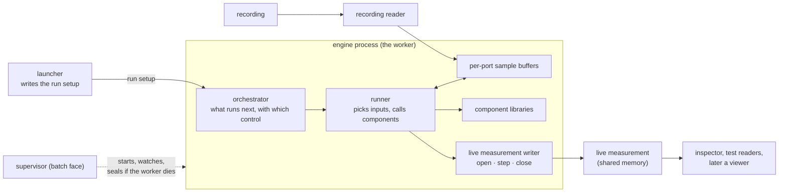

# VANTAGE — architecture

**A supporting document** (`R-REQ-17`, to be declared under `context:` in
`layers.yaml` by step 8). It says what each part of Vantage is for, what it never
does, how the six rules are kept, how work is split over threads without changing
a result, how failures are contained, and where each part lives in code. Nothing
here is a requirement and nothing here allocates a UID. The obligations are
written in step 8 against this document.

Contracts this document builds on and does not change (`D14`):
`modules/interfaces/docs/resim_contract/RCT_Architecture.md` (messages, header
rule, live measurement), `RCT_System_Requirements.md` (cited as `RCT:SYS-nnnn`),
`RCT_Implementation_Design.md` (cited as `RCT:IMP-nnnn`). Program decisions:
`VANTAGE_DEV_PLAN.md` (`D1`..`D18`, gates `G1`..`G5`). Plain-English concept with
examples: the concept page named in the plan §8.

**Equal outputs** is the term of the `RCT_System_Requirements.md` preamble. This
document uses it for every comparison of outputs and defines nothing beside it.

## 1. In plain words

Vantage re-runs some components on a recording of a drive. It gives each re-run
component exactly the input samples the car gave it, and it writes everything that
happens into one place, the **live measurement**, where any reader can look at it.

| | What | Who makes it |
|---|---|---|
| Input 1 | A recording: every port the car logged, in time order, with the car's controls and refSyncs | the car, or the lab's fake car |
| Input 2 | Component libraries: the code under test, on the generic ABI | component teams, or the lab generator |
| Input 3 | A run setup: which stages run again, how each is started, how they are wired | the launcher |
| Output | The live measurement: shared memory with the description, one `MeasCycle` per engine step, bulk frames and a status block | Vantage only |

Vantage has no viewer (`D13`); its one window is the launcher window, a thin
front over the launcher (`D21`). A command-line inspector reads the live
measurement and proves that it holds everything a viewer will need.

Two sentences carry the whole design. **Order is decided by the recording and the
wiring, never by a clock.** **Every input is chosen by the number the car wrote,
never by what happens to be in memory.**

C++ carries the run path (owner decision 2026-08-27). The parts and what stays in
Python are in §3 and §11.

## 2. Every name, its purpose and its scope

Each name has one meaning and one writer. Names of messages and fields are the
contract's (`RCT_Architecture.md` §0); they are listed here only where Vantage
reads or writes them.

### 2.1 Parts and processes

| Name | Kind | Purpose | Scope |
|---|---|---|---|
| Vantage | the program | re-runs components on a recording and writes the live measurement | one package, `adas-vantage` (`D2`) |
| launcher | part (Python) | turns a developer's choices into a run setup file and starts an engine run | before an engine run; writes only the run setup |
| orchestrator | part (C++) | decides what runs next, with which control message; keeps the six rules | one per engine process; one thread |
| runner | part (C++) | for one run: picks inputs, calls the component, collects outputs, records | one per engine process |
| sample buffer | part (C++) | holds the last samples of one port, found by number | one per port |
| live measurement writer | part (C++ library, C API) | writes the live measurement; three engine calls and the supervisor's seal call | one per engine process; the only code that writes a live measurement (`D18 (3)`) |
| live measurement inspector | part (C++ tool) | attaches, dumps and checks a live measurement | one per reader process; read-only |
| engine | part | any program that runs components and writes a live measurement | the resim engine now; others later (§3.8) |
| worker | process | the engine process that holds the runner, the components and the writer | one per engine run |
| supervisor | process | starts a worker, classifies how it ended, calls the library's seal on an abandoned live measurement | batch face and isolation only |
| face | way of starting | developer face: `simengine` started directly, no supervisor. Batch face: started under a supervisor, one process per recording | per engine run |
| isolated stage | worker | a second engine process that runs one stage, for bisecting a crash | on request |

### 2.2 Run words

| Name | Meaning | Written by | Scope |
|---|---|---|---|
| run | one start of one component: one control message in, one set of outputs out | orchestrator (starts), runner (executes) | one stage |
| engine run | the whole execution of one engine on one recording or slice: one outcome, one run id, one live measurement (`D18 (5)`) | worker | whole engine run |
| run ticket | the orchestrator's note that a run is due: stage, control message, trigger time, waited steps | orchestrator | until the run is committed |
| engine step | all processing at one simulation instant, ended by one `MeasCycle` (§7) | orchestrator | whole engine run |
| step number | count of engine steps since the engine run started, from 0 | orchestrator | whole engine run; replaces "tick" |
| simulation time | the instant of a step, integer ns; the recording's reception clock (`R-SIM-14`) or a clock source's tick | orchestrator, only | whole engine run |
| event | something that happens at an instant: a recorded sample arrives, a clock ticks, a run commits | orchestrator | one step |
| rank | 1 + the highest rank among the simulated stages a stage reads (previous-cycle edges not counted); 1 if none | orchestrator, at load | one stage |
| trigger | what starts a run of a stage: `control` (the recorded control message), a named input port, or a clock | run setup | one stage |
| clock | a period in ns that starts runs where nothing recorded does | run setup | one stage |
| previous-cycle input | an input read from the sender's last run, which breaks a loop | run setup | one input |
| selection | the samples handed to one run, with the badges they raise | runner | one run |
| counter fallback | for a named sample that is not found: the newest sample whose `measurement_counter` is not after the wanted one, by `counterDistance` (§6, `D18 (1)`) | runner | one input of one run |
| time rule | the newest sample not after the trigger time; only for a stage with no recorded refSync, or beyond the counter fallback's maximum gap (§6) | runner | one input of one run |
| readiness limit | how many steps a run may wait for a named sample; value `⊘` (`RCT:Q3`) | run setup | whole engine run |
| read-ahead | the recording is read this many steps beyond the instant being processed, so a sample or refSync logged later than the control that names it can be found | runner | whole engine run |
| jump | the engine is moved to another position in the recording; the next run of every stage is RESTART | host calls `simEngineSeek` | whole engine run |
| outcome | how the engine run ended: pass, fail, crash, timeout (`MeasStatus.outcome`) | worker (pass, fail, timeout); supervisor (crash, timeout) | whole engine run |
| seal | the writer library's `sealAbandoned`, called by the supervisor once the worker is confirmed dead: it writes `outcome` and `status` of the live measurement and nothing else (§9) | supervisor | whole engine run |

### 2.3 Run setup fields

The run setup is a JSON file, the Resolved Run Spec (`include/simcore/runspec.hpp`).
The launcher is its only writer. The engine reads it and never writes it. Keys are
snake_case, the same spelling as the structs. `new` marks a key this design adds,
`changed` a key whose meaning changes, `gone` a key that no longer exists.

| Key | State | Means |
|---|---|---|
| `schema`, `run_id`, `spec_sha256` | kept | identity of the setup; `schema` moves to a new version string. `run_id` is the setup's id and is not the engine run's `runId` |
| `sources[]` (`path`, `sha256`, `codec`, `ingest`, `absent`) | kept | the recording and its ingest map (`R-SIM-23`) |
| `stages[].name`, `mode`, `impl`, `abi_version`, `config_bundle_sha256` | kept | as in `R-SIM-10`; become `MeasStage.name`, `mode`, `impl` |
| `stages[].trigger` | new | `control`, an input port name, or empty when a clock starts the stage |
| `stages[].clock_period_ns` | changed | was `period_ns`, the grid period; now the period of the clock that starts a stage with no recorded trigger; 0 when none |
| `stages[].ports[]` (`name`, `dir`, `kind`, `proto_type`, `record`, `fixed_slots`) | kept | declared ports; `record` is `full`, `excluded` or `decimate:<n>` (`R-SIM-6`) |
| `stages[].ports[].bulk` | new | the port's values go to `MeasBulk` (`RCT:SYS-0029`); the component manifest has no such flag |
| `stages[].ports[].buffer_depth` | new | samples kept for this port; value `⊘` |
| `stages[].ports[].sampling`, `on_missing` | gone | unbuilt policies of the grid design; input selection (§6) is the only policy. Refused at load if present, never read and ignored (`D18 (4)`) |
| `stages[].inputs[]` (`port`, `producer`, `producer_port`) | kept | the wiring |
| `stages[].inputs[].previous_cycle` | new | true for a previous-cycle input; replaces `delay_steps` |
| `stages[].inputs[].delay_steps` | gone | a delay counted in grid steps has no meaning when steps are events |
| `mutations[]` | kept | the declared overrides (`R-SIM-15`); become `MeasOverride` |
| `outputs.path`, `outputs.codec` | kept | the recording this engine run writes, if any |
| `outputs.livemeas` | new | name and geometry of the live measurement: `name`, `cycle_slot_count`, `cycle_slot_size`, `bulk_slot_count`, `bulk_slot_size` (`RCT:Q1`, `RCT:Q2`, values `⊘`). Absent: no live measurement |
| `readiness_limit_steps` | new | the readiness limit; value `⊘`; becomes `MeasDescription.readiness_limit_steps` |
| `fallback_max_gap` | new | the counter fallback's maximum gap, in counter steps by `counterDistance`; value `⊘` (`D18 (1)`) |
| `checkpoint.path`, `limits.exec_timeout_ms`, `limits.severity_exit` | kept | as today |
| `coherence_verdict` | kept | the launcher's own classification, recorded |
| `grid_step_ns`, `order` | gone | no grid; the order is derived at load (§5) |

Two engine options are not in the setup because they must not change a result:
`--threads N` (default 1, §8) and `--wait-for-attach`.

### 2.4 Names Vantage reads or writes from the contract

| Name | Vantage's use |
|---|---|
| `control` (input port of each simulated stage) | written by the orchestrator, from the recorded control when the recording has one (§3.2) |
| `refSync` (output port) | the recorded one of a stage selects its inputs; the re-run's own is recorded like any output and never used for selection |
| `compState` (output port) | recorded and shown; never read to decide anything (`RCT:SYS-0012`) |
| `measurement_counter`, `source_timestamp_us`, `cycle_counter`, `sig_status` | read from the `sig_header` of every sample at the door of a sample buffer |
| `MeasStatus`, `MeasDescription`, `MeasCycle`, `MeasBulk` | written by the live measurement writer; read by the inspector |
| `MeasBadge` kinds | raised by the orchestrator and runner (§6) |

## 3. The parts

### 3.1 Launcher (Python)

*Does.* Reads the developer's choices: recording, project, which stages are
`simulate`, `measured` or `off`, which implementation each uses, overrides.
Probes the recording's topic index to see which cuts are feasible and whether a
stage has a recorded `control` and `refSync`. Fills `trigger`, `previous_cycle`
and the `⊘` values. Writes the run setup. Starts `simengine` (directly, or under a
supervisor). Prints the exit code's meaning.

*Never.* Runs a component. Decides anything during an engine run. Starts an engine
run from anything but a file it has just written (no code path from an in-memory
selection to an engine run). Is the authority on the six rules: it may warn early,
but the engine refuses a bad setup on its own.

*Reads.* The recording's index, the component libraries' file names, project
configuration. *Writes.* The run setup, one process, one exit code.

*Why Python.* The run setup is text authored from YAML, includes and project
files. The engine never reads YAML (`D-1`, `DD-02`). A C++ launcher would be a
second implementation of that grammar with no new behaviour. Moving it later
changes nothing else, because the run setup is the only seam.

### 3.2 Orchestrator (C++)

*Does.* Builds the dependency graph and ranks from the wiring and refuses loops
(rules 1, 2). Resolves how every simulated stage is started (rule 3). Orders
events by (simulation time, rank, stage declaration order, arrival order). Creates
a run ticket for each trigger. Writes the control message. Replaying a recorded
control, it copies the recorded `measurement_counter` and `source_timestamp_us`,
writes its own `cycle_counter` and sticker OK, sets RESTART for the first run of a
stage and after a jump, and otherwise passes the recorded `op_mode` (`D17`). A control from a trigger sample or
a clock takes its header from the trigger, with RESTART or RUN by the same rule.
Counts each stage's runs. Keeps each stage's runs strictly in order
(rule 5). Parks a ticket whose named sample does not exist yet and counts the
steps it waits (rule 6). Ends the step.

*Never.* Calls a component. Changes the bytes of any sample (it creates only
control messages). Reads a wall clock, a thread id or an execution time to decide
anything. Writes into a component's outputs. Reads `compState` (`RCT:SYS-0012`).
Starts a component on its own account: every run has a recorded control, a
trigger sample or a clock tick behind it.

*Reads.* The run setup, the headers of samples (through the sample buffers), the
runner's commit reports. *Writes.* Run tickets, control messages, badge counts,
and the event log (with the counts of gaps, resets and stalled triggers, §6).

### 3.3 Runner (C++)

*Does.* Owns the one step loop (`StepOnce`). For a ticket: selects the inputs
(refSync first, then the counter fallback or the time rule), applies declared
overrides, builds the port set with the control message, calls the component under
the exec timeout, collects the outputs, checks that each output copies the run's
measurement counter (a difference goes to the event log, rule 3), and reports the
result for commit. Reads the recording ahead. Compares
simulated outputs with the recorded ones for the first divergence. Hands the
step's values to the recording writer, the checkpoint and the live measurement
writer.

*Never.* Decides when a run happens or in which order. Changes `op_mode`. Retries a
failed run. Keeps a sample the orchestrator did not commit. Calls two stages of
one library at the same time (§8).

*Reads.* Tickets, sample buffers, the recording, component manifests. *Writes.*
Component inputs, committed samples, the recording, the checkpoint, the writer's
step.

### 3.4 Per-port sample buffers (C++)

*Does.* Keep the last `buffer_depth` samples of one port, each with its header
(four fields), its simulation arrival time, its origin and its payload. Find a
sample by `measurement_counter`, find the newest sample whose counter is not after a
given one (by `counterDistance`), find the newest sample not after a time, give the
newest sample (the held value shown in the live measurement, with its age). Read the
header of every sample as it enters, and check identity: it tells a counter reset
from identity broken by the `counterDistance` of both counters, as `D17 (3)` defines
them. Identity broken raises `KIND_IDENTITY_BROKEN`; gaps and resets are counted in
the event log (§6).

*Never.* Interpret a payload beyond its `sig_header`. Block a writer. Grow beyond
`buffer_depth`. Compare counters with `>` (distance with wrap-around only,
`RCT:SYS-0005`).

*Reads.* Samples from the reader and from commits. *Writes.* Nothing outside
itself.

### 3.5 Live measurement writer (C++ library, plain-C API)

Described in §10.

### 3.6 Live measurement inspector (C++ tool)

Described in §10.

### 3.7 Supervisor (C++, inside `simengine`)

*Does.* Starts the worker, which is `simengine` itself with a worker flag. Waits
under a deadline. Classifies the end: ok, fail (clean non-zero exit), crash
(abnormal end), timeout (killed at the deadline), failed to start. Attaches to
the live measurement while the worker runs and calls the library's seal when the
worker is confirmed dead (§9). Writes the attempt manifest and the crash reproducer. Returns the closed
exit code set.

*Never.* Executes a component or a step. Turns a clean failure into a pass by
retrying. Writes into the live measurement itself: its one write is the library's
seal call, after the worker is confirmed dead.

### 3.8 Engines

The **resim engine** is `simengine` on a recording. Other engines (a CARLA bridge, a
CarMaker plug-in) come later (`C3`). They do not link the engine library. They
call the writer's three C calls and nothing else of Vantage. Their output is the
same live measurement, so the inspector and any viewer need no engine-specific
code.

## 4. The run setup

*What it holds.* Stages with `mode` and `impl`; the wiring; for each stage its
trigger or clock; the previous-cycle inputs; the readiness limit; overrides; the
record policy of each port; the `bulk` flag and `buffer_depth` of each port; the
live measurement name and geometry; the recording and its ingest map. §2.3 lists
every key.

*Who writes it.* The launcher, only. The lab's generator writes a setup the same
way for tests.

*Explicit, never guessed.* The engine never picks a trigger. A simulated stage whose
`trigger` is `control` must find `<stage>.control` in the recording's topic index at
load. A stage with an input trigger must name an input it declares. A stage with a
clock must have a period above 0. Anything else is a load error naming the stage
and what was expected (`N-8`).

*Thresholds nobody supplied are `⊘`.* The engine has no default for any of them. A
setup missing one is refused at load, naming the key. The lab's design (step 7)
supplies provisional values for its tests, marked as provisional.

| Value | Where | Why `⊘` | How it is fixed |
|---|---|---|---|
| `readiness_limit_steps` | setup | `RCT:Q3`: nobody has supplied it | measure the largest wait the lab's catalogue needs, plus the car recordings once they exist |
| `fallback_max_gap` | setup | nobody has supplied it | the lab design gives a provisional value; then the largest gap the lab catalogue and the first car recordings need |
| `buffer_depth` | each port | the deepest backward look is set by the slowest consumer and the previous-cycle edges | the smallest depth with no eviction miss over the lab catalogue; misses are counted |
| slot size and ring depth, `MeasCycle` | `outputs.livemeas` | `RCT:Q1` | measure the largest step the lab produces |
| slot size and ring depth, `MeasBulk` | `outputs.livemeas` | `RCT:Q2` | after the first camera source exists |

*Mapping onto `MeasDescription`.*

| `MeasStage` field | From |
|---|---|
| `name`, `mode`, `impl` | `stages[].name`, `mode`, `impl.kind` + `impl.path` |
| `build_id` | the loaded manifest's `build_id`; empty for a stage that is not loaded (`R-SIM-25`: unknown, never a guess) |
| `trigger` | `stages[].trigger` |
| `clock_period_ns` | `stages[].clock_period_ns` |
| `previous_cycle_inputs` | the `port` of each input with `previous_cycle` |

`MeasDescription.stages`, `ports`, `bundles` (config only, from
`config_bundle_sha256`) and `overrides` (from `mutations[]`, the address, verb and
argument) come from the same file. `descriptor_set` is the union of every
manifest's descriptor set and the recording's topic schemas. `recording` is the
recording's name. The readiness limit maps to `MeasDescription.readiness_limit_steps`
(field 7). The buffer depths, the record policies, overrides' time windows and the
declared faults have no field in `MeasDescription`; they are reported in the
engine's event log.

## 5. The six rules

Each rule is kept in the place named. A load-time rule is checked once, before the
first step, and a violation stops the engine run with a named error. A run-time rule is
kept on every run.

| # | Rule | Why it exists | Without it | Kept at | By |
|---|---|---|---|---|---|
| 1 | The graph is built from the wiring; a producer runs before its consumer inside one instant | the order of runs at one instant must be the same every time | a consumer reads its producer's previous sample, or the result depends on declaration order | load: ranks computed; run: runs of one instant go in rank order | orchestrator |
| 2 | A loop needs one declared previous-cycle edge | inside one instant nobody can go first | a deadlock, or a silent guess about who goes first | load: a loop through edges not marked `previous_cycle` is a load error that names the loop | orchestrator |
| 3 | One run per trigger, with a control message; every output copies the control's counter and time | the car's run starts are the only timing there is | the PC invents timing, or a producer renumbers and every match downstream fails (31 of 31 in the model) | run: a ticket per recorded control, trigger sample or clock tick; each output's `measurement_counter` is checked against the control's; a difference is a `RCT:SYS-0001` break by the component under test, written to the event log (stage, port, step), and the engine run goes on (`D18 (2)`) | orchestrator (starts), runner (checks) |
| 4 | Inputs are chosen by refSync; without one, by the counter fallback when a named sample is not found, or by the time rule when the stage has no recorded refSync; both badged | one different sample gives a different output, and memory makes it last | the PC takes "whatever is newest" and differs from the car | run | runner |
| 5 | A stage's runs go strictly in order | run 7 must not start before run 6 is committed, even if run 6 waits | a stage with memory sees its runs out of order | run: one queue per stage; the next ticket of a stage is not dispatched while an earlier one is open | orchestrator |
| 6 | Readiness: a run waits, in event order, for a named sample that does not exist yet, up to the limit | the car's consumer may have read a sample made after its trigger | wrong in 15 of 15 late-consumer runs in the model | run: parked ticket, steps counted; limit passed: counter fallback, raise `KIND_READINESS_TIMEOUT` | orchestrator (waits), runner (selects) |

How each is checked at load:

- *Rank and loops* (rules 1, 2). Edges are the wiring from a `simulate` producer to
  a `simulate` consumer. A `measured`, `off` or `source` producer adds no edge, so it
  gives no rank. An edge marked `previous_cycle` adds no edge to the graph. A stage
  that reads its own output must mark that input `previous_cycle`, or it is a
  loop of one.
- *Starting* (rule 3). Every `simulate` stage has exactly one of: a recorded
  `control`, a trigger input, a clock.
- *Limit* (rule 6). `readiness_limit_steps` is an integer, 0 meaning a run never waits.
A setup without it is refused at load.

*A `measured` stage between two `simulate` stages* is allowed. The upstream stage
then computes into nothing on that path, and the orchestrator raises
`KIND_COMPUTED_NOT_CONSUMED` on it: a `simulate` stage with at least one declared
consumer, none of which is `simulate`. A stage nobody consumes at all is the end of a
chain and is not badged.

## 6. Input selection

One function, `SelectInputs`, runs when a ticket is dispatched. It is called for
every declared data input of the stage, in manifest order, and builds the port set
the component receives. The control message is added to it. Nothing else is.

1. **By refSync.** The runner takes the *recorded* `refSync` of the stage whose
   `measurement_counter` equals the control's. The sample whose
   `measurement_counter` equals the entry for that input is handed over. The search
   goes through the arrived samples, then through the read-ahead (the car may have
   logged a sample later than the control that names it). Matching is by
   `measurement_counter` only.
2. **Entry is 0.** The car read nothing for that input. The component gets an empty
   input with unknown origin. No badge.
3. **Counter fallback.** The entry names a sample and none is found. The runner takes
   the newest sample on the port whose `measurement_counter` is not after the wanted
   one, by `counterDistance` (`D18 (1)`). It searches every sample in the port's
   buffer, read-ahead included: a sample whose counter is not after the wanted one was
   made before it, so the counter keeps the choice causal even if it was logged late.
   Beyond `fallback_max_gap` the counter fallback takes nothing and the time rule picks
   the sample (`D18 (1)`); the event log records stage, port, wanted counter, found
   counter and gap.
4. **Time rule.** Only for a stage with no recorded refSync, or beyond the maximum
   gap (step 3). The newest arrived
   sample on the port whose `source_timestamp_us` is not after the trigger's. If
   either time is 0 (unknown), the newest sample that arrived at or before this
   instant. The time rule never looks into the read-ahead. For both fallbacks, a
   previous-cycle input takes only samples committed in an earlier step, so a producer
   that ran earlier at the same instant is never seen.
5. **Waiting.** If the entry names a sample from a `simulate` producer that is not
   committed yet, the runner reports *not ready* and the orchestrator parks the
   ticket. For a recorded sample the runner reads ahead instead, as far as the
   readiness limit, in steps.

| Outcome | Raised (kind, on) | Counted |
|---|---|---|
| matched by refSync | none | — |
| entry 0 | none | — |
| entry names a sample, none found (not in the recording, evicted, or never made) | `KIND_FALLBACK` on the port, counter fallback used | per engine run |
| the counter fallback's best sample is beyond `fallback_max_gap` | `KIND_FALLBACK` on the port, time rule used, event log entry | per engine run |
| the stage has no recorded refSync at all | `KIND_FALLBACK` on every input, every run, time rule used | per engine run |
| waited the limit and the sample did not come | `KIND_READINESS_TIMEOUT` on the port, then the counter fallback is used and `KIND_FALLBACK` is raised too | per engine run |
| the counter fallback finds no sample (none with a counter not after the wanted one) | the input is empty and `KIND_FALLBACK` is raised | per engine run |
| the time rule finds no sample | the input is empty and `KIND_FALLBACK` is raised | per engine run |
| the stage's first run after the start or a jump is not at the recording's start, and the recording holds the stage's outputs | `KIND_WARMING_UP` on the stage, until its outputs first equal the recorded outputs, compared as in §7 *Where equal outputs apply* | per engine run |
| identity broken as `D17 (3)` defines it | `KIND_IDENTITY_BROKEN` on the port | per sample |
| a simulated stage with consumers, none of them simulated | `KIND_COMPUTED_NOT_CONSUMED` on the stage | once |

`KIND_FALLBACK` is the only kind for "not matched to car inputs", whether one port
missed or the whole stage has no refSync; the badge's subject tells which. The
end of the recording forces every open ticket to run at the last instant with the
readiness outcome above.

A counter gap, a counter reset and a stalled trigger have no badge kind. They are
counted in the engine's event log, and a badge kind is added only when a reader
needs one (`D17 (3)`).

## 7. The engine step

*What one step is.* All processing at one simulation instant T:

1. T is the earliest of: the next recorded message in the stream, the next clock tick.
2. Every recorded message at T enters its sample buffer, in file order. A recorded
   control, or a new `measurement_counter` on a trigger input, creates a ticket. A
   clock tick creates a ticket.
3. Tickets are dispatched by rank, lowest first. A ticket is dispatched when its
   stage has no earlier open ticket (rule 5) and `SelectInputs` finds every named
   sample (rule 6); otherwise it is parked.
4. When a rank's runs are committed, their outputs enter the buffers and may create
   tickets (a consumer triggered by this output), which join the next ranks of the
   same step. A step ends when no ticket is dispatchable. Loops cannot make this
   endless: every loop has a previous-cycle edge (rule 2).
5. The step's values go to the recording, the checkpoint and the live measurement
   writer, one `MeasCycle`.

A parked ticket runs in the step in which the sample it waits for is committed. So a
run can happen at an instant after its trigger's; its control header keeps the
trigger's time. The step's time is the instant of processing.

*What "tick" now means.* Nothing. The word is retired. The step number takes its
place everywhere. A step exists for every instant at which any event is processed,
including instants at which only measured samples arrive, so a reader sees every
recorded value at its own instant.

*Rejected:* a step per run, which would split two runs of one instant into two
`MeasCycle`s and let a reader see one stage's output without the other's of the
same instant.

*Jump.* A host calls `simEngineSeek`. Buffers and open tickets are emptied, the
reader seeks, every stage's next run is RESTART. `simEngineSeek` keeps the live
measurement writer open: `MeasStatus.runId` does not change (one `runId` per engine
run) and step numbers continue. There is no state to restore (`RCT:P1`), so
components warm up, and `KIND_WARMING_UP` is raised on a stage only when the
recording holds the stage's outputs. The slice start of a batch engine run is a jump
before the first step.

*Where equal outputs apply.* The divergence latch compares each simulated data
output and `compState` with the recording's. It zeroes both headers'
`cycle_counter` first, and it does not compare RESTART runs. Only a RUN run can
diverge (`RCT:SYS-0016`). A re-run's `refSync` is compared only on each entry's
`measurement_counter` and `source_timestamp_us`; its other header fields are not
compared. A divergence is information; it does not make the engine run fail.

*Existing features that index by tick and take the step instead.* Each keeps its
logic. Only the key and its source change.

| Feature | Where today | Takes |
|---|---|---|
| Scheduler clock | `src/simcore/scheduler/due.cpp` `Scheduler::Advance`, `tick_index`, `now_ns` | the orchestrator's step number and simulation time |
| Due test and reconcile | `scheduler/due.cpp` `IsDue`; `scheduler/reconcile.cpp` `ReconcileModuleFlag` | nothing: a run exists only for a ticket. A component that does not set `updated` on a port produces no sample for it |
| Schedule dump | `scheduler/dump.cpp` `PredictSchedule`, `ScheduleDumpText`, `horizon_ticks` | a plan of ranks, triggers and clocks from the setup alone, and the first N steps when a recording is given; the schedule can no longer be predicted from the setup alone |
| Record decimation | `runner/cycle_loop.cpp` `RecordPolicy::WritesAt(tick_index)` | the step number |
| Run outcome | `RunOutcome::cycles_executed` | `steps_executed` |
| First divergence | `runner/divergence.cpp` `Divergence::tick_index`, `DivergenceLatch::Observe`, `InformationalOnly`, `kDefaultGraceTicks` | step number; grace counted in steps |
| Checkpoint | `runner/checkpoint.cpp` `CheckpointRecord::tick_index`, `RecordCompleted`, `RecordDivergence`; the `progress.json` key | step number; the file key is renamed in step with its Python readers (`orchestrate/progress.py`, `orchestrate/reopen.py`) |
| Breakpoints | `diagnostics/breakpoints.cpp` `CheckCycle(condition, tick_index)` | step number |
| Cycle trace | `diagnostics/trace.cpp` `CycleTrace`, `CycleTraceEntry::tick_index`, `CycleOutcome` | one entry per run, keyed by step; "held" is a property of a port value in the live measurement, not of a stage |
| Crash reproducer | `diagnostics/reproducer.cpp` `ReproducerInput::failing_cycle` | step number |
| Player transport publish | `runner.hpp` `SetTransportPublisher`; `transport/*.cpp` `Publish(tickIndex, …)` | replaced by the live measurement writer's step |
| Engine ABI | `abi/simcore.h` `simEngineStepOnce` | one engine step; the function keeps its name |
| Python cycle model | `adas_sim/session/tick.py`, `io/cycles.py`, `graph/grid.py` | not carried as a run path (§3, §11) |

## 8. Threads

*What may run side by side.* Runs of stages of the same rank, in the same step, that
have no wiring between them. Nothing else. The orchestrator thread makes every
decision, reads every header and commits every result. A worker thread does one
thing: call `Component::Exec` on inputs that were fixed before it started.
Parallelism never crosses a step: a barrier follows every rank.

*Why the result is the same on one thread and on many (gate G3).* Five facts, each
checkable:

1. The order of events is (time, rank, stage declaration order, arrival order).
   None of the four depends on which thread is faster.
2. The inputs of a run are chosen by number on the orchestrator's thread and copied
   into the ticket before dispatch. A worker never reads a buffer.
3. Results are committed in stage declaration order within a rank, not in the order
   threads finish. Buffers, badges, the recording and the live measurement see one
   order.
4. A worker thread owns its component exclusively for the call, its input copy and
   its output buffers. Components share nothing with each other.
5. Overrides, the divergence latch, the checkpoint, the byte counter, the trace and
   the writer run on the orchestrator's thread only.

The comparison of a one-thread engine run with an N-thread engine run is a
comparison of equal outputs of every port of every step. Because all five facts also
hold in one thread, the two engine runs are in fact byte-identical; equal outputs is
still the term the test uses.

*What is never shared between threads.* A sample buffer. A `Component`. Two stages
loaded from the same library path: they share the library's global state, so they
never run at the same time. The mutator's hold state (`mutate::Mutator::ApplyTo`
keeps mutable counters). The writer's cursor and slots. The event queue.

*Order of work.* One thread first (`--threads 1`, the default). Measure where the
time goes (`diagnostics/cost.cpp`). Parallel ranks second. Reading the recording on
its own thread is parked (§14).

## 9. Failures

Three outcomes are never merged: **fail** (the engine run stopped itself and said why),
**crash** (the process ended without saying), **timeout** (a call or the engine run
took longer than its limit). They send different people to look (`R-SIM-19`).

*Which process holds what.* The **worker** holds the runner, every simulated
component and the live measurement writer. It is one process. The writer is never in
another process: the writer needs every port value of every step, and moving them
across a process boundary would add a second transport to every engine run. Recording and
writing happen where the values already are.

*Two faces and the isolated stage.*

| Face | Processes | What a component crash does |
|---|---|---|
| Developer | one: `simengine` started directly, debugger attachable (`--wait-for-attach`) | the process dies with its stack. Nobody can write an outcome. A reader sees the heartbeat stop, `status` still *running* and `writerPid` gone, and reports "writer gone at step N" |
| Batch | a supervisor and, per recording, one worker | the supervisor survives and seals the live measurement |
| Isolated stage | the engine that asked, and a second engine process for one stage (`RunIsolatedStage`) | the asking engine survives and treats the child as the batch face does |

*Who writes each `MeasStatus.outcome` value.*

| Value | Written by | When |
|---|---|---|
| pass | the worker, in `liveMeasClose` | the engine run reached the end of the recording or the end of the slice |
| fail | the worker, in `liveMeasClose` | the engine run stopped itself on an error: bad setup after the live measurement opened, a component error, an unreadable input |
| timeout (a call) | the worker, in `liveMeasClose` | a component call exceeded `limits.exec_timeout_ms`; the worker stops the engine run and closes normally |
| timeout (the engine run) | the supervisor, by seal | the worker did not finish before the supervisor's deadline and was killed |
| crash | the supervisor, by seal | the worker ended abnormally |
| none yet (0) | nobody | the developer face after a crash; also an engine run still going |

*The seal.* The supervisor attaches read-write to the live measurement as soon as its
magic is valid, inside its normal wait loop, and keeps the mapping. The mapping
keeps the memory alive on a system where a named region disappears with its last
handle. The live measurement is written only by the writer library
(`RCT_Architecture.md` §7). When the worker has ended and `writerPid` is confirmed
gone, the supervisor calls the library's seal, `sealAbandoned` (§10.1), which writes
`outcome`, then `status = finished`. Nothing else, and never a slot. The worker is
dead, so the live measurement still has one writer at a time. A reader never writes
(`RCT:SYS-0027`): it reports a dead writer, it does not seal.

*Divergence from the recording is not a failure.* Re-running new code is the use of
the tool. It is reported as the first divergence (step, stage, port) and flagged
informational.

*Contained failures, whichever face.* A component that reports `ERROR` changes
nothing in the orchestrator (`RCT:SYS-0012`). A missing sample is a fallback with a
badge. A live measurement that cannot be created gives one warning and the engine run
goes on without it. A second engine with the same name gets an error and runs on without
a live measurement. A quarantined component (one already crashed or hung inside a
call) is not called again in the same process.

*Which crashed stage.* The supervisor's attempt manifest and reproducer name the
stage. The live measurement does not; `MeasBadge` has no such kind (open question
5).

## 10. The live measurement writer and the inspector

### 10.1 Writer: three calls

Plain C, declared in `include/vantage/livemeas_writer.h`. Every engine uses these
three and nothing else. Each returns an error code; none throws, aborts or waits.
Every problem is a code and a warning, so the writer can never stop the engine.

| Call | Does |
|---|---|
| `liveMeasOpen(name, geometry, description, length, &handle)` | Creates the data and bulk segments. If a segment of that name exists and its `writerPid` is alive: error, the engine runs on without a live measurement. If it exists and the writer is dead: replaces it. Writes `MeasStatus` with a new random `runId`, writes the serialized `MeasDescription`, then sets `status` running (`RCT:IMP-0034`) |
| `liveMeasStep(handle, step, simTimeNs, values, nValues, badges, nBadges)` | Builds one `MeasCycle` from plain structs, writes it into the next slot between `beginSlot` and `endSlot`, then adds 1 to `heartbeat`. A bulk port goes to `MeasBulk` first and the value carries the `MeasBulkRef`. A payload that does not fit is marked `omitted`; if the step still does not fit, `droppedCycles` rises. No lock, no wait, no reader state (`RCT:IMP-0035`, `IMP-0036`, `IMP-0037`) |
| `liveMeasClose(handle, outcome)` | Sets `outcome`, then `status = finished`. Removes the name so no new reader attaches; readers already attached keep reading |

The inputs are plain structs (port index, payload pointer and length, origin, age,
bulk flag; badge kind, subject, count). The library serializes the `MeasCycle`, so an
engine written in C needs no protobuf. The description is passed as serialized
bytes. The resim engine builds it with the generated classes; a C engine receives it
pre-built (`C3`).

The supervisor's seal is not a fourth engine call. It is a C++ function in the same
library, `sealAbandoned(name, outcome)`, declared in `include/vantage/livemeas_seal.hpp`,
used only by the supervisor.

### 10.2 Which package ships the writer, and why

The writer is a library of `adas-vantage`, as the Conan component `livemeas`.

- **Not `interfaces`.** `interfaces` holds schemas and headers (`R-IFACE-1`). The writer is
  code with behaviour: platform shared-memory calls and the protobuf runtime. Every
  consumer of `interfaces` would pay for both.
- **Not in `simcore`.** An engine that is not the resim engine must be able to use
  the writer without linking the engine, the recording codecs and the component
  host. The writer is its own target.
- **The reader side is already shared.** The layout, `beginSlot`, `endSlot`,
  `tryCopySlot` and `checkAttach` are in `interfaces`
  (`cpp/livemeas/livemeas_layout.hpp`), so a reader needs only `interfaces`. Writer
  and reader cannot disagree about the layout: there is one definition
  (`RCT:SYS-0036`).
- **First form is a static library.** The shared form, for engines that are not C++,
  waits for the first such engine (§14).

### 10.3 Inspector: attach, dump, check

A command-line tool, `vantage-inspect`, in `adas-vantage`. It links the layout header,
the protobuf runtime and the recording reader, and no component host. It never needs
generated bindings or a checkout (`R-SIM-11`).

| Verb | Does | Rows |
|---|---|---|
| `attach` | Maps both segments read-only. Calls `checkAttach`. On a layout mismatch, exits naming both versions and reads nothing. Prints status, run id, heartbeat, outcome, geometry. States "writer gone" when the heartbeat has stopped, `status` is running and the pid is dead | `RCT:IMP-0038`, `RCT:SYS-0027`, `RCT:SYS-0030` |
| `dump` | Reads every `MeasCycle` with `tryCopySlot`; a torn copy is discarded and read again. Decodes every port with dynamic messages built from `descriptor_set`. Prints one line per port value. `--follow` keeps its own cursor and reports "N steps skipped" when the writer has lapped it | `RCT:IMP-0039`, `RCT:SYS-0023`, `RCT:SYS-0025` |
| `check` | Reads the whole live measurement and verifies it against the description and, with `--recording`, against the recording: every declared port has a value (or is marked omitted) at every step; step numbers are consecutive; control, refSync and compState of every simulated stage are present for every run; each measured value equals the recording's value at its step; badges and counts are monotone. Exits with the closed exit code set | `RCT:SYS-0023`, `RCT:SYS-0024`, `RCT:SYS-0029`, `RCT:SYS-0031` |

*How it serves gate G4.* G4 asks that for every lab topology the inspector finds
every live-measurement item in it and that every failure drill passes with test
readers and no viewer. `check` is the "finds every item" test: it enumerates items
from the description, not from a list kept beside it. The drills are driven by
test readers built on the same layout header (a stalled reader, a stress writer, a
reader of another layout version, a killed writer, a killed reader, a second engine
with the same name, an oversize port), and `attach`, `dump` and `check` are the
readers that report the outcome. A viewer later adds nothing to what the drills
need.

## 11. Code layout

One package, `adas-vantage` (`D2`). Paths are relative to `modules/vantage`.
**(E)** marks a file that exists today and is where the part starts. **(N)** marks a
new file. A path is a promise: the code goes there under that name. Test files are
named by step 8.

New directories: `src/livemeas/`, `include/vantage/`, `src/inspector/`,
`src/simcore/orchestrator/`, `src/adas_sim/scenario/`. Two build entries are added to `conf/build.yml`: the
`livemeas` component and the `vantage-inspect` executable, both in the standard
recipe.

| Part | Starts from / file | Main symbols |
|---|---|---|
| Launcher | `src/adas_sim/launcher/model.py` (E), `src/adas_sim/launcher/write.py` (E), `src/adas_sim/launcher/classify.py` (E), `src/adas_sim/launcher/cuts.py` (E), `src/adas_sim/launcher/availability.py` (E) | `Selection`, `to_run_config`, `launch`, `cuts_for_recording` |
| Run setup writer | `src/adas_sim/runspec/emit.py` (E), `src/adas_sim/runspec/schema/run_spec.schema.json` (E), `src/adas_sim/graph/pipeline.py` (E) | `emit_run_spec` writes `trigger`, `clock_period_ns`, `previous_cycle`, `bulk`, `buffer_depth`, `outputs.livemeas`, `readiness_limit_steps`; stops writing `grid_step_ns`, `order`, `delay_steps` |
| Engine start from Python | `src/adas_sim/engine/bridge.py` (E) | passes `--supervise` and reads the exit code |
| Launcher window (`D21`) | — | `src/adas_sim/launcher/window.py` (N): `LauncherWindow`, on Python's standard-library toolkit; every action is a launcher-model call |
| Scenario to recording (`D22`) | — | `src/adas_sim/scenario/record.py` (N): `record_scenario`, the `sim record` verb; builds messages from a scenario file of explicit values and writes them through the Python writer in `interfaces` |
| Run setup loader | `include/simcore/runspec.hpp` (E), `src/simcore/runspec/load.cpp` (E) | `RunSpec`, `SpecStage::trigger`, `clock_period_ns`, `SpecInput::previous_cycle`, `SpecPort::bulk`, `buffer_depth`, `SpecOutputs::livemeas`, `RunSpec::readiness_limit_steps`; `LoadRunSpec` checks the `⊘` values are present and refuses `sampling` and `on_missing` |
| Orchestrator: graph | `include/simcore/scheduler.hpp` (E) | new `include/simcore/orchestrator.hpp` (N), `src/simcore/orchestrator/graph.cpp` (N): `BuildGraph`, `Rank`, loop error naming the loop |
| Orchestrator: events and steps | `src/simcore/scheduler/due.cpp` (E) | `src/simcore/orchestrator/orchestrator.cpp` (N): `Orchestrator::BeginStep`, `NextRunnable`, `Commit`, `EndStep`, `Jump`; `src/simcore/orchestrator/event_queue.cpp` (N): `EventQueue` |
| Orchestrator: control writing (`RCT:IMP-0032`) | `src/simcore/orchestrator/control.cpp` (N) | `ControlWriter::Write` (§3.2) |
| Orchestrator: readiness | `src/simcore/orchestrator/readiness.cpp` (N) | `Readiness::Park`, `Retry`, `Expired` |
| Orchestrator: schedule plan | `src/simcore/scheduler/dump.cpp` (E) | `src/simcore/orchestrator/plan_dump.cpp` (N): `PlanText` |
| Runner: step loop | `include/simcore/runner.hpp` (E), `src/simcore/runner/cycle_loop.cpp` (E) | `Runner::StepOnce` (the one loop body), `Runner::Construct`, `Runner::SetLiveMeasurement` |
| Runner: input selection (`RCT:IMP-0033`) | `src/simcore/runner/select_inputs.cpp` (N) | `SelectInputs`, `Selection`, `NotReady` |
| Runner: read-ahead | `src/simcore/runner/cycle_loop.cpp` (E) `Runner::PullCycle` | `src/simcore/runner/read_ahead.cpp` (N): `ReadAhead::Fill`, `Find` |
| Runner: one run | `src/simcore/module_host/component.cpp` (E) `Component::Exec` | `src/simcore/runner/run_stage.cpp` (N): `RunStage` (builds the port set with `control`, calls `Exec`, checks the output counters) |
| Runner: equal outputs | `src/simcore/runner/divergence.cpp` (E) | `EqualOutputs`, `DivergenceLatch::Observe` (header-aware) |
| Sample buffers | `include/simcore/bus.hpp` (E), `src/simcore/bus/port_bus.cpp` (E) | `PortBus` holds one `SampleBuffer` per port; `Get` keeps its meaning (newest) |
| Sample buffer | `src/simcore/bus/sample_buffer.cpp` (N) | `SampleBuffer::Push`, `FindByCounter`, `NewestCounterNotAfter`, `NewestNotAfter`, `Newest` |
| Header read at the door | `src/simcore/bus/header.cpp` (E) | `src/simcore/bus/signal_header.cpp` (N): `ReadSignalHeader(payload, descriptor)` by reflection on the field `sig_header` |
| Identity checks | `src/simcore/bus/cycle.cpp` (E) `CycleReconstructor::Ingest` (counter, gap, repeat) | `src/simcore/bus/identity.cpp` (N): `IdentityTracker::Observe`, reading `measurement_counter` |
| Description builder | `src/simcore/abi/simcore.cpp` (E) `SimEngine` | `src/simcore/livemeas/description_builder.cpp` (N): `BuildMeasDescription(spec, components, topics)` |
| Writer: C API | — | `include/vantage/livemeas_writer.h` (N): `liveMeasOpen`, `liveMeasStep`, `liveMeasClose` |
| Writer: `open` (`RCT:IMP-0034`) | `src/simcore/transport/shm.cpp` (E) (segment create, pid liveness) | `src/livemeas/writer.cpp` (N): `LiveMeasWriter::open` |
| Writer: `step` (`RCT:IMP-0035`) | `src/simcore/transport/shm.cpp` (E) | `src/livemeas/writer.cpp` (N): `LiveMeasWriter::step`; `src/livemeas/cycle_encoder.cpp` (N): `encodeCycle` |
| Writer: bulk (`RCT:IMP-0036`) | — | `src/livemeas/writer.cpp` (N): `LiveMeasWriter::writeBulk` |
| Writer: oversize (`RCT:IMP-0037`) | — | `src/livemeas/writer.cpp` (N): `LiveMeasWriter::fitCycle` |
| Writer: shared region | `src/simcore/transport/shm.cpp` (E) | `src/livemeas/shared_region.hpp` (N), `shared_region_posix.cpp` (N), `shared_region_windows.cpp` (N); the build selects one |
| Seal | — | `include/vantage/livemeas_seal.hpp` (N), `src/livemeas/seal.cpp` (N): `sealAbandoned` |
| Inspector: attach (`RCT:IMP-0038`) | `src/simcore/transport/shm.cpp` (E) (client attach) | `src/inspector/attach.cpp` (N): `attachReadOnly`, `runAttach`; `src/inspector/main.cpp` (N) |
| Inspector: read (`RCT:IMP-0039`) | `src/simcore/io/codecs/erg.cpp` (E) (pool and factory from a descriptor set) | `src/inspector/dump.cpp` (N): `readCycles`; `src/inspector/decoder.cpp` (N): `DynamicDecoder` |
| Inspector: check | `include/simcore/io.hpp` (E) `Reader` | `src/inspector/check.cpp` (N): `runCheck` |
| Resim engine and supervisor | `src/simengine/main.cpp` (E), `src/simcore/abi/simcore.cpp` (E), `include/simcore/abi/simcore.h` (E), `src/simcore/module_host/isolate.cpp` (E) | `main`, `RunWithSupervision`, `RunOnce`, `RunIsolatedStage`; `simEngineCreate`, `simEngineRun`, `simEngineStepOnce`, new `simEngineSeek`; `SIMCORE_ABI_VERSION` 3 |
| Mutations and faults | `include/simcore/mutate.hpp` (E) | `Mutator::ApplyTo`, called on the orchestrator's thread |
| Recording I/O | `include/simcore/io.hpp` (E) | `Reader::ReadRange`, `Seek`, `Describe`; `WriterBase::WriteMessage` |
| Component host | `include/simcore/module_host.hpp` (E) | `Component::Load`, `Init`, `Exec`; `RunWithTimeout` |
| Diagnostics | `include/simcore/diagnostics.hpp` (E) | `CycleTrace`, `ByteCounter`, `CheckCycle`, `WriteReproducer`, keyed by step (§7) |

*Rows `IMP-0032`..`IMP-0039` of `RCT_Implementation_Design.md`, one place.* The RCT
rows name the part ("vantage orchestrator, its control writing"). This table gives
them their file and symbol; the rows are re-pointed by a design-row edit (`D14`).

| RCT row | Part named there | File and symbol |
|---|---|---|
| `RCT:IMP-0032` | orchestrator, control writing | `src/simcore/orchestrator/control.cpp` `ControlWriter::Write` |
| `RCT:IMP-0033` | runner, input selection | `src/simcore/runner/select_inputs.cpp` `SelectInputs` |
| `RCT:IMP-0034` | writer, `open` | `src/livemeas/writer.cpp` `LiveMeasWriter::open`, exported as `liveMeasOpen` |
| `RCT:IMP-0035` | writer, `step` | `src/livemeas/writer.cpp` `LiveMeasWriter::step`, exported as `liveMeasStep` |
| `RCT:IMP-0036` | writer, bulk ports | `src/livemeas/writer.cpp` `LiveMeasWriter::writeBulk` |
| `RCT:IMP-0037` | writer, oversize | `src/livemeas/writer.cpp` `LiveMeasWriter::fitCycle` |
| `RCT:IMP-0038` | inspector, attach | `src/inspector/attach.cpp` `attachReadOnly`, `runAttach` |
| `RCT:IMP-0039` | inspector, read | `src/inspector/dump.cpp` `readCycles`, with `src/inspector/decoder.cpp` `DynamicDecoder` |

*What is C++ and what stays Python.* Orchestrator, runner, sample buffers, writer,
inspector, supervisor, the run setup loader and the engine's load-time checks are
C++. The launcher, the run setup writer and the loop that starts one supervisor per
recording and tallies exit codes stay Python, because they only author or start
files and processes and add no run behaviour. The Python run path is legacy and is
not a Vantage part: `adas_sim/core/`, `session/`, `sources/`, the in-process loop of
`cli/run.py`, `pyapi/engine.py`, and the grid in `graph/grid.py`. What becomes of
each is decided in the register (6b).

## 12. What the lab must give Vantage

Only an interface. The lab's own design is step 7.

- Recordings in a format Vantage reads, holding for every stage the lab's fake car
  ran: every data port, `control`, `refSync` and `compState`, with header fields as
  the contract fills them.
- The known right answer: the outputs of every component as the fake car produced
  them, in the same recording, so a resim compares equal outputs with it.
- For each catalogue case, a run setup (or the description to make one): stages and
  modes, triggers, previous-cycle inputs, the provisional `⊘` values.
- Component libraries on the generic ABI with `control`, `refSync` and `compState`
  ports declared in their manifests.
- Cases for the drills: a recording whose refSync names a sample that is not there,
  one with no refSyncs, one whose producer renumbers, one with a counter jump, one
  with a component that reports `ERROR`, one that hangs, one that crashes.
- A way to run a case under a supervisor, so the lab can assert the seal.

## 13. Rules this design changes

Rules of the 1v `.claude` set that are superseded or amended here, so the migration
back-port is a list. Moving the viewer out (`D13`) leaves the viewer rules in place
for the viewer's own design; they are listed as *moved out*, not changed.

| Rule | Part | Change |
|---|---|---|
| `R-SIM-18` | whole rule | superseded: no base grid, no GCD, no due ticks, no grid load errors. A declared period survives only as `clock_period_ns` of a stage no recording starts. The manifest's `period_ns` no longer drives scheduling. "The DLL's own `updated` flag is authoritative over the predicted schedule" has nothing to predict |
| `R-SIM-5` | resim "deterministic" | stated as equal outputs |
| `R-SIM-24` | axes of determinism | adds an axis, thread count (one against N), exact and blocking, on the same footing as same-process and fresh-process; the comparison is equal outputs |
| `R-SIM-6` | "per tick" wording; `decimate: n` | step number replaces tick; the live measurement is the recording of the engine run in memory |
| `R-SIM-17` | "head", "tick 0", transport | the head is the furthest step; the viewer-facing transport moves out; the engine offers `simEngineSeek` only |
| `R-SIM-10` | port set; "severed chain" | a stage's port set includes `control`, `refSync`, `compState`; the badge is `KIND_COMPUTED_NOT_CONSUMED`; closing the gap by default is launcher advice |
| `R-SIM-19` | faces | the developer face is `simengine` started directly; the batch face runs under a supervisor; the supervisor writes crash and timeout into the live measurement; the in-process face has no crash outcome |
| `R-SIM-14` | two clocks | `capture_time_ns` is not used to age a value: `age_ns` is simulation time since the value was last written, and the header has one timestamp. The envelope field stays as the codec's |
| `R-SIM-4`, `R-SIM-22` | ports | additive: `control`, `refSync`, `compState` are conventional port names generated into every shim |
| `R-SIM-23` | ingest map | additive: a recording's `control` and `refSync` topics are declared in `provides:` |
| `R-SIM-13` | "the viewer renders a Session" | moved out: a viewer reads the live measurement (`D13`) |
| `R-SIM-2`, `R-SIM-20`, `R-SIM-21`, `R-SIM-25`, `R-SIM-26` | scene, plug-ins, evidence, viewer | moved out: viewer design. `MeasBundle.KIND_PLUGIN` stays unused by Vantage |
| `R-IFACE-4` | "still open: rows 5–7" | closed for Vantage by the header read at the door of every sample buffer; the retirement of `capture_timestamp_us` is the contract's |
| `skills/c_api_dll_pattern.md` | port set | the generic ABI carries `control` in and `refSync`, `compState` out (the contract's) |
| `rules/sim.md` header note | override note | folded into the rules themselves at migration |

## 14. Open questions, rejected options, parked

### Open questions

| # | Question | Recommendation |
|---|---|---|
| 5 | Which stage crashed is not in the live measurement | keep it in the supervisor's manifest; add a badge kind only if a viewer needs it live |
| 6 | The `⊘` values of §4: readiness limit, `fallback_max_gap`, buffer depth, `MeasCycle` and `MeasBulk` geometry | fixed by measurement on the lab; the engine refuses a setup without them. 0 is a valid readiness limit: it never waits |
| 8 | After the writer exits, how long does the name stay? On POSIX, unlink at close; on Windows, the region lives while any handle is open | unlink at close and at seal; attached readers keep reading; a dead writer's name is replaced by the next `open` |
| 11 | Does the recording log a refSync or a late sample after the control that names it, and by how many steps? | the read-ahead is the readiness limit, in steps; confirm on the first car recording |

### Closed by the owner

| # | Question | Answer and source |
|---|---|---|
| 1 | The readiness limit, buffer depths, override windows and declared faults have no field in `MeasDescription` | the readiness limit is `MeasDescription.readiness_limit_steps`; the rest go to the engine's event log (`D17 (2)`) |
| 2 | A counter gap, a counter reset and a stalled trigger have no badge kind | counted in the event log; a kind comes only when a reader needs one (`D17 (3)`) |
| 3 | Comparing the re-run's `refSync` | owner, 2026-10-30; §7 |
| 4 | A recorded control's count after a jump | the orchestrator writes its own `cycle_counter` (`D17 (1)`, §3.2) |
| 7 | `MeasStatus.status = paused` | no pause for now (`D17 (5)`) |
| 9 | How long `KIND_WARMING_UP` lasts | until the stage's outputs first equal the recorded outputs, only when the recording holds them (`D17 (4)`) |
| 10 | Steps at instants where only measured samples arrive | a step at every instant where any event happens (`D17 (5)`) |
| 12 | A shared library beside the static one | the writer ships as a static library first (`D17 (5)`) |
| 13 | Does the counter fallback need a maximum gap? | yes: `fallback_max_gap`, value `⊘`; beyond it the time rule (`D18 (1)`) |

### Rejected options

| Option | Reason |
|---|---|
| The live measurement writer in the supervisor, or in a sidecar process | every step's values would cross a process boundary through a second transport; the writer would no longer see what the runner sees |
| The writer and the reader helpers both in `interfaces` | `interfaces` is schemas and headers; the writer is platform code with the protobuf runtime |
| A reader writes `crash` when it sees a dead writer | readers map read-only (`RCT:SYS-0027`); one more writer role would make it unclear who wrote a value |
| A fourth public writer call for pause or seal | the three calls are common to every engine; the seal is a C++ function of the same library, used only by the supervisor (`D18 (3)`) |
| Keeping a base grid with events on top | the grid invents timing the car never had (`D10`) |
| One step per run | splits an instant; a reader sees one stage's output without another's of the same instant |
| Parallel runs across steps, committed in the order threads finish | the result would depend on thread speed |
| One thread per stage, free-running | rule 5 and the commit order cannot then be kept without a lock on every buffer |
| Selecting inputs from the re-run's own refSync | it is written from what the re-run read, so it cannot say what the car read (`RCT:F5`) |
| The engine guessing a stage's trigger from the recording | the trigger is run setup (`RCT:F4`); a guess is a second description free to disagree |
| The thread count in the run setup | it must not change a result, so it is not part of the engine run's identity |
| A C++ launcher now | a second YAML grammar, no new behaviour |
| The time rule looking into the read-ahead | breaks causality for the one rule that has no number to anchor it. The counter fallback may search it, because the counter keeps the choice causal (§6) |
| The old per-port single-slot bus | cannot look a sample up by number |
| The player transport (`ITransport`, one slot per port, a read index in shared memory) as the live measurement carrier | its defects are listed in `RCT_Architecture.md` §6 |

### Parked

| What | Why it waits |
|---|---|
| Pause, step back and seek by a viewer (`R-SIM-17`) | no viewer yet; `simEngineSeek` covers the contract's jump |
| The reader thread, and running steps in a pipeline | measure first whether reading the recording dominates |
| The shared-library writer and its Python binding | first non-C++ engine (`C3`) |
| A CARLA bridge and a CarMaker plug-in as engines | `C3`, after `G4` |
| Real-time pacing and a "took 45 ms, budget 20 ms" report | no reader; `diagnostics/cost.cpp` has the timer |
| Naming which recorded stage a simulated stage replaces (two builds side by side) | no lab case yet; today the stage name is the recorded name |
| Live sources with no recording (`sim run`) | a stand-in is a `stubdll:` stage with a clock; no case needs more |
| State snapshot and "restart from this snapshot" (`RCT:P1`) | contract-parked; warming up is badged meanwhile, where the recording holds the outputs |
| A viewer (`V`) | separate decision (`D13`) |
