# VANTAGE — Implementation Design

**One document, not two.** The build order is on top, the design rows at the bottom. Part 8a
holds the orchestrator (`C1`); part 8b the live measurement writer, the inspector and the
supervisor (`C2`); part 8c adds `WP-19` to `WP-28` and `IMP-0125` to `IMP-0217` after these.

**Package numbers are ids, not positions.** The order is the order of the list below. **A
package row says only what it alone knows** — the box, the headline, and why it sits where it
does. What it lands is the `WP` column of the design rows, one place.

**A path below is a promise** — the code goes at that path under that name. Paths are relative
to `modules/vantage` and follow `VANTAGE_Architecture.md` §11 (cited as `ARCH §n`); where §11
names no file, the row names it and says so. Every new file carries the file header block
(`R-STYLE-1`, `COMPONENT: VANTAGE`, `R-NAME-6`).

**Rows the contract already holds are cited, never repeated.** The orchestrator's control
writing is `RCT:IMP-0032` (`src/simcore/orchestrator/control.cpp` `ControlWriter::Write`) and
the runner's input selection is `RCT:IMP-0033` (`src/simcore/runner/select_inputs.cpp`
`SelectInputs`), both in `RCT:WP-08` (`RCT_Implementation_Design.md`). The engine's recording
writer and reader are `RCT:IMP-0048` (`RCT:WP-13`). **`C2` lands the live measurement rows the
contract holds the same way:** the writer's `open`, `step`, bulk ports and oversize handling are
`RCT:IMP-0034` to `RCT:IMP-0037` (`RCT:WP-09`, landed by `WP-14`), and the inspector's attach and
read are `RCT:IMP-0038` and `RCT:IMP-0039` (`RCT:WP-10`, landed by `WP-16`). The rows below build
around them.

## Progress (`R-REQ-6a`)

**The design rows' boxes are the only hand-maintained progress state in this set.** A
package's box is recomputed from the rows it lands and the checker fails on disagreement
(`C-WPROLL`).

| Box | Means |
|---|---|
| `[ ]` | not started |
| `[~]` | started — **and the row must say `closed by <command or condition>`** |
| `[x]` | done — the tests the requirements name pass |

**Progress is not verification** (`R-REQ-6`): a ticked box says the work was done; whether the
requirement is *met* is a Test Execution Record's answer.

---

## Blocked, and by what

**`WP-05` needs `RCT:WP-08`.** `RunStage` hands a component the message `ControlWriter::Write`
builds and the samples `SelectInputs` picks; both are contract rows built in the same pass.

**`WP-09`'s tests need `RCT:WP-13` and the lab.** They read the engine-run recording, which the
engine's writer makes (`RCT:IMP-0048`), and they run the lab cases of
`VANTAGE_Lab_Design.md` §6, including those of `LAB-WP-10` (`coprime_periods`, `renumber_lib`,
`repeat_trigger`) and of `LAB-WP-11` (`counter_wrap`). A test whose lab output is missing skips with a printed reason
(`R-TEST-3`).

**`WP-15` needs `WP-14` and `RCT:WP-02`.** The engine hands the writer plain structs and builds the
description from `MeasDescription`, which `interfaces` defines.

**`WP-17` needs `WP-14` and `WP-15`.** The seal is the writer library's, and the supervisor seals
what the worker's writer left. It unblocks `LAB-53` (`VANTAGE_Lab_Design.md`), the lab's
`supervise.py`.

**`WP-18`'s tests need `RCT:WP-02`, `RCT:WP-03`, the lab, and `LAB-53`.** They run the lab cases of
`VANTAGE_Lab_Design.md` §6, including the `camera` topology (`LAB-WP-08`) and the `hang` and
`crash` cases, and the supervised run of `lab_tools.supervise`. A test whose lab output is missing
skips with a printed reason (`R-TEST-3`).

**`WP-20` lands `IMP-0112`.** `IMP-0112` stays `WP-17`'s row; `WP-20` is the package whose rows make it true, and its
box is ticked with them. `WP-17` stays `[~]` until then.

**`WP-23` and `WP-25` wait on three owner answers.** `IMP-0154` holds for either answer to open question 2 (it checks the hash);
`IMP-0186` waits on open question 3 (where the grace lives); the recommendations are in `VANTAGE_System_Requirements.md` §21.

**`WP-24` needs the supervisor.** It reads `<setup>.attempts.jsonl` and starts `--supervise`; both exist since `WP-17`.

**`WP-28` is last.** It deletes a path only when no file under `src`, `tests` or `scripts` imports it; `IMP-0216` finds that.

## Order, and why

The run setup first, because every other part is built from it. Then the sample buffers and the
header read at their door, because the orchestrator decides from headers and the runner selects
from buffers. Then the graph, which every step needs for its ranks. Then the events, steps,
readiness and jump of the orchestrator; then the runner that drives them through one step loop.
Equal outputs and the first divergence come once a step produces outputs; threads come last,
after one thread is right and measured (`ARCH §8`, order of work). The source checks follow the
code they scan, and the test group closes gate **G3** (`VANTAGE_DEV_PLAN.md` §5).

Part 8c, in the order a suite stays green. The scenario script first, because it is new and nothing depends on it. Then the one place
that starts the engine, so the launcher, the batch and the window all start it the same way. The launcher before its window, which
only calls it; configuration and diagnostics beside them; the batch on the supervisor; determinism after the batch, whose runs it
compares. Delivery after the parts it ships, and the retirement of the Python run path last, file by file.

- [x] **WP-01** — Run setup loader · Every other part is built from the `RunSpec` it returns; Vantage's own setup writer changes with it, so every commit on `c1` builds and passes the unit suite.
- [x] **WP-02** — Sample buffers, the header at the door, identity · The orchestrator decides from headers; selection finds samples by number here.
- [x] **WP-03** — Graph, ranks and the plan · Load-time rules 1 to 3; every step needs the ranks.
- [x] **WP-04** — Events, steps, readiness, jump, event log · The orchestrator's run-time rules; needs the graph and the buffers.
- [x] **WP-05** — Runner: read-ahead, one run, the step loop · Drives `WP-04` and calls components; needs `RCT:WP-08`.
- [x] **WP-10** — Launcher run-setup values · Vantage's own callers can write a run setup again; lands after `WP-05` and before the merge of `c1` at G3.
- [x] **WP-11** — The `measurement_counter` wrap (`D24`) · Lands after `WP-10`, so `WP-09` and gate G3 cover it; the identity check and the control writer exist since `WP-02` and `WP-05`, and `WP-09`'s tests need the lab's `counter_wrap` (`LAB-WP-11`).
- [x] **WP-06** — Equal outputs and the first divergence · Compares what `WP-05` produces with the recording.
- [x] **WP-07** — Threads · Only after one thread gives equal outputs (`ARCH §8`).
- [x] **WP-08** — Source checks · Scan the code `WP-02` to `WP-05` write.
- [x] **WP-12** — The engine-run recording's config bundle · Lands with `RCT:WP-13`, whose engine writer it extends; `WP-09`'s `SYT-RUN-11` reads it.
- [x] **WP-13** — Producer keys and the `09b` known limits (`D29`) · Before gate G3 and the merge: `--pin-builds` and the determinism report on `main` read these keys today, so their absence would land as a regression.
- [x] **WP-09** — The C1 tests and gate G3 · Needs everything above, `RCT:WP-13` and the lab.
- [x] **WP-14** — Live measurement writer library · Lands `RCT:IMP-0034` to `RCT:IMP-0037` and the seal; the engine and the supervisor both call it, so it is built first and alone (`ARCH §10.2`).
- [x] **WP-15** — The engine writes the live measurement · Needs the writer; retires the transport publisher once the writer carries every step, so one carrier is never missing.
- [x] **WP-16** — Inspector · Lands `RCT:IMP-0038`, `RCT:IMP-0039` and `check`; needs a writer to read and, for its tests, the engine.
- [x] **WP-17** — Supervisor, the seal call and the crash record · Needs the writer's seal (`WP-14`) and a worker that writes (`WP-15`); the tests read what the inspector prints, so it follows `WP-16`.
- [x] **WP-18** — The C2 tests and gate G4 · Needs everything above, the lab and `LAB-53`.
- [x] **WP-19** — The scenario-to-recording script · Independent of the engine; first, so a test can feed exactly the values it wants to every later package (`D22`). Needs the Python writer in `interfaces` (`RCT:WP-11`).
- [x] **WP-20** — One place starts the engine · Lands `IMP-0112` and the removal of `--config` and `--timeout-ms` (`D31 (1)`): the seven callers of `run_engine` move off `config_path` and `exec_timeout_ms` first, so no suite is red between the steps.
- [x] **WP-21** — The launcher · Needs `WP-20`: `launch` starts the engine through the one place.
- [x] **WP-22** — The launcher window · Needs `WP-21`: every window action is a call of the model it hardens.
- [ ] **WP-23** — Configuration · Gives the engine its bundle check and the launcher its remaining load-time checks; the bundle's place is open question 2 (§21), so the check is by hash.
- [ ] **WP-24** — Batch on the supervisor · Needs `WP-20` and the supervisor (`WP-17`): the loop starts `--supervise` per recording and reads the attempt record; its worker process is retired here.
- [ ] **WP-25** — Diagnostics · The divergence grace row waits for open question 3 (§21).
- [ ] **WP-26** — Determinism · Needs `WP-24`: the axes are read from the manifests of runs the batch face made.
- [ ] **WP-27** — Delivery · After the parts it ships exist; the install tree is what `SYT-DLV-01` lists.
- [ ] **WP-28** — Retire the Python run path · Last: each file goes in the step after which nothing imports it, with the tests that imported it.

```mermaid
flowchart LR
    WP01["WP-01<br/>run setup"] --> WP02["WP-02<br/>sample buffers"]
    WP01 --> WP03["WP-03<br/>graph + plan"]
    WP02 --> WP04["WP-04<br/>events + steps"]
    WP03 --> WP04
    WP04 --> WP05["WP-05<br/>runner"]
    RCT8["RCT:WP-08<br/>control + selection"] --> WP05
    WP05 --> WP10["WP-10<br/>launcher values"]
    WP10 --> WP11["WP-11<br/>counter wrap"]
    WP11 --> WP06["WP-06<br/>equal outputs"]
    WP06 --> WP07["WP-07<br/>threads"]
    WP05 --> WP08["WP-08<br/>source checks"]
    WP07 --> WP09["WP-09<br/>tests, G3"]
    WP08 --> WP09
    RCT13["RCT:WP-13<br/>engine recording"] --> WP09
    RCT13 --> WP12["WP-12<br/>bundle block"]
    WP12 --> WP13["WP-13<br/>producer keys"]
    WP13 --> WP09
    WP09 --> WP14["WP-14<br/>writer library"]
    RCT2["RCT:WP-02<br/>messages"] --> WP15
    WP14 --> WP15["WP-15<br/>engine writes"]
    WP14 --> WP16["WP-16<br/>inspector"]
    WP15 --> WP16
    WP15 --> WP17["WP-17<br/>supervisor"]
    WP16 --> WP17
    WP17 --> WP18["WP-18<br/>tests, G4"]
    LAB53["LAB-53<br/>supervise.py"] --> WP18
    RCT11["RCT:WP-11<br/>Python writer"] --> WP19["WP-19<br/>scenario script"]
    WP18 --> WP20["WP-20<br/>one engine start"]
    WP20 --> WP21["WP-21<br/>launcher"]
    WP21 --> WP22["WP-22<br/>window"]
    WP21 --> WP23["WP-23<br/>configuration"]
    WP21 --> WP25["WP-25<br/>diagnostics"]
    WP20 --> WP24["WP-24<br/>batch"]
    WP24 --> WP26["WP-26<br/>determinism"]
    WP19 --> WP27["WP-27<br/>delivery"]
    WP22 --> WP27
    WP23 --> WP27
    WP25 --> WP27
    WP26 --> WP27
    WP27 --> WP28["WP-28<br/>retire Python run path"]
```

---

## Design rows

`Change` is derived from what exists today (`KEEP MOVE DEDUPE EXTEND NEW DROP`).
`Tests` repeats the tests of the requirement served, so a row reads standalone.

**The event log** (`ARCH §3.2`) has no file in `ARCH §11`; `IMP-0023` places it beside the
orchestrator and keeps the `event=` vocabulary of `include/simcore/events.hpp` unchanged, as
the register's code table says.

| Box | UID | Serves | WP | Change | Artifact — Design | Tests |
|---|---|---|---|---|---|---|
| `[x]` | `IMP-0001` | `SYS-0001`, `SYS-0003`, `SYS-0006`, `SYS-0011` | `WP-01` | `EXTEND` | `include/simcore/runspec.hpp::RunSpec`, `SpecStage`, `SpecInput`, `SpecPort`, `SpecOutputs` — gain `trigger`, `clock_period_ns` (was `period_ns`), `previous_cycle` (was `delay_steps`), `bulk`, `buffer_depth`, `livemeas`, `readiness_limit_steps`, `fallback_max_gap` (`ARCH §2.3`); lose `sampling`, `on_missing`, `grid_step_ns`, `order`. | `SYT-RUN-01`, `SYT-RUN-03`, `SYT-RUN-06`, `SYT-ORC-03` |
| `[x]` | `IMP-0002` | `SYS-0002` | `WP-01` | `EXTEND` | `src/simcore/runspec/load.cpp::LoadRunSpec` — a port carrying `sampling` or `on_missing` is a load error naming the key, the stage and the port; the value is never read. | `SYT-RUN-02` |
| `[x]` | `IMP-0003` | `SYS-0003` | `WP-01` | `EXTEND` | `src/simcore/runspec/load.cpp::LoadRunSpec` — a missing `⊘` value of `ARCH §4` is a load error naming the key; the live measurement geometry is required only with `outputs.livemeas`; no default exists in code. | `SYT-RUN-03` |
| `[x]` | `IMP-0004` | `SYS-0004` | `WP-01` | `EXTEND` | `src/simcore/runspec/load.cpp::LoadRunSpec` — `schema` equals `adas.sim.runspec/2.0`, one constant beside `LoadRunSpec`; any other value, or none, is a load error naming the string found and the string expected. | `SYT-RUN-04` |
| `[x]` | `IMP-0005` | `SYS-0001`, `SYS-0040` | `WP-01` | `EXTEND` | `src/simengine/main.cpp::main` — takes one run setup path and the engine options `--threads N` (default 1) and `--wait-for-attach`; reads no environment variable, YAML file or library search path to decide a run. | `SYT-RUN-01`, `SYT-THR-02` |
| `[x]` | `IMP-0049` | `SYS-0046` | `WP-01` | `EXTEND` | `src/simcore/runspec/load.cpp::LoadRunSpec` — a key the run setup schema does not name, `delay_steps`, `grid_step_ns`, `order`, `impl.pattern` and `impl.search` included, is a load error naming the key and where it is: top level, or the stage, port or input that holds it. | `SYT-RUN-09` |
| `[x]` | `IMP-0058` | `SYS-0046` | `WP-01` | `EXTEND` | `include/simcore/runspec.hpp::ImplRef`, `src/simcore/runspec/load.cpp::LoadRunSpec`, `src/simcore/diagnostics/graph_dump.cpp`, `src/adas_sim/runspec/emit.py`, `src/adas_sim/engine/bridge.py`, `run_spec.schema.json` — `impl` is `kind` and `path` only; `pattern` and `search` are retired keys, neither written nor read; `graph_dump` prints the kind when `path` is empty. | `SYT-RUN-09` |
| `[x]` | `IMP-0051` | `SYS-0002`, `SYS-0003`, `SYS-0004`, `SYS-0006`, `SYS-0010`, `SYS-0011`, `SYS-0046` | `WP-01` | `EXTEND` | `src/adas_sim/runspec/emit.py::emit_run_spec`, `src/adas_sim/runspec/schema/run_spec.schema.json` — write `schema` `adas.sim.runspec/2.0`, `trigger`, `clock_period_ns`, `previous_cycle`, `bulk`, `buffer_depth`, `outputs.livemeas`, `readiness_limit_steps`, `fallback_max_gap` (`ARCH §11`); stop writing `grid`, `order`, `delay_steps`, `sampling`, `on_missing`. | `SYT-RUN-02`, `SYT-RUN-03`, `SYT-RUN-04`, `SYT-RUN-06`, `SYT-RUN-09`, `SYT-ORC-02`, `SYT-ORC-03` |
| `[x]` | `IMP-0006` | `SYS-0006`, `SYS-0020`, `SYS-0022`, `SYS-0025`, `SYS-0031` | `WP-02` | `NEW` | `src/simcore/bus/sample_buffer.cpp::SampleBuffer::Push`, `FindByCounter`, `NewestCounterNotAfter`, `NewestNotAfter`, `Newest` — at most `buffer_depth` samples, each with its four header fields, arrival time, origin and payload; counters compared only through `counterDistance`; a lookup of an evicted counter reports an eviction miss; `NewestSourceTimeNotAfter` is removed (`WP-06`), the per-sample time rule having replaced it. | `SYT-RUN-06`, `SYT-SEL-01`, `SYT-SEL-03`, `SYT-SEL-06`, `ANL-02` |
| `[x]` | `IMP-0007` | `SYS-0006` | `WP-02` | `EXTEND` | `include/simcore/bus.hpp::PortBus`, `src/simcore/bus/port_bus.cpp` — one `SampleBuffer` per port, sized by its `buffer_depth`; `Get` keeps its meaning, the newest sample. | `SYT-RUN-06` |
| `[x]` | `IMP-0008` | `SYS-0017`, `SYS-0029` | `WP-02` | `NEW` | `src/simcore/bus/signal_header.cpp::ReadSignalHeader(payload, descriptor)` — reads `measurement_counter`, `source_timestamp_us`, `cycle_counter` and `sig_status` by reflection on the field `sig_header`, for every sample entering a buffer; besides the recorded `refSync` and control (`SYS-0017`), the only payload read behind a decision. | `ANL-01`, `SYT-SEL-10` |
| `[x]` | `IMP-0009` | `SYS-0029`, `SYS-0030` | `WP-02` | `NEW` | `src/simcore/bus/identity.cpp::IdentityTracker::Observe` — per port, from the `counterDistance` of both counters (`D17 (3)`): identity broken raises `KIND_IDENTITY_BROKEN`; a counter gap or a counter reset adds one event log entry. | `SYT-SEL-10`, `SYT-SEL-11` |
| `[x]` | `IMP-0010` | `SYS-0030` | `WP-02` | `DROP` | `src/simcore/bus/cycle.cpp::CycleReconstructor` — deleted; its counter, gap and repeat logic is `IdentityTracker`'s (`IMP-0009`), reading `measurement_counter`, and its recovery ladder leaves with the grid (`D10`). | `SYT-SEL-11` |
| `[x]` | `IMP-0011` | `SYS-0009`, `SYS-0012` | `WP-03` | `NEW` | `include/simcore/orchestrator.hpp` — declares `BuildGraph`, `Rank`, `EventQueue`, `Orchestrator`, `Readiness`, `EventLog` and `PlanText`; replaces `include/simcore/scheduler.hpp`, which `IMP-0024` deletes in `WP-05`. | `SYT-ORC-01`, `SYT-ORC-04` |
| `[x]` | `IMP-0012` | `SYS-0009`, `SYS-0010` | `WP-03` | `NEW` | `src/simcore/orchestrator/graph.cpp::BuildGraph`, `Rank` — an edge only from a `simulate` producer to a `simulate` consumer and none for a `previous_cycle` input; rank as `ARCH §2.2`; a loop left is a load error naming its stages. | `SYT-ORC-01`, `SYT-ORC-02` |
| `[x]` | `IMP-0013` | `SYS-0011` | `WP-03` | `NEW` | `src/simcore/orchestrator/graph.cpp::BuildGraph` — each `simulate` stage has exactly one start: `trigger: control` with `<stage>.control` in the recording's topic index, a declared input, or `clock_period_ns` above 0; otherwise a load error naming the stage and what was expected. | `SYT-ORC-03` |
| `[x]` | `IMP-0014` | `SYS-0018` | `WP-03` | `NEW` | `src/simcore/orchestrator/graph.cpp::BuildGraph` — marks a `simulate` stage whose declared consumers are all not `simulate`; the orchestrator raises `KIND_COMPUTED_NOT_CONSUMED` on it once. | `SYT-ORC-09` |
| `[x]` | `IMP-0015` | `SYS-0019` | `WP-03` | `NEW` | `src/simcore/orchestrator/plan_dump.cpp::PlanText` — from the `RunSpec` and the graph alone, one line per simulated stage: rank, trigger or clock, previous-cycle inputs; loads no library. Replaces `src/simcore/scheduler/dump.cpp` (`PredictSchedule`, `ScheduleDumpText`), which is deleted. | `SYT-ORC-10` |
| `[x]` | `IMP-0016` | `SYS-0032`, `SYS-0039` | `WP-04` | `NEW` | `src/simcore/orchestrator/event_queue.cpp::EventQueue` — orders events by (simulation time, rank, stage declaration order, arrival order); one instant's recorded messages in `sources[]` order, then file order; clock ticks every `clock_period_ns` from the whole recording's first reception time, also for a slice, which skips the ticks before its start and so ticks at the full run's instants. | `SYT-STP-01`, `SYT-THR-01` |
| `[x]` | `IMP-0017` | `SYS-0012`, `SYS-0032` | `WP-04` | `NEW` | `src/simcore/orchestrator/orchestrator.cpp::Orchestrator::BeginStep` — takes the earliest instant, enters each recorded message of it into its buffer through `IdentityTracker::Observe`, and creates one ticket per recorded control, new trigger-input `measurement_counter` or clock tick. | `SYT-ORC-04`, `SYT-STP-01` |
| `[x]` | `IMP-0050` | `SYS-0047` | `WP-04` | `NEW` | `src/simcore/orchestrator/orchestrator.cpp::Orchestrator::BeginStep` — a trigger-input sample at `counterDistance` 0 from the one that last started a run of the stage, with the same payload bytes, starts no run and adds one `stalled_trigger` entry naming the stage and its own trigger port; other bytes are `IdentityTracker`'s identity broken (`D17 (3)`). | `SYT-ORC-11` |
| `[x]` | `IMP-0018` | `SYS-0009`, `SYS-0014` | `WP-04` | `NEW` | `src/simcore/orchestrator/orchestrator.cpp::Orchestrator::NextRunnable` — hands out the open tickets of the lowest rank whose stage has no earlier open ticket and whose named samples are found; parks the rest with `Readiness::Park`. | `SYT-ORC-01`, `SYT-ORC-06` |
| `[x]` | `IMP-0019` | `SYS-0026`, `SYS-0033`, `SYS-0039` | `WP-04` | `NEW` | `src/simcore/orchestrator/orchestrator.cpp::Orchestrator::Commit` — enters a rank's outputs into the buffers in stage declaration order, marked with the step that made them, and creates the tickets they trigger in the same step. | `SYT-SEL-07`, `SYT-STP-02`, `SYT-THR-01` |
| `[x]` | `IMP-0020` | `SYS-0016`, `SYS-0032` | `WP-04` | `NEW` | `src/simcore/orchestrator/orchestrator.cpp::Orchestrator::EndStep` — ends the step when no ticket is dispatchable and gives the next step its number; at the recording's end, runs every parked ticket in the last step with the readiness outcome. | `SYT-ORC-08`, `SYT-STP-01` |
| `[x]` | `IMP-0021` | `SYS-0034`, `SYS-0035`, `SYS-0036` | `WP-04` | `NEW` | `src/simcore/orchestrator/orchestrator.cpp::Orchestrator::Jump` — empties every buffer, the read-ahead and every open ticket, and seeks the reader; the step number continues; each stage's next run is judged warming up as `IMP-0062` says. | `SYT-STP-03`, `SYT-STP-04`, `SYT-STP-05` |
| `[x]` | `IMP-0062` | `SYS-0036` | `WP-04` | `EXTEND` | `src/simcore/orchestrator/orchestrator.cpp::Orchestrator::NextRunnable` — a stage's first run after the start or a jump is warming up when the recording holds the stage's outputs, unless the car's recorded control of that run is RESTART: the one it replays, or for a trigger-sample run the stage's recorded control of the same `measurement_counter`; a clock-started run always is (`D28 (4)`). | `SYT-STP-05` |
| `[x]` | `IMP-0022` | `SYS-0015`, `SYS-0028` | `WP-04` | `NEW` | `src/simcore/orchestrator/readiness.cpp::Readiness::Park`, `Retry`, `Expired` — a parked ticket is retried at each later event until its sample is committed or `readiness_limit_steps` steps have passed; then the counter fallback, with `KIND_READINESS_TIMEOUT` on the port. | `SYT-ORC-07`, `SYT-SEL-09` |
| `[x]` | `IMP-0023` | `SYS-0013`, `SYS-0024`, `SYS-0030`, `SYS-0037`, `SYS-0043`, `SYS-0047` | `WP-04` | `NEW` | `src/simcore/orchestrator/event_log.cpp::EventLog::Add` — one line per entry: an `event=` value of `simcore::Event`, `step=`, and `entry=` from the closed list `output_counter_break`, `fallback_beyond_gap`, `counter_gap`, `counter_reset`, `stalled_trigger`, `eviction_miss`, `first_divergence`, with the fields `ARCH §5` and `§6` name. | `SYT-ORC-05`, `SYT-ORC-11`, `SYT-SEL-05`, `SYT-SEL-11`, `SYT-STP-06`, `SYT-EQO-02` |
| `[x]` | `IMP-0024` | `SYS-0012` | `WP-05` | `DROP` | `include/simcore/scheduler.hpp`, `src/simcore/scheduler/due.cpp::Scheduler::Advance`, `IsDue` — deleted: no base grid and no due test; a run exists only for a ticket (`D10`). | `SYT-ORC-04` |
| `[x]` | `IMP-0025` | `SYS-0012` | `WP-04` | `DROP` | `src/simcore/scheduler/reconcile.cpp::ReconcileModuleFlag` — deleted: with no due flag there is nothing to reconcile; a component that does not set `updated` on a port produces no sample for it (`ARCH §7`). | `SYT-ORC-04` |
| `[x]` | `IMP-0052` | `SYS-0048` | `WP-10` | `EXTEND` | `src/adas_sim/graph/pipeline.py::Pipeline.load`, `Pipeline.setup_values` — `RunSetupValues` from the run configuration: its `run_setup:` block (`readiness_limit_steps`, `fallback_max_gap`, `livemeas`, absent meaning none) and each stage's `trigger`, `buffer_depth`, `bulk` and inputs' `previous_cycle`; a missing one is an `AuthoringError` naming it before any setup is written; no default. `cli/resim.py`, `orchestrate/worker.py`, `check/runner.py` pass it on. Closed by `c327be2`'s expected-red tests passing and `tests/unit/test_c3_check.py`'s provisional values removed. | `SYT-RUN-10` |
| `[x]` | `IMP-0053` | `SYS-0031`, `SYS-0049` | `WP-11` | `EXTEND` | `include/simcore/bus.hpp`, `src/simcore/bus/identity.cpp::MeasurementCounterDistance`, `IdentityTracker::Observe` — Vantage's one distance on `measurement_counter`, `0xFFFFFFFF` → 1 one step (`D24`): d = `counterDistance(from, to)`, z = `counterDistance(from, 0)`; d − 1 when 0 < z ≤ d, d + 1 when d ≤ z < 0, else d. `Observe`'s `measurement_distance` is it; `counterDistance` and the `cycle_counter` reading stay. | `SYT-SEL-12`, `ANL-02` |
| `[x]` | `IMP-0054` | `SYS-0050` | `WP-11` | `EXTEND` | `src/simcore/orchestrator/control.cpp::ControlWriter::HeaderOf` — a clock tick's `measurement_counter` is (k mod `0xFFFFFFFF`) + 1, so a clock-started stage's controls run 1 to `0xFFFFFFFF` and then 1 again, never 0 (`D24`). | `SYT-ORC-12` |
| `[x]` | `IMP-0055` | `SYS-0050` | `WP-11` | `NEW` | `tests/support/control_tick.cpp::main` — a test executable linking `simcore`: takes a clock period in ns and a tick number k, builds the control for that tick with `ControlWriter::Write` (first reception time 0), prints its `measurement_counter`, and runs no stage and loads no library. Registered in `tests/CMakeLists.txt`. | `SYT-ORC-12` |
| `[x]` | `IMP-0056` | `SYS-0031`, `SYS-0051` | `WP-11` | `EXTEND` | `src/simcore/runner/select_inputs.cpp::SelectInputs` — the counter fallback's gap (its not-after test, `best_gap`, the comparison with `fallback_max_gap` and `input.gap`) is `bus::MeasurementCounterDistance(found, wanted)` (`IMP-0053`), never `counterDistance`, so `0xFFFFFFFE` → 2 is a gap of 3 (`D24`). | `SYT-SEL-13`, `ANL-02` |
| `[x]` | `IMP-0057` | `SYS-0031` | `WP-08` | `EXTEND` | `include/simcore/bus.hpp`, `src/simcore/bus/identity.cpp::IsUnknownMeasurementCounter` — true for a `measurement_counter` of 0 (unknown, `RCT:SYS-0004`), beside `MeasurementCounterDistance` (`IMP-0053`); `cycle_loop.cpp` (the control counter) and `select_inputs.cpp` (`RecordedRefSync`, an entry the car read nothing for) test for unknown only through it. `cycle_counter` has none: its 0 is a real value. | `ANL-02` |
| `[x]` | `IMP-0026` | `SYS-0005`, `SYS-0015`, `SYS-0020` | `WP-05` | `NEW` | `src/simcore/runner/read_ahead.cpp::ReadAhead::Fill`, `Find` — reads every `sources[]` file through `io::Reader::ReadRange`, merged by reception time then `sources[]` order, up to `readiness_limit_steps` steps past the instant processed, and for a run's refSync to its stage's next recorded `control` (`D27`); `Find` searches by `measurement_counter`; the time rule never calls it. | `SYT-RUN-05`, `SYT-ORC-07`, `SYT-SEL-01` |
| `[x]` | `IMP-0027` | `SYS-0012`, `SYS-0013`, `SYS-0021`, `SYS-0027` | `WP-05` | `NEW` | `src/simcore/runner/run_stage.cpp::RunStage` — builds the port set from the control (`RCT:IMP-0032`) and the selection (`RCT:IMP-0033`), an input with no sample not offered; applies the declared overrides; calls `Component::Exec` under `limits.exec_timeout_ms`; logs each output whose `measurement_counter` differs from the control's; never retries. | `SYT-ORC-04`, `SYT-ORC-05`, `SYT-SEL-02`, `SYT-SEL-08` |
| `[x]` | `IMP-0028` | `SYS-0001`, `SYS-0005`, `SYS-0007`, `SYS-0008`, `SYS-0019` | `WP-05` | `EXTEND` | `src/simcore/runner/cycle_loop.cpp::Runner::Construct` — builds buffers, graph, orchestrator and read-ahead from the `RunSpec` alone, over every `sources[]` file as one recording; prints `PlanText` before loading any library; refuses a `measured` stage whose outputs the topic index lacks, naming stage and ports; loads no `measured` or `off` library. | `SYT-RUN-01`, `SYT-RUN-05`, `SYT-RUN-07`, `SYT-RUN-08`, `SYT-ORC-10` |
| `[x]` | `IMP-0029` | `SYS-0009`, `SYS-0032` | `WP-05` | `EXTEND` | `src/simcore/runner/cycle_loop.cpp::Runner::StepOnce` — the one loop body, one engine step (`ARCH §7`): `BeginStep`; per rank `NextRunnable`, `RunStage` for each ticket, `Commit`; until `EndStep`. Replaces the cycle loop and `Runner::PullCycle`. | `SYT-ORC-01`, `SYT-STP-01` |
| `[x]` | `IMP-0030` | `SYS-0018`, `SYS-0028`, `SYS-0035`, `SYS-0036` | `WP-05` | `EXTEND` | `src/simcore/runner/cycle_loop.cpp::Runner::SetLiveMeasurement` — takes the sink the writer's `liveMeasStep` call fills (`ARCH §10.1`); after each step it hands the step number, simulation time, every port value with origin and age, and the step's badges; with no sink, nothing. | `SYT-ORC-09`, `SYT-SEL-09`, `SYT-STP-04`, `SYT-STP-05` |
| `[x]` | `IMP-0031` | `SYS-0034`, `SYS-0035` | `WP-05` | `EXTEND` | `include/simcore/abi/simcore.h`, `src/simcore/abi/simcore.cpp::simEngineStepOnce`, `simEngineSeek` — `simEngineStepOnce` runs one engine step; the new `simEngineSeek` calls `Orchestrator::Jump`; `SIMCORE_ABI_VERSION` 4 (3 until `WP-07` added `simEngineSetThreads`). | `SYT-STP-03`, `SYT-STP-04` |
| `[x]` | `IMP-0061` | `SYS-0014`, `SYS-0053` | `WP-05` | `EXTEND` | `src/simcore/runner/cycle_loop.cpp::Runner::WriteStep` — writes each run committed in the step, in commit order: its `control`, then each output it committed, from that run's own values, so a stage run twice in one step leaves both runs' messages; then the step's other recorded topics in topic order. | `SYT-ORC-04`, `SYT-ORC-06` |
| `[x]` | `IMP-0032` | `SYS-0036`, `SYS-0044` | `WP-06` | `EXTEND` | `src/simcore/runner/divergence.cpp::EqualOutputs` — two outputs are equal outputs once both headers' `cycle_counter` is 0; a `refSync` is compared only on each entry's `measurement_counter` and `source_timestamp_us`; a stage's warming up ends at its first equal output. | `SYT-STP-05`, `SYT-EQO-03` |
| `[x]` | `IMP-0033` | `SYS-0043`, `SYS-0045`, `SYS-0054` | `WP-06` | `EXTEND` | `src/simcore/runner/divergence.cpp::DivergenceLatch::Observe` — given each output with its port's recorded output of the same `measurement_counter`, arrived or read ahead, never by instant (none: not compared); skips RESTART runs; latches the first step, stage and port `EqualOutputs` finds unequal, writes it once to the event log, and never changes the outcome. | `SYT-EQO-02`, `SYT-EQO-04`, `SYT-EQO-05` |
| `[x]` | `IMP-0034` | `SYS-0039`, `SYS-0040` | `WP-07` | `EXTEND` | `include/simcore/runner.hpp::RunnerOptions` — gains `threads`, default 1, set only from `--threads`, never from the run setup. | `SYT-THR-01`, `SYT-THR-02` |
| `[x]` | `IMP-0035` | `SYS-0039` | `WP-07` | `EXTEND` | `src/simcore/runner/cycle_loop.cpp::Runner::StepOnce` — with `threads` above 1, the tickets of one rank with no wiring between them run on worker threads that only call `Component::Exec` on inputs fixed before dispatch; a barrier ends each rank; `Commit` stays in declaration order. | `SYT-THR-01` |
| `[x]` | `IMP-0036` | `SYS-0041` | `WP-07` | `EXTEND` | `src/simcore/runner/cycle_loop.cpp::Runner::StepOnce` — two tickets whose stages are loaded from the same library path never run at the same time; the later one waits for the earlier one's call to return. | `SYT-THR-03` |
| `[x]` | `IMP-0060` | `SYS-0040` | `WP-07` | `EXTEND` | `src/simcore/module_host/exec_timeout.cpp::ExecTimeout` — under `limits.exec_timeout_ms` each caller (the orchestrator at `threads` 1, each worker above) hands its calls to its own long-lived call thread, with a timed wait. A timeout ends the engine run with outcome `timeout` (`R-SIM-19`) and abandons that thread; the process then refuses every later engine run, saying to restart it. | `SYT-THR-02` |
| `[x]` | `IMP-0037` | `SYS-0017` | `WP-08` | `NEW` | `scripts/check_engine_decisions.py [--root <dir>] [--selftest]` — scans `src/simcore/orchestrator/`, `src/simcore/runner/select_inputs.cpp` and `read_ahead.cpp` for clock, thread-id and timer calls and for a parse of any message type but `RefSync` and `CycleControl` (`ReadSignalHeader` aside); one line per finding, exit 1 on any; `--selftest` plants `ANL-01` `.c2`, `.c3`; `ci_gate.py` runs it. | `ANL-01` |
| `[x]` | `IMP-0038` | `SYS-0031` | `WP-08` | `NEW` | `scripts/check_counter_compare.py [--root <dir>] [--selftest]` — scans `include/simcore/` and `src/simcore/` for `==`, `!=`, `<`, `>`, `<=` or `>=` with an operand naming `measurement_counter` or `cycle_counter`, a comparison with 0 included; a `counterDistance(…)` or `MeasurementCounterDistance(…)` result is a distance, not a counter; one line per finding, exit 1 on any; `--selftest` plants `ANL-02` `.c2`..`.c4`; `ci_gate.py` runs it. | `ANL-02` |
| `[x]` | `IMP-0039` | `SYS-0038` | `WP-08` | `KEEP` | `scripts/check_time_units.py` — its roots, `include/simcore`, `src/simcore` and `src/simengine`, already hold `src/simcore/orchestrator/`; its planted case stays in `tests/unit/test_a1_check_time_units.py`. | `ANL-03` |
| `[x]` | `IMP-0059` | `SYS-0052` | `WP-12` | `EXTEND` | `src/simcore/abi/simcore.cpp::simEngineCreate`, `src/simcore/io/codecs/mcap.cpp::McapWriter` — with `outputs.path` set, each simulated stage's bundle folder (`config_path` when given, else `config/` beside its library) is read after its `Init` and written once by `WriteMeta` as `config_bundle`, `<stage>/<relative POSIX path>` → each file's exact text (`RCT:SYS-0044`). | `SYT-RUN-11` |
| `[x]` | `IMP-0063` | `SYS-0055` | `WP-13` | `EXTEND` | `src/simcore/abi/simcore.cpp::ManifestYaml`, `simEngineCreate` — beside C6's keys: `run_id` and `run_spec_sha256` (the setup's `run_id` and `spec_sha256`), `host`, `process_nonce` (random, drawn once per process) and each simulated stage's `library_sha256` (the SHA-256 of the library file loaded), named as `adas_sim.io.base.manifest_from_dict` reads them. | `SYT-RUN-12` |
| `[x]` | `IMP-0064` | `SYS-0056` | `WP-13` | `EXTEND` | `src/simcore/abi/simcore.cpp`, `src/simcore/runner/cycle_loop.cpp::Runner` — the `manifest` block is written once, when the recording closes, for every outcome that closes it, with `divergence`: `step=<n> stage=<s> port=
` of the latched first divergence, `none` when an output was compared and none diverged, else `unknown`. | `SYT-EQO-06` |
| `[x]` | `IMP-0065` | `SYS-0020` | `WP-13` | `EXTEND` | `src/simcore/runner/select_inputs.cpp::RecordedRefSync` — an arrived refSync matches only if it was received at or before the stage's next recorded `control` after this run's (`D27`, `D29 (3)`), whatever the `control` port's `buffer_depth`: the bound never depends on either control still being in the stage's sample buffer; one received later is not found, so the run takes the time rule. | `SYT-SEL-01` |
| `[x]` | `IMP-0066` | `SYS-0057` | `WP-13` | `EXTEND` | `src/simcore/runner/cycle_loop.cpp::Runner::WriteStep` — after each run's outputs (`IMP-0061`), that run's overridden input topics, from what that run was handed; a stage run twice in one step leaves both. | `SYT-ORC-13` |
| `[x]` | `IMP-0067` | `SYS-0040` | `WP-13` | `EXTEND` | `src/simcore/module_host/component.cpp::Component::Exec` — under a timeout the call's inputs, input metadata, output buffers and result live in state its task shares, never in the caller's frame, so a call returning after its timeout writes only there; a timed-out component's library is never unloaded (`IMP-0060`, `D29 (2)`). | `SYT-THR-02` |
| `[x]` | `IMP-0068` | `SYS-0055` | `WP-13` | `EXTEND` | `src/adas_sim/io/mcap.py::McapReader.meta` — a component whose `manifest` entry has no `config_bundle_sha256` takes it from the `config_bundle` block's `<stage>/bundle.sha256`, so `derive_axis`, the evidence chain and `sim doctor` read the bundle hash where the engine writes it (`D29 (1)`). | `SYT-RUN-12` |
| `[x]` | `IMP-0069` | `SYS-0055` | `WP-13` | `NEW` | `tests/support/rewrite_recording.cpp::main` — reads a recording through the engine's reader and writes its messages and metadata again through the engine's writer, so `RCT:SYT-REC-03.c3` compares two writer calls with the same arguments, not two engine runs, whose `process_nonce` differs. | `SYT-RUN-12` |
| `[x]` | `IMP-0070` | `SYS-0055`, `SYS-0056`, `SYS-0057` | `WP-13` | `NEW` | `tests/system/test_vnt_producer_keys.py` — `SYT-RUN-12`, `SYT-ORC-13` and `SYT-EQO-06`, on the helpers of `tests/support/engine_runs.py`. | `SYT-RUN-12`, `SYT-ORC-13`, `SYT-EQO-06` |
| `[x]` | `IMP-0040` | `SYS-0039`, `SYS-0042` | `WP-09` | `NEW` | `tests/support/lab_cases.py::lab_case`, `edit_setup`, `edit_recording` — finds a lab case's run setup, recording and libraries in the lab build; copies a setup with one change, or a recording with one edit written through the `interfaces` writer; skips with a printed reason when the lab is not built. | `SYT-EQO-01`, `SYT-THR-01` |
| `[x]` | `IMP-0041` | `SYS-0032`, `SYS-0035` | `WP-09` | `NEW` | `tests/support/step_tap.cpp::main` — a test executable linking `simcore`: runs a run setup through `Runner` with a sink on `Runner::SetLiveMeasurement` printing one JSON line per step (step, time, badges); `--threads N`; `--jump-at-ms F --jump-to-ms T` calls `simEngineSeek`'s jump once. | `SYT-STP-01`, `SYT-STP-04` |
| `[x]` | `IMP-0042` | `SYS-0008`, `SYS-0040`, `SYS-0041` | `WP-09` | `NEW` | `tests/fixtures/exec_probe/exec_probe.cpp::adasExec` — the exec probe: a component on the generic ABI that appends its stage name, library path, thread id, entry and exit to a file named in its bundle, and spins a fixed time inside each call. | `SYT-RUN-08`, `SYT-THR-02`, `SYT-THR-03` |
| `[x]` | `IMP-0043` | `SYS-0039`, `SYS-0042` | `WP-09` | `NEW` | `tests/system/test_vnt_gate_g3.py` — gate `G3`: `SYT-EQO-01` and `SYT-THR-01` over every exact case, comparing with `lab_tools.compare.equal_outputs`, the lab's comparator. | `SYT-EQO-01`, `SYT-THR-01` |
| `[x]` | `IMP-0044` | `SYS-0001`, `SYS-0002`, `SYS-0003`, `SYS-0004`, `SYS-0005`, `SYS-0006`, `SYS-0007`, `SYS-0008`, `SYS-0046`, `SYS-0052` | `WP-09` | `NEW` | `tests/system/test_vnt_run_setup.py` — `SYT-RUN-01` to `SYT-RUN-09` and `SYT-RUN-11` (`SYT-RUN-10` is `IMP-0052`'s); `tests/support/engine_runs.py`, the engine and recording helpers it shares with `IMP-0045`. | `SYT-RUN-01`, `SYT-RUN-02`, `SYT-RUN-03`, `SYT-RUN-04`, `SYT-RUN-05`, `SYT-RUN-06`, `SYT-RUN-07`, `SYT-RUN-08`, `SYT-RUN-09`, `SYT-RUN-11` |
| `[x]` | `IMP-0045` | `SYS-0009`, `SYS-0010`, `SYS-0011`, `SYS-0012`, `SYS-0013`, `SYS-0014`, `SYS-0015`, `SYS-0016`, `SYS-0018`, `SYS-0019`, `SYS-0047`, `SYS-0050`, `SYS-0053` | `WP-09` | `NEW` | `tests/system/test_vnt_orchestrator.py` — `SYT-ORC-01` to `SYT-ORC-12`. | `SYT-ORC-01`, `SYT-ORC-02`, `SYT-ORC-03`, `SYT-ORC-04`, `SYT-ORC-05`, `SYT-ORC-06`, `SYT-ORC-07`, `SYT-ORC-08`, `SYT-ORC-09`, `SYT-ORC-10`, `SYT-ORC-11`, `SYT-ORC-12` |
| `[x]` | `IMP-0046` | `SYS-0020`, `SYS-0021`, `SYS-0022`, `SYS-0023`, `SYS-0024`, `SYS-0025`, `SYS-0026`, `SYS-0027`, `SYS-0028`, `SYS-0029`, `SYS-0030`, `SYS-0049`, `SYS-0051` | `WP-09` | `NEW` | `tests/system/test_vnt_selection.py` — `SYT-SEL-01` to `SYT-SEL-13`. | `SYT-SEL-01`, `SYT-SEL-02`, `SYT-SEL-03`, `SYT-SEL-04`, `SYT-SEL-05`, `SYT-SEL-06`, `SYT-SEL-07`, `SYT-SEL-08`, `SYT-SEL-09`, `SYT-SEL-10`, `SYT-SEL-11`, `SYT-SEL-12`, `SYT-SEL-13` |
| `[x]` | `IMP-0047` | `SYS-0032`, `SYS-0033`, `SYS-0034`, `SYS-0035`, `SYS-0036`, `SYS-0037` | `WP-09` | `NEW` | `tests/system/test_vnt_step.py` — `SYT-STP-01` to `SYT-STP-06`. | `SYT-STP-01`, `SYT-STP-02`, `SYT-STP-03`, `SYT-STP-04`, `SYT-STP-05`, `SYT-STP-06` |
| `[x]` | `IMP-0048` | `SYS-0040`, `SYS-0041`, `SYS-0043`, `SYS-0044`, `SYS-0045`, `SYS-0054` | `WP-09` | `NEW` | `tests/system/test_vnt_equal_outputs.py` — `SYT-THR-02`, `SYT-THR-03` and `SYT-EQO-02` to `SYT-EQO-05`. | `SYT-THR-02`, `SYT-THR-03`, `SYT-EQO-02`, `SYT-EQO-03`, `SYT-EQO-04`, `SYT-EQO-05` |
| `[x]` | `IMP-0071` | `SYS-0058`, `SYS-0062`, `SYS-0063`, `SYS-0064`, `SYS-0065`, `SYS-0066`, `SYS-0068`, `SYS-0070` | `WP-14` | `NEW` | `include/vantage/livemeas_writer.h` — declares the plain-C `liveMeasOpen`, `liveMeasStep`, `liveMeasClose`, the plain structs (port index, payload pointer and length, origin, `age_ns`, bulk flag; badge kind, subject, count) and the error codes; a port index may repeat in one step's array, which is how a stage's two runs arrive, in run order (`D30`); no C++ or protobuf type crosses it. | `SYT-LMW-01`, `SYT-LMW-04`, `SYT-LMW-05`, `SYT-LMW-06`, `SYT-LMW-07`, `SYT-LMW-08`, `SYT-LMW-10`, `SYT-LMW-12` |
| `[x]` | `IMP-0072` | `SYS-0068`, `SYS-0069` | `WP-14` | `NEW` | `src/livemeas/shared_region.hpp::SharedRegion`, `shared_region_posix.cpp`, `shared_region_windows.cpp` — create, map read-write, map read-only, remove a named region, and `isProcessAlive(pid)`; `createOrReplace` returns `kNameHeld` for a name whose writer lives and replaces the region of a dead writer; the build selects one file; replaces the segment code of `src/simcore/transport/shm.cpp`. | `SYT-LMW-10`, `SYT-LMW-11` |
| `[x]` | `IMP-0073` | `SYS-0062`, `SYS-0065` | `WP-14` | `NEW` | `src/livemeas/cycle_encoder.cpp::encodeCycle` — serialises one `MeasCycle` from the plain structs, appending a port's values in the order given, so two runs of one stage keep their run order (`D30`); the per-value `age_ns` and origin are copied as handed. | `SYT-LMW-04`, `SYT-LMW-07` |
| `[x]` | `IMP-0074` | `SYS-0070` | `WP-14` | `NEW` | `src/livemeas/writer.cpp::LiveMeasWriter::close`, exported as `liveMeasClose` — sets `outcome`, then `status` finished, then removes the name so no new reader attaches; readers already attached keep reading (`ARCH §10.1`). | `SYT-LMW-12` |
| `[x]` | `IMP-0075` | `SYS-0095` | `WP-17` | `NEW` | `src/simengine/main.cpp::HoldLiveMeas` — called from the supervisor's wait (`IMP-0104`'s `poll`): maps the live measurement named by `ReadLiveMeasName` read-write through `SharedRegion` (`IMP-0072`) once its magic is valid, writes nothing through it, and keeps the mapping until the supervisor ends, so the region outlives a worker dying where a named region ends with its last handle (`ARCH §9`, `D31 (4)`). | `SYT-SUP-07` |
| `[x]` | `IMP-0076` | `SYS-0095`, `SYS-0096`, `SYS-0097` | `WP-14` | `NEW` | `src/livemeas/seal.cpp::sealAbandoned(name, outcome)` — opens the region of that name; when `status` is running and `writerPid` is not alive, writes `outcome` and then `status` finished and no other byte, once, then removes the name as `liveMeasClose` does (`D31 (5)`); when the writer lives or the status is finished it writes nothing and returns a code (`D18 (3)`). | `SYT-SUP-07`, `SYT-SUP-08`, `SYT-SUP-09` |
| `[x]` | `IMP-0077` | `SYS-0074` | `WP-14` | `NEW` | `src/livemeas/CMakeLists.txt` — the static library target `livemeas` linking the `interfaces` layout header and the protobuf runtime, and no `simcore` target; `conf/build.yml` declares it as the `livemeas` component in the standard recipe (`ARCH §10.2`). | `ANL-04` |
| `[x]` | `IMP-0078` | `SYS-0059`, `SYS-0060`, `SYS-0061`, `SYS-0066` | `WP-15` | `NEW` | `src/simcore/livemeas/description_builder.cpp::BuildMeasDescription(spec, components, topics)` — builds the `MeasDescription` as `ARCH §4` maps it: stages with `build_id` empty for a stage not loaded, ports with `proto_type` and `bulk`, triggers, clocks, previous-cycle inputs, overrides, bundle hashes, `readiness_limit_steps`, and a `descriptor_set` that is the union of every manifest's and the recording's topic schemas. | `SYT-LMW-02`, `SYT-LMW-03`, `SYT-LMW-08` |
| `[x]` | `IMP-0079` | `SYS-0062`, `SYS-0063`, `SYS-0065`, `SYS-0072` | `WP-15` | `EXTEND` | `include/simcore/runner.hpp::StepValue`, `StepReport`, `LiveMeasSink` — `StepValue` gains `run` (the position of a value among a port's values in the step, 0 for a port with one) and `bulk`; `StepReport::values` may hold several values of one port, in run order; `LiveMeasSink::OnStep` keeps its shape, so the step tap (`F-TAP`) implements it unchanged. | `SYT-LMW-04`, `SYT-LMW-05`, `SYT-LMW-07`, `SYT-LMW-14` |
| `[x]` | `IMP-0080` | `SYS-0062`, `SYS-0063`, `SYS-0064`, `SYS-0065` | `WP-15` | `EXTEND` | `src/simcore/runner/cycle_loop.cpp::Runner::StepOnce` — builds the `StepReport`: every declared port's newest sample with `age_ns`; a simulated stage's `control`, `refSync` and outputs only as its runs wrote them, in run order, held between runs, never a recorded arrival (`R-SIM-26`); each run's overridden inputs; origin the recording's tag, `simulated` or `overridden`; every badge above 0. | `SYT-LMW-04`, `SYT-LMW-05`, `SYT-LMW-06`, `SYT-LMW-07` |
| `[x]` | `IMP-0081` | `SYS-0072`, `SYS-0073` | `WP-15` | `NEW` | `src/simcore/livemeas/engine_sink.cpp::LiveMeasWriterSink` — a `LiveMeasSink` that hands each `StepReport` to `liveMeasStep` and then, when one is set, to a second sink; `Runner::SetLiveMeasurement` takes it, and the step tap is the second sink, so the tap and the writer get one report. | `SYT-LMW-14`, `SYT-LMW-15` |
| `[x]` | `IMP-0082` | `SYS-0058`, `SYS-0068`, `SYS-0073` | `WP-15` | `EXTEND` | `src/simcore/abi/simcore.cpp::simEngineCreate` — with `outputs.livemeas`, builds the description and calls `liveMeasOpen`; a non-OK code prints one warning naming the name and the code and the engine run goes on with no sink; without the key it calls nothing. | `SYT-LMW-01`, `SYT-LMW-10`, `SYT-LMW-15` |
| `[x]` | `IMP-0083` | `SYS-0070` | `WP-15` | `EXTEND` | `src/simcore/abi/simcore.cpp::simEngineRun`, `simEngineDestroy` — `liveMeasClose` with `pass` at the end of the recording or slice, `fail` on the engine's own error, `timeout` when a call exceeds `limits.exec_timeout_ms`; never `crash`. | `SYT-LMW-12` |
| `[x]` | `IMP-0084` | `SYS-0071` | `WP-15` | `KEEP` | `src/simcore/abi/simcore.cpp::simEngineSeek` — calls neither `liveMeasOpen` nor `liveMeasClose`, so one `runId` spans the jump and the step numbers continue. | `SYT-LMW-13` |
| `[x]` | `IMP-0085` | `SYS-0074` | `WP-15` | `DROP` | `include/simcore/transport.hpp`, `include/simcore/transport_publisher.hpp`, `include/simcore/transport_shm.hpp`, `src/simcore/transport/inproc.cpp`, `src/simcore/transport/shm.cpp` — deleted; `src/simcore/CMakeLists.txt` and `include/simcore/CMakeLists.txt` lose them. | `ANL-04` |
| `[x]` | `IMP-0086` | `SYS-0074` | `WP-15` | `DROP` | `include/simcore/runner.hpp::Runner::SetTransportPublisher`, `transport_publisher_`, the `Publish` call in `src/simcore/runner/cycle_loop.cpp::Runner::WriteStep`, and `simEngineAttachTransport` in `include/simcore/abi/simcore.h` — deleted; `SIMCORE_ABI_VERSION` rises by one. | `ANL-04` |
| `[x]` | `IMP-0087` | `SYS-0074` | `WP-15` | `DROP` | `tests/unit/test_transport_inproc.cpp`, `tests/unit/test_transport_shm.cpp`, `tests/integration/test_it_transport.cpp`, `tests/integration/test_it_trn05_crash.cpp`, `tests/fixtures/trn_engine_host` and the test `It11EmbedHost.AttachTransportThenStepOnceDeliversRealFramesBetweenTicks` — deleted with the carrier they test; their `tests/CMakeLists.txt` entries go. | `ANL-04` |
| `[x]` | `IMP-0088` | `SYS-0058` | `WP-15` | `NEW` | `tests/fixtures/held_probe/held_probe.cpp::adasExec` — a component on the generic ABI for `F-LM-HELD`: inputs `control` and `in` (`adas.lab.LabSample`), outputs `refSync` (naming the `in` sample read) and `compState` OK, each header's `measurement_counter` and `source_timestamp_us` copied from its control; its first call returns only once the file its bundle key `PROBE_GATE_FILE` names exists; `PROBE_FAIL_AT_CALL: n` makes call n return an error. | `SYT-LMW-01` |
| `[x]` | `IMP-0089` | `SYS-0074` | `WP-15` | `EXTEND` | `src/simcore/CMakeLists.txt`, `conf/build.yml` — `simcore` links `livemeas`, whose three calls the engine makes, and the package's root component requires the `livemeas` component; `livemeas` links no `simcore` target (`IMP-0077`, `ARCH §10.2`). | `ANL-04` |
| `[x]` | `IMP-0090` | `SYS-0074` | `WP-15` | `NEW` | `scripts/check_single_carrier.py [--root <dir>] [--selftest]` — scans `include/simcore/`, `src/simcore/` and `src/simengine/` for the transport publisher's names and includes; one line per finding, exit 1 on any; `--selftest` plants `ANL-04` `.c2`, `.c3`; `ci_gate.py` runs it. | `ANL-04` |
| `[x]` | `IMP-0091` | `SYS-0085`, `SYS-0086` | `WP-16` | `NEW` | `src/inspector/main.cpp::main` — the verbs `attach`, `dump`, `check`; exit codes `InspectExit`: 0 nothing found, 1 `check` found something, 2 a usage error, 6 cannot attach (the `SimExitCode` values for ok, config and infra); each non-zero end prints its cause. | `SYT-INS-11`, `SYT-INS-12` |
| `[x]` | `IMP-0092` | `SYS-0075`, `SYS-0076` | `WP-16` | `NEW` | `src/inspector/status_report.cpp::formatStatus`, `writerGone` — `formatStatus` prints status, run id, heartbeat, outcome and geometry; `writerGone` is true when the heartbeat has stopped, `status` is running and the pid is dead, and the line reads "writer gone at step N", N the last step the heartbeat counted. | `SYT-INS-01`, `SYT-INS-02` |
| `[x]` | `IMP-0093` | `SYS-0077` | `WP-16` | `NEW` | `src/inspector/dump.cpp::runDump` — one line per port value of every cycle, in step order, decoded by `DynamicDecoder`; `--description` prints the decoded `MeasDescription`; `--follow` keeps reading until `status` is finished or the writer is gone. | `SYT-INS-03` |
| `[x]` | `IMP-0094` | `SYS-0079` | `WP-16` | `NEW` | `src/inspector/follow.cpp::FollowCursor` — the reader's own position; when the writer has overwritten steps it had not read, the next line is "N steps skipped", N the steps overwritten. | `SYT-INS-05` |
| `[x]` | `IMP-0095` | `SYS-0080` | `WP-16` | `NEW` | `src/inspector/check.cpp::checkPorts` — for every port of the description and every step after that port's first value, a finding when there is neither a value nor an `omitted` mark (a port never given a value, as a stage input read through its producer's port, gives none); the ports come from the description, with no name in the source. | `SYT-INS-06` |
| `[x]` | `IMP-0096` | `SYS-0081` | `WP-16` | `NEW` | `src/inspector/check.cpp::checkSteps` — a finding naming both numbers when a step is not the previous step plus one; a step lost to lapping is one. | `SYT-INS-07` |
| `[x]` | `IMP-0097` | `SYS-0082` | `WP-16` | `NEW` | `src/inspector/check.cpp::checkRuns` — for each simulated stage of the description and each run, a finding when `control`, `refSync` or `compState` has no value, naming stage, step and port. | `SYT-INS-08` |
| `[x]` | `IMP-0098` | `SYS-0083` | `WP-16` | `NEW` | `src/inspector/check.cpp::checkAgainstRecording` — with `--recording`, a finding for each value of a measured port whose `measurement_counter` or payload bytes differ from the recording's value of its step, read through the `Reader` of `include/simcore/io.hpp`. | `SYT-INS-09` |
| `[x]` | `IMP-0099` | `SYS-0084` | `WP-16` | `NEW` | `src/inspector/check.cpp::checkBadges` — a finding naming badge, subject and both steps when a count is lower than in an earlier step. | `SYT-INS-10` |
| `[x]` | `IMP-0100` | `SYS-0085` | `WP-16` | `NEW` | `src/inspector/check.cpp::runCheck` — follows the live measurement to its end, runs the five checks, prints one line per finding and returns `InspectExit` 1 when there is any, 0 when none. | `SYT-INS-11` |
| `[x]` | `IMP-0101` | `SYS-0078` | `WP-16` | `NEW` | `src/inspector/CMakeLists.txt`, `conf/build.yml` — the executable `vantage-inspect` links the `interfaces` layout header, the protobuf runtime and the recording reader of `simcore`'s `io` view, and no component host and no generated bindings; declared in the standard recipe (`ARCH §11`). | `SYT-INS-04` |
| `[x]` | `IMP-0102` | `SYS-0087` | `WP-16` | `NEW` | `scripts/check_inspector_items.py [--root <dir>] [--selftest]` — scans `src/inspector/` for a string literal that names a stage or a port (a dotted `<stage>.<port>` or a name of the lab catalogue); one line per finding, exit 1 on any; `--selftest` plants `ANL-05` `.c2`; `ci_gate.py` runs it. | `ANL-05` |
| `[x]` | `IMP-0103` | `SYS-0088`, `SYS-0090`, `SYS-0094` | `WP-17` | `EXTEND` | `src/simengine/main.cpp::ParseArgs` — takes `--supervise`, `--restart-on-crash N`, `--attempt-timeout-ms N` and the internal worker flag, which carries the supervision cell's name, besides `SYS-0001`'s options; `--config` and `--timeout-ms` are gone (`D31 (1)`); `--supervise` without `--attempt-timeout-ms` is a usage error, exit 2, naming it. | `SYT-SUP-01`, `SYT-SUP-02`, `SYT-SUP-06` |
| `[x]` | `IMP-0104` | `SYS-0095`, `SYS-0102` | `WP-17` | `EXTEND` | `src/simcore/module_host/isolate.cpp::RunIsolatedStage` — takes a `poll` function called at each wait step with the child's process id, and returns the stage's name in the result; a crash, timeout or failure of the child never ends the caller. | `SYT-SUP-07`, `SYT-SUP-14` |
| `[x]` | `IMP-0105` | `SYS-0091`, `SYS-0092` | `WP-17` | `NEW` | `src/simengine/main.cpp::ClassifyWorkerEnd` — maps `IsolatedRunResult` to one `SimExitCode`: ok 0, the worker's own code on fail, timeout 7, crash 8, failed to start 6; no raw platform status leaves `main`. | `SYT-SUP-03`, `SYT-SUP-04` |
| `[x]` | `IMP-0106` | `SYS-0088`, `SYS-0089`, `SYS-0093`, `SYS-0094`, `SYS-0103` | `WP-17` | `EXTEND` | `src/simengine/main.cpp::RunWithSupervision` — per attempt, creates the supervision cell (`IMP-0109`), starts one worker (this binary, the worker flag carrying the cell's name) under the deadline and reads the cell after its end; restarts only after a crash, at most `--restart-on-crash` times; returns `ClassifyWorkerEnd` of the last attempt; the worker takes the run setup alone. | `SYT-SUP-01`, `SYT-SUP-02`, `SYT-SUP-05`, `SYT-SUP-06`, `SYT-SUP-15` |
| `[x]` | `IMP-0107` | `SYS-0095`, `SYS-0097`, `SYS-0098` | `WP-17` | `NEW` | `src/simengine/main.cpp::SealAfterWorker`, `ReadLiveMeasName` — `ReadLiveMeasName` reads `outputs.livemeas.name` from the setup; after a crash or timeout and once `writerPid` is gone, `SealAfterWorker` calls `sealAbandoned` with `crash` or `timeout`; with no name, or after a pass or a fail, it calls nothing. | `SYT-SUP-07`, `SYT-SUP-09`, `SYT-SUP-10` |
| `[x]` | `IMP-0108` | `SYS-0099`, `SYS-0100` | `WP-17` | `EXTEND` | `src/simengine/main.cpp::AppendManifestAttempt` — one JSON line per attempt in `<run_setup>.attempts.jsonl` (`D31 (6)`): attempt, outcome, exit code or signal, last, and `stages`, the stages the supervision cell marks in a call, or `unknown` when it marks none. | `SYT-SUP-11`, `SYT-SUP-12` |
| `[x]` | `IMP-0109` | `SYS-0100`, `SYS-0101` | `WP-17` | `NEW` | `src/simengine/supervision_cell.hpp`, `src/simengine/supervision_cell.cpp::SupervisionCell` — the supervision cell (`D31 (3)`) on `livemeas`'s `SharedRegion` (`IMP-0072`), named from the supervisor's process id and the attempt number: `create(name, stageCount)`, zeroed, for the supervisor; `open(name)` for the worker, which hands the mapping to the engine (`IMP-0124`); `stagesInCall(stageNames)` and `lastCompletedStep()` for the supervisor after the worker's end, then removes it. No file is written. | `SYT-SUP-12`, `SYT-SUP-13` |
| `[x]` | `IMP-0110` | `SYS-0101` | `WP-17` | `EXTEND` | `src/simcore/diagnostics/reproducer.cpp::WriteReproducer`, `ReproducerInput` — gain `stages` and `run_id`; `failing_cycle` is the last completed step, or none when no step completed. | `SYT-SUP-13` |
| `[x]` | `IMP-0111` | `SYS-0101` | `WP-17` | `EXTEND` | `src/simengine/main.cpp::WriteCrashReproducer` — after a crash only, fills `ReproducerInput` from the supervision cell (the last completed step and the stages in a call) and the run setup (`run_id`), and writes it with the setup and the standard error into `reproducers/` beside the run setup (`D31 (6)`); writes nothing after a timeout, a failure or a pass. | `SYT-SUP-13` |
| `[x]` | `IMP-0112` | `SYS-0088` | `WP-17` | `EXTEND` | `src/adas_sim/engine/bridge.py::run_engine` — passes `--supervise` and `--attempt-timeout-ms`, the deadline a required argument with no default (`SYS-0090`), and reads the exit code; no longer passes `--config` or `--timeout-ms`. `LAB-53` (`VANTAGE_Lab_Design.md`) is the lab's row this package unblocks. | `SYT-SUP-01` |
| `[x]` | `IMP-0113` | `SYS-0104` | `WP-17` | `NEW` | `scripts/check_supervisor_boundary.py [--root <dir>] [--selftest]` — scans `RunWithSupervision`, `ClassifyWorkerEnd`, `HoldLiveMeas`, `SealAfterWorker` and `WriteCrashReproducer` in `src/simengine/main.cpp` for a call of `Component::Exec`, `RunStage`, `liveMeasStep` or `liveMeasClose`; one line per finding, exit 1 on any; `--selftest` plants `ANL-06` `.c2`, `.c3`; `ci_gate.py` runs it. | `ANL-06` |
| `[x]` | `IMP-0114` | `SYS-0105`, `SYS-0079`, `SYS-0086` | `WP-18` | `NEW` | `tests/support/lm_reader.cpp::main` — `F-READER`: `--stall`, `--kill-after N`, `--layout-version V`, `--write-byte`, `--until-finished` (attaches once the name appears, prints the final outcome), on the layout header alone. | `SYT-LMW-16`, `SYT-INS-05`, `SYT-INS-12` |
| `[x]` | `IMP-0115` | `SYS-0080`, `SYS-0081`, `SYS-0082`, `SYS-0083`, `SYS-0084` | `WP-18` | `NEW` | `tests/support/lm_flawed.cpp::main` — `F-FLAWED-LM`: replays a lab case's description and recorded values through the three writer calls with at most one flaw: `--drop-port`, `--skip-step`, `--drop-ref-sync`, `--alter-byte`, `--lower-badge`. | `SYT-INS-06`, `SYT-INS-07`, `SYT-INS-08`, `SYT-INS-09`, `SYT-INS-10` |
| `[x]` | `IMP-0116` | `SYS-0058` | `WP-18` | `NEW` | `tests/support/lm_stress.cpp::main` — `F-STRESS`: a writer filling a 2-slot ring through the library at full speed with a log of every step, and one copying reader; `RCT:SYT-LMS-03` on Vantage. | `SYT-LMW-01` |
| `[x]` | `IMP-0117` | `SYS-0102` | `WP-18` | `NEW` | `tests/support/isolate_stage.cpp::main` — `F-ISOLATE`: hosts one stage of a lab case through `RunIsolatedStage` and prints outcome, exit code and stage. | `SYT-SUP-14` |
| `[x]` | `IMP-0118` | `SYS-0058`, `SYS-0076`, `SYS-0080` | `WP-18` | `NEW` | `tests/support/livemeas_runs.py::held_run`, `inspect` — start a run on `F-LM-HELD`, wait for the name, attach, release the gate file, and run `vantage-inspect` verbs with their output and exit code; skips with a printed reason when the lab or the inspector is not built. | `SYT-LMW-01`, `SYT-INS-02`, `SYT-INS-06` |
| `[x]` | `IMP-0119` | `SYS-0058`, `SYS-0066`, `SYS-0074` | `WP-18` | `NEW` | `tests/system/test_vnt_lms.py` — `RCT:SYT-LMS-01` to `RCT:SYT-LMS-09` on Vantage, on `F-LM-HELD`, `F-STRESS` and the `camera` topology; each id appears in the file. | `SYT-LMW-01`, `SYT-LMW-08`, `ANL-04` |
| `[x]` | `IMP-0120` | `SYS-0058`, `SYS-0059`, `SYS-0060`, `SYS-0061`, `SYS-0062`, `SYS-0063`, `SYS-0064`, `SYS-0065`, `SYS-0066`, `SYS-0067`, `SYS-0068`, `SYS-0069`, `SYS-0070`, `SYS-0071`, `SYS-0072`, `SYS-0073`, `SYS-0105` | `WP-18` | `NEW` | `tests/system/test_vnt_live_measurement.py` — `SYT-LMW-01` to `SYT-LMW-16`. | `SYT-LMW-01`, `SYT-LMW-02`, `SYT-LMW-03`, `SYT-LMW-04`, `SYT-LMW-05`, `SYT-LMW-06`, `SYT-LMW-07`, `SYT-LMW-08`, `SYT-LMW-09`, `SYT-LMW-10`, `SYT-LMW-11`, `SYT-LMW-12`, `SYT-LMW-13`, `SYT-LMW-14`, `SYT-LMW-15`, `SYT-LMW-16` |
| `[x]` | `IMP-0121` | `SYS-0075`, `SYS-0076`, `SYS-0077`, `SYS-0078`, `SYS-0079`, `SYS-0081`, `SYS-0082`, `SYS-0083`, `SYS-0084`, `SYS-0085`, `SYS-0086` | `WP-18` | `NEW` | `tests/system/test_vnt_inspector.py` — `SYT-INS-01` to `SYT-INS-05` and `SYT-INS-07` to `SYT-INS-12`. | `SYT-INS-01`, `SYT-INS-02`, `SYT-INS-03`, `SYT-INS-04`, `SYT-INS-05`, `SYT-INS-07`, `SYT-INS-08`, `SYT-INS-09`, `SYT-INS-10`, `SYT-INS-11`, `SYT-INS-12` |
| `[x]` | `IMP-0122` | `SYS-0088`, `SYS-0089`, `SYS-0090`, `SYS-0091`, `SYS-0092`, `SYS-0093`, `SYS-0094`, `SYS-0095`, `SYS-0096`, `SYS-0097`, `SYS-0098`, `SYS-0099`, `SYS-0100`, `SYS-0101`, `SYS-0102`, `SYS-0103` | `WP-18` | `NEW` | `tests/system/test_vnt_supervisor.py` — `SYT-SUP-01` to `SYT-SUP-15`. | `SYT-SUP-01`, `SYT-SUP-02`, `SYT-SUP-03`, `SYT-SUP-04`, `SYT-SUP-05`, `SYT-SUP-06`, `SYT-SUP-07`, `SYT-SUP-08`, `SYT-SUP-09`, `SYT-SUP-10`, `SYT-SUP-11`, `SYT-SUP-12`, `SYT-SUP-13`, `SYT-SUP-14`, `SYT-SUP-15` |
| `[x]` | `IMP-0123` | `SYS-0080` | `WP-18` | `NEW` | `tests/system/test_vnt_gate_g4.py` — gate `G4`: `SYT-INS-06` over every topology and the drill table of `VANTAGE_Test_Spec.md` §1a. | `SYT-INS-06` |
| `[x]` | `IMP-0124` | `SYS-0100`, `SYS-0101` | `WP-17` | `EXTEND` | `include/simcore/runner.hpp::Runner::SetSupervisionCell`, `simcore.h::simEngineSetSupervisionCell` — `simcore.h` declares the cell's layout once (stage count, last completed step, one byte per stage in setup order); `Runner::ExecTicket` sets its stage's byte before `Component::Exec` and clears it after; `StepOnce` stores each step's number after handing on its report; with no cell, nothing. | `SYT-SUP-12`, `SYT-SUP-13` |
| `[x]` | `IMP-0125` | `SYS-0128`, `SYS-0131`, `SYS-0132`, `SYS-0133`, `SYS-0134` | `WP-19` | `NEW` | `src/adas_sim/scenario/record.py::record_scenario`, `main` — reads a scenario file of explicit values, builds each message of the stated interface type from its descriptor, writes them in time order and nothing else; starts no engine and calls no component. | `SYT-SCN-01`, `SYT-SCN-03`, `SYT-SCN-04`, `SYT-SCN-05` |
| `[x]` | `IMP-0126` | `SYS-0128`, `SYS-0131` | `WP-19` | `NEW` | `src/adas_sim/scenario/scenario_file.py::load_scenario` — checks every type and field of the scenario against the interface schemas and refuses an unknown one, naming it, before any file is written; a field not listed stays at its default. | `SYT-SCN-01`, `SYT-SCN-03` |
| `[x]` | `IMP-0127` | `SYS-0129`, `SYS-0130`, `SYS-0132` | `WP-19` | `NEW` | `src/adas_sim/scenario/write.py::write_scenario_recording` — writes through `adas_recording.writer.McapRecorder`, found by `recording_writer()`, with `source_kind` `synthetic`, each topic's schema and provenance and the scenario's `manifest` keys; calls no other writer. | `ANL-09`, `SYT-SCN-01`, `SYT-SCN-02` |
| `[x]` | `IMP-0128` | `SYS-0134` | `WP-19` | `EXTEND` | `src/adas_sim/cli/__init__.py::main` — the `record` verb dispatches to `scenario.record.main`; the verb parses arguments and delegates only. | `SYT-SCN-05` |
| `[x]` | `IMP-0129` | `SYS-0134` | `WP-19` | `DROP` | `src/adas_sim/cli/record.py` — deleted with its test files; its scripted source is `sources/`, retired in `WP-28`. | `SYT-SCN-05` |
| `[x]` | `IMP-0130` | `SYS-0130` | `WP-19` | `NEW` | `scripts/check_one_recording_writer.py [--root <dir>] [--selftest]` — scans `src/adas_sim/scenario` for a call of any recording writer but `McapRecorder`; one line per finding, exit 1 on any; `--selftest` plants `ANL-09` `.c2`; `ci_gate.py` runs it. | `ANL-09` |
| `[x]` | `IMP-0131` | `SYS-0128`, `SYS-0129`, `SYS-0131`, `SYS-0132`, `SYS-0133`, `SYS-0134` | `WP-19` | `NEW` | `tests/system/test_vnt_scenario.py` — `SYT-SCN-01` to `SYT-SCN-05`; every engine run goes through `tests/support/lab_cases.py::edit_setup`, so the parallel runner's per-worker names hold. | `SYT-SCN-01`, `SYT-SCN-02`, `SYT-SCN-03`, `SYT-SCN-04`, `SYT-SCN-05` |
| `[x]` | `IMP-0132` | `SYS-0108`, `SYS-0109`, `SYS-0110` | `WP-20` | `EXTEND` | `src/adas_sim/engine/bridge.py::run_engine` — takes `supervise`, `attempt_timeout_ms`, `restart_on_crash` and `threads`; builds one command line with `command_line` (`IMP-0151`); refuses `supervise` without `attempt_timeout_ms`, naming it, before any process starts; loses `config_path` and `exec_timeout_ms`. Lands `IMP-0112`. | `ANL-07`, `SYT-LCH-02` |
| `[x]` | `IMP-0133` | `SYS-0110` | `WP-20` | `EXTEND` | `src/simengine/main.cpp::ParseArgs`, the usage text — `--config` and `--timeout-ms` are no longer options (`D31 (1)`); `RunOnce` passes no configuration path and no call timeout to `simEngineCreate`; the tests that pass either are corrected in the same change. | `SYT-LCH-02` |
| `[x]` | `IMP-0134` | `SYS-0107`, `SYS-0108` | `WP-20` | `EXTEND` | `src/adas_sim/check/runner.py::check_scenario`, `check_scenarios`, `src/adas_sim/cli/check.py::run` — stop passing `config_path`; start runs only through `run_engine`. | `ANL-07` |
| `[x]` | `IMP-0135` | `SYS-0107`, `SYS-0108` | `WP-20` | `EXTEND` | `src/adas_sim/cli/resim.py::run`, `src/adas_sim/orchestrate/run.py::invoke_engine` — stop passing `config_path` and `exec_timeout_ms`; the call timeout is the setup's `limits.exec_timeout_ms`. | `ANL-07` |
| `[x]` | `IMP-0136` | `SYS-0107`, `SYS-0108` | `WP-20` | `EXTEND` | `src/adas_sim/orchestrate/worker.py::main` — stops passing `config_path`; the file is deleted in `WP-24`. | `ANL-07` |
| `[x]` | `IMP-0137` | `SYS-0107`, `SYS-0108` | `WP-20` | `EXTEND` | `tests/support/engine_runs.py::run_engine`, `tests/system/test_d6_doctor_cli.py`, `tests/system/test_d7_pin_builds_cli.py`, `tests/integration/test_ut_exe_05_exit_codes.cpp` — the engine start passes neither `--config` nor `--timeout-ms`; the setup carries what they carried. | `ANL-07` |
| `[x]` | `IMP-0138` | `SYS-0107`, `SYS-0108` | `WP-20` | `NEW` | `scripts/check_one_engine_start.py [--root <dir>] [--selftest]` — finds a process start naming the engine outside `engine/bridge.py`, and a start whose setup is not written in the same function; one line per finding, exit 1 on any; `--selftest` plants `ANL-07` `.c2`, `.c3`; `ci_gate.py` runs it. | `ANL-07` |
| `[x]` | `IMP-0139` | `SYS-0107`, `SYS-0108`, `SYS-0109`, `SYS-0110` | `WP-20` | `NEW` | `tests/system/test_vnt_engine_start.py` — `SYT-LCH-02` and `ANL-07`; engine runs go through `edit_setup`. | `ANL-07`, `SYT-LCH-02` |
| `[x]` | `IMP-0140` | `SYS-0106`, `SYS-0107`, `SYS-0110`, `SYS-0111`, `SYS-0197` | `WP-21` | `EXTEND` | `src/adas_sim/launcher/write.py::to_run_config`, `launch` — `launch` writes the setup, calls `run_engine` on that path and prints the exit code's meaning; nothing else of a selection survives the call. | `ANL-07`, `SYT-LCH-01`, `SYT-LCH-02`, `SYT-LCH-03` |
| `[x]` | `IMP-0141` | `SYS-0111` | `WP-21` | `EXTEND` | `src/adas_sim/diagnostics/errors.py::exit_code_meaning` — the name and one line for each of the eight codes of `SYS-0092`; any other value is `unknown`. | `SYT-LCH-03` |
| `[x]` | `IMP-0142` | `SYS-0112`, `SYS-0113` | `WP-21` | `EXTEND` | `src/adas_sim/launcher/cuts.py::cuts_for_recording`, `cuts_for_all` — from the topic index alone: per stage whether its outputs, `control` and `refSync` are present; no payload is opened. | `SYT-LCH-04` |
| `[x]` | `IMP-0143` | `SYS-0113`, `SYS-0114`, `SYS-0118` | `WP-21` | `EXTEND` | `src/adas_sim/launcher/model.py::Selection` — `set_mode` refuses `measured` for a stage the cuts mark infeasible, naming stage and ports; `offered_triggers(stage)` returns `control` only with the stage's `control` topic and declared inputs otherwise; every change returns a new `Selection`. | `SYT-LCH-01`, `SYT-LCH-04`, `SYT-LCH-05` |
| `[x]` | `IMP-0144` | `SYS-0115`, `SYS-0116`, `SYS-0117` | `WP-21` | `EXTEND` | `src/adas_sim/launcher/classify.py::classify`, `LaunchBlocked`, `src/adas_sim/graph/coherence.py::remedies` — block a broken chain naming path, landing stage and remedies; a waiver needs a flag and a reason and goes to `coherence_verdict`; a policy can forbid waivers; an orphan warns once. | `SYT-LCH-07` |
| `[x]` | `IMP-0145` | `SYS-0120` | `WP-21` | `EXTEND` | `src/adas_sim/launcher/availability.py::check_availability` — tells from the file system whether a library for the running platform exists, loads nothing, and gives the reason when it does not. | `SYT-LCH-06` |
| `[x]` | `IMP-0146` | `SYS-0119`, `SYS-0193` | `WP-21` | `EXTEND` | `src/adas_sim/runspec/emit.py::emit_run_spec` — writes each simulated stage's `impl.path` as one absolute library path; a stage with no library ends with an error naming the stage and the stem searched, before the file is written. | `SYT-LCH-06` |
| `[x]` | `IMP-0147` | `SYS-0121` | `WP-21` | `NEW` | `src/adas_sim/launcher/dry_run.py::dry_run`, `src/adas_sim/cli/explain.py::run` — the `explain` verb prints the resolved setup with each value's layer from `config/layers.py::Provenanced`, calls no component and starts no engine run. | `SYT-LCH-08` |
| `[x]` | `IMP-0148` | `SYS-0106`, `SYS-0107`, `SYS-0111`, `SYS-0112`, `SYS-0113`, `SYS-0114`, `SYS-0115`, `SYS-0116`, `SYS-0117`, `SYS-0118`, `SYS-0119`, `SYS-0120`, `SYS-0121`, `SYS-0193`, `SYS-0197`, `SYS-0198` | `WP-21` | `NEW` | `tests/system/test_vnt_launcher.py` — `SYT-LCH-01`, `SYT-LCH-03` to `SYT-LCH-08`. | `ANL-07`, `SYT-LCH-01`, `SYT-LCH-03`, `SYT-LCH-04`, `SYT-LCH-05`, `SYT-LCH-06`, `SYT-LCH-07`, `SYT-LCH-08` |
| `[x]` | `IMP-0149` | `SYS-0122`, `SYS-0123`, `SYS-0125`, `SYS-0126`, `SYS-0127` | `WP-22` | `NEW` | `src/adas_sim/launcher/window.py::LauncherWindow` — on `tkinter` only; draws `view.window_state`, and each widget command is one call of the launcher model or of `command.command_line`; adds a `window` verb in `src/adas_sim/cli/__init__.py`. | `ANL-08`, `SYT-WIN-01`, `SYT-WIN-02` |
| `[x]` | `IMP-0150` | `SYS-0124`, `SYS-0125` | `WP-22` | `NEW` | `src/adas_sim/launcher/view.py::window_state(selection, index)` — a plain value: each stage's offered modes, its libraries and availability, and the cuts per recording, from `cuts_for_all`, `check_availability` and `Selection`. | `SYT-WIN-02` |
| `[x]` | `IMP-0151` | `SYS-0123` | `WP-22` | `NEW` | `src/adas_sim/launcher/command.py::command_line(setup_path, face, deadline, threads)` — the one function that builds the engine's command line, called by `run_engine`, *copy command line* and *start*. | `SYT-WIN-01` |
| `[x]` | `IMP-0152` | `SYS-0122`, `SYS-0127` | `WP-22` | `NEW` | `scripts/check_window_boundary.py [--root <dir>] [--selftest]`, `scripts/check_no_graphical_toolkit.py` — the first scans `window.py` for a file access, a process start or a mode comparison; the second admits `tkinter` there and no other graphical import; `--selftest` plants `ANL-08` `.c2`, `.c3`; `ci_gate.py` runs both. | `ANL-08` |
| `[x]` | `IMP-0153` | `SYS-0122`, `SYS-0123`, `SYS-0124`, `SYS-0125`, `SYS-0126`, `SYS-0127`, `SYS-0194`, `SYS-0195` | `WP-22` | `NEW` | `tests/system/test_vnt_window.py` — `SYT-WIN-01`, `SYT-WIN-02` and `ANL-08`; ends with a printed reason where no display exists (`R-TEST-3`). | `ANL-08`, `SYT-WIN-01`, `SYT-WIN-02`, `SYT-WIN-03` |
| `[ ]` | `IMP-0154` | `SYS-0144` | `WP-23` | `NEW` | `src/simcore/abi/simcore.cpp::CheckBundleHashes` — before `Runner::Construct`, recomputes each simulated stage's bundle hash over the folder the stage is initialised with and refuses a hash other than the setup's `config_bundle_sha256` with exit 2, naming the stage and both hashes. | `SYT-CFG-01` |
| `[ ]` | `IMP-0155` | `SYS-0144`, `SYS-0145` | `WP-23` | `KEEP` | `src/adas_sim/config/bundle.py::BundleWriter`, `BundleReader`, `BundleMismatch`, `interfaces` `scripts/pack_config_bundle.py::bundle_sha256` — one hash function for a bundle, used by the build's pack step and by `CheckBundleHashes`. | `SYT-CFG-01` |
| `[ ]` | `IMP-0156` | `SYS-0146` | `WP-23` | `EXTEND` | `src/adas_sim/config/project.py::ProjectModel` — compares the projects of the selected stages' bundles and warns once, naming both; `allow_mixed_projects` records the choice in the setup. | `SYT-CFG-02` |
| `[ ]` | `IMP-0157` | `SYS-0147` | `WP-23` | `EXTEND` | `src/adas_sim/config/ego.py::EgoModel` — compares the bundles' `ego_params.yaml` and refuses a difference, naming both files and the key; there is no escape. | `SYT-CFG-02` |
| `[ ]` | `IMP-0158` | `SYS-0149` | `WP-23` | `KEEP` | `src/adas_sim/config/layers.py::Layer`, `Provenanced`, `merge` — four layers; each leaf keeps layer, file and line. | `SYT-CFG-04` |
| `[ ]` | `IMP-0159` | `SYS-0150` | `WP-23` | `KEEP` | `src/adas_sim/config/include.py::expand`, `resolve_vars` — includes and `${var}` resolve at load and each resolution is listed. | `SYT-CFG-04` |
| `[ ]` | `IMP-0160` | `SYS-0156` | `WP-23` | `KEEP` | `src/adas_sim/config/roundtrip.py::round_trip`, `dump` — a configuration read and written is byte-identical. | `SYT-CFG-04` |
| `[ ]` | `IMP-0161` | `SYS-0151`, `SYS-0152` | `WP-23` | `KEEP` | `src/adas_sim/config/schema.py::validate`, `check_version`, `src/adas_sim/cli/validate.py::run` — each kind's schema with the file and key path of each error; a missing or unknown version is refused naming both. | `SYT-CFG-05` |
| `[ ]` | `IMP-0162` | `SYS-0153`, `SYS-0154`, `SYS-0155` | `WP-23` | `EXTEND` | `src/adas_sim/graph/pipeline.py::Pipeline` — refuses two producers of one port naming both, a required input with no producer naming the candidates, a type mismatch and a data port wired to `control`. | `SYT-CFG-06` |
| `[ ]` | `IMP-0163` | `SYS-0157`, `SYS-0158` | `WP-23` | `KEEP` | `src/adas_sim/config/override.py::parse_override_verb`, `src/adas_sim/runspec/address.py` — the six verbs and the `[i]`, `[*]` grammar; a seventh verb and a predicate are refused when the setup is written. | `SYT-CFG-07` |
| `[ ]` | `IMP-0164` | `SYS-0157`, `SYS-0158` | `WP-23` | `KEEP` | `include/simcore/mutate.hpp::Mutator`, `src/simcore/mutate/` — the six verbs by name; an unknown verb is a load error naming it; no verb adds an element; a `fixed_slots` port is cleared in place. | `SYT-CFG-07` |
| `[ ]` | `IMP-0165` | `SYS-0159`, `SYS-0165` | `WP-23` | `EXTEND` | `src/simcore/abi/simcore.cpp::SimEngine::ManifestParts` — adds, beside C6's keys, one record per override and fault in force (address, verb, window as the setup has them) and each port's record policy (`D29 (1)`). | `SYT-CFG-08` |
| `[ ]` | `IMP-0166` | `SYS-0161`, `SYS-0166` | `WP-23` | `EXTEND` | `src/simcore/runspec/load.cpp::LoadRunSpec` — refuses `excluded` or `decimate` on a port a simulated stage consumes, and a stage that needs a port listed in `sources[].absent`, each naming the port. | `SYT-CFG-08`, `SYT-CFG-09` |
| `[ ]` | `IMP-0167` | `SYS-0160` | `WP-23` | `KEEP` | `src/adas_sim/ingest/map.py::IngestMap`, `IngestRecordingReader`, `scripts/check_anl_sw36.py` — a map renames and tags and computes nothing; the script takes its id from this set. | `SYT-CFG-09` |
| `[ ]` | `IMP-0168` | `SYS-0163`, `SYS-0164` | `WP-23` | `KEEP` | `src/adas_sim/ingest/map.py::discover_ingest_maps_from_library_dirs` — resolves a component's map from beside its library only; a port claimed by two maps is an authoring error naming both. | `SYT-CFG-09` |
| `[ ]` | `IMP-0169` | `SYS-0162` | `WP-23` | `EXTEND` | `src/simcore/io/translate.cpp::TranslatingReader::ReadRange` — a payload whose type is not its port's declared type sets `Batch::error` naming the port and both types, and is never coerced. | `SYT-CFG-09` |
| `[ ]` | `IMP-0170` | `SYS-0144`, `SYS-0145`, `SYS-0146`, `SYS-0147`, `SYS-0148`, `SYS-0149`, `SYS-0150`, `SYS-0151`, `SYS-0152`, `SYS-0153`, `SYS-0154`, `SYS-0155`, `SYS-0156`, `SYS-0157`, `SYS-0158`, `SYS-0159`, `SYS-0160`, `SYS-0161`, `SYS-0162`, `SYS-0163`, `SYS-0164`, `SYS-0165`, `SYS-0166`, `SYS-0199` | `WP-23` | `NEW` | `tests/system/test_vnt_config.py` — `SYT-CFG-01` to `SYT-CFG-09`; engine runs go through `edit_setup`. | `SYT-CFG-01`, `SYT-CFG-02`, `SYT-CFG-03`, `SYT-CFG-04`, `SYT-CFG-05`, `SYT-CFG-06`, `SYT-CFG-07`, `SYT-CFG-08`, `SYT-CFG-09`, `SYT-CFG-10` |
| `[ ]` | `IMP-0171` | `SYS-0135`, `SYS-0136`, `SYS-0141` | `WP-24` | `EXTEND` | `src/adas_sim/orchestrate/batch.py::run_batch` — for each recording writes a setup in the entry's own directory and calls `run_engine` with supervision and the deadline; a failed entry never stops the loop; the report's code is the attempt record's last outcome. | `SYT-BAT-01`, `SYT-BAT-02` |
| `[ ]` | `IMP-0172` | `SYS-0137`, `SYS-0139` | `WP-24` | `NEW` | `src/adas_sim/orchestrate/attempts.py::read_attempts`, `last_outcome` — read `<setup>.attempts.jsonl`; `batch.py::_classify`, `_load_completed` and `reconcile` use it instead of `progress.json`. | `SYT-BAT-02`, `SYT-BAT-03` |
| `[ ]` | `IMP-0173` | `SYS-0140` | `WP-24` | `KEEP` | `src/adas_sim/orchestrate/batch.py::sweep_configs`, `sweep` — one setup per value, differing in the value and the names derived from it. | `SYT-BAT-04` |
| `[ ]` | `IMP-0174` | `SYS-0142` | `WP-24` | `EXTEND` | `src/adas_sim/orchestrate/readerror.py::retry`, `src/adas_sim/orchestrate/severity.py` — an entry the engine ends with exit 5 follows `skip`, `abort` or `retry N`; a skip is counted; another name is refused. | `SYT-BAT-05` |
| `[ ]` | `IMP-0175` | `SYS-0138` | `WP-24` | `EXTEND` | `src/adas_sim/orchestrate/artifacts.py::run_dir`, `is_self_contained` — the entry's directory holds its setup, recording, event log, attempt record and reproducer and shares no file with another. | `SYT-BAT-03` |
| `[ ]` | `IMP-0176` | `SYS-0143` | `WP-24` | `EXTEND` | `src/adas_sim/diagnostics/estimate.py::estimate_duration`, `src/adas_sim/cli/batch.py::run` — the estimate counts steps from the index and the clocks and prints its factor. | `SYT-BAT-06` |
| `[ ]` | `IMP-0177` | `SYS-0135` | `WP-24` | `DROP` | `src/adas_sim/orchestrate/worker.py` — deleted with its tests; `batch.py` starts the engine itself. | `SYT-BAT-01` |
| `[ ]` | `IMP-0178` | `SYS-0135`, `SYS-0136`, `SYS-0137`, `SYS-0138`, `SYS-0139`, `SYS-0140`, `SYS-0141`, `SYS-0142`, `SYS-0143` | `WP-24` | `NEW` | `tests/system/test_vnt_batch.py` — `SYT-BAT-01` to `SYT-BAT-06`; engine runs go through `edit_setup`. | `SYT-BAT-01`, `SYT-BAT-02`, `SYT-BAT-03`, `SYT-BAT-04`, `SYT-BAT-05`, `SYT-BAT-06` |
| `[ ]` | `IMP-0179` | `SYS-0167` | `WP-25` | `KEEP` | `scripts/check_error_parity.py`, `src/adas_sim/diagnostics/errors.py` — the Python kinds and exit codes equal the C++ set; `ci_gate.py` runs the script. | `ANL-10` |
| `[ ]` | `IMP-0180` | `SYS-0168` | `WP-25` | `EXTEND` | `src/adas_sim/diagnostics/diagnostics.py::doctor_report`, `src/adas_sim/cli/doctor.py::run` — report the engine, libraries, bundles and versions found, an unknown for any unreadable; the `Session` feasible-cut query and the viewer plug-in report are removed. | `SYT-DIA-01` |
| `[ ]` | `IMP-0181` | `SYS-0169` | `WP-25` | `KEEP` | `src/adas_sim/diagnostics/suggest.py::near_matches` — the nearest names for a name the launcher does not know. | `SYT-DIA-02` |
| `[ ]` | `IMP-0182` | `SYS-0170` | `WP-25` | `EXTEND` | `src/adas_sim/diagnostics/logging.py::log`, `src/adas_sim/diagnostics/events.py::Event`, `scripts/check_closed_sets.py` — a line carries `step=` where it had `tick=`; the event names are the C++ set's. | `ANL-10` |
| `[ ]` | `IMP-0183` | `SYS-0171` | `WP-25` | `KEEP` | `src/adas_sim/diagnostics/summary.py::summarize`, `format_summary` — counts a run's warnings by kind from its own log lines at its end. | `SYT-DIA-03` |
| `[ ]` | `IMP-0184` | `SYS-0172` | `WP-25` | `NEW` | `src/simcore/diagnostics/run_report.cpp::PrintRunReport` — at the end of an engine run prints steps, wall time, each simulated stage's library path, version, build and bundle hash, and the bytes read per topic from `ByteCounter`. | `SYT-DIA-04` |
| `[ ]` | `IMP-0185` | `SYS-0173` | `WP-25` | `EXTEND` | `include/simcore/diagnostics.hpp::CycleTrace`, `ByteCounter`, `src/simcore/diagnostics/run_report.cpp` — a failure inside a diagnostic is logged and ends nothing. | `SYT-DIA-05` |
| `[ ]` | `IMP-0186` | `SYS-0174` | `WP-25` | `NEW` | `src/simcore/runner/divergence.cpp::DivergenceLatch::InformationalFrom` — returns the first divergence's step plus the grace `⊘`; `Runner::WriteStep` sets `RawMessage::informational_only` from it. Blocked on open question 3 for the grace's source. | `SYT-DIA-06` |
| `[ ]` | `IMP-0187` | `SYS-0175` | `WP-25` | `KEEP` | `src/simengine/main.cpp::PrintPid`, `WaitForAttach` — print the process id before any step and run none until released. | `SYT-DIA-07` |
| `[ ]` | `IMP-0218` | `SYS-0192` | `WP-25` | `EXTEND` | `include/simcore/diagnostics.hpp::CycleTrace`, `src/simcore/runner/cycle_loop.cpp::Runner::StepOnce` — the trace is off unless asked for, holds one entry per run keyed by the step number and is never read by a decision. | `SYT-DIA-05` |
| `[ ]` | `IMP-0188` | `SYS-0167`, `SYS-0168`, `SYS-0169`, `SYS-0170`, `SYS-0171`, `SYS-0172`, `SYS-0173`, `SYS-0174`, `SYS-0175`, `SYS-0192`, `SYS-0196` | `WP-25` | `NEW` | `tests/system/test_vnt_diagnostics.py` — `SYT-DIA-01` to `SYT-DIA-07` and `ANL-10`; engine runs go through `edit_setup`. | `ANL-10`, `SYT-DIA-01`, `SYT-DIA-02`, `SYT-DIA-03`, `SYT-DIA-04`, `SYT-DIA-05`, `SYT-DIA-06`, `SYT-DIA-07`, `SYT-DIA-08` |
| `[ ]` | `IMP-0189` | `SYS-0184`, `SYS-0186`, `SYS-0187` | `WP-26` | `EXTEND` | `src/adas_sim/diagnostics/determinism.py::derive_axis`, `compare_exact` — axes same-process, fresh-process and thread-count, derived from the manifests' `process_nonce`, `library_sha256`, `host` and thread count; a pair differing in more than one dimension says so; the comparison is equal outputs over decoded values. | `SYT-DET-01`, `SYT-DET-03` |
| `[ ]` | `IMP-0190` | `SYS-0185` | `WP-26` | `EXTEND` | `src/adas_sim/diagnostics/determinism.py::compare_with_tolerance`, `format_report` — rebuilt-binary and other-machine axes report their differences and the tolerance in force and never fail the gate. | `SYT-DET-02` |
| `[ ]` | `IMP-0191` | `SYS-0188` | `WP-26` | `KEEP` | `src/adas_sim/diagnostics/tolerance.py::load_tolerance`, `ToleranceRow` — one declaration per component and field with a mandatory reason, default exact; its hash is in the manifest of a compared run. | `SYT-DET-02` |
| `[ ]` | `IMP-0192` | `SYS-0189` | `WP-26` | `EXTEND` | `src/adas_sim/runspec/manifest.py::verify_pinned_builds`, `check_library_provenance` — a re-run is pinned to each `library_sha256` the recording carries; a mismatch names stage and both hashes; a locally built library is unpinnable. | `SYT-DET-04` |
| `[ ]` | `IMP-0193` | `SYS-0184`, `SYS-0185`, `SYS-0186`, `SYS-0187` | `WP-26` | `EXTEND` | `src/adas_sim/cli/determinism.py::run` — prints the axis and the report of `format_report`; exit 1 only on an exact axis that differs. | `SYT-DET-01`, `SYT-DET-02`, `SYT-DET-03` |
| `[ ]` | `IMP-0194` | `SYS-0184`, `SYS-0185`, `SYS-0186`, `SYS-0187`, `SYS-0188`, `SYS-0189` | `WP-26` | `NEW` | `tests/system/test_vnt_determinism.py` — `SYT-DET-01` to `SYT-DET-04`; engine runs go through `edit_setup`. | `SYT-DET-01`, `SYT-DET-02`, `SYT-DET-03`, `SYT-DET-04` |
| `[ ]` | `IMP-0195` | `SYS-0176`, `SYS-0179` | `WP-27` | `EXTEND` | `conf/build.yml`, `CMakeLists.txt` install rules — install `simengine`, `vantage-inspect`, the `livemeas` library with `include/vantage/`, the `adas_sim` package and `versions.json`. | `SYT-DLV-01`, `SYT-DLV-03` |
| `[ ]` | `IMP-0196` | `SYS-0177`, `SYS-0178` | `WP-27` | `EXTEND` | `src/simengine/CMakeLists.txt`, `src/adas_sim/io/recording_writer.py::find_recording_package` — `adas_recording.path` is installed beside `simengine` and names the `adas-interfaces` package folder; nothing outside the install tree is searched. | `SYT-DLV-02` |
| `[ ]` | `IMP-0197` | `SYS-0179` | `WP-27` | `NEW` | `src/adas_sim/version.py::package_versions` — the package, port-model and ABI versions, separately, with the compatibility list written to `versions.json`. | `SYT-DLV-03` |
| `[ ]` | `IMP-0198` | `SYS-0180` | `WP-27` | `NEW` | `src/adas_sim/selftest.py::run_selftest`, the `selftest` verb — runs the engine on a miniature recording shipped in the package and exits 0 or non-zero. | `SYT-DLV-03` |
| `[ ]` | `IMP-0199` | `SYS-0181`, `SYS-0182`, `SYS-0183` | `WP-27` | `NEW` | `scripts/check_paths_one_place.py [--root <dir>] [--selftest]` — finds a second path join or library load outside the two places that own them; `--selftest` plants `ANL-11` `.c2`; `check_invariants.py` `GT-1` and `check_headers.py` are kept and run with it by `ci_gate.py`. | `ANL-11` |
| `[ ]` | `IMP-0200` | `SYS-0176`, `SYS-0177`, `SYS-0178`, `SYS-0179`, `SYS-0180`, `SYS-0181`, `SYS-0182`, `SYS-0183` | `WP-27` | `NEW` | `tests/system/test_vnt_delivery.py` — `SYT-DLV-01` to `SYT-DLV-03` and `ANL-11`; engine runs go through `edit_setup`. | `ANL-11`, `SYT-DLV-01`, `SYT-DLV-02`, `SYT-DLV-03` |
| `[ ]` | `IMP-0201` | `SYS-0190` | `WP-28` | `DROP` | `src/adas_sim/core/` — deleted with the tests that import it (the Python run path); nothing under `src` or `tests` imports it, which `ANL-13` finds. | `ANL-12`, `ANL-13` |
| `[ ]` | `IMP-0202` | `SYS-0190` | `WP-28` | `DROP` | `src/adas_sim/session/` — deleted with the tests that import it (the Python cycle model and the viewer's `Session`); nothing under `src` or `tests` imports it, which `ANL-13` finds. | `ANL-12`, `ANL-13` |
| `[ ]` | `IMP-0203` | `SYS-0190` | `WP-28` | `DROP` | `src/adas_sim/sources/` — deleted with the tests that import it (the scripted source; the scenario script replaced its job); nothing under `src` or `tests` imports it, which `ANL-13` finds. | `ANL-12`, `ANL-13` |
| `[ ]` | `IMP-0204` | `SYS-0190` | `WP-28` | `DROP` | `src/adas_sim/player/` — deleted with the tests that import it (a viewer panel); nothing under `src` or `tests` imports it, which `ANL-13` finds. | `ANL-12`, `ANL-13` |
| `[ ]` | `IMP-0205` | `SYS-0190` | `WP-28` | `DROP` | `src/adas_sim/io/cycles.py` — deleted with the tests that import it (the Python cycle model); nothing under `src` or `tests` imports it, which `ANL-13` finds. | `ANL-12`, `ANL-13` |
| `[ ]` | `IMP-0206` | `SYS-0190` | `WP-28` | `DROP` | `src/adas_sim/graph/grid.py` — deleted with the tests that import it (the base grid); nothing under `src` or `tests` imports it, which `ANL-13` finds. | `ANL-12`, `ANL-13` |
| `[ ]` | `IMP-0207` | `SYS-0190` | `WP-28` | `DROP` | `src/adas_sim/pyapi/engine.py` — deleted with the tests that import it (an alias of the engine bridge); nothing under `src` or `tests` imports it, which `ANL-13` finds. | `ANL-12`, `ANL-13` |
| `[ ]` | `IMP-0208` | `SYS-0190` | `WP-28` | `DROP` | `src/adas_sim/pyapi/live.py` — deleted with the tests that import it (a socket server of a running `Session`); nothing under `src` or `tests` imports it, which `ANL-13` finds. | `ANL-12`, `ANL-13` |
| `[ ]` | `IMP-0209` | `SYS-0190` | `WP-28` | `DROP` | `src/adas_sim/engine/refrun.py` — deleted with the tests that import it (a Python two-build comparison per tick); nothing under `src` or `tests` imports it, which `ANL-13` finds. | `ANL-12`, `ANL-13` |
| `[ ]` | `IMP-0210` | `SYS-0190` | `WP-28` | `DROP` | `src/adas_sim/diagnostics/evidence.py` — deleted with the tests that import it (the evidence panel); nothing under `src` or `tests` imports it, which `ANL-13` finds. | `ANL-12`, `ANL-13` |
| `[ ]` | `IMP-0211` | `SYS-0190` | `WP-28` | `DROP` | `src/adas_sim/diagnostics/explain.py` — deleted with the tests that import it (`explain` over a `Session`); nothing under `src` or `tests` imports it, which `ANL-13` finds. | `ANL-12`, `ANL-13` |
| `[ ]` | `IMP-0212` | `SYS-0190` | `WP-28` | `DROP` | `src/adas_sim/resolve/plugins.py` — deleted with the tests that import it (viewer plug-in resolution); nothing under `src` or `tests` imports it, which `ANL-13` finds. | `ANL-12`, `ANL-13` |
| `[ ]` | `IMP-0213` | `SYS-0190` | `WP-28` | `DROP` | `src/adas_sim/cli/run.py` — deleted with the tests that import it (the in-process `sim run` loop); nothing under `src` or `tests` imports it, which `ANL-13` finds. | `ANL-12`, `ANL-13` |
| `[ ]` | `IMP-0214` | `SYS-0190` | `WP-28` | `DROP` | `scripts/check_coverage_delta.py`, `scripts/coverage_baseline.json`, `scripts/prove_equal.py`, `scripts/check_evidence_single_producer.py`, `scripts/check_trace.py` — deleted; each guarded a file or a gate that is gone, and `ci_gate.py` no longer names them. | `ANL-12`, `ANL-13` |
| `[ ]` | `IMP-0215` | `SYS-0190`, `SYS-0191` | `WP-28` | `NEW` | `scripts/check_no_python_run.py [--root <dir>] [--selftest]` — finds an `adasExec` call or component execution under `src/adas_sim`, and a Python include or embedding call under `src/simcore`, `src/simengine`, `src/livemeas` and `src/inspector`; `--selftest` plants `ANL-12` `.c2`, `.c3`; `ci_gate.py` runs it. | `ANL-12`, `ANL-13` |
| `[ ]` | `IMP-0216` | `SYS-0190` | `WP-28` | `NEW` | `scripts/check_no_retired_imports.py [--root <dir>] [--selftest]` — finds an import of a path `IMP-0201` to `IMP-0214` deleted; `--selftest` plants `ANL-13` `.c2`; `ci_gate.py` runs it. | `ANL-12`, `ANL-13` |
| `[ ]` | `IMP-0217` | `SYS-0190`, `SYS-0191` | `WP-28` | `NEW` | `tests/system/test_vnt_python_side.py` — `ANL-12` and `ANL-13`. | `ANL-12`, `ANL-13` |
| `[x]` | `IMP-0219` | `SYS-0194`, `SYS-0195` | `WP-22` | `KEEP` | `src/adas_sim/launcher/model.py::Selection.isolate`, `group_state`, `group_control_view` — `isolate` sets one stage `simulate` and every other stage with recorded outputs `measured`; a group of stages in different modes is mixed and cannot be assigned a mode. | `SYT-WIN-03` |
| `[ ]` | `IMP-0220` | `SYS-0196` | `WP-25` | `KEEP` | `src/adas_sim/diagnostics/logging.py::log`, `flush_deduped` — a message above `FLOOD_THRESHOLD` is one counted entry with the total, and one entry says counting began, naming the message and the threshold. | `SYT-DIA-08` |
| `[x]` | `IMP-0221` | `SYS-0198` | `WP-21` | `KEEP` | `src/adas_sim/runspec/canon.py::compute_spec_sha256`, `write_run_spec` — `spec_sha256` is the hash of the canonical setup content: unchanged by writing it again, changed by any one field. | `SYT-LCH-01` |
| `[ ]` | `IMP-0222` | `SYS-0199` | `WP-23` | `NEW` | `src/simcore/abi/simcore.cpp::CheckSourceHashes` — before `Runner::Construct`, hashes each `sources[]` file and refuses a value other than its `sha256` with exit 2, naming the file and both hashes; `LoadRunSpec` still opens no file. | `SYT-CFG-10` |
