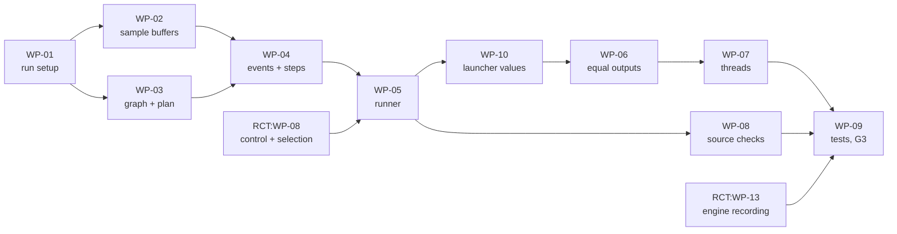

# VANTAGE — Implementation Design

**One document, not two.** The build order is on top, the design rows at the bottom. Part 8a
holds the orchestrator (`C1`); parts 8b and 8c add their packages and rows after these.

**Package numbers are ids, not positions.** The order is the order of the list below. **A
package row says only what it alone knows** — the box, the headline, and why it sits where it
does. What it lands is the `WP` column of the design rows, one place.

**A path below is a promise** — the code goes at that path under that name. Paths are relative
to `modules/vantage` and follow `VANTAGE_Architecture.md` §11 (cited as `ARCH §n`); where §11
names no file, the row names it and says so. Every new file carries the file header block
(`R-STYLE-1`, `COMPONENT: VANTAGE`, `R-NAME-6`).

**Rows the contract already holds are cited, never repeated.** The orchestrator's control
writing is `RCT:IMP-0032` (`src/simcore/orchestrator/control.cpp` `ControlWriter::Write`) and
the runner's input selection is `RCT:IMP-0033` (`src/simcore/runner/select_inputs.cpp`
`SelectInputs`), both in `RCT:WP-08` (`RCT_Implementation_Design.md`). The engine's recording
writer and reader are `RCT:IMP-0048` (`RCT:WP-13`). The rows below build around them.

## Progress (`R-REQ-6a`)

**The design rows' boxes are the only hand-maintained progress state in this set.** A
package's box is recomputed from the rows it lands and the checker fails on disagreement
(`C-WPROLL`).

| Box | Means |
|---|---|
| `[ ]` | not started |
| `[~]` | started — **and the row must say `closed by <command or condition>`** |
| `[x]` | done — the tests the requirements name pass |

**Progress is not verification** (`R-REQ-6`): a ticked box says the work was done; whether the
requirement is *met* is a Test Execution Record's answer.

---

## Blocked, and by what

**`WP-05` needs `RCT:WP-08`.** `RunStage` hands a component the message `ControlWriter::Write`
builds and the samples `SelectInputs` picks; both are contract rows built in the same pass.

**The merge of `c1` at gate G3 needs `WP-10`.** After `WP-01`, `emit_run_spec` needs `RunSetupValues` and nothing in Vantage supplies them, so `sim resim`, the batch worker and `sim check` write no run setup until `WP-10` lands; the tests vantage `c1` commit `c327be2` lists as expected red stay red until then.

**`WP-09`'s tests need `RCT:WP-13` and the lab.** They read the engine-run recording, which the
engine's writer makes (`RCT:IMP-0048`), and they run the lab cases of
`VANTAGE_Lab_Design.md` §6, including those of `LAB-WP-10` (`coprime_periods`, `renumber_lib`,
`repeat_trigger`). A test whose lab output is missing skips with a printed reason
(`R-TEST-3`).

## Order, and why

The run setup first, because every other part is built from it. Then the sample buffers and the
header read at their door, because the orchestrator decides from headers and the runner selects
from buffers. Then the graph, which every step needs for its ranks. Then the events, steps,
readiness and jump of the orchestrator; then the runner that drives them through one step loop.
Equal outputs and the first divergence come once a step produces outputs; threads come last,
after one thread is right and measured (`ARCH §8`, order of work). The source checks follow the
code they scan, and the test group closes gate **G3** (`VANTAGE_DEV_PLAN.md` §5).

- [~] **WP-01** — Run setup loader · Every other part is built from the `RunSpec` it returns; Vantage's own setup writer changes with it, so every commit on `c1` builds and passes the unit suite. Closed by `SYT-RUN-01`..`SYT-RUN-09`, `SYT-ORC-02`, `SYT-ORC-03` and `SYT-THR-02` passing (`WP-09`).
- [~] **WP-02** — Sample buffers, the header at the door, identity · The orchestrator decides from headers; selection finds samples by number here. Closed by `SYT-RUN-06`, `SYT-SEL-01`, `SYT-SEL-03`, `SYT-SEL-06`, `SYT-SEL-10`, `SYT-SEL-11`, `ANL-01` and `ANL-02` passing (`WP-09`).
- [~] **WP-03** — Graph, ranks and the plan · Load-time rules 1 to 3; every step needs the ranks. Closed by `SYT-ORC-01`, `SYT-ORC-02`, `SYT-ORC-03`, `SYT-ORC-04`, `SYT-ORC-09` and `SYT-ORC-10` passing (`WP-09`).
- [ ] **WP-04** — Events, steps, readiness, jump, event log · The orchestrator's run-time rules; needs the graph and the buffers.
- [ ] **WP-05** — Runner: read-ahead, one run, the step loop · Drives `WP-04` and calls components; needs `RCT:WP-08`.
- [ ] **WP-10** — Launcher run-setup values · Vantage's own callers can write a run setup again; lands after `WP-05` and before the merge of `c1` at G3.
- [ ] **WP-06** — Equal outputs and the first divergence · Compares what `WP-05` produces with the recording.
- [ ] **WP-07** — Threads · Only after one thread gives equal outputs (`ARCH §8`).
- [ ] **WP-08** — Source checks · Scan the code `WP-02` to `WP-05` write.
- [ ] **WP-09** — The C1 tests and gate G3 · Needs everything above, `RCT:WP-13` and the lab.

---

## Design rows

`Change` is derived from what exists today (`KEEP MOVE DEDUPE EXTEND NEW DROP`).
`Tests` repeats the tests of the requirement served, so a row reads standalone.

**The event log** (`ARCH §3.2`) has no file in `ARCH §11`; `IMP-0023` places it beside the
orchestrator and keeps the `event=` vocabulary of `include/simcore/events.hpp` unchanged, as
the register's code table says.

| Box | UID | Serves | WP | Change | Artifact — Design | Tests |
|---|---|---|---|---|---|---|
| `[~]` | `IMP-0001` | `SYS-0001`, `SYS-0003`, `SYS-0006`, `SYS-0011` | `WP-01` | `EXTEND` | `include/simcore/runspec.hpp::RunSpec`, `SpecStage`, `SpecInput`, `SpecPort`, `SpecOutputs` — gain `trigger`, `clock_period_ns` (was `period_ns`), `previous_cycle` (was `delay_steps`), `bulk`, `buffer_depth`, `livemeas`, `readiness_limit_steps`, `fallback_max_gap` (`ARCH §2.3`); lose `sampling`, `on_missing`, `grid_step_ns`, `order`. Closed by `SYT-RUN-01`, `SYT-RUN-03`, `SYT-RUN-06`, `SYT-ORC-03` passing (`WP-09`). | `SYT-RUN-01`, `SYT-RUN-03`, `SYT-RUN-06`, `SYT-ORC-03` |
| `[~]` | `IMP-0002` | `SYS-0002` | `WP-01` | `EXTEND` | `src/simcore/runspec/load.cpp::LoadRunSpec` — a port carrying `sampling` or `on_missing` is a load error naming the key, the stage and the port; the value is never read. Closed by `SYT-RUN-02` passing (`WP-09`). | `SYT-RUN-02` |
| `[~]` | `IMP-0003` | `SYS-0003` | `WP-01` | `EXTEND` | `src/simcore/runspec/load.cpp::LoadRunSpec` — a missing `⊘` value of `ARCH §4` is a load error naming the key; the live measurement geometry is required only with `outputs.livemeas`; no default exists in code. Closed by `SYT-RUN-03` passing (`WP-09`). | `SYT-RUN-03` |
| `[~]` | `IMP-0004` | `SYS-0004` | `WP-01` | `EXTEND` | `src/simcore/runspec/load.cpp::LoadRunSpec` — `schema` equals `adas.sim.runspec/2.0`, one constant beside `LoadRunSpec`; any other value, or none, is a load error naming the string found and the string expected. Closed by `SYT-RUN-04` passing (`WP-09`). | `SYT-RUN-04` |
| `[~]` | `IMP-0005` | `SYS-0001`, `SYS-0040` | `WP-01` | `EXTEND` | `src/simengine/main.cpp::main` — takes one run setup path and the engine options `--threads N` (default 1) and `--wait-for-attach`; reads no environment variable, YAML file or library search path to decide a run. Closed by `SYT-RUN-01`, `SYT-THR-02` passing (`WP-09`). | `SYT-RUN-01`, `SYT-THR-02` |
| `[~]` | `IMP-0049` | `SYS-0046` | `WP-01` | `EXTEND` | `src/simcore/runspec/load.cpp::LoadRunSpec` — a key the run setup schema does not name, `delay_steps`, `grid_step_ns` and `order` included, is a load error naming the key and where it is: top level, or the stage, port or input that holds it. Closed by `SYT-RUN-09` passing (`WP-09`). | `SYT-RUN-09` |
| `[~]` | `IMP-0051` | `SYS-0002`, `SYS-0003`, `SYS-0004`, `SYS-0006`, `SYS-0010`, `SYS-0011`, `SYS-0046` | `WP-01` | `EXTEND` | `src/adas_sim/runspec/emit.py::emit_run_spec`, `src/adas_sim/runspec/schema/run_spec.schema.json` — write `schema` `adas.sim.runspec/2.0`, `trigger`, `clock_period_ns`, `previous_cycle`, `bulk`, `buffer_depth`, `outputs.livemeas`, `readiness_limit_steps`, `fallback_max_gap` (`ARCH §11`); stop writing `grid`, `order`, `delay_steps`, `sampling`, `on_missing`. Closed by `SYT-RUN-02`, `SYT-RUN-03`, `SYT-RUN-04`, `SYT-RUN-06`, `SYT-RUN-09`, `SYT-ORC-02`, `SYT-ORC-03` passing (`WP-09`). | `SYT-RUN-02`, `SYT-RUN-03`, `SYT-RUN-04`, `SYT-RUN-06`, `SYT-RUN-09`, `SYT-ORC-02`, `SYT-ORC-03` |
| `[~]` | `IMP-0006` | `SYS-0006`, `SYS-0020`, `SYS-0022`, `SYS-0025`, `SYS-0031` | `WP-02` | `NEW` | `src/simcore/bus/sample_buffer.cpp::SampleBuffer::Push`, `FindByCounter`, `NewestCounterNotAfter`, `NewestNotAfter`, `Newest` — at most `buffer_depth` samples, each with its four header fields, arrival time, origin and payload; counters compared only through `counterDistance`; a lookup of an evicted counter reports an eviction miss. Closed by `SYT-RUN-06`, `SYT-SEL-01`, `SYT-SEL-03`, `SYT-SEL-06`, `ANL-02` passing (`WP-09`). | `SYT-RUN-06`, `SYT-SEL-01`, `SYT-SEL-03`, `SYT-SEL-06`, `ANL-02` |
| `[~]` | `IMP-0007` | `SYS-0006` | `WP-02` | `EXTEND` | `include/simcore/bus.hpp::PortBus`, `src/simcore/bus/port_bus.cpp` — one `SampleBuffer` per port, sized by its `buffer_depth`; `Get` keeps its meaning, the newest sample. Closed by `SYT-RUN-06` passing (`WP-09`). | `SYT-RUN-06` |
| `[~]` | `IMP-0008` | `SYS-0017`, `SYS-0029` | `WP-02` | `NEW` | `src/simcore/bus/signal_header.cpp::ReadSignalHeader(payload, descriptor)` — reads `measurement_counter`, `source_timestamp_us`, `cycle_counter` and `sig_status` by reflection on the field `sig_header`, for every sample entering a buffer; the only payload read behind a decision. Closed by `ANL-01`, `SYT-SEL-10` passing (`WP-09`). | `ANL-01`, `SYT-SEL-10` |
| `[~]` | `IMP-0009` | `SYS-0029`, `SYS-0030` | `WP-02` | `NEW` | `src/simcore/bus/identity.cpp::IdentityTracker::Observe` — per port, from the `counterDistance` of both counters (`D17 (3)`): identity broken raises `KIND_IDENTITY_BROKEN`; a counter gap or a counter reset adds one event log entry. Closed by `SYT-SEL-10`, `SYT-SEL-11` passing (`WP-09`). | `SYT-SEL-10`, `SYT-SEL-11` |
| `[~]` | `IMP-0010` | `SYS-0030` | `WP-02` | `DROP` | `src/simcore/bus/cycle.cpp::CycleReconstructor` — deleted; its counter, gap and repeat logic is `IdentityTracker`'s (`IMP-0009`), reading `measurement_counter`, and its recovery ladder leaves with the grid (`D10`). Closed by `SYT-SEL-11` passing (`WP-09`). | `SYT-SEL-11` |
| `[~]` | `IMP-0011` | `SYS-0009`, `SYS-0012` | `WP-03` | `NEW` | `include/simcore/orchestrator.hpp` — declares `BuildGraph`, `Rank`, `EventQueue`, `Orchestrator`, `Readiness`, `EventLog` and `PlanText`; replaces `include/simcore/scheduler.hpp`. Closed by `SYT-ORC-01` and `SYT-ORC-04` passing (`WP-09`). | `SYT-ORC-01`, `SYT-ORC-04` |
| `[~]` | `IMP-0012` | `SYS-0009`, `SYS-0010` | `WP-03` | `NEW` | `src/simcore/orchestrator/graph.cpp::BuildGraph`, `Rank` — an edge only from a `simulate` producer to a `simulate` consumer and none for a `previous_cycle` input; rank as `ARCH §2.2`; a loop left is a load error naming its stages. Closed by `SYT-ORC-01` and `SYT-ORC-02` passing (`WP-09`). | `SYT-ORC-01`, `SYT-ORC-02` |
| `[~]` | `IMP-0013` | `SYS-0011` | `WP-03` | `NEW` | `src/simcore/orchestrator/graph.cpp::BuildGraph` — each `simulate` stage has exactly one start: `trigger: control` with `<stage>.control` in the recording's topic index, a declared input, or `clock_period_ns` above 0; otherwise a load error naming the stage and what was expected. Closed by `SYT-ORC-03` passing (`WP-09`). | `SYT-ORC-03` |
| `[~]` | `IMP-0014` | `SYS-0018` | `WP-03` | `NEW` | `src/simcore/orchestrator/graph.cpp::BuildGraph` — marks a `simulate` stage whose declared consumers are all not `simulate`; the orchestrator raises `KIND_COMPUTED_NOT_CONSUMED` on it once. Closed by `SYT-ORC-09` passing (`WP-09`). | `SYT-ORC-09` |
| `[~]` | `IMP-0015` | `SYS-0019` | `WP-03` | `NEW` | `src/simcore/orchestrator/plan_dump.cpp::PlanText` — from the `RunSpec` and the graph alone, one line per simulated stage: rank, trigger or clock, previous-cycle inputs; loads no library. Replaces `src/simcore/scheduler/dump.cpp` (`PredictSchedule`, `ScheduleDumpText`), which is deleted. Closed by `SYT-ORC-10` passing (`WP-09`). | `SYT-ORC-10` |
| `[ ]` | `IMP-0016` | `SYS-0032`, `SYS-0039` | `WP-04` | `NEW` | `src/simcore/orchestrator/event_queue.cpp::EventQueue` — orders events by (simulation time, rank, stage declaration order, arrival order); one instant's recorded messages in `sources[]` order, then file order; clock ticks every `clock_period_ns` from the whole recording's first reception time, also for a slice, which skips the ticks before its start and so ticks at the full run's instants. | `SYT-STP-01`, `SYT-THR-01` |
| `[ ]` | `IMP-0017` | `SYS-0012`, `SYS-0032` | `WP-04` | `NEW` | `src/simcore/orchestrator/orchestrator.cpp::Orchestrator::BeginStep` — takes the earliest instant, enters each recorded message of it into its buffer through `IdentityTracker::Observe`, and creates one ticket per recorded control, new trigger-input `measurement_counter` or clock tick. | `SYT-ORC-04`, `SYT-STP-01` |
| `[ ]` | `IMP-0050` | `SYS-0047` | `WP-04` | `NEW` | `src/simcore/orchestrator/orchestrator.cpp::Orchestrator::BeginStep` — a trigger-input sample at `counterDistance` 0 from the one that last started a run of the stage, with the same payload bytes, starts no run and adds one `stalled_trigger` entry; other bytes are `IdentityTracker`'s identity broken (`D17 (3)`). | `SYT-ORC-11` |
| `[ ]` | `IMP-0018` | `SYS-0009`, `SYS-0014` | `WP-04` | `NEW` | `src/simcore/orchestrator/orchestrator.cpp::Orchestrator::NextRunnable` — hands out the open tickets of the lowest rank whose stage has no earlier open ticket and whose named samples are found; parks the rest with `Readiness::Park`. | `SYT-ORC-01`, `SYT-ORC-06` |
| `[ ]` | `IMP-0019` | `SYS-0026`, `SYS-0033`, `SYS-0039` | `WP-04` | `NEW` | `src/simcore/orchestrator/orchestrator.cpp::Orchestrator::Commit` — enters a rank's outputs into the buffers in stage declaration order, marked with the step that made them, and creates the tickets they trigger in the same step. | `SYT-SEL-07`, `SYT-STP-02`, `SYT-THR-01` |
| `[ ]` | `IMP-0020` | `SYS-0016`, `SYS-0032` | `WP-04` | `NEW` | `src/simcore/orchestrator/orchestrator.cpp::Orchestrator::EndStep` — ends the step when no ticket is dispatchable and gives the next step its number; at the recording's end, runs every parked ticket in the last step with the readiness outcome. | `SYT-ORC-08`, `SYT-STP-01` |
| `[ ]` | `IMP-0021` | `SYS-0034`, `SYS-0035`, `SYS-0036` | `WP-04` | `NEW` | `src/simcore/orchestrator/orchestrator.cpp::Orchestrator::Jump` — empties every buffer, the read-ahead and every open ticket, and seeks the reader; the step number continues; each stage whose outputs the recording holds is warming up from its next run. | `SYT-STP-03`, `SYT-STP-04`, `SYT-STP-05` |
| `[ ]` | `IMP-0022` | `SYS-0015`, `SYS-0028` | `WP-04` | `NEW` | `src/simcore/orchestrator/readiness.cpp::Readiness::Park`, `Retry`, `Expired` — a parked ticket is retried at each later event until its sample is committed or `readiness_limit_steps` steps have passed; then the counter fallback, with `KIND_READINESS_TIMEOUT` on the port. | `SYT-ORC-07`, `SYT-SEL-09` |
| `[ ]` | `IMP-0023` | `SYS-0013`, `SYS-0024`, `SYS-0030`, `SYS-0037`, `SYS-0043`, `SYS-0047` | `WP-04` | `NEW` | `src/simcore/orchestrator/event_log.cpp::EventLog::Add` — one line per entry: an `event=` value of `simcore::Event`, `step=`, and `entry=` from the closed list `output_counter_break`, `fallback_beyond_gap`, `counter_gap`, `counter_reset`, `stalled_trigger`, `eviction_miss`, `first_divergence`, with the fields `ARCH §5` and `§6` name. | `SYT-ORC-05`, `SYT-ORC-11`, `SYT-SEL-05`, `SYT-SEL-11`, `SYT-STP-06`, `SYT-EQO-02` |
| `[ ]` | `IMP-0024` | `SYS-0012` | `WP-04` | `DROP` | `include/simcore/scheduler.hpp`, `src/simcore/scheduler/due.cpp::Scheduler::Advance`, `IsDue` — deleted: no base grid and no due test; a run exists only for a ticket (`D10`). | `SYT-ORC-04` |
| `[ ]` | `IMP-0025` | `SYS-0012` | `WP-04` | `DROP` | `src/simcore/scheduler/reconcile.cpp::ReconcileModuleFlag` — deleted: with no due flag there is nothing to reconcile; a component that does not set `updated` on a port produces no sample for it (`ARCH §7`). | `SYT-ORC-04` |
| `[ ]` | `IMP-0052` | `SYS-0048` | `WP-10` | `EXTEND` | `src/adas_sim/graph/pipeline.py::Pipeline.load`, `Pipeline.setup_values` — `RunSetupValues` from the run configuration: its `run_setup:` block (`readiness_limit_steps`, `fallback_max_gap`, `livemeas`, absent meaning none) and each stage's `trigger`, `buffer_depth`, `bulk` and inputs' `previous_cycle`; a missing one is an `AuthoringError` naming it before any setup is written; no default. `cli/resim.py`, `orchestrate/worker.py`, `check/runner.py` pass it on. Closed by `c327be2`'s expected-red tests passing and `tests/unit/test_c3_check.py`'s provisional values removed. | `SYT-RUN-10` |
| `[ ]` | `IMP-0026` | `SYS-0005`, `SYS-0015`, `SYS-0020` | `WP-05` | `NEW` | `src/simcore/runner/read_ahead.cpp::ReadAhead::Fill`, `Find` — reads every `sources[]` file through `io::Reader::ReadRange`, merged by reception time then `sources[]` order, up to `readiness_limit_steps` steps past the instant processed; `Find` searches by `measurement_counter`; the time rule never calls it. | `SYT-RUN-05`, `SYT-ORC-07`, `SYT-SEL-01` |
| `[ ]` | `IMP-0027` | `SYS-0012`, `SYS-0013`, `SYS-0021`, `SYS-0027` | `WP-05` | `NEW` | `src/simcore/runner/run_stage.cpp::RunStage` — builds the port set from the control (`RCT:IMP-0032`) and the selection (`RCT:IMP-0033`), an input with no sample not offered; applies the declared overrides; calls `Component::Exec` under `limits.exec_timeout_ms`; logs each output whose `measurement_counter` differs from the control's; never retries. | `SYT-ORC-04`, `SYT-ORC-05`, `SYT-SEL-02`, `SYT-SEL-08` |
| `[ ]` | `IMP-0028` | `SYS-0001`, `SYS-0005`, `SYS-0007`, `SYS-0008`, `SYS-0019` | `WP-05` | `EXTEND` | `src/simcore/runner/cycle_loop.cpp::Runner::Construct` — builds buffers, graph, orchestrator and read-ahead from the `RunSpec` alone, over every `sources[]` file as one recording; prints `PlanText` before loading any library; refuses a `measured` stage whose outputs the topic index lacks, naming stage and ports; loads no `measured` or `off` library. | `SYT-RUN-01`, `SYT-RUN-05`, `SYT-RUN-07`, `SYT-RUN-08`, `SYT-ORC-10` |
| `[ ]` | `IMP-0029` | `SYS-0009`, `SYS-0032` | `WP-05` | `EXTEND` | `src/simcore/runner/cycle_loop.cpp::Runner::StepOnce` — the one loop body, one engine step (`ARCH §7`): `BeginStep`; per rank `NextRunnable`, `RunStage` for each ticket, `Commit`; until `EndStep`. Replaces the cycle loop and `Runner::PullCycle`. | `SYT-ORC-01`, `SYT-STP-01` |
| `[ ]` | `IMP-0030` | `SYS-0018`, `SYS-0028`, `SYS-0035`, `SYS-0036` | `WP-05` | `EXTEND` | `src/simcore/runner/cycle_loop.cpp::Runner::SetLiveMeasurement` — takes the sink the writer's `liveMeasStep` call fills (`ARCH §10.1`); after each step it hands the step number, simulation time, every port value with origin and age, and the step's badges; with no sink, nothing. | `SYT-ORC-09`, `SYT-SEL-09`, `SYT-STP-04`, `SYT-STP-05` |
| `[ ]` | `IMP-0031` | `SYS-0034`, `SYS-0035` | `WP-05` | `EXTEND` | `include/simcore/abi/simcore.h`, `src/simcore/abi/simcore.cpp::simEngineStepOnce`, `simEngineSeek` — `simEngineStepOnce` runs one engine step; the new `simEngineSeek` calls `Orchestrator::Jump`; `SIMCORE_ABI_VERSION` 3. | `SYT-STP-03`, `SYT-STP-04` |
| `[ ]` | `IMP-0032` | `SYS-0036`, `SYS-0044` | `WP-06` | `EXTEND` | `src/simcore/runner/divergence.cpp::EqualOutputs` — two outputs are equal outputs once both headers' `cycle_counter` is 0; a `refSync` is compared only on each entry's `measurement_counter` and `source_timestamp_us`; a stage's warming up ends at its first equal output. | `SYT-STP-05`, `SYT-EQO-03` |
| `[ ]` | `IMP-0033` | `SYS-0043`, `SYS-0045` | `WP-06` | `EXTEND` | `src/simcore/runner/divergence.cpp::DivergenceLatch::Observe` — keyed by step; skips RESTART runs; latches the first step, stage and port `EqualOutputs` finds unequal, writes it once to the event log, and never changes the outcome. | `SYT-EQO-02`, `SYT-EQO-04` |
| `[ ]` | `IMP-0034` | `SYS-0039`, `SYS-0040` | `WP-07` | `EXTEND` | `include/simcore/runner.hpp::RunnerOptions` — gains `threads`, default 1, set only from `--threads`, never from the run setup. | `SYT-THR-01`, `SYT-THR-02` |
| `[ ]` | `IMP-0035` | `SYS-0039` | `WP-07` | `EXTEND` | `src/simcore/runner/cycle_loop.cpp::Runner::StepOnce` — with `threads` above 1, the tickets of one rank with no wiring between them run on worker threads that only call `Component::Exec` on inputs fixed before dispatch; a barrier ends each rank; `Commit` stays in declaration order. | `SYT-THR-01` |
| `[ ]` | `IMP-0036` | `SYS-0041` | `WP-07` | `EXTEND` | `src/simcore/runner/cycle_loop.cpp::Runner::StepOnce` — two tickets whose stages are loaded from the same library path never run at the same time; the later one waits for the earlier one's call to return. | `SYT-THR-03` |
| `[ ]` | `IMP-0037` | `SYS-0017` | `WP-08` | `NEW` | `scripts/check_engine_decisions.py [--root <dir>] [--selftest]` — scans `src/simcore/orchestrator/`, `src/simcore/runner/select_inputs.cpp` and `read_ahead.cpp` for clock, thread-id and timer calls and for payload parses other than `ReadSignalHeader`; one line per finding, exit 1 on any; `--selftest` plants one of each. | `ANL-01` |
| `[ ]` | `IMP-0038` | `SYS-0031` | `WP-08` | `NEW` | `scripts/check_counter_compare.py [--root <dir>] [--selftest]` — scans `include/simcore/` and `src/simcore/` for `==`, `!=`, `<`, `>`, `<=` or `>=` with an operand naming `measurement_counter` or `cycle_counter`; one line per finding, exit 1 on any; `--selftest` plants one. | `ANL-02` |
| `[ ]` | `IMP-0039` | `SYS-0038` | `WP-08` | `KEEP` | `scripts/check_time_units.py` — its roots, `include/simcore`, `src/simcore` and `src/simengine`, already hold `src/simcore/orchestrator/`; its planted case stays in `tests/unit/test_a1_check_time_units.py`. | `ANL-03` |
| `[ ]` | `IMP-0040` | `SYS-0039`, `SYS-0042` | `WP-09` | `NEW` | `tests/support/lab_cases.py::lab_case`, `edit_setup`, `edit_recording` — finds a lab case's run setup, recording and libraries in the lab build; copies a setup with one change, or a recording with one edit written through the `interfaces` writer; skips with a printed reason when the lab is not built. | `SYT-EQO-01`, `SYT-THR-01` |
| `[ ]` | `IMP-0041` | `SYS-0032`, `SYS-0035` | `WP-09` | `NEW` | `tests/support/step_tap.cpp::main` — a test executable linking `simcore`: runs a run setup through `Runner` with a sink on `Runner::SetLiveMeasurement` printing one JSON line per step (step, time, badges); `--threads N`; `--jump-at-ms F --jump-to-ms T` calls `simEngineSeek`'s jump once. | `SYT-STP-01`, `SYT-STP-04` |
| `[ ]` | `IMP-0042` | `SYS-0008`, `SYS-0040`, `SYS-0041` | `WP-09` | `NEW` | `tests/fixtures/exec_probe/exec_probe.cpp::adasExec` — the exec probe: a component on the generic ABI that appends its stage name, library path, thread id, entry and exit to a file named in its bundle, and spins a fixed time inside each call. | `SYT-RUN-08`, `SYT-THR-02`, `SYT-THR-03` |
| `[ ]` | `IMP-0043` | `SYS-0039`, `SYS-0042` | `WP-09` | `NEW` | `tests/system/test_vnt_gate_g3.py` — gate `G3`: `SYT-EQO-01` and `SYT-THR-01` over every exact case, comparing with `lab_tools.compare.equal_outputs`, the lab's comparator. | `SYT-EQO-01`, `SYT-THR-01` |
| `[ ]` | `IMP-0044` | `SYS-0001`, `SYS-0002`, `SYS-0003`, `SYS-0004`, `SYS-0005`, `SYS-0006`, `SYS-0007`, `SYS-0008`, `SYS-0046`, `SYS-0048` | `WP-09` | `NEW` | `tests/system/test_vnt_run_setup.py` — `SYT-RUN-01` to `SYT-RUN-10`. | `SYT-RUN-01`, `SYT-RUN-02`, `SYT-RUN-03`, `SYT-RUN-04`, `SYT-RUN-05`, `SYT-RUN-06`, `SYT-RUN-07`, `SYT-RUN-08`, `SYT-RUN-09`, `SYT-RUN-10` |
| `[ ]` | `IMP-0045` | `SYS-0009`, `SYS-0010`, `SYS-0011`, `SYS-0012`, `SYS-0013`, `SYS-0014`, `SYS-0015`, `SYS-0016`, `SYS-0018`, `SYS-0019`, `SYS-0047` | `WP-09` | `NEW` | `tests/system/test_vnt_orchestrator.py` — `SYT-ORC-01` to `SYT-ORC-11`. | `SYT-ORC-01`, `SYT-ORC-02`, `SYT-ORC-03`, `SYT-ORC-04`, `SYT-ORC-05`, `SYT-ORC-06`, `SYT-ORC-07`, `SYT-ORC-08`, `SYT-ORC-09`, `SYT-ORC-10`, `SYT-ORC-11` |
| `[ ]` | `IMP-0046` | `SYS-0020`, `SYS-0021`, `SYS-0022`, `SYS-0023`, `SYS-0024`, `SYS-0025`, `SYS-0026`, `SYS-0027`, `SYS-0028`, `SYS-0029`, `SYS-0030` | `WP-09` | `NEW` | `tests/system/test_vnt_selection.py` — `SYT-SEL-01` to `SYT-SEL-11`. | `SYT-SEL-01`, `SYT-SEL-02`, `SYT-SEL-03`, `SYT-SEL-04`, `SYT-SEL-05`, `SYT-SEL-06`, `SYT-SEL-07`, `SYT-SEL-08`, `SYT-SEL-09`, `SYT-SEL-10`, `SYT-SEL-11` |
| `[ ]` | `IMP-0047` | `SYS-0032`, `SYS-0033`, `SYS-0034`, `SYS-0035`, `SYS-0036`, `SYS-0037` | `WP-09` | `NEW` | `tests/system/test_vnt_step.py` — `SYT-STP-01` to `SYT-STP-06`. | `SYT-STP-01`, `SYT-STP-02`, `SYT-STP-03`, `SYT-STP-04`, `SYT-STP-05`, `SYT-STP-06` |
| `[ ]` | `IMP-0048` | `SYS-0040`, `SYS-0041`, `SYS-0043`, `SYS-0044`, `SYS-0045` | `WP-09` | `NEW` | `tests/system/test_vnt_equal_outputs.py` — `SYT-THR-02`, `SYT-THR-03` and `SYT-EQO-02` to `SYT-EQO-04`. | `SYT-THR-02`, `SYT-THR-03`, `SYT-EQO-02`, `SYT-EQO-03`, `SYT-EQO-04` |
