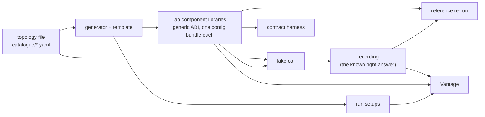

# VANTAGE — lab design

**A supporting document** (`R-REQ-17`, to be declared under `context:` with `rollup: true` in
`layers.yaml` by step 8). It says how a lab component is described, generated and built, how
the fake car makes recordings with a known right answer, which topologies the catalogue holds,
how every fixture of the contract's catalogue is made, where each piece of code goes, and in
which order the lab is built. It allocates no UID and holds no requirement row. Its build order
(section 9) uses ids scoped to this document (`LAB-WP-nn`, `LAB-nn`).

Built on, and not changed here (`D14`): `modules/interfaces/docs/resim_contract/`
(`RCT_Architecture.md`, `RCT_System_Requirements.md` cited as `RCT:SYS-nnnn`,
`RCT_Test_Spec.md` for the fixture names, `RCT_Implementation_Design.md` cited as
`RCT:IMP-nnnn`) and `VANTAGE_Architecture.md` (cited as `ARCH §n`). Program decisions:
`VANTAGE_DEV_PLAN.md` (`D1`..`D20`, gates `G2`..`G4`). The term **equal outputs** is the one
defined in the `RCT_System_Requirements.md` preamble.

## 1. In plain words

The lab is a test bench for Vantage and for the contract. It makes small, dummy components
whose outputs are plain arithmetic, runs them in a fake car, and keeps what the fake car wrote
as the **known right answer**. Vantage re-runs the same components on that recording and must
give the same outputs.

It serves three gates (`VANTAGE_DEV_PLAN.md` §5):

| Gate | What the lab gives it |
|---|---|
| `G2` lab components pass the contract tests | components that keep the contract, a harness that drives one directly, and a reference re-run that needs no Vantage |
| `G3` every topology is exact against the fake car | one recording per topology and scenario, and a run setup for each way of re-running it |
| `G4` the inspector finds every item, every failure drill passes | topologies that make every kind of live-measurement item, and recordings and bundles that make each drill |

The lab has three parts, and each is small on purpose (`VANTAGE_DEV_PLAN.md` §4).

| Part | What it is | Language |
|---|---|---|
| **Generator** | one C++ template and one script that fills it from a YAML description; also writes the run setups | C++ template, Python script |
| **Fake car** | runs the generated libraries through the generic ABI on their own task clocks and records every port | Python |
| **Catalogue** | one YAML file per topology, with its scenarios and the ways Vantage re-runs it | YAML |



Lab components are **generated build outputs, not repositories** (`D4`). Nothing generated is
checked in. There is no code-generation framework and no plug-in system.

## 2. Every name, its purpose and its scope

Each name has one meaning. Message and field names are the contract's (`RCT_Architecture.md` §0)
and are used here without redefinition.

| Name | Kind | Purpose | Scope |
|---|---|---|---|
| `vantage-lab` | repository (a component repo, `D4`) | holds the template, the generator, the fake car and the catalogue | one repo; built with the standard component build (section 4) |
| topology file | YAML, `catalogue/<topology>.yaml` | one set of sources and components, how they are wired, and what to do with them | one per topology; the single input of the generator and the car |
| component description | mapping in a topology file's `components:` list | says what one lab component reads, how it is started and whether it has memory (section 3) | one per component; meaningful only inside its topology |
| source description | mapping in `sources:` | says how one source produces samples | one per source |
| scenario | mapping in `scenarios:` | one run of the fake car on the topology, with scripted events, plus the ways Vantage re-runs the result | one recording per scenario |
| resim case | mapping in a scenario's `resim:` list | one way of re-running a recording: which stages are measured, what starts a stage, optional bundle changes and a jump | one run setup per case |
| template | two files, `template/lab_component.hpp.in`, `template/lab_sil.cpp.in` | the component code every lab component is made from | one, shared by all |
| generator | Python module `lab_tools.generate` | fills the template and writes ports file, config and build input for each component | build time |
| lab component | shared library on the generic ABI | the dummy component under test | one per component per topology, named `lab_<topology>_<component>` |
| calibration key | key in the bundle's `default.yaml` | a threshold of one lab component, `LAB_<COMPONENT>_<NAME>_<UNIT>` (`R-NAME-3`) | one component |
| fake car | Python module `lab_tools.car` | plays the scheduler and the sources; makes the recording | one scenario run |
| task | the car's unit of timing | a clock (period, phase, jitter) that starts one component or makes one source's samples | one per component and source |
| tick | one period of a task clock | nominal time `phase + k * period`, counted from k = 0 | one run of one component |
| activation | event | the car writes the run's `control` message at the nominal tick time | one per tick |
| start | event | the car runs the component and writes its outputs, at the nominal tick time plus the drawn jitter | one per tick |
| seed | integer in the topology file | makes every jitter draw repeatable | one topology |
| bus | the car's own history | for each port, every sample with its logging time; the car reads from it | one scenario run |
| recorder | Python module `lab_tools.recorder` | writes the bus content as a recording file | one scenario run |
| recording | `.mcap` file | every source, `control`, data output, `refSync` and `compState` of every component; the known right answer | one per scenario |
| run setup | JSON file | the input Vantage's engine reads (`ARCH §2.3`), written here for tests | one per resim case |
| catalogue | the folder `catalogue/` | all topology files | the whole lab |
| harness | `tests/harness/lab_harness.py` | drives one lab component directly through the generic ABI (`F-HARN`) | contract tests |
| reference re-run | `lab_tools.reference` | re-runs lab components on a recording by its refSyncs, with no Vantage | `G2` |
| provisional values | `catalogue/provisional.yaml` | the lab's numbers for the `⊘` run-setup values and for each component's `LAB_<C>_MAX_AGE_US` and `LAB_<C>_RECOVERY_RUNS` (section 7) | every run setup; the generator |

## 3. The component description file

A component description is one mapping in the `components:` list of a topology file. There is
no separate file per component, because the same name means different things in different
topologies (`A` reads one source in the running example, and a source and a component in `feedback`).

| Key | Required | Default | Means |
|---|---|---|---|
| `name` | yes | — | the stage name; also the recorded topic prefix and the library suffix |
| `period_ms` | one of the two | — | the component's own clock |
| `trigger` | one of the two | — | the name of an input; a run starts at every new sample on it, and `period_ms` must be absent |
| `phase_ms` | no | `period_ms` | nominal time of the first tick, so a time stamp is never 0 |
| `jitter_ms` | no | 0 | largest start delay; each start draws a whole number of µs from 0 to this, inclusive |
| `inputs` | yes | — | ordered list of the data inputs (below); may be empty |
| `outputs` | no | `[out]` | names of the data outputs; output k carries the result plus k |
| `memory` | no | `false` | `true`: the result is a running sum since the last RESTART |

Each entry of `inputs`:

| Key | Default | Means |
|---|---|---|
| `producer` | required | a source name or a component name |
| `port` | `out` | which output of the producer (a source has one output, named by the source) |
| `name` | `in_<producer>` | the input's port name; the `refSync` entry carries it |
| `previous_cycle` | `false` | read the producer's output of an earlier instant (section 5) |

**The declared order is the only order.** Input k of the list is manifest input k and
`RefSyncBuilder` index k (`RCT:IMP-0028`); `control` is not in the list and not in the
`refSync`.

Component `B` of the running example, with what the generator derives from it:

```yaml
- name: B
  period_ms: 40
  phase_ms: 60       # the first run needs all four inputs to exist (Z has its first sample at 50 + jitter)
  jitter_ms: 4
  memory: true
  inputs:
    - {producer: A}
    - {producer: X}
    - {producer: Y}
    - {producer: Z}
```

| Derived | Value for `B` |
|---|---|
| manifest inputs, in order | `control`, `in_A`, `in_X`, `in_Y`, `in_Z` |
| manifest outputs | `out`, `refSync`, `compState` |
| `refSync` entries, in order | `in_A`, `in_X`, `in_Y`, `in_Z` |
| library | `lab_running_example_B` |
| calibration keys, provisional values from `catalogue/provisional.yaml` | `LAB_B_MAX_AGE_US` = 118000, `LAB_B_RECOVERY_RUNS` = 2 (section 7) |
| calibration keys the generator writes as 0 | `LAB_B_HANG_AFTER_RUNS` = 0, `LAB_B_CRASH_AFTER_RUNS` = 0 |

**`LAB_<C>_MAX_AGE_US` and `LAB_<C>_RECOVERY_RUNS` have no default in code** and are not part
of the description (`D20` (2)). Their values are provisional lab values, written per topology
and component in `catalogue/provisional.yaml` and marked provisional like the other values of
section 7, which also says why each was chosen. The generator refuses a component whose two
keys are not given there, with an error naming the component and the key, so no run is ever
made with a value nobody wrote. A key missing from a built bundle is a different case and keeps
the contract's behaviour (`RCT:SYS-0019`: ERROR naming the key, INVALID outputs). The two
`..._AFTER_RUNS` keys make a component hang or crash after that many runs; 0 means never. They
exist for the failure drills (section 6) and are read from the bundle, so the car's recording
is always made by healthy components.

**The loader checks the file** (`TopologyError`, naming file and key): a producer that does not
exist; both or neither of `period_ms` and `trigger`; a `trigger` that is not a declared input;
a duplicate name; and a loop through inputs not marked `previous_cycle`. That last check is the
lab's own copy of rule 2 (`ARCH §5`), so the catalogue cannot hold an accidental loop. The one
topology that holds a loop on purpose says `expect: refused_at_load` in its scenario and is
exempt.

A **source description** has `name`, `period_ms`, `phase_ms`, `jitter_ms` as above, and
`kind: sample` (default) or `kind: image` with `width`, `height` and an optional
`big_frame: {at_counter, bytes}`.

A **topology file** has `topology` (its name, equal to the file name), `seed`, `duration_ms`
(the car starts no tick after it), `sources`, `components` and `scenarios`.

## 4. The template and the generator

### 4.1 The template

The template is two files, because `R-ARCH-2` keeps `src/component/**` free of file I/O and
`R-ARCH-5` keeps platform code apart.

| File | Holds | Rule |
|---|---|---|
| `template/lab_component.hpp.in` | `LabComponent`: the algorithm. Plain C++, protobuf at the door only (`R-ARCH-3`). No thread, clock, file or random value | `R-ARCH-2` |
| `template/lab_sil.cpp.in` | the composition root: `adasAbiVersion`, `adasManifest`, `adasInit`, `adasExec`, `adasShutdown`, the calibration load, the hang and crash switches | `R-ARCH-5`, `R-SIM-22` |

`LabComponent::exec` does the same steps in the same order every run. Its shape (the
contract rows it lands are in brackets):

```cpp
void LabComponent::exec(const CycleControl& control, const Inputs& in, Outputs& out) {
  cycle_.begin(control);                                   // own count + 1 (IMP-0013)
  refSync_.begin();                                        // every entry 0
  for (size_t i = 0; i < kInputCount; ++i)
    if (in.sample[i] != nullptr) refSync_.recordRead(i, in.sample[i]->sig_header());

  Verdict v;                                               // sticker, state, reason, value
  if (control.op_mode() == CycleControl::RESTART) {        // IMP-0023
    state_ = State{};                                      // a freshly constructed state
    v = Verdict::init();                                   // stickers INIT, NOT_INITIALIZED
  } else if (!calibrationError_.empty()) {                 // IMP-0026
    v = Verdict::error(calibrationError_);                 // names the key
  } else if (const char* bad = firstUntrusted(in, control.sig_header().source_timestamp_us())) {
    state_.failing = true; state_.trustedStreak = 0;       // IMP-0025
    v = Verdict::error(std::string("input ") + bad + " not trusted");
  } else if (state_.failing && ++state_.trustedStreak < recoveryRuns_) {
    v = Verdict::error("recovering");                      // still ERROR until the declared runs pass
  } else {
    state_.failing = false;
    v = Verdict::running(compute(in));                     // IMP-0027
  }
  publish(v, cycle_, refSync_.finish(cycle_), out);        // one place; no path returns early (IMP-0022)
}
```

| Contract row | Where in the template |
|---|---|
| `RCT:IMP-0022` one run per control | `exec` above: every path reaches `publish`, which writes every data output, `refSync` and `compState` |
| `RCT:IMP-0023` RESTART | the first branch; `State{}` replaces the memory (running sum, failing flag, streak) |
| `RCT:IMP-0024` `inputTrusted` | `inputTrusted(header, controlTimestampUs)`: sticker is OK, and `controlTimestampUs - header.source_timestamp_us <= maxAgeUs` as `int64_t` (a sample newer than the control is fine). An input that was not read is not trusted. `LabComponent` has no `compState` input, so a producer's state cannot be read |
| `RCT:IMP-0025` fault path | the third and fourth branches: outputs INVALID, `compState` ERROR with the input's port name in `reason`; after `recoveryRuns_` trusted runs it is RUNNING again, with no RESTART |
| `RCT:IMP-0026` calibration load | in `lab_sil.cpp.in`: `loadCalibration` reads `default.yaml` of the bundle; a missing or non-integer key sets `calibrationError_` to `calibration key <KEY> missing`, so every RUN run is ERROR. A missing bundle makes `adasInit` return NULL, never a silent default (`adas_sil_abi.h`) |
| `RCT:IMP-0027` arithmetic | `compute`, below |

**The arithmetic.** With the samples read in declared order, `v0, v1, ...` their `value`
fields, the result is `sum_i 1000003^i * v_i`, in `uint64_t` (wraps; defined). With `memory`,
the result is `state_.acc += sum` and then `state_.acc`. Output k carries the result plus k.
`1000003` is odd, so changing one input sample always changes the result. There is no clock,
no random value, no unordered container and every member has an initialiser. A source's sample
`value` is its own `measurement_counter`, so two different samples of one source always differ.
The data payload is `adas.lab.LabSample`, whose `value` carries the result. It lives in
`interfaces`, `modules/interfaces/proto/lab/lab_sample.proto` (`D20` (1)); its fields are listed
once, in `RCT_Implementation_Design.md` *Message fields*.

**RESTART runs read their inputs** and record them in the `refSync`, but do not use them. A
resim therefore finds the same samples for a RESTART run as the car did.

**The hang and crash switches** are in `lab_sil.cpp.in`, before the call to `exec`, so the
algorithm file stays clean: when `LAB_<C>_HANG_AFTER_RUNS` is above 0 and the run count has
passed it, the shim loops forever; `LAB_<C>_CRASH_AFTER_RUNS` writes through a null pointer.

### 4.2 The generator

`python -m lab_tools.generate --topology catalogue/<name>.yaml --out <dir>` uses only the
standard library and PyYAML, like `interfaces/scripts/gen_sil_ports.py`, so a build needs no
Python environment of its own. Per component it writes, under
`<dir>/<topology>/<component>/`:

| File | Content | Used by |
|---|---|---|
| `src/component/<component>_ports.hpp` | the ports struct: `control`, one member per input, `out...`, `refSync`, `compState` | `gen_sil_ports.py` (checks `binds:`) |
| `ports.yaml` | the port declaration: names, `proto_type`, `binds:`; ungated | `adas_generate_sil_ports` |
| `lab_params.hpp` | input names in order, output names, `memory`, key names | `lab_component.hpp` |
| `lab_component.hpp`, `lab_sil.cpp` | the template with those names filled in (`string.Template` from the standard library) | the compiler |
| `default.yaml` | the calibration keys: the two of `catalogue/provisional.yaml` and the two `..._AFTER_RUNS` at 0 (section 3) | `adas_pack_config_bundle` |

It writes no value of its own into C++ except the names and the memory flag. All thresholds
are calibration keys in `default.yaml` (`R-NAME-3`, `R-SIM-3a`). Port declarations are not
re-implemented: `adas_generate_sil_ports` builds the table, `buildManifest()` and the dispatch
bindings from `ports.yaml`, as for every component (`R-SIM-22`). The manifest therefore
declares `control`, `refSync` and `compState` (`ARCH §12`).

### 4.3 How it is built: the one standard component build

`vantage-lab` has no private build structure (`R-BUILD-1`..`R-BUILD-6`, `R-VAR-1`).

| Piece | How the lab uses it |
|---|---|
| `conanfile.py` | the 6-line `python_requires` stub; no recipe logic |
| `conf/build.yml` | `variants.base.sil.platforms` (`vs2026`, `ubuntu_gcc`); `requires: adas-interfaces/1.1.0`, `protobuf/3.21.12`; `recipe.type: shared-library`; `build_subdir: src/platform/lab_sil`; a `python_envs.lab` entry for the car (PyYAML, protobuf, mcap) |
| `conf/build_tools.version` | the pin every component carries |
| `build.bat`, `build.sh`, `scripts/build.py`, `scripts/build_gui.py`, `.clang-format` | **copied** by `modules/toolchain/scripts/sync_copy_files.py`, never edited here (`R-BUILD-6`) |
| `src/platform/lab_sil/CMakeLists.txt` | the standard SIL directory; includes `lab_components.cmake` |
| the command | `build.bat -P base -t sil -p vs2026` (project, target and platform all named, `R-VAR-1`; `ubuntu_gcc` on Linux) |

`lab_components.cmake` defines `lab_add_topology(<file>)`. The top-level list is every
`catalogue/*.yaml`, found with `CONFIGURE_DEPENDS`. For each topology it:

1. runs the generator with `execute_process` **at configure time**, into the build tree, and
   adds the topology file to `CMAKE_CONFIGURE_DEPENDS`, so editing it re-configures;
2. for each generated component, adds a shared library `lab_<topology>_<component>` from
   `lab_sil.cpp`, with `adas_generate_sil_ports` and `adas_pack_config_bundle` (the standard
   functions of `interfaces`), linking `AdasInterfaces::AdasInterfaces`, which carries the lab
   messages, and compile definitions `ADAS_<COMPONENT>_VERSION`, `_BUILD_ID` (a hash of the generated
   sources) and `_PROJECT_NAME` that the generated manifest builder reads;
3. places each library in its own folder, `<sil build dir>/lab/<topology>/<component>/`, so
   `<library_dir>/config/` is that one component's bundle (`R-SIM-3a`: one bundle per
   component, beside the library).

The generator also writes `<sil build dir>/lab/<topology>/index.json`: component name →
library path, config folder and build id. The car and the harness read this file; they never
guess a path.

*One risk, checked at `LAB-WP-02`:* the car loads every library of a topology into one
process, and each library carries its own protobuf runtime, as df and vdy do today. If the
runtime reports a duplicate registration, the fix is the standard one for those libraries, not
a lab-specific one.

## 5. The topology file and the fake car

### 5.1 Why Python

The fake car is written in Python and uses the generic ABI through `ctypes`, like any host
(`R-SIM-11`: message classes are built from the descriptor set in `adasManifest`, with no
generated bindings and no sibling checkout).

- The model it makes real is Python, about 150 lines; the car is the same logic with real
  libraries behind it.
- The car is the **independent check** Vantage is compared with (`RCT_Implementation_Design.md`,
  *Order, and why*). A second implementation in another language makes sharing code with the
  engine under test impossible by construction. The car imports nothing from `adas_sim`.
- Speed does not matter: a topology runs a few seconds of simulated time, a few hundred runs.

### 5.2 The task clock

Every task has `period`, `phase`, `jitter` and a seed. Times are integer µs.

- Tick k (from 0) of a task has the **nominal time** `phase + k * period`.
- The **start** of tick k is the nominal time plus `jitter_k`, a whole number of µs drawn from
  0 to `jitter` inclusive by `random.Random("<seed>/<task name>")`, one draw per tick, in tick
  order. A task with jitter 0 draws nothing.
- A source makes its sample of tick k at the start time of the tick. The sample is **stamped**
  with the nominal time and **logged** at the start time.
- A component run has the same two times. Its `control` message is **logged at the nominal
  time** (the activation); the run reads and writes at the start time; every output carries the
  control's time. This is what makes a late start real: a sample logged between the activation
  and the start can be read by a run whose control is older than the sample (rule 6, `ARCH §5`).

The car is a discrete-event loop. Events at one logging time go in this order, and within one
class in the order the topology file declares the tasks: (1) source samples, (2) activations,
(3) starts. A component triggered by an input starts, and logs its control, **immediately after
the sample that triggers it is logged**, before the next event. Nothing takes simulated time:
a run is instant.

### 5.3 One component start

At the start of a run the car:

1. For each declared input, picks the sample from the bus: the **newest sample whose logging
   time is not after now**, in event order, so a sample logged earlier in the same instant is
   visible and one logged later is not. For `previous_cycle: true` it picks the newest sample
   whose logging time is **strictly before now**. A component's own earlier output is the
   self-loop case of the same rule. No sample yet: the input is not offered (`valid` 0).
2. Builds the port set: `control` and each picked sample as a serialized message with its age
   in seconds (`now - logging time`), and an output buffer for every output port.
3. Calls `adasExec`, once.
4. Writes the outputs to the bus and the recorder at now: each data output, `refSync`,
   `compState`.

The `control` message of the tick:

| Field | Value (`RCT:SYS-0009`..`RCT:SYS-0011`) |
|---|---|
| `measurement_counter` | clock-started: k + 1. Input-triggered: the trigger sample's |
| `source_timestamp_us` | clock-started: the nominal time. Input-triggered: the trigger sample's |
| `cycle_counter` | the car's count of runs of this component, from 1 |
| `sig_status` | OK |
| `op_mode` | RESTART on the first run and on each run the scenario lists for this component; otherwise RUN |

The car **never reads `compState`** and never changes `op_mode` for any other reason.

### 5.4 Sources

Each new sample gets the previous counter plus 1 (the first is 1) and the non-zero nominal
time (`RCT:IMP-0029`). A `sample` source's `value` is its counter. An `image` source's payload
is `adas.lab.LabImage` (`width`, `height`, `pixels`; in `interfaces`,
`modules/interfaces/proto/lab/lab_image.proto`, fields listed in `RCT_Implementation_Design.md`
*Message fields*) with `pixels[i] = (counter + i) mod 256`; `big_frame` makes one frame that
long, for the oversize drill. A source's `cycle_counter` equals its counter.

### 5.5 Scenarios: what the car can be told to do

A scenario has a `name`, optional `car:` and `recording:` blocks, an optional `expect`, and
`resim:` cases. Every verb exists because a named fixture or drill needs it; the list is
closed.

| Block | Verb | Effect | Needed by |
|---|---|---|---|
| `car:` | `restart: [{component, at_run}]` | that component's `at_run`-th control carries RESTART | `F-LAB-RESTART` |
| `car:` | `silent: [{source, from_ms, for_ms}]` | the source logs no sample whose time is in the window; its counter does not advance | `F-LAB-FAULT` |
| `car:` | `invalid: [{source, from_ms, for_ms}]` | samples in the window carry sticker INVALID | `F-LAB-FAULT` |
| `car:` | `renumber: [component]` | the component's outputs carry its own run count as `measurement_counter` (a break of `RCT:SYS-0001`) | drill: producer renumbers |
| `car:` | `counter_jump: [{source, at_counter, by}]` | from that counter on, the source's counter is `by` higher | drill: counter jump |
| `recording:` | `drop_sample: [{port, counter}]` | the sample is not written, though the bus had it and a `refSync` names it | drill: refSync names a missing sample |
| `recording:` | `drop_ref_sync: all` | no `refSync` topic is written | drill: no refSyncs |

Faults are made **at the source**, not at the hand-over, because a source fault is in the
recording: the resim hands the recorded samples and reaches the same result. A fault injected
only in the car's hand-over would leave a recording no resim could equal.

### 5.6 The recorder and the recording format

`lab_tools.recorder` writes an `.mcap` file, Vantage's default codec (`ARCH §4`), with the
`mcap` Python package.

| Item | Content |
|---|---|
| topic | the port name: `source.<name>` for a source; `<component>.<port>` for `control`, each data output, `refSync`, `compState` (`R-SIM-6`) |
| schema | the message's full name and the `FileDescriptorSet` taken from the library's manifest, as `adas.sil.ComponentManifest` carries it |
| message order | event order; messages with equal logging time keep file order |
| `log_time` | logging time in ns (µs * 1000); `publish_time` is set equal and the manifest version tells readers it is not a capture time |
| metadata `manifest` | scenario name, seed, `source_kind: synthetic`, `run_kind: sim`, each library's build id; **no wall-clock time**, so one scenario, topology and seed always gives byte-identical files |
| metadata `topic_provenance` | sources `mocked`; every component port `simulated` (`R-SIM-12`) |
| topics sorted | channel numbers are deterministic |

Every component port is recorded, with no decimation or exclusion (`R-SIM-6`), so a recording
supports any cut. The recorder also writes the `recording:` edits of the scenario.

## 6. The catalogue and the fixtures

### 6.1 The topologies

One YAML file each, added one corner case at a time. The first milestone is the first row.

| File | Components (period ms, jitter) | Case it makes |
|---|---|---|
| `running_example` | sources `X` 10, `Y` 25 (3), `Z` 50 (5); `A` 20 (2) reads `X`; `B` 40 (4) reads `A`,`X`,`Y`,`Z`; `C` 20 reads `X`; `D` 20 (2) reads `C`; `E` 30 (3) reads `Y` | the model's first case. `B` and `D` have memory |
| `fan_out` | `X` 10; `A` 20 reads `X`; `B` 20 and `C` 40 read `A` | one producer, two parallel consumers |
| `diamond` | `X` 10; `A` 20 reads `X`; `B`, `C` 20 read `A`; `D` 20 reads `B`,`C` | two parallel stages joined |
| `rates_not_multiple` | `X` 10; `A` 20 reads `X`; `B` 30 reads `A`; `C` 70 reads `A`,`B` | periods with no common grid |
| `feedback` | `X` 10; `A` 20 reads `X` and `B` with `previous_cycle: true`; `B` 20 reads `A` | a loop broken by one previous-cycle input |
| `measured_middle` | `X` 10; `A` 20 reads `X`; `M` 20 reads `A`; `B` 20 reads `M`. Case: `A`,`B` simulated, `M` measured | a measured stage between two simulated ones |
| `late_consumer` | `X` 10; `P` 20, phase 22, reads `X`; `Q` 20, phase 20, jitter 8, reads `P` | a start jitter larger than the gap to the producer: `Q`'s control is logged at 100, `P`'s sample at 102, and `Q` starts as late as 108 |
| `data_triggered` | `X` 30; `Y` 20; `T` reads `X`,`Y`, `trigger: in_X` | a run started by an input, not by its own clock |
| `loop_no_edge` | `X` 10; `A` 20 reads `X`,`B`; `B` 20 reads `A`; `expect: refused_at_load` | a loop with no previous-cycle input; Vantage must refuse it at load |
| `camera` | `X` 30; `Cam` image 64 x 48, 50; `A` 20 reads `X` | a bulk source for the live measurement (`F-CAM`); the contract's fixture needs it |

`camera` is not in the list the program fixed for the catalogue; `F-CAM` of the contract's test
specification requires it, so it is added and flagged.

The file of the first milestone, in full:

```yaml
topology: running_example
seed: 1
duration_ms: 3000
sources:
  - {name: X, period_ms: 10}
  - {name: Y, period_ms: 25, jitter_ms: 3}
  - {name: Z, period_ms: 50, jitter_ms: 5}
components:
  - {name: A, period_ms: 20, jitter_ms: 2, inputs: [{producer: X}]}
  - name: B
    period_ms: 40
    phase_ms: 60
    jitter_ms: 4
    memory: true
    inputs: [{producer: A}, {producer: X}, {producer: Y}, {producer: Z}]
  - {name: C, period_ms: 20, inputs: [{producer: X}]}
  - {name: D, period_ms: 20, jitter_ms: 2, memory: true, inputs: [{producer: C}]}
  - {name: E, period_ms: 30, jitter_ms: 3, inputs: [{producer: Y}]}
scenarios:
  - name: base
    resim:
      - {name: cut_c, measured: [C]}          # A, B, D, E simulated; C measured
      - {name: all_simulated}
      - {name: jump, measured: [C], jump_to_ms: 1500}
```

A resim case has `name`; `measured` (a list of stages, default none); `trigger` (a mapping
stage → `control` or an input name, default `control`); `config` (a mapping stage →
`{set: {KEY: value}, remove: [KEY]}`); `bulk` (a list of ports whose `bulk` flag is set,
default none); `livemeas` (overrides of the provisional geometry, for example
`{cycle_slot_count: 2}`); `jump_to_ms` (read by the test driver, which calls
`simEngineSeek`; a jump is a host call, not a run setup key). The generator writes one
bundle copy per `config` entry (`bundles.bundle_variant`) and the run setup points at it.

### 6.2 Scenarios of the running example

Added after the first milestone, to the same file, with their numbers worked from the
description of `B`:

```yaml
  - name: restart
    car: {restart: [{component: D, at_run: 30}]}
    resim: [{name: replay, measured: [C]}]
  - name: fault
    car:
      silent:  [{source: Z, from_ms: 400,  for_ms: 920}]
      invalid: [{source: Z, from_ms: 1320, for_ms: 800}]
    resim: [{name: replay}]
```

`Z` is read only by `B`, so the fault touches one input of one component. `B`'s provisional
`LAB_B_MAX_AGE_US` is 118 ms. The silent window is `max_age + 20 * 40 ms` = 918 ms, written
920; the invalid window is `20 * 40 ms` = 800 ms. The windows are in time, so "20 runs" is
20 plus or minus 1 because of jitter; the tests read the first run of each window and the
recovery, not the count. Healthy samples resume at 2120 ms, and the run lasts to 3000 ms, so
`B` has about 22 healthy runs to clear its ERROR within `LAB_B_RECOVERY_RUNS`.

Drill scenarios (`G4`; `ARCH §12`), also on the running example:

| Scenario | Block | Resim case adds | Expected |
|---|---|---|---|
| `missing_sample` | `recording: {drop_sample: [{port: source.Y, counter: 20}, {port: source.Y, counter: 21}, {port: source.Y, counter: 22}]}` | `all_simulated` | fallback by counter, inside `fallback_max_gap` (3 missing) |
| `missing_run` | ten consecutive counters of `source.Y` dropped | `all_simulated` | gap beyond `fallback_max_gap`: the time rule picks |
| `no_ref_sync` | `recording: {drop_ref_sync: all}` | `all_simulated` | `expect: diverges` (mismatches are counted, not zero) |
| `renumber` | `car: {renumber: [A]}` | `all_simulated` | identity broken on `A`'s output |
| `counter_jump` | `car: {counter_jump: [{source: X, at_counter: 50, by: 1000}]}` | `all_simulated` | a counter jump in the event log |
| (cases of `base`) `hang`, `crash` | — | `config: {B: {set: {LAB_B_HANG_AFTER_RUNS: 5}}}`, and `LAB_B_CRASH_AFTER_RUNS: 5` | timeout and crash outcomes |
| (case of `base`) `error` | — | none; the `fault` scenario is the ERROR drill | a component that reports ERROR |

`expect` has three values: `exact` (default: the re-run equals the recording), `diverges`
(a difference is expected and counted) and `refused_at_load`.

### 6.3 Every fixture of the contract's catalogue

| Fixture | How the lab produces it |
|---|---|
| `F-HARN` | `tests/harness/lab_harness.py` loads the library of `B` (four inputs, memory) from `index.json` and drives it through the generic ABI with scripted `CycleControl` messages and hand-made `LabSample`s: skipped producer runs, an INVALID sticker, a withheld input, a counter start of `0xFFFFFFFF`, a fresh process per run (`SYT-CTL-02`). `A` serves where one input is enough |
| `F-LAB` | `python -m lab_tools car running_example base` writes `lab/running_example/base.mcap` |
| `F-LAB-JUMP` | the `base` recording and its resim case `jump` (`jump_to_ms: 1500`, the middle of 3000); Vantage makes the re-run |
| `F-LAB-RESTART` | scenario `restart`: `D`'s 30th control carries RESTART; its resim case `replay` uses recorded controls, with no jump |
| `F-LAB-FAULT` | scenario `fault` (section 6.2) |
| `F-LAB-CAL` | a resim case with `config: {B: {remove: [LAB_B_MAX_AGE_US]}}`, or `bundles.bundle_variant` called by the harness; the bundle is repacked with a new `bundle.sha256` |
| `F-CATALOGUE` | `python -m lab_tools all` makes the `base` recording of every file in `catalogue/` and every run setup |
| `F-LM` | the `base` recording with resim case `cut_c`, whose run setup carries `outputs.livemeas` with the provisional geometry (section 7) |
| `F-LM-STRESS` | not made by the lab. The writer and reader programs are Vantage's (`VANTAGE_Test_Spec`). The lab supplies the content: the `base` recording of the running example and a resim case with `livemeas: {cycle_slot_count: 2}` |
| `F-CAM` | the `camera` topology and its `base` recording; the case sets `bulk: [source.Cam]`. The oversize case leaves `bulk` empty and the source has `big_frame: {at_counter: 20, bytes: 65536}`, one inline frame larger than the provisional `MeasCycle` slot |
| `F-PROTO` | not made by the lab. Made from `interfaces` by `check_rct_schema.py`. The lab's messages live in `interfaces` too (`modules/interfaces/proto/lab/lab_sample.proto`, `lab_image.proto`, `D20` (1)) and are checked by the same scripts |
| `F-SRC` | not made by the lab. The lab's source tree is one of the trees `RCT:SYS-0036`'s check searches; the lab defines no live-measurement struct |

### 6.4 Which tests the lab can pass alone

The reference re-run (`lab_tools.reference`) takes a recording and the libraries, hands each
simulated component the samples its recorded `refSync` names, in the order and cut given, and
compares its outputs with the recording as equal outputs (`lab_tools.compare.equal_outputs`).
With `use_ref_sync=False` it hands the newest sample not after the trigger time and **counts**
the mismatches, the model's second check. With it, the lab passes alone, with no Vantage:
`SYT-HDR-01`..`SYT-HDR-04`, `SYT-CTL-01`, `SYT-CTL-02`, `SYT-CTL-05`, `SYT-CTL-07`,
`SYT-RSY-01`..`SYT-RSY-04`, `SYT-CST-01`..`SYT-CST-06`. The tests that need a Vantage re-run
(`SYT-CTL-03`, `SYT-CTL-04`, `SYT-CTL-06`, `SYT-LMS-*`) use the same fixtures. `G2` is closed
by the first group.

### 6.5 Running a case under a supervisor

`lab_tools.supervise` starts `simengine --supervise` on a run setup, waits, and returns the exit
code and the live measurement's `outcome` read through `vantage-inspect attach`, so the lab can
assert that the seal wrote `crash` or `timeout` (`ARCH §9`, §12).

## 7. Provisional values

The `⊘` values of `ARCH §4` have no customer figure, and a lab component's maximum input age
and recovery runs have no default in code (`D20` (2)). The lab gives each a **provisional**
number so its tests can run (`R-REQ-10`). None is final. They are written once, in
`catalogue/provisional.yaml`, which every run setup and the generator read; this table says why.

| Value | Provisional value | How it is derived | How it will be measured or replaced |
|---|---|---|---|
| `LAB_<C>_MAX_AGE_US` | per topology and component; for `B` of `running_example`, 118000 (provisional) | twice the largest `period + jitter` among the component's producers plus its own jitter: for `B`, 2 * (55 + 4) ms = 118 ms (the largest producer is `Z`, 50 + 5). A healthy input is never older than one producer period plus both jitters, so a healthy run is never untrusted | a lab choice, not a customer figure: replaced by a per-topology value the catalogue author writes for that component, never by a code default |
| `LAB_<C>_RECOVERY_RUNS` | per topology and component; 2 for each component of `running_example` (provisional) | the number of trusted runs that clear an ERROR; 2 is the smallest value for which the template's "recovering" branch runs, and the `fault` scenario leaves `B` about 22 healthy runs to clear it (section 6.2) | a lab choice, not a customer figure: replaced by a per-topology value the catalogue author writes for that component, never by a code default |
| `readiness_limit_steps` | 8 (provisional) | in `late_consumer`, `Q`'s control is logged at its tick and its sample up to 8 ms later; at most four distinct event instants fall in that window (the tick, `P`'s sample, `Q`'s start, one more); 8 is twice that | the largest wait, in steps, the engine's event log shows over the catalogue; the limit becomes that plus a margin. A case with limit 0 proves the timeout path |
| `fallback_max_gap` | 6 (provisional) | `missing_sample` drops 3 consecutive counters, a gap of 3; 6 is twice that. `missing_run` drops 10, so both sides of the limit exist | the largest gap a catalogue recording shows with complete refSyncs (expected 0), then the first car recordings |
| `buffer_depth` | 16 for every port (provisional) | the deepest look-back is a consumer period plus both jitters over the producer period: `B` over `X` is (40 + 4) / 10, about 5; 16 is about three times that, and a previous-cycle input needs one more | the smallest depth with no eviction miss over the catalogue; misses are counted |
| `MeasCycle` ring | 8 slots of 16384 bytes (provisional) | the largest step of the running example holds 23 port values at about 60 bytes with their fields, about 1.4 kB (an estimate, not a measurement); 16 KiB is over ten times that; 8 slots is the depth the current transport uses | the largest `CycleSlotHeader.length` over the catalogue; the size becomes the next power of two at or above twice that |
| `MeasBulk` ring | 4 slots of 8192 bytes (provisional) | one `camera` frame is 64 * 48 = 3072 bytes plus its header; 8 KiB is a margin; 4 slots hold four steps of one camera | after the first real camera source exists (`RCT:Q2`); the lab number only exercises the mechanism |

`outputs.livemeas.name` is `lab_<topology>_<scenario>_<case>`.

## 8. Code layout

Paths are relative to `modules/vantage-lab`, except the lab messages, which name their repo. A
path is a promise: the code goes there under that name.

| Part | File(s) | Main symbols |
|---|---|---|
| Build stub | `conanfile.py`, `conf/build.yml`, `conf/build_tools.version`, `pyproject.toml` | `python_requires` stub; variants; `python_envs.lab` |
| Copied machinery | `build.bat`, `build.sh`, `scripts/build.py`, `scripts/build_gui.py`, `.clang-format` | from `modules/toolchain/copy_files/` only |
| CMake | `CMakeLists.txt`, `src/platform/lab_sil/CMakeLists.txt`, `src/platform/lab_sil/lab_components.cmake` | `lab_add_topology` |
| Lab messages | in `interfaces`, not this repo: `modules/interfaces/proto/lab/lab_sample.proto`, `modules/interfaces/proto/lab/lab_image.proto`, each headed "lab-only, never a production port" (`D20` (1)) | `adas.lab.LabSample`, `adas.lab.LabImage` |
| Template | `template/lab_component.hpp.in`, `template/lab_sil.cpp.in` | `LabComponent::exec`, `inputTrusted`, `compute`, `loadCalibration`, `adasInit`, `adasExec`, `adasManifest` |
| Topology | `src/lab_tools/topology.py` | `load_topology`, `Topology`, `ComponentDesc`, `SourceDesc`, `Scenario`, `TopologyError` |
| Generator | `src/lab_tools/generate.py` | `generate_topology`, `generate_component`, `write_ports_yaml`, `write_ports_header`, `write_default_yaml`, `write_index` |
| Run setups | `src/lab_tools/setup_writer.py`, `catalogue/provisional.yaml` | `write_run_setup`, `load_provisional` |
| ABI loader | `src/lab_tools/abi.py`, `src/lab_tools/messages.py` | `LabLibrary`, `AdasPort`, `AdasPortSet`, `MessageFactory` |
| Fake car | `src/lab_tools/car.py` | `Car`, `Task`, `SourceTask`, `Bus`, `ControlWriter`, `Car.run`, `Car.startComponent` |
| Recorder | `src/lab_tools/recorder.py` | `McapRecorder`, `apply_recording_edits` |
| Bundles | `src/lab_tools/bundles.py` | `bundle_variant` |
| Checks | `src/lab_tools/compare.py`, `src/lab_tools/reference.py` | `equal_outputs`, `ReferenceResim` |
| Supervised run | `src/lab_tools/supervise.py` | `run_under_supervisor` |
| Command line | `src/lab_tools/__main__.py` | verbs `generate`, `car`, `setup`, `reference`, `supervise`, `all` |
| Catalogue | `catalogue/<topology>.yaml` | section 6.1 |
| Tests | `tests/harness/lab_harness.py`, `tests/harness/test_contract_harness.py`, `tests/test_car_*.py`, `tests/test_catalogue.py` | each contract test id in its test name (`R-REQ-9`) |

Contract rows `RCT:IMP-0022`..`RCT:IMP-0031`, re-pointed to these files and symbols by a
design-row edit (`D14`). This table maps each contract row to the lab row that builds it.

| RCT row | Part named there | File and symbol | Lab row |
|---|---|---|---|
| `RCT:IMP-0022` | template, `exec()` | `template/lab_component.hpp.in` `LabComponent::exec` | `LAB-08` |
| `RCT:IMP-0023` | template, RESTART path | `template/lab_component.hpp.in` `LabComponent::exec`, first branch, `State{}` | `LAB-09` |
| `RCT:IMP-0024` | template, `inputTrusted` | `template/lab_component.hpp.in` `inputTrusted` | `LAB-10` |
| `RCT:IMP-0025` | template, fault path | `template/lab_component.hpp.in` `LabComponent::exec`, third and fourth branches | `LAB-11` |
| `RCT:IMP-0026` | template, calibration load | `template/lab_sil.cpp.in` `loadCalibration` | `LAB-14` |
| `RCT:IMP-0027` | template, arithmetic | `template/lab_component.hpp.in` `LabComponent::compute` | `LAB-12` |
| `RCT:IMP-0028` | generator | `src/lab_tools/generate.py` `generate_component` | `LAB-15` |
| `RCT:IMP-0029` | fake car, sources | `src/lab_tools/car.py` `SourceTask` | `LAB-24` |
| `RCT:IMP-0030` | fake car, scheduler | `src/lab_tools/car.py` `ControlWriter`, `Car.run` | `LAB-27`, `LAB-31` |
| `RCT:IMP-0031` | fake car, recorder | `src/lab_tools/recorder.py` `McapRecorder` | `LAB-29` |

The scheduler's text, including the scripted restart of `car.restart`, lives in `RCT:IMP-0030`
(one fact, one place).

## 9. Build order

The first milestone is `LAB-WP-01` to `LAB-WP-06`: the running example only. `LAB-WP-02` and
`LAB-WP-03` close `RCT:WP-06`; `LAB-WP-04` and `LAB-WP-05` close `RCT:WP-07`. A package says
only why it sits where it does; what it lands is the `WP` column of the rows below, in one
place (`R-REQ-6a`). Every box is `[ ]` until the tests named for the rows pass.

- [x] **LAB-WP-01** — The lab repo in the standard build · Nothing else can be built or tried before a component repo configures with the shared toolchain
- [x] **LAB-WP-02** — Template, generator and the running example's libraries · The first implementer of every component obligation; needs `LAB-WP-01`
- [x] **LAB-WP-03** — Contract harness and ABI loader · Passes the harness tests as soon as a library exists, before any car
- [x] **LAB-WP-04** — Fake car: sources, scheduler, recorder, on the running example · Makes `F-LAB`; needs the libraries and the ABI loader
- [ ] **LAB-WP-05** — Running example scenarios: restart, fault, calibration · Makes `F-LAB-RESTART`, `F-LAB-FAULT`, `F-LAB-CAL`
- [ ] **LAB-WP-06** — Run setups, provisional values and the reference re-run · Makes `F-LM` and closes `G2` without Vantage
- [ ] **LAB-WP-07** — The other topologies, one file each · Added after the milestone, one corner case at a time
- [ ] **LAB-WP-08** — Camera, drills and the supervised run · The `G4` drills; needs `LAB-WP-05` and `LAB-WP-06`

| Box | ID | WP | Serves (RCT) | Artifact — Design |
|---|---|---|---|---|
| `[x]` | `LAB-01` | `LAB-WP-01` | — | `conanfile.py` — the 6-line `python_requires` stub pinned to `adas-toolchain/X.Y.Z`; no recipe logic. |
| `[x]` | `LAB-02` | `LAB-WP-01` | — | `conf/build.yml`, `conf/build_tools.version` — variants `base.sil`; requires; `build_subdir: src/platform/lab_sil`; `python_envs.lab`. |
| `[x]` | `LAB-03` | `LAB-WP-01` | — | `build.bat`, `build.sh`, `scripts/build.py`, `scripts/build_gui.py`, `.clang-format` — placed by `sync_copy_files.py`; `CPY-1` passes. |
| `[x]` | `LAB-04` | `LAB-WP-01` | — | `CMakeLists.txt`, `src/platform/lab_sil/CMakeLists.txt` — find `AdasInterfaces`, include `lab_components.cmake`, one `lab_add_topology` per catalogue file. |
| `[x]` | `LAB-05` | `LAB-WP-01` | `RCT:SYS-0035` | `modules/interfaces/proto/lab/lab_sample.proto`, `modules/interfaces/proto/lab/lab_image.proto` — package `adas.lab`, `LabSample`, `LabImage`, one `sig_header` each, fields as `RCT_Implementation_Design.md` *Message fields*; each file headed "lab-only, never a production port" (`D20` (1)). |
| `[x]` | `LAB-06` | `LAB-WP-01` | — | `pyproject.toml` — the `lab_tools` package and its dependencies. |
| `[x]` | `LAB-07` | `LAB-WP-02` | `RCT:IMP-0028` | `src/lab_tools/topology.py::load_topology` — reads a topology file into `Topology`; raises `TopologyError` for each check of section 3. |
| `[x]` | `LAB-08` | `LAB-WP-02` | `RCT:IMP-0022` | `template/lab_component.hpp.in::LabComponent::exec` — one run per control; `publish` is the only exit. |
| `[x]` | `LAB-09` | `LAB-WP-02` | `RCT:IMP-0023` | `template/lab_component.hpp.in::LabComponent::exec` first branch — `State{}`, stickers INIT, `compState` NOT_INITIALIZED. |
| `[x]` | `LAB-10` | `LAB-WP-02` | `RCT:IMP-0024` | `template/lab_component.hpp.in::inputTrusted` — sticker OK and `int64_t` age within `maxAgeUs`. |
| `[x]` | `LAB-11` | `LAB-WP-02` | `RCT:IMP-0025` | `template/lab_component.hpp.in::LabComponent::exec` — untrusted input gives ERROR with the port in `reason`; `recoveryRuns_` trusted runs clear it. |
| `[x]` | `LAB-12` | `LAB-WP-02` | `RCT:IMP-0027` | `template/lab_component.hpp.in::LabComponent::compute` — the polynomial sum, the running sum, output k plus k. |
| `[x]` | `LAB-13` | `LAB-WP-02` | `RCT:SYS-0013` | `template/lab_sil.cpp.in` — `adasAbiVersion`, `adasManifest`, `adasInit`, `adasExec`, `adasShutdown` over the generated bindings. |
| `[x]` | `LAB-14` | `LAB-WP-02` | `RCT:IMP-0026` | `template/lab_sil.cpp.in::loadCalibration` — a missing key gives `calibrationError_`; also the hang and crash switches. |
| `[x]` | `LAB-15` | `LAB-WP-02` | `RCT:IMP-0028` | `src/lab_tools/generate.py::generate_component` — declared input order is manifest order and `RefSyncBuilder` order. |
| `[x]` | `LAB-16` | `LAB-WP-02` | `RCT:IMP-0028` | `src/lab_tools/generate.py::write_ports_yaml`, `write_ports_header`, `write_default_yaml`, `write_index` — `write_default_yaml` takes `LAB_<C>_MAX_AGE_US` and `LAB_<C>_RECOVERY_RUNS` from `catalogue/provisional.yaml` and refuses a component without them, naming the component and the key. |
| `[x]` | `LAB-17` | `LAB-WP-02` | — | `src/platform/lab_sil/lab_components.cmake::lab_add_topology` — configure-time generation, one library and one bundle folder per component. |
| `[x]` | `LAB-18` | `LAB-WP-02` | — | `catalogue/running_example.yaml` — the file of section 6.1, scenario `base` only. |
| `[x]` | `LAB-54` | `LAB-WP-02` | — | `catalogue/provisional.yaml` — `LAB_<C>_MAX_AGE_US` and `LAB_<C>_RECOVERY_RUNS` of section 7 for every component of `running_example`, each with `status: provisional`. |
| `[x]` | `LAB-19` | `LAB-WP-03` | — | `src/lab_tools/abi.py::LabLibrary` with `AdasPort`, `AdasPortSet` — `load`, `manifest`, `init`, `exec`, `shutdown` through `ctypes`. |
| `[x]` | `LAB-20` | `LAB-WP-03` | — | `src/lab_tools/messages.py::MessageFactory` — message classes built from the manifest's descriptor set. |
| `[x]` | `LAB-21` | `LAB-WP-03` | — | `tests/harness/lab_harness.py::LabHarness` — drives one library with scripted controls and hand-made samples (`F-HARN`). |
| `[x]` | `LAB-22` | `LAB-WP-03` | `RCT:SYS-0003`, `RCT:SYS-0006`, `RCT:SYS-0007`, `RCT:SYS-0014`, `RCT:SYS-0015`, `RCT:SYS-0022` | `tests/harness/test_contract_harness.py` — `SYT-HDR-03`, `SYT-CTL-01`, `SYT-CTL-02`, `SYT-RSY-02`, `SYT-RSY-03`, `SYT-CST-06`. |
| `[x]` | `LAB-23` | `LAB-WP-04` | `RCT:IMP-0030` | `src/lab_tools/car.py::Task` — nominal tick, drawn jitter, the seeded generator `"<seed>/<name>"`. |
| `[x]` | `LAB-24` | `LAB-WP-04` | `RCT:IMP-0029` | `src/lab_tools/car.py::SourceTask` — counter plus 1, non-zero nominal time, `value` equal to the counter. |
| `[x]` | `LAB-25` | `LAB-WP-04` | `RCT:IMP-0030` | `src/lab_tools/car.py::Bus` — per port history; newest not after now; newest strictly before now. |
| `[x]` | `LAB-26` | `LAB-WP-04` | `RCT:IMP-0030` | `src/lab_tools/car.py::Car.run` — the event loop in the order of section 5.2, including input-triggered starts. |
| `[x]` | `LAB-27` | `LAB-WP-04` | `RCT:IMP-0030` | `src/lab_tools/car.py::ControlWriter` and `Car.startComponent` — control fields of section 5.3; never reads `compState`. |
| `[x]` | `LAB-28` | `LAB-WP-04` | `RCT:SYS-0013`, `RCT:SYS-0016` | `src/lab_tools/car.py::Car.startComponent` — picks the inputs, calls `adasExec` once, writes every output. |
| `[x]` | `LAB-29` | `LAB-WP-04` | `RCT:IMP-0031` | `src/lab_tools/recorder.py::McapRecorder` — topics, schemas, metadata of section 5.6; byte-identical for one seed. |
| `[x]` | `LAB-30` | `LAB-WP-04` | `RCT:SYS-0001`, `RCT:SYS-0002`, `RCT:SYS-0004`, `RCT:SYS-0010`, `RCT:SYS-0013` | `tests/test_car_running_example.py` — `SYT-HDR-01`, `SYT-HDR-02`, `SYT-HDR-04`, `SYT-CTL-05`, `SYT-RSY-01`, and two car runs giving identical bytes. |
| `[ ]` | `LAB-31` | `LAB-WP-05` | `RCT:IMP-0030` | `src/lab_tools/car.py::ControlWriter` — scripted restart from `car.restart`. |
| `[ ]` | `LAB-32` | `LAB-WP-05` | `RCT:SYS-0018`, `RCT:SYS-0020` | `src/lab_tools/car.py::SourceTask` — `silent` and `invalid` windows. |
| `[ ]` | `LAB-33` | `LAB-WP-05` | — | `catalogue/running_example.yaml` — scenarios `restart` and `fault` of section 6.2. |
| `[ ]` | `LAB-34` | `LAB-WP-05` | `RCT:SYS-0019` | `src/lab_tools/bundles.py::bundle_variant` — copy a bundle, set or remove keys, repack with the new `bundle.sha256`. |
| `[ ]` | `LAB-35` | `LAB-WP-05` | `RCT:SYS-0012`, `RCT:SYS-0017`, `RCT:SYS-0018`, `RCT:SYS-0019`, `RCT:SYS-0020`, `RCT:SYS-0021` | `tests/test_car_scenarios.py` — `SYT-CTL-07`, `SYT-CST-01`..`SYT-CST-05`. |
| `[ ]` | `LAB-36` | `LAB-WP-06` | — | `src/lab_tools/setup_writer.py::write_run_setup` — one run setup JSON per resim case, with the keys of `ARCH §2.3` only. |
| `[ ]` | `LAB-37` | `LAB-WP-06` | — | `catalogue/provisional.yaml` — the run-setup values of section 7, each with `status: provisional`. |
| `[ ]` | `LAB-38` | `LAB-WP-06` | `RCT:SYS-0016` | `src/lab_tools/compare.py::equal_outputs` — same count, byte-identical once `cycle_counter` is 0. |
| `[ ]` | `LAB-39` | `LAB-WP-06` | `RCT:SYS-0016` | `src/lab_tools/reference.py::ReferenceResim` — re-run by refSync for any cut and order; `use_ref_sync=False` counts mismatches. |
| `[ ]` | `LAB-40` | `LAB-WP-06` | `RCT:SYS-0016` | `tests/test_catalogue.py` — `SYT-RSY-04` on every catalogue file present. |
| `[ ]` | `LAB-41` | `LAB-WP-07` | `RCT:SYS-0016` | `catalogue/fan_out.yaml`. |
| `[ ]` | `LAB-42` | `LAB-WP-07` | `RCT:SYS-0016` | `catalogue/diamond.yaml`. |
| `[ ]` | `LAB-43` | `LAB-WP-07` | `RCT:SYS-0016` | `catalogue/rates_not_multiple.yaml`. |
| `[ ]` | `LAB-44` | `LAB-WP-07` | `RCT:SYS-0016` | `catalogue/feedback.yaml`. |
| `[ ]` | `LAB-45` | `LAB-WP-07` | `RCT:SYS-0016` | `catalogue/measured_middle.yaml`. |
| `[ ]` | `LAB-46` | `LAB-WP-07` | `RCT:SYS-0016` | `catalogue/late_consumer.yaml`. |
| `[ ]` | `LAB-47` | `LAB-WP-07` | `RCT:SYS-0009`, `RCT:SYS-0016` | `catalogue/data_triggered.yaml` — resim cases with `trigger: control` and `trigger: {T: in_X}`. |
| `[ ]` | `LAB-48` | `LAB-WP-07` | — | `catalogue/loop_no_edge.yaml` — `expect: refused_at_load`; the loader accepts it only with that word. |
| `[ ]` | `LAB-49` | `LAB-WP-08` | `RCT:SYS-0029`, `RCT:SYS-0031` | `catalogue/camera.yaml` and `src/lab_tools/car.py::SourceTask` image kind with `big_frame`. |
| `[ ]` | `LAB-50` | `LAB-WP-08` | `RCT:SYS-0001` | `src/lab_tools/car.py::Car.startComponent` — `renumber` and `counter_jump`. |
| `[ ]` | `LAB-51` | `LAB-WP-08` | `RCT:SYS-0016` | `src/lab_tools/recorder.py::apply_recording_edits` — `drop_sample`, `drop_ref_sync`. |
| `[ ]` | `LAB-52` | `LAB-WP-08` | — | `catalogue/running_example.yaml` — the drill scenarios and cases `hang`, `crash` of section 6.2. |
| `[ ]` | `LAB-53` | `LAB-WP-08` | — | `src/lab_tools/supervise.py::run_under_supervisor` — starts `simengine --supervise`, returns exit code and the sealed `outcome`. |

## 10. Open questions, decided, rejected options, parked

### Open questions

| # | Question | Recommendation |
|---|---|---|
| `Q-L4` | Recording conventions Vantage's reader must agree with: `source.<name>` topics for the lab's sources, equal logging times keeping file order, `manifest_version` below the capture-time version | confirm in step 8 against the ingest rules (`R-SIM-23`); the lab changes only its recorder if one differs |

### Decided

The owner's decisions of 2026-10-30, recorded as `D20` in `VANTAGE_DEV_PLAN.md`.

- `Q-L1` — `LabSample` and `LabImage` live in `interfaces`, `proto/lab/`, package `adas.lab` (`D20` (1)).
- `Q-L2` — the new text of `RCT:IMP-0030` is in the RCT design (`D20` (3)).
- `Q-L3` — the lab writes the run setup JSON itself (`D20` (3)).
- `Q-L5` — the component description stays inside the topology file (`D20` (3)).
- `Q-L6` — `LAB_<C>_HANG_AFTER_RUNS` and `LAB_<C>_CRASH_AFTER_RUNS` are kept (`D20` (3)).
- `Q-L7` — maximum input age and recovery runs have no code default; provisional calibration values, the generator refuses a component without them (`D20` (2)).
- `Q-L8` — the seven scenario verbs of section 5.5, a closed list (`D20` (3)).
- `Q-L9` — the provisional values of section 7, for the lab's tests only (`D20` (3)).

### Rejected options

| Option | Reason |
|---|---|
| A code-generation framework or a template engine with dependencies | one template and `string.Template` are enough; a framework is a second thing to maintain (`VANTAGE_DEV_PLAN.md` §4) |
| A plug-in system for lab components | nothing needs one |
| One hand-written component per case | copies drift; the point of the lab is that a description makes the component |
| A private conanfile, presets or work area for the lab | `R-BUILD-1`: one standard component build |
| A fake car in C++ | it would sit next to the engine under test and invite shared code; the control writer must not be shared (`RCT_Implementation_Design.md`) |
| Sharing the control-writing code with Vantage | the car is the independent check |
| Faults injected at the hand-over | the recording would not show them, so no resim could equal it |
| Logging the control at the start time | hides the late-consumer case: the named sample would always precede its control |
| A separate file per component description | a name means different things in different topologies |
| All cases in one topology file | the program asked for one file per topology, one corner case at a time |
| Wall-clock time in the recording | two runs of one scenario would differ in bytes |
| Random or time-of-day values in the arithmetic | `RCT:IMP-0027`: outputs depend only on the inputs and the memory |
| Lab recordings as JSON lines or CSV | mcap is the default codec with embedded schemas; the lab then reads like a real recording |

### Parked

| What | Why it waits |
|---|---|
| A lab component with more than one function | `RCT_Architecture.md` §11 P5 is each function's own design |
| A component that consumes the camera image | no gate needs it; `F-CAM` needs only the bulk port |
| State snapshot and "restart from this snapshot" (`RCT:P1`) | contract-parked; the car also starts cold, so lab results stay exact |
| Lab sources for other engines (a bridge to a foreign simulator) | `C3`, after `G4` |
| A threaded fake car | no need; it would make the known right answer depend on thread speed |
| Real-time pacing | no reader |
