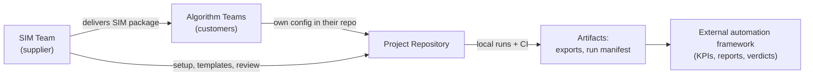
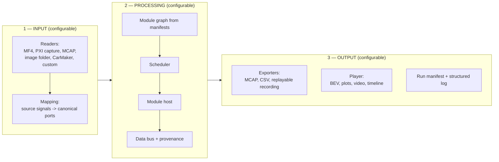
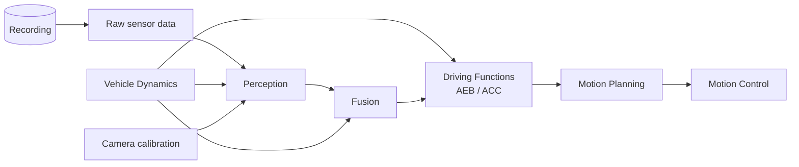
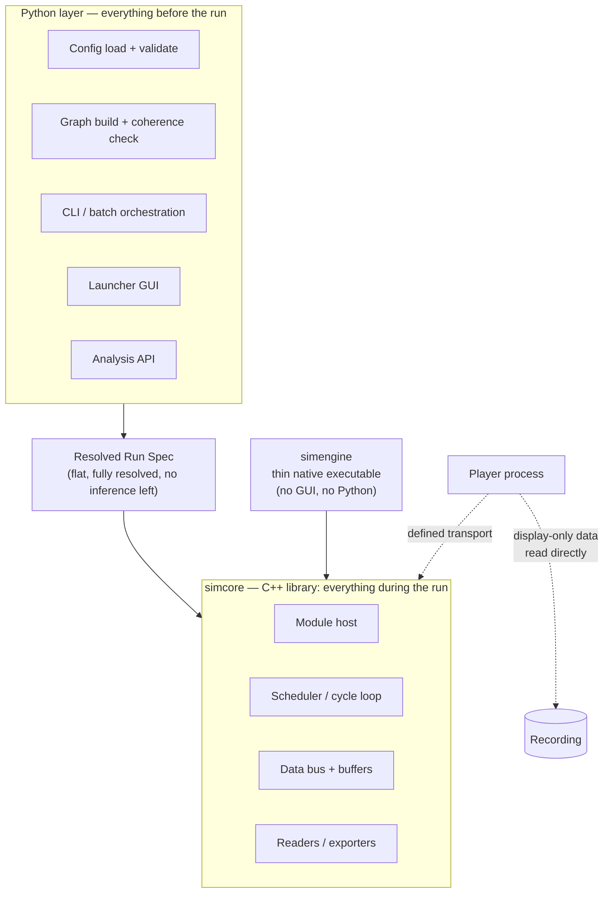
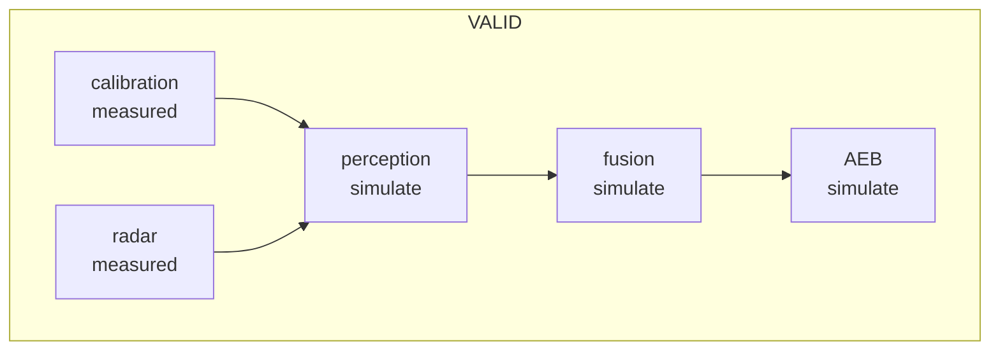
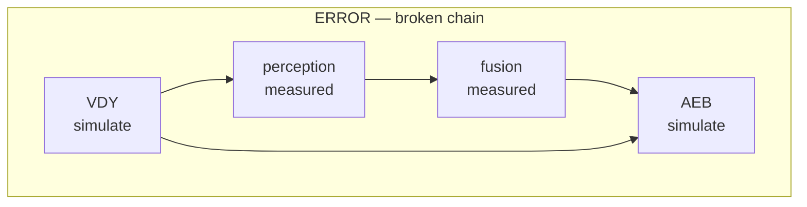
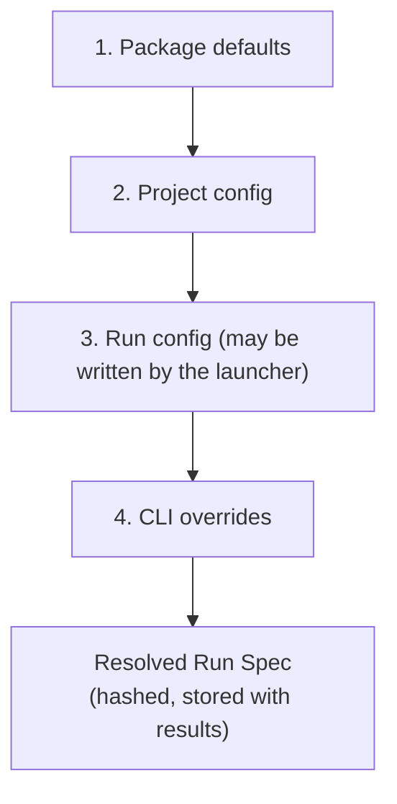
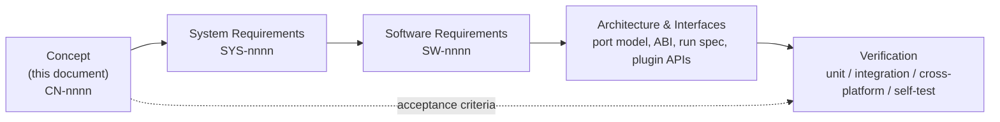

# SIM — Replay & Simulation Engine
## Master Concept Document — v0.3.1

**Owner:** SIM Team (tool supplier)
**Audience:** ADAS algorithm teams, CI/DevOps, and the authors of the requirement documents derived from this one
**Status:** Concept baseline. This document is the **source** from which the System Requirements, Software Requirements, architecture and interface specifications are derived. When those documents disagree with each other, this one says what was actually asked for.

---

## 0. How to read this document

### 0.1 Numbering

Two numbers, on purpose.

| What | Example | Rule |
|---|---|---|
| **Heading number** | `12.3` | Position in the document. **Changes when sections move.** Use it when talking to people. |
| **UID** | `CN-0nnn` | Stable identity. Allocated once, in creation order, **never changed and never reused**. Use it in trace links. |

Requirement statements are numbered `<section>.<subsection>.<item>`. The UID sits beside it.

**This version proves why both exist.** v0.3 inserted three new sections in the middle of the document. Every heading number after section 5 shifted. **Not one UID changed.** Any trace link written against v0.2's UIDs is still valid.

### 0.2 Route through the document

| Part | Sections | Content |
|---|---|---|
| **I — Concept** | 1–4 | What SIM is, who owns what, principles |
| **II — Shape of the software** | 5–6 | Process architecture and the C++/Python boundary |
| **III — Mechanics** | 7–12 | Data, input, modules, output, staged simulation, timing |
| **IV — Usage** | 13–20 | Player, launcher, config, batch, CI, debugging, speed, recording prep |
| **V — Current state** | 21–23 | What exists today, what is wrong with it, how to get from here to there |
| **VI — Boundaries** | 24–31 | Cross-platform, determinism, packaging, risks, open questions, traceability |

### 0.3 What changed from v0.2

| Change | Where | Why |
|---|---|---|
| C++/Python boundary promoted to its own section, with a decision rule and a full module mapping | 6 | Requested as a strict, unambiguous split |
| Coherence rule replaced with a three-way classification | 11.2 | The old rule was too coarse; calibration-style inputs must stay measured |
| Current implementation inventory added | 21 | A working Python framework and a C++ host both exist; the document must say what happens to each |
| Defects found in code review added | 22 | Five structural findings that shape the requirements |
| Migration path added | 23 | How to get from what exists to what this document describes |
| Duplication analysis added | 21.3 | Four subsystems currently exist in both languages |
| Target package structure added; library loading split into resolution vs loading | 21.2, 21.4 | *(v0.3.1)* The existing core/executable split is already correct; what changes is what goes in and what comes out |

### 0.4 Superseded UIDs

Thirteen v0.2 UIDs no longer appear, because their sections were restructured. They are recorded here rather than silently dropped — a retired UID is **never reused** for new content.

| Retired | Was | Replaced by |
|---|---|---|
| CN-0054 … CN-0062 | The v0.2 language-split table rows | Section 6 in full — `CN-0288` … `CN-0296` |
| CN-0075, CN-0076, CN-0077 | Source aliasing by fallback list | `CN-0304` … `CN-0310` (ingest maps) and `CN-0118` … `CN-0121` (explicit mode) |
| CN-0169 | Backward stepping requires re-run or recorded output | `CN-0335` — executing and viewing are separated, so backwards seek is free |
| CN-0147 | A snap tolerance may align near-values | `CN-0394` — a period that is not an integer multiple of the grid is a load error, never rounded. Snapping and the no-rounding rule were two answers to one question, and the second is the one the drift argument supports |

---

# PART I — CONCEPT

# 1. Purpose and scope

## 1.1 The problem

Every project builds its own simulation script. Each team writes its own reader, its own loop to call algorithm libraries, its own plotting and export code. When the project ends, all of it is thrown away. Two teams cannot compare results, because their loops are not the same.

## 1.2 The solution in one sentence

> **SIM is one configurable replay engine, delivered as a package by the SIM team, that reads recorded data produced by anyone, feeds it through any set of algorithm libraries at the correct timing, and produces any set of outputs — controlled entirely by configuration files that live inside each project's own repository.**

The algorithm engineer writes **configuration**, not framework code.

**"Produced by anyone" is load-bearing.** SIM's primary input is data it did not create: vehicle measurement, bench replay, another team's export. A tool that only replays its own recordings solves a much smaller problem than the one that exists.

## 1.3 In scope

| # | UID | Statement |
|---|---|---|
| 1.3.1 | CN-0001 | Algorithm-level Software-in-the-Loop (SIL) simulation only. |
| 1.3.2 | CN-0002 | Chain: sensor input → perception → fusion → driving functions (AEB, ACC, …) → motion planning → motion control. |
| 1.3.3 | CN-0003 | Algorithm components are C++ shared libraries (`.dll` / `.so`). |
| 1.3.4 | CN-0004 | Input is recorded data: vehicle measurement, bench replay (NI PXI), CarMaker export, image folders, or any source with a reader plugin. |
| 1.3.5 | CN-0005 | Sensor modalities: camera, radar, camera-radar fusion, multi-camera fusion, and combinations. |
| 1.3.6 | CN-0006 | Interactive use (with player) and headless use (CI) from the same engine. |
| 1.3.7 | CN-0007 | Windows and Linux, same configuration files, same results. |
| 1.3.8 | CN-0281 | Scale from a lean run (one recording, one function) to a heavy campaign (many recordings, multi-sensor, full chain) without changing tool or configuration shape. |

## 1.4 Out of scope

| # | UID | Statement |
|---|---|---|
| 1.4.1 | CN-0008 | Not a physics or sensor-model simulator. Synthetic stimulus comes from CarMaker or similar and is treated as just another input source. |
| 1.4.2 | CN-0009 | Not Hardware-in-the-Loop. No real ECU, no real bus, no real-time guarantee. |
| 1.4.3 | CN-0010 | Not a closed-loop world simulator. See 11.6. |
| 1.4.4 | CN-0011 | **No KPI computation, no pass/fail decisions, no test reporting.** A separate automation framework owns these. SIM's job ends at clean, self-describing artifacts. See 10.2. |
| 1.4.5 | CN-0012 | Not a labelling tool, not a results database, not a tuning optimiser — though the batch and export interfaces are designed so those can be built on top. |
| 1.4.6 | CN-0282 | Not a world-model client. Driving a live simulator is **out of scope entirely** — a foreign simulator reaches the system only as a recording, through the ordinary codec and ingest-map path (CN-0136). *Amended 2026-08-11 with the confirmation of Implementation Design `DD-12`, which is stronger than the original wording: not even as a plugin.* |

---

# 2. Supplier–customer model

## 2.1 Roles



## 2.2 Ownership

| # | UID | Statement |
|---|---|---|
| 2.2.1 | CN-0013 | The SIM package is **one product**, identical for all projects. Project behaviour comes only from configuration and plugins, never from a forked copy. |
| 2.2.2 | CN-0014 | Configuration files live in the algorithm team's repository, versioned with their code. |
| 2.2.3 | CN-0015 | SIM team owns configuration **format and schema**; the algorithm team owns configuration **content** after handover. |
| 2.2.4 | CN-0016 | Configuration must be simple enough for an algorithm engineer to change alone. This is the main measure of success. |
| 2.2.5 | CN-0017 | If a project needs something SIM cannot do, the answer is a **plugin** on a public interface — never a private fork. |
| 2.2.6 | CN-0018 | Project-specific readers, visualizations and modules are the responsibility of the project team. SIM owns the framework and the standard set. |
| 2.2.7 | CN-0283 | The framework shall name no function and no component. Enforced by an automated check re-run on every build, plus a test that the check itself fails on a planted violation. |

## 2.3 Preconditions on the customer

Staged simulation is only possible for data that was actually recorded. These are entry conditions a project must satisfy **before** SIM can help it. Cheap now; effectively impossible to retrofit.

| # | UID | Statement |
|---|---|---|
| 2.3.1 | CN-0019 | Every module output interface **shall carry a signal header** with at least: internal timestamp (µs), cycle/measurement counter, and a status/validity field. |
| 2.3.2 | CN-0020 | The signal header is the basis for time reconstruction, ordering, freshness detection and repeat detection. Without it, timing can only be approximated. |
| 2.3.3 | CN-0021 | Each project **shall publish a trace catalogue**: for every module, which outputs are traced into the recording, at what rate, in what group, at what size. |
| 2.3.4 | CN-0022 | A module can only be set to `measured` if its outputs appear in the trace catalogue and in the recording. SIM validates this before a run. |
| 2.3.5 | CN-0023 | The trace catalogue shall include a per-cycle size budget, so recording bandwidth limits are visible at design time rather than discovered during a test drive. |
| 2.3.6 | CN-0024 | Where a source format supports it, the signal header shall be preserved on conversion, so data from different source systems can be combined in one run. |
| 2.3.7 | CN-0284 | Each component shall declare its cycle period as **configuration**, not as a compiled constant, so a rate sweep needs no rebuild. The period is reported through the manifest, never set by the host. |

## 2.4 Qualification obligations

*Added v0.3.2, 2026-08-13, closing `OQ-17` — see §30.5. The answer is **yes**:
outputs of this tool will be cited in a functional-safety argument, and a
functional-safety concept for the tool will be asked for. What follows is the
**first level** of that obligation, and deliberately no more: three statements
that make a confidence claim provable, none of which requires knowing which
standard or confidence level will eventually be named.*

**Why three, and why these three.** Every tool-confidence scheme asks the same
two questions before it asks anything else — *how bad is it if this tool is
wrong* (impact) and *would we notice* (detection). `CN-0401` is the input to the
first and `CN-0402` to the second. `CN-0400` is what makes both answerable from
the build rather than from a workshop. Naming a standard is deliberately not
done here: the classification is quality's to make, and a concept that
pre-empted it would be re-written rather than used.

| # | UID | Statement |
|---|---|---|
| 2.4.1 | CN-0400 | Outputs of this tool will be **cited as evidence in a safety argument**. The tool shall therefore be built so a confidence claim about it can be **evidenced rather than asserted**, and the evidence shall be a by-product of the ordinary build — never a package assembled afterwards from memory. |
| 2.4.2 | CN-0401 | The tool shall state, per artifact kind it produces, **what it may be relied upon for and what it may not** — the use constraints, the known limits that bound them, and the open defects that affect them — shipped with the release rather than held in review notes. |
| 2.4.3 | CN-0402 | For every artifact kind that may be cited, the tool shall **name the check that would catch a wrong value in it**, or declare that none exists. An undetected-error path that is declared is a managed risk; one that is merely absent is a surprise. |

> **This is an addition, not a re-styling.** The set was already written in a
> shape a qualification argument asks for — numbered `shall` statements, an
> `Accept` criterion per requirement, a `Verify` method naming its test, a
> `Trace` link upward — and it was written that way because *a requirement
> nobody can fail is worthless* (`CN-0356`), not in anticipation of this answer.
> The expensive parts of qualification — classifying the tool, producing the
> validation evidence for that classification, and writing the tool safety
> manual — are process work **downstream** of these documents. So the cost of
> the yes is mostly addition, which is why three concept statements carry it.
>
> **What was already true and is now claimable.** `CN-0040` (provenance
> everywhere) and the evidence chain built on it mean every rendered or exported
> value already traces to the bytes that produced it. `CN-0402`'s detection half
> is largely the negative checks and their planted-violation twins that
> `CN-0356`'s argument already forced into existence. These statements make
> those properties **cited**, not new.

---

# 3. Concept overview

## 3.1 Three configurable pillars



| # | UID | Statement |
|---|---|---|
| 3.1.1 | CN-0025 | **Input configurable.** The user declares the format and how signals map onto canonical ports. |
| 3.1.2 | CN-0026 | **Processing configurable.** The user declares which modules take part, in which mode, at which rate. |
| 3.1.3 | CN-0027 | **Output configurable.** The user declares which exporters and views are active. Any can be switched off. |
| 3.1.4 | CN-0028 | The engine core knows nothing about a specific project. It knows the port model, the graph, and the clock. |

## 3.2 Reference processing chain



Each box carries a **mode** and an **implementation** — two independent axes, see 11.1.

## 3.3 What a module delivers

| # | UID | Artifact | Owner | Purpose |
|---|---|---|---|---|
| 3.3.1 | CN-0029 | **Algorithm library** | Module team | The code under test |
| 3.3.2 | CN-0030 | **Visualization plugin** | Module team | Draws this module's data as named layers |
| 3.3.3 | CN-0031 | **Manifest + ingest map** | Module team | Declares ports, timing, binaries, and how a foreign recording's signals reach those ports |

| # | UID | Statement |
|---|---|---|
| 3.3.4 | CN-0032 | The visualization plugin **shall not** read the algorithm library's memory. It subscribes to data on the bus by name. |
| 3.3.5 | CN-0033 | Consequence: the same visualization renders correctly whether data was simulated or replayed. The player never needs to know which. |
| 3.3.6 | CN-0034 | Consequence: the SIM team never writes module-specific drawing code. |
| 3.3.7 | CN-0285 | A module's deliverables shall be **packed and deployed beside its library**, not merely present in a source checkout. A run must work from installed artifacts alone. |

---

# 4. Design principles

| # | UID | Principle | Plain meaning | Validated by |
|---|---|---|---|---|
| 4.1.1 | CN-0035 | Configuration over code | Users describe *what*, not *how*. No user writes a loop. | `CT-01` |
| 4.1.2 | CN-0036 | One package, many projects | No project branches of the tool. Ever. | `CT-02` |
| 4.1.3 | CN-0037 | Declarative modules | Each module describes itself in a manifest. The engine reads manifests; it hardcodes no chain. | `CT-03` |
| 4.1.4 | CN-0038 | Deterministic by default | Same input + config + binaries = identical output, on both operating systems. | `CT-04` |
| 4.1.5 | CN-0039 | Fail loud, fail early | Invalid or physically meaningless setups are rejected before the run, naming what to change. | `CT-05` |
| 4.1.6 | CN-0040 | Provenance everywhere | For every value: which module, which mode, which source, which original timestamp. | `CT-06` |
| 4.1.7 | CN-0041 | Headless first | The player is an optional consumer. The engine never needs a screen. | `CT-07` |
| 4.1.8 | CN-0042 | Pay only for what you use | Nothing is read, decoded or computed unless the active graph needs it. | `CT-08` |
| 4.1.9 | CN-0043 | Same behaviour on both operating systems | Differences between Windows and Linux results are defects. | `CT-09` |
| 4.1.10 | CN-0044 | Open at the edges, closed at the core | Readers, exporters, views and modules are plugins. Scheduler, port model and config engine are not. | `CT-10` |
| 4.1.11 | CN-0045 | Explainable runs | The tool can always print what it will do before doing it. | `CT-11` |
| 4.1.12 | CN-0046 | Debuggable by construction | Attaching a native debugger and stepping through a module is a designed-in workflow. | `CT-12` |
| 4.1.13 | CN-0286 | Closed vocabularies | Verb lists, primitive kinds, error classes and log events are closed sets. A seventh verb is a design change requiring a requirement, never a quiet extension point. | `CT-13` |
| 4.1.14 | CN-0287 | One implementation per concept | Any rule that exists in two languages will drift. Every concept has exactly one home. See section 6. | `CT-14` |

**The `Validated by` column is the downward half of the trace** (`CN-0399`,
added v0.3.2). `CN-0380` makes these principles acceptance criteria for the
product as a whole, so each is asserted by one validation test in
`SIM_Concept_Test_Spec_v0.1.md`; that document's `Asserts` column is the upward
half. The two are checked against each other by `py/trace_check.py`, in both
directions, so neither can be edited alone.

**`CN-0016` (§2.2.4) is validated by `CT-15`.** It is not a section-4 principle
but it is the stated *main measure of success*, and `CN-0380`'s argument applies
to it unchanged: it is a property of the assembled product, not of any single
requirement. It is recorded here rather than as a column in §2.2 because it is
the only row in that table with a validation test, and a column of thirteen
blanks would suggest the other rows were overlooked rather than out of scope.

---

# PART II — SHAPE OF THE SOFTWARE

# 5. Process architecture

## 5.1 The question

Should the player and the engine live in one process, or two?

| Option | Shape |
|---|---|
| **A — Single process** | GUI + engine + algorithm libraries in one executable. |
| **B — Two processes** | Headless engine and player, connected by a transport. |
| **C — Library + wrappers** | The engine is a *library*. A thin native executable wraps it for headless use. The player is a separate process talking to it through a defined interface. |

## 5.2 Why C

| Driver | Effect |
|---|---|
| **Heavy load = many recordings in parallel** | The heavy case is N recordings × full chain, i.e. N engines across cores. You can run N engines; you cannot run N GUIs. Option A caps the system at one simulation per desktop. |
| **Same tool in CI** | In A, the CI path is a "no-GUI mode" of a GUI application — a second code path that drifts. In C, CI runs the same engine the desktop uses. |
| **Linux containers** | A drags a GUI toolkit into every CI image. C's engine has no GUI dependency. |
| **Debugger attach** | Attaching to a clean engine process beats attaching to one full of render timers and GUI threads. |
| **Crash isolation** | One bad module kills the engine, not the player and not the batch. |
| **Data volume is not a blocker** | A typical recording is ~17–25 MB/s stored, and a large share is context video that never enters the simulation chain (5.5). What crosses the boundary is small. |

## 5.3 Chosen structure



| # | UID | Statement |
|---|---|---|
| 5.3.1 | CN-0047 | The engine shall be built as a **library** (`simcore`) with a stable C ABI, not as an application. |
| 5.3.2 | CN-0048 | A **thin native executable** (`simengine`) shall wrap the library. No GUI dependency, no Python requirement. This is what CI runs, what batch spawns, and what a debugger attaches to. |
| 5.3.3 | CN-0049 | The **player is a separate process**. It never reads engine memory directly. |
| 5.3.4 | CN-0050 | The transport behind that interface is replaceable: in-process pass-through, local shared memory, or network. Changing transport shall not change the interface. |
| 5.3.5 | CN-0051 | Phase 1 may ship the player launching a local engine over local shared memory. To the engineer this feels like one application; architecturally it is already two processes. |
| 5.3.6 | CN-0052 | Bulk data shall use shared memory, not sockets. Control and metadata may use a socket. |
| 5.3.7 | CN-0053 | The player may attach to and detach from a running engine without stopping the run. |

**The one line that must not be crossed:** if any view is allowed to read an engine pointer directly "because it is faster", the split becomes impossible later.

## 5.4 Data that bypasses the engine

| # | UID | Statement |
|---|---|---|
| 5.4.1 | CN-0063 | Signals that are displayed but consumed by no active module (surround-view cameras used only for context) **shall not be routed through the engine**. |
| 5.4.2 | CN-0064 | The player reads such display-only data directly from the recording, decoding lazily and only for frames actually shown. |
| 5.4.3 | CN-0065 | This is both a bandwidth measure and a correctness measure: display-only data never influences simulation and is never mistaken for an input. |

---

# 6. The C++ / Python boundary

This section exists because the boundary must be unambiguous. A rule that requires judgement in each case will be argued in each case, and the two sides will drift.

## 6.1 The rule

> **If it runs once per tick or more often, it is C++.**
> **If it runs once per run, or at human/display speed, it is Python.**

Display rate is not tick rate. A viewer redraws about 30 times a second; the engine ticks 100 times a second and reads thousands of messages in between. That is why the player stays in Python and the loop does not.

| # | UID | Statement |
|---|---|---|
| 6.1.1 | CN-0288 | Any code executing per tick, per message or per sample shall be C++. |
| 6.1.2 | CN-0289 | Any code executing once per run, or at user-interaction or display rate, shall be Python. |
| 6.1.3 | CN-0290 | **Python shall never touch a message payload.** Bulk data crossing into Python is exposed as array views onto engine-owned buffers, never as per-element Python objects. |
| 6.1.4 | CN-0291 | **No concept shall be implemented in both languages.** Where a rule exists on both sides today, one side is deleted, not maintained. |

## 6.2 The interface between them

| # | UID | Statement |
|---|---|---|
| 6.2.1 | CN-0292 | Python hands the engine a **Resolved Run Spec**: a flat document with every path resolved, every mode decided, every period computed, every validation already passed. |
| 6.2.2 | CN-0293 | The Resolved Run Spec is the **only** input the engine takes. The engine performs no configuration inference, no schema upgrading, no wiring validation, no library search-path logic. |
| 6.2.3 | CN-0294 | Consequence of 6.2.2: the engine needs **no YAML parser**. Its input is already resolved. |
| 6.2.4 | CN-0295 | The engine shall never call back into Python during a run. |
| 6.2.5 | CN-0296 | The Resolved Run Spec is written into the run artifacts and is sufficient on its own to reproduce the run. |
| 6.2.6 | CN-0396 | **Resolution is two passes, not one: probe, then emit.** Several fields of the spec can only be filled by knowing what a recording and a module actually contain — which ports a file carries, which timing rung each supports, which ports it never carries, and each module's declared period. Python therefore reads a **recording index** and a **module manifest** before it emits, and both reads are once-per-run. |
| 6.2.7 | CN-0397 | The probe pass uses the **same readers the run uses**, through the engine's own interface — never a second, simpler parser written for configuration time. A configuration layer that reads a file differently from the way the run reads it will one day approve a run that then fails at tick 0. |
| 6.2.8 | CN-0398 | What the probe pass returns is **data, not a connection**. The recording index and the manifest are plain structures; the graph, coherence and ingest layers receive them as arguments and open nothing themselves. |

## 6.3 Responsibility map

| Responsibility | Side |
|---|---|
| Config parse, schema validation, layer merge | **Python** |
| Graph build, wiring validation, port-type match | **Python** |
| Coherence / stale-data classification | **Python** |
| Library path resolution | **Python** |
| Ingest map parsing and validation | **Python** |
| Period resolution, base-grid computation | **Python** |
| Mode toggles, close-gaps, config round-trip | **Python** |
| Run manifest, run id, hashing | **Python** |
| CLI, batch orchestration, subprocess pool | **Python** |
| Launcher GUI | **Python** |
| Player state — viewport, transport, layer tree | **Python** |
| Scene build and render at display rate | **Python** |
| Diagnostics — explain, doctor, probe | **Python** |
| **— probe pass: called once by Python, executed by C++ (6.2.6) —** | |
| Recording index — topics, types, bounds, per-port timing rung | **C++, called once** |
| Module manifest read — ports, periods, ABI version, schemas | **C++ library, called once** |
| **— boundary: the Resolved Run Spec —** | |
| Recording open, index build, seek | **C++** |
| Per-tick message read and grouping | **C++** |
| Due-tick gating, hold, age tracking | **C++** |
| Sampling policy, freshness, zero-order hold | **C++** |
| Module load and per-tick dispatch | **C++** |
| Override and fault application to payloads | **C++** |
| Export writing | **C++** |
| Bulk buffers, image decode | **C++** |

## 6.4 Why this is not two things to maintain

The concern is real, so state the answer plainly: **Python owns everything before the run starts; C++ owns everything during it.** No rule lives in both. The Resolved Run Spec is the seam, and it is a data format, not shared logic.

The current codebase does the opposite — see 21.3, where four subsystems exist in both languages.

---

# PART III — MECHANICS

# 7. Data model

## 7.1 Three layers

```
   Source file            Canonical port             Module struct
   (project specific)     (SIM owned, versioned)     (algorithm owned)
   ------------------     ----------------------     -----------------
   "ARS540.Obj[3].vx" ->  fusion.objects[3].vx   ->   ObjectList_t
        (ingest map)              (port model)          (manifest)
```

| # | UID | Statement |
|---|---|---|
| 7.1.1 | CN-0066 | SIM defines a **port model**: a versioned catalogue of named ports carrying typed payloads. |
| 7.1.2 | CN-0067 | Readers never talk to modules directly. Readers produce port values; modules consume port values. |
| 7.1.3 | CN-0068 | The mapping from source signal names to ports is a **file**, not code. |
| 7.1.4 | CN-0069 | The port model is versioned. Adding an optional field is minor; removing or changing one is major. |
| 7.1.5 | CN-0070 | Missing or invalid fields are represented explicitly, never silently zero-filled. |
| 7.1.6 | CN-0071 | Projects may extend the model in a project-local namespace without forking the core. |
| 7.1.7 | CN-0297 | Payload schemas travel **with the component**, embedded in its manifest. The framework shall require no generated bindings and no sibling source checkout to decode any component's ports. |

## 7.2 Signal header

| Field | Source | Used for |
|---|---|---|
| `t_source` | module signal header | true time of computation |
| `counter` | module signal header | cycle identity, gap and repeat detection |
| `status` | module signal header | validity |
| `t_capture` | source, where it carries one | the instant the data describes |
| `t_sim` | engine | which cycle it was delivered in |
| `producer` | engine | module id or `RECORDING` |
| `mode` | engine | `simulate` or `measured` |
| `is_repeat` | engine | no new data since last cycle |

**Reception time is `t_recv`, and it is not a header field.** It is the instant
the recorder wrote the message, so it belongs to the recording envelope rather
than to the data. It is what transport and jitter analysis measures, and it is
the last rung the engine falls back to when reconstructing cycle structure
(12.2). Keeping it out of the header is what stops it being read as *when this
was true*: `t_capture` answers that question and is left explicitly unknown
when nothing supplies it.

| # | UID | Statement |
|---|---|---|
| 7.2.1 | CN-0072 | Every port value shall carry the header above. |
| 7.2.2 | CN-0073 | `t_source` is preferred over `t_recv` where available. The engine records which was used, per port, in the run manifest. |
| 7.2.3 | CN-0074 | If neither `t_source` nor `counter` is available, the engine warns and marks that port's timing as approximated. |
| 7.2.4 | CN-0298 | A recording shall carry **two distinct timestamps** — capture and reception. Collapsing them into one makes every latency question unanswerable from a recording. |
| 7.2.5 | CN-0391 | **Capture and reception are never the same field and never the same name.** `t_capture` is validity, `t_recv` is arrival, and `t_capture` is never filled from `t_recv` — equality there manufactures an age of exactly zero that is indistinguishable from a true one. |

## 7.3 Provenance tagging

| # | UID | Statement |
|---|---|---|
| 7.3.1 | CN-0299 | Every port carries an origin tag from a closed set: `measured`, `truth`, `mocked`, `simulated`, `overridden`, `unknown`. |
| 7.3.2 | CN-0300 | A recording with no provenance metadata degrades visibly to `unknown`, never silently to a "real" tag. |
| 7.3.3 | CN-0301 | A value that was reconstructed rather than read shall be marked as such, and never silently re-derived. |

---

# 8. Input layer

## 8.1 Readers

| # | UID | Statement |
|---|---|---|
| 8.1.1 | CN-0078 | A **Reader** is a plugin that can open a source, build a time index, seek, and return port values. |
| 8.1.2 | CN-0079 | Readers shall support random access by time, or provide an index that makes it possible. |
| 8.1.3 | CN-0080 | On first open, a reader builds a **sidecar index** and caches it. Later runs and batch entries reuse it. |
| 8.1.4 | CN-0081 | The index shall be keyed by port, so a run can read only the ports its active graph needs. |
| 8.1.5 | CN-0082 | Multiple readers may be active in one run and are merged on a common time base. |
| 8.1.6 | CN-0083 | Each source declares a time domain and an optional offset/skew correction. |
| 8.1.7 | CN-0084 | A configurable synchronization buffer shall allow alignment of sources whose data arrives out of order. |
| 8.1.8 | CN-0085 | Reader plugins are discovered by registration. Adding a format requires no change to the SIM core. |
| 8.1.9 | CN-0086 | Where a format carries its own data description, the reader shall use it, and shall allow an external override. |
| 8.1.10 | CN-0302 | A reader shall **stream**. The engine shall never require the whole recording to be resident in memory. |
| 8.1.11 | CN-0303 | A codec declares its capabilities explicitly — embedded schemas, random access, round-trip, capture time. A codec that cannot round-trip cannot be a simulation input. |

Formats, in priority order:

| Priority | Format | Source |
|---|---|---|
| P1 | MF4 / MDF4 | Vehicle measurement |
| P1 | Bench capture (NI PXI export) | Radar / camera bench replay |
| P1 | MCAP | Internal exchange, SIM's own output |
| P2 | Image folder + index | Camera recordings |
| P2 | CarMaker output | Synthetic scenarios |
| P3 | ROS bag, ADTF DAT, custom binary | Partner and legacy data |

## 8.2 Ingest maps

An ingest map is the declared bridge from *what is in this file* to *which port it satisfies*. It is owned by whoever owns the recordings, never by the framework.

| # | UID | Statement |
|---|---|---|
| 8.2.1 | CN-0304 | An ingest map declares, per source signal: the target port, the payload type, the origin tag, unit, scale/offset, and array shape where applicable. |
| 8.2.2 | CN-0305 | An ingest map shall bind the **signal header fields** explicitly — which source channel provides `t_source`, `counter` and `status`. |
| 8.2.3 | CN-0306 | An ingest map declares which ports the family of recordings **never** carries, with a reason, so a hole is named at load rather than discovered as a first-cycle failure. |
| 8.2.4 | CN-0307 | A recording family is recognised by declared match rules, so two teams' vocabularies can coexist without agreeing on a shared namespace. |
| 8.2.5 | CN-0308 | A port claimed by two applicable maps is an authoring error naming both. |
| 8.2.6 | CN-0309 | Unit conversion and scaling **are** permitted, and are declarative (a factor and an offset, from a closed vocabulary). Arbitrary expressions, field arithmetic and scripting are **not**: a computing step between the recording and the software under test is an unversioned algorithm that would make a re-run reproduce the recording plus whatever that step did. |
| 8.2.7 | CN-0310 | Ingest maps are deployed **beside the component library**, not read from a source checkout. |

> **Note on 8.2.6.** This deliberately widens the current rule of "renames and tags only". Declarative scale/offset is not computation in the dangerous sense — it is unit correction, it is inspectable, and it is versioned with the map. Without it, no real measurement format can be ingested at all, because raw channels carry raw units.

---

# 9. Processing layer

## 9.1 Module manifest

The engine must know which modules exist, what each consumes and produces, and how fast each runs. Three possible sources: derive from the build skeleton, declare per module, or guess with a script.

**Chosen: declare per module, in a manifest owned by the module team.** The build skeleton may *generate* a first draft. Guessing is rejected.

| # | UID | Statement |
|---|---|---|
| 9.1.1 | CN-0087 | Every simulatable module provides a manifest at a fixed location in its repository. |
| 9.1.2 | CN-0088 | The engine builds the module graph from manifests plus the project's active module list. No chain is hardcoded. |
| 9.1.3 | CN-0089 | A port has exactly **one producer** in a run. Two active producers is a rejected configuration. |
| 9.1.4 | CN-0090 | A required input with no producer and no recording source is a rejected configuration. |
| 9.1.5 | CN-0091 | Manifests may be auto-generated as a first draft from the build skeleton, but the checked-in manifest is the authority. |
| 9.1.6 | CN-0092 | A module may be instantiated more than once in a run, with instance renaming. |
| 9.1.7 | CN-0311 | The manifest shall carry: component id, version, ABI version, build id, per-port name and type, per-port period, config bundle hash, and the embedded payload schema set. |
| 9.1.8 | CN-0312 | A component may be **split into two** without invalidating existing recordings, pipelines, plugins or ingest maps. Port identity is independent of which component produces it. |

## 9.2 Port kinds

| Kind | Pair | Carries | Example |
|---|---|---|---|
| **Data port** | Provide ↔ Request | values | `ObjectList`, `EgoMotion` |
| **Control port** | Client ↔ Server | execution triggers and lifecycle | `Init`, `Reset`, `Step`, `CycleEnd → Store` |

| # | UID | Statement |
|---|---|---|
| 9.2.1 | CN-0093 | The port model shall distinguish data ports from control ports. |
| 9.2.2 | CN-0094 | Separating them is what makes "who runs when" configurable in a file instead of in code. |
| 9.2.3 | CN-0095 | Lifecycle events may be connected to any module that needs them. |

## 9.3 Module host

| # | UID | Statement |
|---|---|---|
| 9.3.1 | CN-0096 | The module host loads the library, resolves ABI entry points, and drives the lifecycle: `create → configure → init → step (many) → reset → destroy`. |
| 9.3.2 | CN-0097 | Errors and crashes are reported as "module X failed at cycle N", with the input snapshot. |
| 9.3.3 | CN-0098 | Conversion between port values and module structs is driven by the manifest, not hand-written per module. |
| 9.3.4 | CN-0099 | Out-of-process module hosting is a later extension, not v1. |
| 9.3.5 | CN-0313 | Every module export is bound at **run time** by name, never linked at compile time. The host resolves arbitrary component libraries by stem. |
| 9.3.6 | CN-0314 | Output buffers grow once on undersize and retry. A port still undersized after one retry is a contract error naming the port. |
| 9.3.7 | CN-0315 | A per-cycle execution timeout shall be configurable. A module exceeding it aborts the run with the cycle named. |

## 9.4 Module ABI

| # | UID | Statement |
|---|---|---|
| 9.4.1 | CN-0100 | The ABI is versioned. The host refuses to load a module with an unsupported ABI version, with a clear message. |
| 9.4.2 | CN-0101 | Modules shall not read wall-clock time. All time arrives through the cycle time and the port headers. |
| 9.4.3 | CN-0102 | Modules shall not spawn threads or read files in ways that make results non-deterministic. Exceptions must be declared in the manifest. |
| 9.4.4 | CN-0316 | The ABI shall remain a small, fixed set of C exports. Adding a parameter is a design change requiring a requirement. |

## 9.5 Composition

| # | UID | Statement |
|---|---|---|
| 9.5.1 | CN-0103 | A module's configuration is a **self-contained unit exposing named ports**. It does not know what it is wired to. |
| 9.5.2 | CN-0104 | A top-level configuration composes units by connecting exposed ports. |
| 9.5.3 | CN-0105 | Composition supports instance renaming. |
| 9.5.4 | CN-0106 | Paths and environment-specific values use variables resolved at load time. |

---

# 10. Output layer

## 10.1 Exporters

| # | UID | Statement |
|---|---|---|
| 10.1.1 | CN-0107 | Outputs are plugins. Zero or more may be active. A run with no outputs is legal. |
| 10.1.2 | CN-0108 | Export formats: MCAP, CSV, Parquet, and a replayable recording SIM can read back. |
| 10.1.3 | CN-0109 | The replayable output shall be usable as SIM input, enabling chaining: simulate perception once, then iterate on the function against the export. |
| 10.1.4 | CN-0110 | Exports may be filtered by port and by time range. |
| 10.1.5 | CN-0111 | Every artifact embeds the run manifest so any result traces back to what produced it. |
| 10.1.6 | CN-0112 | Exported data preserves the signal header, including origin and mode. |
| 10.1.7 | CN-0317 | Each port declares a **record policy** from a closed set: full, excluded, or decimated by N. Recording volume shall be estimated **before** a campaign runs, not discovered when a disk fills. |
| 10.1.8 | CN-0318 | Bulk arrays are **referenced** into the recording, never inlined into the scene or the tick structure. |
| 10.1.9 | CN-0319 | A merged output — original recording passed through, with simulated ports overwriting their own channels — shall be loadable on its own, with no other input. |

## 10.2 Handover to the external automation framework

| # | UID | Statement |
|---|---|---|
| 10.2.1 | CN-0113 | SIM produces a **run manifest** in machine-readable form alongside every run. |
| 10.2.2 | CN-0114 | The run manifest shall carry the **coherence classification** (11.3) and the **divergence point** (11.6). Without these, a downstream KPI can be computed confidently on a physically invalid run. |
| 10.2.3 | CN-0115 | SIM returns distinct exit codes for: success, configuration error, coherence violation, module failure, input/integrity error, infrastructure error. |
| 10.2.4 | CN-0116 | SIM emits structured logs from a closed event vocabulary, with a human-readable console option. |
| 10.2.5 | CN-0117 | SIM shall not decide whether a run "passed". It reports what happened. |

---

# 11. Staged simulation

## 11.1 Two axes: mode and implementation

Mode and implementation are independent. Conflating them is why staged simulation is usually done badly.

| Axis | Values | Meaning |
|---|---|---|
| **mode** | `simulate` / `measured` / `off` | Where this module's outputs come from |
| **impl** | `lib:<stem>` / `stub:<name>` / `none` | Which implementation runs when mode is `simulate` |

| # | UID | Statement |
|---|---|---|
| 11.1.1 | CN-0118 | Every module in the graph carries a mode and, when simulating, an implementation. |
| 11.1.2 | CN-0119 | Mode may be overridden per output port for expert cases. |
| 11.1.3 | CN-0120 | Modules in `measured` are pure data sources, emitting declared outputs from the recording at the recorded rate. |
| 11.1.4 | CN-0121 | The set of ports crossing from `measured` into `simulate` is the **injection boundary**, logged explicitly at the start of every run. |
| 11.1.5 | CN-0320 | An `off` module needs no special case: its ports are simply absent, which is the same "absent port" convention a missing input already uses. |
| 11.1.6 | CN-0321 | A `stub` implementation shall exist so that framework tests run with no compiled component present. |

## 11.2 The coherence rule

**The question is never "is this module simulated?" It is "was this recorded data made under conditions this run has since changed?"**

> **Definition.** A module in `measured` mode is **stale** if any ancestor of it, anywhere upstream in the data graph, is in `simulate` mode.

Three outcomes:

| Case | Condition | Verdict |
|---|---|---|
| **Broken chain** | Stale **and** has a `simulate` descendant | **ERROR** — recorded data made under old conditions is feeding a live computation |
| **Orphan simulation** | Stale **and** no `simulate` descendant | **WARNING** — nothing computes on it, but the picture and the export mix two eras |
| **Injection** | Not stale | **NORMAL** — this is what staged simulation is for |

Worked examples:

| Setup | Classification |
|---|---|
| VDY `simulate`, perception `measured`, AEB `simulate` | perception is stale *and* has a simulate descendant → **error** |
| VDY `simulate`, everything downstream `measured` | perception is stale, no simulate descendant → **warning** |
| Perception `simulate`, camera calibration `measured` (no simulated ancestor) | calibration is **not stale** → **normal**, forever |





| # | UID | Statement |
|---|---|---|
| 11.2.1 | CN-0322 | Staleness is computed over the **transitive** ancestor set, and consumption over the **transitive** descendant set. A rule that inspects only direct neighbours misses the common case where two measured modules sit in sequence. |
| 11.2.2 | CN-0323 | The classification shall be computable without executing anything, and shall be available as a standalone check. |

## 11.3 What happens when the rule is broken

```
[SIM] Coherence check FAILED — broken chain

  vdy        = simulate   produces: EgoMotion
  perception = measured   stale via: vdy
  fusion     = measured   stale via: vdy -> perception
  aeb        = simulate   consumes: fusion.ObjectList   <-- the corruption lands here

  Reason: recorded 'perception' and 'fusion' outputs were produced with the RECORDED
          EgoMotion. Simulating 'vdy' changes EgoMotion, so those recorded outputs
          no longer match what 'aeb' is being fed.

  Choose one:
    1) vdy = measured                          (smallest change)
    2) perception = simulate, fusion = simulate (simulate from vdy downstream)
    3) --allow-incoherent --reason "<text>"     (run is tagged coherent=false)

  Suggested: option 1
```

| # | UID | Statement |
|---|---|---|
| 11.3.1 | CN-0122 | The engine performs the coherence classification before every run. |
| 11.3.2 | CN-0123 | A **broken chain** blocks the run by default. |
| 11.3.3 | CN-0124 | `--promote-downstream` sets all affected modules to `simulate` automatically and prints exactly what changed. |
| 11.3.4 | CN-0125 | A broken chain may be waived only with an explicit flag **and** a written reason. Silent waiving is not possible. |
| 11.3.5 | CN-0126 | A waived run is permanently marked `coherent = false` in the run manifest, in every export, and with a visible banner in the player. |
| 11.3.6 | CN-0127 | CI policy may forbid waivers entirely. |
| 11.3.7 | CN-0128 | The check is available standalone, for the launcher and for a fast lint job. |
| 11.3.8 | CN-0324 | An **orphan simulation** warns exactly once, naming every affected module, and badges them "computed, not consumed" wherever they are rendered. It never blocks. |
| 11.3.9 | CN-0325 | A mode change returns a **new** configuration; the caller keeps the old one, so every toggle is undoable. |

## 11.4 Overrides and fault injection

| # | UID | Statement |
|---|---|---|
| 11.4.1 | CN-0129 | A specific consumer port may be pinned to a specific source. |
| 11.4.2 | CN-0130 | An override contradicting the coherence rule is treated exactly like a waiver. |
| 11.4.3 | CN-0131 | Overrides are listed explicitly in the run manifest. |
| 11.4.4 | CN-0326 | Overrides use a **closed verb list**. Arithmetic verbs (const, hold, offset, scale) and structural verbs (select, drop) only. No expression, no script, no callable. |
| 11.4.5 | CN-0327 | The governing principle: **an override may destroy or attenuate information, never create an entity.** This rules out insert, move and duplicate on principle. |
| 11.4.6 | CN-0328 | Port addressing uses a closed grammar: port, port.field, port.array[i], port.array[*]. No predicates. |
| 11.4.7 | CN-0329 | Fault injection uses a closed verb list derived from the port value's own metadata fields: drop, stale, delay, invalidate, corrupt. |

## 11.5 Common staging patterns

| Pattern | `simulate` set | Use |
|---|---|---|
| Full sim | everything from raw sensor data down | End-to-end verification |
| Function tuning | AEB + downstream | Change parameters, reuse recorded perception/fusion |
| Fusion development | Fusion + downstream | Change fusion, reuse recorded perception |
| Perception only | Perception; downstream `off` | Perception evaluation |
| Pipeline regression | nothing | Verify SIM itself, readers and exporters |

## 11.6 The open-loop limit

SIM replays recorded sensor data, recorded while the real vehicle did what it did. The moment a simulated function changes what the vehicle would do, the simulated ego is no longer where the recorded one was, and the recorded sensor data stops matching.

| # | UID | Statement |
|---|---|---|
| 11.6.1 | CN-0132 | SIM is an **open-loop** replay engine. Simulated actuation does not change the recorded sensor stream. |
| 11.6.2 | CN-0133 | The engine detects the **first divergence point** and records it in the run manifest and on the player timeline. |
| 11.6.3 | CN-0134 | Data after the divergence point plus a configurable grace window is flagged "informational only" in exports. |
| 11.6.4 | CN-0135 | Optional **ego re-integration** (later release) propagates ego pose from simulated actuation and transforms recorded object data into the new ego frame. An approximation, and labelled as such. |
| 11.6.5 | CN-0136 | Closed-loop analysis needs a world simulator and is out of scope. SIM reads that tool's output as an input source. |

---

# 12. Time and scheduling

## 12.1 Three clocks

| Clock | Meaning |
|---|---|
| `t_source` | when the data was computed, from the signal header |
| `t_sim` | the engine's own clock |
| `t_exec` | wall-clock time on the machine running the simulation |

| # | UID | Statement |
|---|---|---|
| 12.1.1 | CN-0137 | Modules see `t_sim` for scheduling and `t_source` inside each port header. |
| 12.1.2 | CN-0138 | `t_exec` is used only for performance reporting. It never influences results. |
| 12.1.3 | CN-0139 | All internal time is **integer nanoseconds**. Human-facing boundaries (CLI, YAML, labels) may use float seconds; the engine may not. |

## 12.2 Reconstructing structure from a flat recording

Recordings in scope carry no explicit task/cycle marking. The structure is present but must be recovered.

| Available | Recovery | Quality |
|---|---|---|
| `counter` in header | New counter value = new cycle. Exact. | **Best** |
| `t_source` in header | Changed timestamp = new data. Exact for rate. | Good |
| `t_recv` only | Arrival time includes transport jitter. | Weak — warn |

| # | UID | Statement |
|---|---|---|
| 12.2.1 | CN-0140 | The engine derives per-port cycle structure from the signal header, preferring `counter`, then `t_source`, then `t_recv`. |
| 12.2.2 | CN-0141 | The method used is reported per port in the run manifest. |
| 12.2.3 | CN-0142 | The engine reports the **measured** rate of each port against the **configured** rate, and warns on mismatch. |
| 12.2.4 | CN-0330 | **A cycle boundary shall never be defined as "messages sharing an identical file timestamp."** In a recording the framework did not produce, no two signals share a timestamp, and such a rule degenerates into one cycle per message. |

## 12.3 Triggering and the base grid

**One clock, two ways of being due.** Three different things in this document
decide that a module runs — new data on its key input, its own period, and, for
a `measured` module, the rate the recording carries. On a recording this
framework produced, all three agree by construction, because every port was
written on the grid. On a recording produced by anyone else — which is the
primary input (1.2) — they cannot agree, and a tool that does not say which
wins will silently pick one. So the engine has exactly one clock, and both
kinds of due-ness are predicates evaluated on its ticks.

| # | UID | Statement |
|---|---|---|
| 12.3.1 | CN-0392 | **`t_sim` advances by exactly one base-grid step per tick**, from the declared run start. There is no second time axis, and no arrival, cycle boundary or module output ever moves it. |
| 12.3.2 | CN-0143 | The default trigger for a module is `on_new(<port>)`: it runs on the first tick at which its key input's freshness key differs from the one it last saw. It is a **predicate evaluated on a tick**, not a clock of its own. |
| 12.3.3 | CN-0144 | `periodic(period, offset)` is available for modules with no data-driven trigger. |
| 12.3.4 | CN-0393 | **Every module's declared period enters the base grid, whether it is triggered by data or by period.** A data-driven module whose period stayed out would let the grid be coarser than its own data, and 12.3.2's predicate would then miss arrivals between ticks. The period is what says how fine the grid must be; the trigger is what says whether this tick counts. |
| 12.3.5 | CN-0145 | The engine maintains a base grid whose step is the **greatest common divisor** of all declared periods. GCD, not minimum: with 20 ms and 30 ms, a 20 ms step can never fire the 30 ms module correctly. |
| 12.3.6 | CN-0394 | A declared period that is not an integer multiple of the base grid is a **load error naming both numbers**, and is never rounded, snapped or nearest-matched. A rounded period accumulates into drift that reads as an algorithm defect in the module rather than as a scheduling defect in the tool. |
| 12.3.7 | CN-0146 | If the computed base step is below a configurable threshold, or produces more than a configurable number of steps, the engine warns and prints the estimated cost. |
| 12.3.8 | CN-0331 | **The multi-rate scheduler is the only execution path.** A single-rate path that runs every module every cycle shall not exist as a parallel option, because it will become the default by accident. |
| 12.3.9 | CN-0332 | A module that is not due **holds** its last output rather than re-running: marked not-updated, with the exact elapsed time since it was last due, computed from integer nanoseconds. |
| 12.3.10 | CN-0333 | A consumer wired to a not-due producer sees that producer's last real value, never a gap. |
| 12.3.11 | CN-0334 | The module's own reported update flag is **authoritative** over the predicted schedule. A disagreement is a reported finding, never hidden. |
| 12.3.12 | CN-0395 | A `measured` module's outputs are delivered on the ticks its **reconstructed** cycle structure (12.2) places them on. Where that rate disagrees with its declared period, the disagreement is reported (12.2.3) and the data wins — a recording cannot be made to have been recorded differently. |

### Example schedule

Radar ~10 ms, perception ~20 ms, fusion ~20 ms, AEB ~50 ms, control ~10 ms. Base grid 10 ms.

```
 t_sim (ms):    0    10   20   30   40   50   60   70   80   90  100
 ------------------------------------------------------------------
 RadarDet       X    X    X    X    X    X    X    X    X    X    X
 Perception     X         X         X         X         X         X
 Fusion         X         X         X         X         X         X
 AEB            X                        X                        X
 Control        X    X    X    X    X    X    X    X    X    X    X
```

A 60-second recording at 10 ms is 6,000 steps. Cost is dominated by what each step *reads*, not by step count — see section 19.

## 12.4 Sampling policies

| Policy | Behaviour | Use |
|---|---|---|
| `latest_at_or_before` (default) | newest value with `t_source ≤ t_sim` (zero-order hold) | Most ports |
| `nearest` | closest in either direction | Offline analysis |
| `strict(tol)` | must find a value within tolerance | Verifying expected rate |
| `interpolate` | linear between neighbours; **continuous scalars only** | Ego speed, yaw rate |
| `all_since_last` | every value since the previous step, as a list | Bursty data |

| # | UID | Statement |
|---|---|---|
| 12.4.1 | CN-0148 | Sampling policy is configurable per port, with a sensible default per type. |
| 12.4.2 | CN-0149 | `on_missing` is configurable: hold, skip cycle, zero, or error. Default is hold with a counted warning. |
| 12.4.3 | CN-0150 | A reused value is flagged as a repeat, and the module may react to it. |

## 12.5 Execution order

| # | UID | Statement |
|---|---|---|
| 12.5.1 | CN-0151 | Within a step, modules execute in **topological order**. The order is deterministic and printed by the explain command. |
| 12.5.2 | CN-0152 | Each edge may declare a **transport delay** in steps. Zero means same-step; one models "the consumer sees the previous cycle's data". |
| 12.5.3 | CN-0153 | Zero-delay cycles in the graph are rejected, naming the loop. |
| 12.5.4 | CN-0154 | The latency model is recorded in the run manifest. |

---

# PART IV — USAGE

# 13. Player

## 13.1 Role

| # | UID | Statement |
|---|---|---|
| 13.1.1 | CN-0155 | The player is a separate process that attaches to an engine. |
| 13.1.2 | CN-0156 | It can attach, detach and re-attach without stopping the run. |
| 13.1.3 | CN-0157 | It can open a finished run's artifacts with no engine at all. |
| 13.1.4 | CN-0158 | It has no knowledge of any specific module. All module-specific rendering comes from visualization plugins. |
| 13.1.5 | CN-0335 | **Executing and viewing are separated.** Because the player renders a completed data set rather than driving the run, backwards seek is free rather than impossible. |
| 13.1.6 | CN-0336 | The player's only input is a session. It never talks to a library, a world model or a file format. |

## 13.2 Layout and draw layers

| # | UID | Statement |
|---|---|---|
| 13.2.1 | CN-0159 | Layout is defined in a file: tabs, splits, views, and which draw layers are visible in each. |
| 13.2.2 | CN-0160 | A visualization plugin registers named draw layers. The player switches them on and off without knowing what they draw. |
| 13.2.3 | CN-0161 | View-local parameters are set in the layout file and adjustable at runtime. |
| 13.2.4 | CN-0162 | Interactive layout changes may be saved back to a layout file. |
| 13.2.5 | CN-0163 | Layout files are project artifacts, versioned in the project repository. |
| 13.2.6 | CN-0337 | A component **ships a default layout**, so opening a recording gives a sensible arrangement rather than an empty grid. A default, never a lock: the user's own layout wins, and reset returns to the default. |
| 13.2.7 | CN-0338 | A drawn primitive carries geometry in metres and a **semantic style token**, never a colour and never a pixel. One token table per medium. |
| 13.2.8 | CN-0339 | Consequence of 13.2.7: a figure in a requirement document and a live run are the same picture. |
| 13.2.9 | CN-0340 | A layer may react to interaction (cursor, selection, toggles) through state passed into it, never through an event callback, so it stays a pure function of its inputs and remains cacheable and testable. |

## 13.3 Controls

| # | UID | Statement |
|---|---|---|
| 13.3.1 | CN-0164 | Transport: play, pause, step forward, step backward, jump to time, jump to marker. |
| 13.3.2 | CN-0165 | Play speed adjustable, including "as fast as the machine allows". |
| 13.3.3 | CN-0166 | Sections: mark a start and end and replay only that slice. |
| 13.3.4 | CN-0167 | Markers in the recording are shown on the timeline and are navigable. |
| 13.3.5 | CN-0168 | The timeline shows the divergence point and the coherence banner. |
| 13.3.6 | CN-0341 | Snapshot: a single frame plus a provenance sidecar, written atomically — both or neither. Two snapshots of the same cycle are byte-identical. |
| 13.3.7 | CN-0342 | Plots are first-class panels over the same port address space as everything else, not a separate mechanism. |
| 13.3.8 | CN-0343 | **Evidence:** from anything on screen, the user can reach the bytes that produced it — port, origin, source timestamp, cycle, and the recording it came from. One producer serves both the GUI panel and the command line, so the two can never disagree. |

## 13.4 Display-only data

| # | UID | Statement |
|---|---|---|
| 13.4.1 | CN-0170 | Context signals are read directly by the player from the recording, not through the engine. |
| 13.4.2 | CN-0173 | Display-only data is decoded lazily, only for frames shown, and visually distinguished from simulation data. |

---

# 14. Launcher

```
┌────────────────────────────────────────────────────────┐
│  SIM Launcher — project: <project>                     │
├────────────────────────────────────────────────────────┤
│  Module        Mode                      Impl          │
│  vdy        ( ) sim  (•) measured ( ) off   lib:vdy_sil│
│  perception ( ) sim  (•) measured ( ) off   lib:per_sil│
│  fusion     ( ) sim  (•) measured ( ) off   lib:fus_sil│
│  aeb        (•) sim  ( ) measured ( ) off   lib:df_sil │
├────────────────────────────────────────────────────────┤
│  Layout:     [ default.yaml          ▼ ]               │
│  Recordings: [ + Add ]  3 selected                     │
│  ✓ Coherence: OK                                       │
│                      [ Save run config ]  [ Launch ]   │
└────────────────────────────────────────────────────────┘
```

| # | UID | Statement |
|---|---|---|
| 14.1.1 | CN-0171 | The launcher presents each module with its mode and implementation and lets the user choose. |
| 14.1.2 | CN-0172 | The launcher runs the coherence classification **at selection time** and blocks Launch on a broken chain, showing the same fix options as 11.3. |
| 14.1.3 | CN-0174 | The launcher **writes a run configuration file** and passes it to the engine. It holds no hidden state. |
| 14.1.4 | CN-0175 | Consequence: any run started from the GUI is exactly reproducible headlessly from the saved run config. This is the link between interactive work and CI. |
| 14.1.5 | CN-0176 | The launcher can add recordings and select a layout, so one action yields a complete run. |
| 14.1.6 | CN-0177 | The launcher shows which modules are available, their versions, and which lack a binary for the current platform. |
| 14.1.7 | CN-0344 | The launcher shall show, per recording, **which cuts it can support** — which modules could be set to `measured` given what the file actually carries. |

---

# 15. Configuration

## 15.1 Layers



| # | UID | Statement |
|---|---|---|
| 15.1.1 | CN-0178 | Four merge layers, later wins. |
| 15.1.2 | CN-0179 | The Resolved Run Spec and its hash are written into the run artifacts. Same hash must mean same results. |
| 15.1.3 | CN-0180 | The explain command prints the resolved configuration and, per value, which layer it came from. |
| 15.1.4 | CN-0181 | Format is YAML. JSON accepted for machine generation. |
| 15.1.5 | CN-0182 | Every configuration file is validated against a published schema. Errors name file, line, wrong value, allowed values. |
| 15.1.6 | CN-0183 | Unknown keys are an **error**, not a warning. |
| 15.1.7 | CN-0184 | Includes and reusable fragments are supported. |
| 15.1.8 | CN-0345 | Every configuration file carries a **schema version**, and an unrecognised version is refused rather than best-guessed. |
| 15.1.9 | CN-0346 | **Validation happens at load, never at first cycle.** Every reference resolves, every mode is checked against the recording, every type matches, and every failure names both ends. |
| 15.1.10 | CN-0347 | Configuration round-trips: writing back what was read produces a byte-identical file. |

## 15.2 File ownership

| File | Lives in | Owned by |
|---|---|---|
| `module.yaml` (manifest) | module repo | Module team |
| `ingest/*.yaml` | module repo, deployed beside the library | Module team |
| `project.yaml` | project repo | Project team |
| `runs/*.yaml` | project repo | Any engineer / launcher |
| `layout/*.yaml` | project repo | Any engineer |
| Schema, defaults | SIM package | SIM team |

## 15.3 Command line

```bash
sim validate --run runs/aeb_tuning.yaml    # fast lint, CI-friendly
sim explain  --run runs/aeb_tuning.yaml    # resolved spec, graph, schedule, coherence
sim probe    <recording>|<library>         # what ports exist; which cuts are feasible
sim run      --run runs/aeb_tuning.yaml    # with player
sim run      --run runs/aeb_tuning.yaml --headless --out out/exp17
sim resim    <recording> --run runs/aeb_tuning.yaml   # execute an existing recording
sim batch    --run runs/aeb_tuning.yaml --list set.txt --jobs 8
sim index    data/*.mf4                    # build / refresh index cache
sim check    data/*.mf4                    # integrity check (section 20)
sim convert  <in> <out>                    # codec-to-codec
sim export   <in> <out> --ports ...        # lossy, terminal, never a resim input
sim doctor                                 # environment facts
sim view     out/exp17                     # player only, no engine
```

---

# 16. Batch simulation

| # | UID | Statement |
|---|---|---|
| 16.1.1 | CN-0185 | A batch is a set of runs from one run configuration plus a list of recordings, and optionally parameter sets. |
| 16.1.2 | CN-0186 | Runs execute in parallel as **separate processes**, not threads. A crashing module in a worker thread would take the whole batch with it. |
| 16.1.3 | CN-0187 | Each run writes to its own artifact directory. |
| 16.1.4 | CN-0188 | A failing run does not stop the batch by default. |
| 16.1.5 | CN-0189 | The batch produces an aggregated status list: per-run result, failure reason, duration. |
| 16.1.6 | CN-0190 | Parameter sweeps are supported. |
| 16.1.7 | CN-0191 | Batches are resumable. |
| 16.1.8 | CN-0192 | Index caches are shared across the batch. |
| 16.1.9 | CN-0193 | Per-run timeout and memory limits are configurable. |
| 16.1.10 | CN-0348 | Outcomes are reported as four distinct states — ok, fail, crash, timeout — never merged. Crash and hang are judged from **outside** the worker, since a segfaulting process cannot report its own death. |
| 16.1.11 | CN-0349 | A worker checkpoints progress to disk as it goes, so a crashing run's last completed cycle is known. |

## 16.2 Reset policy

| # | UID | Statement |
|---|---|---|
| 16.2.1 | CN-0194 | Reset mode is configurable: none / reset / reset + init. |
| 16.2.2 | CN-0195 | Reset timing is configurable: before the whole batch / before each entry / before each section. |
| 16.2.3 | CN-0196 | Default is reset + init before each entry, the only setting that makes runs order-independent. |
| 16.2.4 | CN-0197 | The chosen policy is recorded in the run manifest. |

## 16.3 Read-error policy

| # | UID | Statement |
|---|---|---|
| 16.3.1 | CN-0198 | On a read error: stop / skip to next entry / abort the batch / skip the damaged package and continue. |
| 16.3.2 | CN-0199 | Skipped packages are counted and reported, and the run is flagged. |

---

# 17. Headless operation and CI

| # | UID | Statement |
|---|---|---|
| 17.1.1 | CN-0200 | The engine runs with no display, no GUI libraries and no interactive prompts. |
| 17.1.2 | CN-0201 | The CI path uses the **same engine binary** as the desktop path. There is no separate CI build. |
| 17.1.3 | CN-0202 | Exit codes are distinct and documented. |
| 17.1.4 | CN-0203 | Artifacts are self-contained: a downloaded artifact directory opens in the player with no access to the original machine. |
| 17.1.5 | CN-0204 | An optional watchdog aborts a run whose module exceeds a configured processing time. |
| 17.1.6 | CN-0205 | The watchdog is **automatically disabled** when a debugger is attached or in debug mode. |
| 17.1.7 | CN-0206 | Per-module timing statistics are reported. |
| 17.1.8 | CN-0350 | Every capability shall be reachable from a plain script in a few lines, with no CLI and no window. The moment a capability is reachable only through the GUI, headless automation stops being free. |
| 17.1.9 | CN-0351 | CI shall be established at the **start** of the build order, not the end. Manual verification is the mechanism that fails first. |

---

# 18. Debugging and developer support

## 18.1 Understanding a run

| # | UID | Statement |
|---|---|---|
| 18.1.1 | CN-0207 | `explain` performs a dry run: resolved spec with source layer per value, graph, schedule, injection boundary, coherence result, estimated duration. Nothing executes. |
| 18.1.2 | CN-0208 | **Tap points**: any internal port can be recorded by naming it in configuration, with no code change. |
| 18.1.3 | CN-0209 | **Provenance query**: for any value, the tool answers where it came from. |
| 18.1.4 | CN-0210 | **Cycle trace**: optional per-cycle log of which modules ran, which inputs they received, and how long each took. |
| 18.1.5 | CN-0211 | **Comparison**: port-level diff between two runs, or between a run and the recording, with first-divergence detection. |
| 18.1.6 | CN-0212 | **Warning summary** at the end of every run: a compact table with counts. |
| 18.1.7 | CN-0213 | **Python API**: everything the CLI does is available from Python. |
| 18.1.8 | CN-0352 | **Name resolution**: any name — port, topic, layer, error code, style token, run id — resolves to an explanation, with "did you mean" suggestions. |
| 18.1.9 | CN-0353 | **Environment report**: a single command reports library resolution, config agreement, recording cut support and plugin inspection, and never raises. |
| 18.1.10 | CN-0354 | Errors come from a **closed taxonomy** — authoring, environment, contract, internal — each carrying expected, found, where and hint, in one fixed shape. |

## 18.2 Attaching a native debugger

| # | UID | Statement |
|---|---|---|
| 18.2.1 | CN-0214 | Algorithm modules are loaded **in-process** by the engine, so attaching to the engine gives access to every module. |
| 18.2.2 | CN-0215 | `--wait-for-debugger`: print the process id and pause before the first cycle. |
| 18.2.3 | CN-0216 | Break conditions: at a cycle, at a time, on entry to a named module, or when a port satisfies a condition. |
| 18.2.4 | CN-0217 | The cycle loop is **single-threaded and deterministic** in the default mode, so breakpoints are usable. |
| 18.2.5 | CN-0218 | The watchdog and timeouts are disabled in debug mode. |
| 18.2.6 | CN-0219 | The engine is launchable **without the Python layer**, from a Resolved Run Spec, so a native debugging session contains no interpreter. |
| 18.2.7 | CN-0220 | Symbol resolution is documented and configurable for both platforms. |
| 18.2.8 | CN-0221 | The package ships ready-made debugger launch configurations for common IDEs on both platforms. |
| 18.2.9 | CN-0222 | Single-cycle replay: re-execute one cycle from a saved state. |
| 18.2.10 | CN-0223 | On a module crash, the engine writes a minimal reproducer package. |

---

# 19. Performance strategy

## 19.1 Where the time goes

Cost is dominated by **reading and decoding input**, not by cycle count. 6,000 cycles is trivial; decoding 6,000 camera frames is not.

## 19.2 Levers

| # | UID | Lever | Effect |
|---|---|---|---|
| 19.2.1 | CN-0224 | **Read only what the active graph needs.** The resolved spec names exactly which ports are required; everything else in the file is skipped. | Largest single lever. An AEB-only run should never decode an image. |
| 19.2.2 | CN-0225 | **Lazy decode.** Decode only when a `simulate` module consumes it, or when the player displays it. | Removes most cost from a signal-only run. |
| 19.2.3 | CN-0226 | **Index once, cache.** Sidecar index reused across runs and batch entries. | Removes repeated full scans. |
| 19.2.4 | CN-0227 | **Reuse intermediate output.** Simulate perception once, export, iterate against the export. | One to two orders of magnitude on tuning loops. |
| 19.2.5 | CN-0228 | **Parallel across recordings**, never inside a run. | Uses all cores, keeps each run deterministic. |
| 19.2.6 | CN-0229 | **Zero-copy buffers**, no per-sample work in the scripting layer. | Keeps the language split honest. |
| 19.2.7 | CN-0230 | **Display-only data bypasses the engine.** | Removes the largest data volume from the simulation path. |
| 19.2.8 | CN-0231 | **Time-sliced runs.** Simulate only the seconds of interest. | Turns a 20-minute recording into a 6-second iteration loop. |
| 19.2.9 | CN-0355 | **Stream, never materialise.** Memory use is bounded by the working set, not by recording length. | Makes 20-minute multi-camera recordings possible at all. |

## 19.3 Budgets

| # | UID | Statement |
|---|---|---|
| 19.3.1 | CN-0232 | The engine reports per run: wall time, cycles executed, time per module, time reading, bytes read. |
| 19.3.2 | CN-0233 | The explain command estimates run duration before execution. |
| 19.3.3 | CN-0356 | Per-cycle cost and campaign throughput shall be **budgeted with a number and measured**, not asserted. A performance requirement nobody can fail is a requirement that will be declared satisfied. |
| 19.3.4 | CN-0357 | Player responsiveness has a stated frame-time budget at a stated cycle count. |

---

# 20. Recording preparation

| # | UID | Statement |
|---|---|---|
| 20.1.1 | CN-0234 | **Integrity check** before simulation: timestamp monotonicity and gaps, counter continuity per port, checksums where available, rate stability. |
| 20.1.2 | CN-0235 | Integrity results shall be available as a gate. Simulating a damaged recording produces confident nonsense. |
| 20.1.3 | CN-0236 | **Content hash** of each recording, used as its identity in the run manifest. |
| 20.1.4 | CN-0237 | **Extract**: a smaller recording by time range and by port or source selection. |
| 20.1.5 | CN-0238 | **Convert / index**: an indexed intermediate form for fast repeated replay. |
| 20.1.6 | CN-0239 | **Inspect**: list ports, rates, sources, time range, available data descriptions. |
| 20.1.7 | CN-0240 | **Lineage**: any derived recording records what it came from, when, and how. |
| 20.1.8 | CN-0241 | Usable independently of the engine; its output is directly usable as engine input. |

---

# PART V — CURRENT STATE

# 21. Current implementation — inventory and verdict

A working Python framework and a C++ host both exist today. This section states what happens to each. It is here so that the requirements derived from this document are written against reality, not against a blank page.

## 21.1 Python framework

| Area | Verdict | Note |
|---|---|---|
| Module manifest + ABI model, schemas embedded in the manifest | **KEEP** | Proven across three components. Best idea in the codebase. |
| `mode` × `impl` two-axis staging | **KEEP** | Adopted into 11.1 as written. |
| Mode toggle returning a new configuration, with gap closing | **KEEP** | 11.3.9. |
| Scene model — geometry and style tokens, never pixels | **KEEP** | 13.2.7–13.2.9. |
| Layer provider registry by import, no central roster | **KEEP** | 13.2.2. |
| Player state separated from rendering | **KEEP** | Enables toggling a layer without re-executing. |
| Two-pass session (execute, then view) | **KEEP** | 13.1.5. Free backwards seek. |
| Closed vocabularies — override, fault, error, log, primitive kinds | **KEEP** | 4.1.13. |
| Framework-names-no-function rule plus its automated check | **KEEP** | 2.2.7. |
| Batch: subprocess per recording, four outcomes, checkpointing | **KEEP** | 16.1.10–16.1.11. |
| Diagnostics: explain, doctor, probe, evidence, name resolution | **KEEP** | 18.1. |
| Determinism axis classification with declared tolerance | **KEEP** | 25.1.7. |
| Cut feasibility — what a recording can support | **KEEP** | 14.1.7. |
| Per-port record policy with pre-run volume estimate | **KEEP** | 10.1.7. |
| Config load, validation, wiring checks, period resolution | **KEEP, becomes Python-only** | This is the once-per-run layer. Its C++ twin is deleted. |
| Ingest map mechanism | **REWORK** | Must grow: unit/scale, array shape, header binding. Parsing stays Python; application moves to C++. |
| `Pipeline.exec` / `step` — Python execution | **DELETE** | Moves to C++. |
| Resim tick loop | **DELETE** | Replaced by the C++ runner. |
| `group_by_log_time` | **DELETE** | Structurally wrong for foreign recordings. See 22.1. |
| Recording read path | **REPLACE** | Streaming, indexed, multi-format. |
| Expectations, predicates, report, check runner | **CUT** | Out of scope (1.4.4). |
| World-model client package | **DEMOTE** | Becomes one optional input plugin, no more privileged than an MF4 reader. |
| Extra themes, palette validator | **CUT** | Keep two themes. |
| Third renderer | **DECIDE, DO NOT ACCUMULATE** | One interactive surface. |

## 21.2 C++ host

The C++ host is roughly 1,800 lines and is **further along than expected**. It is not redundant work; it is the seed of the engine.

**The library/executable split already exists.** The code is already built as a core library with a thin executable on top. So this is not a restructure — it is a rename, plus a change of what goes in and what comes out.

| Today | Becomes |
|---|---|
| C++ core library | **`simcore`** — the engine library (5.3.1) |
| C++ host executable | **`simengine`** — the thin native wrapper (5.3.2) |

### Three fates, not one

| Fate | Area | Note |
|---|---|---|
| **Moves in unchanged** | Component host — runtime symbol binding, ABI check, manifest read, output buffer grow-and-retry | Already implements 9.3.5, 9.3.6 |
| | Dynamic library open + symbol lookup | Must live in the engine process |
| | Error taxonomy — four kinds, one message shape | 18.1.10 |
| | Per-execution timeout | 9.3.7 |
| **Moves in, rewritten** | Recording reader | Right place, wrong internals: single-format, whole file resident, groups by exact timestamp. See 22.1, 22.3 |
| | Resim runner | Loop shape is right; must stream rather than accumulate every cycle's outputs |
| | Multi-rate stepping with hold and age | Implemented, currently unused. Promoted to the only path (12.3.6) |
| **Does not move — deleted** | Single-rate execution | 12.3.6 |
| | Pipeline configuration load and validation | Once per run. Duplicate of Python (21.3) |
| | Ingest map parsing | Once per run. Duplicate of Python, and already narrower — it silently accepts malformed keys the Python side rejects |
| | Library **resolution** by stem and search path | Once per run. See 21.2.1 below |

### Library loading splits in two

The loader is two capabilities with opposite frequencies, and they go to opposite sides.

| Piece | Does | Frequency | Side |
|---|---|---|---|
| Resolution | a stem plus search directories → a real file, by platform pattern | once per run | **Python** |
| Loading | open the file, look up symbols | per run, inside the engine process | **C++** |

| # | UID | Statement |
|---|---|---|
| 21.2.1 | CN-0384 | The Resolved Run Spec shall carry **absolute, already-resolved paths** for every module binary. The engine performs no stem expansion and consults no search path. |
| 21.2.2 | CN-0385 | Consequence: which file was chosen is decided once, recorded in the run manifest, and reproducible — removing a common class of platform-dependent failure. |
| 21.2.3 | CN-0386 | The engine shall independently print the graph and schedule it actually loaded, so it can be compared against what the configuration layer predicted. A disagreement is a defect in the seam, and this is how it is caught. |

## 21.3 The duplication that must be resolved

Four subsystems exist in both languages today. Only one of them should.

| Subsystem | Python | C++ | Verdict |
|---|---|---|---|
| Pipeline load and validation | yes | yes | **Python only.** Once per run. |
| Ingest map parsing | yes | yes | **Python only.** Once per run. C++ applies the resolved mapping. |
| Component host | yes (ctypes) | yes (native) | **C++ only.** Per cycle. |
| Recording read and grouping | yes | yes | **C++ only.** Per message. |

| # | UID | Statement |
|---|---|---|
| 21.3.1 | CN-0358 | The engine shall have exactly one implementation. Where a capability exists on both sides today, one is deleted rather than kept in step. |
| 21.3.2 | CN-0359 | Evidence that duplication is already costing: the multi-rate scheduler is implemented **twice** and used **zero times**, because both implementations mirror each other's choice to call the single-rate path. |
| 21.3.3 | CN-0387 | Evidence that drift has already started: the two ingest-map parsers do not agree. One rejects malformed keys; the other accepts them silently. |

## 21.4 Target package structure

```
simcore/                    C++ library — everything DURING the run
  module_host/              symbol binding, ABI check, manifest read, buffers
  scheduler/                due-tick gating, hold, age  (multi-rate only)
  bus/                      port values, buffers, provenance headers
  io/                       streaming indexed readers + writers
  runner/                   cycle loop, streaming output
  errors/                   closed taxonomy
  diagnostics/              graph/schedule dump, timing statistics

simengine/                 thin native executable
  main.cpp                  arguments, debugger hooks, spec load, exit code

<python package>/           everything BEFORE the run
  config, graph, coherence, ingest-map parsing, library resolution,
  run-spec emission, CLI, batch, launcher, player, analysis API
```

The executable is deliberately small:

```
main(argc, argv)
  parse: <run_spec>, --wait-for-debugger, --break-at, --out
  if wait-for-debugger: print process id, pause
  load run spec
  construct engine from spec        -> simcore
  run                               -> simcore
  return exit code from the closed taxonomy
```

| # | UID | Statement |
|---|---|---|
| 21.4.1 | CN-0388 | The engine executable shall contain argument handling and lifecycle only. It shall contain **no configuration parser, no validation, no path search and no inference**. |
| 21.4.2 | CN-0389 | If the executable grows beyond roughly a hundred lines, something belonging on the Python side has leaked back in. This is a review check, not a hard limit. |
| 21.4.3 | CN-0390 | The engine library shall be usable without the executable, so the player and any host can embed it directly (5.3.1). |

---

# 22. Defects found in review

Recorded because each one shapes a requirement, not to assign blame. Each is checkable.

## 22.1 The cycle boundary is defined by exact timestamp equality

Both the Python and C++ readers group messages into a cycle by identical file timestamp.

That is correct when the framework produced the recording — every port of a cycle is written at the same time value. For a measurement or bench recording, where every signal carries its own microsecond timestamp from its own source, almost no two messages share a timestamp. The grouping degenerates to roughly **one cycle per message**, each containing one port, with every other input absent.

**This is the structural reason the tool does not yet work on foreign data.** → `CN-0330`, and the whole of 12.2.

## 22.2 The multi-rate scheduler exists twice and is used never

Both hosts implement due-tick gating, holds and age tracking. Both resim drivers call the single-rate path instead, each citing the other's choice. Every requirement about declared periods, base grids and hold semantics is therefore unexercised by the path that runs in CI. → `CN-0331`, `CN-0359`.

## 22.3 The whole recording is materialised in memory

Python: the message list, then a regrouped dictionary, then an accumulated results list — three full copies. C++: a map of every message, then a vector of every cycle, then a vector of every cycle's outputs.

At 1–1.5 GB per minute, a 20-minute recording cannot be opened. → `CN-0302`, `CN-0355`.

## 22.4 The coherence check inspects only direct neighbours

The severed-chain detection looks one hop upstream and one hop downstream. The common real case — a simulated module, two measured modules in sequence, then a simulated module — is not detected in either direction, and the corrupted result is produced silently. → `CN-0322`.

## 22.5 Python is on the per-message path

Per cycle, per module, per port: dictionary construction, reference splitting, override application via full decode-mutate-re-encode, and marshalling across the language boundary in both directions. The published measurement covers the read path only. → `CN-0288`, `CN-0290`.

## 22.6 A supporting observation

Requirement status vocabulary distinguishes decided from built, which is correct, but means the register cannot answer "what is left". Coverage is derived by a script, which is the right instinct — but the script scores only part of the verifier space, and several requirements that report proven rest on checks that have never run. **A requirement nobody can fail is a requirement that will be declared satisfied.** → `CN-0356`.

---

# 23. Migration path

| Phase | Goal | Contents |
|---|---|---|
| **0 — Freeze the seam** | Stop the drift | Define the Resolved Run Spec. Rename the core library and executable (21.2). Delete configuration load, ingest parsing and library resolution from C++; delete execution from Python. One implementation per concept from this point on. |
| **1 — Fix the clock** | Make foreign data possible | Replace timestamp-equality grouping with header-driven cycle reconstruction. Add the signal header end to end. Promote multi-rate to the only path. |
| **2 — Fix the reader** | Make real recordings possible | Streaming, indexed, port-selective reading. First measurement-format reader. Sidecar index cache. |
| **3 — Fix coherence** | Make results trustworthy | Transitive staleness classification, three outcomes, launcher integration. |
| **4 — Split the process** | Make batch and CI real | Native engine executable, player as a separate process, shared-memory transport. |
| **5 — Images** | Make multi-camera possible | Bulk-by-reference, lazy decode, camera panel, display-only bypass. |
| **6 — Package** | Make it a product | Versioning, compatibility matrix, self-test, templates, debugger configurations. |

| # | UID | Statement |
|---|---|---|
| 23.1.1 | CN-0360 | Nothing is deleted before its replacement is proven. |
| 23.1.2 | CN-0361 | Migration is incremental and tested at every step; each phase leaves the tool working. |
| 23.1.3 | CN-0362 | The existing Python execution path may run in parallel as a reference during phase 1 only, and is deleted at the end of it. Two engines shall not survive a phase boundary. |

---

# PART VI — BOUNDARIES

# 24. Cross-platform behaviour

| # | UID | Statement |
|---|---|---|
| 24.1.1 | CN-0242 | The same configuration files work unchanged on Windows and Linux. |
| 24.1.2 | CN-0243 | Manifests declare a binary per platform. Users never write platform-specific configuration. |
| 24.1.3 | CN-0244 | Path handling, case sensitivity and separators are abstracted. |
| 24.1.4 | CN-0245 | Dynamic library loading is abstracted behind the module host. |
| 24.1.5 | CN-0246 | Floating-point behaviour must be consistent. Compiler flag expectations are part of the delivery contract; deviations are warned about at load. |
| 24.1.6 | CN-0247 | The reference test suite runs on both operating systems and compares results. |
| 24.1.7 | CN-0248 | Exit codes are identical on both platforms. |
| 24.1.8 | CN-0363 | Console encoding is forced at every entry point, so diagnostics read the same on both platforms. |

---

# 25. Determinism and reproducibility

| # | UID | Statement |
|---|---|---|
| 25.1.1 | CN-0249 | Same inputs + same resolved spec + same binaries produce identical outputs. |
| 25.1.2 | CN-0250 | No wall-clock dependency, no unseeded randomness, no dependence on thread scheduling in the default mode. |
| 25.1.3 | CN-0251 | Parallelism is across independent runs only. |
| 25.1.4 | CN-0252 | Every run writes a **run manifest**: versions, resolved spec and hash, module ids/versions/binary hashes, input paths and hashes, modes, timing model, reset policy, coherence result, divergence point, host platform, start and end time. |
| 25.1.5 | CN-0253 | A past run can be reproduced from its manifest alone. |
| 25.1.6 | CN-0254 | Anything breaking reproducibility must be declared and marks the run non-reproducible. |
| 25.1.7 | CN-0364 | Determinism is **measured across the axes that break it** — same process, fresh process, rebuilt binary, different machine — and reported per axis. Bit-identity across machines is not required; a declared and tracked bound is. |
| 25.1.8 | CN-0365 | Tolerance is declared once, in one place, per component and field. Every widening carries a mandatory written reason. A tolerance that can be raised quietly is how a regression suite stops catching regressions while still reporting green. |
| 25.1.9 | CN-0366 | A resim may be **pinned to a specific component build**, verified against the library hash the recording already carries. A locally built library is honestly reported as unpinnable. |

---

# 26. Extensibility

| # | UID | Statement |
|---|---|---|
| 26.1.1 | CN-0255 | Four public extension points: **Reader**, **Exporter**, **Visualization**, **Module**. |
| 26.1.2 | CN-0256 | Plugins are discovered by registration, not by editing the core. |
| 26.1.3 | CN-0257 | Each extension point has a versioned interface and a conformance test kit. |
| 26.1.4 | CN-0258 | Plugin templates are part of the delivery. |
| 26.1.5 | CN-0367 | **A recording never executes code.** A recording carries a plugin's identity and hash, never its implementation. Opening a colleague's file must never run their code. |
| 26.1.6 | CN-0368 | The plugin API carries its own version range, independent of the recording format and the module ABI. |
| 26.1.7 | CN-0369 | A plugin binds to ports through the manifest and never spells a raw address. |

---

# 27. Packaging and delivery

| # | UID | Statement |
|---|---|---|
| 27.1.1 | CN-0259 | The package is delivered as a versioned, installable artifact for Windows and Linux, with pinned dependencies. |
| 27.1.2 | CN-0260 | Semantic versioning. Port-model version and module ABI version are versioned independently, with a published compatibility matrix. |
| 27.1.3 | CN-0261 | Projects pin a version range. The tool refuses to run outside it. |
| 27.1.4 | CN-0262 | The delivery contains: engine library, engine executable, player, launcher, standard readers and exporters, port model, config schemas, templates, debugger configurations, migration notes, documentation. |
| 27.1.5 | CN-0263 | Every release ships a **self-test** running a bundled miniature recording through a bundled dummy chain. |
| 27.1.6 | CN-0264 | Breaking changes come with a migration guide and, where possible, an automatic config migration command. |
| 27.1.7 | CN-0370 | A shipped player states its compatibility explicitly, built from the real enforced constants rather than a hand-maintained note. |
| 27.1.8 | CN-0371 | The tool must be **survivable by someone who did not build it**. The documentation set is sized so that a new maintainer can be productive without reading all of it. |
| 27.1.9 | CN-0372 | What a component owes the framework is a **checklist**, and a second component proves the checklist is sufficient. |

---

# 28. Assumptions

| # | UID | Assumption |
|---|---|---|
| 28.1.1 | CN-0265 | Algorithm modules can be built as shared libraries with a stable C entry-point layer. |
| 28.1.2 | CN-0266 | Modules are single-threaded from SIM's perspective, or their internal threading is deterministic. |
| 28.1.3 | CN-0267 | Module output interfaces carry a signal header. Being established as a standard for new work. |
| 28.1.4 | CN-0268 | Recordings contain the outputs of any module a team wishes to set to `measured`. |
| 28.1.5 | CN-0269 | Recordings have a usable common time base, or offsets between time domains are known. |
| 28.1.6 | CN-0270 | Typical recordings are on the order of 1–1.5 GB per minute, a large share of which is context video that never enters the simulation chain. |
| 28.1.7 | CN-0373 | Recordings in scope carry **no task or cycle marking**. Cycle structure must be reconstructed from the signal header. |

---

# 29. Risks

| # | UID | Risk | Impact | Mitigation |
|---|---|---|---|---|
| 29.1.1 | CN-0271 | Silent incoherent runs produce wrong conclusions | Very high | Transitive classification, blocking by default, stamped waivers (11.3) |
| 29.1.2 | CN-0272 | Signal header not adopted consistently by module teams | Very high | Entry condition (2.3), validated at load, reported per port |
| 29.1.3 | CN-0273 | Users over-trust results past the divergence point | High | Divergence detection and flagging (11.6) |
| 29.1.4 | CN-0274 | Port model becomes a bottleneck | High | Strict versioning, optional fields, project-local extensions |
| 29.1.5 | CN-0275 | Configuration grows complex and users return to private scripts | High | Templates, explain, and lines-of-config per project as a health metric |
| 29.1.6 | CN-0276 | The player/engine transport becomes a maintenance burden | Medium | Narrow interface; in-process transport first (5.3.5) |
| 29.1.7 | CN-0277 | Windows/Linux numeric differences | Medium | Controlled compiler flags, cross-platform reference tests |
| 29.1.8 | CN-0278 | Module ABI churn breaks projects | Medium | ABI versioning, compatibility matrix, deprecation window |
| 29.1.9 | CN-0279 | A team forks the tool "just for now" | High | Plugin interfaces good enough that forking is unnecessary |
| 29.1.10 | CN-0280 | Mixed-language debugging frustrates users | Medium | Native-only engine entry point (18.2.6), shipped debugger configurations |
| 29.1.11 | CN-0374 | **Two engines drift apart** — the fast one takes the campaigns, the friendly one keeps the developer loop, and within two quarters they disagree | Very high | One implementation per concept (21.3), enforced at the phase boundary (23.1.3) |
| 29.1.12 | CN-0375 | The document set outgrows the product it describes, and documents stop being maintained silently rather than by decision | High | Size the set to what one maintainer can reconcile; derive status rather than storing it (27.1.8) |
| 29.1.13 | CN-0376 | The first camera campaign fills a disk and someone quietly disables recording for the large ports | High | Declared per-port record policy with a pre-run volume estimate (10.1.7) |

---

# 30. Open questions

> **The live view is `SIM_Open_Questions_v0.1.md`**, which carries these
> together with the derived documents' own questions and records each answer
> with its date and its consequence. Struck-through items below are closed;
> this list stays as the concept's own record of what was asked.

### 30.1 Concept
1. Is ego re-integration (11.6.4) needed in release one, or deferred?
2. Is module-level staging plus port override sufficient granularity?
3. How many instances of the same module must one run support?

### 30.2 Modules
4. Which components have real, functional SIL libraries today, and which are structural only? This decides what can actually be validated.
5. Do existing modules support reset without destroy?
6. Should SIM inject parameters, or point at the module's existing parameter file?
7. Is the manifest approach acceptable to all module teams, and can a first draft be generated from the build skeleton?

### 30.3 Data
8. ~~Definitive input format list for release one, in priority order.~~ **Answered 2026-08-11:** MCAP (interchange) · MDF4 (vehicle measurement) · TDMS (bench capture).
9. ~~Exactly what does the bench capture write, and does it preserve the signal header end to end?~~ **Answered 2026-08-13: a sample is obtainable.** It is verification evidence, not design input — no decision waits on it.
10. ~~Preferred exchange format for outputs.~~ **Answered 2026-08-12:** MCAP and CSV/TSV, the latter registered write-only.
11. ~~Does an internal port model or signal catalogue already exist that should be adopted rather than defined?~~ **Answered 2026-08-12: derive it** from the manifests present in the run — neither adopt nor define.

### 30.4 Timing
12. Do any modules change rate at runtime?
13. Is same-step execution acceptable as default, or must transport delays be modelled from day one?
14. How much jitter exists between capture time and internal time in practice?

### 30.5 Operations
15. **Which CI system, and what artifact retention?** *Undecided as of 2026-08-13; Jenkins is the likely candidate, not a commitment.* De-blocked rather than waiting: the check harness is vendor-independent and the trigger file is written the day the vendor is known (§17).
16. ~~Are there tool qualification or functional-safety process constraints on SIM?~~ **Answered 2026-08-13: yes.** Tool outputs will be cited in a safety argument and a functional-safety concept will be asked for. The first-level obligations are §2.4 (`CN-0400`…`CN-0402`); the classification itself is quality's, and is not pre-empted here.
17. ~~Who maintains project configuration after handover, and what is the support model?~~ **Answered 2026-08-13: the algorithm test manager or the product owner** — a named role in the customer organisation, matching `CN-0015`'s schema/content split exactly.
18. ~~Campaign retention policy — what is kept as a baseline, what is regenerable, what is deleted.~~ **Answered 2026-08-13: campaign results are retained by the customer**, in the result format named in the run configuration; storage and durations are the customer's. What the tool owes is that a retained result is self-describing (§2.4, `CN-0400`).
19. ~~Licence and distribution situation for proprietary format readers.~~ **Answered 2026-08-13: acceptable to pursue**, per format, at the week its first sample file arrives. It is a procurement question, not an architectural one — a codec is four methods behind a registered interface.

### 30.6 Process
20. Numbering: keep both heading number and UID, or single number with a frozen skeleton?
21. How large should the derived document set be? Section 29's `CN-0375` is a live risk, not a theoretical one.

---

# 31. Traceability



Rules for the derived documents:

| # | UID | Rule |
|---|---|---|
| 31.1.1 | CN-0377 | Every system requirement traces to at least one CN UID. |
| 31.1.2 | CN-0378 | Every CN UID not implemented in release one is explicitly marked deferred, with a reason. |
| 31.1.3 | CN-0379 | Every open question in section 30 becomes a decision record or a documented assumption before requirements are baselined. |
| 31.1.4 | CN-0380 | The principles in section 4 become acceptance criteria for the tool as a whole, not individual requirements. |
| 31.1.5 | CN-0381 | A requirement shall be **falsifiable**. If no test can contradict it, it is a motivation, not a requirement, and the checklist it points to is the requirement instead. |
| 31.1.6 | CN-0382 | Verification status is **derived** from the test suite, never stored by hand in a second place. |
| 31.1.7 | CN-0383 | A test identifier cited by a requirement shall appear in the test that implements it, so the link is discoverable by search rather than by one sentence in a plan. |
| 31.1.8 | CN-0399 | **A trace link shall be written from both ends and checked for agreement.** The requirement names its test; the test names its requirement. This is deliberately the one permitted second copy — each document must be readable standalone, since a test specification whose rows do not say what they verify is unreviewable, and a requirement that does not say how it is verified is unfalsifiable. The copy is made safe by **checking** it, never by deleting one end. A link asserted at one end only is a link nobody can contradict, and two ends left unchecked drift while each document still passes review on its own — which is precisely how a traceability matrix becomes confidently wrong. Every layer obeys this, including this document, whose section 4 carries a `Validated by` column for the purpose. |

---

# Appendix A — Glossary

| Term | Meaning |
|---|---|
| **SIM** | The replay and simulation engine described here |
| **SIM package** | The versioned artifact delivered by the SIM team |
| **Module / component** | One algorithm unit, delivered as a shared library |
| **Manifest** | The declarative file a module ships describing itself |
| **Port** | A named, typed data channel between modules |
| **Port model** | SIM's versioned catalogue of port definitions |
| **Ingest map** | Project-specific translation from source signal names to ports |
| **Signal header** | Per-value timestamp, counter and status carried by every module interface |
| **Mode** | Per module: `simulate`, `measured`, `off` |
| **Impl** | Which implementation runs when mode is `simulate` |
| **Staged simulation** | Simulating part of the chain and replaying the rest |
| **Injection boundary** | Ports crossing from measured modules into simulated modules |
| **Stale** | A measured module with a simulated ancestor |
| **Broken chain** | A stale module with a simulated descendant — the error case |
| **Orphan simulation** | A simulated module whose output reaches no simulated consumer |
| **Base grid** | The engine clock step, the GCD of declared periods |
| **Freshness key** | The header field used to detect that new data arrived |
| **Divergence point** | The first moment simulated actuation differs from the recording |
| **Draw layer** | A named rendering registered by a visualization plugin |
| **Tap point** | An internal port recorded for debugging, enabled by configuration |
| **Run manifest** | The record of everything that defined a run, stored with its results |
| **Resolved Run Spec** | The flat, fully-resolved document Python hands the engine — the language boundary |
| **simcore** | The C++ engine library |
| **simengine** | The thin native executable wrapping simcore |

---

# Appendix B — One-page summary

* **One tool, many configurations.** SIM team supplies it; algorithm teams configure it from their own repositories.
* **Its primary input is data it did not create.** A tool that only replays its own recordings solves a much smaller problem than the one that exists.
* **Three pillars:** input (readers + ingest maps), processing (module graph + timing), output (exporters + player).
* **Modules describe themselves** in a manifest and deliver three things: algorithm library, visualization plugin, ingest map. The visualization never touches the algorithm's memory, so the same view works for simulated and replayed data.
* **Engine is a C++ library**, wrapped by a headless executable, with the player as a separate process. Heavy case = N engines in parallel; lean case = one engine started in a second with a debugger attached.
* **The boundary is one rule:** per tick or more often is C++; once per run or at display speed is Python. Python hands the engine a Resolved Run Spec and never touches a message.
* **One implementation per concept.** Four subsystems exist in both languages today; three of them lose a copy.
* **Signal header is mandatory** on every module output. It is what makes honest timing possible when recordings carry no task structure. A cycle is never defined by identical file timestamps.
* **Staged simulation** on two axes, mode and impl, with a transitive staleness rule: broken chain blocks, orphan simulation warns, injection is normal.
* **Open-loop divergence** is detected and marked, not hidden.
* **Speed comes from not doing work:** read only what the graph needs, decode lazily, cache indices, reuse intermediates, stream rather than materialise, parallelise across recordings.
* **KPIs are somebody else's job.** SIM produces clean artifacts, an honest run manifest, and meaningful exit codes.
* **A requirement nobody can fail will be declared satisfied.** Every claim in the derived documents carries a number and a test that can contradict it.
* **Success measure:** an algorithm engineer can set up and change a simulation alone, in configuration, in minutes.

---

*End of v0.3.1. Add new UIDs at the end of the relevant table rather than renumbering, so that traceability stays valid across future restructuring — as demonstrated by this version.*
