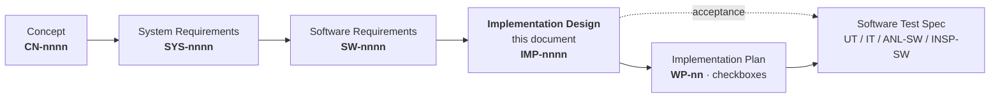

# SIM — Replay & Simulation Engine
## Implementation Design Specification — v0.1

**Owner:** SIM Team (tool supplier)
**Derived from:** `SIM_Software_Requirements_v0.1.md` (this directory), which is derived from `SIM_System_Requirements_v0.1.md`, which is derived from `SIM_Concept_Document_v0.3.1.md`.
**Status:** Draft for review. Not baselined. Inherits every blocking open decision from SwReq §34; closes eight of them as design decisions in §1 and marks each as *confirm* or *adopted*.
**Audience:** whoever writes the code, and whoever reviews it against the requirement set.

> **The master is `SIM_Concept_Document_v0.3.1.md`.** Where anything here appears to disagree with it, the concept wins and this document is wrong. Where this document appears to disagree with the Software Requirements, the Software Requirements win and this document is wrong.

> **This document exists because SwReq §35 says it must.** That section lists six things the Software Requirements deliberately do not contain — module/class/file/function **names**, **skeletons and signatures**, **build order/stages/checkboxes**, **reuse-removal-redefinition mapping at file granularity**, a second architecture narrative, and test steps. Four of the six are this document and its sibling plan. The two that are not — a second architecture narrative and test steps and expected values — stay absent here for the reasons SwReq gives.

> **▶ Before writing any code, read `SIM_Implementation_Plan_v0.1.md` §0.1.** It names the reading order, the first work package, and the four AI-operational-layer files (`.claude/rules/sim.md`'s `R-SIM-9`/`R-SIM-13`/`R-SIM-14`, and `modules/sim/CLAUDE.md`) that currently describe the architecture this design replaces. They change inside `WP-02`, with the code they govern.

> **Scope change, 2026-08-10 — read `DD-12` and `DD-13` first.** The live world-model client is **removed from the system**, not demoted: there is no `sources/` package, no world-driving plug-in and no live stimulus. Every input is a recording read by a codec, and a foreign simulator reaches the system as MCAP plus an ingest map, which `SYS-0109` already required. `SYS-0282` was reworked and SwReq §32.4's disposition row superseded to match. `DD-13` additionally makes **MCAP the only reader implemented in release one**, because no sample of any other format exists yet.

---

## 0. How to read this document

### 0.1 Where this document sits



| Document | Answers | Exists? |
|---|---|---|
| Concept (`v0.3.1`) | *What was asked for, and why* | yes |
| System Requirements (`v0.1`) | *What the system must do at its boundary* | yes |
| Software Requirements (`v0.1`) | *What each software item must do, and what already exists* | yes |
| **Implementation Design (this)** | *Which file, which symbol, which signature, and what changes about it* | **this draft** |
| Implementation Plan (`v0.1`) | *In what order, gated by what, tracked how* | `SIM_Implementation_Plan_v0.1.md` |
| Software Test Specification (`v0.1`) | *What each cited test identifier asserts* | `SIM_Software_Test_Spec_v0.1.md` |
| Interface Specification | *The exact bytes at each `IF-nn`* | not yet — §3 fixes `IF-09` because nothing can be built until it is fixed |

### 0.2 Two numbers, on purpose

Third document, same discipline, same reason.

| What | Example | Rule |
|---|---|---|
| **Heading number** | `7.2` | Position in the document. Changes when sections move. |
| **UID** | `IMP-0042` | Stable identity. Allocated once, in creation order, **never changed and never reused.** |

`IMP` numbers are allocated in `SW` order in this first issue, so `IMP-0001` serves `SW-0001`. **That correspondence is a convenience of the first allocation and is not a rule** — a later `SW` needing two artifacts gets a second `IMP` appended at the end of its section, and the numbers diverge from that point. Never infer an `SW` from an `IMP` number; read the `Serves` column.

### 0.3 Anatomy of an implementation design requirement

Every `IMP` is one row of a table:

| Field | Rule |
|---|---|
| **`IMP-nnnn`** | The UID. |
| **Serves** | The **one** `SW` requirement this design realises. Every `SW` is served by at least one `IMP` — checked by `docs/v2/py/trace_check.py`, not by reading. |
| **`SI`** | The software item, unchanged from SwReq §1.2. An `IMP` never re-assigns an item; if the item looks wrong, the `SW` is wrong and is changed first. |
| **`WP`** | The work package in the Implementation Plan that lands it. This is the checkbox. |
| **Change** | One of six classes (§0.4). Derived from the `SW`'s `Now.` value plus this document's placement decision, never asserted independently. |
| **Artifact · Design** | The concrete file and symbol, and the single design statement that makes the `SW`'s **Accept** clause reachable. A path here is a promise: the code goes at that path under that name. |
| **Test** | The identifier(s) the `SW` cites, repeated so a row is self-contained. Their content is the Test Specification's. |

**What an `IMP` is not.** It is not a restatement of the `SW` in different words. If an `IMP` reads like its `SW` with a filename attached, it has added nothing and the row is wrong. The value an `IMP` adds is exactly one of: *where the code goes*, *what the symbol is called*, *what its signature is*, or *what has to be deleted first*.

### 0.4 The six change classes

Derived mechanically from the `SW`'s `Now.` field, then adjusted by this document's placement decisions. The mapping is stated so it can be checked rather than trusted.

| Class | From `Now.` | Means |
|---|---|---|
| **`KEEP`** | `DONE` | Code exists at the right path under the right item. It may be re-exported under a new package name (§2.3); its body is not touched. |
| **`MOVE`** | `DONE·MOVE` | Code exists and is reusable; the file moves — across items, across languages, or out of `modules/sil_host`. Body changes only where the move forces it. |
| **`DEDUPE`** | `DONE·TWICE` | Two implementations. One survives, one is deleted, and the deletion is gated by `SW-0019`. |
| **`EXTEND`** | `PARTIAL` | Code exists and is narrower than the requirement. New logic is added; existing logic is not rewritten (`R-STYLE-2`). |
| **`NEW`** | `NEW` | Nothing exists. |
| **`DROP`** | any | The behaviour leaves the product. Only used where a `SYS` or `SW` requirement removed the scope, never as an implementation preference. |

A `KEEP` row that names a path under a new package is still `KEEP`, not `MOVE`: §2.3's package rename is one mechanical pass, and classing 98 requirements as `MOVE` because a directory was renamed would drown the 78 that are genuinely misplaced.

### 0.5 What this document fixes, and what it refuses to fix

| Fixed here | Deliberately not here |
|---|---|
| Every file path and symbol name | Function bodies |
| Every public signature at an item boundary | Private helpers inside an item |
| The Resolved Run Spec's concrete schema (§3) — because nothing can be built until the seam is real | The other fifteen `IF-nn` interfaces, which are the Interface Specification's |
| Which code is deleted, and in what order relative to its replacement | The commit sequence, which is the Plan's |
| The eight design decisions SwReq §34.2 left open (§1) | The five inherited blocking questions in SwReq §34.1, which are the customer's |

---

## 1. Design decisions

SwReq §34.2 records eight questions arising from the decomposition, and says of the first: *"`SWQ-01` should close before any of §32.1 begins. It is the only one where the wrong answer is expensive to reverse."* Nothing below can be designed around an open `SWQ-01`, so each is closed here with its rationale, and each is marked:

| Mark | Meaning |
|---|---|
| **`ADOPTED`** | Settled. No work package below is waiting on it. |

**All fourteen were confirmed on 2026-08-11**, so every mark now reads `ADOPTED`
and the `CONFIRM` / `CONFIRM·HARD` marks are gone rather than left standing
stale. What they meant is worth keeping, because it says which three were the
consequential ones: `DD-03` (the flat C ABI), `DD-04` (exactly one codec) and
`DD-12` (no live world-model client at all) were marked `CONFIRM·HARD` —
expensive to reverse — and are the three whose reversal would now cost a
restructure rather than an edit. The rest were `CONFIRM`: real choices made on
stated grounds, reversible at a named point.

**`DD-12`'s confirmation came with the format list** that `SW-0381` and `OQ-08`
were waiting on: *a recording can be an MCAP, an MDF4 or a TDMS.* See `DD-13`,
which is unchanged in substance — MCAP is still the only codec in release one —
but now names the other two instead of describing them.

---

**`DD-01`** · closes `SWQ-01` · **`ADOPTED`** — **The deliverables are sibling folders inside `modules/sim`, named after what they are: `src/simcore/`, `src/simengine/`, `src/adas_sim/`, with public C++ headers at `include/simcore/`.**

`R-SIM-1` puts the framework in `modules/sim` once; `SYS-0257` requires the engine library and engine executable inside one versioned installable artifact; SwReq §32.1's first consequence already states the destination is `modules/sim`, not a new module.

**There is no language folder, and that is the point.** Concept §21.4's target package structure lists three siblings — `simcore/`, `simengine/`, `<python package>/` — not a C++ tree and a Python tree. A `cpp/` directory would say *what a thing is written in*, which is the least interesting fact about it and the one most likely to change; a folder named `simcore` says *what it is*, which is the thing every other document already refers to. The `SI-nn` decomposition, `D-1`…`D-6`'s dependency rules and every `IMP` row below address items by name, so the tree matching those names is what makes an import-direction check readable rather than clever.

**One separator rule, so the names cannot drift.** A C++ deliverable's name carries **no separator** — `simcore`, `simengine`, never `sim-core` or `sim-engine`; a Python package's name is **snake_case** because PEP 8 says so — `adas_sim`. That is the whole rule, and it is written here because the pair `simcore` / `sim-engine` existed in these documents until 2026-08-11 and read as two conventions where there was only ever one. The folder, the CMake target, the binary and every reference in these documents use the same spelling.

**Why under `src/` rather than at the repository root.** The byte-identical `conanfile.py` exports `("CMakeLists.txt", "src/*", "include/*", "cmake/*", "proto/*", "scripts/*", "projects/*")`. Root-level `simcore/` and `simengine/` would need that tuple edited, and `conanfile.py` is byte-identical across every component (`R-BUILD-1`) — so the shape that reads best at the root is the one shape the build machinery forbids. Under `src/` the recipe needs no change at all, and the layout matches `modules/df`, which already puts sources under `src/` and public headers under `include/`. **`src/` is a source root, not a language folder** — `adas_sim` already lives there, and now its two siblings do too.

**What it costs:** `modules/sim/conf/build.yml` moves from `type: unknown` with no settings to a real library recipe; `modules/sim/CMakeLists.txt` moves from `LANGUAGES NONE` to a real C++ project; `pyproject.toml`'s `packages.find` gains an explicit `include = ["adas_sim*"]` so setuptools cannot wander into the two C++ siblings. **`conanfile.py` does not change.** That last line is the check that says the decision is cheap: if it had required editing the recipe, it would have been the wrong shape.

**The player is not a fourth root.** It is Python, it ships in the same distribution (`CN-0262` delivers engine library, engine executable, player and launcher as one package), and it is already `SI-21`. It stays `src/adas_sim/player/`. A fourth root would create a second Python distribution to satisfy a folder-shape preference, and no requirement asks for one. *Separate **process*** (`CN-0049`) is a run-time property the transport (`SI-25`) provides; it is not a packaging one.

---

**`DD-02`** · closes `SWQ-04` · **`ADOPTED`** — **The Resolved Run Spec is JSON, with a canonical serialisation defined in §3.4.**

`CN-0294` says the engine needs no YAML parser. Choosing YAML for the seam would hand it one back and undo the reason the seam exists. `SW-0012` requires text and a meaningful line diff; `SW-0004` requires a stable canonical form to hash. JSON gives all three with a single-header reader and exactly one canonicalisation rule set. Reversible: the spec is written and read at two named symbols (§3.5), so a format change is two functions.

---

**`DD-03`** · closes `SWQ-05` · **`ADOPTED`** — **`simcore` is C++17 internally and exposes a flat C ABI (`simcore/abi/simcore.h`) to every embedder. `simengine` and the Python binding both consume that C ABI and nothing else.**

`CN-0047` says a stable C ABI. `SW-0144` requires the library to be usable without the executable, and `SW-0016`/`SW-0142` require the engine to link no interpreter — which a pybind11 module would violate by construction. A C ABI consumed from Python by `ctypes` gives: no build-time coupling between the player and the engine's compiler, one binding mechanism already proven in this repository (`modules/df/tools/.../df_ctypes.py`), and `SW-0144`'s second host for free — `simengine` *is* the second host.

**Expensive to reverse** because every signature in §4–§13 is shaped by it: a C++ ABI would let types cross the boundary and would make the Python binding a compiled artifact pinned to one compiler.

---

**`DD-04`** · new, not in `SWQ` · **`ADOPTED`** — **There is exactly one codec implementation, in `simcore/io` (C++). The player reads recordings through the `simcore` C ABI, not through a second Python codec.**

This decision is forced and is stated because leaving it implicit is how the fifth duplication would be created after the first four were removed. Three requirements pulled in apparently opposite directions: `SW-0013` forbids Python on a per-message path; the `SI-18` requirement for a finished run to open with **no engine present** (superseded to `viz` — `SM-04`, this document's §21); and `SI-18`'s player-decodes-lazily-in-Python requirement (superseded the same round — `viz`'s `PortValue` diverged from it entirely, decode-free by design).

They are only in tension if "no engine present" is read as "no engine *library* present". It means **no engine *run*** — `E2E-08` opens an artifact directory on a machine with no build, and the player is part of the delivered package (`SYS-0257`), so `simcore` is on that machine whenever the player is. The player therefore opens a recording through `simcore`'s reader and receives array views onto engine-owned buffers (`SW-0014`), which is `CN-0290` exactly.

**The consequence to accept openly:** `io/mcap.py`, `io/csv.py`, `io/jsonl.py` and `io/base.py`'s read path do not survive as codecs. They become `MOVE`s into `simcore/io` (§4) and their Python remnant is a thin binding, not a parser. This is a larger deletion than SwReq §32.2's four-plus-two, and §14.2 records it as the seventh duplication rather than letting it appear later as a surprise.

---

**`DD-05`** · closes `SWQ-02` · **`ADOPTED`** — **Static parameter data is a port *kind*, not a concept beside ports.**

The port declaration gains `kind: data | control | static`, extending the two kinds `CN-0093` already distinguishes rather than adding a third top-level concept. `SW-0060`'s "no cycle structure, no hold, no age" then becomes a property the scheduler reads off the kind, and `SW-0057`'s "a consumer always receives its full port set" needs no exception. The alternative — static data as a parallel channel — would require every consumer, every export and every evidence answer to learn about a second address space.

---

**`DD-06`** · closes `SWQ-03` · **`ADOPTED`** — **Description resolution produces several typed artifacts, each with its own accepted-version set.**

`SW-0198` requires *per description type* accepted versions. One artifact kind cannot carry per-type version sets without inventing a type field inside it, which is the same design with an extra indirection. Typed from the start.

---

**`DD-07`** · closes `SWQ-06` · **`ADOPTED`** — **`SW-0230`'s "a few lines" is three statements: one import, one construction, one call.**

Stated as a number so `SW-0230` can be failed. `ANL-SW-40` counts statements in the scripted equivalent of every CLI verb (`SW-0231`) and fails above three.

---

**`DD-08`** · closes `SWQ-07` · **`ADOPTED`** — **`check/` is moved intact to `modules/sim/contrib/check/`, excluded from the package, and offered to the automation-framework owner.**

`SW-0126` puts verdicts outside the system; SwReq §32.4 says the mechanism is good and should be offered onward rather than deleted from the world. `contrib/` is not built, not packaged, not imported by anything under `src/`, and carries a `README` naming the owner question as open. If no owner claims it within the migration, it is deleted at `MP-6` — recorded so that "temporarily archived" cannot become permanent by silence.

---

**`DD-09`** · closes `SWQ-08` · **`ADOPTED`** — **Per-stage isolation (`SW-0096`) reuses the module ABI over a pipe, hosted by a second `simengine` process in single-stage mode.**

No new hosting design, no new ABI, and `SYS-0058`'s deferral of out-of-process module hosting is untouched — the isolated thing is a *stage of the engine*, not a module hosted out of process. The child is the same executable with `--isolate-stage <name>`, which also makes the isolated path exercise the same load and lifecycle code as the normal one.

---

**`DD-10`** · new, not in `SWQ` · **`ADOPTED`** — **The Python package is restructured so that a package name is a software item name.**

`adas_sim.core`, `adas_sim.contracts` and `adas_sim.view` are not item names, and three of the four duplications live in files whose package gives no clue which side of the seam they belong to. After the restructure, `adas_sim/config/`, `adas_sim/graph/`, `adas_sim/runspec/` … map one-to-one onto `SI-10`…`SI-25`, and `D-1`…`D-6` (SwReq §1.3) become import-direction checks a script can run (`ANL-SW-07`). Full mapping in §2.3.

---

**`DD-11`** · new, not in `SWQ` · **`ADOPTED`** — **The signal header is built before the cycle ladder, and both are built before anything is deleted.**

SwReq §32.5's closing paragraph names `SW-0049` and `SW-0043` as what the largest number of other requirements sit on. `SW-0050`'s ladder reads three of the header's eight fields, so the header is not merely first among equals — it is the ladder's input. The Plan orders them `WP-07` then `WP-08`, both inside `MP-1`, and neither behind any deletion.

**`WP-07`'s contract-side input is `docs/interfaces_signal_header_plan.md`** (superproject root, 2026-08-11). Three of `SW-0043`'s eight fields — source time, cycle counter, status — can only stop being *unknown* if the payload carries them, so the header this item reads is `adas.common.SignalHeader`, defined in `modules/interfaces` and filled by each producing component at its `ProPort`. That plan makes header carriage a rule (**a message that can be a port payload carries exactly one `sig_header`; nothing nested inside it does**) and widens the one field that cannot survive this design: `uint32 time_stamp` wraps in 4.3 seconds read as nanoseconds. **Nothing in `simcore` learns a message by name** — the header is read by descriptor, which is possible precisely because the field name is uniform, and which `R-SIM-11` already guarantees is available without generated bindings.

---

**`DD-12`** · **supersedes the draft's "demote"** · **`ADOPTED`** — **The live world-model client is removed from the system entirely. There is no `sources/` abstraction, no world-model plug-in, and no live stimulus of any kind. Every input is a recording, read by a codec.**

**This is a scope decision by the customer, taken 2026-08-10, and it is stronger than what the requirement documents currently say.** SwReq §32.4 said *"demoted, not deleted"*, and `CN-0282` says driving a live simulator is *"a plugin concern, never a core one"* — both leave a live-source seam open. The decision closes it: a scene-authoring, actor-spawning, world-driving client does not fit this architecture, and keeping one as a plug-in preserves the shape of the thing that does not fit.

**What replaces it costs nothing, because the requirements already say it.** `SYS-0109` — *"Where closed-loop analysis is required, the system shall read the world simulator's output as an input source … ingested through the same reader and ingest-map path as a measurement, with no privileged code path."* A foreign simulator that emits MCAP is therefore already fully supported, by the `io` codec table and an ingest map, with **no code in `modules/sim` naming it**. The capability is not lost; the coupling is.

**Consequences, each planned in `WP-02`:**

| Goes | Why |
|---|---|
| `sources/carla/**` (~1,080 lines, 9 modules + `catalogue.yaml`) | The world-model client itself |
| `sources/base.py` — the `Source` protocol | With no live source, an abstraction over live sources has one implementation left, and it is `None` |
| `contracts/scenario.py`'s `world:` / `carla:` blocks | World bindings — map, spawn index, blueprints — describe a world nobody drives |
| `cli/record.py`'s `--source carla`, `cli/run.py`'s `--source` | The only wiring that reached a live source |
| `tests/unit/test_c2_carla_*.py` (3 files) | Their subject leaves |
| Comments naming it in `io/base.py`, `io/ingest.py`, `model/objects.py`, `sources/recorder.py` | A name in a comment is still a name (`R-SIM-1`'s own argument) |
| `sources/` as a package | Nothing is left in it |

| Survives, relocated | Why |
|---|---|
| `sources/recorder.py` → `adas_sim/io/recorder.py` | It writes recordings; it never drove a world |
| `sources/synthetic.py` → `tests/fixtures/make_synthetic_mcap.py` | A stimulus generator becomes what `R-SIM-12` already says a mock should be: *"freeze its output into the mcap, then resim with that stage `measured`"* — production side, not a live source |

**`ANL-SW-53` becomes a deletion check, not an import check:** the six function tokens `R-SIM-1` already greps for gain a seventh entry for the world-model client's name, scoped to `src/**`, with the planted-violation test `SW-0370` requires. A name that cannot reappear is a stronger guarantee than a name confined to one directory.

---

**`DD-13`** · new, from the same decision · **`ADOPTED`** — **MCAP is the only codec implemented in release one. `SW-0381`'s other two readers are built when a sample file exists, and not before.**

**The three are now named** (confirmed with `DD-12`, 2026-08-11): **MCAP** — the system's own interchange format; **MDF4** — the vehicle measurement format; **TDMS** — the bench capture export. `SW-0381` described them by role because `OQ-08` was open; that half of `OQ-08` is now closed, and the descriptions above are the mapping.

`SW-0381` requires three readers for `R1`. Two of them cannot be *written* today, let alone tested: there is no MDF4 and no TDMS sample in hand. A reader developed against a format specification and no file is a reader that fails on the first real file, and `F-FOREIGN` — the fixture the whole of `MP-1` is validated against — would have to be synthesised from the same guess.

**Naming them changes the plan's shape not at all, and that is the point.** `R-SIM-14` makes a format a codec of ~4 methods each behind one registered interface, so three names is three rows in the codec table. If naming the formats had propagated anywhere beyond that table and `WP-18`, the codec seam would have been wrong.

**So the requirement stands and the plan sequences it.** `WP-06` implements the codec contract with MCAP as its one registration; `WP-18` adds MDF4 and TDMS, and its exit gate is explicitly conditional on a sample being available. This is recorded in §32 as a blocking input alongside `OQ-14` and `OQ-16`, because it is the same kind of thing: **a requirement nobody can exercise is a requirement that will be declared satisfied.**

The seam's schema follows: §3.1's `sources[].codec` example reads `"mcap"`, and the codec table has one row until a file arrives to justify a second.

---

**`DD-14`** · consequence of `DD-12` · **`ADOPTED`** — **The producing-and-not-executing verb in release one is `convert`, not `record`. `record` leaves the verb set.**

`SW-0233` requires three distinct verbs: one that produces a recording and executes nothing, one that does both, one that executes an existing recording. Today those are `record` / `run` / `resim`, and `record`'s only producer was the live world model that `DD-12` removes.

**The requirement is unchanged and still satisfied** — by `convert` / `run` / `resim`. `convert` produces a recording from an external artifact through the capability table (`SW-0265`) and executes nothing, which is exactly the obligation. `record` is retired from `VERBS` (§18.1) and `SW-0232`'s published count drops by one. Retiring a verb whose producer no longer exists is bookkeeping; keeping it as an empty shell would be the mistake, because the next reader would ask what it records.

---

## 2. Target repository shape

### 2.1 The tree

Every path in §4–§29 is under this tree. `[N]` marks a directory that does not exist today.

```
modules/sim/
  CMakeLists.txt                     UPDATE  LANGUAGES NONE -> CXX  (DD-01)
  conanfile.py                       UNCHANGED  byte-identical (R-BUILD-1)
  conf/build.yml                     UPDATE  type: library, real platforms (DD-01)
  pyproject.toml                     UPDATE  DD-10 layout; packages.find gains
                                             include = ["adas_sim*"]  (DD-01)
  VERSION                            UNCHANGED

  include/                      [N]  public C++ API — same shape as modules/df
    simcore/                    [N]
      io.hpp bus.hpp scheduler.hpp module_host.hpp
      mutate.hpp runner.hpp errors.hpp diagnostics.hpp runspec.hpp
      abi/simcore.h             [N]  the flat C ABI for embedders   (DD-03)
      abi/module_abi.h          [N]  the module ABI                 (IF-01)
  cmake/                        [N]  FloatingPoint.cmake            (IMP-0365)

  src/                               THREE deliverables, named after what they are
    CMakeLists.txt              [N]  add_subdirectory(simcore); add_subdirectory(simengine)

    simcore/                    [N]  the engine library — everything DURING a run
      io/  bus/  scheduler/  module_host/  mutate/  runner/
      errors/  diagnostics/  runspec/
      third_party/              [N]  single-header JSON reader      (DD-02)
      tests/                    [N]  UT-IO / UT-BUS / UT-SCH / UT-HOST / UT-MUT / UT-RUN / UT-ERR / UT-EDG

    simengine/                 [N]  the thin executable            (SI-09)
      main.cpp                  [N]
      tests/                    [N]  UT-EXE

    adas_sim/                        the Python package — everything BEFORE a run, and the player
      config/                   [N]  SI-10
      graph/                    [N]  SI-11
      ingest/                   [N]  SI-12
      resolve/                  [N]  SI-13
      runspec/                  [N]  SI-14
      orchestrate/              [N]  SI-15
      prep/                     [N]  SI-16
      diagnostics/              [N]  SI-17
      session/                  [N]  SI-18, 14/15 leaving
                                     NOTE: scene/, render/, player/ (SI-19/20/21)
                                     leave the tree entirely -- superseded to
                                     modules/viz (SM-01, 2026-08-20). session/
                                     itself leaves too (SM-04, 2026-08-20) except
                                     attach.py (SW-0298, SI-25-adjacent) -- whether
                                     that one file relocates into transport/ or
                                     keeps its own directory for one module is
                                     SM-06's call (SI-25 split), not decided here
      launcher/                 [N]  SI-22
      pyapi/                    [N]  SI-23
      plugins/                  [N]  SI-24
      transport/                [N]  SI-25
      io/                            thin binding onto simcore/io, plus recorder.py (DD-04)
      cli/                           stays — argument parsing only, no logic (SW-0229)
                                     NOTE: no sources/ — DD-12 removes it entirely

  scripts/                           the analysis checks — every ANL-SW-nn that is
                                     a grep, a symbol dump or an import direction,
                                     plus prove_equal.py (WP-15a). Not packaged,
                                     not imported by src/. Built at WP-01, before
                                     the code any of them governs.
  contrib/check/                [N]  archived, unpackaged, unimported (DD-08)
  tests/                             UT-* (Python items) + IT-*
  docs/v2/py/                   [N]  trace_check.py and the derived matrices
```

```
modules/sil_host/                    RETIRED at the end of MP-2 (SwReq §32.1)
```

### 2.2 What `modules/sil_host` becomes, file by file

SwReq §32.1 fixes the disposition; this fixes the destination path. **Nothing is rewritten from nothing and no file stays where it is.**

| From `modules/sil_host` | Lines | To | Change | `WP` |
|---|---:|---|---|---|
| `src/sil_component.cpp/.hpp` | 315 | `src/simcore/module_host/component.cpp` + `include/simcore/module_host.hpp` | `MOVE` | `WP-10` |
| `src/exec_timeout.cpp/.hpp` | 77 | `src/simcore/module_host/exec_timeout.cpp` | `MOVE` | `WP-10` |
| `src/errors.hpp` | 61 | `include/simcore/errors.hpp` | `MOVE` | `WP-03` |
| `src/graph_dump.cpp/.hpp` | 68 | `src/simcore/diagnostics/graph_dump.cpp` | `MOVE`, extended | `WP-15` |
| `src/resim_runner.cpp/.hpp` | 134 | `src/simcore/runner/cycle_loop.cpp` | `MOVE`, rewritten to stream | `WP-13` |
| `src/recording_reader.cpp/.hpp` | 191 | `src/simcore/io/` **and** `src/simcore/bus/cycle.cpp` — split by §4/§5 | `MOVE`, internals replaced | `WP-06`, `WP-08` |
| `src/pipeline.cpp/.hpp` — `Step()` | ~120 of 558 | `src/simcore/scheduler/due.cpp` | `MOVE` | `WP-09` |
| `src/pipeline.cpp/.hpp` — load, validate, grid, `Exec()` | ~438 of 558 | — | `DEDUPE`, deleted | `WP-16` |
| `src/ingest_map.cpp/.hpp` — apply half (`ResolveIngestOverrides`) | 42 of 198 | `src/simcore/io/translate.cpp` | `MOVE` | `WP-06` |
| `src/ingest_map.cpp/.hpp` — parse half (`ParseIngestMapFile`, `DiscoverIngestMaps`) | 58 of 198 | — | `DEDUPE`, deleted | `WP-16` |
| `src/library_loader.cpp/.hpp` — open half (`DynamicLibrary`) | 41 of 162 | `src/simcore/module_host/dso.cpp` | `MOVE` | `WP-10` |
| `src/library_loader.cpp/.hpp` — resolve half (`ResolveLibrary` + its two message helpers) | 55 of 162 | — | `DEDUPE`, deleted | `WP-16` |
| `main.cpp` | 179 | `src/simengine/main.cpp` | `MOVE`, trimmed to `SW-0141` | `WP-14` |
| `tests/**` | 933 | `src/simcore/tests/` and `src/simengine/tests/` | `MOVE` — these are `SW-0019`'s corpus | `WP-06`…`WP-15` |

**The line counts are measured, not estimated.** Each split row was counted against the file, including its header block and the anonymous namespace its half owns; a `.cpp/.hpp` pair is counted together. They are quoted because `WP-16` is a deletion package whose only real content is this ledger — an approximate ledger would make the one package that removes ~2,500 lines the one package nobody can check.

**The tests move first, not last.** `SW-0019` says nothing is deleted before the survivor passes the retiring implementation's own tests. That is only executable if the tests are already running against the new location, so each `MOVE` row carries its tests with it and `WP-16` — the deletion package — runs last and does nothing but delete.

### 2.3 The Python package rename (`DD-10`)

One mechanical pass, one commit, no behaviour change. Listed in full because a rename that is 90% done is worse than one not started.

| Today | Becomes | Item |
|---|---|---|
| `contracts/pipeline.py` (1149) | split → `config/pipeline_schema.py`, `graph/build.py`, `graph/coherence.py`, `runspec/emit.py` | `SI-10`/`SI-11`/`SI-14` |
| `contracts/component.py` (519) | `resolve/component.py` — **probe only**, execution path deleted | `SI-13` |
| `contracts/loader.py` (83) | `resolve/library.py` | `SI-13` |
| `contracts/binding.py` (332) | `runspec/address.py` (resolution) + `simcore/mutate` (application) | `SI-14`/`SI-05` |
| `contracts/override.py` (91), `contracts/fault.py` (197) | `config/verbs.py` (the closed lists) + `simcore/mutate` (application) | `SI-10`/`SI-05` |
| `contracts/scenario.py` (524) | `config/scenario.py`, minus the `expect:`/`markers:` blocks | `SI-10` |
| `core/manifest.py` (491) | `runspec/manifest.py` | `SI-14` |
| `core/ids.py` (51) | `runspec/ids.py` | `SI-14` |
| `core/batch.py` (219), `core/batch_worker.py` (190) | `orchestrate/batch.py`, `orchestrate/worker.py` | `SI-15` |
| `core/diagnostics.py` (400), `core/explain.py` (145), `core/evidence.py` (195) | `diagnostics/` | `SI-17` |
| `core/determinism.py` (223), `core/tolerance.py` (87) | `diagnostics/determinism.py`, `diagnostics/tolerance.py` | `SI-17` |
| `core/session.py` (192), `core/tick.py` (220), `core/history.py` (159) | superseded — `modules/viz` (`SM-04`, 2026-08-20) | `SI-18` |
| `core/signals.py` (168) | superseded — `modules/viz` (`SM-04`, 2026-08-20) | `SI-18` |
| `core/errors.py` (72), `core/logging.py` (80), `core/console.py` (30) | `diagnostics/errors.py` — the Python half of the one permitted duplication (`SW-0121`) | `SI-17` |
| `core/runner.py` (351), `core/resim.py` (257) | **deleted** — execution moves to `simcore/runner` | — |
| `io/base.py` (433), `io/mcap.py`, `io/csv.py`, `io/jsonl.py` | codecs → `simcore/io`; Python remnant is `io/binding.py` | `SI-01` |
| `io/ingest.py` (260) | `ingest/map.py` | `SI-12` |
| `io/registry.py` (126) | `plugins/registry.py` | `SI-24` |
| `model/project.py` (337) | `config/project.py` | `SI-10` |
| `model/plugins.py` (176) | `resolve/plugins.py` | `SI-13` |
| `model/ego.py`, `model/objects.py`, `model/sensors.py`, `model/cameras.py` | `config/vehicle.py` — configuration-derived geometry, not a model layer | `SI-10` |
| `view/**` (11 modules, 1471) | superseded — `modules/viz` (`SM-01`, 2026-08-20) | `SI-21` |
| `app/**` (10 modules, 1140) | superseded — `modules/viz` (`SM-01`, 2026-08-20) | `SI-21` |
| `render/viewer.py` (1990) | superseded — `modules/viz` (`SM-01`, 2026-08-20) | `SI-21` |
| `render/{bev,theme,clip,plots,timeline,capture,image_view,palette_check,foxglove}.py` | superseded — `modules/viz` (`SM-01`, 2026-08-20) | `SI-20` |
| `scene/**` | superseded — `modules/viz` (`SM-01`, 2026-08-20) | `SI-19` |
| `check/**` (1040) | `contrib/check/` — out of the package (`DD-08`) | — |
| `sources/carla/**` (1080) | **deleted** (`DD-12`) | — |
| `sources/base.py` (70) | **deleted** — no live source remains to abstract (`DD-12`) | — |
| `sources/recorder.py` (252) | `io/recorder.py` | `SI-01` |
| `sources/synthetic.py` (93) | `tests/fixtures/make_synthetic_mcap.py` — a fixture, not a source (`DD-12`) | — |
| `cli/**` | `cli/` unchanged — argument parsing only | `SI-15` |

**`render/viewer.py` is 1990 lines and is the one file this rename does not fix.** It is moved, not split, in the rename pass; the split it needed (panel state separable from rendering, testable with no window) was `WP-26`'s job and moved with it — superseded to `viz` (`SM-01`, 2026-08-20).

---

## 3. The seam — Resolved Run Spec (`IF-09`)

Fixed here, ahead of the Interface Specification, because SwReq §32.5 makes it the first thing built and nothing else can start without it.

### 3.1 Shape

```jsonc
{
  "schema": "adas.sim.runspec/1.0",          // SW-0005 — refused outside range
  "run_id": "…",                              // SW-0221
  "spec_sha256": "…",                         // SW-0004 — over §3.4's canonical form
  "grid": { "step_ns": 10000000 },            // SW-0006 — computed, not derivable here
  "sources": [ {
      "path": "C:/abs/rec.mcap",              // SW-0001 — absolute, always
      "sha256": "…",                          // SW-0412 — the file the probe pass read
      "codec": "mcap",              // DD-13 — the only codec in R1
      "identity": { "family":"…","model":"…","name":"…","instance":0 },  // SW-0196, DD-06
      "descriptions": [ {"type":"…","version":"…","path":"…","tier":"embedded"} ],
      "merge": { "policy":"play_all", "basis":"capture" },               // SW-0035, SW-0036
      "ingest": [ {                                                       // SW-0011 — resolved table
          "topic":"ARS540.Obj", "port":"fusion.objects", "proto_type":"…",
          "origin":"measured", "factor":1.0, "offset":0.0,
          "header":{"t_source":"…","counter":"…","status":"…"},           // SW-0189
          "ladder_floor":"counter" } ],                                   // SW-0051
      "absent": [ {"port":"…","reason":"…"} ]                             // SW-0190
  } ],
  "stages": [ {
      "name":"fusion", "mode":"simulate", "impl":{"kind":"dll","path":"C:/abs/fus.dll",
                                                  "pattern":"{stem}.dll","search":["…"]},  // SW-0003
      "period_ns": 20000000,                                              // SW-0006
      "abi_version": 2, "config_bundle_sha256":"…",
      "ports": [ {"name":"objects","dir":"pro","kind":"data","proto_type":"…",
                  "record":"full","sampling":"latest_at_or_before",
                  "on_missing":"hold","fixed_slots":false} ],             // SW-0009, SW-0010, DD-05
      "inputs": [ {"port":"objects_in","producer":"perception","producer_port":"objects",
                   "delay_steps":0} ]                                     // SW-0007, SW-0073
  } ],
  "mutations": [ {"verb":"scale","address":{"stage":"vdy","port":"out",
                  "path":["egoDyn","vx"],"index":null},"operands":[1.1],
                  "window_ns":[0,null]} ],                                // SW-0008, SW-0108
  "order": ["vdy","perception","fusion","aeb"],                           // SW-0072 — topological, precomputed
  "coherence": {"verdict":"normal","stale":[],"waiver":null},             // SW-0224
  "outputs": {"dir":"C:/abs/out/run17","exports":[{"codec":"mcap","ports":["*"]}]},
  "limits": {"exec_timeout_ms":250, "severity_exit":"error"},             // SW-0092, SW-0128
  "diagnostics": {"cycle_trace":false, "graph_dump":true}                 // SW-0132, SW-0133
}
```

### 3.2 What the shape enforces

| Field absent by design | Enforces |
|---|---|
| No `search_path`, no stem | `SW-0003`, `SW-0018` — the engine expands nothing |
| No period *ingredients*, only `step_ns` and `period_ns` | `SW-0006` — no GCD in the engine (`ANL-SW-02` greps for it) |
| No reference grammar — `inputs` names a producer, never `self.x`/`source.x` | `SW-0007` — no reference parser in the engine (`ANL-SW-03`) |
| No ingest *map*, only a resolved table | `SW-0011`, `SW-0032` — the engine opens no map file (`ANL-SW-04`) |
| No address *string*, only `{stage, port, path[], index}` | `SW-0008` — `SI-05` parses nothing |
| `record`, `sampling`, `on_missing` present on **every** port | `SW-0009`, `SW-0010` — no default table in the engine |

### 3.3 The one rule that keeps it honest

> **If the engine has to *decide* something the configuration layer could have decided, the spec is missing a field.**

`ANL-SW-01` is the mechanical form: a checker walks the emitted spec and reports any value that is a reference, a stem, a relative path, an expression, or absent-where-required. Zero, or the emit fails.

### 3.3a Resolution is two passes — probe, then emit

The rule above has a consequence the seam's shape does not show on its own. Several of §3.1's fields cannot be decided from configuration alone: `ingest[].ladder_floor` depends on what timing each topic actually carries, `absent[]` on what the file does not carry, `stages[].period_ns` and `abi_version` on what the module declares, and every `measured` stage's validity on whether its outputs are in the file. **The configuration layer therefore has to read before it can resolve** — and the items that need those facts are exactly the items forbidden to open anything.

```
  probe  ──►  RecordingIndex   per source   (SI-13, through simcore's reader)
              ModuleManifest   per stage    (SI-13, through the module ABI)
                     │
                     ▼  passed as data — no handle, no import        (SW-0411)
  resolve ─►  graph · coherence · ingest family · feasibility        (SI-10..SI-12)
                     │
                     ▼
  emit   ──►  Resolved Run Spec, carrying each source's sha256       (SW-0412)
```

| Rule | Why |
|---|---|
| The probe reads through **the same interfaces the run uses** — `io.hpp::Describe` and `adasManifest` | A second, simpler reader written for configuration time would one day approve a run that then fails at tick 0, and the disagreement would be invisible because only one of the two is ever compared against the recording |
| What comes back is **plain data**, never an open handle | It is what makes `graph/`, `ingest/` and `config/` testable with a hand-written index and no file on disk, which is the property their whole unit-test surface rests on |
| The spec carries **each source's content hash** | Two passes without this is strictly worse than one: the spec would assert properties of a file nobody re-checked. `simcore` refuses a mismatch naming both hashes |
| `SI-13` is the **only** Python item that binds the C interface for this, and is bounded by symbol | `SW-0409`. Manifest, version and describe may be called; initialise, execute, shutdown and step may not — a stricter statement than forbidding the binding by folder, and the only one that survives the probe pass existing |

**This does not weaken `CN-0293`.** The engine's input is still the spec and nothing else; what is added is a statement about how the spec came to be fillable. The alternative — leaving it unstated — does not remove the read, it only leaves the reader unnamed.

### 3.4 Canonical serialisation (`SW-0004`, `SW-0012`)

| Rule | Why |
|---|---|
| UTF-8, LF endings, two-space indent, one JSON value per line where the value is scalar | `SW-0012` — a one-mode change is a one-line diff |
| Object keys sorted lexicographically **except** the top level, which is fixed in §3.1's order | Stable hash; readable head |
| Arrays keep semantic order (`order`, `stages`, `ports`); never sorted | Reordering `order` *is* a semantic change |
| Floats forbidden outside `factor`/`offset`/`operands`; all time is integer ns | `SW-0046` |
| The hash is computed over the serialisation with `spec_sha256` set to `""` | A hash cannot cover itself |

### 3.5 The two symbols the format lives behind

```python
# adas_sim/runspec/emit.py                                       (SI-14)
def emit_run_spec(resolved: ResolvedConfig) -> RunSpec: ...
def write_run_spec(spec: RunSpec, path: Path) -> str: ...   # returns spec_sha256
```
```cpp
// include/simcore/runspec.hpp                       (SI-09 reads, simcore consumes)
namespace simcore {
struct RunSpec;                                   // POD tree, no inference, no defaults
Result<RunSpec> LoadRunSpec(std::string_view json);   // refuses schema out of range (SW-0005)
}
```

`DD-02` is reversible at exactly these four symbols.

---

### 3.6 The language boundary, as design

SwReq §4 states the boundary as eight requirements; four of them are satisfied by *deleting*, and that is what makes them design work rather than a rule to remember.

```python
# adas_sim/pyapi/           SI-23 — the whole scripting surface
#   engine.py    thin ctypes binding onto abi/simcore.h   (DD-03)
#   views.py     ArrayView onto an engine buffer, with a generation guard
#   api.py       the public surface: one import, one construction, one call (DD-07)

class ArrayView:                         # SW-0014, SW-0015
    __array_interface__: dict            # numpy sees engine memory, no copy
    _generation: int                     # bumped by IMP-0058 on buffer reuse
    def __getitem__(self, i): ...        # raises StaleViewError past its generation
```

| `IMP` | Serves | `WP` | Change | Artifact · Design | Test |
|---|---|---|---|---|---|
| `IMP-0013` | `SW-0013` | `WP-16` | `EXTEND` | Satisfied by deletion: `core/resim.py` and `contracts/component.py`'s execution path go at `WP-16`, once `IMP-0422` (`WP-15b`) has moved every live caller off them. `ANL-SW-05` walks the call graph from every per-tick entry point and reports any Python frame; the profile in `IT-03` is the confirming measurement, not the check. **Correction 2026-08-22:** this row named `core/runner.py`; wrong — see Design §28.1's correction note and `SW-0013`'s corrected `Now.` note. | `ANL-SW-05`, `IT-03` |
| `IMP-0422` | `SW-0013` | `WP-15b` | `EXTEND` | Every remaining live caller of `core/resim.py`/`resolve/component.py`'s execution path — `cli/resim.py` (`sim resim`), `orchestrate/worker.py` (the `sim batch` per-recording subprocess worker, `R-SIM-19`), `check/runner.py` (scenario `expect:` evaluation — independent of its later, unrelated `MP-6` move to `contrib/check/`, `DD-08`/`SYS-0127`/Design §28.2: it is still packaged and still calls the Python resim loop until then) and `player/shell/qt_window.py`'s GUI "Run" button — rewired onto `simcore`/`simengine`'s C ABI (`IMP-0144`, `R-SIM-4`/`R-SIM-11`) instead. Integration shape (subprocess vs. in-process `ctypes` binding, per call site) is an open call for whoever executes this row, not prescribed here. | `ANL-SW-05`, `IT-03` |
| `IMP-0014` | `SW-0014` | `WP-29` | `NEW` | `pyapi/views.py::ArrayView` — `__array_interface__` pointing at the buffer `simcoreReadPort` returned. `UT-API-01` asserts the numpy array's `.base` pointer lies inside the engine's arena, which is a stronger check than counting allocations. | `UT-API-01` |
| `IMP-0015` | `SW-0015` | `WP-29` | `NEW` | `views.py` — every access compares `_generation` against the engine's current one and raises `StaleViewError` naming the tick the view was taken at. Without it `IMP-0014` trades an honest cost for a silent wrong answer. | `UT-API-02` |
| `IMP-0016` | `SW-0016` | `WP-14` | `KEEP` | `simcore` registers no callback into the scripting layer; the C ABI is one-directional by shape — every function takes plain data and returns an `int`. `ANL-SW-06` is the symbol scan. | `ANL-SW-06` |
| `IMP-0017` | `SW-0017` | `WP-27` | `NEW` | `ANL-SW-07` — an import-direction check: no module outside `adas_sim/pyapi/` and `adas_sim/transport/` may import `ctypes` or open a shared-memory handle. `DD-10`'s package rename is what makes this check writable at all. | `ANL-SW-07` |
| `IMP-0018` | `SW-0018` | `WP-16` | `DEDUPE` | `scripts/check_no_cpp_config.py` — enumerates the four capabilities by name (config parse, ingest parse, wiring validation, library search) and asserts zero implementations under `src/simcore/` or `src/simengine/`. Satisfied by `WP-16`'s deletions; the check is what stops them coming back. | `ANL-SW-08` |
| `IMP-0019` | `SW-0019` | `WP-15a` | `NEW` | `scripts/prove_equal.py` — runs the retiring implementation's own test corpus against the survivor and writes a table of pass/deliberate-change/fail. It is **its own work package**, in front of `WP-16` rather than inside it: a gate written into the package it guards is opened by whoever opens the package, and this one guards the removal of ~2,500 lines and a whole module. As a separate package it is a ticked prerequisite, which is the mechanism the rest of the plan relies on. | `IT-04`, `ANL-SW-09` |
| `IMP-0020` | `SW-0020` | `WP-01` | `NEW` | `scripts/check_no_duplication.py` — names the **seven** historically duplicated capabilities (SwReq's six plus `DD-04`'s codec) and fails the build if any has two implementations. Runs from `WP-01`, so it is green before it has anything to catch and red the moment it does. | `ANL-SW-10` |


# PART B — THE ENGINE (`simcore`, C++)

> Every header below is at `include/simcore/`; every source path is relative to `src/simcore/`. `Result<T>` is `SI-07`'s carrier (§11.1) and is the only way any of these report failure — there are no exceptions across an item boundary and no error codes of local invention.

## 4. `SI-01` — `io`

### 4.1 Skeleton

```cpp
// include/simcore/io.hpp
namespace simcore::io {

// ---- what a codec declares about itself, as data (SW-0022) ----------------
struct Capabilities {
  bool embedded_schemas, random_access, meta_blocks,
       arbitrary_topics, capture_time, round_trip;
};

// ---- what a codec moves: bytes with a name and two stamps -----------------
// It knows no port, no module, no graph, no cycle. (SwReq §1.4)
struct RawMessage {
  std::string_view            topic;
  int64_t                     log_time_ns;      // reception — always present
  std::optional<int64_t>      capture_time_ns;  // validity  — never defaulted (SW-0044)
  std::span<const std::byte>  payload;          // view into the reader's buffer
  bool                        restamped;        // set only by force-align (SW-0037)
};

// ---- a read batch is bounded on three axes, whichever hits first ----------
struct ReadBounds { std::size_t max_messages; std::size_t max_bytes; int64_t max_span_ns; };  // SW-0026
enum class BatchEnd { Count, Bytes, Span, EndOfFile };                                        // reported, not inferred
struct Batch { std::vector<RawMessage> messages; BatchEnd ended_by; };

// ---- the closed method set (SW-0021) — five in, four out -----------------
class Reader {
 public:
  virtual ~Reader() = default;
  virtual Result<void>        Open(const std::filesystem::path&)            = 0;
  virtual Result<Description> Describe() const                              = 0;
  virtual Result<void>        Seek(int64_t log_time_ns)                     = 0;
  virtual Result<Batch>       ReadRange(ReadBounds)                         = 0;
  virtual void                Close()                                       = 0;
};
class Writer {
 public:
  virtual ~Writer() = default;
  virtual Result<void> Open(const std::filesystem::path&, const Meta&)      = 0;
  virtual Result<void> WriteMessage(const RawMessage&)                      = 0;
  virtual Result<void> WriteMeta(MetaKind, std::span<const std::byte>)      = 0;
  virtual Result<void> Close()                                              = 0;
};

// ---- registry: one line per format, lookup by extension (SW-0023) --------
class CodecRegistry {
 public:
  void Register(std::string ext, Capabilities, ReaderFactory, WriterFactory /*may be null*/);
  Result<std::unique_ptr<Reader>> OpenRead (const std::filesystem::path&) const;
  Result<std::unique_ptr<Writer>> OpenWrite(const std::filesystem::path&) const;  // refuses write-only gaps
  std::span<const CodecEntry>     All() const;                                    // SW-0024's symmetry check
};
CodecRegistry& codecs();

// ---- the resolved ingest table, applied — never interpreted (SW-0032) ----
struct IngestRow { std::string topic, port, proto_type, origin;
                   double factor, offset; HeaderBinding header; Rung ladder_floor; };
class Translator {
 public:
  explicit Translator(std::span<const IngestRow>);        // from the spec, always
  Result<PortMessage> Apply(const RawMessage&) const;     // rename + tag + factor/offset, nothing else
};

// ---- merge of N sources onto one timeline (SW-0035..0037) ----------------
enum class MergePolicy { PlayAll, PlayIntersection, ForceAlignment, PlaySequentially };
enum class SyncBasis   { Capture, Reception };
class Merger { public: Merger(MergePolicy, SyncBasis, std::span<Reader* const>);
                       Result<Batch> Next(ReadBounds); };

// ---- index, seek, selection ---------------------------------------------
class SidecarIndex {                                       // SW-0028..0030
 public:
  static Result<SidecarIndex> BuildOrLoad(const std::filesystem::path& recording);
  std::span<const std::string> Topics() const;             // keyed by topic (SW-0029)
  Result<std::uint64_t>        OffsetAtOrAfter(std::string_view topic, int64_t t_ns) const;
  bool                         IsStale() const;            // size+mtime+codec version
};
struct Selection { std::vector<std::string> sources, instances, cycles, topics; };  // SW-0031, closed set
}
```

```
src/io/
  registry.cpp        codecs(), Register, OpenRead/OpenWrite, symmetry assertion
  reader_base.cpp     streaming ReadRange loop, bounds accounting, BatchEnd
  writer_base.cpp     deterministic write order, header preservation, streaming flush
  decode.cpp          LazyPayload — decode on first touch, never at read (SW-0027)
  index.cpp           SidecarIndex: build, load, staleness, topic offsets
  selection.cpp       Selection parse-free application over the index
  translate.cpp       Translator: rename, tag, factor/offset, proto_type refusal
  merge.cpp           Merger: four policies, sync basis, restamp marking
  export.cpp          port-subset export, flattening, write-only registration
  merged_output.cpp   original passthrough + simulated overwrite, self-sufficient
  codecs/mcap.cpp                        THE ONLY R1 READER  (DD-13)
  codecs/mf4.cpp  codecs/pxi.cpp         R1 when a sample file exists (SW-0381)
  codecs/csv_writer.cpp  codecs/parquet_writer.cpp           R1  (SW-0384)
  codecs/rosbag.cpp  codecs/imagedir.cpp  codecs/carmaker.cpp R2  (SW-0382)
        (no sources/ — DD-12 removes live world-model clients from the system.
         A foreign simulator that emits MCAP is a codec plus an ingest map,
         with no code here naming it — SYS-0109.)
```

### 4.2 Design requirements

| `IMP` | Serves | `WP` | Change | Artifact · Design | Test |
|---|---|---|---|---|---|
| `IMP-0021` | `SW-0021` | `WP-06` | `MOVE` | `io.hpp::Reader/Writer` — five and four pure virtuals, `final` on every codec. The protocol comes from `io/base.py::Reader`; the language changes, the shape does not. Adding a format touches the new codec plus one `Register` line. | `UT-IO-01`, `ANL-SW-11` |
| `IMP-0022` | `SW-0022` | `WP-06` | `MOVE` | `io.hpp::Capabilities` — six `bool`s, passed to `Register`, never a method. A capability queried from an instance would let one file's answer differ from its format's. | `UT-IO-02` |
| `IMP-0023` | `SW-0023` | `WP-06` | `MOVE` | `src/simcore/io/registry.cpp::CodecRegistry::Register` — extension is the key; a second registration of one extension is an `Internal` error naming both. Ports `io/registry.py`'s behaviour. | `UT-IO-03` |
| `IMP-0024` | `SW-0024` | `WP-06` | `MOVE` | `registry.cpp` — `Register` asserts that a codec whose `round_trip` is true supplies a `WriterFactory`; one whose `round_trip` is false is registered **write-only** and `OpenRead` refuses it by capability. | `UT-IO-04` |
| `IMP-0025` | `SW-0025` | `WP-06` | `DEDUPE` | `src/simcore/io/reader_base.cpp::ReadRange` — the only read entry point; holds one `Batch` and the codec's own buffer, never a whole-file container. Replaces **both** `io/base.py`'s message list and `recording_reader.cpp`'s message map. | `UT-IO-05`, `ANL-SW-12` |
| `IMP-0026` | `SW-0026` | `WP-06` | `NEW` | `io.hpp::ReadBounds` + `reader_base.cpp` — three counters checked per message; `BatchEnd` records which fired. A message exceeding `max_bytes` alone is emitted alone, so the bound cannot deadlock. | `UT-IO-06` |
| `IMP-0027` | `SW-0027` | `WP-06` | `EXTEND` | `src/simcore/io/decode.cpp::LazyPayload` — `RawMessage::payload` is bytes; decoding happens at first structured access and is memoised per message. Extends `core/tick.py::PortValue`'s existing lazy parse, moved to C++. | `UT-IO-07` |
| `IMP-0028` | `SW-0028` | `WP-17` | `NEW` | `src/simcore/io/index.cpp::SidecarIndex::BuildOrLoad` — sidecar at `<recording>.simidx`; `IsStale()` compares size, mtime and codec version, and a stale index is rebuilt, never repaired. | `UT-IO-08` |
| `IMP-0029` | `SW-0029` | `WP-17` | `NEW` | `index.cpp` — the on-disk form is `topic -> [(log_time_ns, offset)]`, so a run reads only the topics its spec names. A monolithic time index would make port-selective reading impossible. | `UT-IO-09`, `ANL-SW-13` |
| `IMP-0030` | `SW-0030` | `WP-17` | `NEW` | `index.cpp::OffsetAtOrAfter` + `Reader::Seek` — seek jumps to the offset; bytes before it are never read. `UT-IO-10` asserts on the byte counter (`IMP-0135`), not on wall time. | `UT-IO-10` |
| `IMP-0031` | `SW-0031` | `WP-17` | `NEW` | `src/simcore/io/selection.cpp::Selection` — four vectors, empty meaning *all*; applied against the index before any payload is touched. No expression, no predicate. | `UT-IO-11` |
| `IMP-0032` | `SW-0032` | `WP-06` | `DEDUPE` | `src/simcore/io/translate.cpp::Translator` — constructed from `RunSpec::sources[].ingest`, never from a file. This is `ingest_map.cpp`'s **apply** half kept; its parse half dies at `WP-16`. | `UT-IO-12`, `ANL-SW-04` |
| `IMP-0033` | `SW-0033` | `WP-06` | `NEW` | `translate.cpp::Apply` — `value * factor + offset`, applied exactly once at translation, recorded in the topic's provenance so a second application is detectable. | `UT-IO-13` |
| `IMP-0034` | `SW-0034` | `WP-06` | `EXTEND` | `translate.cpp` — the row's `proto_type` is compared to the message's declared type; a mismatch is an `Authoring` error naming both, and marks that cut infeasible rather than coercing. | `UT-IO-14` |
| `IMP-0035` | `SW-0035` | `WP-17` | `NEW` | `src/simcore/io/merge.cpp::Merger` — a `switch` over the four-value enum with no default branch, so a fifth policy fails to compile. | `UT-IO-15` |
| `IMP-0036` | `SW-0036` | `WP-17` | `NEW` | `merge.cpp::SyncBasis` — carried from the spec, written into the run manifest by `IMP-0215`. Never inferred from what the file happens to carry. | `UT-IO-16` |
| `IMP-0037` | `SW-0037` | `WP-17` | `NEW` | `merge.cpp` — `ForceAlignment` sets `RawMessage::restamped`, which survives into the port value's provenance and into every export. The unmarked form is the adoption SwReq Appendix A refused. | `UT-IO-17` |
| `IMP-0038` | `SW-0038` | `WP-06` | `MOVE` | `src/simcore/io/meta.cpp::MetaKind` — a closed enum (`run_manifest`, `config_bundle`, `plugin_identity`, `lineage`, `tolerance`); ports `io/base.py`'s meta-block handling. | `UT-IO-18` |
| `IMP-0039` | `SW-0039` | `WP-06` | `MOVE` | `meta.cpp::OriginOrUnknown` — a topic with no provenance block yields `Origin::Unknown`, never `Measured`. Ports the Python rule of the same name. | `UT-IO-19` |
| `IMP-0040` | `SW-0040` | `WP-06` | `MOVE` | `src/simcore/io/writer_base.cpp` — message order is input order, no map iteration reaches the file, and no wall-clock value is written outside the declared `meta` block. | `UT-IO-20` |
| `IMP-0041` | `SW-0041` | `WP-06` | `EXTEND` | `writer_base.cpp::WriteMessage` — flushes on the same three bounds `ReadBounds` uses. Replaces the accumulate-then-write shape in `resim_runner.cpp` and `core/resim.py`. | `UT-IO-21` |
| `IMP-0042` | `SW-0042` | `WP-18` | `MOVE` | `src/simcore/io/merged_output.cpp` — original messages pass through, simulated ports overwrite their own topic, and the result carries its own `meta` so it loads alone. | `UT-IO-22` |
| `IMP-0381` | `SW-0381` | `WP-18` | `EXTEND` | `src/simcore/io/codecs/{mcap,mdf4,tdms}.cpp` — MCAP is the port of `io/mcap.py` and lands at `WP-06`. **MDF4 and TDMS are blocked on a sample file (`DD-13`)** and are written the week one arrives; they are the reason `SI-01` exists at all, which is why they are deferred rather than dropped. | `UT-IO-23` |
| `IMP-0382` | `SW-0382` | `WP-30` | `NEW` | `src/simcore/io/codecs/{rosbag,imagedir,carmaker}.cpp` — `R2`. Each is one reader class plus one `Register` line, which is `SW-0021`'s claim being paid off. | `UT-IO-24` |
| `IMP-0383` | `SW-0383` | `WP-01` | `KEEP` | `scripts/check_invariants.py` gains an `io`-scope rule: no identifier under `src/simcore/io/codecs/**` names a module, and no module manifest names a codec. Extends the existing `GT-1` grep rather than adding a second scanner. | `ANL-SW-72` |
| `IMP-0384` | `SW-0384` | `WP-18` | `MOVE` | `src/simcore/io/codecs/{mcap,csv_writer,parquet_writer}.cpp` — CSV ports `io/csv.py`; MCAP is the round-trippable one; Parquet is registered **write-only** so `IMP-0024` refuses it as an input. | `UT-IO-25` |
| `IMP-0385` | `SW-0385` | `WP-18` | `EXTEND` | `writer_base.cpp` — all eight header fields are columns/fields in every export, including `unknown` ones. Extends `io/csv.py`, which carries four. | `UT-IO-26` |
| `IMP-0386` | `SW-0386` | `WP-18` | `MOVE` | `src/simcore/io/export.cpp::PortSubset` — the subset is manifest port names from the spec; an export is registered write-only so the loader refuses it as a resim input by capability, not by convention. | `UT-IO-27` |

---

## 5. `SI-02` — `bus`

> `SI-02` is where SwReq §2.4 relocates cycle reconstruction, and `DD-11` makes it the first behaviour built after the seam. `SI-01` hands it named bytes with two stamps; `SI-02` decides what a cycle is, what is held, and what is unknown.

### 5.1 Skeleton

```cpp
// include/simcore/bus.hpp
namespace simcore::bus {

enum class Origin  { Measured, Truth, Mocked, Simulated, Overridden, Unknown };   // SW-0048, closed
enum class Rung    { SourceCycleId, HeaderCounter, SourceTime, ReceptionTime };   // SW-0050, ordered
enum class Quality { Exact, Derived, Approximated };                              // SW-0052
enum class PortKind{ Data, Control, Static };                                     // DD-05, SW-0060

// ---- the eight-field signal header. Every field is value-or-unknown -------
// (SW-0043). `Unknown<T>` is not std::optional by accident: it prints as
// `unknown` and refuses arithmetic, so a missing value cannot become a zero.
struct Header {
  Unknown<int64_t>  t_source_ns;     // computation time      — from the source header
  Unknown<uint64_t> counter;         // cycle identity
  Unknown<uint32_t> status;          // validity
  Unknown<int64_t>  t_capture_ns;    // validity instant      — never defaulted to reception
  int64_t           t_sim_ns;        // delivery cycle        — always known
  // NOTE: reception time is NOT here. It is `RawMessage::t_recv_ns`, on the
  // envelope, which is why Rung::ReceptionTime reads the message and not the
  // header. Two fields one word apart that mean opposite things is how the
  // defaulting SW-0044 forbids becomes an easy mistake instead of an
  // unwritable one (SW-0044, SYS-0284).
  ProducerId        producer;        // module id or RECORDING
  Mode              mode;            // Simulate | Measured | Off
  bool              is_repeat;       // no new data since last cycle
};

struct PortValue {
  PortId              port;
  Header              header;
  Origin              origin;
  Quality             quality;       // and which Rung produced it
  Rung                rung;
  bool                updated;       // false when held
  LazyPayload         payload;       // bytes until first structured access
  BulkRef             bulk;          // topic + log_time_ns; never inlined (SW-0059)
  int64_t age_ns() const;            // DERIVED: t_sim_ns - t_capture_ns, else hold schedule
};

// ---- cycle reconstruction: the ladder, per port (SW-0049, SW-0050) -------
class CycleReconstructor {
 public:
  explicit CycleReconstructor(std::span<const PortDecl>);   // carries each port's ladder_floor
  Result<void>          Ingest(const PortMessage&);
  std::optional<Cycle>  TakeCompleteCycle();                // never "same log_time_ns"
  Rung                  RungUsed(PortId) const;             // reported per port (SW-0050)
  std::span<const Gap>  Gaps() const;                       // detected, never interpolated (SW-0053)
  RateReport            MeasuredRate(PortId) const;         // vs declared (SW-0055)
};

// ---- buffers and hold ---------------------------------------------------
class PortBus {
 public:
  void                Publish(PortValue&&);
  const PortValue&    Get(PortId) const;      // always returns: last real value, marked held
  PortSet             SetFor(StageId) const;  // full port set, always (SW-0057)
  BufferStats         Stats() const;          // reuse count, high-water bytes (SW-0058)
};

// ---- the port catalogue: versioned, resolved at load (SW-0388, SW-0390) --
class PortCatalogue {
 public:
  static Result<PortCatalogue> Resolve(const RunSpec&);
  Result<const PortDecl*>      Find(std::string_view qualified_name) const;   // ns-aware
  SemVer                       Version() const;
};
}
```

```
src/bus/
  header.cpp        Header, Unknown<T>, the eight fields, integer-ns invariants
  value.cpp         PortValue, age_ns derivation, origin tagging
  cycle.cpp         CycleReconstructor — the ladder, gaps, repeat, measured rate
  port_bus.cpp      Publish/Get/SetFor, hold semantics, buffer accounting
  bulk.cpp          BulkRef — topic + log_time_ns, resolved at draw/consume time
  catalogue.cpp     PortCatalogue, namespaces, version gate
  static_data.cpp   PortKind::Static — no cycle, no hold, no age
```

### 5.2 Design requirements

| `IMP` | Serves | `WP` | Change | Artifact · Design | Test |
|---|---|---|---|---|---|
| `IMP-0043` | `SW-0043` | `WP-07` | `EXTEND` | `bus.hpp::Header` — eight fields, each `Unknown<T>` or always-known, per the table above. Extends `core/tick.py::PortValue`, which has five; the three new ones (`t_source_ns`, `counter`, `status`) are what every foreign-recording requirement rests on. | `UT-BUS-01` |
| `IMP-0044` | `SW-0044` | `WP-07` | `MOVE` | `header.cpp` — `t_capture_ns` is `Unknown` by default and there is **no constructor** taking reception as capture. Ports the Python two-clock rule; the type makes the collapse unwritable rather than discouraged. | `UT-BUS-02` |
| `IMP-0045` | `SW-0045` | `WP-07` | `MOVE` | `value.cpp::PortValue::age_ns()` — a method, never a field; capture when known, else the hold schedule. Ports `core/tick.py`'s derived `age_s`, keeping integer ns (`SW-0046`). | `UT-BUS-03` |
| `IMP-0046` | `SW-0046` | `WP-07` | `EXTEND` | `header.cpp` — every time member is `int64_t` ns; `ANL-SW-14` greps `simcore` for `float`/`double` on a member whose name ends `_s`, `_ms` or `_time`. Float seconds survive only at CLI, YAML and label boundaries. | `ANL-SW-14`, `UT-BUS-04` |
| `IMP-0047` | `SW-0047` | `WP-07` | `MOVE` | `header.cpp::Unknown<T>` — no implicit conversion to `T`, no `value_or`, and a formatter that prints `unknown`. Ports the Python `unknown` discipline into a type so `SW-0220` is structural. | `UT-BUS-05` |
| `IMP-0048` | `SW-0048` | `WP-07` | `MOVE` | `bus.hpp::Origin` — six-value enum, `switch` with no default; `ANL-SW-15` compares it against the published schema's enumeration (`SW-0361`). | `UT-BUS-06`, `ANL-SW-15` |
| `IMP-0049` | `SW-0049` | `WP-08` | `DEDUPE` | `src/simcore/bus/cycle.cpp` — `TakeCompleteCycle` groups by the ladder, never by stamp equality. **Both** `io/base.py::group_by_log_time` and `recording_reader.cpp`'s grouping are deleted at `WP-16`; `ANL-SW-16` fails the build if either name reappears. | `UT-BUS-07`, `ANL-SW-16` |
| `IMP-0050` | `SW-0050` | `WP-08` | `NEW` | `cycle.cpp::CycleReconstructor` — the `Rung` enum's order **is** the ladder; descent happens per port when the rung above is unavailable, and `RungUsed()` feeds the run manifest. `OQ-01` changing the answer makes rung 1 inert, not wrong. | `UT-BUS-08` |
| `IMP-0051` | `SW-0051` | `WP-08` | `NEW` | `cycle.cpp` — `ladder_floor` from the spec forbids rungs *above* it; a request to force upward is an `Authoring` error. Every forcing is written to the manifest beside `RungUsed`. | `UT-BUS-09` |
| `IMP-0052` | `SW-0052` | `WP-08` | `NEW` | `value.cpp` — `Quality` travels on the value, not in a side report, so an evidence answer (`IMP-0274`) and an export both carry it without a join. | `UT-BUS-10` |
| `IMP-0053` | `SW-0053` | `WP-08` | `NEW` | `cycle.cpp::Gaps()` — a counter discontinuity produces a `Gap{port, from, to, missed}`; the missing cycles are **not** synthesised. Reported once per port per run, counted, never per message. | `UT-BUS-11` |
| `IMP-0054` | `SW-0054` | `WP-08` | `EXTEND` | `cycle.cpp` — `is_repeat` is set when the freshness key (`counter`, else `t_source_ns`) is unchanged. Extends the Python `updated` flag, which today infers repetition from the schedule rather than from the data. | `UT-BUS-12` |
| `IMP-0055` | `SW-0055` | `WP-08` | `NEW` | `cycle.cpp::MeasuredRate` — a running mean and jitter per port, compared to the spec's `period_ns`; a mismatch beyond a declared band is one warning naming both numbers. | `UT-BUS-13` |
| `IMP-0056` | `SW-0056` | `WP-09` | `DEDUPE` | `src/simcore/bus/port_bus.cpp::Get` — returns the last real value with `updated=false` and a growing `age_ns`. Survives from `pipeline.cpp::Step`'s hold; the Python twin in `contracts/pipeline.py` is deleted at `WP-16`. | `UT-BUS-14` |
| `IMP-0057` | `SW-0057` | `WP-09` | `MOVE` | `port_bus.cpp::SetFor` — builds the stage's full declared port set every tick regardless of mode; this is the single invariant that makes `simulate` and `measured` indistinguishable to a consumer. | `UT-BUS-15` |
| `IMP-0058` | `SW-0058` | `WP-09` | `NEW` | `port_bus.cpp::BufferStats` — a slab allocator with an explicit generation counter per buffer; a reused buffer bumps the generation, which is what `IMP-0015` invalidates a Python view against. | `UT-BUS-16` |
| `IMP-0059` | `SW-0059` | `WP-07` | `MOVE` | `src/simcore/bus/bulk.cpp::BulkRef` — `{topic, log_time_ns, bytes}`; the payload is resolved at consume or draw time. Ports the Scene-side rule (`R-SIM-2`) into the bus so it holds before the player exists. | `UT-BUS-17` |
| `IMP-0060` | `SW-0060` | `WP-07` | `NEW` | `src/simcore/bus/static_data.cpp` — `PortKind::Static` (`DD-05`); the scheduler skips it for due-ness, `age_ns()` returns `unknown`, and hold is undefined rather than false. Unparented in `SYS` — SwReq §32.3. | `UT-BUS-18` |
| `IMP-0387` | `SW-0387` | `WP-08` | `NEW` | `cycle.cpp` — `t_source_ns` is preferred over `t_capture_ns` wherever both exist; the choice is recorded per port beside `RungUsed`, so the manifest answers *which clock was believed*. | `UT-BUS-19` |
| `IMP-0388` | `SW-0388` | `WP-07` | `NEW` | `src/simcore/bus/catalogue.cpp::PortCatalogue::Resolve` — reads the catalogue named by the spec, version-gated at load. **`OQ-11` must be answered before this is authored** — adopting an existing signal catalogue beats defining one. | `UT-BUS-20` |
| `IMP-0389` | `SW-0389` | `WP-07` | `KEEP` | `catalogue.cpp::Find` — a `PortDecl` carries no producer field, so splitting a component in two invalidates no recording, pipeline, plug-in or ingest map. Already true in the Python manifest model; recorded so the move does not lose it. | `UT-BUS-21` |
| `IMP-0390` | `SW-0390` | `WP-07` | `NEW` | `catalogue.cpp` — a project namespace prefix (`<project>::<port>`) resolved after the core catalogue; a project name colliding with a core port is an `Authoring` error naming both. | `UT-BUS-22` |
| `IMP-0420` | `SW-0420` | `WP-07` | `EXTEND` | `catalogue.cpp::PortCatalogue::Version()` — classifies a catalogue diff against its predecessor (added optional field → minor bump, removed/changed field → major bump) and `Resolve()` refuses a spec pinned to a different major version, naming both. Extends `IMP-0388`'s existing version *identity* with the semantic *rule* `SW-0420` states. | `UT-BUS-23` |
| `IMP-0421` | `SW-0421` | `WP-06b` | `NEW` | `src/simcore/io/codecs/erg.cpp` — the `.erg` codec: binary header + `.erg.info` sidecar parsing, `<stem>.manifest.pb`-sidecar-driven column-to-port grouping (longest-prefix match against the manifest's own `PortSpec` names, `<component>.host.*` diagnostics recognized and dropped), and `DescriptorPool`/`DynamicMessageFactory` reflection reconstructing real messages field-by-field. `erg_wire.{hpp,cpp}` — the generic field-number/wire-type walker reading `ComponentManifest`/`PortSpec` without a first-party dependency. | `UT-IO-28`, `UT-IO-29` |

---

## 6. `SI-03` — `scheduler`

### 6.1 Skeleton

```cpp
// include/simcore/scheduler.hpp
namespace simcore::sched {

enum class Sampling { LatestAtOrBefore, Nearest, Strict, Interpolate, AllSinceLast };  // SW-0068
enum class OnMissing{ Hold, SkipCycle, Zero, Error };                                  // SW-0070

// The grid is CONSUMED, never computed (SW-0062). There is no Gcd() in simcore,
// and no Snap() in either language (SW-0173).
class Scheduler {
 public:
  explicit Scheduler(const RunSpec&);                 // step_ns and period_ns arrive resolved
  void                    Advance();                            // t_sim_ns_ += step_ns. Only writer. (SW-0413)
  int64_t                 TSimNs() const;
  bool                    IsDue(StageId, int64_t tick) const;   // integer predicate (SW-0064)
  bool                    HasFreshInput(StageId) const;         // the on_new predicate (SW-0065)
  std::span<const StageId> Order() const;                       // topological, from the spec (SW-0072)
  int64_t                 DelaySteps(EdgeId) const;             // whole grid steps (SW-0073)
  PortValue               Sample(PortId, int64_t t_sim_ns) const;
  void                    ReconcileUpdated(StageId, PortId, bool reported);  // SW-0066
  void                    ReconcileMeasuredRate(StageId);                    // SW-0414
  ScheduleDump            Dump() const;                         // emitted before execution (SW-0076)
 private:
  int64_t t_sim_ns_;      // no setter, and no assignment from any message stamp
};
}
```

```
src/scheduler/
  due.cpp        Advance, IsDue, HasFreshInput; from pipeline.cpp::Step
  sample.cpp     the five policies, the four missing-data behaviours
  order.cpp      topological order consumed from the spec; delay in whole steps
  reconcile.cpp  declared schedule vs the module's own updated flag, and
                 declared period vs the recording's reconstructed cadence
  dump.cpp       ScheduleDump — the pre-execution emission
```

**One clock, two predicates.** Three requirements decide that a module runs — a
fresh key input (`SW-0065`), a declared period (`SW-0064`), and a `measured`
stage's recorded cadence (`SW-0414`). They agree by construction on a recording
this framework produced and cannot agree on one it did not, which is why
`Advance()` is the only writer of `t_sim_ns_` and both kinds of due-ness are
`const` predicates over it. `HasFreshInput` compares the freshness key
`IMP-0054` set against the one the stage last consumed, so two arrivals inside
one grid step yield one execution with the later value and one counted
*coalesced arrival* — the grid being fine enough for that to be rare is
`SW-0006`'s job, not the scheduler's.

### 6.2 Design requirements

| `IMP` | Serves | `WP` | Change | Artifact · Design | Test |
|---|---|---|---|---|---|
| `IMP-0061` | `SW-0061` | `WP-09` | `DEDUPE` | `src/simcore/scheduler/due.cpp` is the **only** execution gate. `Pipeline::Exec` and `contracts/pipeline.py::Pipeline.step`'s every-tick loop are deleted at `WP-16`; `ANL-SW-17` greps for a second stepping entry point. This closes concept §22.2 — implemented twice, used never. **Correction 2026-08-22:** this row named `core/runner.py`, which was wrong — see Design §28.1's correction note; the Python twin was `contracts/pipeline.py`, already removed at `WP-02` (commit `cee3081`), ahead of `WP-16`'s own gate. | `ANL-SW-17`, `UT-SCH-01` |
| `IMP-0062` | `SW-0062` | `WP-09` | `DEDUPE` | `Scheduler::Scheduler(const RunSpec&)` — reads `grid.step_ns` and `stages[].period_ns`. `ComputeBaseGridNs` is deleted from C++; `ANL-SW-02` fails on any GCD, snap or unit conversion in `simcore`. | `ANL-SW-02` |
| `IMP-0064` | `SW-0064` | `WP-09` | `DEDUPE` | `due.cpp::IsDue` — integer modulo on `int64_t` only; no float, no epsilon, no tolerance. Survives from `pipeline.cpp::Step`; the Python twin dies at `WP-16`. | `UT-SCH-02` |
| `IMP-0065` | `SW-0065` | `WP-09` | `EXTEND` | `due.cpp` — `on_new(<port>)` is the default trigger, evaluated against the freshness key `IMP-0054` sets; `periodic(period, offset)` is the declared alternative. Today only the periodic form exists. | `UT-SCH-03` |
| `IMP-0066` | `SW-0066` | `WP-09` | `MOVE` | `src/simcore/scheduler/reconcile.cpp` — the module's reported `updated` wins; a disagreement with the predicted schedule is one `ProvenanceWarning` naming stage, port, tick and both values. Ports the rule already in `contracts/pipeline.py`. | `UT-SCH-04` |
| `IMP-0067` | `SW-0067` | `WP-09` | `NEW` | `Scheduler::Scheduler` — at construction, before tick 0: a grid step below a configured floor or a tick count above a configured ceiling emits a costed warning naming both. Reported by the item that will pay for it, which is what "before it is paid for" means. | `UT-SCH-05` |
| `IMP-0068` | `SW-0068` | `WP-09` | `NEW` | `src/simcore/scheduler/sample.cpp` — five policies, `switch` with no default; the policy arrives per port in the spec and the scheduler holds **no default table** of its own. | `UT-SCH-06` |
| `IMP-0069` | `SW-0069` | `WP-04` | `NEW` | `adas_sim/config/policy.py::check_interpolatable` — `Interpolate` on a non-continuous type is refused at config load, naming the port and its type. Refusing it in the engine would be a run-time failure for an authoring mistake. | `UT-CFG-01` |
| `IMP-0070` | `SW-0070` | `WP-09` | `EXTEND` | `sample.cpp::OnMissing` — four behaviours; `Hold` is the default and increments a counted warning rather than logging per occurrence. Extends today's implicit hold-always. | `UT-SCH-07` |
| `IMP-0071` | `SW-0071` | `WP-30` | `NEW` | `src/simcore/io/merge.cpp` — an out-of-order buffer of declared depth, `R2`. Placed with the merger, not the scheduler: it is a source-alignment concern and the scheduler must not read payloads. | `UT-SCH-08` |
| `IMP-0072` | `SW-0072` | `WP-09` | `MOVE` | `src/simcore/scheduler/order.cpp::Order` — returns `RunSpec::order` verbatim. The topological sort itself is `SI-11`'s (`IMP-0167`), so the engine has no sort and cannot produce a second order. | `UT-SCH-09`, `ANL-SW-18` |
| `IMP-0073` | `SW-0073` | `WP-09` | `NEW` | `order.cpp::DelaySteps` — per edge, in whole grid steps; zero is same-tick, one is previous-cycle. A fractional delay is unrepresentable because the field is `int64_t`. | `UT-SCH-10` |
| `IMP-0075` | `SW-0075` | `WP-09` | `KEEP` | `scheduler.hpp` — no member takes or returns a payload; `ANL-SW-19` asserts the scheduler translation unit does not include `decode.hpp`. Already true; recorded so the move does not lose it. | `ANL-SW-19` |
| `IMP-0076` | `SW-0076` | `WP-15` | `EXTEND` | `src/simcore/scheduler/dump.cpp::ScheduleDump` — emitted before tick 0 and compared against the configuration layer's prediction by `IMP-0131`. Extends `graph_dump.cpp`, which dumps the graph but not the schedule. | `UT-SCH-11` |
| `IMP-0077` | `SW-0077` | `WP-09` | `KEEP` | `IT-05` runs one spec on a loaded and an idle machine and diffs port values; no `std::chrono` call appears in `src/simcore/scheduler/**` outside `dump.cpp`'s reporting. Already true of `pipeline.cpp::Step`. | `IT-05` |
| `IMP-0078` | `SW-0078` | `WP-09` | `EXTEND` | `src/simcore/runner/pacing.cpp` — pacing delays execution only, reads a requested rate and never writes `t_sim_ns_`. **Relocated 2026-08-20** (`SM-04`) from `adas_sim/session/pacing.py`: `session/` moves to `viz` in full, and this property is genuinely engine-side (the C++ run loop's own non-influence obligation), not the player's — the requested rate crosses the transport, but what must not be perturbed is `simcore`'s own execution. The separation is asserted by running a paced and an unpaced spec and diffing port values. | `UT-SCH-12` |
| `IMP-0413` | `SW-0413` | `WP-09` | `NEW` | `src/simcore/scheduler/due.cpp::Scheduler::Advance` — `t_sim_ns_ += spec.grid.step_ns` and nothing else writes that member; it is `private` with no setter, so an arrival cannot move it even by mistake. `ANL-SW-75` asserts no assignment to it from a message timestamp. This is `IMP-0049`'s change seen from the scheduler: today the tick index advances per grouped message set, so the recording's own density decides the tick sequence. | `UT-SCH-13`, `ANL-SW-75` |
| `IMP-0414` | `SW-0414` | `WP-09` | `NEW` | `reconcile.cpp::ReconcileMeasuredRate` — a `measured` stage's outputs are delivered on the ticks `IMP-0050`'s reconstruction places them on; where that cadence differs from `stages[].period_ns` beyond `IMP-0055`'s band, one finding names both rates and the recording's cadence is used. The same mechanism `IMP-0066` uses for a live module's own `updated` flag, applied to the recording — in both cases the observed fact outranks the declared one. | `UT-SCH-14` |

> **One row in this table is not `SI-03`'s**, and is placed here because it reads with the sampling it constrains rather than with its owning item: `IMP-0069` belongs to `SI-10` (§13). Ownership is the `SW`'s, never the section's — `docs/v2/py/trace_check.py` reads it from the Software Requirements, so a section heading can never re-assign an item. **`IMP-0078` no longer needs this caveat** — `SW-0078` is `SI-03`'s own (Software Requirements §7), and as of `SM-04` (2026-08-20) its design row's `WP` matches, having moved off the now-superseded `SI-18`'s package. The note previously read "and `IMP-0078` to `SI-18`", which was stale even before this session — `SW-0078`'s item field has read `SI-03` throughout, and this table was already the right place for it.

---

## 7. `SI-04` — `module_host`

### 7.1 Skeleton

```cpp
// include/simcore/module_host.hpp   (the module ABI itself is abi/module_abi.h — IF-01)
namespace simcore::host {

enum class Phase { Create, Configure, Init, Step, Reset, Destroy };   // SW-0084, observable

class Module {
 public:
  static Result<Module> Load(const std::filesystem::path& absolute);  // SW-0079 — no search
  Result<void>          CheckAbi() const;                             // SW-0081 — before anything else
  Result<Manifest>      ReadManifest() const;                         // SW-0090
  Result<void>          Transition(Phase);                            // SW-0084, SW-0085
  Result<StepReport>    Step(int64_t t_sim_ns, const PortSet& in, PortSet& out,
                             std::chrono::milliseconds timeout);      // SW-0092
  const LoadRecord&     Record() const;                               // path, pattern, abi, build id
};

class Dso {                                  // library_loader.cpp's OPEN half only
 public:
  static Result<Dso> Open(const std::filesystem::path&);   // absolute, always
  template <class F> Result<F*> Symbol(std::string_view);  // by name, at run time (SW-0080)
};

class ExecTimeout {                          // SW-0092, SW-0093
 public:
  ExecTimeout(std::chrono::milliseconds, bool suspended_under_debugger);
  ScopedGuard Arm(StageId, int64_t tick);
};
}
```

```
src/module_host/
  component.cpp     from sil_component.cpp — bind, ABI check, manifest read, buffers
  dso.cpp           from library_loader.cpp's open half — platform dlopen/LoadLibrary
  lifecycle.cpp     the six phases, reset-without-destroy, control-port delivery
  convert.cpp       manifest-driven port<->struct conversion, buffer grow-and-retry
  exec_timeout.cpp  from exec_timeout.cpp — unchanged, plus debugger suspension
  quarantine.cpp    legacy modules with no manifest (SW-0091)
  isolate.cpp       --isolate-stage child over the module ABI (DD-09)
```

### 7.2 Design requirements

| `IMP` | Serves | `WP` | Change | Artifact · Design | Test |
|---|---|---|---|---|---|
| `IMP-0079` | `SW-0079` | `WP-10` | `DEDUPE` | `src/simcore/module_host/dso.cpp::Dso::Open` — takes `std::filesystem::path` and asserts `is_absolute()`. The resolve half of `library_loader.cpp` is deleted at `WP-16`; `ANL-SW-08` enumerates the four forbidden capabilities. | `UT-HOST-01`, `ANL-SW-08` |
| `IMP-0080` | `SW-0080` | `WP-10` | `MOVE` | `dso.cpp::Symbol<F>` — every module entry point is looked up by name at run time; nothing is link-time bound. Ports `sil_component.cpp` unchanged, which already does exactly this. | `ANL-SW-20` |
| `IMP-0081` | `SW-0081` | `WP-10` | `MOVE` | `component.cpp::CheckAbi` — called before `Create`; a mismatch names both versions and no other export is resolved. Ports `sil_component.cpp`'s existing order. | `UT-HOST-02` |
| `IMP-0082` | `SW-0082` | `WP-10` | `KEEP` | `abi/module_abi.h` — the five exports (`adasInit`/`adasExec`/`adasShutdown`/`adasManifest`/`adasAbiVersion`). `ANL-SW-21` counts them; a sixth fails the build, which is what makes `CN-0316` real. | `ANL-SW-21` |
| `IMP-0083` | `SW-0083` | `WP-10` | `EXTEND` | `dso.cpp::Open` — the error carries the absolute path plus the platform's own message (`GetLastError`/`dlerror`), not a rewritten one. Extends the current message, which names the stem. | `UT-HOST-03` |
| `IMP-0084` | `SW-0084` | `WP-10` | `EXTEND` | `src/simcore/module_host/lifecycle.cpp::Phase` — six phases, each emitting a structured log event from `SI-07`'s vocabulary. Today only init/exec/shutdown exist and none is observable. | `UT-HOST-04` |
| `IMP-0085` | `SW-0085` | `WP-10` | `NEW` | `lifecycle.cpp::Transition(Reset)` — permitted from `Step` back to `Init` without `Destroy`; a module declaring no reset export is reported at load, and `SI-15`'s reset policy then falls back to destroy-and-recreate rather than silently doing nothing. | `UT-HOST-05` |
| `IMP-0086` | `SW-0086` | `WP-10` | `NEW` | `lifecycle.cpp` — lifecycle arrives as `PortKind::Control` values on the bus, wired in the same file and grammar as data (SYS §2.3's finding). No second wiring mechanism. | `IT-06` |
| `IMP-0087` | `SW-0087` | `WP-10` | `MOVE` | `component.cpp` — `adasInit(NULL)` resolves the bundle module-relative; an explicit path wins; a project mismatch warns (`R-SIM-3a`). Ports the existing behaviour with the resolution moved to `SI-13`. | `IT-07` |
| `IMP-0088` | `SW-0088` | `WP-10` | `KEEP` | `src/simcore/module_host/convert.cpp` — the manifest's embedded `FileDescriptorSet` drives conversion; there is no per-module conversion code and no generated binding requirement. Already true. | `ANL-SW-22` |
| `IMP-0089` | `SW-0089` | `WP-10` | `MOVE` | `convert.cpp` — grow once on undersize and retry; still undersized is a `Contract` error naming the port and both sizes. Ports `sil_component.cpp` unchanged. | `UT-HOST-06` |
| `IMP-0090` | `SW-0090` | `WP-10` | `MOVE` | `component.cpp::ReadManifest` — the port set comes from `adasManifest`, never from a host-side table. Ports the existing read; `SI-17`'s probe uses the same call, so there is one answer. | `UT-HOST-07` |
| `IMP-0091` | `SW-0091` | `WP-10` | `NEW` | `src/simcore/module_host/quarantine.cpp` — `impl.kind == "legacy"` is the only path that accepts a manifest-less binary, its wiring is verbose and per-argument, and it is badged in the manifest. Never the default path (`R-SIM-16`). | `UT-HOST-08` |
| `IMP-0092` | `SW-0092` | `WP-10` | `MOVE` | `src/simcore/module_host/exec_timeout.cpp` — moves unchanged from `sil_host`; the abort message names stage, tick and elapsed. Its own honest limit on what it can recover from moves with it. | `UT-HOST-09` |
| `IMP-0093` | `SW-0093` | `WP-10` | `NEW` | `exec_timeout.cpp::ExecTimeout` — constructed with `suspended_under_debugger`, set by `SI-09` from `IsDebuggerPresent`/`TracerPid`. A timeout that fires because someone hit a breakpoint is a defect (`CN-0205`, `CN-0218`). | `UT-HOST-10` |
| `IMP-0094` | `SW-0094` | `WP-10` | `EXTEND` | `component.cpp` — on failure the error carries stage, tick and an input snapshot written beside the run artifacts. Extends today's message, which names the stage only. Feeds `IMP-0139`'s reproducer. | `UT-HOST-11` |
| `IMP-0095` | `SW-0095` | `WP-10` | `KEEP` | `component.cpp` — in-process by default, which is what makes `E2E-05`'s single debugger attach reach every module. Already true; the `mode: isolated` exception is `IMP-0096`. | `UT-HOST-12` |
| `IMP-0096` | `SW-0096` | `WP-14` | `NEW` | `src/simcore/module_host/isolate.cpp` — spawns `simengine --isolate-stage <name>` and speaks the module ABI over a pipe (`DD-09`). No new hosting design, and `SYS-0058`'s deferral is untouched. | `UT-HOST-13` |
| `IMP-0391` | `SW-0391` | `WP-10` | `EXTEND` | `scripts/gen_ports.py` — regeneration writes to a temp path and **diffs**; it never overwrites the checked-in manifest. Extends the existing generator, which overwrites. | `UT-HOST-15` |
| `IMP-0392` | `SW-0392` | `WP-10` | `KEEP` | `modules/<name>/conf/ports.yaml` → generated shim, build output, never checked in (`R-SIM-22`). Already true across `df` and `vdy`; recorded so the C++ move does not regress it. | `UT-HOST-16` |
| `IMP-0393` | `SW-0393` | `WP-10` | `EXTEND` | `abi/module_abi.h` — a header comment is not a contract; `UT-HOST-17` scans a loaded module's import table for clock symbols and reports, and `INSP-SW-09` reviews the contract text, and the manifest carries a `reads_clock` declaration. | `UT-HOST-17`, `INSP-SW-09` |
| `IMP-0394` | `SW-0394` | `WP-10` | `NEW` | `component.cpp::ReadManifest` — a `nondeterminism:` block (threads, file I/O, RNG) is read and copied into the run manifest, so a determinism divergence (`IMP-0283`) can name a declared cause. | `UT-HOST-18` |

---

## 8. `SI-05` — `mutate`

### 8.1 Skeleton

```cpp
// include/simcore/mutate.hpp
namespace simcore::mutate {

enum class Verb  { Const, Hold, Offset, Scale, Select, Drop };                  // SW-0097, six, closed
enum class Fault { Drop, Stale, Delay, Invalidate, Corrupt };                   // SW-0101, five, closed

// The address arrives RESOLVED from the spec (SW-0008). Nothing here parses.
struct Address { StageId stage; PortId port; std::vector<FieldId> path;
                 std::optional<int32_t> index; bool all_elements; };

class Mutator {
 public:
  explicit Mutator(std::span<const MutationSpec>);
  Result<void> ApplyTo(PortValue&, int64_t t_sim_ns) const;   // decode once, mutate, encode once
  bool         Touches(PortId) const;                          // bounded set (SW-0105)
};
}
```

```
src/mutate/
  verbs.cpp     the six arithmetic/structural verbs, switch with no default
  faults.cpp    the five fault verbs, each derived from a header field
  address.cpp   Address application over a decoded message; no string parsing
  window.cpp    time-scoped activation, recorded into the manifest
```

### 8.2 Design requirements

| `IMP` | Serves | `WP` | Change | Artifact · Design | Test |
|---|---|---|---|---|---|
| `IMP-0097` | `SW-0097` | `WP-11` | `MOVE` | `src/simcore/mutate/verbs.cpp` — `switch (Verb)` with no default branch; a seventh verb fails to compile. Ports `contracts/override.py`'s closed list, whose enforcement today is a runtime check. | `UT-MUT-01`, `ANL-SW-23` |
| `IMP-0098` | `SW-0098` | `WP-11` | `MOVE` | `verbs.cpp` — no verb allocates a repeated-field element. `UT-MUT-02` asserts no verb grows a repeated field, and the build asserts no `Add`/`insert` call inside `src/simcore/mutate/**`, which is the governing principle made mechanical. | `UT-MUT-02` |
| `IMP-0099` | `SW-0099` | `WP-11` | `MOVE` | `src/simcore/mutate/address.cpp` — takes the spec's `{path[], index, all_elements}` struct. There is no address string in `simcore`; the grammar lives once, in `IMP-0008`'s resolver. | `UT-MUT-03` |
| `IMP-0100` | `SW-0100` | `WP-11` | `MOVE` | `address.cpp` — a port declared `fixed_slots` clears in place and never compacts, because compaction renumbers indices and breaks object association silently. Ports the Python rule. | `UT-MUT-04` |
| `IMP-0101` | `SW-0101` | `WP-11` | `MOVE` | `src/simcore/mutate/faults.cpp` — each of the five acts on a header field `IMP-0043` defines, so a sixth fault would need a ninth header field. Ports `contracts/fault.py`. | `UT-MUT-05` |
| `IMP-0102` | `SW-0102` | `WP-11` | `EXTEND` | `Mutator::ApplyTo` — decode once, apply every verb for that value, encode once. Today `contracts/binding.py` decodes and re-encodes per verb, which is both slow and a second place a value can change. | `UT-MUT-06` |
| `IMP-0103` | `SW-0103` | `WP-11` | `MOVE` | `verbs.cpp` — sets `PortValue::origin = Overridden` on the value itself, so an export and an evidence answer agree without consulting the manifest. | `UT-MUT-07` |
| `IMP-0104` | `SW-0104` | `WP-11` | `MOVE` | `faults.cpp::Delay` — shifts `t_capture_ns` and refuses when it is `unknown`, rather than fabricating one. This is `IMP-0044`'s two-clock rule paying off. | `UT-MUT-08` |
| `IMP-0105` | `SW-0105` | `WP-11` | `KEEP` | `Mutator::Touches` — built at construction from the spec; a port outside the set is never passed to `ApplyTo`. Already true in Python. | `UT-MUT-09` |
| `IMP-0428` | `SW-0424` | `WP-11a` | `EXTEND` | `src/simcore/mutate/address.cpp::ApplyTo`'s internal `Touches` re-check made to agree with `bus::PortBus::Publish`'s fully-qualified `"<stage>.<port>"` storage convention (`src/simcore/bus/port_bus.cpp:24`), instead of comparing against a bare name nothing publishes. Found `2026-08-22` attempting `WP-14a`; fix shape (qualify inside `ApplyTo`, vs. changing `Publish`'s own convention and everything that already reads it) is decided by whoever executes this row, from the real blast radius of each option — not prescribed here. | `UT-MUT-11` |
| `IMP-0106` | `SW-0106` | `WP-11` | `EXTEND` | `scripts/check_closed_sets.py` — compares six enums (`Verb`, `Fault`, `Origin`, `Rung`, `MergePolicy`, error kinds) against the published schema's enumerations and fails on a difference either way. This is SV-8, and it is the check that makes "closed" true rather than conventional. | `ANL-SW-24` |
| `IMP-0107` | `SW-0107` | `WP-11` | `NEW` | `Mutator::ApplyTo` — a `MutationSpec` whose `crosses_boundary` flag is set (computed at emit by `IMP-0008`) is refused unless the spec also carries a waiver. `SI-11` classifies; `SI-05` **refuses**, which is why the obligation is observable at `mutate`'s own interface. | `IT-08` |
| `IMP-0108` | `SW-0108` | `WP-11` | `MOVE` | `src/simcore/mutate/window.cpp` — `[from_ns, to_ns)` per mutation, `null` meaning open; the window is copied into the run manifest by `IMP-0219`. | `UT-MUT-10` |

---

## 9. `SI-06` — `runner`

### 9.1 Skeleton

```cpp
// include/simcore/runner.hpp
namespace simcore {

class Runner {                       // ONE loop. There is no second one. (SW-0109)
 public:
  static Result<Runner> Construct(const RunSpec&);
  Result<RunOutcome>    Run(ProgressSink&, CancelToken);
  Result<void>          StepOnce();                    // the same body Run calls
  const InjectionBoundary& Boundary() const;           // computed before tick 0 (SW-0113)
  std::optional<Divergence> FirstDivergence() const;   // SW-0116
};
}
```

```
src/runner/
  cycle_loop.cpp     from resim_runner.cpp — rewritten to stream, not accumulate
  injection.cpp      the measured->simulate boundary, computed and logged pre-tick-0
  divergence.cpp     first divergence detection, grace window, per-message flagging
  checkpoint.cpp     last completed cycle to disk as the run proceeds
  slice.cpp          time-sliced run: seek, run, stop — cost is the slice
```

### 9.2 Design requirements

| `IMP` | Serves | `WP` | Change | Artifact · Design | Test |
|---|---|---|---|---|---|
| `IMP-0109` | `SW-0109` | `WP-13` | `DEDUPE` | `src/simcore/runner/cycle_loop.cpp::Runner::Run` — one loop, built from the spec. `Run` calls `StepOnce`, so a stepped and a continuous run cannot diverge. `ANL-SW-17` fails on a second loop. | `ANL-SW-17`, `UT-RUN-01` |
| `IMP-0110` | `SW-0110` | `WP-13` | `MOVE` | `cycle_loop.cpp` — a `measured` stage publishes its declared outputs from the bus and is never loaded. Ports the Python behaviour; the invariant is `IMP-0057`'s full port set. | `UT-RUN-02` |
| `IMP-0112` | `SW-0112` | `WP-13` | `MOVE` | `cycle_loop.cpp` — an `off` stage contributes no ports, which is the same absent-port convention a missing input already uses. No special case, per `CN-0320`. | `UT-RUN-03` |
| `IMP-0113` | `SW-0113` | `WP-13` | `NEW` | `src/simcore/runner/injection.cpp` — the set of ports crossing `measured → simulate`, computed from the spec and logged as one structured event before tick 0. | `UT-RUN-04` |
| `IMP-0114` | `SW-0114` | `WP-13` | `MOVE` | `cycle_loop.cpp` — the recorder's topic list is derived from the spec's declared ports, so *"did we record everything?"* is true by construction. Every port carries a policy (`IMP-0009`), including `excluded`. | `IT-09` |
| `IMP-0116` | `SW-0116` | `WP-13` | `NEW` | `src/simcore/runner/divergence.cpp` — compares simulated actuation against the recorded actuation port each tick and latches the first difference beyond a declared band. | `UT-RUN-05` |
| `IMP-0117` | `SW-0117` | `WP-13` | `NEW` | `divergence.cpp` — after the divergence point plus a configured grace window, every written message carries `informational_only`. Per message, not per file, so a slice of a run stays usable. | `UT-RUN-06` |
| `IMP-0118` | `SW-0118` | `WP-13` | `KEEP` | `cycle_loop.cpp` — the reader is upstream of the bus and is never written to. Open loop is structural, not a rule. Already true; recorded so the merged-output work (`IMP-0042`) does not create a back edge. | `ANL-SW-25` |
| `IMP-0119` | `SW-0119` | `WP-13` | `EXTEND` | `src/simcore/runner/checkpoint.cpp` — last completed cycle written to `progress.json` on the same flush schedule as the writer. Extends `core/batch_worker.py`'s checkpoint, which is per run rather than per cycle. | `UT-RUN-07` |
| `IMP-0120` | `SW-0120` | `WP-13` | `NEW` | `src/simcore/runner/slice.cpp` — seeks via `IMP-0030` and stops at the slice end; the byte counter (`IMP-0135`) is what proves the cost is the slice rather than the file. | `UT-RUN-08`, `ANL-SW-26` |
| `IMP-0395` | `SW-0395` | — | `NEW` | Ego re-integration. **`DEF`** — deferred with its parent, and named here only so its absence is a decision. No artifact allocated. | `UT-RUN-09` |
| `IMP-0396` | `SW-0396` | `WP-30` | `NEW` | `src/simcore/runner/replay_one.cpp` — re-execute one cycle from a saved input snapshot (`IMP-0094`'s). `R2`; it is `IMP-0139`'s reproducer made executable. | `UT-RUN-10` |

---

## 10. `SI-07` — `errors`

> **The one permitted duplication.** Two processes in two languages both need to raise. `SW-0121` allows it and `SW-0122` keeps it honest by comparing rather than trusting.

### 10.1 Skeleton

```cpp
// include/simcore/errors.hpp     — moved from sil_host/src/errors.hpp
namespace simcore {
enum class Kind { Authoring, Environment, Contract, Internal };     // four, no fifth
struct Error { Kind kind; std::string expected, found, where, hint; };
template <class T> class Result;                                    // Error or T, never both
enum class ExitCode { Ok=0, Config=2, Coherence=3, Module=4,
                      Input=5, Infra=6, Timeout=7, Crash=8 };       // SW-0125, published
}
```
```python
# adas_sim/diagnostics/errors.py — the Python half of the same taxonomy
class Kind(StrEnum): AUTHORING; ENVIRONMENT; CONTRACT; INTERNAL
class SimError(Exception): kind, expected, found, where, hint
EXIT_CODES: Mapping[str, int]            # generated from the same source as errors.hpp
```

### 10.2 Design requirements

| `IMP` | Serves | `WP` | Change | Artifact · Design | Test |
|---|---|---|---|---|---|
| `IMP-0121` | `SW-0121` | `WP-03` | `DEDUPE` | `include/simcore/errors.hpp` moves from `sil_host` unchanged; `adas_sim/diagnostics/errors.py` is the Python half. Both are generated from `docs/v2/errors.yaml` so neither is hand-maintained — this is the exception, made cheap. | `UT-ERR-01`, `ANL-SW-27` |
| `IMP-0122` | `SW-0122` | `WP-03` | `NEW` | `scripts/check_error_parity.py` — compares the two enumerations and the four message fields, and fails the build on any difference. Without it, the granted exception becomes the seventh drift. | `ANL-SW-28` |
| `IMP-0123` | `SW-0123` | `WP-03` | `MOVE` | `errors.hpp::Error` — `expected` and `found` are separate fields, never one formatted string, so both ends are machine-readable. Ports the existing four-field shape. | `UT-ERR-02` |
| `IMP-0124` | `SW-0124` | `WP-03` | `MOVE` | `adas_sim/diagnostics/suggest.py::near_matches` — edit distance over the candidate set, populating `hint`. Ports the existing Python suggestion; C++ raises with the candidate list and lets the CLI rank. | `UT-ERR-03` |
| `IMP-0125` | `SW-0125` | `WP-03` | `EXTEND` | `errors.hpp::ExitCode` — eight values, published in the CLI reference, identical on both platforms. Extends today's set, which is ad hoc; `UT-ERR-04` diffs the two platforms' emitted table. | `UT-ERR-04` |
| `IMP-0126` | `SW-0126` | `WP-02` | `DROP` | No exit code means "the scenario failed". `check/` moves to `contrib/` (`DD-08`) and `ANL-SW-29` fails if anything under `src/` imports it; `INSP-SW-01` reviews the exit-code table for a smuggled verdict. This is the deletion that makes `SYS-0127` real. | `ANL-SW-29`, `INSP-SW-01` |
| `IMP-0127` | `SW-0127` | `WP-03` | `MOVE` | `adas_sim/diagnostics/events.py` + `src/simcore/errors/events.cpp` — one closed event vocabulary, generated from `docs/v2/events.yaml`, same mechanism as `IMP-0121`. | `UT-ERR-05`, `ANL-SW-30` |
| `IMP-0128` | `SW-0128` | `WP-23` | `NEW` | `adas_sim/orchestrate/severity.py` — `--exit-on {exception,error,alert,warning}`; the threshold in force is written to the run manifest so a short run is explicable. | `UT-ERR-06` |
| `IMP-0129` | `SW-0129` | `WP-03` | `MOVE` | `adas_sim/diagnostics/console.py::force_utf8` called from every entry point, and `SetConsoleOutputCP` in `simengine`'s `main`. Ports `core/console.py`. | `UT-ERR-07` |
| `IMP-0130` | `SW-0130` | `WP-24` | `NEW` | `adas_sim/diagnostics/summary.py` — a counted table at run end whose totals reconcile against the structured log's event counts; a mismatch is itself a warning. | `UT-ERR-08` |


---

## 11. `SI-08` — engine diagnostics

### 11.1 Skeleton

```cpp
// include/simcore/diagnostics.hpp
namespace simcore::diag {

struct GraphDump   { std::vector<StageLine> stages; std::vector<EdgeLine> edges; };
struct ScheduleDump{ int64_t step_ns; std::vector<PeriodLine> periods; };
struct CostReport  { int64_t wall_ns, read_ns; std::map<StageId,int64_t> per_stage_ns;
                     std::uint64_t cycles, bytes_read; };        // bytes COUNTED (SW-0135)

class CycleTrace {                                    // off by default (SW-0133)
 public:
  explicit CycleTrace(bool enabled, std::filesystem::path sink);
  void Record(int64_t tick, StageId, bool due, bool ran, int64_t ns, PortSet::View in);
};

struct BreakCondition { std::optional<int64_t> at_tick, at_time_ns;
                        std::optional<StageId> on_entry;
                        std::optional<PortPredicate> when; };     // closed, no expression

// Every function here is noexcept and returns a value. Diagnostics never raise. (SW-0140)
GraphDump    DumpGraph   (const Runner&) noexcept;
ScheduleDump DumpSchedule(const Scheduler&) noexcept;
CostReport   Cost        (const Runner&) noexcept;
LoadedModules Modules    (const Runner&) noexcept;
void         WriteReproducer(const Error&, const std::filesystem::path&) noexcept;
}
```

```
src/diagnostics/
  graph_dump.cpp   from sil_host/src/graph_dump.cpp — extended to emit the schedule too
  trace.cpp        CycleTrace — per tick, per module, accounting for every one
  cost.cpp         wall/read/per-stage timers and the byte counter
  modules.cpp      loaded module ids, versions, binary hashes
  breakpoints.cpp  the four break conditions, evaluated in the loop
  reproducer.cpp   minimal crash package: spec, tick, input snapshot, stderr
```

### 11.2 Design requirements

| `IMP` | Serves | `WP` | Change | Artifact · Design | Test |
|---|---|---|---|---|---|
| `IMP-0131` | `SW-0131` | `WP-15` | `MOVE` | `src/simcore/diagnostics/graph_dump.cpp` — emits graph **and** schedule from what the engine actually loaded, in the same shape `adas_sim/diagnostics/explain.py` predicts, so `IT-10` diffs the two texts. A disagreement is a defect in the seam and this is how it is caught (`CN-0386`). | `IT-10` |
| `IMP-0132` | `SW-0132` | `WP-15` | `NEW` | `src/simcore/diagnostics/trace.cpp::CycleTrace::Record` — one row per stage per tick, including stages that were **not** due, so "accounts for every module" is checkable by row count rather than by inspection. | `UT-EDG-01` |
| `IMP-0133` | `SW-0133` | `WP-15` | `NEW` | `trace.cpp` — enabled from the spec's `diagnostics.cycle_trace`; when off, the sink is a null object with no branch inside the loop. `UT-EDG-02` runs the same spec twice and compares port values. | `UT-EDG-02` |
| `IMP-0134` | `SW-0134` | `WP-15` | `NEW` | `src/simcore/diagnostics/cost.cpp::CostReport` — wall, read, per-stage, cycles and bytes, written into the run manifest. This is what makes `SW-0369`'s budget failable rather than asserted. | `UT-EDG-03` |
| `IMP-0135` | `SW-0135` | `WP-15` | `NEW` | `cost.cpp` — the counter is incremented in `Reader::ReadRange` from the actual byte span, never from a message count times an average. `IMP-0030` and `IMP-0120` both assert against it. Wired into `Runner`'s live cycle loop 2026-08-23 (`Runner::SetByteCounter`, called from `PullCycle`). | `UT-EDG-04`, `UT-RUN-15` |
| `IMP-0136` | `SW-0136` | `WP-15` | `KEEP` | `cost.cpp` — timers read `steady_clock` and write only to `CostReport`; the no-clock rule (`SW-0077`'s) deliberately excludes `diagnostics/`, and `UT-EDG-05` proves the measured values do not change a port value. | `UT-EDG-05` |
| `IMP-0137` | `SW-0137` | `WP-15` | `EXTEND` | `src/simcore/diagnostics/modules.cpp` — id, version, ABI version, absolute path and binary SHA-256 per loaded module. Extends `graph_dump.cpp`, which names stages but not what was loaded into them. | `UT-EDG-06` |
| `IMP-0138` | `SW-0138` | `WP-15` | `NEW` | `src/simcore/diagnostics/breakpoints.cpp::BreakCondition` — four fields, a closed struct, evaluated at the top of the loop. `PortPredicate` is `{port, field, op, value}` from a six-operator closed set — not an expression language (`CN-0286`). | `UT-EDG-07` |
| `IMP-0139` | `SW-0139` | `WP-15` | `NEW` | `src/simcore/diagnostics/reproducer.cpp::WriteReproducer` — writes spec, tick, `IMP-0094`'s input snapshot and captured stderr into one directory that `IMP-0245`'s *Open on Bench* consumes. `simEngineCreate` wires a real `Checkpoint` (new `RunSpec.checkpoint.path`, gated like `IMP-0426`'s writer) closed 2026-08-24, the gap found live that left this row `[~]`. | `UT-EDG-08`, `UT-ABI-03` |
| `IMP-0140` | `SW-0140` | `WP-15` | `MOVE` | Every symbol in `diagnostics.hpp` is `noexcept` and returns a value; a partially-known dump reports `unknown` fields. Ports the Python `doctor` rule (`SW-0277`) into the engine so both halves behave identically. | `UT-EDG-09` |

---

## 12. `SI-09` — `simengine`

### 12.1 Skeleton

```cpp
// src/simengine/main.cpp   — SW-0389's hundred-line review check applies here
int main(int argc, char** argv) {
  auto args = ParseArgs(argc, argv);      // <run_spec> --out --wait-for-debugger
                                          // --break-at --isolate-stage --restart
  if (args.wait_for_debugger) { PrintPid(); WaitForAttach(); }
  auto spec   = simcore::LoadRunSpec(ReadFile(args.spec));      // refuses out-of-range
  auto runner = simcore::Runner::Construct(spec);
  auto out    = runner.Run(ConsoleProgress{}, SignalCancel{});
  return static_cast<int>(out.exit_code);                        // the taxonomy's
}
```

```cpp
// include/simcore/abi/simcore.h — the flat C ABI every embedder uses (DD-03)
typedef struct SimcoreRunner SimcoreRunner;
int  simcoreAbiVersion(void);
int  simcoreConstruct(const char* run_spec_json, SimcoreRunner** out);
int  simcoreRun(SimcoreRunner*);
int  simcoreStepOnce(SimcoreRunner*);
int  simcoreReadPort(SimcoreRunner*, const char* port, SimcoreView* out);  /* zero-copy */
int  simcoreLastError(SimcoreRunner*, SimcoreError* out);
void simcoreDestroy(SimcoreRunner*);
```

### 12.2 Design requirements

| `IMP` | Serves | `WP` | Change | Artifact · Design | Test |
|---|---|---|---|---|---|
| `IMP-0141` | `SW-0141` | `WP-14` | `MOVE` | `src/simengine/main.cpp` — the eight lines above plus argument parsing. `ANL-SW-31` counts non-comment lines and reports above 100 (`CN-0389`'s review check, mechanised); `sil_host/main.cpp` is 179 and loses its config handling on the way in. | `ANL-SW-31` |
| `IMP-0142` | `SW-0142` | `WP-14` | `KEEP` | `src/simengine/CMakeLists.txt` links `simcore` only. `ANL-SW-06` runs a symbol scan for any interpreter symbol in both binaries. Already true of `sil_host`; recorded so the move cannot lose it. | `UT-EXE-01`, `ANL-SW-06` |
| `IMP-0143` | `SW-0143` | `WP-14` | `NEW` | `main.cpp::PrintPid/WaitForAttach` — prints the pid to stdout, flushes, and blocks until a debugger attaches or a keypress. This is `E2E-05` step 4 and it is why the engine must be launchable from a spec alone. | `UT-EXE-02` |
| `IMP-0144` | `SW-0144` | `WP-14` | `MOVE` | `abi/simcore.h` — the C ABI (`DD-03`). `IT-11` embeds `simcore` from a test host that is not `simengine`, which is what proves the library is usable without the executable rather than asserting it. | `IT-11` |
| `IMP-0145` | `SW-0145` | `WP-14` | `KEEP` | One target, no `-DCI` variant, no headless build flag. `ANL-SW-32` asserts the interactive, batch and CI paths invoke the same binary hash. | `ANL-SW-32` |
| `IMP-0146` | `SW-0146` | `WP-14` | `KEEP` | `ANL-SW-33` scans the link line for a GUI toolkit and the source for `stdin` reads. `simengine` never prompts; a missing argument is an `Authoring` error, not a question. | `UT-EXE-03`, `ANL-SW-33` |
| `IMP-0147` | `SW-0147` | `WP-14` | `NEW` | `main.cpp` — `--restart <n>` defaults to zero. A restart is written to the run manifest as a distinct outcome; a crash that became `ok` through a silent retry is the failure this forbids. | `UT-EXE-04` |
| `IMP-0148` | `SW-0148` | `WP-14` | `EXTEND` | `main.cpp` returns `ExitCode` and nothing else; `UT-EXE-05` asserts each taxonomy kind maps to its published code on both platforms. Extends `sil_host/main.cpp`, which returns 1 for everything that is not success. | `UT-EXE-05` |
| `IMP-0397` | `SW-0397` | `WP-31` | `NEW` | `docs/v2/debugging.md` plus shipped `.vscode/launch.json` and a Visual Studio `.natvis`; `INSP-SW-*` checks the file set exists for both platforms. Part of the delivery (`CN-0221`), not a wiki page. | `UT-EXE-06` |
| `IMP-0426` | `SW-0422` | `WP-14a` | `EXTEND` | `src/simcore/abi/simcore.cpp::simEngineCreate` constructs its `Runner` with a real writer, opened from the resolved Run Spec's own declared output path/policy (`R-SIM-6`), instead of `nullptr`. Found 2026-08-22: `WP-14` landed this function as a deliberately read-only slice (its own comment says so), which blocks every downstream host — `WP-15b`'s four Python callers among them — from getting results back through the ABI at all. | `UT-ABI-01` |
| `IMP-0427` | `SW-0423` | `WP-14a` | `EXTEND` | `simEngineCreate` wires a `PortResolver` — a no-op one when the spec declares zero overrides, `simcore/mutate`'s existing verb application (`SI-05`, already real) otherwise — instead of leaving mutations unreachable. | `UT-ABI-02` |

---

# PART C — THE CONFIGURATION LAYER (Python)

> Everything in this part runs **once per run**. `ANL-SW-34` is the boundary check: no module under `adas_sim/config`, `graph`, `ingest`, `resolve` or `runspec` may open a recording payload or load a module binary.

## 13. `SI-10` — `config`

### 13.1 Skeleton

```python
# adas_sim/config/
#   layers.py      four-layer merge, per-value source recording
#   schema.py      published JSON-Schema set, unknown-key refusal, version gate
#   kinds.py       the four file kinds and their boundaries (SW-0150)
#   include.py     includes, fragments, variables
#   roundtrip.py   byte-identical write-back
#   pipeline_schema.py   from contracts/pipeline.py — the schema half only
#   scenario.py    from contracts/scenario.py, minus expect:/markers:
#   project.py     from model/project.py
#   vehicle.py     from model/{ego,objects,sensors,cameras}.py
#   verbs.py       the closed override and fault vocabularies
#   policy.py      sampling / on_missing / record policy validation
#   bundle.py      what may enter the config bundle, and the two agreement checks

class Layer(StrEnum):  PACKAGE; PROJECT; RUN; CLI          # SW-0149, later wins

@dataclass(frozen=True)
class Provenanced[T]:                                       # SW-0149, SW-0166
    value: T
    layer: Layer
    file: Path
    line: int

class FileKind(StrEnum):                                    # SW-0150 — four, never merged
    COMPOSITION; CONNECTIONS; SOURCE_BINDING; LAYOUT

def load(paths: ConfigPaths, cli: Mapping[str, str]) -> ResolvedConfig: ...
def validate(cfg: RawConfig) -> None: ...                   # raises SimError(AUTHORING)
def round_trip(path: Path) -> bytes: ...                    # SW-0155
```

### 13.2 Design requirements

| `IMP` | Serves | `WP` | Change | Artifact · Design | Test |
|---|---|---|---|---|---|
| `IMP-0149` | `SW-0149` | `WP-04` | `EXTEND` | `config/layers.py::merge` — returns `Provenanced[T]` per leaf, so the layer is carried rather than reconstructed. Today `contracts/pipeline.py` merges but keeps no origin, which is why `SW-0166` is `PARTIAL`. | `UT-CFG-02` |
| `IMP-0150` | `SW-0150` | `WP-04` | `EXTEND` | `config/kinds.py::FileKind` — four kinds with disjoint key sets; a key of one kind appearing in another is an `Authoring` error. SYS §2.2's independently-arrived-at four-way split, made a refusal rather than a convention. | `UT-CFG-03`, `INSP-SW-02` |
| `IMP-0151` | `SW-0151` | `WP-04` | `EXTEND` | `config/schema.py` — one published JSON-Schema per kind under `schemas/`, shipped in the package. Errors name file, line, wrong value and allowed values. Extends today's ad-hoc dataclass validation. | `UT-CFG-04` |
| `IMP-0152` | `SW-0152` | `WP-04` | `EXTEND` | `schema.py` — `additionalProperties: false` everywhere, and the error carries `near_matches` from `IMP-0124`. An unknown key is an error, never a warning (`CN-0183`). | `UT-CFG-05` |
| `IMP-0153` | `SW-0153` | `WP-04` | `MOVE` | `schema.py::check_version` — ports `contracts/pipeline.py`'s `version:` gate to every file kind, not just the pipeline. The C++ mirror in `pipeline.cpp` dies at `WP-16`. | `UT-CFG-06` |
| `IMP-0154` | `SW-0154` | `WP-04` | `MOVE` | `config/__init__.py::load` — every reference resolves, every mode is checked against the recording index, every type matches, before any object is returned. Ports the load-time discipline (`R-SIM-*`, `CN-0346`) across all four kinds. | `UT-CFG-07` |
| `IMP-0155` | `SW-0155` | `WP-04` | `NEW` | `config/roundtrip.py` — a YAML round-trip that preserves key order, comments and quoting, so the launcher writing a file it read produces no spurious diff. Uses a round-trip loader, not the safe loader. | `UT-CFG-08` |
| `IMP-0156` | `SW-0156` | `WP-04` | `NEW` | `config/include.py::expand` — `!include` resolved relative to the including file, cycle-detected, and the expanded form is what is validated, so an included fragment cannot smuggle an unknown key past `IMP-0152`. | `UT-CFG-09` |
| `IMP-0157` | `SW-0157` | `WP-04` | `NEW` | `include.py::resolve_vars` — `${name}` from a declared variable set only; every resolution is recorded as a `Provenanced` entry and printed by `explain`. No environment lookup by default. | `UT-CFG-10` |
| `IMP-0158` | `SW-0158` | `WP-04` | `MOVE` | `config/paths.py::ConfigPaths` — the project root is a parameter, never a package-relative default, so configuration lives in the customer's repository (`CN-0014`). `IT-12` runs from a checkout with the package installed read-only. | `IT-12` |
| `IMP-0159` | `SW-0159` | `WP-04` | `MOVE` | `config/bundle.py::may_enter_bundle` — a file enters iff some module's DLL reads it at run time (`R-SIM-9`); simulation data is refused with the rule quoted. Ports today's bundle assembly. | `UT-CFG-11` |
| `IMP-0160` | `SW-0160` | `WP-04` | `MOVE` | `bundle.py` — project agreement across manifests is a **warning** with a declared escape; ego-parameter agreement is a **hard error with no escape** (`R-SIM-3a`). Two severities, ported unchanged. | `UT-CFG-12` |
| `IMP-0161` | `SW-0161` | `WP-04` | `KEEP` | `config/vehicle.py` — ego body, footprints, sensor poses and intrinsics come from the project's YAML per run; a fallback footprint is tagged `assumed_geometry` so it draws visibly as a guess. Already true. | `UT-CFG-13` |
| `IMP-0162` | `SW-0162` | `WP-04` | `KEEP` | The bundle is copied **beside** the library, never compiled into it, so `IT-13` edits a value and re-runs with no build. Already true; `DD-01`'s C++ subtree must not tempt anyone to embed it. | `IT-13` |
| `IMP-0163` | `SW-0163` | `WP-04` | `KEEP` | `config/policy.py` reads `<COMPONENT>_<FN>_PERIOD_US` as an integer; `emit_run_spec` multiplies by 1000 into `period_ns`. Integer microseconds in, integer nanoseconds out, no float anywhere (`R-SIM-18`). | `UT-CFG-14` |
| `IMP-0164` | `SW-0164` | `WP-04` | `EXTEND` | `ANL-SW-34` — an import-direction check: nothing under `adas_sim/config/**` may import `adas_sim.io` or `ctypes`. Today `contracts/pipeline.py` reaches into the component loader, which is why this is `PARTIAL`. | `ANL-SW-34` |
| `IMP-0165` | `SW-0165` | `WP-04` | `EXTEND` | `config/__init__.py::validate_only` — the path `sim validate` takes; runs with no recording and no binary, so it is a fast lint job in CI (`CN-0128`). Extends today's validate, which needs the libraries present. | `UT-CFG-15` |
| `IMP-0166` | `SW-0166` | `WP-04` | `EXTEND` | `layers.py::Provenanced` is carried through into `explain`'s output, per value. This is `IMP-0149`'s payoff and the reason the two are one work package. | `UT-CFG-16` |
| `IMP-0398` | `SW-0398` | `WP-04` | `NEW` | `config/kinds.py` — a `COMPOSITION` file declares a unit's exposed ports and nothing about wiring; wiring is `CONNECTIONS`. A composition file naming another unit is an `Authoring` error, which is what makes a unit reusable (`CN-0103`). | `UT-CFG-18` |
| `IMP-0399` | `SW-0399` | `WP-31` | `MOVE` | `schemas/` ships in the package (SIM owns the format); `projects/**` lives in the customer repository (the algorithm team owns the content). `INSP-SW-10` reviews the split against a named checklist. | `INSP-SW-10` |

---

## 14. `SI-11` — `graph`

> The item with the most `PARTIAL` rows (9 of 26), and the one carrying the single correctness defect in the codebase: `severed_chains()` inspects one hop.

### 14.1 Skeleton

```python
# adas_sim/graph/
#   build.py       graph from manifests; producers, types, kinds, cycles
#   grid.py        base grid derivation, multiple check, snapping, pathology warning
#   coherence.py   TRANSITIVE staleness and consumption; three outcomes; remedies
#   waiver.py      flag + written reason + permanent marking
#   feasible.py    which cuts a recording supports
#   modes.py       with_mode, close_gaps, orphan badging  (from contracts/pipeline.py)
#   catalogue.py   trace-catalogue validation against the file

class Verdict(StrEnum): NORMAL; ORPHAN; BROKEN            # SW-0176 — exactly three

@dataclass(frozen=True)
class Finding:
    verdict: Verdict
    stale: tuple[StageId, ...]
    path: tuple[StageId, ...]          # the ancestry that made it stale
    landing: StageId | None            # where the corruption lands (BROKEN only)

def ancestors(g: Graph, s: StageId)   -> frozenset[StageId]: ...   # TRANSITIVE (SW-0174)
def descendants(g: Graph, s: StageId) -> frozenset[StageId]: ...   # TRANSITIVE (SW-0175)
def classify(g: Graph) -> tuple[Finding, ...]: ...                 # opens nothing
def remedies(f: Finding) -> tuple[Remedy, ...]: ...                # smallest change first
```

### 14.2 Design requirements

| `IMP` | Serves | `WP` | Change | Artifact · Design | Test |
|---|---|---|---|---|---|
| `IMP-0063` | `SW-0063` | `WP-20` | `DEDUPE` | `graph/grid.py::check_period_multiples` — a period that is not an integer multiple of the derived step is an `Authoring` error naming both numbers, never rounded. The C++ twin in `pipeline.cpp` dies at `WP-16`. | `UT-GRF-01` |
| `IMP-0074` | `SW-0074` | `WP-20` | `NEW` | `graph/build.py::check_zero_delay_cycles` — Tarjan over edges whose `delay_steps == 0`; the error names the loop's stages in cycle order. A non-zero delay edge legitimately closes a loop and is not reported. | `UT-GRF-02` |
| `IMP-0111` | `SW-0111` | `WP-20` | `MOVE` | `graph/feasible.py::check_measured_supported` — compares each `measured` stage's declared outputs against the `RecordingIndex` it is handed (`IMP-0411`); the error names stage, every missing port and the file. Ports today's check, which runs at first tick against an open recording. | `UT-GRF-03` |
| `IMP-0115` | `SW-0115` | `WP-20` | `MOVE` | `graph/record_policy.py::check_consumed_ports_recorded` — `excluded`/`decimate` on a port a `simulate` stage consumes is a load error **at record time**; at resim time the same fact is only an infeasible cut. Ports the rule from `contracts/pipeline.py`. | `UT-GRF-04` |
| `IMP-0167` | `SW-0167` | `WP-20` | `KEEP` | `graph/build.py::build` — nodes come from manifests plus the active module list; `ANL-SW-35` greps for a hard-coded stage sequence. Already true and is the property that makes `E2E-10`'s no-help onboarding possible. | `UT-GRF-05`, `ANL-SW-35` |
| `IMP-0168` | `SW-0168` | `WP-20` | `MOVE` | `build.py::check_single_producer` — two active producers for one port is an `Authoring` error naming both stages and the port. Ports today's check. | `UT-GRF-06` |
| `IMP-0169` | `SW-0169` | `WP-20` | `EXTEND` | `build.py::check_required_inputs` — the error lists every producer **and** every source topic that was considered, so the reader can see why nothing matched. Extends today's message, which names only the unbound port. | `UT-GRF-07` |
| `IMP-0170` | `SW-0170` | `WP-20` | `EXTEND` | `build.py::check_port_types` — compares `proto_type` at both ends including the ingest table's, at load. Extends today's check, which compares names but not the recording side. | `UT-GRF-08` |
| `IMP-0171` | `SW-0171` | `WP-20` | `NEW` | `build.py::check_port_kinds` — a `Data` port wired to a `Control` port is an `Authoring` error. Needed the moment `IMP-0086` makes lifecycle wiring ordinary rather than exceptional. | `UT-GRF-09` |
| `IMP-0172` | `SW-0172` | `WP-20` | `DEDUPE` | `grid.py::derive_step` — GCD of declared periods, derived and never read from configuration; a `base_grid:` key in any file is an `Authoring` error. `ComputeBaseGridNs` dies at `WP-16`. | `UT-GRF-10` |
| `IMP-0173` | `SW-0173` | `WP-20` | `NEW` | `grid.py` has **no** `snap` function and the schema has no tolerance key, so `ANL-SW-02`'s grep for `snap` returns nothing in either language. A period that is not an integer multiple of the derived grid raises naming both integers and the grid. Any tolerance would hide exactly the rate defect `IMP-0055` exists to surface, and a rounded period accumulates into drift that reads as a defect in the module rather than in the scheduling that caused it. | `UT-GRF-11` |
| `IMP-0174` | `SW-0174` | `WP-20` | `EXTEND` | `graph/coherence.py::ancestors` — full transitive closure. **This replaces `contracts/pipeline.py::severed_chains`'s one-hop upstream scan.** It is the single correctness defect in the codebase (SwReq §30.3) and the reason `MP-3` exists as its own phase. | `UT-GRF-12` |
| `IMP-0175` | `SW-0175` | `WP-20` | `EXTEND` | `coherence.py::descendants` — full transitive closure, replacing the one-hop downstream scan in the same function. `UT-GRF-13` uses the concept's own case: simulate → measured → measured → simulate. | `UT-GRF-13` |
| `IMP-0176` | `SW-0176` | `WP-20` | `EXTEND` | `coherence.py::Verdict` — three values; `classify` returns exactly one `Finding` per stale stage. Today the code returns `SeveredChain` tuples with no verdict, so orphan and broken are indistinguishable to a caller. | `UT-GRF-14` |
| `IMP-0177` | `SW-0177` | `WP-20` | `MOVE` | `coherence.py::classify` takes a `Graph` and nothing else — no reader, no loader, no path. `UT-GRF-15` calls it with every collaborator absent, and `SW-0164`'s `ANL-SW-34` covers the layer-wide form; this is what makes `sim validate` a fast CI lint (`CN-0128`). | `UT-GRF-15` |
| `IMP-0178` | `SW-0178` | `WP-20` | `EXTEND` | `coherence.py::render_finding` — reproduces concept §11.3's message verbatim in shape: each stale stage, the `stale via:` path, and the consumer where the corruption lands. Extends today's warning, which names three stage ids and no path. | `UT-GRF-16` |
| `IMP-0179` | `SW-0179` | `WP-20` | `EXTEND` | `coherence.py::remedies` — returns the three options concept §11.3 lists, ordered by number of stages changed, with the smallest marked *suggested*. Extends `with_mode`'s gap closing, which performs a remedy but never offers one. | `UT-GRF-17` |
| `IMP-0180` | `SW-0180` | `WP-20` | `NEW` | `graph/waiver.py` — `--allow-incoherent --reason "<text>"`; both required, an empty reason refused. The waiver sets `coherent=false` in the run manifest, in every export's meta block, and in the player's banner. | `UT-GRF-18` |
| `IMP-0181` | `SW-0181` | `WP-20` | `NEW` | `waiver.py::Policy.waivers_allowed` — read from the project configuration; CI sets it false and a waiver attempt then exits with `ExitCode::Coherence`. | `UT-GRF-19` |
| `IMP-0182` | `SW-0182` | `WP-20` | `EXTEND` | `coherence.py` — one `ProvenanceWarning` per run naming every orphan, and a `computed_not_consumed` flag per stage for the GUI badge. Extends today's single warning, which fires per `with_mode` call rather than per run. | `UT-GRF-20` |
| `IMP-0183` | `SW-0183` | `WP-20` | `MOVE` | `graph/modes.py::with_mode(close_gaps=True)` — default closes, `close_gaps=False` forces open and warns. Ports `contracts/pipeline.py::with_mode` unchanged; only the staleness function underneath it changes. | `UT-GRF-21` |
| `IMP-0184` | `SW-0184` | `WP-20` | `MOVE` | `modes.py::with_mode` returns a **new** `Pipeline`; the caller keeps the old one, so every toggle is undoable (`CN-0325`). Ports today's behaviour, which is already correct. | `UT-GRF-22` |
| `IMP-0185` | `SW-0185` | `WP-20` | `MOVE` | `graph/feasible.py::feasible_cuts` — from the `RecordingIndex` and `ModuleManifest` set it is **handed** (`IMP-0411`), never from a file it opens; reported by `sim probe` and the start page. Ports today's implementation. | `UT-GRF-23` |
| `IMP-0186` | `SW-0186` | `WP-20` | `EXTEND` | `graph/catalogue.py::validate_trace_catalogue` — the project's declared catalogue (`CN-0021`) is compared against what the file carries, and a divergence names both. Extends `feasible.py`, which reads the file but has no declaration to compare against. | `UT-GRF-24` |
| `IMP-0400` | `SW-0400` | `WP-20` | `NEW` | `modes.py::with_port_mode` — a per-output-port mode override for expert cases (`CN-0119`); the override appears in the run manifest and participates in coherence exactly as a stage mode does. | `UT-GRF-25` |
| `IMP-0411` | `SW-0411` | `WP-20` | `NEW` | `graph/build.py` and `graph/feasible.py` take `RecordingIndex` and `ModuleManifest` as **parameters**; `ANL-SW-34` asserts no codec or C-interface import anywhere in `SI-10`…`SI-12` or `SI-14`. This is what makes the whole `UT-GRF-*` surface runnable against hand-written structures with no file on disk, which is why it is a requirement and not a coding preference. | `UT-GRF-27`, `ANL-SW-34` |
| `IMP-0401` | `SW-0401` | `WP-30` | `NEW` | `build.py::instantiate` — one manifest, N instances, each with a declared instance name that prefixes its ports. `R2`. Port identity stays independent of the instance (`IMP-0389`). | `UT-GRF-26` |

---

## 15. `SI-12` — `ingest`

### 15.1 Skeleton

```python
# adas_sim/ingest/
#   map.py          the ingest map: parse, validate, resolve to the spec's table
#   family.py       declared match rules -> which map applies to this file
#   header.py       explicit signal-header binding
#   identity.py     source identity tuple (family, model, name, instance)   SW-0196
#   description.py  ordered, reported, version-checked description resolution DD-06
#   static.py       static parameter data resolution: recording first, then sidecar
#   units.py        the closed unit vocabulary: factor and offset only

@dataclass(frozen=True)
class SourceIdentity: family: str; model: str; name: str; instance: int

@dataclass(frozen=True)
class Description: type: str; version: str; path: Path; tier: Tier   # DD-06, typed

@dataclass(frozen=True)
class SignalBinding:                                   # SW-0188, SW-0189
    topic: str; port: str; proto_type: str; origin: Origin
    factor: float; offset: float; shape: tuple[int, ...] | None
    t_source: str | None; counter: str | None; status: str | None

def match_family(path: Path, maps: Sequence[IngestMap]) -> IngestMap: ...   # SW-0191
def resolve_descriptions(src: SourceIdentity, cfg) -> tuple[Description, ...]: ...
def to_spec_rows(m: IngestMap) -> tuple[IngestRow, ...]: ...               # SW-0011
```

### 15.2 Design requirements

| `IMP` | Serves | `WP` | Change | Artifact · Design | Test |
|---|---|---|---|---|---|
| `IMP-0187` | `SW-0187` | `WP-12` | `DEDUPE` | `ingest/map.py` — the one parser, from `io/ingest.py`. `ingest_map.cpp`'s parse half dies at `WP-16`; `ANL-SW-08` enumerates the four forbidden C++ capabilities and this is one. | `UT-ING-01`, `ANL-SW-08` |
| `IMP-0188` | `SW-0188` | `WP-12` | `EXTEND` | `map.py::SignalBinding` — the nine fields above. Today's map carries topic, port and origin; type, unit factor/offset, array shape and the three header bindings are new and are what a real measurement format needs. | `UT-ING-02` |
| `IMP-0189` | `SW-0189` | `WP-12` | `NEW` | `ingest/header.py` — which source channel supplies `t_source`, `counter` and `status`, declared per signal. A map with no header binding is accepted, and every port it feeds is reported as ladder rung 4 (`IMP-0050`). | `UT-ING-03` |
| `IMP-0190` | `SW-0190` | `WP-12` | `MOVE` | `map.py` — the `absent:` block, each entry carrying a reason; reported at load and fed into `IMP-0185`'s feasible-cut answer. Ports today's behaviour. | `UT-ING-04` |
| `IMP-0191` | `SW-0191` | `WP-12` | `EXTEND` | `ingest/family.py::match_family` — declared match rules over path glob and embedded meta; two applicable maps claiming one port is `IMP-0192`. Extends today's single-map assumption. | `UT-ING-05` |
| `IMP-0192` | `SW-0192` | `WP-12` | `MOVE` | `family.py::check_no_double_claim` — an `Authoring` error naming both maps and the port. Ports today's check into the multi-map world `IMP-0191` creates. | `UT-ING-06` |
| `IMP-0193` | `SW-0193` | `WP-12` | `EXTEND` | `ingest/units.py` — a closed unit table plus a factor and an offset; `INSP-SW-03` reviews the table against a named checklist. This is `CN-0309`'s deliberate widening of "renames and tags only", and the boundary it must not cross is `IMP-0202`. | `UT-ING-07`, `INSP-SW-03` |
| `IMP-0194` | `SW-0194` | `WP-21` | `KEEP` | Maps are read from `<library_dir>/sim/ingest/`, the deployed location, not from a source checkout (`R-SIM-20`). Already true; `IT-14` runs with the checkout deleted. | `IT-14` |
| `IMP-0195` | `SW-0195` | `WP-12` | `KEEP` | `map.py` produces `IngestRow` data only; application is `IMP-0032`'s, in C++. No callable, no lambda, no `eval` anywhere in the module. | `UT-ING-08` |
| `IMP-0196` | `SW-0196` | `WP-12` | `NEW` | `ingest/identity.py::SourceIdentity` — the four-part tuple resolved before any description is selected. An incomplete identity is reported, never guessed. **Unparented in `SYS`** — SwReq §32.3. | `UT-ING-09` |
| `IMP-0197` | `SW-0197` | `WP-12` | `EXTEND` | `ingest/description.py::resolve_descriptions` — an ordered tier list (`embedded`, `configured`, `convention`), the chosen tier reported per source. Extends today's embedded-schema read, which has one tier and reports nothing. | `UT-ING-10` |
| `IMP-0198` | `SW-0198` | `WP-12` | `NEW` | `description.py::Description` is typed (`DD-06`), and each type carries its own accepted-version set; a version outside it is refused naming type, found and accepted. | `UT-ING-11` |
| `IMP-0199` | `SW-0199` | `WP-12` | `NEW` | `ingest/static.py` — recording first, then a configured directory by declared naming convention, with the choice reported. Feeds `IMP-0060`'s static port class. **Unparented in `SYS`.** | `UT-ING-12` |
| `IMP-0200` | `SW-0200` | `WP-12` | `NEW` | `static.py` and `map.py` open recordings read-only and write decisions to the run manifest. `ANL-SW-*` asserts no write mode on a recording path outside `SI-16`'s explicit derive operations. | `UT-ING-13` |
| `IMP-0201` | `SW-0201` | `WP-12` | `NEW` | `description.py::TIER_ORDER` — a module constant, printed by `explain`, never discovered by probing the filesystem. A precedence nobody can read is a precedence nobody can predict. | `UT-ING-14` |
| `IMP-0202` | `SW-0202` | `WP-12` | `EXTEND` | `ANL-SW-36` — greps `adas_sim/ingest/**` for `eval`, `exec`, `lambda`, `compile` and operator tokens outside `units.py`'s two. This is the line `IMP-0193` widened up to and must not cross (`R-SIM-23`). | `ANL-SW-36` |

---

## 16. `SI-13` — `resolve`

### 16.1 Skeleton

```python
# adas_sim/resolve/
#   library.py    module binary: stem + search path -> absolute path, reported
#   bundle.py     config bundle: module-relative, explicit wins, mismatch warns
#   plugins.py    plug-in bundles from a path of library directories
#   component.py  from contracts/component.py — PROBE ONLY, no execution path
#   probe.py      the probe pass: RecordingIndex + ModuleManifest, as data  (SW-0409, SW-0410)
#                 the ONLY C-interface binding outside pyapi/ and transport/,
#                 bounded by SYMBOL: Describe / adasManifest / adasAbiVersion
#                 only — never adasInit, adasExec, adasShutdown or a step call
#   order.py      the one shared "ordered tiers, report the tier" helper

@dataclass(frozen=True)
class Resolution[T]:                      # SW-0204, SW-0214 — one shape for all three
    chosen: T
    tier: str
    searched: tuple[str, ...]
    rejected: tuple[tuple[str, str], ...]      # (candidate, why)

def resolve_library(stem: str, search: Sequence[Path], platform: Platform) -> Resolution[Path]: ...
def resolve_bundle (lib: Path, explicit: Path | None)                     -> Resolution[Path]: ...
def resolve_plugins(plugin_path: Sequence[Path])                          -> Resolution[tuple[PluginBundle, ...]]: ...
def is_available   (stem: str, search: Sequence[Path], platform: Platform) -> bool: ...   # no load
```

### 16.2 Design requirements

| `IMP` | Serves | `WP` | Change | Artifact · Design | Test |
|---|---|---|---|---|---|
| `IMP-0203` | `SW-0203` | `WP-21` | `DEDUPE` | `resolve/library.py::resolve_library` — from `contracts/loader.py`, which is already correct. `library_loader.cpp`'s resolve half dies at `WP-16`; the engine receives an absolute path (`IMP-0079`). | `ANL-SW-08`, `UT-RES-01` |
| `IMP-0204` | `SW-0204` | `WP-21` | `MOVE` | `library.py` returns `Resolution[Path]` carrying every directory searched and every candidate rejected with a reason. The result goes into the spec (`IMP-0003`) and the run manifest, so *which file* is a recorded fact. | `UT-RES-02` |
| `IMP-0205` | `SW-0205` | `WP-21` | `EXTEND` | `library.py::is_available` — file existence plus the platform pattern, with no `dlopen`. This is what the launcher shows before launch (`IMP-0344`); loading to find out would make a broken module crash the launcher. | `UT-RES-03` |
| `IMP-0206` | `SW-0206` | `WP-21` | `KEEP` | `resolve/bundle.py` — one bundle per component per build, with `bundle.sha256`. Already true (`R-SIM-3a`); recorded because `DD-01` puts a C++ build in this module and a bundle-per-pipeline would be the tempting mistake. | `UT-RES-04` |
| `IMP-0207` | `SW-0207` | `WP-21` | `KEEP` | `bundle.py::resolve_bundle` — module-relative default, explicit path wins, project mismatch is a warning. Already true. | `UT-RES-05` |
| `IMP-0208` | `SW-0208` | `WP-21` | `KEEP` | `bundle.py` — the viewer resolves embedded-in-recording → library `config/` → source checkout and **states which**. Already true, and it is the check that stops two readers agreeing by coincidence. | `UT-RES-06` |
| `IMP-0209` | `SW-0209` | `WP-21` | `KEEP` | `resolve/plugins.py` — discovery from a plug-in path of library directories, so "point the player at a folder of DLLs" is true by construction. Already true; `IT-15` runs with no source checkout. | `IT-15` |
| `IMP-0210` | `SW-0210` | `WP-21` | `KEEP` | `plugins.py` — a recording embeds a plug-in's hash and identity, never its bytes; the config bundle's bytes **are** embedded. The asymmetry is deliberate and is not to be "fixed" (`R-SIM-20`). | `UT-RES-07` |
| `IMP-0211` | `SW-0211` | `WP-21` | `KEEP` | `plugins.py` reads `plugin.yaml`'s API generation **before** importing the module, because an incompatible plug-in must be refused rather than half-loaded. Already true. | `UT-RES-08` |
| `IMP-0212` | `SW-0212` | `WP-21` | `EXTEND` | `ANL-SW-37` — an import check that `resolve_library` is called from exactly one place (`runspec/emit.py`) and its `Resolution` is what the spec, the manifest and the launcher all read. Today the launcher panel resolves independently. | `ANL-SW-37` |
| `IMP-0213` | `SW-0213` | `WP-21` | `MOVE` | `plugins.py::pin_status` — a library whose hash matches no published build is reported `unpinnable`, never silently pinned. Ports today's determinism-side behaviour into resolution where it belongs. | `UT-RES-09` |
| `IMP-0214` | `SW-0214` | `WP-21` | `EXTEND` | `resolve/order.py::ordered_tiers` — the one helper all three resolvers use, so the shape cannot diverge. `ANL-SW-38` asserts each resolver returns `Resolution[...]` and calls the helper. Today the three are similar by convention. | `ANL-SW-38` |
| `IMP-0409` | `SW-0409` | `WP-21` | `EXTEND` | `resolve/probe.py` — the only Python module outside `pyapi/` and `transport/` that binds the C interface. `ANL-SW-07` becomes a **symbol** scan rather than an import scan: `Describe`, `adasManifest` and `adasAbiVersion` are permitted here; `adasInit`, `adasExec`, `adasShutdown` and every engine step entry point are permitted nowhere in the configuration layer. Extends `contracts/component.py`'s existing manifest read, which does the right thing from the wrong package. | `ANL-SW-07`, `UT-RES-10` |
| `IMP-0410` | `SW-0410` | `WP-21` | `EXTEND` | `resolve/probe.py::describe_recording` / `read_manifest` — returns frozen `RecordingIndex` and `ModuleManifest` dataclasses, no handle retained. Both read through the interfaces the run uses (`IMP-0021`'s `Describe`, `IMP-0090`'s manifest read), so neither can describe an artifact differently from the way the run will. **Until this lands, `WP-05` uses today's Python equivalents** — `io/base.py`'s topic scan and `contracts/component.py`'s probe — exactly as it uses today's `resolve_library` for `IMP-0003`; `WP-21` re-homes both and re-points them at `simcore`. | `UT-RES-11` |

---

## 17. `SI-14` — `runspec`

### 17.1 Skeleton

```python
# adas_sim/runspec/
#   emit.py       ResolvedConfig -> RunSpec; the only writer of the seam
#   canon.py      §3.4's canonical serialisation and the hash
#   address.py    the reference grammar -> resolved {stage, port, path[], index}
#   manifest.py   the run manifest: assembly, atomic write, unknown-filling
#   ids.py        run id derivation
#   volume.py     pre-run recording-volume estimate
#   schema/       published JSON-Schema for both spec and manifest

def emit_run_spec(resolved: ResolvedConfig) -> RunSpec: ...
def write_run_spec(spec: RunSpec, path: Path) -> str: ...          # returns spec_sha256
def canonical(spec: RunSpec) -> bytes: ...                          # §3.4
def unresolved(spec: RunSpec) -> tuple[str, ...]: ...               # SW-0001 / ANL-SW-01
def resolve_address(ref: str, manifests: Manifests) -> Address: ...  # SW-0008
def write_manifest(m: RunManifest, dir: Path) -> None: ...           # atomic, always
```

### 17.2 Design requirements

| `IMP` | Serves | `WP` | Change | Artifact · Design | Test |
|---|---|---|---|---|---|
| `IMP-0001` | `SW-0001` | `WP-05` | `EXTEND` | `runspec/emit.py::emit_run_spec` + `unresolved()` — the emit raises unless `unresolved()` returns empty. Extends `core/manifest.py::RunSpec`, which reads a run configuration rather than emitting a resolved artifact. | `UT-SPC-01`, `ANL-SW-01` |
| `IMP-0002` | `SW-0002` | `WP-05` | `NEW` | `IT-01` runs the engine with the configuration tree deleted and only spec, recordings and binaries present. The test **is** the design: nothing else proves the seam is closed. | `IT-01` |
| `IMP-0003` | `SW-0003` | `WP-05` | `MOVE` | `emit.py` writes `IMP-0204`'s `Resolution` into `stages[].impl` as `{path, pattern, search}`. The engine consults no search path (`IMP-0079`). | `UT-SPC-02` |
| `IMP-0004` | `SW-0004` | `WP-05` | `EXTEND` | `runspec/canon.py::canonical` + `write_run_spec` — SHA-256 over §3.4's form with `spec_sha256` blanked. Extends `core/ids.py`, which hashes inputs but has no canonical spec to hash. | `UT-SPC-03` |
| `IMP-0005` | `SW-0005` | `WP-05` | `MOVE` | `emit.py` writes `schema: adas.sim.runspec/1.0`; `simcore::LoadRunSpec` refuses outside its range naming both, and a missing version naming the omission. The version mechanism ports from `contracts/pipeline.py`. | `UT-SPC-04` |
| `IMP-0006` | `SW-0006` | `WP-05` | `DEDUPE` | `emit.py` writes `grid.step_ns` and `stages[].period_ns` only; the GCD is taken over **every** stage's declared period whatever triggers it, and over no port of static kind. `ANL-SW-02` greps `simcore` for `gcd`, `snap` and unit conversion — `snap` now appears in neither language, since `IMP-0173` removes the tolerance rather than relocating it. `ComputeBaseGridNs` dies at `WP-16`. | `ANL-SW-02`, `UT-SPC-23` |
| `IMP-0007` | `SW-0007` | `WP-05` | `NEW` | `emit.py` writes `inputs[] = {port, producer, producer_port, delay_steps}`; `ANL-SW-03` greps `simcore` for dotted-address splitting and for the `self`/`source` prefixes. The grammar lives once, in `IMP-0008`. | `ANL-SW-03` |
| `IMP-0008` | `SW-0008` | `WP-05` | `EXTEND` | `runspec/address.py::resolve_address` — separates resolution from application, which `contracts/binding.py` today fuses. Emits `{stage, port, path[], index, all_elements}`; `IMP-0099` consumes it and parses nothing. | `UT-SPC-05` |
| `IMP-0009` | `SW-0009` | `WP-05` | `MOVE` | `emit.py` writes `record` on **every** port; a port with no policy is an emit-time error. Ports `contracts/pipeline.py::RecordVerb` and `core/manifest.py::_record_policy_records` — a re-homing within Python. | `UT-SPC-06` |
| `IMP-0010` | `SW-0010` | `WP-05` | `NEW` | `emit.py` writes `sampling` and `on_missing` per port from the type's declared default resolved at config load, so `IMP-0068` and `IMP-0070` need no default table in the engine. | `UT-SPC-07` |
| `IMP-0011` | `SW-0011` | `WP-05` | `DEDUPE` | `emit.py` writes `sources[].ingest` from `IMP-0187`'s parsed map; `ANL-SW-04` asserts `simcore` opens no `.yaml`. `ingest_map.cpp`'s parse half dies at `WP-16`. | `ANL-SW-04`, `IT-02` |
| `IMP-0012` | `SW-0012` | `WP-05` | `NEW` | `canon.py` — §3.4's rules, chosen so a one-mode change is a one-line diff. `UT-SPC-08` emits two specs differing in one mode and asserts the diff's line count. | `UT-SPC-08` |
| `IMP-0412` | `SW-0412` | `WP-05` | `NEW` | `emit.py` writes `sources[].sha256` from the probe pass; `simcore::LoadRunSpec` rehashes each named recording and refuses a mismatch naming both digests. Two-pass resolution without this is strictly worse than one pass, because the spec would assert properties of a file nobody re-checked. | `UT-SPC-24` |
| `IMP-0215` | `SW-0215` | `WP-22` | `EXTEND` | `runspec/manifest.py::write_manifest` — every run, every face, machine-readable. Extends `core/manifest.py`, which writes a manifest for a recording session but not for every run shape. | `UT-SPC-09` |
| `IMP-0216` | `SW-0216` | `WP-22` | `EXTEND` | `manifest.py` embeds the Resolved Run Spec and its hash, so `IT-16` reproduces a run from the manifest alone. Extends today's manifest, which references inputs but does not carry the spec. | `IT-16` |
| `IMP-0217` | `SW-0217` | `WP-22` | `MOVE` | `IMP-0038`'s `MetaKind::run_manifest` block is written by every writer, so every artifact traces back to what produced it. Ports today's embedding into the C++ writer. | `UT-SPC-10` |
| `IMP-0218` | `SW-0218` | `WP-22` | `KEEP` | `manifest.py` carries `host`, `process_nonce`, `library_sha256`, `build_id`, `config_bundle_sha256` — the five fields `IMP-0281` derives a determinism axis from. Already true. | `UT-SPC-11` |
| `IMP-0219` | `SW-0219` | `WP-22` | `KEEP` | Every override and fault, with its verb, resolved address, operands and time window, beside the config-bundle hash. Already true; `IMP-0108` supplies the window. | `UT-SPC-12` |
| `IMP-0220` | `SW-0220` | `WP-22` | `KEEP` | `manifest.py` writes the literal string `unknown`, never a plausible default. Already true, and `IMP-0047`'s `Unknown<T>` makes the C++ half structural rather than disciplined. | `UT-SPC-13` |
| `IMP-0221` | `SW-0221` | `WP-22` | `MOVE` | `runspec/ids.py::new_run_id` — derived from spec hash plus start time, stable across a re-emit of the same inputs. Ports `core/ids.py`. | `UT-SPC-14` |
| `IMP-0222` | `SW-0222` | `WP-22` | `EXTEND` | `manifest.py` — the manifest write is in a `finally`, so a crashed or timed-out run still produces one, carrying the failure and the last completed cycle. Extends today's success-path-only write. | `UT-SPC-15` |
| `IMP-0223` | `SW-0223` | `WP-22` | `EXTEND` | A run with zero exporters still writes `run_manifest.json` (`CN-0107` makes a no-output run legal). Extends today's behaviour, which writes the manifest beside an export. | `UT-SPC-16` |
| `IMP-0224` | `SW-0224` | `WP-22` | `NEW` | `manifest.py` carries `coherence` (from `IMP-0176`) and `divergence` (from `IMP-0116`). `CN-0114`: without both, a downstream KPI can be computed confidently on a physically invalid run. | `UT-SPC-17` |
| `IMP-0225` | `SW-0225` | `WP-22` | `MOVE` | `runspec/volume.py::estimate` — from declared rates and payload sizes, labelled an upper bound and revised from the measured rate as the run proceeds. Ports today's estimator. | `UT-SPC-18` |
| `IMP-0226` | `SW-0226` | `WP-22` | `MOVE` | `manifest.py` carries `tolerance_sha256` over `modules/<name>/sim/tolerance.yaml`, so a widened tolerance changes the manifest. Ports today's hash. | `UT-SPC-19` |
| `IMP-0227` | `SW-0227` | `WP-22` | `MOVE` | `manifest.py::write_manifest` — write to `.tmp` then `os.replace`, so a reader never sees a partial manifest. Ports today's atomic write. | `UT-SPC-20` |
| `IMP-0228` | `SW-0228` | `WP-22` | `EXTEND` | `runspec/schema/run_manifest.schema.json` — published in the package and version-gated like every other file kind. Extends today's manifest, which is versioned in prose. | `UT-SPC-21` |
| `IMP-0402` | `SW-0402` | `WP-22` | `NEW` | `manifest.py` carries the per-edge `delay_steps` map in force, so a result computed with a one-cycle transport delay is distinguishable from one computed same-tick (`CN-0154`). | `UT-SPC-22` |


---

# PART D — ORCHESTRATION, PREPARATION, DIAGNOSTICS

## 18. `SI-15` / `SI-23` — command line, batch, scripting

### 18.1 Skeleton

```python
# adas_sim/orchestrate/
#   verbs.py      the closed verb table: name -> callable in pyapi, one row each
#   run.py        one engine invocation shape for every face          (SW-0238)
#   batch.py      from core/batch.py — subprocess pool, four outcomes, resume
#   worker.py     from core/batch_worker.py — one process per recording
#   watchdog.py   TWO monitors: processing time and responsiveness    (SW-0246/0247)
#   limits.py     per-run memory/time limits, reported distinctly
#   reset.py      reset mode x reset timing, two independent settings (SW-0251)
#   readerror.py  the closed read-error set, bounded retry, counted skips
#   severity.py   --exit-on threshold                                  (SW-0128)
#   artifacts.py  per-run directory layout, self-containment
# adas_sim/cli/       argparse only — every verb is three lines into pyapi (SW-0229)

class Outcome(StrEnum): OK; FAIL; CRASH; TIMEOUT       # SW-0242 — four, never merged
class ReadError(StrEnum): STOP; SKIP_ENTRY; ABORT_BATCH; SKIP_PACKAGE
class ResetMode(StrEnum): NONE; RESET; RESET_INIT
class ResetWhen(StrEnum): BATCH; ENTRY; SECTION

VERBS: Final[Mapping[str, Callable]] = {          # SW-0232 — closed, published, counted
  "validate","explain","probe","run","resim","batch",
  "index","check","convert","export","doctor","view","compare",
}                                                 # DD-14: no "record" — its only
                                                  # producer was the live world model.
                                                  # convert/run/resim are SW-0233's three.
```

### 18.2 Design requirements

| `IMP` | Serves | `WP` | Change | Artifact · Design | Test |
|---|---|---|---|---|---|
| `IMP-0229` | `SW-0229` | `WP-23` | `KEEP` | `adas_sim/cli/*.py` — each verb is argparse plus one `pyapi` call. `ANL-SW-39` asserts no `cli/` module imports anything but `argparse` and `adas_sim.pyapi`. Already close; the rename makes it checkable. | `ANL-SW-39`, `UT-ORC-01` |
| `IMP-0230` | `SW-0230` | `WP-29` | `MOVE` | `adas_sim/pyapi/api.py` — one import, one construction, one call (`DD-07`). `UT-API-03` counts statements per verb's scripted form and fails above three; `INSP-SW-04` reviews the surface against the checklist. | `UT-API-03`, `INSP-SW-04` |
| `IMP-0231` | `SW-0231` | `WP-29` | `KEEP` | `orchestrate/verbs.py::VERBS` maps each CLI verb to the same callable the script uses, so the two cannot diverge. `UT-ORC-*` runs both forms and diffs the artifact directories. | `UT-API-04` |
| `IMP-0232` | `SW-0232` | `WP-23` | `EXTEND` | `verbs.py::VERBS` — a frozen mapping, its length asserted against the published CLI reference. Adding a verb without documenting it fails. Extends today's `cli/__init__.py` dispatch, which is a chain of `if`s. | `ANL-SW-40` |
| `IMP-0233` | `SW-0233` | `WP-23` | `KEEP` | `record` produces and executes nothing; `run` does both; `resim` executes an existing artifact (`R-SIM-12`). Already true; recorded so `IMP-0238`'s shared invocation shape does not merge them. | `UT-ORC-02` |
| `IMP-0234` | `SW-0234` | `WP-23` | `EXTEND` | `verbs.py` — every entry carries a `dry_run` callable; `--dry-run` on a verb without one is an error at table-construction time, not at invocation. Extends `explain`, which is a dry run for exactly one verb. | `UT-ORC-03` |
| `IMP-0235` | `SW-0235` | `WP-23` | `EXTEND` | `orchestrate/progress.py::ProgressSink` + `CancelToken`, passed into `Runner::Run` (`IMP-0109`) and into every batch job. Extends today's per-batch progress, which has no per-run granularity and no cancel. | `UT-ORC-04` |
| `IMP-0236` | `SW-0236` | `WP-23` | `MOVE` | `orchestrate/artifacts.py::run_dir` — `<out>/<run_id>/` containing spec, manifest, exports, logs, checkpoints. Ports today's layout. | `UT-ORC-05` |
| `IMP-0237` | `SW-0237` | `WP-23` | `KEEP` | `artifacts.py` — the directory embeds the config bundle's bytes and the plug-in identities, so `E2E-08` opens it on a machine with no build. Already true. | `IT-17` |
| `IMP-0238` | `SW-0238` | `WP-23` | `MOVE` | `orchestrate/run.py::invoke_engine` — the single function every face calls: Bench, `sim run`, `sim resim`, a batch worker. One invocation shape means one thing to debug. Ports today's split paths into one. | `ANL-SW-41`, `UT-ORC-06` |
| `IMP-0239` | `SW-0239` | `WP-29` | `EXTEND` | `pyapi/__init__.py::API_VERSION` — semantic, independent of the module ABI and the plug-in generation (`IMP-0360`'s three contracts). Extends today's package version, which is the only number. | `UT-API-05` |
| `IMP-0240` | `SW-0240` | `WP-29` | `KEEP` | `pyapi` builds message classes at run time from the manifest's `FileDescriptorSet`; generated bindings may be used when present, never required (`R-SIM-11`). Already true. | `IT-18` |
| `IMP-0241` | `SW-0241` | `WP-23` | `KEEP` | `orchestrate/batch.py` — `subprocess`, never `threading`. A crashing module in a worker thread would take the whole batch. Already true. | `UT-ORC-07` |
| `IMP-0242` | `SW-0242` | `WP-23` | `KEEP` | `batch.py` — the parent judges `Outcome` from exit code, timer and liveness, because a segfaulting process cannot report its own death. Already true. | `UT-ORC-08` |
| `IMP-0243` | `SW-0243` | `WP-23` | `KEEP` | `batch.py` — a failing entry is recorded and the pool continues; `--fail-fast` is opt-in. Already true. | `UT-ORC-09` |
| `IMP-0244` | `SW-0244` | `WP-23` | `EXTEND` | `batch.py::reconcile` — the aggregate is *rebuilt* from the per-run manifests rather than accumulated in the parent, so the two cannot disagree. Extends today's accumulator. | `UT-ORC-10` |
| `IMP-0245` | `SW-0245` | `WP-23` | `EXTEND` | `orchestrate/reopen.py::open_on_bench` — takes `IMP-0139`'s reproducer directory and constructs an in-process Bench run at the failing tick. Extends today's crash record, which stores the data but has no consumer. | `UT-ORC-11` |
| `IMP-0246` | `SW-0246` | `WP-23` | `EXTEND` | `orchestrate/watchdog.py::ProcessingWatchdog` — its own poll interval and threshold, units declared. Extends `sil_host`'s per-exec timeout, which is per call rather than per run. | `UT-ORC-12` |
| `IMP-0247` | `SW-0247` | `WP-23` | `NEW` | `watchdog.py::ResponsivenessWatchdog` — a separate monitor with its own interval and threshold. A run that is computing and a run that is wedged are different findings and must not share a threshold (SwReq §2.6). | `UT-ORC-13` |
| `IMP-0248` | `SW-0248` | `WP-23` | `EXTEND` | `orchestrate/limits.py` — memory and wall-time caps per run, each breach reported as its own outcome reason rather than folded into `FAIL`. Extends today's timeout-only limit. | `UT-ORC-14` |
| `IMP-0249` | `SW-0249` | `WP-23` | `EXTEND` | `batch.py::resume` — completion is decided by the presence of a complete per-run manifest, not by a parent-side ledger, so a resumed batch re-executes nothing completed even after the parent died. Extends today's checkpoint. | `UT-ORC-15` |
| `IMP-0250` | `SW-0250` | `WP-23` | `MOVE` | `batch.py::sweep` — each sweep entry emits a full spec differing in exactly the swept value; `UT-ORC-*` diffs two specs and asserts a one-line difference (`IMP-0012`'s payoff). Ports today's sweep. | `UT-ORC-16` |
| `IMP-0251` | `SW-0251` | `WP-23` | `NEW` | `orchestrate/reset.py` — `ResetMode` × `ResetWhen` as two independent settings, both written to the run manifest; the default is `RESET_INIT` × `ENTRY`, the only combination that makes runs order-independent. | `UT-ORC-17` |
| `IMP-0252` | `SW-0252` | `WP-23` | `NEW` | `orchestrate/readerror.py::ReadError` — four values, `switch`-equivalent with no default; skipped packages are counted and the run is flagged. | `UT-ORC-18` |
| `IMP-0253` | `SW-0253` | `WP-23` | `NEW` | `readerror.py::retry` — a bounded count with no backoff loop, and every retry recorded in the manifest. An unbounded retry converts a damaged file into a hung campaign. | `UT-ORC-19` |
| `IMP-0254` | `SW-0254` | `WP-23` | `NEW` | `batch.py` — the sidecar index (`IMP-0028`) is built once by the parent before the pool starts; workers open it read-only. Concurrent build-on-first-use would have N workers writing one sidecar. | `UT-ORC-20` |
| `IMP-0255` | `SW-0255` | `WP-23` | `EXTEND` | `orchestrate/run.py` — Bench runs in-process, `batch` runs one subprocess per recording, and `mode: isolated` is per stage (`IMP-0096`). Three settings, chosen by face, never one global switch. Extends today's always-subprocess batch. | `UT-ORC-21` |
| `IMP-0256` | `SW-0256` | `WP-23` | `KEEP` | `batch.py` takes the developer's own run configuration plus a recording list; there is no batch-only schema. Already true, and it is what makes the developer validate what the campaign runs. | `UT-ORC-22`, `ANL-SW-42` |

---

## 19. `SI-16` — `prep`

> The item with the most `NEW` rows outside the transport (8 of 14), for a stated reason: every recording so far was produced by the framework and was therefore trusted.

### 19.1 Skeleton

```python
# adas_sim/prep/
#   identity.py   three identities: medium, file, capture-group          (SW-0258)
#   integrity.py  four independent check classes                          (SW-0259)
#   gate.py       integrity result as a pass/refuse gate                  (SW-0260)
#   checksum.py   optional verification with a declared cost              (SW-0261)
#   recover.py    explicit recovery, marked in every derived artifact     (SW-0262)
#   extract.py    time range + port selection -> a directly usable input
#   sections.py   N artifacts under a declared naming rule + complement   (SW-0264)
#   convert.py    codec -> codec, a consequence of the capability table
#   inspect.py    ports, rates, sources, time range, descriptions
#   lineage.py    what it came from, when, how — surviving chained derivation

class CheckClass(StrEnum):                    # SW-0259 — four, independent
    MONOTONICITY; COUNTER_CONTINUITY; RATE_STABILITY; CHECKSUM

@dataclass(frozen=True)
class Identities:                             # SW-0258
    medium: str          # the capture medium
    file: str            # content hash of this file
    group: str | None    # shared by files captured simultaneously by different units
```

### 19.2 Design requirements

| `IMP` | Serves | `WP` | Change | Artifact · Design | Test |
|---|---|---|---|---|---|
| `IMP-0257` | `SW-0257` | `WP-19` | `MOVE` | `prep/identity.py::content_hash` — SHA-256 over the file, used as its identity in the run manifest. Ports today's recording hash. | `UT-PRP-01` |
| `IMP-0258` | `SW-0258` | `WP-19` | `NEW` | `identity.py::Identities` — the third field is what makes a correct multi-source merge possible; without it `IMP-0035` cannot tell which files belong to one capture. | `UT-PRP-02` |
| `IMP-0259` | `SW-0259` | `WP-19` | `NEW` | `prep/integrity.py::CheckClass` — four classes reported **separately**, because a rate wobble and a broken checksum send different people to investigate. | `UT-PRP-03` |
| `IMP-0260` | `SW-0260` | `WP-19` | `NEW` | `prep/gate.py::gate` — returns a verdict plus a per-class table; `sim check` exits `ExitCode::Input` on refusal. Simulating a damaged recording produces confident nonsense (`CN-0235`). | `UT-PRP-04` |
| `IMP-0261` | `SW-0261` | `WP-19` | `NEW` | `prep/checksum.py` — opt-in, and the estimated cost printed before it starts, so it is a choice rather than a surprise on a 20-minute file. | `UT-PRP-05` |
| `IMP-0262` | `SW-0262` | `WP-19` | `NEW` | `prep/recover.py` — explicit verb, never automatic at open. Every derived artifact carries `recovered: true` and the byte range dropped. Silent recovery at open is the adoption SwReq Appendix A refused. | `UT-PRP-06` |
| `IMP-0263` | `SW-0263` | `WP-19` | `EXTEND` | `prep/extract.py` — output is a registered round-trippable codec (`IMP-0024`), so the extract is directly a simulation input. Extends today's export, which is lossy and terminal. | `UT-PRP-07` |
| `IMP-0264` | `SW-0264` | `WP-19` | `NEW` | `prep/sections.py` — N artifacts named `<stem>.s<NN>.<ext>` under a declared rule, and `--complement` produces everything not selected by the same call. | `UT-PRP-08` |
| `IMP-0265` | `SW-0265` | `WP-19` | `MOVE` | `prep/convert.py` — reads the capability table and refuses any pair the table forbids; there is no per-pair conversion code. Ports today's `cli/convert.py` onto the C++ registry. | `UT-PRP-09` |
| `IMP-0266` | `SW-0266` | `WP-19` | `MOVE` | `prep/inspect.py` — reads through `IMP-0021`'s `Describe`, the same call a run uses, so inspection cannot report something a run would not see. Ports `cli/probe.py`'s recording half. | `UT-PRP-10` |
| `IMP-0267` | `SW-0267` | `WP-19` | `NEW` | `prep/lineage.py` — a lineage entry is appended, never replaced, so a twice-derived recording carries both steps. A replaced lineage is how provenance quietly becomes one hop deep. | `UT-PRP-11` |
| `IMP-0268` | `SW-0268` | `WP-19` | `KEEP` | `prep/**` imports nothing from `resolve` or `module_host`; `ANL-SW-*` asserts it. Preparation on a machine with no module installed is `E2E-09`'s precondition. | `UT-PRP-12` |
| `IMP-0269` | `SW-0269` | `WP-19` | `NEW` | `prep/inspect.py::per_cycle_size` — measured bytes per cycle per port against the trace catalogue's declared budget (`CN-0023`), so a bandwidth overrun is visible at design time. | `UT-PRP-13` |
| `IMP-0270` | `SW-0270` | `WP-19` | `KEEP` | Every `prep` verb opens its input read-only and writes a new file. `ANL-SW-*` asserts no write mode on an input path. Already true; `IMP-0200` is the same rule from the ingest side. | `UT-PRP-14` |

---

## 20. `SI-17` — `diagnostics`

> The second-strongest area of the codebase (12 of 17 `DONE`). Almost nothing here is new work; the risk is losing it in the rename.

### 20.1 Skeleton

```python
# adas_sim/diagnostics/
#   explain.py      dry run: resolved spec + per-value layer, graph, schedule,
#                   injection boundary, coherence, estimated duration
#   estimate.py     duration estimate WITH its own stated accuracy       (SW-0272)
#   evidence.py     THE producer: evidence(address, session, tick) -> Evidence
#   doctor.py       environment report, never raises
#   names.py        any name -> explanation, with near matches
#   probe.py        a module's ports from its manifest; a recording's feasible cuts
#   compare.py      run vs run, first divergence by tick/port/field
#   determinism.py  the four axes, derived from manifests
#   tolerance.py    declared per component and field, mandatory reason, headroom
#   tap.py          any internal port recordable by naming it            (SW-0285)
#   errors.py       the Python half of SI-07's taxonomy
#   summary.py      the reconciling warning summary

@dataclass(frozen=True)
class Evidence:                    # SW-0273 — ONE producer, two formatters
    port: str; topic: str; tick: int; origin: Origin
    config_bundle: str; module_build: str
    published: bool                # True = SUT published it, False = layer reconstructed
    rung: Rung; quality: Quality   # from IMP-0050 / IMP-0052
    # every field that cannot be filled is the literal string "unknown"

def evidence(address: Address, session: Session, tick: int) -> Evidence: ...
def render_panel(e: Evidence) -> Widget: ...      # the GUI formatter
def render_text (e: Evidence) -> str: ...         # `sim explain <signal> --at <tick>`
```

### 20.2 Design requirements

| `IMP` | Serves | `WP` | Change | Artifact · Design | Test |
|---|---|---|---|---|---|
| `IMP-0271` | `SW-0271` | `WP-24` | `EXTEND` | `diagnostics/explain.py` — adds the schedule, the injection boundary and the duration estimate to today's output, and executes nothing (`UT-DIA-01`). `SW-0164`'s `ANL-SW-34` covers "opens nothing", and `SW-0131`'s `IT-10` is what diffs this output against the engine-side dump. | `UT-DIA-01` |
| `IMP-0272` | `SW-0272` | `WP-24` | `NEW` | `diagnostics/estimate.py` — returns `(estimate, accuracy_band)` and the band is measured from prior runs of the same shape, not asserted. **`OQ-14` closed 2026-08-13**: the band is declared from the first campaign on SysReq §18.0's reference configuration, so this is failable from the second. | `ANL-SW-43` |
| `IMP-0273` | `SW-0273` | `WP-24` | `KEEP` | `diagnostics/evidence.py::evidence` — one producer, `render_panel` and `render_text` the two formatters. Already true and structural: `GT-9`'s shape. Recorded because a second producer is the easiest regression to introduce. | `UT-DIA-02`, `ANL-SW-44` |
| `IMP-0274` | `SW-0274` | `WP-24` | `EXTEND` | `evidence.py::Evidence` gains `rung` and `quality` from `IMP-0050`/`IMP-0052`, so an answer reaches the bytes *and* says how the timing was recovered. Extends today's record, which stops at origin. | `UT-DIA-03` |
| `IMP-0275` | `SW-0275` | `WP-24` | `KEEP` | The join is `run_id` → manifest, `Layer.id` → resolved `requires` → ports → topics → origin, `pick_id` → entity. No new capture, no new index (`R-SIM-25`, `OD-6`). Already true. | `UT-DIA-04` |
| `IMP-0276` | `SW-0276` | `WP-24` | `KEEP` | `evidence.py` answers *where a value came from*, never *why the algorithm produced it*. The chain stops at the module boundary; there is no hook into module internals to add later. | `INSP-SW-05` |
| `IMP-0277` | `SW-0277` | `WP-24` | `KEEP` | `diagnostics/doctor.py` — every probe wrapped, every failure a reported field, the function total. Already true; `IMP-0140` is the engine-side twin. | `UT-DIA-05` |
| `IMP-0278` | `SW-0278` | `WP-24` | `KEEP` | `diagnostics/names.py::resolve` — port, topic, layer, error code, style token, run id, all through one entry point with near matches. Already true. | `UT-DIA-06` |
| `IMP-0279` | `SW-0279` | `WP-24` | `KEEP` | `diagnostics/probe.py` calls `adasManifest` through `resolve/component.py`'s probe path — the same manifest read `IMP-0090` uses, so there is one answer and no hand-mapping step (`R-SIM-16`). | `UT-DIA-07` |
| `IMP-0280` | `SW-0280` | `WP-24` | `KEEP` | `diagnostics/compare.py` — first divergence with tick, port, field and the bound in force. A bare pass/fail is not a determinism result. Already true. | `UT-DIA-08` |
| `IMP-0281` | `SW-0281` | `WP-24` | `KEEP` | `diagnostics/determinism.py::axis_of` — derived from the two manifests' five fields (`IMP-0218`), never from a flag; a pair differing in more than one dimension is reported as evidence for neither. Already true. | `UT-DIA-09` |
| `IMP-0282` | `SW-0282` | `WP-24` | `KEEP` | `compare.py` compares port values; two recordings of one deterministic run are never byte-identical because each carries a `run_id` and a timestamp. Already true. | `UT-DIA-10` |
| `IMP-0283` | `SW-0283` | `WP-24` | `EXTEND` | `determinism.py` — same-process and fresh-process have **no tolerance field**, so there is nothing to widen; rebuilt-binary and different-machine are measured against `tolerance.yaml`. Extends today's implementation, which exercises only the same-process axis. | `UT-DIA-11` |
| `IMP-0284` | `SW-0284` | `WP-24` | `KEEP` | `diagnostics/tolerance.py` — `modules/<name>/sim/tolerance.yaml`, `default: exact`, integers and enums not overridable, every row carrying a mandatory `why:`, and a **passing** report printing the headroom consumed. Already true; the headroom print is the only anti-spiral mechanism that does not depend on someone choosing to look. | `UT-DIA-12` |
| `IMP-0285` | `SW-0285` | `WP-24` | `EXTEND` | `diagnostics/tap.py` — a `taps:` list in the run configuration adds ports to the recorder's topic list with no code change. Extends the record policy, which covers declared ports but not internals. | `UT-DIA-13` |
| `IMP-0286` | `SW-0286` | `WP-29` | `KEEP` | Every diagnostic is a `pyapi` function the CLI wraps (`UT-DIA-14`); `SW-0229`'s `ANL-SW-39` is what keeps the CLI from growing logic of its own. Already true. | `UT-DIA-14` |
| `IMP-0403` | `SW-0403` | `WP-24` | `KEEP` | `pyapi.api.explain_signal(...)` is `evidence()` with a formatter, so the provenance query and the GUI panel are the same code reached two ways. Already true. | `UT-DIA-15` |

---

# PART E — THE PLAYER

> `SI-19` is 16 of 17 `DONE` and **none of it moves**. `SI-21` is 10 of 16 `DONE` but carries a 1,990-line file that must be split. `SI-22` and `SI-25` are effectively unbuilt. The design work in this part is concentrated in three places, and the rest is protection.

## 21. `SI-18` — `session` — 14 of 15 superseded (`SM-04`, 2026-08-20)

`SI-18` moves to `viz` in full (`D-3`'s Route B). 14 design rows this
item landed are retired with pointers to `VIZ:` (not yet allocated, three
already real per `VZ-12`) — exact identifier pairs are the Software
Requirements document's own disposition table for this item, not repeated
here per `R-REQ-1`. **`IMP-0078` (`SW-0078`, pacing) was never this item's**
— relocated to `SI-03`'s own design section (§6), where its `SW` has
always belonged. No code is deleted by this box (that is `SM-12`).
Recorded per `R-REQ-2` rather than deleted silently.

### 21.2 The one row that stays

| `IMP` | Serves | `WP` | Change | Artifact · Design | Test |
|---|---|---|---|---|---|
| `IMP-0298` | `SW-0298` | `WP-27` | `NEW` | `session/attach.py` — attach and detach through `SI-25`; the engine's tick rate is unchanged across both, which `IT-19` measures rather than assumes. **Not superseded** — it already lands in `WP-27` (`SI-25` transport), not this item's now-retired `WP-25`, and needed no textual change. | `IT-19` |

## 22. `SI-19` — `scene` — superseded (`SM-01`, 2026-08-20)

`SI-19` moved to `viz` with the rest of the player/scene toolkit
(`adas_sim/scene/**`). All 17 design rows this item landed are retired with
pointers to `VIZ:` (not yet allocated) — the exact identifier pairs are the
Software Requirements document's own disposition table for this item, not
repeated here per `R-REQ-1` (a fact stated once). None had gone past
`KEEP`/`EXTEND` design; no code is deleted by this box (that is `SM-12`).
Recorded per `R-REQ-2` rather than deleted silently.

---

## 23. `SI-20` — `render` — superseded (`SM-01`, 2026-08-20; the trial slice's own row already retired one item here)

`SI-20` moved to `viz` with the rest of the player/scene toolkit
(`adas_sim/render/**`). The 7 remaining design rows this item landed are
retired with pointers to `VIZ:` (not yet allocated) — the exact identifier
pairs are the Software Requirements document's own disposition table for
this item. Recorded per `R-REQ-2` rather than deleted silently.

---

## 24. `SI-21` — `player` — superseded (`SM-01`, 2026-08-20)

`SI-21` moved to `viz` with the rest of the player/scene toolkit
(`adas_sim/player/**`, formerly `render/viewer.py` + `view/**` + `app/**`).
All 16 design rows this item landed are retired with pointers to `VIZ:`
(not yet allocated) — the exact identifier pairs are the Software
Requirements document's own disposition table for this item. Recorded per
`R-REQ-2` rather than deleted silently.

---

## 25. `SI-22` — `launcher`

> **Zero `DONE`.** The panel that shows mode and implementation exists; the thing that writes a run configuration and holds no hidden state does not. This is the link between interactive work and CI, and it is missing.

### 25.1 Skeleton

```python
# adas_sim/launcher/
#   model.py     the selection: per module mode x impl, recordings, layout
#   classify.py  coherence AT SELECTION TIME, not at launch          (SW-0342)
#   write.py     writes a run configuration file and returns; no launch state
#   availability.py  which modules have a binary for this platform   (SW-0344)
#   cuts.py      per recording, which cuts it supports               (SW-0345)

def to_run_config(sel: Selection) -> RunConfig: ...   # the ONLY output
def launch(path: Path) -> Job: ...                    # reads the file it just wrote
```

**The one rule:** `launch()` takes a path, never a `Selection`. A launcher that can start a run from in-memory state has hidden state by construction, and `CN-0175`'s "any run started from the GUI is exactly reproducible headlessly" stops being true.

### 25.2 Design requirements

| `IMP` | Serves | `WP` | Change | Artifact · Design | Test |
|---|---|---|---|---|---|
| `IMP-0341` | `SW-0341` | `WP-28` | `EXTEND` | `launcher/model.py::Selection` — mode and impl selectable per module, with impl **retained** on a `measured` stage so the toggle is reversible. Extends `panels/pipeline_panel.py`, which shows mode only. | `UT-LNC-01` |
| `IMP-0342` | `SW-0342` | `WP-28` | `NEW` | `launcher/classify.py` — `IMP-0176`'s classifier runs on every selection change, and Launch is disabled on `BROKEN` with `IMP-0179`'s three remedies offered inline. | `UT-LNC-02` |
| `IMP-0343` | `SW-0343` | `WP-28` | `NEW` | `launcher/write.py::to_run_config` + `launch(path)`. The signature is the design: there is no code path from `Selection` to a run. | `IT-21` |
| `IMP-0344` | `SW-0344` | `WP-28` | `EXTEND` | `launcher/availability.py` — calls `IMP-0205`'s `is_available`, which does not load, so a module missing a binary for this platform is greyed rather than discovered by a crash. | `UT-LNC-03` |
| `IMP-0345` | `SW-0345` | `WP-28` | `EXTEND` | `launcher/cuts.py` — per recording, `IMP-0185`'s feasible-cut set shown as which modules *could* be `measured`. Extends the start page, which lists recordings without answering this. | `UT-LNC-04` |
| `IMP-0346` | `SW-0346` | `WP-28` | `EXTEND` | `launcher/model.py` — add recordings, pick a layout, choose modes, Save, Launch: one screen, one action, a complete run. Extends the start page's partial flow. | `UT-LNC-05` |
| `IMP-0347` | `SW-0347` | `WP-28` | `NEW` | `write.py` emits through `config/roundtrip.py` against the same published schema `sim run` validates, so a launcher-written file and a hand-written one are indistinguishable to the loader. | `UT-LNC-06` |
| `IMP-0348` | `SW-0348` | `WP-31` | `EXTEND` | A **diff-asserting** walkthrough of the five declared common changes: make each on a reference project, assert the resulting diff touches exactly its declared file set with no rebuild and no source edit. **`OQ-16` closed 2026-08-13** — the change list was already in `SW-0348`'s own `Shall`, and the structural gate replaces the stopwatch as the CI check. Elapsed times are still recorded, as observations carried to the customer team, never as a bound. | `UT-LNC-07`, `ANL-SW-57` |

---

## 26. `SI-25` — `transport`

> 7 of 8 `NEW`. Two processes joined by a file today.

### 26.1 Skeleton

```python
# adas_sim/transport/
#   iface.py      the ONE interface both transports implement          (SW-0349)
#   inproc.py     in-process pass-through — phase 1                    (CN-0051)
#   shm.py        local shared memory for bulk, a socket for control   (SW-0351)
#   negotiate.py  version negotiation at attach                        (SW-0355)
#   liveness.py   an engine that dies is reported, never waited on     (SW-0356)

class Transport(Protocol):                      # changing transport changes no consumer
    def attach(self, endpoint: str) -> Attachment: ...
    def control(self, msg: Control) -> Reply: ...        # small, over the channel
    def bulk(self, port: str, tick: int) -> ArrayView: ...# large, over shared memory
    def detach(self) -> None: ...
```

### 26.2 Design requirements

| `IMP` | Serves | `WP` | Change | Artifact · Design | Test |
|---|---|---|---|---|---|
| `IMP-0349` | `SW-0349` | `WP-27` | `NEW` | `transport/iface.py::Transport` plus `inproc.py` and `shm.py`. Two implementations from the start, because one implementation behind an interface is an interface nobody has tested. | `UT-TRN-01` |
| `IMP-0350` | `SW-0350` | `WP-27` | `KEEP` | `ANL-SW-58` — no `player/**` or `session/**` module holds an engine pointer or maps a buffer outside `transport/`. This is the line concept §5.3 says must not be crossed; the check is what keeps "because it is faster" from crossing it. | `ANL-SW-58` |
| `IMP-0351` | `SW-0351` | `WP-27` | `NEW` | `transport/shm.py` — bulk over a named shared-memory segment, control and metadata over a local socket. `ArrayView` (`IMP-0014`) is what the caller receives, so the zero-copy guarantee is the same one the in-process transport gives. | `UT-TRN-02` |
| `IMP-0352` | `SW-0352` | `WP-27` | `NEW` | `shm.py::attach/detach` — the engine writes into a ring the player may or may not be reading; attaching adds a reader and changes no engine state. `IT-19` measures tick rate with and without a player. | `IT-19` |
| `IMP-0353` | `SW-0353` | `WP-27` | `NEW` | `shm.py` — the ring drops frames for the player rather than blocking the writer, and the drop count is reported. A viewer that can stall the engine makes every timing measurement meaningless. | `UT-TRN-03` |
| `IMP-0354` | `SW-0354` | `WP-27` | `NEW` | `transport/iface.py` carries ports, ticks and bytes; it has no codec, no format name and no schema. `ANL-SW-*` asserts `transport/**` imports nothing from `io`. | `ANL-SW-59` |
| `IMP-0355` | `SW-0355` | `WP-27` | `NEW` | `transport/negotiate.py` — a version exchange at attach; a mismatch is refused naming both, never negotiated down silently. Third of `IMP-0360`'s three independent contracts. | `UT-TRN-04` |
| `IMP-0356` | `SW-0356` | `WP-27` | `NEW` | `transport/liveness.py` — a heartbeat with a declared timeout; a dead engine surfaces as a reported detachment with the last tick seen, never as a player that hangs. | `UT-TRN-05` |

---

## 27. `SI-24` — `plugins`, and the constraints that bind every item

### 27.1 Skeleton

```python
# adas_sim/plugins/
#   registry.py    the FOUR extension registries and no fifth   (SW-0358)
#   version.py     three independently versioned contracts + generated matrix
#   conformance/   one kit per extension point                  (SW-0358)
#     reader_kit.py exporter_kit.py viz_kit.py module_kit.py

EXTENSION_POINTS: Final = ("reader", "exporter", "visualization", "module")   # four
```

```
scripts/                       the ANL-SW harness — every check is a script, run in CI
  check_invariants.py          existing: GT-1 / GT-11 + the new io and player scopes
  check_closed_sets.py         SV-8: six enums vs the published schema     (IMP-0106)
  check_error_parity.py        the one permitted duplication               (IMP-0122)
  check_no_duplication.py      the seven historically duplicated capabilities (IMP-0020)
  check_no_cpp_config.py       the four capabilities deleted from C++      (IMP-0018)
  check_imports.py             D-1..D-6 as import directions               (IMP-0017)
  check_time_units.py          integer-nanosecond discipline               (IMP-0046)
  check_trace.py               docs/v2/py/trace_check.py's CI entry point  (IMP-0372)
  prove_equal.py               SW-0019's gate                              (IMP-0019)
```

### 27.2 Design requirements

| `IMP` | Serves | `WP` | Change | Artifact · Design | Test |
|---|---|---|---|---|---|
| `IMP-0357` | `SW-0357` | `WP-01` | `KEEP` | `scripts/check_invariants.py` — the function-name grep over `src/**`, `tests/` deliberately excluded (`R-SIM-1`). Unchanged; `DD-01`'s new `src/simcore/**` and `src/simengine/**` subtree is **added to its scope** in `WP-03`. | `ANL-SW-53`, `UT-PLG-01` |
| `IMP-0358` | `SW-0358` | `WP-29` | `EXTEND` | `plugins/registry.py::EXTENSION_POINTS` — four, asserted by length, each with a conformance kit under `conformance/`. Extends `io/registry.py`, which has one registry and no kit. | `UT-PLG-02`, `INSP-SW-07` |
| `IMP-0359` | `SW-0359` | `WP-29` | `KEEP` | Registration by import and entry point, never by editing a core list. Already true for layer providers; `IMP-0358` extends the same mechanism to the other three. | `UT-PLG-03` |
| `IMP-0360` | `SW-0360` | `WP-31` | `EXTEND` | `plugins/version.py` — module ABI, plug-in API generation and recording-format version, each independent, with the compatibility matrix **generated** from the enforced constants rather than hand-maintained (`CN-0370`). | `UT-PLG-04` |
| `IMP-0361` | `SW-0361` | `WP-01` | `EXTEND` | `scripts/check_closed_sets.py` — see `IMP-0106`. It runs from `WP-01` so every closed set added later is born checked. | `ANL-SW-24` |
| `IMP-0362` | `SW-0362` | `WP-31` | `KEEP` | One package, no project branches; project behaviour comes only from configuration and plug-ins (`CN-0013`, `CN-0036`). Already true. | `ANL-SW-60` |
| `IMP-0363` | `SW-0363` | `WP-31` | `MOVE` | The same configuration set runs on both platforms; manifests declare a binary per platform and users write no platform-specific configuration. Ports today's portability contract into the new file kinds. | `UT-CFG-17` |
| `IMP-0364` | `SW-0364` | `WP-03` | `EXTEND` | Two places, one each: `adas_sim/config/paths.py` for path handling and `simcore/src/module_host/dso.cpp` for dynamic loading. `ANL-SW-*` asserts no other module calls `LoadLibrary`/`dlopen` or does separator arithmetic. | `ANL-SW-61` |
| `IMP-0365` | `SW-0365` | `WP-03` | `NEW` | `cmake/FloatingPoint.cmake` — the required flags (`/fp:precise`, `-ffp-contract=off`) set once and **checked at load**: the manifest records the flags a module was built with and a deviation warns. | `UT-HOST-14` |
| `IMP-0366` | `SW-0366` | `WP-01` | `NEW` | `.github/workflows/` — the suite runs on Windows and Linux and compares results. `CN-0351`: CI is established at the **start** of the build order, which is why this is `WP-01` and not `WP-31`. | `UT-ORC-23` |
| `IMP-0367` | `SW-0367` | `WP-01` | `EXTEND` | `scripts/measure.py` — every measured claim records platform, shell, CPU and build type beside the number. Extends today's ad-hoc measurements, which carry the number alone. | `UT-ORC-24` |
| `IMP-0368` | `SW-0368` | `WP-23` | `KEEP` | Parallelism is across runs; `ANL-SW-*` asserts no thread pool inside `simcore` and no `--jobs` inside a run. Already true. | `ANL-SW-62`, `UT-ORC-25` |
| `IMP-0369` | `SW-0369` | `WP-31` | `NEW` | `tests/perf/` — SysReq §18.0's reference configuration with **per-worker** budgets in `conf/budget.yaml` (≥ 10.4 recordings/hour, ≤ 5 min 46 s per recording, ≤ 4 GB peak resident), failing above them and printing consumed headroom on pass. The aggregate campaign figure is *derived* as `workers × per-worker rate`, never budgeted separately — which is what makes a larger server a derived number rather than a re-negotiation. **`OQ-14` closed 2026-08-13.** | `ANL-SW-63` |
| `IMP-0370` | `SW-0370` | `WP-01` | `EXTEND` | Every `scripts/check_*.py` ships a planted-violation test proving the check fails when it should. Extends today's coverage, which has this for `check_invariants.py` only. | `ANL-SW-64` |
| `IMP-0371` | `SW-0371` | `WP-01` | `EXTEND` | `scripts/check_trace.py` — every `UT-*`/`IT-*`/`ANL-SW-*`/`INSP-SW-*` identifier cited in a requirement appears in the test that implements it, so the link is greppable. Extends today's partial convention. | `ANL-SW-65` |
| `IMP-0372` | `SW-0372` | `WP-01` | `NEW` | `docs/v2/py/trace_check.py` — asserts `CN → SYS → SW → IMP → WP → test` closes in both directions, and reports SwReq §32.3's five unparented requirements as **known** rather than passing them. | `ANL-SW-66` |
| `IMP-0373` | `SW-0373` | `WP-01` | `KEEP` | No status column anywhere. `Now.` is SwReq's dated planning field and is deleted at `MP-6`; `WP` checkboxes track *work*, and *verification* is the suite's answer alone. | `ANL-SW-67`, `INSP-SW-08` |
| `IMP-0374` | `SW-0374` | `WP-01` | `KEEP` | `scripts/check_headers.py` — the `Copyright / Proprietary / COMPONENT: SIM / @file / @brief / @author` block on every new `.cpp/.hpp/.h/.py` (`R-STYLE-1`). Extended in `WP-03` to cover `src/simcore/**` and `src/simengine/**`. | `ANL-SW-68` |
| `IMP-0375` | `SW-0375` | `WP-01` | `EXTEND` | One string for one thing: a port named in a log, in configuration and on screen is character-identical (`N-1`..`N-13`). `ANL-SW-*` cross-checks the three surfaces for a sample set. Extends today's naming discipline, which is reviewed rather than checked. | `ANL-SW-69` |
| `IMP-0376` | `SW-0376` | `WP-01` | `EXTEND` | CI runs from the first increment (`CN-0351`), which is why `WP-01` is CI and the check harness rather than code. Manual verification is the mechanism that fails first. | `ANL-SW-70` |
| `IMP-0377` | `SW-0377` | `WP-31` | `EXTEND` | `selftest/` — a bundled miniature recording through a bundled stub chain, shipped in the package and run by `sim doctor --selftest`. Extends today's fixture set, which is not shipped. | `UT-ORC-26` |
| `IMP-0378` | `SW-0378` | `WP-01` | `KEEP` | `impl.kind == "stub"` lets the whole suite run with no compiled component present, which is what makes `WP-01`'s CI possible before `WP-03` exists. Already true. | `UT-ORC-27` |
| `IMP-0379` | `SW-0379` | `WP-31` | `EXTEND` | `docs/v2/component_checklist.md`, proven sufficient by a **second** component completing it unaided (`E2E-10`). Extends today's onboarding notes. **Three** components carry `conf/ports.yaml` and a SIL C interface (`OQ-05`, measured 2026-08-12): `df`, `vdy` and `perception-core` — the last is the most useful second component here, because it sits upstream of `df` on a real data path, so the checklist is exercised against real multi-module wiring rather than against an isolated library. | `IT-22` |
| `IMP-0380` | `SW-0380` | `WP-31` | `EXTEND` | `scripts/measure_docs.py` — total words in the maintained set, reported per release. `CN-0375` is a live risk: a document set that outgrows its product stops being maintained silently rather than by decision. | `ANL-SW-71` |
| `IMP-0406` | `SW-0406` | `WP-31` | `NEW` | `pyproject.toml` + `conanfile.py` — a project pins a version range and the tool refuses to run outside it, naming both. | `UT-PLG-05` |
| `IMP-0407` | `SW-0407` | `WP-31` | `EXTEND` | `sim migrate` — an automatic configuration migration per breaking change, plus a migration note. Extends today's `version:` upgrader, which covers the pipeline file only. | `UT-PLG-06` |
| `IMP-0408` | `SW-0408` | `WP-01` | `NEW` | `docs/v2/py/trace_check.py::check_falsifiable` — every requirement in SwReq has a non-empty `Accept` and at least one test identifier; a requirement with neither is reported as a motivation, not passed. This is SV-1. | `ANL-SW-74` |
| `IMP-0415` | `SW-0415` | `WP-01` | `NEW` | `conf/artifact_kinds.yaml` — one row per artifact kind the system writes (`recording`, `export`, `run_manifest`, `report`, `snapshot`, …), each `cited: true\|false`; plus `scripts/check_artifact_kinds.py`, which walks every writer and diffs the kinds actually produced against the file. Belongs in `WP-01` with the other negative checks and for the same reason: written now it is green today and turns red at the commit that adds an undeclared writer, whereas written at `WP-31` it merely records whatever exists by then. | `ANL-SW-76` |
| `IMP-0416` | `SW-0416` | `WP-31` | `NEW` | `contrib/qual/gen_use_constraints.py` → `USE_CONSTRAINTS.md` in the delivered package, generated from `conf/artifact_kinds.yaml` plus `conf/known_limits.yaml` (one entry per cited kind: what it may be relied on for, its limits, its open defects). Generation refuses a cited kind with no entry and a blank entry; the generated file carries its own content hash so a hand-edit is a reported finding, not a silent overwrite. `INSP-SW-11` reviews each entry against *"is this limit governed by a requirement or a test?"*, which is what stops the file becoming reassuring prose. | `ANL-SW-77`, `INSP-SW-11` |
| `IMP-0418` | `SW-0418` | `WP-01` | `EXTEND` | `docs/v2/py/trace_check.py::roll_up` / `apply_built` / `read_built` — the plan's per-`IMP` boxes are the only stored progress state; `SW` is 1:1 with `IMP`, `SYS` and `CN` combine pessimistically (**done only when every child is done**, because a parent reporting done over an open child is the one failure that makes a progress display worth less than none). `--write-status` writes, the ordinary run verifies. The aggregation is written as an aggregation even though `IMP`→`SW` is 1:1 on every row today: a lookup would silently report the first `IMP`'s state the day one `SW` gains a second. `ANL-SW-79` plants four violations — a hand-edited mark, a non-idempotent rewrite, a `[~]` with no `closed by`, and an orphan rendered as *not started*. | `ANL-SW-79` |
| `IMP-0417` | `SW-0417` | `WP-01` | `EXTEND` | `scripts/check_trace.py` gains a second table: each cited kind's `detected_by:` list from `conf/known_limits.yaml`, resolved by the **same** resolver `IMP-0371` already uses for `Verify` identifiers — one resolver, two tables, so a test id cannot resolve in one place and not the other. `undetected` is a legal value and its count prints on pass, per `SW-0417`. | `ANL-SW-78` |
| `IMP-0419` | `SW-0419` | `WP-06a` | `NEW` | `conf/build.yml`'s `recipe.components.io` block plus `conanfile.py`'s generic component-population loop in `package_info()` (`R-BUILD-1`, byte-identical across every component repo) — declares `adas-sim::io` as a named-subset Conan component over the one `simcore.a` artifact. `scripts/check_engine_boundary.py` (`ANL-SW-80`) parses `adas-sim`'s own resolved Conan graph and fails on any first-party `adas-*` package beyond itself, which is what makes the "any consumer of `io` acquires no engine" claim transitive rather than asserted. | `ANL-SW-80` |


---

# PART F — DISPOSITION

> SwReq §35 lists *"reuse/removal/redefinition mapping at file granularity"* as belonging to the implementation plan. §2.2 did it for `modules/sil_host`; this does it for `modules/sim`, and §28.3 collects every deletion into one ledger so no removal happens outside `SW-0019`'s gate.

## 28. What is removed

### 28.1 Deleted because its replacement exists elsewhere

| File | Lines | Why it goes | Replaced by | Gate |
|---|---:|---|---|---|
| `src/adas_sim/core/resim.py` | 257 | The Python resim tick loop; the second of the two engines (`CN-0362`) | `simcore/runner` (`IMP-0109`) | `WP-16` |
| `src/adas_sim/contracts/component.py` — execution path | ~300 of 519 | ctypes `exec` per tick (`SW-0013`). **The probe path survives** as `resolve/component.py`, because probing is once per run | `simcore/module_host` (`IMP-0090`) | `WP-16` |
| `src/adas_sim/io/base.py::group_by_log_time` | ~60 of 433 | Cycle boundary by identical timestamp — structurally wrong for foreign recordings (`SW-0049`) | `simcore/bus/cycle.cpp` (`IMP-0049`) | `WP-16` |
| `src/adas_sim/io/base.py` — the rest of the read path | ~250 of 433 | One codec implementation only (`DD-04`) | `simcore/io` (`IMP-0021`, `IMP-0025`) | `WP-16` |
| `src/adas_sim/io/mcap.py` | 188 | ditto | `simcore/io/codecs/mcap.cpp` (`IMP-0381`) | `WP-16` |
| `src/adas_sim/io/csv.py` | 282 | ditto — becomes a **writer** in C++ | `simcore/io/codecs/csv_writer.cpp` (`IMP-0384`) | `WP-16` |
| `src/adas_sim/io/jsonl.py` | 163 | ditto | `simcore/io` registry | `WP-16` |
| `modules/sil_host/src/pipeline.cpp` — load, validate, grid, `Exec` | ~438 of 558 | Config parse, wiring validation and base grid are Python's; the single-rate path must not exist at all (`SW-0018`, `SW-0061`) | `config`/`graph` + `IMP-0061` | `WP-16` |
| `modules/sil_host/src/ingest_map.cpp` — parse half | ~118 of 198 | One ingest parser (`SW-0187`) | `ingest/map.py` (`IMP-0187`) | `WP-16` |
| `modules/sil_host/src/library_loader.cpp` — resolve half | ~102 of 162 | One resolver (`SW-0203`) | `resolve/library.py` (`IMP-0203`) | `WP-16` |
| `modules/sil_host/` — the module | — | Nothing remains after six moves and three deletions. It is **retired, not emptied** (SwReq §32.1) | `modules/sim/cpp/` | `WP-16` |

**Subtotal: ~2,150 lines deleted**, every one of them a second implementation of something that survives elsewhere.

**Correction 2026-08-22.** This table previously carried a `src/adas_sim/core/runner.py` (351 lines) row, deleted whole at `WP-16`. That was wrong: the file is the replay/viewer session-builder (`R-SIM-13`), not a `simcore/runner` duplicate, and has 12 live call sites that would break — see `SW-0013`'s corrected `Now.` note in the Software Requirements document. The row is struck, not replaced, and the subtotal above is reduced by 351 lines accordingly. Separately: `IMP-0061`/`IMP-0064`/`IMP-0066` below describe a genuine Python "every-tick loop" duplicate of `due.cpp` — that one lived in `contracts/pipeline.py::Pipeline.step()`, not `core/runner.py`, and was already removed in the `WP-02` rename (commit `cee3081`), ahead of this ledger's own `WP-16` gate. Flagged for verification; not re-opened here.

### 28.2 Removed from the product, not from the world

| Code | Lines | Disposition | Why |
|---|---:|---|---|
| `check/expect.py`, `check/runner.py`, `check/report.py` | 1,040 | → `contrib/check/`, unpackaged, unimported (`DD-08`) | `SYS-0127` puts pass/fail outside the system. The mechanism is good; the scope moved. Deleted at `MP-6` if no owner claims it |
| `contracts/scenario.py` — `expect:` and `markers:` blocks | part of 524 | Split: world, sensor-model and fault sections stay in `config/scenario.py`; the expectation block leaves with `check/` | Same reason, at schema granularity |
| `sources/carla/**` + `sources/base.py` | 1,150 | **Deleted** (`DD-12`) | The live world-model client does not fit the architecture. `SYS-0109` already makes a foreign simulator's output an input source read through the ordinary codec and ingest-map path, so the capability survives and the coupling does not |

**None of the three is a defect.** All three are scope the concept moved outward, and recording them is what stops them being carried forward by momentum.

### 28.3 The deletion ledger — nothing here happens before its gate

`SW-0019`: nothing is deleted before the survivor passes the retiring implementation's own tests. `SW-0020`: no capability survives a phase boundary with two implementations. Both are mechanised (`IMP-0019`, `IMP-0020`) and both run before `WP-16`, which is the only work package that deletes.

| # | Capability | Survivor | Dies | Proven-equal corpus |
|---|---|---|---|---|
| 1 | Recording read and cycle grouping | neither — both replaced | `io/base.group_by_log_time` **and** `recording_reader.cpp`'s grouping | `tests/unit/test_a4_mcap.py` + `sil_host/tests/unit/test_resim_measured.cpp` |
| 2 | Pipeline load and validation | `config`/`graph` (Python) | `pipeline.cpp`'s load half | `sil_host/tests/unit/test_pipeline_load_errors.cpp` |
| 3 | Ingest map parsing | `ingest/map.py` | `ingest_map.cpp`'s parse half | `sil_host/tests/unit/test_ingest_map.cpp` |
| 4 | Component host | `simcore/module_host` (C++) | `contracts/component.py`'s execution path | `sil_host/tests/system/test_st_c7_2_two_stage_resim.cpp` |
| 5 | Base-grid computation | `graph/grid.py` | `pipeline.cpp::ComputeBaseGridNs` | `sil_host/tests/unit/test_pipeline_period_grid.cpp` |
| 6 | Library resolution | `resolve/library.py` | `library_loader.cpp`'s resolve half | `sil_host`'s loader tests |
| 7 | **Codec implementation** (`DD-04`, added here) | `simcore/io` | `io/{base,mcap,csv,jsonl}.py` read paths | `tests/unit/test_a4_mcap.py` and the codec fixtures |

**The concept predicted four. SwReq found six. This document makes it seven** — `DD-04`'s codec decision adds the seventh, and it is recorded here rather than discovered at `WP-16` when the two readers disagree about a file.

## 29. What is updated

Only changes forced by a requirement. A file not listed here is renamed by `DD-10` and otherwise untouched.

| File | Change | Driven by |
|---|---|---|
| `CMakeLists.txt` | `LANGUAGES NONE` → `CXX`; adds `src/` | `DD-01` |
| `conf/build.yml` | `type: unknown` → `library`; real settings and platforms | `DD-01` |
| `conanfile.py` | **none** — already exports `src/*`, `include/*`, `cmake/*` and selects layout from `build.yml`. This is what fixed `DD-01`'s shape | `R-BUILD-1` holds |
| `pyproject.toml` | package list follows the `DD-10` rename; `packages.find` gains `include = ["adas_sim*"]`; `contrib/` excluded | `DD-10`, `DD-08`, `DD-01` |
| `scripts/check_invariants.py` | scope extended to `src/simcore/**` and `src/simengine/**` and to `io/codecs/**`; planted-violation test per rule | `IMP-0357`, `IMP-0370` |
| `contracts/pipeline.py` (1,149) | **split four ways**, not edited in place | `DD-10`, `IMP-0174` |
| `contracts/pipeline.py::severed_chains` | one-hop → transitive closure. **The one correctness defect in the codebase** | `IMP-0174`, `IMP-0175` |
| `contracts/binding.py` (332) | resolution separated from application | `IMP-0008` |
| `core/tick.py::PortValue` | five fields → eight, each value-or-unknown | `IMP-0043` |
| `core/manifest.py` (491) | gains spec emission and canonical hashing | `IMP-0001`, `IMP-0004` |
| `io/ingest.py` (260) | gains units, array shape, header binding, family matching, description resolution | `IMP-0188`…`IMP-0198` |
| `core/batch*.py` (409) | gains the second watchdog, reset policy, read-error policy, shared index | `IMP-0247`, `IMP-0251`…`IMP-0254` |

---

# PART G — COVERAGE AND OPEN ITEMS

## 30. Coverage

Derived by `docs/v2/py/trace_check.py`, not maintained by hand (`SW-0373`). Re-run it rather than trusting this table.

| Property | Value |
|---|---|
| `SW` requirements | 408 |
| `IMP` design requirements | 408 |
| `SW` with no `IMP` | **0** |
| `IMP` with no `SW` | **0** |
| `IMP` with no `WP` | 1 — `IMP-0395`, `DEF` with its parent |
| Distinct test identifiers referenced | 444 |
| `SW` with no cited test | **0** |

**By change class** — the shape of the work, and the reason this is a migration rather than a build:

| Class | Count | Share |
|---|---:|---:|
| `KEEP` | 99 | 24% |
| `MOVE` | 78 | 19% |
| `DEDUPE` | 17 | 4% |
| `EXTEND` | 101 | 25% |
| `NEW` | 112 | 27% |
| `DROP` | 1 | <1% |

**Nearly half the specification already has working code behind it, and half of that is in the wrong place.** The expensive work is done; the expensive risk is placement.

## 31. Assumptions this document makes

Each is a place where the design proceeded rather than blocked. If one is wrong, the named work package is where it is cheapest to correct.

| # | Assumption | If wrong |
|---|---|---|
| A-1 | `DD-01` — the C++ subtree belongs in `modules/sim`. SwReq §32.1 argues it; this treats it as settled | `WP-03`. Cheap now, expensive after `WP-16` |
| A-2 | `DD-04` — one codec, in C++, reached from Python through the C ABI. The alternative is two readers and a seventh drift | `WP-06`. Expensive after `WP-16` |
| A-3 | The player ships with `simcore`, so "no engine present" (the `SI-18` requirement now superseded to `viz`, `SM-04`) means no engine **run** | `WP-25`, now retired to `viz`. Would force a second Python codec and reopen A-2 |
| A-4 | **Restated 2026-08-12, `OQ-11` closed.** No catalogue is authored *or* adopted: `IMP-0388`'s catalogue is **derived** as the union of the run's `ModuleManifest`s, so it cannot drift from what compiled. What remains assumed is narrower — that if an organisation-level catalogue exists we may have to adopt its **vocabulary**. That costs a rename, never a redesign, so the waste this assumption guarded against is gone | `WP-07` |
| A-5 | `df` and `vdy` remain the two components proving `IMP-0379`'s checklist | `WP-31` |
| A-6 | `DD-12` — no live stimulus of any kind is ever needed, because `SYS-0109` covers a foreign simulator by codec plus ingest map | `WP-02`. Reversing after the deletion means rebuilding a client, so this is the assumption to challenge now if it is going to be challenged |
| A-7 | `DD-13` — MCAP is sufficient to prove every format-neutral obligation in `SI-01` | `WP-06`. If a second format turns out to break an assumption the contract makes, it surfaces at `WP-18` rather than at a customer |

## 32. What is blocked, and on whom

Not open questions of this document's making — five inherited from SwReq §34.1 that this design cannot close because the answers are the customer's. **All open items across the document set, in one answerable place: `SIM_Open_Questions_v0.1.md`.**

| Blocked | Requirement | Blocked on | Effect if unanswered |
|---|---|---|---|
| `IMP-0050` rung 1 | `SW-0050` | `OQ-01` — do the recordings carry cycle marking? | Rung 1 becomes inert rather than wrong. **The ladder's shape is correct either way**, which is why it was built as a ladder |
| `IMP-0388` | `SW-0388` | `OQ-11` — does a signal catalogue already exist? | A catalogue is authored that may have to be replaced |
| ~~`IMP-0272`, `IMP-0369`~~ (a third row, the frame-time budget, retired with `SI-20` — `SM-01`, 2026-08-20) | `SW-0272`, `SW-0369` | ~~`OQ-14` — the numbers for per-cycle cost, throughput, frame time~~ | **Closed 2026-08-13.** `IMP-0369` takes supplied numbers (≥ 10.4 recordings/hour per worker, ≤ 5 min 46 s per recording, ≤ 4 GB peak) derived from *1000 recordings overnight on 8 cores and 32 GB*; `IMP-0272` is **seeded** from its first measurement, since no absolute exists for it. Both remaining rows are failable |
| ~~`IMP-0348`~~ | `SW-0348` | ~~`OQ-16` — the common configuration changes and their budgets~~ | **Closed 2026-08-13.** The change list was never open — it is in `SW-0348`'s own `Shall`. The gate is now **structural** (the diff touches exactly its declared file set), failable in CI today; the wall clock is recorded as an observation and put to the customer team |
| ~~requirement style, evidence, document set~~ | all | ~~`OQ-17` — tool qualification or functional-safety constraints~~ | **Closed 2026-08-13: yes**, tool outputs will be cited in a safety argument. The fallback was never exercised — the cost is **addition, not re-styling**: three concept statements (§2.4), three system requirements (SysReq §23a) and `IMP-0415`…`IMP-0417`. Two of the four obligations any confidence scheme asks for were already discharged by `SYS-0114`/`SYS-0123` and are deliberately not restated |
| `IMP-0381`'s second and third readers, **and `MP-1`'s exit** | `SW-0381`, `SW-0049`, `SW-0050` | **A sample file.** There is no MDF4 and no TDMS in hand (`DD-13`) | MCAP ships; the other two are written the week a sample arrives. **The cost is larger than one requirement:** `F-FOREIGN` is crafted, so it encodes the same assumptions the recovery ladder does and validates the guess rather than the data. `MP-1`'s exit is therefore provisional until `WP-18` re-runs the ladder tests against a real sample. **`OQ-09` answered 2026-08-13: a bench sample is obtainable**, which converts this from an open input to a scheduled one — `R-8` retires when it lands |
| ~~`CN-0282`'s wording~~ | — | ~~The **concept is the master** and still reads *"driving a live simulator is a plugin concern"*~~ | **Closed 2026-08-11.** `DD-12` confirmed, and the amendment applied in the concept — `CN-0282` now reads *"out of scope entirely"*. §33 records it |

**One of the six is still open, and it is an input rather than a decision.** Every other row closed between 2026-08-11 and 2026-08-13. The survivor — a real MDF4 or TDMS sample — blocks *finishing* one requirement and the strength of one milestone's exit evidence, never *starting*: the harness is built regardless, so the answer is dropped in rather than designed around. That was the property this table was built to preserve, and it held.

## 33. Amendment to the concept baseline — applied

One line of the master document was weaker than the decision it is supposed to govern. It was **proposed here and not applied**, because the concept is the baseline every other document derives from and amending it is its owner's act, not a derived document's. **The owner confirmed `DD-12` on 2026-08-11 and the amendment is now applied in the concept.** Recorded here rather than deleted, so the change to a baselined document has a stated reason and a date.

| UID | Reads today | Proposed | Why |
|---|---|---|---|
| `CN-0282` | *"Not a world-model client. Driving a live simulator is a **plugin concern**, never a core one."* | *"Not a world-model client. Driving a live simulator is **out of scope entirely** — a foreign simulator reaches the system only as a recording, through the ordinary codec and ingest-map path (`CN-0136`)."* | `DD-12` removes the plug-in seam as well as the core one. Leaving `CN-0282` saying *"plugin concern"* while `SYS-0282`, SwReq §32.4 and this document say *"no such plug-in exists"* is precisely the two-copies-that-drift failure `CN-0287` exists to prevent. |

**Nothing downstream is blocked by this.** `CN-0136` and `SYS-0109` already carry the whole foreign-simulator story, and every derived requirement traces to those. The amendment closes a wording gap, not a behavioural one — but it should not sit open, because the next reader of the concept will believe it.

---

## 34. What this document deliberately does not contain

| Not here | Where | Why |
|---|---|---|
| Function bodies | The code | A design that specifies a body has stopped being a design |
| The other fifteen `IF-nn` interfaces | The Interface Specification | Only `IF-09` is fixed here, because nothing can be built until the seam is real |
| Test steps, fixtures and expected values | `SIM_Software_Test_Spec_v0.1.md` | This document fixes identifiers and artifacts; that one fixes assertions |
| Stage order, gates and checkboxes | `SIM_Implementation_Plan_v0.1.md` | This fixes *what* and *where*; the plan fixes *when* and *behind what gate* |
| System and user-experience test requirements | Deferred by agreement | The first pass is the software requirement set |
| A second architecture narrative | Concept §5, §6, §7, §21.4, §26 | Duplicating it would create the two-copies-that-drift failure `CN-0287` exists to prevent |
