# SIM — Replay & Simulation Engine
## Implementation Plan — v0.1

**Owner:** SIM Team (tool supplier)
**Derived from:** `SIM_Implementation_Design_v0.1.md` (this directory), and through it from the Software Requirements, System Requirements and Concept.
**Status:** Draft for review. Not baselined. Tracks *work*, never *verification* — see §0.4.

---

## 0. How to use this document

### 0.1 ▶ START HERE

> **The next work package is the lowest-numbered `WP` whose checkbox is unticked and whose prerequisites are all ticked.** Do not scan for something that looks unfinished, and do not start a package out of order because it looks easy: §1.2's ordering constraints are load-bearing and three of them are the difference between a reversible migration and a rewrite.

At the time of writing that is **`WP-01`**, and `WP-01` is CI and the check harness — not code. `CN-0351`: *CI shall be established at the start of the build order, not the end. Manual verification is the mechanism that fails first.*

#### Read these first, in this order

| # | Read | Why |
|---|---|---|
| 1 | `SIM_Concept_Document_v0.3.1.md` §5, §6, §21.4 | The process architecture, the language boundary, the target package shape. Everything else assumes them. |
| 2 | `SIM_Implementation_Design_v0.1.md` §1 (`DD-01`…`DD-14`) | The fourteen decisions. **`DD-12` and `DD-13` are new (2026-08-10) and change scope** — read them before touching `sources/` or a codec. |
| 3 | `SIM_Implementation_Design_v0.1.md` §2 | The target tree and the file-by-file disposition. Your file paths come from here. |
| 4 | This document, §1.2 | The six ordering constraints. Violating one is how a reversible migration becomes a rewrite. |
| 5 | The `WP` you are about to start | Its `Lands` list points into the Design's `IMP` rows; each `IMP` names the artifact and the test. |

#### The AI-operational-layer files that must change, and when

Root `.claude/` is **root-canonical** (`docs/ai_operational_layer_spec.md`) and is changed *only on extreme need*. Five rules and one module file currently describe an architecture this plan replaces, so they would actively mislead. **They change inside `WP-02`, with the code they govern — never before it.** A rule edited ahead of its code describes a state that does not exist, which is the same defect as a rule edited after.

| File | What must change | Why it is extreme need |
|---|---|---|
| `.claude/rules/sim.md` — `R-SIM-13` | Delete the corollary *"CARLA is a server we drive"*. Foreign simulators reach the system **only** as a codec plus an ingest map (`SYS-0109`). | It names a live-integration path `DD-12` removes. An implementer reading it would build the thing being deleted. |
| `.claude/rules/sim.md` — `R-SIM-14` | Delete *"Keep `io/` (format codecs) distinct from `sources/` (world-model clients)"*. There is no `sources/`. | It mandates an abstraction that no longer exists. |
| `.claude/rules/sim.md` — `R-SIM-9` | Drop the `modules/sim/…/sources/<world>/` path from the reusable-sensor-model sentence. | The path is gone; the rest of the rule stands unchanged. |
| `.claude/rules/sim.md` — `R-SIM-5` | The three-way *sim / resim / replay* distinction keeps its shape, but *sim* no longer means *"live world model, non-deterministic"* — there is no live world model. Restate it as a run that **produces** a recording while executing (`SW-0233`'s middle verb), which is what remains true. | A branch of a normative distinction that names nothing is worse than a missing one: it reads as a capability that must exist somewhere. |
| `.claude/rules/sim.md` — `R-SIM-18` | The rule says a period that is not an integer multiple of the grid is a load error *"never rounded"*, which is now the whole answer — the snap tolerance that stood beside it is gone (`SW-0173`). Delete nothing; add that no tolerance key exists. | The rule and the requirement set previously gave opposite instructions on the same input. Only one can be followed. |
| `modules/sim/CLAUDE.md` | Same `io/`-vs-`sources/` clause; **and** the doc pointers, which name `docs/sim_*.md` while those files are now `docs/v1/` and the live set is `docs/v2/`; **and** the product names, now that the requirement documents use neutral role names and the interface keeps its own (`OQ-20`). | This is the first file an implementation session reads. Pointing it at the superseded set is the highest-leverage way to waste a session. |

**No skill, template or workflow needs changing.** `skills/c_api_dll_pattern.md`, `skills/sil_python_binding.md`, `skills/sim_scene_layers.md` and `workflows/add_sim_layer.md` mention CARLA only as incidental examples referring to `modules/df/tools/carla/` — a **df-side legacy tool**, outside this module and outside this plan's scope. Checked 2026-08-10.

> **One thing this plan does not decide:** `modules/df/tools/carla/` still exists in the `df` component. If CARLA is out of the architecture, that tool is dead too — but it is another module's content and its removal is the owner's call, not this plan's. Raised, not assumed.

### 0.2 What a work package is

One `WP` is: **one item's worth of obligation, one test surface, one owner, one exit gate.** Packages are cut per software item rather than per feature, so a package has exactly one place its defects can be. A `WP` that would need two owners is two packages.

```
### WP-nn · MP-p · <name>
- [ ] Prereq: WP-xx, WP-yy            what must be ticked first, and why
- [ ] Lands: IMP-nnnn … (count)       from the Implementation Design
- [ ] Files: <paths touched>          new / moved / deleted
- [ ] Exit:  <the gate>               what must be true, mechanically
```

A `WP` box is ticked when its **Exit** gate passes, never when its files exist.

### 0.3 Identifiers

| Prefix | Means | Allocated by |
|---|---|---|
| `MP-0`…`MP-6` | Migration phase, from concept §23 unchanged | Concept |
| `WP-01`…`WP-31` | Work package. Stable; a dissolved package's number is retired. A package inserted after numbering is **lettered** (`WP-15a`) rather than renumbered, so §0.1's *lowest-numbered unticked package* rule keeps pointing at the right work | This document |
| `IMP-nnnn` | Implementation design requirement | Implementation Design |
| `SW-nnnn` / `SYS-nnnn` / `CN-nnnn` | Requirement UIDs | Their own documents |

The full chain is `CN → SYS → SW → IMP → WP → test`, closed in both directions by `docs/v2/py/trace_check.py`. **Run it before any commit to this directory.**

### 0.4 What the checkboxes are, and are not

`SW-0373`, inherited: *verification status shall be derived from the test suite and never stored by hand in a second place.*

A `WP` checkbox is **not** a verification claim. It records that a unit of work was carried out and its exit gate passed on the day it was ticked. Whether a requirement is *met* is answered by the suite and by nothing else. The two are kept apart by construction: a checkbox names a `WP`, and a `WP` is work; a requirement's status is a query over test results and is never written down here.

This is the same distinction SwReq §0.7 draws for its `Now.` field, and it has the same discipline attached: **the checkboxes are deleted with this document when the migration completes.** A permanently-maintained progress list is exactly the second stored copy the rule forbids; the way this one avoids becoming that is by having an end.

---

## 1. Shape of the migration

### 1.1 Phases

Concept §23's seven phases, unchanged, with the packages that belong to each.

| Phase | Goal | Packages | Ends when |
|---|---|---|---|
| **`MP-0`** — Freeze the seam | Stop the drift | `WP-01`…`WP-05` | The Resolved Run Spec exists and the engine reads nothing else |
| **`MP-1`** — Fix the clock | Make foreign data possible | `WP-06`…`WP-12` | A recording the framework did not produce reconstructs into cycles correctly — **provisionally**, against a crafted fixture; confirmed at `WP-18` against a real one |
| **`MP-2`** — Fix the reader, one engine | Make real recordings possible | `WP-13`…`WP-19`, incl. `WP-15a` | `sil_host` is retired and no capability has two implementations |
| **`MP-3`** — Fix coherence | Make results trustworthy | `WP-20`…`WP-24` | Transitive staleness blocks a broken chain before it produces a wrong answer |
| **`MP-4`** — Split the process | Make batch and CI real | `WP-25`…`WP-29` | The player attaches to a running engine over a transport |
| **`MP-5`** — Images | Make multi-camera possible | `WP-30` | A multi-camera recording opens without materialising |
| **`MP-6`** — Package | Make it a product | `WP-31` | A customer installs it and runs the self-test |

### 1.2 The ordering constraints that are not negotiable

Six. Each has a stated failure if violated.

| # | Constraint | Why |
|---|---|---|
| **O-1** | **CI and the check harness come first (`WP-01`).** | `CN-0351`. Every `ANL-SW-*` check is green before it has anything to catch and red the moment it does. A check added after the code it governs is a check written to pass. |
| **O-2** | **The seam (`WP-05`) precedes every deletion.** | Until the Resolved Run Spec exists, the engine has nothing else to read, so nothing on the C++ side can be removed. SwReq §32.5 states this first. |
| **O-3** | **The signal header (`WP-07`) precedes the cycle ladder (`WP-08`).** | `DD-11`. `SW-0050`'s ladder reads three of the header's eight fields; the header is the ladder's input, not its peer. |
| **O-4** | **`WP-07`/`WP-08` precede everything measurable.** | SwReq §32.5: they are what the largest number of other requirements depend on. *"They are not the easiest first stage. They are the one whose absence makes the rest unmeasurable."* |
| **O-5** | **`WP-16` (deletion) is last in `MP-2`, does nothing but delete, and cannot begin until `WP-15a` is green.** | `SW-0019`. Every move carries its tests with it, so the survivor is already passing the retiring implementation's corpus before anything is removed — and `WP-15a` is where that is *proven*, in front of the deletion rather than inside it. |
| **O-6** | **`SWQ-01` (`DD-01`) closes before `WP-03`.** | SwReq §34.2: *"the only one where the wrong answer is expensive to reverse."* |

### 1.3 The dependency graph

```mermaid
flowchart LR
  W01["WP-01 CI + checks"] --> W02["WP-02 py restructure"]
  W02 --> W03["WP-03 C++ subtree + errors"]
  W02 --> W04["WP-04 config"]
  W03 --> W05["WP-05 THE SEAM"]
  W04 --> W05
  W05 --> W06["WP-06 io core"]
  W06 --> W07["WP-07 signal header"]
  W07 --> W08["WP-08 cycle ladder"]
  W08 --> W09["WP-09 scheduler"]
  W03 --> W10["WP-10 module_host"]
  W09 --> W11["WP-11 mutate"]
  W04 --> W12["WP-12 ingest"]
  W09 --> W13["WP-13 runner"]
  W10 --> W13
  W11 --> W13
  W13 --> W14["WP-14 simengine + C ABI"]
  W13 --> W15["WP-15 engine diagnostics"]
  W10 --> W15a["WP-15a EQUIVALENCE GATE"]
  W14 --> W16["WP-16 DELETION"]
  W15 --> W16
  W15a --> W16
  W12 --> W16
  W16 --> W17["WP-17 index/seek"]
  W17 --> W18["WP-18 codecs/export"]
  W18 --> W19["WP-19 prep"]
  W16 --> W20["WP-20 graph + coherence"]
  W20 --> W21["WP-21 resolve"]
  W21 --> W22["WP-22 run manifest"]
  W22 --> W23["WP-23 orchestrate"]
  W23 --> W24["WP-24 diagnostics"]
  W24 --> W25["WP-25 session"]
  W25 --> W26["WP-26 player split"]
  W14 --> W27["WP-27 transport"]
  W26 --> W28["WP-28 launcher"]
  W27 --> W29["WP-29 pyapi + plugins"]
  W29 --> W30["WP-30 images"]
  W30 --> W31["WP-31 package"]
```



---

## 2. `MP-0` — Freeze the seam

> **Goal: stop the drift.** Nothing here adds a capability. Everything here makes the next four phases possible and reversible.

### WP-01 · `MP-0` · CI and the analysis-check harness
- [ ] **Prereq:** none. This is the entry point (`O-1`).
- [ ] **Lands:** `IMP-0020`, `IMP-0357`, `IMP-0361`, `IMP-0366`, `IMP-0367`, `IMP-0370`…`IMP-0376`, `IMP-0378`, `IMP-0383`, `IMP-0408` — 15.
- [ ] **Files:** `.github/workflows/*` · `scripts/check_no_duplication.py` · `check_closed_sets.py` · `check_imports.py` · `check_trace.py` · `check_headers.py` · `check_time_units.py` · `measure.py` · `docs/v2/py/trace_check.py` · a planted-violation test per check.
- [ ] **Exit:** the suite runs on **Windows and Linux** and compares (`IMP-0366`); every `scripts/check_*.py` has a planted-violation test that fails when it should (`IMP-0370`); `trace_check.py` reports `CN → SYS → SW → IMP → WP → test` closed with SwReq §32.3's five unparented requirements listed as **known** rather than passed.
- [ ] **Exit:** every check reports **how many files it scanned**, and a check that scanned zero reports `SKIPPED`, never `PASSED`. Every path a check names is asserted to exist in the tree.

> **Why this is first and not last.** Every negative check in this plan — no second implementation, no Python on the per-message path, no GCD in the engine, no component name in the framework — is worthless if it is written after the thing it forbids. Written now, each is green today and turns red at the exact commit that breaks it.

> **And why the scan count is part of the gate.** Half of these checks govern C++ that does not exist until `WP-03`, and one walks a per-tick call graph that does not exist until `WP-13`. Their planted-violation tests prove the *check* works; they do not prove it is pointed at anything. A green check that scanned nothing is indistinguishable from a green check that scanned everything, and it stays indistinguishable right up to the day it should have failed — which is the same failure a check written after its code has, arriving by a different route. A misspelt or superseded path is the ordinary way this happens, so the path assertion is not defensive: it is the check on the checks.

### WP-02 · `MP-0` · Python restructure, world-model removal, archive
- [ ] **Prereq:** `WP-01` (the import-direction and name checks must exist before the imports move).
- [ ] **Lands:** `IMP-0126` — 1.  **The rest of this package is `DD-10`, `DD-12` and `DD-14`, which are a rename and two deletions, not requirements.**

**(a) The rename** — Design §2.3's table in full, plus `DD-01`'s three source roots:
- [ ] `src/adas_sim/**` regrouped onto the `SI-nn` item names.
- [ ] `src/simcore/`, `src/simengine/`, `include/simcore/` created empty with their `CMakeLists.txt` (populated by `WP-03`).
- [ ] `pyproject.toml`: `packages.find` gains `include = ["adas_sim*"]` so setuptools cannot wander into the two C++ siblings.

**(b) The world-model removal (`DD-12`)** — deletion, not relocation:
- [ ] Delete `src/adas_sim/sources/carla/**` (9 modules + `catalogue.yaml`, ~1,080 lines).
- [ ] Delete `src/adas_sim/sources/base.py` — the `Source` protocol has no implementations left.
- [ ] Delete `tests/unit/test_c2_carla_actor_behaviour.py`, `test_c2_carla_frame_convert.py`, `test_c2_carla_portability.py`.
- [ ] Move `sources/recorder.py` → `io/recorder.py`; move `sources/synthetic.py` → `tests/fixtures/make_synthetic_mcap.py`. Delete the now-empty `sources/` package.
- [ ] Remove the wiring: `cli/record.py` (`--source carla`, the `CarlaSource` import, `--component-lib` gating), `cli/run.py`'s `--source`.
- [ ] **Keep `io/recorder.py` driving `Pipeline.step`.** It is the only remaining caller of the multi-rate path, and `WP-09` is where its replacement lands. Move the module; do not unwire the call.
- [ ] Remove `contracts/scenario.py`'s `carla:` / `world:` blocks — world bindings describe a world nobody drives. `run.faults` and the sensor-error-model sections **stay**: they apply to recorded data and are still meaningful.
- [ ] Strip the name from comments in `io/base.py`, `io/ingest.py`, `model/objects.py`, `sources/recorder.py`, and from `scripts/{check_invariants,ci_gate,gui}.py`, `scripts/gui_config.json`, `vantage.bat`, `tests/fixtures/scenarios/*.yaml`.
- [ ] `DD-14`: remove `record` from the verb set; `convert`/`run`/`resim` are `SW-0233`'s three.
- [ ] Extend `scripts/check_invariants.py`'s name grep with the world-model client's name, scoped to `src/**`, **plus its planted-violation test** (`SW-0370`).

**(c) The archive (`DD-08`)**:
- [ ] `check/**` → `contrib/check/`, unpackaged and unimported.

**(d) The AI operational layer** — §0.1's table, changed here and not before:
- [ ] `.claude/rules/sim.md`: `R-SIM-13` corollary, `R-SIM-14` `sources/` clause, `R-SIM-9` path.
- [ ] `modules/sim/CLAUDE.md`: the `io/`-vs-`sources/` constraint, and the doc pointers → `docs/v2/`.

- [ ] **Exit:** the full existing suite green before and after, minus the three deleted CARLA tests; `ANL-SW-27` confirms nothing under `src/` imports `contrib`; the extended name check is green and its planted-violation test fails as designed; a grep for the world-model client's name over `src/`, `scripts/`, `tests/` and `docs/v2/` returns nothing.

> **Do (a) in one commit.** A rename that is 90% done is worse than one not started: for the duration both layouts are live and every subsequent merge conflicts. **(b), (c) and (d) are separate commits** — a deletion mixed into a rename is a deletion nobody can review, and the whole argument for `SW-0019` is that removals are visible.

> **The one thing (b) must not take with it.** `Pipeline.step` — the multi-rate path — is reached in production only from `cli/run.py` and `sources/recorder.py`. Removing both here would leave the migration with **no** integration-level exercise of multi-rate stepping from `WP-02` until `WP-09`, running for two phases on the single-rate path that `SW-0061` exists to abolish, which is `CN-0360` violated in the one place it matters most. The recorder moves to `io/` in (a) and keeps calling `step`; it stops when `WP-09`'s scheduler replaces it, and the retirement of its own driver is `WP-16`'s business like every other deletion.

### WP-03 · `MP-0` · The C++ subtree, and the error taxonomy
- [ ] **Prereq:** `WP-02`; **and `SWQ-01` closed** (`O-6`).
- [ ] **Lands:** `IMP-0121`…`IMP-0125`, `IMP-0127`, `IMP-0129`, `IMP-0364`, `IMP-0365` — 9.
- [ ] **Files:** `CMakeLists.txt` (`LANGUAGES NONE` → `CXX`) · `conf/build.yml` (`type: library`) · `src/CMakeLists.txt` · `include/simcore/errors.hpp` **moved from** `sil_host/src/errors.hpp` · `adas_sim/diagnostics/errors.py` · `docs/v2/errors.yaml` + `events.yaml` · `cmake/FloatingPoint.cmake` · `scripts/check_error_parity.py`.
- [ ] **Exit:** `modules/sim` builds a C++ target on both platforms with **`conanfile.py` unedited** (`R-BUILD-1`); `check_error_parity.py` green; `check_invariants.py` scope extended to `src/simcore/**` and `src/simengine/**` and still green.

### WP-04 · `MP-0` · `SI-10` `config`
- [ ] **Prereq:** `WP-02`.
- [ ] **Lands:** `IMP-0069`, `IMP-0149`…`IMP-0166`, `IMP-0398` — 20.
- [ ] **Files:** `adas_sim/config/**` (from `contracts/pipeline.py`'s schema half, `contracts/scenario.py`, `model/project.py`, `model/{ego,objects,sensors,cameras}.py`) · `schemas/*.schema.json`.
- [ ] **Exit:** `sim validate` runs with **no recording and no binary present** (`IMP-0165`); an unknown key is an error with near matches (`IMP-0152`); a round-trip is byte-identical (`IMP-0155`); `ANL-SW-34` confirms the config layer opens no payload.

### WP-05 · `MP-0` · **The seam** — Resolved Run Spec
- [ ] **Prereq:** `WP-03`, `WP-04`. **This is `O-2`: nothing is deleted before this exists.**
- [ ] **Lands:** `IMP-0001`…`IMP-0012` — 12.
- [ ] **Files:** `adas_sim/runspec/{emit,canon,address}.py` · `runspec/schema/run_spec.schema.json` · `include/simcore/runspec.hpp` + `src/simcore/runspec/load.cpp` · `src/simcore/third_party/` (single-header JSON, `DD-02`).
- [ ] **Lands:** `IMP-0412` — the emitted spec carries each source's content hash and `LoadRunSpec` refuses a mismatch naming both digests.
- [ ] **Exit:** `IT-01` — the engine runs with the configuration source tree **deleted**, only the spec, the named recordings and the named binaries present, and produces identical port values. `ANL-SW-01` reports zero unresolved constructs in an emitted spec.

> **Emission is two passes, and the first one is borrowed until `WP-21`.** Several spec fields cannot be filled from configuration alone — the timing rung a topic supports, the ports a file never carries, a module's declared period and ABI version. `emit.py` therefore probes before it resolves (Design §3.3a). The probe's permanent home is `resolve/probe.py` at `WP-21`; until then it calls today's Python equivalents, exactly as `IMP-0003` calls today's `resolve_library` before `WP-21` re-homes that too. Borrowing an existing implementation is not the same as building a second one, and `ANL-SW-10` is what keeps the distinction honest.

> **`MP-0` ends here.** From this point one implementation per concept is enforceable, because there is finally something for the engine to read that is not a configuration file.

---

## 3. `MP-1` — Fix the clock

> **Goal: make foreign data possible.** This phase is why the tool does not yet work on a recording it did not produce.

### WP-06 · `MP-1` · `SI-01` `io` — codec contract, streaming, translate
- [ ] **Prereq:** `WP-05`.
- [ ] **Lands:** `IMP-0021`…`IMP-0027`, `IMP-0032`…`IMP-0034`, `IMP-0038`…`IMP-0041` — 14.
- [ ] **Files:** `include/simcore/io.hpp` · `src/simcore/io/{registry,reader_base,writer_base,decode,translate,meta}.cpp` · `src/simcore/io/codecs/mcap.cpp` · `sil_host/src/recording_reader.cpp` **moved, internals replaced** · `sil_host/src/ingest_map.cpp`'s **apply half moved**.
- [ ] **Exit:** `ANL-SW-12` — a 20-minute recording opens with resident memory bounded by the working set, not by file length. `ANL-SW-04` — `simcore` opens no `.yaml`. `ANL-SW-11` — adding a format touches the new codec and the registry and nothing else, demonstrated by a throwaway codec.
- [ ] **`DD-13`: MCAP is the only registration.** Everything else `SI-01` owns — the contract, streaming, bounds, translation, meta — is format-neutral and is proven here against the one format available. A second codec is `WP-18`, gated on a sample file existing.

### WP-07 · `MP-1` · `SI-02` `bus` — the signal header
- [ ] **Prereq:** `WP-06`. **`O-3`/`O-4`: this precedes the ladder and everything measurable.**
- [ ] **Lands:** `IMP-0043`…`IMP-0048`, `IMP-0059`, `IMP-0060`, `IMP-0388`…`IMP-0390` — 11.
- [ ] **Files:** `include/simcore/bus.hpp` · `src/simcore/bus/{header,value,bulk,catalogue,static_data}.cpp`.
- [ ] **Exit:** all eight header fields present on every port value on every path, each value-or-explicitly-unknown (`UT-BUS-01`); `ANL-SW-14` finds no float seconds inside `simcore`; `Unknown<T>` has no implicit conversion, so `IMP-0047` is structural.
- [ ] **Blocked-but-not-blocking:** `IMP-0388` needs `OQ-11`. Build the catalogue mechanism; do not author a catalogue until the answer is in.

### WP-08 · `MP-1` · `SI-02` `bus` — cycle reconstruction, the recovery ladder
- [ ] **Prereq:** `WP-07` (`O-3`).
- [ ] **Lands:** `IMP-0049`…`IMP-0055`, `IMP-0387` — 8.
- [ ] **Files:** `src/simcore/bus/cycle.cpp`.
- [ ] **Exit:** each of the four rungs individually exercised on a crafted recording, and the rung used **reported per port in the run manifest** (`UT-BUS-08`). A recording in which no two messages share a timestamp reconstructs into correct cycles — which is the single change that makes the tool work on data it did not create.

> **This is the highest-value change in the migration.** Concept §22.1 and SwReq §2.4 both identify it, and it is the reason `MP-1` exists as its own phase rather than as part of the reader work.

### WP-09 · `MP-1` · `SI-03` `scheduler`
- [ ] **Prereq:** `WP-08`.
- [ ] **Lands:** `IMP-0056`…`IMP-0058`, `IMP-0061`, `IMP-0062`, `IMP-0064`…`IMP-0068`, `IMP-0070`, `IMP-0072`, `IMP-0073`, `IMP-0075`, `IMP-0077`, `IMP-0413`, `IMP-0414` — 17.
- [ ] **Files:** `include/simcore/scheduler.hpp` · `src/simcore/scheduler/{due,sample,order,reconcile}.cpp` · `src/simcore/bus/port_bus.cpp` · `sil_host/src/pipeline.cpp`'s **`Step()` moved**.
- [ ] **Exit:** `ANL-SW-17` — exactly one stepping entry point. `ANL-SW-02` — no GCD, snap or unit conversion anywhere in `simcore`. **The multi-rate path is the only path**, closing concept §22.2's *implemented twice, never on the path that matters*.
- [ ] **Exit:** `ANL-SW-75` — `Advance()` is the only writer of simulation time, and no message timestamp is ever assigned to it. One clock; a fresh key input and a due period are both `const` predicates over it, and a `measured` stage's recorded cadence is reconciled against its declared period rather than either overwriting the other silently.

### WP-10 · `MP-1` · `SI-04` `module_host`
- [ ] **Prereq:** `WP-03` (needs the taxonomy and the build, not the scheduler).
- [ ] **Lands:** `IMP-0079`…`IMP-0095`, `IMP-0391`…`IMP-0394` — 21.
- [ ] **Files:** `include/simcore/module_host.hpp` · `abi/module_abi.h` · `src/simcore/module_host/{component,dso,lifecycle,convert,exec_timeout,quarantine}.cpp` · **moved from** `sil_host/src/{sil_component,exec_timeout}.cpp` and `library_loader.cpp`'s open half.
- [ ] **Exit:** `sil_host`'s own component and timeout tests pass against the moved code unchanged — which is `SW-0019`'s corpus for duplication #4, banked early.

### WP-11 · `MP-1` · `SI-05` `mutate`
- [ ] **Prereq:** `WP-09`.
- [ ] **Lands:** `IMP-0097`…`IMP-0108` — 12.
- [ ] **Files:** `include/simcore/mutate.hpp` · `src/simcore/mutate/{verbs,faults,address,window}.cpp`.
- [ ] **Exit:** `ANL-SW-23` — no repeated-field allocation anywhere in `src/simcore/mutate/**`, which is *"may destroy or attenuate, never create"* made mechanical. `ANL-SW-24` — all six closed vocabularies compared against the published schema (SV-8).

### WP-12 · `MP-1` · `SI-12` `ingest`
- [ ] **Prereq:** `WP-04`.
- [ ] **Lands:** `IMP-0187`…`IMP-0193`, `IMP-0195`…`IMP-0202` — 15.
- [ ] **Files:** `adas_sim/ingest/{map,family,header,identity,description,static,units}.py`.
- [ ] **Exit:** `ANL-SW-36` — no `eval`/`exec`/`lambda`/`compile` and no operator token outside `units.py`'s factor and offset. An ingest map is not a place to compute, and this is the check that keeps `IMP-0193`'s deliberate widening from becoming an expression language.
- [ ] **Note:** `IMP-0196`, `IMP-0199` are **unparented in `SYS`** (SwReq §32.3). Build them; `trace_check.py` reports them as known gaps rather than passing them.

---

## 4. `MP-2` — Fix the reader, and end the duplication

### WP-13 · `MP-2` · `SI-06` `runner`
- [ ] **Prereq:** `WP-09`, `WP-10`, `WP-11`.
- [ ] **Lands:** `IMP-0109`, `IMP-0110`, `IMP-0112`…`IMP-0114`, `IMP-0116`…`IMP-0120` — 10.
- [ ] **Files:** `include/simcore/runner.hpp` · `src/simcore/runner/{cycle_loop,injection,divergence,checkpoint,slice}.cpp` · **from** `sil_host/src/resim_runner.cpp`, rewritten to stream.
- [ ] **Exit:** one loop, `Run` calling `StepOnce` (`ANL-SW-17`); output written as produced, never accumulated (`UT-IO-21`); the injection boundary logged before tick 0; first divergence latched and flagged per message past the grace window.

### WP-14 · `MP-2` · `SI-09` `simengine` and the C ABI
- [ ] **Prereq:** `WP-13`.
- [ ] **Lands:** `IMP-0016`, `IMP-0096`, `IMP-0141`…`IMP-0148` — 10.
- [ ] **Files:** `src/simengine/main.cpp` (**from** `sil_host/main.cpp`, trimmed) · `include/simcore/abi/simcore.h` · `src/simcore/module_host/isolate.cpp` (`DD-09` — the isolated stage is a second `simengine`, so it belongs with the executable, not with images).
- [ ] **Exit:** `ANL-SW-06` — no interpreter symbol in either binary. `IT-11` — `simcore` embedded from a host that is **not** `simengine`, which proves `SW-0144` rather than asserting it. `ANL-SW-31` — `main.cpp` under 100 non-comment lines.

### WP-15 · `MP-2` · `SI-08` engine diagnostics
- [ ] **Prereq:** `WP-13`.
- [ ] **Lands:** `IMP-0076`, `IMP-0131`…`IMP-0140` — 11.
- [ ] **Files:** `include/simcore/diagnostics.hpp` · `src/simcore/diagnostics/{graph_dump,trace,cost,modules,breakpoints,reproducer}.cpp` · **from** `sil_host/src/graph_dump.cpp`.
- [ ] **Exit:** `IT-10` — the engine's own graph-and-schedule dump diffs clean against the configuration layer's prediction. **A disagreement is a defect in the seam, and this is how it is caught** (`CN-0386`). Bytes read is counted, not estimated, so `WP-17` and `WP-30` have something to assert against.

### WP-15a · `MP-2` · The equivalence gate
- [ ] **Prereq:** `WP-10` (the module host is the last capability whose corpus must pass before anything is removed).
- [ ] **Lands:** `IMP-0019` — 1.
- [ ] **Files:** `scripts/prove_equal.py` · `scripts/check_coverage_delta.py`.
- [ ] **Exit:** the report is produced and **is green** — zero unexplained failures across all seven rows of Design §28.3, each retiring implementation's own corpus run against its survivor, with any difference recorded as a deliberate behaviour change and a reason. `ANL-SW-09` fails the build if coverage decreases across a deletion.

> **Why this is a package and not a line inside `WP-16`.** It gates the removal of ~2,500 lines and a whole module, and risk `R-2` is that it gets started before the gate is clean *because the deletions look obvious*. A gate written inside the package it guards is opened by whoever opens the package. As its own `WP` it is a **ticked prerequisite**, which is the only mechanism this plan trusts anywhere else. It is lettered rather than numbered so that §0.1's *"lowest-numbered unticked package"* rule keeps pointing at the right work.

### WP-16 · `MP-2` · **DELETION** — retire `sil_host`, end seven duplications
- [ ] **Prereq:** `WP-12`, `WP-14`, `WP-15`, **`WP-15a` ticked and green**. **`O-5`: this package does nothing but delete.**
- [ ] **Lands:** `IMP-0013`, `IMP-0018` — 2.  The package's real content is Design 28.1's table.
- [ ] **Delete:**
  - [ ] `core/runner.py` (351), `core/resim.py` (257)
  - [ ] `contracts/component.py`'s execution path (~300 of 519) — the probe path survives
  - [ ] `io/base.py::group_by_log_time` and the read path (~310 of 433)
  - [ ] `io/mcap.py` (188), `io/csv.py` (282), `io/jsonl.py` (163)
  - [ ] `sil_host/src/pipeline.cpp`'s load/validate/grid/`Exec` (~438 of 558)
  - [ ] `sil_host/src/ingest_map.cpp`'s parse half (~118)
  - [ ] `sil_host/src/library_loader.cpp`'s resolve half (~102)
  - [ ] **`modules/sil_host` — retire the module.** Nothing remains after six moves and three deletions.
- [ ] **Exit:** `ANL-SW-08` — zero implementations of the four forbidden capabilities in C++. `ANL-SW-10` — none of the **seven** historically duplicated capabilities has two implementations. `ANL-SW-05` — no Python frame on any per-message path.

> **~2,500 lines deleted, and not one of them a capability lost.** Every line removed here is a second implementation of something that survives elsewhere and has already been proven equal.

### WP-17 · `MP-2` · `SI-01` — index, seek, selection, merge
- [ ] **Prereq:** `WP-16`.
- [ ] **Lands:** `IMP-0028`…`IMP-0031`, `IMP-0035`…`IMP-0037` — 7.
- [ ] **Files:** `src/simcore/io/{index,selection,merge}.cpp`.
- [ ] **Exit:** `UT-IO-10` asserts on `IMP-0135`'s **byte counter**, not on wall time — a seek reads none of what precedes it. Force-alignment marks every message it re-stamped (`IMP-0037`); the unmarked form stays refused.

### WP-18 · `MP-2` · `SI-01` — codec coverage and export
- [ ] **Prereq:** `WP-17`.
- [ ] **Lands:** `IMP-0042`, `IMP-0381`, `IMP-0384`…`IMP-0386` — 5.
- [ ] **Files:** `src/simcore/io/codecs/{csv_writer,parquet_writer}.cpp` · `src/simcore/io/{export,merged_output}.cpp` · `codecs/{mf4,pxi}.cpp` **when, and only when, a sample file exists**.
- [ ] **Exit, unconditional:** three export targets; Parquet registered **write-only** so the loader refuses it as a resim input by capability rather than by convention. `E2E-07`'s merged output loads on its own with no other input.
- [ ] **Exit, conditional (`DD-13`):** re-run `UT-BUS-07`…`UT-BUS-13` against the **real** sample, not the crafted fixture. Any rung that behaves differently reopens `WP-08`; it is not a `WP-18` finding. This is where `MP-1`'s provisional exit becomes a real one.
- [ ] **Exit, conditional (`DD-13`):** `SW-0381`'s second and third readers. **Blocked on an input this project does not have** — there is no MDF4 and no TDMS sample in hand (the three formats were named 2026-08-11: MCAP interchange, MDF4 measurement, TDMS bench capture). A reader written against a specification and no file is a reader that fails on the first real file, and `F-FOREIGN`, which the whole of `MP-1` is validated against, would have to be synthesised from the same guess. Ship MCAP; add each of the other two the week its first sample arrives.

### WP-19 · `MP-2` · `SI-16` `prep`
- [ ] **Prereq:** `WP-18`.
- [ ] **Lands:** `IMP-0257`…`IMP-0270` — 14.
- [ ] **Files:** `adas_sim/prep/**`.
- [ ] **Exit:** `E2E-09` — a damaged recording is **refused before it produces confident nonsense**. Integrity reported across four independent classes, never as one verdict; recovery explicit and marked in every derived artifact.

---

## 5. `MP-3` — Fix coherence

### WP-20 · `MP-3` · `SI-11` `graph` — wiring and **transitive** coherence
- [ ] **Prereq:** `WP-16`.
- [ ] **Lands:** `IMP-0063`, `IMP-0074`, `IMP-0111`, `IMP-0115`, `IMP-0167`…`IMP-0186`, `IMP-0400`, `IMP-0411` — 26.
- [ ] **Files:** `adas_sim/graph/{build,grid,coherence,waiver,feasible,modes,catalogue,record_policy}.py` — from `contracts/pipeline.py`'s graph half.
- [ ] **Exit:** `UT-GRF-12`/`UT-GRF-13` use the concept's own case — **simulate → measured → measured → simulate** — and it is detected in both directions. Three outcomes, never two. A broken chain blocks naming the path and the landing point; a waiver needs a flag *and* a written reason and marks permanently.

> **This is the one correctness defect in the existing codebase.** `severed_chains()` inspects one hop upstream and one hop downstream; the common real case produces no finding and a corrupted result, silently. The mechanism is sound and stays; the traversal is replaced.

### WP-21 · `MP-3` · `SI-13` `resolve`
- [ ] **Prereq:** `WP-20`.
- [ ] **Lands:** `IMP-0194`, `IMP-0203`…`IMP-0214`, `IMP-0409`, `IMP-0410` — 15.
- [ ] **Files:** `adas_sim/resolve/{library,bundle,plugins,component,order}.py`.
- [ ] **Exit:** `ANL-SW-38` — all three resolvers return the same `Resolution[...]` shape through one shared helper. `ANL-SW-37` — `resolve_library` is called from exactly one place, and its result is what the spec, the manifest and the launcher all read.
- [ ] **Exit:** `ANL-SW-07` is now a **symbol** scan. `resolve/probe.py` is the one binding outside `pyapi/` and `transport/`; `Describe`, `adasManifest` and `adasAbiVersion` are reachable from it and no execute, initialise, shutdown or step entry point is reachable from the configuration layer at all. The probe returns frozen structures, so `ANL-SW-34` stays green with `graph/` and `ingest/` importing nothing.

### WP-22 · `MP-3` · `SI-14` — the run manifest
- [ ] **Prereq:** `WP-21`.
- [ ] **Lands:** `IMP-0215`…`IMP-0228`, `IMP-0402` — 15.
- [ ] **Files:** `adas_sim/runspec/{manifest,ids,volume}.py` · `runspec/schema/run_manifest.schema.json`.
- [ ] **Exit:** `IT-16` — a run reproduced from its manifest alone. The manifest is written **even when the run fails** and even when there are no outputs, and it carries the coherence classification and the divergence point (`CN-0114`).

### WP-23 · `MP-3` · `SI-15` `orchestrate`
- [ ] **Prereq:** `WP-22`.
- [ ] **Lands:** `IMP-0128`, `IMP-0229`, `IMP-0232`…`IMP-0238`, `IMP-0241`…`IMP-0256`, `IMP-0368` — 26.
- [ ] **Files:** `adas_sim/orchestrate/**` · `adas_sim/cli/**` (argparse only).
- [ ] **Exit:** `E2E-06` — one recording's module segfaults, another hangs, the batch continues, and the aggregate distinguishes **ok / fail / crash / timeout** without merging any two. `ANL-SW-39` — no `cli/` module imports anything but `argparse` and `pyapi`.

### WP-24 · `MP-3` · `SI-17` `diagnostics`
- [ ] **Prereq:** `WP-23`.
- [ ] **Lands:** `IMP-0130`, `IMP-0271`…`IMP-0285`, `IMP-0403` — 17.
- [ ] **Files:** `adas_sim/diagnostics/**`.
- [ ] **Exit:** `sim explain <signal> --at <tick>` and the GUI evidence panel return **identical** answers because they call one producer with two formatters. A passing determinism report prints the tolerance used **and the headroom consumed** — the only anti-spiral mechanism that does not depend on someone choosing to look.
- [ ] **Blocked-but-not-blocking:** `IMP-0272` needs `OQ-14`. Build the estimator and its accuracy band; the threshold arrives later.

---

## 6. `MP-4` — Split the process

### WP-25 · `MP-4` · `SI-18` `session`
- [ ] **Prereq:** `WP-24`.
- [ ] **Lands:** `IMP-0078`, `IMP-0287`…`IMP-0297`, `IMP-0299`, `IMP-0300`, `IMP-0404` — 15.
- [ ] **Files:** `adas_sim/session/**` — from `core/{session,tick,history,signals}.py`.
- [ ] **Exit:** session construction reads the topic index and the manifest only; a 20-minute recording opens without materialising (`IMP-0300`). Five step granularities, and `NEXT_CYCLE_OF` lands on a coherent input set — which is what `WP-08`'s ladder bought the player.

### WP-26 · `MP-4` · `SI-19`/`SI-20`/`SI-21` — protect the scene, split the viewer
- [ ] **Prereq:** `WP-25`.
- [ ] **Lands:** `IMP-0301`…`IMP-0323`, `IMP-0325`…`IMP-0340`, `IMP-0405` — 40.
- [ ] **Files:** `render/viewer.py` (1,990) **split** into `player/shell/qt_window.py` + `player/panels/**` · `view/**` → `player/panels/` · `app/**` → `player/shell/` · `player/{layout,params,listen,surface}.py`.
- [ ] **Exit:** every panel unit-tested **with no window** (`IMP-0326`); Qt imported in exactly one module (`IMP-0319`); `check_invariants.py` still green on all sixteen scene rules, with its planted-violation test.

> **The largest package by count and the smallest by risk.** `SI-19` is 16 of 17 `DONE` and none of it moves; the work is the `viewer.py` split, and the requirement is that the split does not undo what is already enforced.

### WP-27 · `MP-4` · `SI-25` `transport`
- [ ] **Prereq:** `WP-14`.
- [ ] **Lands:** `IMP-0017`, `IMP-0298`, `IMP-0349`…`IMP-0356` — 10.
- [ ] **Files:** `adas_sim/transport/{iface,inproc,shm,negotiate,liveness}.py`.
- [ ] **Exit:** **two** transports against one interface, because one implementation behind an interface is an interface nobody has tested. `IT-19` measures engine tick rate with and without a player attached. A slow player drops frames; it never slows the engine.

### WP-28 · `MP-4` · `SI-22` `launcher`
- [ ] **Prereq:** `WP-26`.
- [ ] **Lands:** `IMP-0341`…`IMP-0347` — 7.
- [ ] **Files:** `adas_sim/launcher/{model,classify,write,availability,cuts}.py`.
- [ ] **Exit:** `launch()` takes a **path**, never a `Selection` — so there is no code path from in-memory state to a run, and `CN-0175`'s *"any run started from the GUI is exactly reproducible headlessly"* is true by signature. Coherence classified at selection time, with the three remedies offered inline.

### WP-29 · `MP-4` · `SI-23` `pyapi` and `SI-24` `plugins`
- [ ] **Prereq:** `WP-27`.
- [ ] **Lands:** `IMP-0014`, `IMP-0015`, `IMP-0230`, `IMP-0231`, `IMP-0239`, `IMP-0240`, `IMP-0286`, `IMP-0358`, `IMP-0359` — 9.
- [ ] **Files:** `adas_sim/pyapi/{engine,views,api}.py` · `adas_sim/plugins/{registry,version}.py` + `conformance/`.
- [ ] **Exit:** `ANL-SW-40` — every verb's scripted form is **three statements** (`DD-07`). `UT-API-02` — a view held across a tick raises, naming the tick it was taken at; it never returns the next tick's bytes as the previous tick's.

---

## 7. `MP-5` and `MP-6`

### WP-30 · `MP-5` · Images — bulk by reference, lazy decode, display-only bypass
- [ ] **Prereq:** `WP-29`.
- [ ] **Lands:** `IMP-0071`, `IMP-0324`, `IMP-0382`, `IMP-0396`, `IMP-0401` — 5.
- [ ] **Files:** `render/image_view.py` · `session/displayonly.py` · `src/simcore/io/codecs/{rosbag,imagedir,carmaker}.cpp` · `src/simcore/io/merge.cpp`'s sync buffer · `src/simcore/runner/replay_one.cpp` · `graph/build.py::instantiate`.
- [ ] **Exit:** a multi-camera recording opens and plays with context video decoded **only for frames shown** and never routed through the engine (`CN-0063`…`CN-0065`).

### WP-31 · `MP-6` · Package — delivery, self-test, budgets, documentation
- [ ] **Prereq:** `WP-30`.
- [ ] **Lands:** `IMP-0348`, `IMP-0360`, `IMP-0362`, `IMP-0363`, `IMP-0369`, `IMP-0377`, `IMP-0379`, `IMP-0380`, `IMP-0397`, `IMP-0399`, `IMP-0406`, `IMP-0407` — 12.
- [ ] **Files:** `selftest/**` · `docs/v2/component_checklist.md` · `docs/v2/debugging.md` · `.vscode/launch.json` and the Visual Studio `.natvis` · `scripts/measure_docs.py` · `plugins/version.py`'s generated matrix · `pyproject.toml`/`conanfile.py` version pin · `sim migrate`.
- [ ] **Exit:** a customer installs the package on a clean machine on both platforms and `sim doctor --selftest` runs a bundled miniature recording through a bundled stub chain. `IMP-0379`'s checklist is proven sufficient by a **second** component completing it unaided.
- [ ] **Then, and only then:**
  - [ ] Delete SwReq's `Now.` field in one pass (SwReq §0.7 rule 3).
  - [ ] Delete this document's checkboxes (§0.4).
  - [ ] Decide `contrib/check/`: handed to the automation-framework owner, or deleted (`DD-08`).
- [ ] **Blocked-but-not-blocking:** `IMP-0348` needs `OQ-16`; `IMP-0369` needs `OQ-14`.

---

## 8. Tracking

### 8.1 Progress, derived

| Phase | Packages | Ticked |
|---|---:|---:|
| `MP-0` Freeze the seam | 5 | 0 / 5 |
| `MP-1` Fix the clock | 7 | 0 / 7 |
| `MP-2` Fix the reader | 8 | 0 / 8 |
| `MP-3` Fix coherence | 5 | 0 / 5 |
| `MP-4` Split the process | 5 | 0 / 5 |
| `MP-5` Images | 1 | 0 / 1 |
| `MP-6` Package | 1 | 0 / 1 |
| **Total** | **32** | **0 / 32** |

Counted by `docs/v2/py/trace_check.py --progress`, which reads the checkboxes above. It counts boxes; it makes no claim about verification (§0.4). **Every count in §8 is emitted by that script, never typed** — a hand-typed total is the same second stored copy `SW-0373` forbids, one category smaller.

### 8.2 Work by package

| `WP` | Phase | `IMP` | `WP` | Phase | `IMP` |
|---|---|---:|---|---|---:|
| `WP-01` | `MP-0` | 15 | `WP-17` | `MP-2` | 7 |
| `WP-02` | `MP-0` | 1 | `WP-18` | `MP-2` | 5 |
| `WP-03` | `MP-0` | 9 | `WP-19` | `MP-2` | 14 |
| `WP-04` | `MP-0` | 20 | `WP-20` | `MP-3` | 26 |
| `WP-05` | `MP-0` | 13 | `WP-21` | `MP-3` | 15 |
| `WP-06` | `MP-1` | 14 | `WP-22` | `MP-3` | 15 |
| `WP-07` | `MP-1` | 11 | `WP-23` | `MP-3` | 26 |
| `WP-08` | `MP-1` | 8 | `WP-24` | `MP-3` | 17 |
| `WP-09` | `MP-1` | 17 | `WP-25` | `MP-4` | 15 |
| `WP-10` | `MP-1` | 21 | `WP-26` | `MP-4` | 40 |
| `WP-11` | `MP-1` | 12 | `WP-27` | `MP-4` | 10 |
| `WP-12` | `MP-1` | 15 | `WP-28` | `MP-4` | 7 |
| `WP-13` | `MP-2` | 10 | `WP-29` | `MP-4` | 9 |
| `WP-14` | `MP-2` | 10 | `WP-30` | `MP-5` | 5 |
| `WP-15` | `MP-2` | 11 | `WP-31` | `MP-6` | 12 |
| `WP-15a` | `MP-2` | 1 | — | — | — |
| `WP-16` | `MP-2` | 2  + the deletion ledger | — | — | — |

**`WP-16`'s two is not a mistake, and neither is `WP-15a`'s one.** A deletion package lands almost no new design requirements; its content is Design §28.3's ledger and its weight is the gate in front of it — which is now `WP-15a`, a package whose single requirement is the gate itself.

### 8.3 Where a finding goes

**A finding is a checkbox in the package that will fix it** — there is no separate defect ledger, for the same reason this plan has no status column. A finding that is:

| Level | Goes | Not closable until |
|---|---|---|
| Implementation | a new `- [ ]` line inside its `WP` | the box is ticked |
| Design | an edit to `SIM_Implementation_Design_v0.1.md`, then a box | the design document is edited |
| Software requirement | an edit to `SIM_Software_Requirements_v0.1.md` first | the requirement document is edited |
| System or concept | an edit upstream, and the `SW` re-derived | the upstream document is edited |

A finding recorded only in a plan is a finding the next reader of the requirements will not see.

---

## 9. Risks

| # | Risk | Impact | Mitigation |
|---|---|---|---|
| R-1 | **`WP-02`'s rename stalls half-done**, leaving two layouts live and every merge conflicting | High | One commit, no behaviour change, full suite green either side. If it cannot be one commit, it is not ready to start |
| R-2 | **`WP-16` is started before `prove_equal.py` is clean**, because the deletions look obvious | Very high | The gate is its own package (`WP-15a`) and therefore a ticked prerequisite, not a line inside the package it guards; `ANL-SW-09` fails the build if coverage decreases across a deletion |
| R-3 | **`DD-04` is reversed after `WP-16`**, requiring a second Python codec to be rebuilt | High | Close it at review, before `WP-06`. It is Assumption A-2 and the cheapest point to overturn it is now |
| R-4 | **`OQ-14`'s numbers never arrive**, so three performance requirements can never be failed | Medium | The harnesses are built regardless (`WP-24`, `WP-26`, `WP-31`) so the number is a configuration change, not a build. But *a requirement nobody can fail is a requirement that will be declared satisfied* |
| R-5 | **`WP-26`'s viewer split quietly re-couples panels to Qt** under schedule pressure | Medium | `IMP-0326`'s no-window unit tests exist before the split, not after |
| R-6 | **The `P0` distortion is inherited and never re-triaged** — 229 of 408 marked `P0` | Medium | SYS §0.6 records it as a customer decision. When SYS is re-triaged both columns re-derive mechanically. Until then, **this plan's order is the real priority signal**, and it is ordered by dependency rather than by label |
| R-7 | **`contrib/check/` becomes permanent by silence** | Low | `WP-31` forces the decision: claimed or deleted |
| R-8 | **`MP-1` is declared finished against a fixture the team wrote itself.** `F-FOREIGN` encodes the same assumptions the recovery ladder does, so it validates the guess rather than the data | High | `MP-1`'s exit is **provisional** and `WP-18` carries the re-validation box; a rung that behaves differently against a real sample reopens `WP-08`. Ten seconds of real bench capture retires this entirely, which is why `OQ-09` is worth more than its position in the register suggests |
| R-9 | **A negative check passes because it scanned nothing** — a superseded or misspelt path, a tree that does not exist yet | High | `WP-01`'s exit: every check reports its scan count, zero reports `SKIPPED` rather than `PASSED`, and every path a check names is asserted to exist |
