# SIM — Replay & Simulation Engine
## Implementation Plan — v0.1

**Owner:** SIM Team (tool supplier)
**Derived from:** `SIM_Implementation_Design_v0.1.md` (this directory), and through it from the Software Requirements, System Requirements and Concept.
**Status:** Draft for review. Not baselined. Tracks *work*, never *verification* — see §0.4.

---

## 0. How to use this document

### 0.1 ▶ START HERE

> **The next work package is the lowest-numbered `WP` whose checkbox is unticked and whose prerequisites are all ticked.** Do not scan for something that looks unfinished, and do not start a package out of order because it looks easy: §1.2's ordering constraints are load-bearing and three of them are the difference between a reversible migration and a rewrite.

**Ask the document rather than reading it:**

```
python docs/v2/py/trace_check.py --status
```

It prints the next work package, what is done, partially done and not started at
every layer, and — inside a partially-done package — **which `IMP` boxes remain**.
That is the resume pointer; §0.5 explains where each number comes from. Nothing
in it is typed by hand except the checkboxes in this document.

At the time of writing the next package is **`WP-01`**, and `WP-01` is CI and the check harness — not code. `CN-0351`: *CI shall be established at the start of the build order, not the end. Manual verification is the mechanism that fails first.*

**Ticking as you go.** A landed design requirement is `- [x]` on its own box
under its package's `Lands:` line, ticked when its named test passes — not when
its file exists. Part-done work is `- [~]` **with a caveat naming what remains
and what closes it** (§0.4); a bare `[~]` fails the checker. Then run the
ordinary checker before committing: it regenerates nothing, but it verifies that
every `**Built.**` line in the requirement documents still agrees with these
boxes, and `--write-status` updates them when it does not.

#### Read these first, in this order

| # | Read | Why |
|---|---|---|
| 1 | `SIM_Concept_Document_v0.3.1.md` §5, §6, §21.4 | The process architecture, the language boundary, the target package shape. Everything else assumes them. |
| 2 | `SIM_Implementation_Design_v0.1.md` §1 (`DD-01`…`DD-14`) | The fourteen decisions. **`DD-12` and `DD-13` are new (2026-08-10) and change scope** — read them before touching `sources/` or a codec. |
| 3 | `SIM_Implementation_Design_v0.1.md` §2 | The target tree and the file-by-file disposition. Your file paths come from here. |
| 4 | This document, §1.2 | The six ordering constraints. Violating one is how a reversible migration becomes a rewrite. |
| 5 | The `WP` you are about to start | Its `Lands` list points into the Design's `IMP` rows; each `IMP` names the artifact and the test. |

#### The AI-operational-layer files that must change, and when

Root `.claude/` is **root-canonical** (`docs/ai_operational_layer_spec.md`) and is changed *only on extreme need*. Five rules and one module file currently describe an architecture this plan replaces, so they would actively mislead. **They change inside `WP-02`, with the code they govern — never before it.** A rule edited ahead of its code describes a state that does not exist, which is the same defect as a rule edited after.

| File | What must change | Why it is extreme need |
|---|---|---|
| `.claude/rules/sim.md` — `R-SIM-13` | Delete the corollary *"CARLA is a server we drive"*. Foreign simulators reach the system **only** as a codec plus an ingest map (`SYS-0109`). | It names a live-integration path `DD-12` removes. An implementer reading it would build the thing being deleted. |
| `.claude/rules/sim.md` — `R-SIM-14` | Delete *"Keep `io/` (format codecs) distinct from `sources/` (world-model clients)"*. There is no `sources/`. | It mandates an abstraction that no longer exists. |
| `.claude/rules/sim.md` — `R-SIM-9` | Drop the `modules/sim/…/sources/<world>/` path from the reusable-sensor-model sentence. | The path is gone; the rest of the rule stands unchanged. |
| `.claude/rules/sim.md` — `R-SIM-5` | The three-way *sim / resim / replay* distinction keeps its shape, but *sim* no longer means *"live world model, non-deterministic"* — there is no live world model. Restate it as a run that **produces** a recording while executing (`SW-0233`'s middle verb), which is what remains true. | A branch of a normative distinction that names nothing is worse than a missing one: it reads as a capability that must exist somewhere. |
| `.claude/rules/sim.md` — `R-SIM-18` | The rule says a period that is not an integer multiple of the grid is a load error *"never rounded"*, which is now the whole answer — the snap tolerance that stood beside it is gone (`SW-0173`). Delete nothing; add that no tolerance key exists. | The rule and the requirement set previously gave opposite instructions on the same input. Only one can be followed. |
| `modules/sim/CLAUDE.md` | Same `io/`-vs-`sources/` clause; **and** the doc pointers, which name `docs/sim_*.md` while those files are now `docs/v1/` and the live set is `docs/v2/`; **and** the product names, now that the requirement documents use neutral role names and the interface keeps its own (`OQ-20`). | This is the first file an implementation session reads. Pointing it at the superseded set is the highest-leverage way to waste a session. |

**No skill, template or workflow needs changing.** `skills/c_api_dll_pattern.md`, `skills/sil_python_binding.md`, `skills/sim_scene_layers.md` and `workflows/add_sim_layer.md` mention CARLA only as incidental examples referring to `modules/df/tools/carla/` — a **df-side legacy tool**, outside this module and outside this plan's scope. Checked 2026-08-10.

> **One thing this plan does not decide:** `modules/df/tools/carla/` still exists in the `df` component. If CARLA is out of the architecture, that tool is dead too — but it is another module's content and its removal is the owner's call, not this plan's. Raised, not assumed.

### 0.2 What a work package is

One `WP` is: **one item's worth of obligation, one test surface, one owner, one exit gate.** Packages are cut per software item rather than per feature, so a package has exactly one place its defects can be. A `WP` that would need two owners is two packages.

```
### WP-nn · MP-p · <name>
- [ ] Prereq: WP-xx, WP-yy            what must be ticked first, and why
- [ ] Lands: IMP-nnnn … (count)       from the Implementation Design
  - [ ] IMP-nnnn · SW-nnnn · KIND — artifact      one box per landed requirement
  - [ ] …
- [ ] Files: <paths touched>          new / moved / deleted
- [ ] Exit:  <the gate>               what must be true, mechanically
```

A `WP` box is ticked when its **Exit** gate passes, never when its files exist.

**The per-`IMP` boxes under `Lands:` are the resume granularity**, added
2026-08-13. Package-level boxes alone were too coarse to answer *"where did I
stop?"* — `WP-26` lands forty design requirements, and one unticked box covering
forty is indistinguishable from one covering none. There are **416** of them
(`IMP-0395` is deferred with its parent and has no package). They are
**generated from the Design's `IMP` rows**, so the plan and the Design cannot
disagree about what a package lands, and
`docs/v2/py/trace_check.py --check-status` fails if a package's boxes and the
Design's assignments diverge.

### 0.3 Identifiers

| Prefix | Means | Allocated by |
|---|---|---|
| `MP-0`…`MP-6` | Migration phase, from concept §23 unchanged | Concept |
| `WP-01`…`WP-31` | Work package. Stable; a dissolved package's number is retired. A package inserted after numbering is **lettered** (`WP-15a`) rather than renumbered, so §0.1's *lowest-numbered unticked package* rule keeps pointing at the right work | This document |
| `IMP-nnnn` | Implementation design requirement | Implementation Design |
| `SW-nnnn` / `SYS-nnnn` / `CN-nnnn` | Requirement UIDs | Their own documents |

The full chain is `CN → SYS → SW → IMP → WP → test`, closed in both directions by `docs/v2/py/trace_check.py`. **Run it before any commit to this directory.**

### 0.4 What the checkboxes are, and are not

`SW-0373`, inherited: *verification status shall be derived from the test suite and never stored by hand in a second place.*

A checkbox here is **not** a verification claim. It records that a unit of work was carried out and its exit gate passed on the day it was ticked. Whether a requirement is *met* is answered by the suite and by nothing else. The two are kept apart by construction: a checkbox names a `WP` or an `IMP`, and both are work; a requirement's *verification* status is a query over test results and is never written down here.

This is the same distinction SwReq §0.7 draws for its `Now.` field, and it has the same discipline attached: **the checkboxes are deleted with this document when the migration completes.** A permanently-maintained progress list is exactly the second stored copy the rule forbids; the way this one avoids becoming that is by having an end.

#### Three states, and the third is the one that earns its keep

| Box | Means |
|---|---|
| `- [ ]` | Not started |
| `- [x]` | Done **and its test passes**. Never tick a box whose tests are still open |
| `- [~]` | **Started; a stated part is complete.** The box must name what remains and must contain the literal words **`closed by`**, followed by the exact command, the exact acceptance condition, or the named thing that does not exist yet |

**`[~]` is not a softer `[x]`, and a `[~]` without `closed by` fails the checker.** The value of the state is entirely in the caveat: *"`sim probe` reports it; the Bench start page is not done — **closed by** `S-B3` landing"* tells the next session where to resume, while a bare `[~]` tells it only that somebody was unsure. This is v1's rule 6 carried forward and mechanised — v1 used the state six times and every use named its closing condition.

**Why the token is required rather than inferred.** The checker cannot detect a caveat by looking for "extra text": each box already carries a generated artifact hint, so any length or difference test would accept a bare `[~]` on a long row and reject a terse caveat on a short one. A required token is exact, and it forces the one thing that makes the state worth having.

Two sub-cases that are legitimately `[~]` rather than `[ ]`:

- **The work is done but cannot be verified in this shell.** The caveat names the exact command and the exact acceptance condition that closes it. This was v1's original use.
- **The work is done as far as something that does not exist yet allows.** The caveat names that thing. A scoped gap that names its blocker is a plan; a silently-narrowed box is a surprise.

**This is why a `[~]` had to be added to the parser at the same time as to the document.** Before 2026-08-13 the box regex accepted only `[ ]` and `[x]`, so a `[~]` was invisible to it — and a package whose every *other* box was ticked would have reported as **ticked** while carrying unfinished work. A third state introduced into the prose alone would have made the progress count confidently wrong, which is worse than not having the state.

### 0.5 Where status comes from, at every layer

**One place is hand-maintained: this document.** Everything above it is derived and mechanically checked, so there is exactly one thing to update when work lands.

```
plan checkboxes (here)   ← the only stored progress state, per IMP
   │  1:1
   ├─► SW  **Built.**    ← generated into the Software Requirements
   │      │  1:many
   │      └─► SYS **Built.**   ← generated into the System Requirements
   │              │  1:many
   │              └─► CN rollup table  ← generated into the Concept
```

| Command | What it does |
|---|---|
| `python docs/v2/py/trace_check.py --status` | Per-layer done / partial / not-started, and **the next work package** |
| `python docs/v2/py/trace_check.py --write-status` | Regenerates every `**Built.**` line from these boxes. Idempotent |
| `python docs/v2/py/trace_check.py` | Ordinary run — **verifies** every written `**Built.**` line against these boxes and fails on disagreement |

**Why a generated mark in a requirement document is not the status column `R-REQ-6` forbids.** The rule's target is a *hand-kept* status, and its stated evidence is this project's own v1 register: 68 of 77 rows read `frozen` after twelve stages had shipped, and it could not answer *"what is left"* — because nobody updated it and nothing checked it. Both failures are structurally impossible here: nothing above this document is typed, and the ordinary checker run recomputes every mark and fails on a mismatch. `R-REQ-11` already settles the principle for trace links, in those words — **the copy is made safe by checking it, not by deleting it.**

---

## 1. Shape of the migration

### 1.1 Phases

Concept §23's seven phases, unchanged, with the packages that belong to each.

| Phase | Goal | Packages | Ends when |
|---|---|---|---|
| **`MP-0`** — Freeze the seam | Stop the drift | `WP-01`…`WP-05` | The Resolved Run Spec exists and the engine reads nothing else |
| **`MP-1`** — Fix the clock | Make foreign data possible | `WP-06`…`WP-12` | A recording the framework did not produce reconstructs into cycles correctly — **provisionally**, against a crafted fixture; confirmed at `WP-18` against a real one |
| **`MP-2`** — Fix the reader, one engine | Make real recordings possible | `WP-13`…`WP-19`, incl. `WP-15a` | `sil_host` is retired and no capability has two implementations |
| **`MP-3`** — Fix coherence | Make results trustworthy | `WP-20`…`WP-24` | Transitive staleness blocks a broken chain before it produces a wrong answer |
| **`MP-4`** — Split the process | Make batch and CI real | `WP-25`…`WP-29` | The player attaches to a running engine over a transport |
| **`MP-5`** — Images | Make multi-camera possible | `WP-30` | A multi-camera recording opens without materialising |
| **`MP-6`** — Package | Make it a product | `WP-31` | A customer installs it and runs the self-test |

### 1.2 The ordering constraints that are not negotiable

Six. Each has a stated failure if violated.

| # | Constraint | Why |
|---|---|---|
| **O-1** | **CI and the check harness come first (`WP-01`).** | `CN-0351`. Every `ANL-SW-*` check is green before it has anything to catch and red the moment it does. A check added after the code it governs is a check written to pass. |
| **O-2** | **The seam (`WP-05`) precedes every deletion.** | Until the Resolved Run Spec exists, the engine has nothing else to read, so nothing on the C++ side can be removed. SwReq §32.5 states this first. |
| **O-3** | **The signal header (`WP-07`) precedes the cycle ladder (`WP-08`).** | `DD-11`. `SW-0050`'s ladder reads three of the header's eight fields; the header is the ladder's input, not its peer. |
| **O-4** | **`WP-07`/`WP-08` precede everything measurable.** | SwReq §32.5: they are what the largest number of other requirements depend on. *"They are not the easiest first stage. They are the one whose absence makes the rest unmeasurable."* |
| **O-5** | **`WP-16` (deletion) is last in `MP-2`, does nothing but delete, and cannot begin until `WP-15a` **and `WP-15b`** are green.** | `SW-0019`. Every move carries its tests with it, so the survivor is already passing the retiring implementation's corpus before anything is removed — `WP-15a` is where that is *proven*, and `WP-15b` (added 2026-08-22) is where the product's remaining live callers are pointed at the survivor, so the deletion has nothing left calling the code it removes. |
| **O-6** | **`SWQ-01` (`DD-01`) closes before `WP-03`.** | SwReq §34.2: *"the only one where the wrong answer is expensive to reverse."* |

### 1.3 The dependency graph

```mermaid
flowchart LR
  W01["WP-01 CI + checks"] --> W02["WP-02 py restructure"]
  W02 --> W03["WP-03 C++ subtree + errors"]
  W02 --> W04["WP-04 config"]
  W03 --> W05["WP-05 THE SEAM"]
  W04 --> W05
  W05 --> W06["WP-06 io core"]
  W06 --> W07["WP-07 signal header"]
  W07 --> W08["WP-08 cycle ladder"]
  W08 --> W09["WP-09 scheduler"]
  W03 --> W10["WP-10 module_host"]
  W09 --> W11["WP-11 mutate"]
  W04 --> W12["WP-12 ingest"]
  W09 --> W13["WP-13 runner"]
  W10 --> W13
  W11 --> W13
  W13 --> W14["WP-14 simengine + C ABI"]
  W13 --> W15["WP-15 engine diagnostics"]
  W10 --> W15a["WP-15a EQUIVALENCE GATE"]
  W14 --> W14a["WP-14a ABI WRITER + RESOLVER"]
  W14a --> W11a["WP-11a OVERRIDE PORT-NAME FIX"]
  W14a --> W15b["WP-15b REWIRE CALLERS"]
  W11a --> W15b
  W15a --> W15b
  W15b --> W16["WP-16 DELETION"]
  W15 --> W16
  W12 --> W16
  W16 --> W17["WP-17 index/seek"]
  W17 --> W18["WP-18 codecs/export"]
  W18 --> W19["WP-19 prep"]
  W16 --> W20["WP-20 graph + coherence"]
  W20 --> W21["WP-21 resolve"]
  W21 --> W22["WP-22 run manifest"]
  W22 --> W23["WP-23 orchestrate"]
  W23 --> W24["WP-24 diagnostics"]
  W24 --> W25["WP-25 session"]
  W25 --> W26["WP-26 player split"]
  W14 --> W27["WP-27 transport"]
  W26 --> W28["WP-28 launcher"]
  W27 --> W29["WP-29 pyapi + plugins"]
  W29 --> W30["WP-30 images"]
  W30 --> W31["WP-31 package"]
```



---

## 2. `MP-0` — Freeze the seam

> **Goal: stop the drift.** Nothing here adds a capability. Everything here makes the next four phases possible and reversible.

### WP-01 · `MP-0` · CI and the analysis-check harness
- [x] **Prereq:** none. This is the entry point (`O-1`).
- [~] **Lands:** `IMP-0020`, `IMP-0357`, `IMP-0361`, `IMP-0366`, `IMP-0367`, `IMP-0370`…`IMP-0376`, `IMP-0378`, `IMP-0383`, `IMP-0408`, `IMP-0415`, `IMP-0417`, `IMP-0418` — 18. 16/18 done and tested; closed by: `IMP-0366` (real GH Actions run), `IMP-0417` (first cited artifact kind) below.
  - [x] `IMP-0020` · `SW-0020` · `NEW` — `scripts/check_no_duplication.py`
  - [x] `IMP-0357` · `SW-0357` · `KEEP` — `scripts/check_invariants.py`
  - [x] `IMP-0361` · `SW-0361` · `EXTEND` — `scripts/check_closed_sets.py`
  - [~] `IMP-0366` · `SW-0366` · `NEW` — `.github/workflows/` — closed by: a real GitHub Actions run of `gate-windows` passing; the job is written, the same commands verified green on Windows locally this session, `.yml` syntax validated, but not yet observed executing through actual GH Actions infrastructure (no push/trigger access from this session)
  - [x] `IMP-0367` · `SW-0367` · `EXTEND` — `scripts/measure.py`
  - [x] `IMP-0370` · `SW-0370` · `EXTEND` — Every `scripts/check_*.py` ships a planted-violation test proving the ch…
  - [x] `IMP-0371` · `SW-0371` · `EXTEND` — `scripts/check_trace.py`
  - [x] `IMP-0372` · `SW-0372` · `NEW` — `docs/v2/py/trace_check.py`
  - [x] `IMP-0373` · `SW-0373` · `KEEP` — No status column anywhere. `Now.` is SwReq's dated planning field and is…
  - [x] `IMP-0374` · `SW-0374` · `KEEP` — `scripts/check_headers.py`
  - [x] `IMP-0375` · `SW-0375` · `EXTEND` — One string for one thing: a port named in a log, in configuration and on screen is character-identical — closed 2026-08-24: `CtypesSilComponent.init()` (`src/adas_sim/resolve/component.py`) now emits one `Event.STAGE_INIT` line per manifest port, `port=spec.name` sourced from the manifest (never a literal, R-SIM-1); `ANL-SW-69` lands as `tests/unit/test_a1_check_anl_sw69.py`, cross-checking config (`modules/df/conf/ports.yaml`), screen (`df_viz/layers/*.cpp`'s literal `AppendPortTree(...)` root_name args) and the captured log line against the real `df_sil.dll` — 4/4 green, plus a planted-character-difference case (`R-REQ-9`).
  - [x] `IMP-0376` · `SW-0376` · `EXTEND` — CI runs from the first increment (`CN-0351`), which is why `WP-01` is CI…
  - [x] `IMP-0378` · `SW-0378` · `KEEP` — `impl.kind == "stub"` lets the whole suite run with no compiled componen…
  - [x] `IMP-0383` · `SW-0383` · `KEEP` — `scripts/check_invariants.py` gains an `io`-scope rule: no identifier un…
  - [x] `IMP-0408` · `SW-0408` · `NEW` — `docs/v2/py/trace_check.py::check_falsifiable`
  - [x] `IMP-0415` · `SW-0415` · `NEW` — `conf/artifact_kinds.yaml`
  - [~] `IMP-0417` · `SW-0417` · `EXTEND` — `scripts/check_trace.py` gains a second table: each cited kind's `detect…` — closed by: the first `WP` that cites a kind `true` in `conf/artifact_kinds.yaml` (`conf/known_limits.yaml`'s real content is `WP-31` scope; populating `detected_by:` now would invent content nobody has decided)
  - [x] `IMP-0418` · `SW-0418` · `EXTEND` — `docs/v2/py/trace_check.py::roll_up`
- [~] **Files:** the CI trigger file for whichever system is chosen (`OQ-15`, undecided — Jenkins likely; ~10 lines, written the day it is known) · `scripts/check_no_duplication.py` · `check_closed_sets.py` · `check_imports.py` · `check_trace.py` · `check_headers.py` · `check_time_units.py` · `check_artifact_kinds.py` · `measure.py` · `conf/artifact_kinds.yaml` · `docs/v2/py/trace_check.py` · a planted-violation test per check. — closed by: `check_imports.py` (`WP-02`, `IMP-0017`) and `check_time_units.py` (`WP-06`, `IMP-0046`) are not `WP-01` `Lands` items and remain unbuilt; the CI trigger file waits on `OQ-15` per this package's own Exit-1 note (non-gating). Every other file listed exists, is tested and is wired into `scripts/ci_gate.py`.
- [x] **Exit:** the harness half is complete and vendor-independent — every check runs as one plain command on a developer machine, on both platforms, returning an exit code. **The trigger file is the only part that waits on `OQ-15`**, and it does not gate this package.
- [~] **Exit:** the suite runs on **Windows and Linux** and compares (`IMP-0366`); every `scripts/check_*.py` has a planted-violation test that fails when it should (`IMP-0370`); `trace_check.py` reports `CN → SYS → SW → IMP → WP → test` closed with SwReq §32.3's five unparented requirements listed as **known** rather than passed. — closed by: `IMP-0366` above (the Windows half is verified locally in this session — `scripts/ci_gate.py` green end-to-end including all new checks and 813 pytest cases; the Linux half is unchanged, pure-Python code with no OS branching introduced, but neither platform has been observed running through the real GH Actions job yet)
- [x] **Exit:** every check reports **how many files it scanned**, and a check that scanned zero reports `SKIPPED`, never `PASSED`. Every path a check names is asserted to exist in the tree.

> **Why this is first and not last.** Every negative check in this plan — no second implementation, no Python on the per-message path, no GCD in the engine, no component name in the framework — is worthless if it is written after the thing it forbids. Written now, each is green today and turns red at the exact commit that breaks it.

> **And why the scan count is part of the gate.** Half of these checks govern C++ that does not exist until `WP-03`, and one walks a per-tick call graph that does not exist until `WP-13`. Their planted-violation tests prove the *check* works; they do not prove it is pointed at anything. A green check that scanned nothing is indistinguishable from a green check that scanned everything, and it stays indistinguishable right up to the day it should have failed — which is the same failure a check written after its code has, arriving by a different route. A misspelt or superseded path is the ordinary way this happens, so the path assertion is not defensive: it is the check on the checks.

### WP-02 · `MP-0` · Python restructure, world-model removal, archive
- [x] **Prereq:** `WP-01` (the import-direction and name checks must exist before the imports move).
- [~] **Lands:** `IMP-0126` — 1.  **The rest of this package is `DD-10`, `DD-12` and `DD-14`, which are a rename and two deletions, not requirements.** — closed by: archiving `check/` to `contrib/` and removing `cli/check.py`'s verb + `player/shell/qt_window.py`'s `evaluate_scenario` import. Deferred this session on discovery that both are real, currently-working production callers (`sim check`'s CI-gate verb, the GUI's live expectation evaluation) — archiving now would delete working functionality with no successor built yet. Scoping decision recorded 2026-08-13.
  - [ ] `IMP-0126` · `SW-0126` · `DROP` — No exit code means "the scenario failed". `check/` moves to `contrib/` (…

**(a) The rename** — Design §2.3's table in full, plus `DD-01`'s three source roots:
- [x] `src/adas_sim/**` regrouped onto the `SI-nn` item names.
- [x] `src/simcore/`, `src/simengine/`, `include/simcore/` created empty with their `CMakeLists.txt` (populated by `WP-03`).
- [x] `pyproject.toml`: `packages.find` gains `include = ["adas_sim*"]` so setuptools cannot wander into the two C++ siblings.
- [~] Note: three files that Design §2.3 names as multi-way **splits** (`contracts/pipeline.py` → 4 destinations, `contracts/binding.py` → 2, `contracts/override.py`+`fault.py` → 1 merged) and one four-way model merge (`model/{ego,objects,sensors,cameras}.py` → `config/vehicle.py`) were moved **whole**, unsplit/unmerged, to their nearest single destination (`pipeline.py`→`graph/build.py`, `binding.py`→`runspec/address.py`, `override.py`→`config/override.py`, `fault.py`→`config/fault.py`, each of the four model files kept its own name under `config/`) — closed by: whichever later `WP` (`WP-04`/`WP-05`/`WP-11`/`WP-20`) actually implements the `IMP`s that give each destination file its real content; splitting/merging now, with no behaviour to guide the boundary, would be redesign under a rename's banner. Scoping decision recorded 2026-08-13.

**(b) The world-model removal (`DD-12`)** — deletion, not relocation:
- [x] Delete `src/adas_sim/sources/carla/**` (9 modules + `catalogue.yaml`, ~1,080 lines).
- [~] Delete `src/adas_sim/sources/base.py` — the `Source` protocol has no implementations left. — closed by: **not deleted.** `SyntheticSource` still implements `Source`, and this session's scoping decision (below) keeps it live in production, so the protocol still has a real implementation. Deletion moves to whichever `WP` removes the live-source path entirely.
- [x] Delete `tests/unit/test_c2_carla_actor_behaviour.py`, `test_c2_carla_frame_convert.py`, `test_c2_carla_portability.py`.
- [~] Move `sources/recorder.py` → `io/recorder.py`; move `sources/synthetic.py` → `tests/fixtures/make_synthetic_mcap.py`. Delete the now-empty `sources/` package. — closed by: **not done.** Discovered mid-`WP` that demoting `SyntheticSource` to a test-only fixture breaks `tests/system/test_c2_record_resim.py` (a real S-C2 system test exercising live record→resim through the production `Recorder`/`Pipeline`), which needs real redesign (pre-generate an `.mcap`, resim against it — the "no live source" model) rather than a mechanical move. Scoping decision: keep `sources/` alive holding `base.py`+`recorder.py`+`synthetic.py`, carla-free, pending `WP-09`/`WP-13`'s runner rewrite. Recorded 2026-08-13.
- [x] Remove the wiring: `cli/record.py` (`--source carla`, the `CarlaSource` import, `--component-lib` gating), `cli/run.py`'s `--source`.
- [~] **Keep `io/recorder.py` driving `Pipeline.step`.** It is the only remaining caller of the multi-rate path, and `WP-09` is where its replacement lands. Move the module; do not unwire the call. — closed by: recorder stayed at `sources/recorder.py` (not moved to `io/`, per the deferral above); its call into `Pipeline.step` is unchanged either way, so the substance of this line holds under either path.
- [x] Remove `contracts/scenario.py`'s `carla:` / `world:` blocks — world bindings describe a world nobody drives. `run.faults` and the sensor-error-model sections **stay**: they apply to recorded data and are still meaningful. (File is now `config/scenario.py` per the rename above.)
- [~] Strip the name from comments in `io/base.py`, `io/ingest.py`, `model/objects.py`, `sources/recorder.py`, and from `scripts/{check_invariants,ci_gate,gui}.py`, `scripts/gui_config.json`, `vantage.bat`, `tests/fixtures/scenarios/*.yaml`. — closed by: done for `io/base.py`, `ingest/map.py` (was `io/ingest.py`), `config/objects.py` (was `model/objects.py`), `sources/recorder.py`, `scripts/check_invariants.py`, and the three fixture yamls. **`scripts/ci_gate.py`, `scripts/gui.py`, `scripts/gui_config.json`, `vantage.bat` deliberately left untouched** — their "carla" occurrences are real `modules/df` directory names (`df/tests/carla_scenarios`, `df/tests/carla_testruns`, df's own data-provenance convention, data genuinely captured from CARLA), not the deleted client; rewriting the strings would break the reference or misdescribe real paths. Scoping decision recorded 2026-08-13.
- [~] `DD-14`: remove `record` from the verb set; `convert`/`run`/`resim` are `SW-0233`'s three. — closed by: **not done.** `sim record` stays registered, narrowed to synthetic-only (no `--source` choice, no carla branch) — removing it entirely was tied to the same synthetic-source redesign deferred above. Revisit alongside the `sources/synthetic.py` deferral.
- [x] Extend `scripts/check_invariants.py`'s name grep with the world-model client's name, scoped to `src/**`, **plus its planted-violation test** (`SW-0370`). Implemented as `check_no_world_model_client` — narrower than a blanket "carla" substring (which would false-positive on `check/runner.py`'s real `carla_scenarios`/`carla_testruns` directory-naming convention): flags the deleted client's own directory and identifiers (`CarlaSource`, `sources.carla`/`sources/carla`) only. Three planted-violation/exemption tests added.

**(c) The archive (`DD-08`)**:
- [~] `check/**` → `contrib/check/`, unpackaged and unimported. — closed by: same deferral as `IMP-0126` above — `cli/check.py` and `player/shell/qt_window.py` are real callers with no successor built yet.

**(d) The AI operational layer** — §0.1's table, changed here and not before:
- [~] `.claude/rules/sim.md`: `R-SIM-13` corollary, `R-SIM-14` `sources/` clause, `R-SIM-9` path. — closed by: `R-SIM-13`/`R-SIM-5`/`R-SIM-9` edited as specified. `R-SIM-14`'s `sources/` clause was **reworded, not deleted**, since `sources/` still holds real code (the scripted source + recorder, per the (b) deferral) — the rule now describes what `sources/` actually holds rather than claiming it is gone. Full alignment with the literal instruction awaits whichever `WP` removes the live-source path.
- [x] `.claude/rules/sim.md`'s own **preamble** (separate from the `R-SIM-*` rule table above): its `Normative index` paragraph cited `modules/sim/docs/sim_*.md` — 11 files, missing the `v1/` prefix, plus `R-SIM-1`'s own `sim_architecture.md` §5.8 reference — none resolving. Closed 2026-08-24 (`SYNC:SM-09`, `VIZ_Sync_Plan_v0.1.md`'s own finding): every stale path corrected to its real `v1/` location; the portability citation specifically repointed at the **live** `SYS-0247`..`SYS-0251` in `docs/v2/SIM_System_Requirements_v0.1.md` §20 (`v1/sim_portability.md` named alongside as the superseded statement, evidence only); the `Build order` citation repointed from `v1/sim_implementation_plan.md` (this file's own CLAUDE.md already says that is **not** the build order) to this document itself. All 20 `modules/...` paths in `.claude/rules/sim.md` now verified to resolve.
- [~] `modules/sim/CLAUDE.md`: the `io/`-vs-`sources/` constraint, and the doc pointers → `docs/v2/`. — closed by: the `sources/` constraint reworded (same reasoning as `R-SIM-14` above). The `docs/sim_*.md` pointers in "Auditing this module" were corrected to their actual current location, `docs/v1/sim_*.md` (not `docs/v2/`) — `sim_audit.md` itself still binds to the v1 triad and has not been repointed at v2 (out of this `WP`'s named scope), so pointing `CLAUDE.md` at `docs/v2/` there would claim a v2 audit binding that does not exist yet. No stale `Vantage`/`Bench`/`Campaign` product-name usage was found in the current file (`OQ-20`) — nothing to change there.

- [~] **Exit:** the full existing suite green before and after, minus the three deleted CARLA tests; `ANL-SW-27` confirms nothing under `src/` imports `contrib`; the extended name check is green and its planted-violation test fails as designed; a grep for the world-model client's name over `src/`, `scripts/`, `tests/` and `docs/v2/` returns nothing. — closed by: suite verified green (1081 passed / 1060+ passed across re-runs, 10 skipped, one known order-dependent viewport-controls flake confirmed to pass in isolation and alongside its own file — not a regression) both after Commit 1 and after Commit 2; `check_invariants.py` and `check_no_duplication.py` clean throughout. `ANL-SW-27` is **not applicable** — `check/` never moved, see (c). The name-check runs clean; the literal "grep returns nothing" is satisfied for the deleted **client**'s identifiers, not for the bare substring "carla" (df's real directory names remain by design, see (b) above).

> **Do (a) in one commit.** A rename that is 90% done is worse than one not started: for the duration both layouts are live and every subsequent merge conflicts. **(b), (c) and (d) are separate commits** — a deletion mixed into a rename is a deletion nobody can review, and the whole argument for `SW-0019` is that removals are visible.

> **The one thing (b) must not take with it.** `Pipeline.step` — the multi-rate path — is reached in production only from `cli/run.py` and `sources/recorder.py`. Removing both here would leave the migration with **no** integration-level exercise of multi-rate stepping from `WP-02` until `WP-09`, running for two phases on the single-rate path that `SW-0061` exists to abolish, which is `CN-0360` violated in the one place it matters most. The recorder moves to `io/` in (a) and keeps calling `step`; it stops when `WP-09`'s scheduler replaces it, and the retirement of its own driver is `WP-16`'s business like every other deletion.

### WP-03 · `MP-0` · The C++ subtree, and the error taxonomy
- [x] **Prereq:** `WP-02`; **and `SWQ-01` closed** (`O-6`). `SWQ-01` was already closed (`DD-01`, adopted 2026-08-11); `WP-02(a)` scaffolded the empty siblings this `WP` gives real content.
- [x] **Lands:** `IMP-0121`…`IMP-0125`, `IMP-0127`, `IMP-0129`, `IMP-0364`, `IMP-0365` — 9. — closed by: 9/9 done and tested; `IMP-0129`/`IMP-0364` closed 2026-08-23 (see their own rows below), found stale during the `WP-03`…`WP-15` audit pass -- both cited a C++ file "doesn't exist yet" that had in fact landed at `WP-14`/`WP-10`.
  - [x] `IMP-0121` · `SW-0121` · `DEDUPE` — `include/simcore/errors.hpp` + `adas_sim/diagnostics/errors.py`, both hand-transcribed from new `docs/v2/errors.yaml`. Field shape ported from `sil_host/src/errors.hpp`'s `SilHostError` (not moved unchanged, see this package's own scoping note below).
  - [x] `IMP-0122` · `SW-0122` · `NEW` — `scripts/check_error_parity.py` + planted-violation tests (`tests/unit/test_a1_check_error_parity.py`)
  - [x] `IMP-0123` · `SW-0123` · `MOVE` — `errors.hpp::Error` (kind/expected/found/where/hint)
  - [x] `IMP-0124` · `SW-0124` · `MOVE` — `adas_sim/diagnostics/suggest.py::near_matches`, extracted from `explain.py`'s/`cli/explain.py`'s own previously-inline `difflib` calls, both switched onto it
  - [x] `IMP-0125` · `SW-0125` · `EXTEND` — `errors.hpp::ExitCode`, 8 values; `adas_sim/diagnostics/errors.py::EXIT_CODES` matching. Renumbered from v1's 4-value set (`EnvironmentError_` 3→6, `InternalError` 70→8) — checked before renumbering that `exit_code` is read by exactly one test and wired into no real `sys.exit()` yet, so safe
  - [x] `IMP-0127` · `SW-0127` · `MOVE` — `adas_sim/diagnostics/events.py` (extracted from `diagnostics/logging.py`'s own `Event` enum, re-exported there for compatibility) + `src/simcore/errors/events.cpp` + `include/simcore/events.hpp`
  - [x] `IMP-0129` · `SW-0129` · `MOVE` — `adas_sim/diagnostics/console.py::force_utf8` — Python half confirmed (`reconfigure_console_utf8()` already the sole call at `cli/__init__.py`'s one process entry point). **C++ half closed 2026-08-23**, found stale auditing this row: `simengine/main.cpp` (`WP-14`) has existed and been in constant use since 2026-08-22, but this box still said `SetConsoleOutputCP`/`main` "waits on `WP-14`... `main.cpp` doesn't exist yet." Fixed: a new `EnableUtf8Console()` (`SetConsoleOutputCP`/`SetConsoleCP`, `CP_UTF8`, Windows-only) called first thing in `main()`. Verified: `simengine`/`simcore_tests` rebuilt clean on `vs2026`; `simcore_tests.exe` 189/196, the same 5 pre-existing failures as every other verification pass in this document, no new regressions; `tests/system/test_a5_it01_config_tree_deleted.py`/`test_d15b_engine_bridge.py`/`test_d15b_cli_resim.py` (real `simengine.exe` invocations) all still green. No dedicated automated console-codepage test was added -- `GetConsoleOutputCP()`'s own behaviour is not reliably observable from a redirected/no-console test harness, and `UT-ERR-07`'s own spec ("emit diagnostics containing non-ASCII... in a default shell") is a manual/system-level claim already substantively covered by the Python half; named honestly rather than a flaky check invented to claim full mechanised coverage.
  - [x] `IMP-0364` · `SW-0364` · `EXTEND` — Python half done — new `adas_sim/config/paths.py` (`sim_root`/`modules_root`/`superproject_root`), replacing three separate hardcoded `Path(__file__).resolve().parents[N]` call sites (`check/runner.py`, `config/ego.py`, `ingest/map.py`) that were fragile against exactly the kind of restructuring `WP-02` just did. **C++ half + `ANL-SW-61` closed 2026-08-23**, found stale auditing this row: `module_host/dso.cpp` (`WP-10`) has existed and centralized `LoadLibraryW`/`dlopen` since 2026-08-21, but this box still said it "waits on `WP-10`." `scripts/check_invariants.py::check_anl_sw61` written (two narrow invariants: a `LoadLibrary`/`dlopen` call only in `dso.cpp`; a `Path(...).resolve().parents[N]` relative walk only in `config/paths.py` -- deliberately not a blanket separator-arithmetic ban, which the design test spec's own pairing does not ask for), wired into `run_all()`. **Found and fixed a real, live violation the moment the check was run**, not merely a hypothetical: `engine/bridge.py`'s own `_MODULE_ROOT = Path(__file__).resolve().parents[3]` (`WP-15b`-era code, postdating this row) was exactly the anti-pattern this check exists to catch -- fixed to call `config.paths.sim_root()` instead. `tests/unit/test_a1_check_invariants.py` gained 6 new cases (empty tree, both verbs' planted-violation and allowed-location pairs) — 29/29 green; `run_all()` clean on the real tree with the check wired in.
  - [x] `IMP-0365` · `SW-0365` · `NEW` — `cmake/FloatingPoint.cmake` (`adas_sim_apply_fp_flags`, applied to the `simcore` target)
- [~] **Files:** `CMakeLists.txt` (`LANGUAGES NONE` → `CXX`) · `conf/build.yml` (`recipe.type: static-library`, not the plan's literal "library" — Conan's real enum value, matching `mathlib`'s own recipe for the same shape) · `src/CMakeLists.txt` · `include/simcore/errors.hpp` **ported from** `sil_host/src/errors.hpp` (field shape only, not moved unchanged — see below) · `adas_sim/diagnostics/errors.py` · `docs/v2/errors.yaml` + `events.yaml` · `cmake/FloatingPoint.cmake` · `scripts/check_error_parity.py`. — closed by: **also needed and not named by this row**: `scripts/build.py` + `build.bat` (copied byte-identical from `vdy`, `R-BUILD-2`/`R-BUILD-3` — `modules/sim` never had them, being pure Python before this `WP`) and `CMakePresets.json` (new, per-component, `sil-vs2026` preset only — no `gtest` target, no C++ tests exist yet) — without these the build aggregator (`scripts/build.py sim -t sil -p vs2026`) cannot find or build the component at all; discovered mid-`WP`, not anticipated when this row was written.

**Scoping notes, discovered mid-`WP`, not silently assumed (2026-08-14):**
- **`errors.hpp` is not literally "moved unchanged" from `sil_host`.** Design §10.1's skeleton shows a materially different shape (`namespace simcore`, `Kind`/`Error`/`Result<T>`/`ExitCode` — a non-throwing struct + variant, not a `std::runtime_error` subclass) than `sil_host`'s `SilHostError`. Only the four-field shape (expected/found/where/hint) is ported; `Result<T>` is new (needed once `simcore` has `noexcept` diagnostics paths, `WP-08`+).
- **Python `SimError` stays four subclasses**, not collapsed into one class carrying a `kind` field as Design's 3-line pseudocode sketch shows — that would touch every `raise AuthoringError(...)`/`except ContractError` call site across the whole package, far outside this `WP`'s own named artifact (the same four fields, kept in parity). Each subclass gained a `kind: ClassVar[str]` instead.
- **`conf/build.yml`'s `static-library` type triggers `conanfile.py`'s existing `layout()` branch, which assumes the SIL-DLL output shape** (`src/platform/<comp>_sil/`) `df`/`vdy` use — not `simcore`'s actual tree (`src/simcore/`, `include/simcore/`). Registered anyway (real aggregator build verified working, `python scripts/build.py sim -t sil -p vs2026`): those `layout()` fields are only read by another component consuming `adas-sim` as a Conan *editable* dependency, and none does yet, so the mismatch is latent. Recorded in `conf/build.yml`'s own comment; revisit when a real consumer needs it.
- [~] **Exit:** `modules/sim` builds a C++ target on both platforms with **`conanfile.py` unedited** (`R-BUILD-1`); `check_error_parity.py` green; `check_invariants.py` scope extended to `src/simcore/**` and `src/simengine/**` and still green. — closed by: **Windows verified directly** this session, both via a raw `conan install`+`cmake --build` and via the full aggregator (`python scripts/build.py sim -t sil -p vs2026`, `simcore.lib` built under `ws/sim-base-sil-vs2026/`). **Linux is not verifiable from this sandboxed Windows session** — same honest gap `WP-01`'s `IMP-0366` left for the GH Actions run; revisit the day a Linux runner is available. `check_error_parity.py` and the extended `check_invariants.py` both green, `conanfile.py` confirmed byte-identical (unedited) throughout.
- [ ] **Exit:** `modules/sim` builds a C++ target on both platforms with **`conanfile.py` unedited** (`R-BUILD-1`); `check_error_parity.py` green; `check_invariants.py` scope extended to `src/simcore/**` and `src/simengine/**` and still green.

### WP-04 · `MP-0` · `SI-10` `config`
- [x] **Prereq:** `WP-02`.
- [~] **Lands:** `IMP-0069`, `IMP-0149`…`IMP-0166`, `IMP-0398` — 20. — closed by: 18/20 done and tested (`IMP-0158`/`IMP-0162` upgraded once `conan remote login adas-local demo -p demo` unblocked the real toolchain -- their own real `IT-12`/`IT-13` system tests now pass); the remaining two (`IMP-0154`, `IMP-0164`) both wait on `WP-05`'s seam, not on this environment.
  - [x] `IMP-0069` · `SW-0069` · `NEW` — `adas_sim/config/policy.py::check_interpolatable` — `UT-CFG-01`, `google.protobuf.descriptor_pb2.FieldDescriptorProto` continuous-scalar check (repeated always refused regardless of scalar type)
  - [x] `IMP-0149` · `SW-0149` · `EXTEND` — `config/layers.py::merge` — `UT-CFG-02`, per-leaf `Provenanced[T]` (value/layer/file/line), line numbers from `yaml.compose` node marks
  - [x] `IMP-0150` · `SW-0150` · `EXTEND` — `config/kinds.py::FileKind` — `UT-CFG-03`, `KIND_KEYS` disjointness asserted by its own test (`INSP-SW-02`)
  - [x] `IMP-0151` · `SW-0151` · `EXTEND` — `config/schema.py` — `UT-CFG-04`, one published JSON-Schema per kind under `config/schemas/*.schema.json` (`tool.setuptools.package-data`), errors name file/line/value/allowed
  - [x] `IMP-0152` · `SW-0152` · `EXTEND` — `schema.py` — `UT-CFG-05`, `additionalProperties: false` + `near_matches` (`IMP-0124`) on an unknown key
  - [x] `IMP-0153` · `SW-0153` · `MOVE` — `schema.py::check_version` — `UT-CFG-06`, usable by every WP-04 kind; `graph/build.py`'s own pipeline-file version gate is untouched by design (that format dies at `WP-16`, not this `WP`)
  - [~] `IMP-0154` · `SW-0154` · `MOVE` — `config/__init__.py::load` — closed by: every check config-layer text alone can make (schema/kinds/version per layer, then merge) is real and tested (`UT-CFG-07`, `UT-CFG-15`, `UT-CFG-16`); the recording-index and DLL-type-matching half of "every reference resolves" needs a real manifest/recording, which `ANL-SW-34` forbids `config/**` from opening -- that half is `WP-05`'s own seam (`IF-09`), not deferred out of the same gap `IMP-0164` names below
  - [x] `IMP-0155` · `SW-0155` · `NEW` — `config/roundtrip.py` — `UT-CFG-08`, `ruamel.yaml` round-trip loader, byte-identical incl. comments/quoting/key order (new dep, `pyproject.toml`)
  - [x] `IMP-0156` · `SW-0156` · `NEW` — `config/include.py::expand` — `UT-CFG-09`, recursive `!include`, cycle-detected, relative to the including file
  - [x] `IMP-0157` · `SW-0157` · `NEW` — `include.py::resolve_vars` — `UT-CFG-10`, `${name}` from a declared set only, no environment fallback, every resolution a `Provenanced` entry
  - [x] `IMP-0158` · `SW-0158` · `MOVE` — `config/paths.py::ConfigPaths` — `IT-12`, `tests/system/test_a2_it12_config_paths_install.py`: a real `pip install --no-deps --target` (read-only-marked) plus a subprocess run from an unrelated "customer checkout" `cwd`, `PYTHONPATH`-only reach to the install -- `project_root` resolves correctly with zero coupling to the install location
  - [x] `IMP-0159` · `SW-0159` · `MOVE` — `config/bundle.py::may_enter_bundle` — `UT-CFG-11`, refuses world-model/sensor-error/fault-injection categories quoting `R-SIM-9`
  - [x] `IMP-0160` · `SW-0160` · `MOVE` — `bundle.py` — `UT-CFG-12`, the two severities ported from `graph/build.py::_validate_cross_component_agreement` (now a thin delegating wrapper, `test_c1c_pipeline.py`'s 49 tests unchanged and green) -- takes plain project names/paths, never a `SilComponent`, so `config/**` needs no `resolve`/`ctypes` import
  - [x] `IMP-0161` · `SW-0161` · `KEEP` — `config/vehicle.py` — `UT-CFG-13`; ego/objects/sensors/cameras stay their own files (already true), not literally consolidated into one `vehicle.py`
  - [x] `IMP-0162` · `SW-0162` · `KEEP` — The bundle is copied **beside** the library, never compiled into it — `IT-13`, `tests/system/test_a2_it13_bundle_edit_no_rebuild.py`: the REAL packed bundle beside a real, already-built `df_sil.dll` (`modules/df/build-sil-vs2026/.../Release/config`, copied first, never mutating the shared build output), `EGO_WHEELBASE_M` edited on disk, `ProjectModel.resolve` picks up the new value with no build step and a moved `bundle_sha256`
  - [x] `IMP-0163` · `SW-0163` · `KEEP` — `config/policy.py` reads `<COMPONENT>_<FN>_PERIOD_US` as an integer — `UT-CFG-14`, `microseconds_to_nanoseconds` the one multiplication, no float anywhere
  - [~] `IMP-0164` · `SW-0164` · `EXTEND` — `ANL-SW-34` — closed by: `scripts/check_invariants.py::check_anl_sw34` implemented and tested (planted-violation + a passing assertion that `config/**` itself is clean); **not yet wired into `run_all()`** because `graph/build.py` already imports `adas_sim.io.base.RecordingReader` (predates this `WP`, untangling it is `WP-05`'s seam work) and `ingest/map.py`/`runspec/manifest.py` have the same shape -- wiring it in is a one-line follow-up once that migration lands
  - [x] `IMP-0165` · `SW-0165` · `EXTEND` — `config/__init__.py::validate_only` — `UT-CFG-15`, identical to `load` (this module never opens a recording/binary regardless). **`sim validate` itself closed 2026-08-23**, found actionable auditing this row: `cli/validate.py` (new, `GT-9`-clean -- argument parsing only, calls the already-tested `validate_only`) wired into `cli/__init__.py`'s dispatcher. `tests/unit/test_a2_cli_validate.py` (3 cases): reports `config valid`/exit 0 on a well-formed project; a broken one raises `AuthoringError` naming the file; the claim itself restated at the CLI (nothing but the config tree present, no recording, no binary). 946/946 unit tests green (same 8 pre-existing, unrelated failures throughout this document).
  - [x] `IMP-0166` · `SW-0166` · `EXTEND` — `layers.py::Provenanced` is carried through into `explain`'s output, per value — `UT-CFG-16`, `explain(name, session, config=...)` returns `kind: "config_value"` with layer/file/line
  - [x] `IMP-0398` · `SW-0398` · `NEW` — `config/kinds.py` — `UT-CFG-18`, `check_composition_no_cross_unit_reference` scans every string leaf of a unit's own body for another declared unit's name
- [x] **Files:** `adas_sim/config/**` (from `contracts/pipeline.py`'s schema half, `contracts/scenario.py`, `model/project.py`, `model/{ego,objects,sensors,cameras}.py`) · `schemas/*.schema.json`. — closed by: `adas_sim/config/{kinds,layers,roundtrip,include,schema,bundle,policy,__init__}.py` + `config/schemas/*.schema.json` all landed, plus `tests/unit/test_a2_{kinds,layers,roundtrip,include,schema,config_paths,bundle,policy,config_load,check_anl_sw34,vehicle_and_bundle_beside_library}.py` and `tests/system/test_a2_it{12,13}_*.py`; `contracts/pipeline.py`/`contracts/scenario.py`/`model/*` were already renamed onto `config/scenario.py`, `config/project.py`, `config/{ego,objects,sensors,cameras}.py` by `WP-02` before this `WP` started, so there was no `contracts/`/`model/` left to move from
- [~] **Exit:** `sim validate` runs with **no recording and no binary present** (`IMP-0165`); an unknown key is an error with near matches (`IMP-0152`); a round-trip is byte-identical (`IMP-0155`); `ANL-SW-34` confirms the config layer opens no payload. — closed by: three of four now hold as REAL CLI-level facts, not just library-level ones -- `sim validate` is a real verb since 2026-08-23 (see `IMP-0165`'s own row above), `schema.validate`/`round_trip` tested throughout. **`ANL-SW-34`'s own wiring into the enforced `run_all()` gate is still genuinely blocked, re-confirmed 2026-08-23** (not stale, unlike this row's other two items found during the same audit pass): `graph/build.py` still imports `adas_sim.io.base.RecordingReader` today (`Pipeline.load`'s own `recording=` parameter) -- untangling that is real, undone `WP-05`-seam work, not a one-line follow-up

### WP-05 · `MP-0` · **The seam** — Resolved Run Spec
- [x] **Prereq:** `WP-03`, `WP-04`. **This is `O-2`: nothing is deleted before this exists.**
- [~] **Lands:** `IMP-0001`…`IMP-0012` — 12. — closed by: 11/12 done and tested (12/13 counting `IMP-0412` below); `IMP-0002` (`IT-01`) closed 2026-08-23, see its own row below; `IMP-0011`'s `ingest[]`/`absent[]` still emit empty -- **stale note found 2026-08-23:** this used to say "since `WP-12`'s own ingest-map parser has not landed," but `WP-12`'s own row landed fully (its parser real and tested) some time ago; `WP-12`'s own closing note already names the actual remaining gap correctly -- wiring `emit.py` to call the now-real parser is left as a one-line follow-up for whichever pass next edits `runspec/emit.py`, not attempted here (out of this audit's own scope, named rather than silently left wrong).
  - [x] `IMP-0001` · `SW-0001` · `EXTEND` — `runspec/emit.py::emit_run_spec` + `unresolved()` — `UT-SPC-01`; raises `InternalError` unless `unresolved()` returns empty, verified end-to-end against a synthetic `ResolvedConfig` + `ComponentManifest`
  - [x] `IMP-0002` · `SW-0002` · `NEW` — `IT-01` runs the engine with the configuration tree deleted and only spec, recordings and binaries present.

    **Closed 2026-08-23, found stale during the `WP-03`…`WP-15` audit pass.** This row's own "cannot be attempted" text dates to `WP-05`'s original landing, when `WP-14`'s `Runner` genuinely did not exist. `WP-14` has since landed and been exercised constantly (`WP-15b`, `WP-16`, the fault-injection follow-on) -- the blocker was stale, not re-checked before being trusted. `tests/system/test_a5_it01_config_tree_deleted.py` (2 cases, new): builds a real spec via `engine.bridge.pipeline_to_run_spec` over a real `dll:echo_stub` stage, runs it once normally (baseline, full checkout present), then copies **only** the spec into a directory containing nothing else (`tmp_path`, asserted -- not assumed -- to share no path with the checkout, `test_a2_it12_config_paths_install.py`'s own precedent) and runs `simengine` against that alone. `diagnostics.determinism.compare_exact` confirms the isolated run's port values agree with the baseline's, tick for tick. Real destruction of `modules/sim/src/adas_sim` was deliberately not attempted (racy, destructive, no stronger a claim than the isolated-directory version) -- see the test file's own docstring for why the non-destructive form is the equivalent, safe-to-run-in-CI claim. Both cases green: `test_config_tree_deleted_engine_still_runs_and_matches_the_baseline`, `test_the_isolated_directory_shares_no_path_with_the_checkout`.
  - [x] `IMP-0003` · `SW-0003` · `MOVE` — `emit.py` writes `IMP-0204`'s `Resolution` into `stages[].impl` as `{path, pattern, search}` — `UT-SPC-02`'s emit-time slice; bridged through today's `resolve_library`, exactly as this row's own design note names (`IMP-0204`/`WP-21` not yet landed)
  - [x] `IMP-0004` · `SW-0004` · `EXTEND` — `runspec/canon.py::canonical` + `write_run_spec` — `UT-SPC-03`, SHA-256 over §3.4's canonical form with `spec_sha256` blanked first
  - [x] `IMP-0005` · `SW-0005` · `MOVE` — `emit.py` writes `schema: adas.sim.runspec/1.0`; `simcore::LoadRunSpec` refuses outside its range naming both — `UT-SPC-04`; verified on BOTH sides, including a real compiled-C++ run refusing `adas.sim.runspec/2.0` and malformed JSON, each naming what was found
  - [x] `IMP-0006` · `SW-0006` · `DEDUPE` — `emit.py` writes `grid.step_ns` and `stages[].period_ns` only; the GCD is taken over every stage's declared period — `UT-SPC-23`; `ANL-SW-02` greps `simcore` for `gcd`/`snap` and is wired into `run_all()`, green
  - [x] `IMP-0007` · `SW-0007` · `NEW` — `emit.py` writes `inputs[] = {port, producer, producer_port, delay_steps}` — tested via `test_a5_emit.py`'s wiring cases; `ANL-SW-03` greps `simcore` for dotted-address splitting and `self.`/`source.` literals, wired into `run_all()`, green
  - [x] `IMP-0008` · `SW-0008` · `EXTEND` — `runspec/address.py::resolve_address` — `UT-SPC-05`; separates resolution from application, and REFUSES (never silently drops) a non-final indexed path segment the flat `{path[], index}` shape cannot represent (`R-SIM-25`) -- a real gap found and closed during this pass, not assumed away
  - [x] `IMP-0009` · `SW-0009` · `MOVE` — `emit.py` writes `record` on every port; a port with no policy resolves to the closed default `full` — `UT-SPC-06`, ported from `graph/build.py::record_policy_for`'s own precedence
  - [x] `IMP-0010` · `SW-0010` · `NEW` — `emit.py` writes `sampling` and `on_missing` per port from the type's declared default — `UT-SPC-07`; hold-last-value (`R-SIM-18`'s own convention) is the fallback when no default is declared, never an arbitrary guess
  - [~] `IMP-0011` · `SW-0011` · `DEDUPE` — `emit.py` writes `sources[].ingest` from `IMP-0187`'s parsed map — closed by: `IMP-0187` (`WP-12`'s ingest-map parser) does not exist yet, so `ingest`/`absent` emit as empty lists (never guessed) and `sha256`/`codec`/`path` are real (`UT-SPC-24`); `ANL-SW-04` greps `simcore` for a quoted `.yaml` path literal or a YAML library token, wired into `run_all()`, green -- revisit the ingest half once `WP-12` lands. **Stale-note check, 2026-08-24: `WP-12`'s parser (`ingest/map.py`, `IMP-0187`) has landed, but this is NOT actually a one-line follow-up as this row's own text implies.** `emit_run_spec` itself has zero production callers anywhere in `src/` (grep confirmed) -- the real production path is `engine/bridge.py::pipeline_to_run_spec`, a hand-duplicated "Python-object twin" that writes the identical `"ingest": [], "absent": []` placeholder (`bridge.py`'s own comment cites the same stale "WP-12 not landed yet" reasoning). Neither function currently opens the recording to learn its topics, which `IngestMap.matches(topics)` needs to pick the applicable map(s) -- wiring this for real means deciding where that probe happens (inside `pipeline_to_run_spec` itself, or threaded in by its own caller, `run_pipeline_via_engine`, which also does not open the recording today) and is genuinely new design work, not a rename. Left open rather than attempted under this label.
  - [x] `IMP-0012` · `SW-0012` · `NEW` — `canon.py` — `UT-SPC-08`; `diff_line_count` asserts a one-mode change produces a small, bounded diff, never a reformatted file
  - [~] `IMP-0412` · `SW-0412` · `NEW` — `emit.py` writes `sources[].sha256` from the probe pass; `simcore::LoadRunSpec` rehashes each named recording and refuses a mismatch naming both digests. — closed by: the Python half is real and tested (`UT-SPC-24`, sha256 carried through unchanged from the caller's own probe); the C++ rehash-and-compare half is deliberately NOT built this pass -- it needs both a SHA-256 implementation and real file I/O, and design §3.3a's own rule ("the probe reads through the SAME interfaces the run uses") argues it belongs behind `io.hpp::Reader` (`WP-06`, not yet built) rather than a second, independent file reader hand-rolled here under time pressure. `LoadRunSpec`'s signature and `RunSpec::sources[].sha256` already carry the value ready for that follow-up.
- [x] **Files:** `adas_sim/runspec/{emit,canon,address}.py` · `runspec/schema/run_spec.schema.json` · `include/simcore/runspec.hpp` + `src/simcore/runspec/load.cpp` · `src/simcore/third_party/` (single-header JSON, `DD-02`). — closed by: all landed; `third_party/nlohmann/json.hpp` is the real upstream amalgamated single-include (v3.11.3, MIT), not the split Conan package layout, matching `DD-02`'s own "single-header" reasoning; `scripts/check_headers.py`/`check_invariants.py` both gained a `third_party` exclusion (vendored code carries its own upstream license, never this project's header or `R-SIM-1`'s grep)
- [~] **Lands:** `IMP-0412` — the emitted spec carries each source's content hash and `LoadRunSpec` refuses a mismatch naming both digests. — closed by: see `IMP-0412`'s own row above -- the Python half only, for the reason stated there
- [x] **Exit:** `IT-01` — the engine runs with the configuration source tree **deleted**, only the spec, the named recordings and the named binaries present, and produces identical port values. `ANL-SW-01` reports zero unresolved constructs in an emitted spec. — closed by: `ANL-SW-01` (`emit.py::unresolved`) is real, tested, and wired into `emit_run_spec` itself (raises rather than merely reporting); `IT-01` itself closed 2026-08-23, see `IMP-0002`'s own row above

> **Emission is two passes, and the first one is borrowed until `WP-21`.** Several spec fields cannot be filled from configuration alone — the timing rung a topic supports, the ports a file never carries, a module's declared period and ABI version. `emit.py` therefore probes before it resolves (Design §3.3a). The probe's permanent home is `resolve/probe.py` at `WP-21`; until then it calls today's Python equivalents, exactly as `IMP-0003` calls today's `resolve_library` before `WP-21` re-homes that too. Borrowing an existing implementation is not the same as building a second one, and `ANL-SW-10` is what keeps the distinction honest.

> **`MP-0` ends here.** From this point one implementation per concept is enforceable, because there is finally something for the engine to read that is not a configuration file.

---

## 3. `MP-1` — Fix the clock

> **Goal: make foreign data possible.** This phase is why the tool does not yet work on a recording it did not produce.

### WP-06 · `MP-1` · `SI-01` `io` — codec contract, streaming, translate
- [x] **Prereq:** `WP-05`.
- [x] **Lands:** `IMP-0021`…`IMP-0027`, `IMP-0032`…`IMP-0034`, `IMP-0038`…`IMP-0041` — 14/14 done.
  - [x] `IMP-0021` · `SW-0021` · `MOVE` — `io.hpp::Reader/Writer` — `UT-IO-01` green
  - [x] `IMP-0022` · `SW-0022` · `MOVE` — `io.hpp::Capabilities` — `UT-IO-02` green
  - [x] `IMP-0023` · `SW-0023` · `MOVE` — `src/simcore/io/registry.cpp::CodecRegistry::Register` — `UT-IO-03` green
  - [x] `IMP-0024` · `SW-0024` · `MOVE` — `registry.cpp` — `UT-IO-04` green
  - [x] `IMP-0025` · `SW-0025` · `DEDUPE` — `src/simcore/io/reader_base.cpp::ReadRange` — `UT-IO-05` green
  - [x] `IMP-0026` · `SW-0026` · `NEW` — `io.hpp::ReadBounds` + `reader_base.cpp` — `UT-IO-06` green
  - [x] `IMP-0027` · `SW-0027` · `EXTEND` — `src/simcore/io/decode.cpp::LazyPayload` — `UT-IO-07` green
  - [x] `IMP-0032` · `SW-0032` · `DEDUPE` — `src/simcore/io/translate.cpp::Translator` — `UT-IO-12` green
  - [x] `IMP-0033` · `SW-0033` · `NEW` — `translate.cpp::Apply` — `UT-IO-13` green
  - [x] `IMP-0034` · `SW-0034` · `EXTEND` — `translate.cpp` — `UT-IO-14` green
  - [x] `IMP-0038` · `SW-0038` · `MOVE` — `src/simcore/io/meta.cpp::MetaKind` — `UT-IO-18` green
  - [x] `IMP-0039` · `SW-0039` · `MOVE` — `meta.cpp::OriginOrUnknown` — `UT-IO-19` green
  - [x] `IMP-0040` · `SW-0040` · `MOVE` — `src/simcore/io/writer_base.cpp` — `UT-IO-20` green
  - [x] `IMP-0041` · `SW-0041` · `EXTEND` — `writer_base.cpp::WriteMessage` — `UT-IO-21` green
- [~] **Files:** `include/simcore/io.hpp` · `src/simcore/io/{registry,reader_base,writer_base,decode,translate,meta}.cpp` · `src/simcore/io/codecs/mcap.cpp` · `sil_host/src/recording_reader.cpp` **moved, internals replaced** · `sil_host/src/ingest_map.cpp`'s **apply half moved**. — closed by: the `simcore/io` half is done and tested (all files above landed, `conf/build.yml`/`CMakeLists.txt`/`CMakePresets.json` wired with a real `gtest-vs2026` target — modules/sim had none before this stage). The `sil_host` half is **not done**: `sil_host` has no dependency on `adas-sim` today (`conf/build.yml` requires `protobuf`/`yaml-cpp`/`mcap`/`adas-interfaces`/`adas-df`/`adas-vdy`, no `adas-sim`), and wiring it would make `sil_host` the FIRST real Conan consumer of `adas-sim` as an editable dependency — which is exactly the latent `conanfile.py` `layout()` mismatch `WP-03`'s own scoping note already flagged and deferred ("revisit when a real consumer needs simcore's headers/lib through Conan"). Retiring `sil_host`'s own `RecordingReader`/`ingest_map` parse-and-apply in favour of `simcore::io` is a real, separate cross-submodule migration; every `SW-0021`…`SW-0041` Accept clause above is satisfied by `simcore::io` standing alone (`UT-IO-*` tests it directly), so the IMP boxes are honestly closable without it. Revisit alongside `WP-03`'s own deferred item.
- [~] **Exit:** `ANL-SW-12` — a 20-minute recording opens with resident memory bounded by the working set, not by file length. `ANL-SW-04` — `simcore` opens no `.yaml`. `ANL-SW-11` — adding a format touches the new codec and the registry and nothing else, demonstrated by a throwaway codec. — closed by: `ANL-SW-04`/`ANL-SW-11` confirmed (`scripts/check_invariants.py` green, `UT-IO-01`'s throwaway codec). `ANL-SW-12` — a genuine RSS sample (`GetProcessMemoryInfo` on Windows) is not implemented; `UT-IO-05`/`UT-IO-21` instead test the STRUCTURAL property that causes the bounded-memory result (batches/writes never exceed their declared bound, at 1x/5x/20x duration) rather than measuring bytes directly — see the scoping notes at the top of `tests/unit/test_ut_io_streaming_and_memory.cpp` and `test_ut_io_writer.cpp`. A literal `ANL-SW-12` measurement is a follow-up, not blocking this WP's own `SW-0025`/`SW-0041` closure.
- [x] **`DD-13`: MCAP is the only registration.** Everything else `SI-01` owns — the contract, streaming, bounds, translation, meta — is format-neutral and is proven here against the one format available. A second codec is `WP-18`, gated on a sample file existing.

**Scoping notes, discovered mid-`WP`, not silently assumed (2026-08-14):**
- **`RunManifest` has no C++ representation yet.** `SW-0038`'s `MetaKind` blocks (`run_manifest`, `config_bundle`, `plugin_identity`, `lineage`, `tolerance`) are opaque named byte blobs to `io` — read/written verbatim, never parsed — because `io` "knows nothing of ports, modules, graphs or cycles" (design §5's own boundary) and nothing in C++ yet constructs a structured `RunManifest` to parse into. One consequence: the `.mcap` codec does not replicate `io/mcap.py`'s `manifest_version >= CAPTURE_TIME_MANIFEST_VERSION` gate for whether `publishTime` is a real capture stamp on a *legacy* recording — no `WP-06` test exercises that gate, and this codec's own writer always sets `publishTime` deliberately. Revisit once `RunManifest` has a C++ home.
- **`SW-0033`'s factor/offset applies to `RawMessage::log_time_ns`/`capture_time_ns` only**, not an arbitrary decoded payload field — the Shall clause's general "the named field" language is satisfied for the one case its own 2026-08-13 note calls load-bearing (the source-timestamp-unit-to-nanoseconds scale); a general per-payload-field correction would need protobuf reflection `io` deliberately does not have. See `translate.cpp`'s own top-of-file note.
- **The `.mcap` writer sets `noChunking = true`**, trading the format's usual zstd-chunked compression for `SW-0041`'s Accept clause ("terminating a run mid-way leaves a readable file up to the last completed tick") — the mcap C++ library exposes no mid-stream chunk-flush primitive short of `close()`, so direct-to-data-section writing is the honest way to meet that clause with what the library gives.
- **`RunSpec::sources[].ingest`** (`SW-0032`'s "constructed from `RunSpec::sources[].ingest`") **is not wired in this pass.** `emit_run_spec` already emits `"ingest": []` (always empty, `WP-12` not landed) and `load.cpp` does not yet parse it — `Translator` takes a `std::vector<IngestRow>` directly, and something in a later `WP` (once `WP-12`'s resolved table exists) wires `RunSpec` through to it. Same "build the mechanism, do not author the table yet" precedent as `IMP-0388`.

### WP-06a · `MP-1` · `SI-01` `io` — the cross-repo consumption boundary — `SYNC:SM-02`

**Lettered, not renumbered** (§0.1's own convention, `WP-15a` precedent) — this package's need was discovered after `WP-06` was already closed 14/14, driven by an external row (`VIZ_Sync_Plan_v0.1.md`'s `SM-02`, "`D-10`'s only cost": the viz player must read a recording through `adas-sim::io` with no engine acquired). **Rolls up `SM-02`'s own hand tick** in that document (§6.1's bootstrap discipline, `R-REQ-11`) — this `SYNC:SM-02` token is the half `sync_check.py`'s `check_bootstrap` looks for.

- [x] **Prereq:** `WP-06`.
- [x] **Lands:** `IMP-0419` — 1/1 done.
  - [x] `IMP-0419` · `SW-0419` · `NEW` — `conf/build.yml`'s `recipe.components.io` block + `conanfile.py`'s generic component-population loop (`R-BUILD-1`, propagated byte-identical to all 9 live component repos in the same pass, `R-BUILD-6`) — `ANL-SW-80`/`check_engine_boundary.py` green, both live against `adas-sim`'s own resolved graph and against its pytest planted-violation twin (`tests/unit/test_a1_check_engine_boundary.py`, 4/4 green).
- [x] **Exit:** a throwaway consumer in a scratch directory reads a real `.mcap` through `adas-sim::io`, with no `modules/sim` checkout and no engine binary in its graph. — closed by: live proof, 2026-08-19, on native Windows (the earlier WSL `/mnt/c` slowness this row previously blamed never reproduces off WSL — the `conan create` this row was stuck on takes ~6s here). Not a clean rerun of the same command: it surfaced and fixed three real defects the editable-mode-only path (`ANL-SW-80`) never exercised, since `conan editable`'s `is_editable` merge branch and a real `conan create` package are genuinely different code paths in Conan 2.30 — (1) `conanfile.py`'s `layout()` `output_folder` branch hardcoded the df/vdy `src/platform/<comp>_sil/` tree shape, a real mismatch against this module's own `src/simcore/`/`include/simcore/` tree flagged as latent by this row's own prior note — now reads `build_subdir`/`build_includedir` from `conf/build.yml`, defaulting to the old path so the other 8 component repos are unaffected (`R-BUILD-6` pass, all 9 `conanfile.py` copies still `diff -q` clean); (2) `src/simcore/CMakeLists.txt` had no `install()` rule, so `CMake.install()` silently produced an empty package (Conan's own "No files in this package!" warning) — added `install(TARGETS simcore ARCHIVE …)` + `install(DIRECTORY include/ …)`; (3) `conanfile.py`'s `components:` loop set each component's `libs` but never its `requires`, so linking only `adas-sim::io` (as the exit condition requires) silently dropped `mcap`/`lz4`/`zstd` — real `LZ4F_*`/`ZSTD_*` unresolved externals — fixed by `conf/build.yml`'s new `components.io.requires: [mcap::mcap]`, read into `comp.requires` for every component, same `R-BUILD-6` pass. Verified: a scratch `conanfile.txt` (`adas-sim/0.1.0`) + `CMakeLists.txt` (`find_package(AdasSim)`, `target_link_libraries(… adas-sim::io)`) built and ran against `tests/fixtures/tiny.mcap`, reporting `topics=3 messages=60`, using only the Conan-cache package (`conan create` with the editable registration temporarily removed, then restored) — no `modules/sim` checkout on its include/link path. `ANL-SW-80` stays the tripwire per the box below; this box is the live half it always deferred to "next session."
- [x] **The escape hatch, and its trigger, carried forward from the sync-plan box, not re-derived:** split `io` into its own Conan package the day `adas-sim` gains a first-party `requires` on a component. `ANL-SW-80` is exactly the tripwire — it fails the day that happens.

### WP-06b · `MP-1` · `SI-01` `io` — the `.erg` codec — `SYNC:SM-05a`

**Lettered, not renumbered** (§0.1's own convention, `WP-06a`/`WP-15a` precedent) — this package's need was discovered after `WP-06`/`WP-06a` were already closed, driven by an external row (`VIZ_Sync_Plan_v0.1.md`'s `SM-05a`, itself blocked until now on "a real ERG sample file in hand," `WP-18`'s own identical conditional-exit discipline: "a reader written against a specification and no file is a reader that fails on the first real file"). `WP-18`'s own `SW-0381` names MCAP/MDF4/TDMS as release one's three readers — `.erg` was never on that list, so this is genuinely new scope, not a `WP-18` slice arriving early.

- [x] **Prereq:** `WP-06a`, and a real `.erg` sample file in hand — now satisfied (`modules/df/src/platform/cm/SimOutput/`, real `bsd/bsd_tos_left_straight` TestRun output, copied into `tests/fixtures/erg/`).
- [x] **Lands:** `IMP-0421` — 1/1 done.
  - [x] `IMP-0421` · `SW-0421` · `NEW` — `src/simcore/io/codecs/erg.cpp` + `erg_wire.{hpp,cpp}` — `UT-IO-28`/`UT-IO-29` green.
- [x] **The design fork, resolved by the user, not guessed:** ERG's columns are flattened scalar diagnostic/field quantities, not serialized port messages the way `.mcap` topics are — two real, different designs were possible (expose scalar signals for plotting, or reconstruct full port messages for resim). The user chose **full port resim**.
- [x] **Why `ComponentManifest`/`PortSpec` are hand-walked (`erg_wire.hpp`), not parsed via the compiled `AdasInterfaces` classes:** `conf/build.yml`'s own comment states `simcore` requires nothing first-party, and `interfaces` is first-party (the same invariant `WP-06a`'s own `ANL-SW-80` tripwire protects). `erg_wire.hpp`'s walker dispatches by field number and wire type alone — the same forward/backward-compatible contract protobuf's own generated code gives — so this is not a second, competing `.proto` definition (`R-IFACE-1` stays intact). The manifest's own embedded `descriptor_set` bytes, by contrast, parse through real `google::protobuf::FileDescriptorSet` — compiled into libprotobuf itself (third-party), added to `conf/build.yml`'s `requires:`/`components.io.requires:` alongside `mcap` (same pin every other component in this repo already uses, `protobuf/3.21.12`).
- [x] **`<component>.host.*` columns have no protobuf home and are dropped, named, not silently ignored** — confirmed live against `modules/df/src/platform/cm/src/host/cm_quantities.cpp`: they are `adas::cm::CmQuantities`/`CmDiag`, plain C++ host-diagnostic state, never serialized as a port. Out of scope for message reconstruction, by design.
- [x] **Fixtures, real not synthetic (`F-ERG-REAL`):** `tests/fixtures/erg/` — a real single-tick 152-byte capture and its 3000-tick/60s companion (same TestRun, `.info` schema `diff`-identical save for per-run timestamps), plus a real `adas.sil.ComponentManifest` sidecar per stem (`adasManifest()`'s own bytes off a real built `df_sil.so`). Provenance recorded in `make_erg_fixture.py` — **not a from-clean-checkout generator** like `make_tiny_mcap.py`'s purely-synthetic sibling, since a real CarMaker sample cannot be synthesized.
- [x] **Exit:** `UT-IO-28` — the real single-row fixture reconstructs `bsd.outputs`/`bsd.compState` as real `BsdOutputs`/`CompState` messages, every mapped field cross-checked against the row's own raw bytes two independent ways (direct byte offsets, and a second `DescriptorPool` the test builds itself, never reusing `ErgReader`'s internal state). `UT-IO-29` — the real 3000-row fixture drains to exhaustion, `6000` messages (`3000` rows × `2` ports), `log_time_ns` spanning `[0, 59.98s]`. — closed by: `simcore_tests` **45/45** green (43 pre-existing + these 2), built and run via a local, uncommitted `conan install` + direct `cmake -S/-B` configure (`sim`'s own `CMakePresets.json` has no `ubuntu_gcc` entries, the user's own decision, `VIZ_Implementation_Plan_v0.1.md` `WP-20` — this row's verification bypasses that, same as every other `ubuntu_gcc` verification in this codebase's own history, without touching `conf/build.yml`'s declared platform list).

### WP-07 · `MP-1` · `SI-02` `bus` — the signal header
- [x] **Prereq:** `WP-06`. **`O-3`/`O-4`: this precedes the ladder and everything measurable.**
- [ ] **Lands:** `IMP-0043`…`IMP-0048`, `IMP-0059`, `IMP-0060`, `IMP-0388`…`IMP-0390`, `IMP-0420` — 11/12 done and tested; `IMP-0420` added 2026-08-20 (`SM-01` follow-up, `SYS-0025` closed) and not yet started.
  - [x] `IMP-0043` · `SW-0043` · `EXTEND` — `bus.hpp::Header` — `UT-BUS-01` green
  - [x] `IMP-0044` · `SW-0044` · `MOVE` — `header.cpp` — `UT-BUS-02` green
  - [x] `IMP-0045` · `SW-0045` · `MOVE` — `value.cpp::PortValue::age_ns()` — `UT-BUS-03` green
  - [x] `IMP-0046` · `SW-0046` · `EXTEND` — `header.cpp` — `ANL-SW-14`, `UT-BUS-04` green
  - [x] `IMP-0047` · `SW-0047` · `MOVE` — `header.cpp::Unknown<T>` — `UT-BUS-05` green
  - [x] `IMP-0048` · `SW-0048` · `MOVE` — `bus.hpp::Origin` — `UT-BUS-06`, `ANL-SW-15` green
  - [x] `IMP-0059` · `SW-0059` · `MOVE` — `src/simcore/bus/bulk.cpp::BulkRef` — `UT-BUS-17` green
  - [x] `IMP-0060` · `SW-0060` · `NEW` — `src/simcore/bus/static_data.cpp` — `UT-BUS-18` green
  - [x] `IMP-0388` · `SW-0388` · `NEW` — `src/simcore/bus/catalogue.cpp::PortCatalogue::Resolve` — `UT-BUS-20` green
  - [x] `IMP-0389` · `SW-0389` · `KEEP` — `catalogue.cpp::Find` — `UT-BUS-21` green
  - [x] `IMP-0390` · `SW-0390` · `NEW` — `catalogue.cpp` — `UT-BUS-22` green
  - [ ] `IMP-0420` · `SW-0420` · `EXTEND` — `catalogue.cpp::PortCatalogue::Version()` — semantic classification + major-mismatch refusal — `UT-BUS-23`
- [x] **Files:** `include/simcore/bus.hpp` · `src/simcore/bus/{header,value,bulk,catalogue,static_data}.cpp`. Also touched: `src/simcore/runspec/load.cpp` (`SW-0046`'s Accept clause -- `grid.step_ns`/`period_ns` refuse a fractional JSON number, the one door configuration enters through, R-SIM-11), `scripts/check_time_units.py` (new, `ANL-SW-14`), `scripts/check_closed_sets.py` (`Origin` entry, `ANL-SW-15` -- extended to read a C++ enum by regex alongside the existing Python-import path), `scripts/ci_gate.py` (registers `check_time_units.py`).
- [x] **Exit:** all eight header fields present on every port value on every path, each value-or-explicitly-unknown (`UT-BUS-01`); `ANL-SW-14` finds no float seconds inside `simcore`; `Unknown<T>` has no implicit conversion, so `IMP-0047` is structural. — closed by: `simcore_tests` 41/41 green (includes the pre-existing `UT-IO-*` suite, unaffected); `check_time_units.py`/`check_closed_sets.py` both clean, with planted-violation coverage for each (`R-REQ-9`). **`IMP-0420` reopens this package's `Lands` count, not this exit** — the header/cycle/catalogue-resolution behaviour this exit describes is unaffected; `IMP-0420` is the catalogue's version *semantics*, added after the fact once `SYS-0025` was found undecomposed.
- [x] **`IMP-0388`'s `OQ-11` blocker:** closed 2026-08-12 (design `A-4`) -- the catalogue is **derived**, never authored or adopted: `PortCatalogue::Resolve` is the union of `RunSpec::stages[].ports[]`, which is already what compiled (R-SIM-22). `SW-0390`'s project namespace is a separate, additive `AddProjectPort` call -- nothing in `RunSpec` carries a project field yet, so this stays a mechanism a future WP wires a real source into, not a design gap.
- [x] **Scoping note (honest, not silent, 2026-08-14; superseded 2026-08-21):** at `WP-07` time, `PortValue` carried `port`/`header`/`origin`/`kind`/`updated`/`hold_ns`/`payload`/`bulk`/`age_ns()` -- `quality`/`rung` were deliberately **not** fields yet (design §5.1 assigns them to `IMP-0052`, `WP-08`); adding them then would have been an unused, speculative copy of a decision `WP-08`'s `CycleReconstructor` hadn't made. **`WP-08` has since made that decision and closed `IMP-0052`** (this plan's own `WP-08` row) — `PortValue::rung`/`quality` are now real fields, `CycleReconstructor` is declared in `bus.hpp`, and `bus::ToPortValue` assembles a value carrying both with no side lookup. `PortValue::payload` is still raw bytes (`std::vector<std::uint8_t>`), not `io::LazyPayload<T>` -- structured/lazy decode wiring has no consumer before `module_host` (`WP-10`); that half of this note still holds.

### WP-08 · `MP-1` · `SI-02` `bus` — cycle reconstruction, the recovery ladder
- [ ] **Prereq:** `WP-07` (`O-3`). **`WP-07` itself is 11/12 done** (only `IMP-0420`, an unrelated catalogue-version item, remains) — not a blocker for this row.
- [x] **`CycleReconstructor`'s ladder/gap/repeat/rate logic landed and verified live, 2026-08-21 (this row's own first slice, explicitly scoped):** `include/simcore/bus.hpp` (`Rung`, `Quality`, `PortMessage`, `LadderFloor`, `Gap`, `Demotion`, `RateReport`, `Cycle`, `CycleReconstructor`) + `src/simcore/bus/cycle.cpp`. Descends the four-rung ladder per message (`SourceCycleId` → `HeaderCounter` → `SourceTime`, demoted to `ReceptionTime` on a non-monotonic source stamp, per port never across ports) — never by log-time/reception-time equality, the exact defect `io/base.py::group_by_log_time` and `sil_host/src/recording_reader.cpp` both share (confirmed by reading `recording_reader.cpp` directly: it groups by `mcap::Message::logTime`, nothing else). Cross-port grouping joins messages sharing the same rung-selected key into one `Cycle` — multi-port input sets, not "one port each" (`SW-0049`'s own Accept). A forced floor may only demand a rung the message's own data actually supports; asking for more is an `Authoring` error naming the port (`SW-0051`). Counter gaps reported once, never synthesised (`SW-0053`); repeat detection via the counter-else-source-time freshness key (`SW-0054`); a running mean/jitter compared against a declared period (`SW-0055`). **`tests/unit/test_ut_bus_cycle.cpp`, 11 cases covering `UT-BUS-07`/`08`/`09`/`11`/`12`/`13`/`19`.** Verified live: `simcore_tests` **76/76 green on both `vs2026`/MSVC and `ubuntu_gcc`** (65 prior + 11 new), `check_invariants.py` clean.
- [x] **`IMP-0052` closed, same day, later pass (2026-08-21):** `PortValue` gains real `rung`/`quality` fields (`bus.hpp`, ahead of `PortValue`'s own declaration since `SW-0052` puts them ON the value); `PortMessage` gains matching `rung`/`quality`/`is_repeat` fields, stamped by `Ingest` onto the stored copy (never a later side lookup that could drift from what actually produced it); `bus::ToPortValue(const PortMessage&)` (`cycle.cpp`) assembles the full value with no join back to `CycleReconstructor`. `tests/unit/test_ut_bus_cycle.cpp`'s `UtBusCycle52` (2 cases) proves `quality`/`rung`/`is_repeat`/header stamps/payload all travel on the returned `PortValue`. Verified live: `simcore_tests` **78/78 green on both `vs2026`/MSVC and `ubuntu_gcc`** (76 prior + 2 new), `check_invariants.py` clean.
- [ ] **Explicit scope boundary, still open (this row's own decision, made in writing rather than discovered by failing):** (1) **wire-level decode** — `PortMessage`'s fields are taken as already-decoded; extracting `t_source_ns`/`counter` out of raw `io::RawMessage::payload` bytes via protobuf reflection against a manifest's `FileDescriptorSet` (the same technique the `.erg` codec already uses, `R-SIM-11`) is a named follow-on. (2) **the run-manifest reporting half of this row's own `Exit`** — `RungUsed`/`Demotions`/`Gaps`/`MeasuredRate` are queryable in-process, and `quality`/`rung` now travel on every `PortValue`, but nothing writes a run manifest yet (no manifest writer exists before `WP-13`/`WP-14`), so "reported per port in the run manifest" is proven as a mechanism, not yet as an artifact.
  - [x] `IMP-0049` · `SW-0049` · `DEDUPE` — `src/simcore/bus/cycle.cpp::TakeCompleteCycle` — `UT-BUS-07` green
  - [x] `IMP-0050` · `SW-0050` · `NEW` — `cycle.cpp::CycleReconstructor` — `UT-BUS-08` green (all four rungs + the non-monotonic demotion case)
  - [x] `IMP-0051` · `SW-0051` · `NEW` — `cycle.cpp` — `UT-BUS-09` green
  - [x] `IMP-0052` · `SW-0052` · `NEW` — `bus.hpp::PortValue::rung/quality` + `cycle.cpp::ToPortValue` — `UtBusCycle52` green
  - [x] `IMP-0053` · `SW-0053` · `NEW` — `cycle.cpp::Gaps()` — `UT-BUS-11` green
  - [x] `IMP-0054` · `SW-0054` · `EXTEND` — `cycle.cpp` — `UT-BUS-12` green
  - [x] `IMP-0055` · `SW-0055` · `NEW` — `cycle.cpp::MeasuredRate` — `UT-BUS-13` green
  - [x] `IMP-0387` · `SW-0387` · `NEW` — `cycle.cpp` — `UT-BUS-19` green (a port carrying both stamps selects `Rung::SourceTime`, proving `t_source_ns` is what drove selection, `t_capture_ns` carried through unused)
- [ ] **Files:** `src/simcore/bus/cycle.cpp` (landed) + `include/simcore/bus.hpp`'s new types, including `PortValue::rung`/`quality` (all landed).
- [ ] **Exit:** each of the four rungs individually exercised on a crafted recording (**done**, `UT-BUS-08`) and the rung used **reported per port in the run manifest** (**not done** — no manifest writer exists yet, see scope boundary above). A recording in which no two messages share a timestamp reconstructs into correct cycles (**done**, `UT-BUS-07`) — which is the single change that makes the tool work on data it did not create.

> **This is the highest-value change in the migration.** Concept §22.1 and SwReq §2.4 both identify it, and it is the reason `MP-1` exists as its own phase rather than as part of the reader work.

### WP-09 · `MP-1` · `SI-03` `scheduler`
- [ ] **Prereq:** `WP-08`. **`WP-08` itself has its own two remaining sub-items** (wire-level decode, run-manifest reporting) but nothing that blocks this row's own start — its Rung/Quality/PortValue foundation is landed and tested.
- [x] **Core landed and verified live, 2026-08-21 (this row's own first slice, explicitly scoped):** `include/simcore/scheduler.hpp` + `src/simcore/scheduler/{due,reconcile}.cpp` (`Scheduler`) and `include/simcore/bus.hpp` + `src/simcore/bus/port_bus.cpp` (`PortBus`) — both ported from `sil_host/src/pipeline.cpp::Pipeline::Step`'s own real algorithm (confirmed by reading it directly: `elapsedNs_ % periodNs == 0` due-ness, `lastOutput_`/`lastDueNs_` hold-value cache, declaration-order stage iteration), not reinvented. `Scheduler::Advance()` is the sole writer of simulation time (`now_ns_ = tick_index_ * grid_step_ns_`, `SW-0413`); `IsDue` is integer-only (`SW-0064`); `Order()` reads `RunSpec::order` once, consumed never recomputed (`SW-0072` — the emitter's own topological sort, same "derived, never authored twice" discipline `PortCatalogue::Resolve` already uses); `ReconcileModuleFlag` reports a stage-level schedule/reported-flag disagreement, silent on agreement (`SW-0066`); the scheduler touches no payload byte and no wall clock anywhere in its source (`SW-0075`/`SW-0077`, true by construction — no `<chrono>`, no `PortValue::payload` access in `scheduler/`). `PortBus::Publish`/`Get`/`SetFor` give `SW-0056`/`0057` a real, testable shape — a held port returns the last real value with exact-nanosecond `hold_ns`, and `SetFor` returns the identical declared port set regardless of which producers actually ran this tick; `BufferStats` tracks reuse count and high-water bytes against an optional declared budget (`SW-0058`). `tests/unit/test_ut_sch_core.cpp` (6 cases, `UT-SCH-01/02/04/09/13`) + `tests/unit/test_ut_bus_port_bus.cpp` (5 cases, `UT-BUS-14/15/16`). Verified live: `simcore_tests` **90/90 green on both `vs2026`/MSVC and `ubuntu_gcc`** (78 prior + 12 new), `check_invariants.py` clean.
- [ ] **Explicit scope boundary, not yet done (this row's own decision, made in writing rather than discovered by failing):** (1) **the data-driven trigger** (`SW-0065`) — freshness-key-based triggering needs `bus::CycleReconstructor` wired into the scheduler, a real integration this slice does not attempt; today's `Scheduler` is periodic-only, matching `pipeline.cpp`'s own `Now.` note ("the data-driven trigger does not exist in either" language). (2) **the five sampling policies** (`SW-0068`) and **missing-data behaviour beyond hold** (`SW-0070`) — `sample.cpp` not started. (3) **per-edge transport delay** (`SW-0073`) — `order.cpp::DelaySteps` not started (`Order()` itself, the stable-sequence half of that file, is done). (4) **play-rate pacing** (`SW-0078`, `IMP-0078`, relocated from the retired `WP-25`) — a real-time concern independent of the scheduling core, not attempted. (5) **the pathological-grid warning** (`SW-0067`). (6) **measured-rate reconciliation against a real recording** (`SW-0414`) — needs `CycleReconstructor::MeasuredRate` wired into `Scheduler`, the same integration gap as (1).
  - [ ] `IMP-0078` · `SW-0078` · `EXTEND` — `simcore/runner/pacing.cpp` — not started, see scope boundary above
  - [x] `IMP-0056` · `SW-0056` · `DEDUPE` — `src/simcore/bus/port_bus.cpp::Get` — `UtBusPortBus14` green
  - [x] `IMP-0057` · `SW-0057` · `MOVE` — `port_bus.cpp::SetFor` — `UtBusPortBus15` green
  - [x] `IMP-0058` · `SW-0058` · `NEW` — `port_bus.cpp::BufferStats` — `UtBusPortBus16` green
  - [x] `IMP-0061` · `SW-0061` · `DEDUPE` — `src/simcore/scheduler/due.cpp` is the only execution gate — `UtSch01OneExecutionPath` green
  - [x] `IMP-0062` · `SW-0062` · `DEDUPE` — `Scheduler::Scheduler(const RunSpec&)` — consumes `grid_step_ns` directly, no GCD anywhere in this file
  - [x] `IMP-0064` · `SW-0064` · `DEDUPE` — `due.cpp::IsDue` — `UtSch02IntegerDueNess` (2 cases) green
  - [ ] `IMP-0065` · `SW-0065` · `EXTEND` — `due.cpp` — not started, see scope boundary above
  - [x] `IMP-0066` · `SW-0066` · `MOVE` — `src/simcore/scheduler/reconcile.cpp` — `UtSch04ModuleFlagAuthoritative` (2 cases) green
  - [ ] `IMP-0067` · `SW-0067` · `NEW` — `Scheduler::Scheduler` — not started (pathological-grid warning), see scope boundary above
  - [ ] `IMP-0068` · `SW-0068` · `NEW` — `src/simcore/scheduler/sample.cpp` — not started
  - [ ] `IMP-0070` · `SW-0070` · `EXTEND` — `sample.cpp::OnMissing` — not started
  - [x] `IMP-0072` · `SW-0072` · `MOVE` — `src/simcore/scheduler/order.cpp::Order` — landed in `due.cpp` (no separate file needed for a plain field read); `UtSch09StableOrder` green
  - [ ] `IMP-0073` · `SW-0073` · `NEW` — `order.cpp::DelaySteps` — not started
  - [x] `IMP-0075` · `SW-0075` · `KEEP` — `scheduler.hpp` — true by construction, no payload access anywhere in `scheduler/`
  - [x] `IMP-0077` · `SW-0077` · `KEEP` — true by construction, no wall-clock read anywhere in `scheduler/`; `IT-05`'s own loaded-vs-idle-machine run not attempted (needs a real component wired through the scheduler, `WP-14`'s own prereq chain)
  - [x] `IMP-0413` · `SW-0413` · `NEW` — `src/simcore/scheduler/due.cpp::Scheduler::Advance` — `UtSch13SimTimeIsArithmeticSequence` green
  - [ ] `IMP-0414` · `SW-0414` · `NEW` — `reconcile.cpp::ReconcileMeasuredRate` — not started, see scope boundary above
- [ ] **Files:** `include/simcore/scheduler.hpp` + `src/simcore/scheduler/{due,reconcile}.cpp` (landed) + `sample.cpp`/`order.cpp`'s own `DelaySteps` (not started) · `src/simcore/bus/port_bus.cpp` (landed) · `sil_host/src/pipeline.cpp`'s **`Step()` ported, not yet deleted** (`WP-16`'s own scope, `SW-0019`'s "no half of a split removed until the surviving half passes the retiring half's own tests" — those tests are `IT`-level and need `WP-14`).
- [ ] **Exit:** `ANL-SW-17` — exactly one stepping entry point (**structurally true**, not yet mechanised as a static check). `ANL-SW-02` — no GCD, snap or unit conversion anywhere in `simcore` (**true in `scheduler/`**, not yet a repo-wide static check). **The multi-rate path is the only path** — **not fully met**: the data-driven trigger (`SW-0065`) that makes it genuinely multi-rate (vs. today's periodic-only core) is still open.
- [ ] **Exit:** `ANL-SW-75` — `Advance()` is the only writer of simulation time, and no message timestamp is ever assigned to it (**done**, `UT-SCH-13`). A fresh key input and a due period are both `const` predicates over it (**due period done; fresh key input is `SW-0065`, open**), and a `measured` stage's recorded cadence is reconciled against its declared period rather than either overwriting the other silently (**`SW-0414`, open**).

### WP-10 · `MP-1` · `SI-04` `module_host`
- [ ] **Prereq:** `WP-03` (needs the taxonomy and the build, not the scheduler).
- [x] **Core landed and verified live, 2026-08-21 (this row's own first slice):** `include/simcore/module_host.hpp` + `include/simcore/abi/module_abi.h` + `src/simcore/module_host/{dso,lifecycle,quarantine,exec_timeout,convert,component}.cpp` — ported from `sil_host/src/{sil_component,exec_timeout}.cpp` and `library_loader.cpp`'s open half (confirmed by reading them directly), not reinvented. Two deliberate `simcore`-idiom departures from the ported shape, not a design change: every fallible entry point returns `Result<T>` (`simcore/errors.hpp`) instead of throwing `SilHostError` (one closed error taxonomy, not a second one, `R-REQ-1`'s duplication principle one level down); `Dso::Open` folds `ResolveLibrary` + the `DynamicLibrary` constructor into one call (`IMP-0079`'s own `DEDUPE`). New this slice, no ported source: `Lifecycle` (`Phase`/`Transition`, `IMP-0084`-`0086`) makes the load/init/shutdown state machine explicit — `sil_host::SilComponent` tracked only a `handle_ == nullptr` sentinel — and adds `Reset()` so a `resim` pass across several recordings can re-`Init()` one already-loaded `Dso`; `Quarantine` (`IMP-0091`) operationalises `R-SIM-19`'s per-stage `mode: isolated` bisection primitive for `Bench`'s in-process case, refusing a further `Exec()` on a component that already crashed or hung, naming the reason; `ExecTimeout` (`IMP-0093`) wraps the ported `RunWithTimeout` as a configured object. `Component::~Component` leaks (never unloads) a `Dso` quarantined for a timeout, since the detached hung thread (`exec_timeout.hpp`'s own honest single-process limit) is still executing inside it. `tests/unit/test_mh_exec_timeout.cpp` (6 cases, `sil_host`'s own 5 `ExecTimeout` cases ported unchanged plus 1 for the new `ExecTimeout` object) + `tests/unit/test_mh_component.cpp` (8 cases, against a real `echo_stub` fixture ported from `sil_host/tests/fixtures/echo_stub/` with one addition — `ADAS_SIL_TEST_STUB_HANG` — so the quarantine/timeout path is exercised through a real ABI boundary, not just `RunWithTimeout`'s own free-function tests). Verified live: `simcore_tests` **104/104 green on both `vs2026`/MSVC (the platform `conf/build.yml` actually declares for this component) and `ubuntu_gcc`** (90 prior + 14 new), no regressions.
- [~] **Explicit scope boundary, not yet done (this row's own decision, made in writing rather than discovered by failing):** the generated-shim/manifest-declaration half of `R-SIM-22` (`IMP-0391`/`IMP-0392`, `scripts/gen_ports.py` turning a component's `conf/ports.yaml` into compiled dispatch code) is the **producer** side of the generic ABI, already real and living in `modules/interfaces/scripts/gen_sil_ports.py` (consumed by `df`/`vdy`/`perception-core`'s own `conf/ports.yaml`) — not this module's file footprint (the plan row's own **Files** list below never named `scripts/gen_ports.py`). `module_host` is the **consumer**: `Component::ReadManifest` needs no codegen at all — it parses whatever `adas.sil.ComponentManifest` bytes the loaded DLL reports, at run time, via protobuf reflection, which is the whole point of the two-call `adasManifest()` pattern (`R-SIM-4`). There is no host-side generated table this work package has a real target to build against yet; forcing one now would be speculative generality this codebase's own style rules forbid. Revisit if/when a consumer-side generated table is actually designed. — closed by: not applicable to `module_host`'s own scope; tracked here so the gap is named rather than silently dropped.
  - [x] `IMP-0079` · `SW-0079` · `DEDUPE` — `src/simcore/module_host/dso.cpp::Dso::Open` — `MhComponent.LoadReadsTheRealManifestOverTheAbi`/`LoadFailsNamingEveryMissingCandidate` green
  - [x] `IMP-0080` · `SW-0080` · `MOVE` — `dso.cpp::Dso::BoundSymbol<Fn>` — exercised by every `Component::Load` case
  - [x] `IMP-0081` · `SW-0081` · `MOVE` — `component.cpp::Component::Load`'s ABI-version check — `sil_component.cpp::CheckAbi`'s ported twin (inlined, no separate free function needed)
  - [x] `IMP-0082` · `SW-0082` · `KEEP` — `include/simcore/abi/module_abi.h` — the real ABI stays declared once in `modules/interfaces` (R-IFACE-1); this header only aliases it into `simcore::module_host`
  - [x] `IMP-0083` · `SW-0083` · `EXTEND` — `dso.cpp::Dso::Open` — extended with the stem/search-dir resolution `library_loader.cpp::ResolveLibrary` used to do separately (the `DEDUPE`)
  - [x] `IMP-0084` · `SW-0084` · `EXTEND` — `lifecycle.cpp::Phase` — three explicit values (`Loaded`/`Initialized`/`ShutdownDone`) where `sil_host` had an implicit `handle_` sentinel
  - [x] `IMP-0085` · `SW-0085` · `NEW` — `lifecycle.cpp::Lifecycle::Transition(Phase::Loaded)` (Reset) — `MhComponent.ResetAllowsReInitAfterShutdownWithoutReloadingTheDso`/`ResetBeforeShutdownIsRefused` green
  - [x] `IMP-0086` · `SW-0086` · `NEW` — `lifecycle.cpp::Lifecycle` — `MhComponent.InitThenExecRunsUnderTheDeclaredLifecycle`/`ExecBeforeInitIsRefusedNamingTheMissingCall` green
  - [x] `IMP-0087` · `SW-0087` · `MOVE` — `component.cpp::Component::Init`/`Shutdown`/`Exec` — ported from `sil_component.cpp`
  - [x] `IMP-0088` · `SW-0088` · `KEEP` — `src/simcore/module_host/convert.cpp` — the `PortMap`<->`AdasPortSet` marshalling factored out of `sil_component.cpp::Exec`'s own inline code
  - [x] `IMP-0089` · `SW-0089` · `MOVE` — `convert.cpp::BuildInputPortSet`/`BuildOutputPortSet`/`UndersizedPorts`/`CollectUpdatedPorts` — `MhComponent.UndersizedOutputPortGrowsOnceAndRetries` green
  - [x] `IMP-0090` · `SW-0090` · `MOVE` — `component.cpp::Component::ReadManifest` — the two-call `adasManifest()` probe pattern, ported
  - [x] `IMP-0091` · `SW-0091` · `NEW` — `src/simcore/module_host/quarantine.cpp` — `MhComponent.HungExecTripsTheQuarantineAndRefusesFurtherCalls` green
  - [x] `IMP-0092` · `SW-0092` · `MOVE` — `src/simcore/module_host/exec_timeout.cpp::RunWithTimeout` — ported unchanged; `test_mh_exec_timeout.cpp`'s 5 ported cases green
  - [x] `IMP-0093` · `SW-0093` · `NEW` — `module_host.hpp::ExecTimeout` — `MhExecTimeout.ExecTimeoutObjectWrapsTheFreeFunctionWithAConfiguredBudget` green
  - [x] `IMP-0094` · `SW-0094` · `EXTEND` — `component.cpp::Component::Exec` — extended with the `Quarantine`/`ExecTimeout` gate ahead of `ExecOnce`'s ported grow-retry body
  - [x] `IMP-0095` · `SW-0095` · `KEEP` — `component.cpp::Component::BuildOutBuffers` — `kDefaultOutputCap` fallback, kept exactly
  - [~] `IMP-0391` · `SW-0391` · `EXTEND` — `scripts/gen_ports.py` — closed by: not this module's scope, see the explicit scope boundary above (producer-side, lives in `modules/interfaces`)
  - [~] `IMP-0392` · `SW-0392` · `KEEP` — `modules/<name>/conf/ports.yaml` → generated shim, build output, never checked in — closed by: same as `IMP-0391`, already real for producers (`df`/`vdy`/`perception-core`'s own `conf/ports.yaml` + `interfaces/scripts/gen_sil_ports.py`); no `module_host` (consumer) counterpart exists to build
  - [x] `IMP-0393` · `SW-0393` · `EXTEND` — `include/simcore/abi/module_abi.h` — the alias layer itself is the extension (the underlying ABI, `IMP-0082`, is `KEEP`)
  - [x] `IMP-0394` · `SW-0394` · `NEW` — `component.cpp::Component::ReadManifest` — new relative to the ported version: returns `Result<bool>` rather than throwing, `simcore`'s own error-handling idiom (`MhComponent.LoadReadsTheRealManifestOverTheAbi` exercises the success path; `LoadFailsNamingEveryMissingCandidate` exercises a sibling `Result::Fail` path in `Load`)
- [ ] **Files:** `include/simcore/module_host.hpp` (landed) · `include/simcore/abi/module_abi.h` (landed) · `src/simcore/module_host/{component,dso,lifecycle,convert,exec_timeout,quarantine}.cpp` (landed) · **moved from** `sil_host/src/{sil_component,exec_timeout}.cpp` and `library_loader.cpp`'s open half · `scripts/gen_ports.py` (not started, see scope boundary above — not this module's file, belongs to `modules/interfaces` if ever built).
- [x] **Exit:** `sil_host`'s own component and timeout tests pass against the moved code unchanged — `sil_host/tests/unit/test_exec_timeout.cpp`'s 5 cases ported verbatim into `test_mh_exec_timeout.cpp` and green; `sil_host`'s own `SilComponent` had no dedicated unit test file to port (its coverage lived inside `test_pipeline_step.cpp`/`test_pipeline_load_errors.cpp`, which are `Pipeline`-level, not `WP-10`'s scope) — `test_mh_component.cpp` is new coverage at the `Component` level itself, against the same real `echo_stub` ABI fixture `sil_host` already used for that indirect coverage. `SW-0019`'s corpus for duplication #4 banked early.

### WP-11 · `MP-1` · `SI-05` `mutate`
- [x] **Prereq:** `WP-09`.
- [x] **Core landed and verified live, 2026-08-21:** `include/simcore/mutate.hpp` + `src/simcore/mutate/{verbs,window,address,faults}.cpp` -- ported from `adas_sim/config/{override,fault}.py` and `adas_sim/runspec/address.py`'s byte-level half (`_descend`/`_resolve_scalar_target`/`_resolve_repeated_target`/`_clear_element_in_place`/`_apply_structural`/`apply_override`/`apply_fault`), read directly rather than reinvented -- same discipline `WP-09`/`WP-10` used. Byte-level reflection reuses `io/codecs/erg.cpp`'s own established `DescriptorPool`/`DynamicMessageFactory`/`google::protobuf::Reflection` technique (`NR-SIM-8`: a third addressing scheme for the same objects is how a tool becomes inconsistent, one level down from where that rule was written). `Mutator` (decode-once/apply-every-mutation/encode-once, `Touches` gate) is new composition around the ported pieces, living in `address.cpp` since the design skeleton names no fifth file for it. **A found, small, targeted gap closed in passing:** `runspec/address.py::resolve_address` has carried `all_elements` in its own `ResolvedAddress` since `IMP-0008` landed (`WP-05`), but `emit.py`'s mutation dict never wrote it to the wire and `simcore::MutationAddress` (`runspec.hpp`) had nowhere to put it -- `select`/`drop[*]` (`IMP-0100`) had no real shape to build against without it. Added `MutationAddress::all_elements`, `load.cpp`'s `index: "*"` parsing, `emit.py`'s own one-line fix, and the schema's `index` type widened to `integer | "*" | null` -- not a new work package, a completion of `IMP-0008`'s own already-declared intent (`tests/unit/test_a5_emit.py`/`test_a5_address_resolve.py` still 17/17 green after the change). `tests/unit/test_mut_core.cpp` (`UT-MUT-01`..`UT-MUT-10`, 22 cases) against a small self-contained synthetic message type (`FileDescriptorProto` built programmatically -- no fixture file, no `AdasInterfaces` dependency). Verified live: `simcore_tests` **126/126 green on both `vs2026`/MSVC (the platform `conf/build.yml` declares) and `ubuntu_gcc`** (104 prior + 22 new), no regressions.
- [~] **Explicit scope boundary, not yet done (this row's own decision, made in writing rather than discovered by failing):** `IMP-0107`'s `crosses_boundary`/waiver refusal needs a flag `SpecMutation` does not yet carry -- `crosses_boundary` is `SI-11`'s coherence classifier's own output (`graph/waiver.py`, `WP-20`, not started; `emit.py` itself still writes `"coherence": {"verdict": "unknown", "stale": [], "waiver": None}` for every run today). There is no real flag `Mutator::ApplyTo` could read yet; wiring one now would be a guess about a shape `WP-20` has not designed. — closed by: `WP-20` landing `graph/waiver.py` and `SpecMutation` gaining a real `crosses_boundary` field from it.
- [ ] **Lands:** `IMP-0097`…`IMP-0108` — 12.
  - [x] `IMP-0097` · `SW-0097` · `MOVE` — `src/simcore/mutate/verbs.cpp` — `UtMut01ClosedVerbs.*` green; `Verb`'s switch in `ApplyArithmetic` carries no `default:`
  - [x] `IMP-0098` · `SW-0098` · `MOVE` — `verbs.cpp` — `UtMut02*` green; `ANL-SW-23` (`scripts/check_no_repeated_field_allocation.py`) mechanised and self-test-verified (plants a real `Add*` call, confirms the check catches it)
  - [x] `IMP-0099` · `SW-0099` · `MOVE` — `src/simcore/mutate/address.cpp` — `UtMut03*` green; takes the spec's `{path[], index, all_elements}` struct directly, no address string in `simcore`
  - [x] `IMP-0100` · `SW-0100` · `MOVE` — `address.cpp` — `UtMut04*` green; `fixed_slots=true` clears in place (`ClearElementInPlace`), `false` compacts via `EraseRepeatedElement`'s swap-to-end (highest index first)
  - [x] `IMP-0101` · `SW-0101` · `MOVE` — `src/simcore/mutate/faults.cpp` — `UtMut05*` green (all five faults)
  - [x] `IMP-0102` · `SW-0102` · `EXTEND` — `Mutator::ApplyTo` — `UtMut06ThreeMutationsOnOneValueAllApplyInASingleDecodeEncodePass` green; one `ParseFromArray`/`SerializeToArray` pair per `ApplyTo` call regardless of mutation count
  - [x] `IMP-0103` · `SW-0103` · `MOVE` — `verbs.cpp` (`Mutator::ApplyTo`, address.cpp) — `UtMut07OverriddenPortCarriesOverriddenOriginOnTheValue` green
  - [x] `IMP-0104` · `SW-0104` · `MOVE` — `faults.cpp::Fault::Delay` (`ApplyFault`) — `UtMut05DelayShiftsAKnownCaptureStampAndRefusesAnUnknownOne` green
  - [x] `IMP-0105` · `SW-0105` · `KEEP` — `Mutator::Touches` — `UtMut09*` green; built at construction, `ApplyTo` itself gates on it before any decode
  - [x] `IMP-0106` · `SW-0106` · `EXTEND` — `scripts/check_closed_sets.py` — widened `Verb`/`Fault` to `"py_cpp"`, comparing `OverrideVerb`/`FaultVerb` (Python) against `simcore::mutate::Verb`/`Fault` (C++, `mutate.hpp`) against the published set AND against each other; live-verified catching a planted mismatch
  - [~] `IMP-0107` · `SW-0107` · `NEW` — `Mutator::ApplyTo` — closed by: see this row's own scope-boundary note above (`WP-20` dependency, no data to act on yet)
  - [x] `IMP-0108` · `SW-0108` · `MOVE` — `src/simcore/mutate/window.cpp` — `UtMut10*` green; `[from_ns, to_ns)`, `null` on either side meaning open, shared by `Mutator` and `FaultSpec`
- [x] **Files:** `include/simcore/mutate.hpp` · `src/simcore/mutate/{verbs,faults,address,window}.cpp`.
- [x] **Exit:** `ANL-SW-23` — no repeated-field allocation anywhere in `src/simcore/mutate/**`, which is *"may destroy or attenuate, never create"* made mechanical (`scripts/check_no_repeated_field_allocation.py`, clean, self-test proves it can fail). `ANL-SW-24` — `Verb`/`Fault`/`Origin` (3 of the six vocabularies real today) compared against the published schema (SV-8) and, for `Verb`/`Fault`, against their own C++ mirror (`scripts/check_closed_sets.py`, clean); `Rung`/`MergePolicy`/`ErrorKind` remain `NOT_YET`, reported not silently skipped.

### WP-12 · `MP-1` · `SI-12` `ingest`
- [x] **Prereq:** `WP-04`.
- [x] **Lands:** `IMP-0187`…`IMP-0193`, `IMP-0195`…`IMP-0202` — 15.
  - [x] `IMP-0187` · `SW-0187` · `DEDUPE` — `ingest/map.py` — `UT-ING-01`; the one parser, already consolidated (no second `io/ingest.py` existed to dedupe from at `WP-12` time — `map.py` was already the sole home)
  - [x] `IMP-0188` · `SW-0188` · `EXTEND` — `map.py::SignalBinding` — `UT-ING-02`; `ProvidedPort` gains `factor`/`offset`/`shape`/`header` (nine fields total, `header` composing `header.py`'s own `HeaderBinding` rather than three flat fields to avoid a second copy of its shape)
  - [x] `IMP-0189` · `SW-0189` · `NEW` — `ingest/header.py` — `UT-ING-03`; `HeaderBinding` + `rung_for`, a no-binding signal reports `RECEPTION_TIME` (ladder rung 4)
  - [x] `IMP-0190` · `SW-0190` · `MOVE` — `map.py` — `UT-ING-04`; `absent:` block unchanged, already real pre-`WP-12`
  - [x] `IMP-0191` · `SW-0191` · `EXTEND` — `ingest/family.py::match_family` — `UT-ING-05`; declared `path_glob` and embedded-identity match, alongside the existing topic-based axis
  - [x] `IMP-0192` · `SW-0192` · `MOVE` — `family.py::check_no_double_claim` — `UT-ING-06`; moved out of `map.py`'s `IngestRecordingReader.__init__` (behaviour unchanged, `test_c9_ingest.py`'s `UT-C9-5` still green)
  - [x] `IMP-0193` · `SW-0193` · `EXTEND` — `ingest/units.py` — `UT-ING-07`, `INSP-SW-03`; closed table, factor+offset only, the sole file `ANL-SW-36` exempts
  - [x] `IMP-0195` · `SW-0195` · `KEEP` — `UT-ING-08`; no callable/lambda/`eval` in the module (one pre-existing `lambda` default in `map.py::config_bundle_bytes`, predating `WP-12`, replaced with a plain conditional under this same bar)
  - [x] `IMP-0196` · `SW-0196` · `NEW` — `ingest/identity.py::SourceIdentity` — `UT-ING-09`; incomplete identity refused naming the missing field. **Unparented in `SYS`** (SwReq §32.3)
  - [x] `IMP-0197` · `SW-0197` · `EXTEND` — `ingest/description.py::resolve_descriptions` — `UT-ING-10`; `TIER_ORDER` precedence over `embedded`/`configured`/`convention`
  - [x] `IMP-0198` · `SW-0198` · `NEW` — `description.py::Description` is typed (`DD-06`), and each type carries its own accepted-version set — `UT-ING-11`
  - [x] `IMP-0199` · `SW-0199` · `NEW` — `ingest/static.py` — `UT-ING-12`; recording first, then a sidecar by naming convention, choice returned as `(payload, origin)`. **Unparented in `SYS`**
  - [x] `IMP-0200` · `SW-0200` · `NEW` — `static.py` and `map.py` open recordings read-only — `UT-ING-13`; sidecar/map bytes and mtime asserted unchanged before/after. Writing the decision to the run manifest is the caller's job (`runspec/emit.py`), out of this `WP`'s own file scope — `resolve_static`/`_parse_ingest_map` return the decision as data precisely so that write happens exactly once, there
  - [x] `IMP-0201` · `SW-0201` · `NEW` — `description.py::TIER_ORDER` — `UT-ING-14`; a module constant, not filesystem-discovered
  - [x] `IMP-0202` · `SW-0202` · `EXTEND` — `ANL-SW-36` — `scripts/check_anl_sw36.py`, real `tokenize`-based scan (not a character grep, which would be red on this codebase's own comment style), self-test proves it fails on a planted `eval()` and a planted arithmetic operator, clean on the real tree
- [x] **Files:** `adas_sim/ingest/{map,family,header,identity,description,static,units}.py`.
- [x] **Exit:** `ANL-SW-36` — no `eval`/`exec`/`lambda`/`compile` and no operator token outside `units.py`'s factor and offset. An ingest map is not a place to compute, and this is the check that keeps `IMP-0193`'s deliberate widening from becoming an expression language. — closed by: `scripts/check_anl_sw36.py`, clean on `adas_sim/ingest/**`, self-test (`--self-test`) proves it can fail.
- [x] **Note:** `IMP-0196`, `IMP-0199` are **unparented in `SYS`** (SwReq §32.3). Built anyway; `trace_check.py` reports them as known gaps rather than passing them.
- [~] **Honestly out of scope this pass:** `ANL-SW-08` (`SW-0018`/`SW-0079`/`SW-0187`/`SW-0203` — config, module_host, ingest, resolve's library search) spans four work packages; `WP-21`'s `resolve/` half does not exist yet, so the check cannot be completed by `WP-12` alone — closed by: revisit once `WP-21` lands. `emit.py`'s own `IMP-0011` (`sources[].ingest` wired from this parser) is `WP-05`'s row, not one of `WP-12`'s 15 -- `emit.py` still emits `ingest: []` -- one-line follow-up once touched, deliberately left to whichever pass next edits `runspec/emit.py`.

---

## 4. `MP-2` — Fix the reader, and end the duplication

### WP-13 · `MP-2` · `SI-06` `runner`
- [x] **Prereq:** `WP-09`, `WP-10`, `WP-11`.
- [x] **Core landed and verified live, 2026-08-21:** `include/simcore/runner.hpp` + `src/simcore/runner/{cycle_loop,injection,divergence,checkpoint,slice}.cpp` — ported from `sil_host/src/resim_runner.cpp::RunResim` and `adas_sim/core/resim.py::resim_pipeline` (`SW-0109`'s own `DONE·TWICE`), both read directly rather than reinvented, same discipline `WP-09`/`WP-10`/`WP-11` used: the per-cycle stimulus extraction, the per-measured-stage recorded-output extraction, the `dt_ns` from consecutive log times and the `Exec`-under-a-timeout are theirs. **The accumulation is deliberately not ported** — both sources materialise the whole recording (`RecordingReader::ticks()`, `list(reader.messages())`) *and* the whole result (`TickOutputs`, `results.append`), the exact defect `SW-0025`/`SW-0041` exist to fix; `Runner::PullCycle` holds one cycle's messages plus whatever a single `io::Batch` carried, and every produced message goes to `io::WriterBase::WriteMessage` as it is produced. **`IMP-0110` and `IMP-0112` are one mechanism, not two branches:** a stage executes iff a loaded `module_host::Component` exists for it, so a `measured` stage (fed from the recording) and an `off` stage (fed by nothing) each need no branch — there is no `if (mode == "off")` anywhere in `runner/`, and `PortBus::Get` already answers for an absent port exactly as for a never-wired one (`CN-0320`, asserted by comparing the two values in `UT-RUN-03`). A `measured` stage handed a component is refused at **construction**, so `SW-0110`'s "no module entry point is invoked" cannot be broken by a later edit to the loop.
  - **Code review pass, 2026-08-21 (thorough, before this row was first ticked):** a full review of the diff found and this row's own follow-up fixed **5 real defects**, none cosmetic: (1) a `req` (input) port's `RecordedTopic` was resolved against its own stage-local name ("sut.objects") rather than the producer-qualified bus address ("meas.objects") the value is actually published under — every declared `req` topic was silently NEVER written despite carrying a `full` policy, confirmed empirically before the fix (only `pro`-dir topics ever reached the writer). Fixed by capturing the exact post-mutation value delivered to an executing stage (`delivered_req_`) and, for a `measured` stage's own inputs (nothing consumes them in this process), resolving the producer-qualified address the same way the execution loop does and reading it off the bus — both paths covered by a new regression case, `UtRun14RecordPolicy.EveryDeclaredInputPortIsAlsoWritten`. (2) `Checkpoint::RecordCompleted` accepted `flush_bounds.max_bytes` as one of the three bounding axes but never tracked or compared any byte count — a byte-bound policy silently degraded to "flush only at `Run()` end". Fixed: `RecordCompleted` now takes the cycle's own written-byte total from the caller (never an internal estimate, `R-SIM-25`) and compares it against `max_bytes`. (3) `origin_for` defaulted an unrecognised topic's provenance to `Origin::Measured` instead of `Origin::Unknown`, contradicting `SW-0039`/`R-SIM-12`'s "an origin nobody can establish reads `unknown`, never a guessed grade" — fixed to default `Unknown`. (4) `Checkpoint::Read`'s `FindValue` did not reverse `JsonEscape`'s own escaping of `"`/`\`, so a `run_id` containing either character round-tripped corrupted (`run\13` → `run\\13`) — fixed with a single-pass scan that finds the true closing (unescaped) quote and unescapes in the same pass. (5) `PullCycle` discarded `RawMessage::capture_time_ns` when building the per-cycle payload map, so every `measured`/`source`-origin published value carried an unknown capture time even when the recording held a real one — fixed by carrying `capture_time_ns` alongside the payload (`RecordedMessage`, `runner.hpp`) through to `publish_recorded`'s `header.t_capture_ns`. All five fixes are covered by the existing or a new unit case; **143/143 green** after the fixes (126 prior + 16 from this row's own first pass + 1 new regression case), on both platforms — the review is what turned the row's first "142/142 green" into a real number rather than a number that happened not to exercise the bug.
  - **Recovery note:** the isolated worktree this row's implementation ran in was garbage-collected by the harness before its changes were committed, taking the uncommitted diff with it. The full file contents were recovered from the agent's own JSONL transcript (its `Write`/`Edit` tool calls carry complete before/after content) and replayed onto this checkout; nothing was reconstructed from memory or re-derived from scratch. Recorded so a future reader does not wonder why a "landed" row needed a second pass on the same day.
  - `tests/unit/test_ut_run_core.cpp` — **17 cases covering `UT-RUN-01`…`UT-RUN-08`** — against a small self-contained synthetic fixture set (a four-stage spec plus an in-test `Reader`/`Writer` codec over a message vector, no file on disk; `F-CHAIN4`/`F-SPEC`/`F-LONG` do not exist as reusable infrastructure yet, exactly what `WP-11`'s row did for its synthetic message type) and the **real `echo_stub`** (`F-STUB`) over the real generic ABI for everything needing a loadable `Component`, as `WP-10`'s own tests did. Verified live: `simcore_tests` **143/143 green on both `vs2026`/MSVC (the platform `conf/build.yml` declares) and `ubuntu_gcc`** (126 prior + 17 new), no regressions; `check_invariants.py` clean, `check_headers.py` reports no new violation (9 pre-existing, none in `runner/`).
- [~] **Explicit scope boundary, not yet done (this row's own decision, made in writing rather than discovered by failing):** (1) **cycle grouping is by `log_time_ns`**, the key both ported sources use — not `bus::CycleReconstructor`'s recovery ladder. `WP-08`'s own row already names the wire-level decode that would feed the ladder (`t_source_ns`/`counter` out of raw payload bytes via reflection) as a follow-on it did not attempt; without it the ladder has nothing above rung 4 to select on, so wiring it here would change the mechanism without changing the answer. (2) **`_validate_measured_stages_against_recording`** (`resim.py`'s pre-flight: a `measured` stage whose outputs the recording lacks, or carries under a different `proto_type`) is **`SW-0111`/`IMP-0111`, `WP-20`'s row**, not one of this row's ten — deliberately not smuggled in here. (3) **`ANL-SW-17`/`ANL-SW-25` are structurally true, not mechanised** — `StepOnce` is the sole stepping body and `Run` is a `while` around it; `reader_` is called only through `Seek`/`ReadRange`/`Describe` and nothing from the bus, the writer or a component is ever handed back to it. Both facts are stated at the point a static check would scan (`cycle_loop.cpp`'s own header), the same standing `WP-09` left `ANL-SW-17` at. — closed by: `WP-08`'s wire-level decode for (1); `WP-20` for (2); a real `scripts/check_*.py` for (3).
  - [x] `IMP-0109` · `SW-0109` · `DEDUPE` — `src/simcore/runner/cycle_loop.cpp::Runner::Run`/`StepOnce` — `UtRun01OneLoop.RunAndManualSteppingProduceByteIdenticalRuns` (`UT-RUN-01`) green: a `Run()` and a hand-stepped run of the same spec produce the same cycle count, the same last log time and byte-identical written output
  - [x] `IMP-0110` · `SW-0110` · `MOVE` — `cycle_loop.cpp` — `UT-RUN-02` green (2 cases): a `measured` stage's declared `pro` ports carry the recording's bytes tagged with the recording's own provenance, and handing one a loaded component is an `Authoring` refusal naming the stage
  - [x] `IMP-0112` · `SW-0112` · `MOVE` — `cycle_loop.cpp` — `UT-RUN-03` green: an off stage's port and a never-wired name return the same `Origin::Unknown`, `updated=false`, empty value from the same call; no `/dark/` topic is derived and none is written
  - [x] `IMP-0113` · `SW-0113` · `NEW` — `src/simcore/runner/injection.cpp` — `UT-RUN-04` green: the `measured→simulate` edges and the `source.<port>` set are computed from the spec and emitted as ONE `event=run_start` line before tick 0, and a full run adds no second one
  - [x] `IMP-0114` · `SW-0114` · `MOVE` — `cycle_loop.cpp::Runner::Construct` (the topic list) + `StepOnce`'s write pass — the mechanism was already landed and unit-covered (`UtRun14RecordPolicy`, 5 cases: every declared port of a non-off stage becomes a topic carrying its own parsed policy, `req` topics included and correctly resolved after the code-review fix above; `excluded` is never written; `decimate:3` writes cycles 0 and 3 of 0..5; an unparsable policy is an `Authoring` error naming the port rather than a silent `full`). **Built:** `tests/integration/test_it09_record_policy.cpp` (`It09RecordPolicy`, 1 case, 2026-08-24) is this row's own named `IT-09`, closing the one remaining gap: a real Run Spec — one `measured` stage (`meas.objects`, `full`) feeding one `simulate` stage over the real `echo_stub` fixture DLL (`sut.objects` req, `excluded`; `sut.outputs` pro, `decimate:3`) — driven through `simEngineCreate`/`simEngineRun`/`simEngineDestroy` alone (no `Runner` constructed directly, unlike `UtRun14RecordPolicy`) and read back through the real `simcore::io::CodecRegistry` `.mcap` codec. **Found live, closed in the same pass:** a `measured` stage's own declared `pro` port is published to the bus with `origin_for(qualified_port)` (`cycle_loop.cpp`), which resolves the ORIGIN OF THE RECORDING'S OWN topic provenance (`io::TopicInfo::provenance`) — an integration-level input recording carrying no provenance tag reads as `Provenance::kUnknown` → `Origin::Unknown`, and `Origin::Unknown` is `R-SIM-12`'s own "nobody can establish this was measured", which the write pass at line ~464 refuses to write (`if (value.origin == bus::Origin::Unknown) continue;`) exactly as designed — so a hand-built `.mcap` source recording for a `measured` stage's `pro` port must set `TopicInfo::provenance` explicitly (`kMeasured`) or the port is silently never published, a distinction `UtRun14RecordPolicy`'s own synthetic `VectorReader`/`MakeTopics` fixture had already been setting correctly (`Provenance::kMeasured`) but that no C-ABI-level integration test had exercised before this one — not a defect in `cycle_loop.cpp` (the refusal is `R-SIM-12`'s own contract working as intended), but a real, previously-unproven precondition on the ingest side that `test_it09_record_policy.cpp`'s own top note now records. Asserts, from the written artifact alone: `/meas/objects` carries all 6 declared cycles; `/sut/objects` never appears; `/sut/outputs` carries exactly the 2 messages `decimate:3` predicts (cycles 0 and 3), each byte-equal to `echo_stub`'s own real per-cycle echo of the delivered `/meas/objects` payload — never a placeholder. **Merge note, 2026-08-24:** this row was built in a parallel worktree branched before `IMP-0148`'s own pass fixed the JSON-path-escaping defect responsible for 4 of that count's 5 (see `WP-14`'s own row below) — re-run after merging onto the fixed tree: `simcore_tests` full suite: 204 tests, **201 passed**, 2 skipped (`It10GraphDiff`, no `python3` on `PATH`), **1 failed** (`UtEdg08Reproducer.WritesARealPackageWithEveryDeclaredPiece`, a genuine Windows temp-dir file-lock race, unrelated to this row) — zero new regressions. **Also named, still open — stale-note check, 2026-08-24:** this used to call the `graph/build.py`-vs-`load.cpp` decimate-format gap "a one-line `load.cpp` widening." Re-checked before relying on that: `SpecPort::record`'s wire format is a bare string end to end today (`emit.py`'s own `_record_verb_for` and `engine/bridge.py`'s twin both only ever emit whatever string a caller supplies, e.g. `"decimate:3"`, matching `UtRun14RecordPolicy`'s and this row's own `It09RecordPolicy`'s fixtures) — `graph/build.py::RecordPolicy`'s object shape (`verb`/`decimate_n`) is a config-layer/`sim probe` concept that has no translation function to the wire string anywhere, and no code path calls one, so the "mismatch" only exists if such a translator existed, which it doesn't yet. This is `WP-21`'s own future `resolve/` scope (the plan's own `emit.py` top note: "the probe's permanent home is `resolve/probe.py` at `WP-21`"), not a load.cpp bug reachable today. Left open, correctly, rather than "fixed" against a caller that does not exist.
  - [x] `IMP-0116` · `SW-0116` · `NEW` — `src/simcore/runner/divergence.cpp::DivergenceLatch::Observe` — `UT-RUN-05` green (2 cases): the first divergence is latched with tick, log time, stage, port and magnitude, is identical across re-runs, and neither a later agreement nor a later different difference disturbs it. **Named:** the magnitude is a **byte** difference, not a numeric field difference "beyond a declared band" — a per-field band needs `modules/<name>/sim/tolerance.yaml` (`R-SIM-24`), which nothing in this repo emits yet, plus reflection to read the field; byte difference is a real, falsifiable magnitude today and the band is a strict refinement of it
  - [x] `IMP-0117` · `SW-0117` · `NEW` — `divergence.cpp::InformationalOnly` + `io::RawMessage::informational_only` — `UT-RUN-06` green (2 cases): every message written at or past `divergence tick + grace_ticks` carries the flag, every earlier one does not, and a run that never diverges never flags a message. The flag is **per message** on the recording *model* (`R-SIM-14`), set beside `translated`, the existing per-message producer-set bool. **Codec carrier closed 2026-08-24** (`SI-01` scope, `io/codecs/mcap.cpp`): a sibling `Metadata` record per flagged message, named `informational_only`, holding `topic`/`log_time_ns` — written immediately beside the message (SW-0040/41's no-accumulation discipline applies to this bookkeeping too), read back via `metadataIndexes()`'s own `std::multimap` shape (the same one `topic_provenance` already relies on for many-records-one-name) into a `(topic, log_time_ns)` set consulted by `Pull()`. `UtIo22McapRoundtrip.InformationalOnlyRoundTripsPerMessage` (new) proves a real write→close→read round trip through the actual `.mcap` codec; `simcore_tests` 204/205 on `vs2026` (the one failure the same pre-existing `UtEdg08Reproducer` Windows temp-lock race, unrelated), no regressions.
  - [x] `IMP-0118` · `SW-0118` · `KEEP` — `cycle_loop.cpp` — true by construction: the only calls made on `reader_` anywhere in `src/simcore/runner/**` are `Seek`, `ReadRange` and `Describe`, and no bus/writer/component value is ever handed back to it. `ANL-SW-25`'s mechanised static form is not yet written (see the scope boundary above)
  - [x] `IMP-0119` · `SW-0119` · `EXTEND` — `src/simcore/runner/checkpoint.cpp` — `UT-RUN-07` green (2 cases): a run abandoned after three cycles leaves a `progress.json` naming cycle 2 and its log time, agreeing exactly with the last cycle present in the output; a checkpoint with nothing completed writes no file rather than claiming cycle 0. Written **after** the cycle completes, replaced **atomically** (temp + rename), flushed on the same `io::ReadBounds` vocabulary `WriterBase` uses — **all three axes now live** (`max_messages`/`max_bytes`/`max_span_ns`, the code-review fix above), extending `adas_sim/orchestrate/worker.py`'s per-RUN checkpoint to per-CYCLE
  - [x] `IMP-0120` · `SW-0120` · `NEW` — `src/simcore/runner/slice.cpp` — the behavioural half is green (`UT-RUN-08`: a `[50·dt, 60·dt)` slice of a 100-cycle recording executes exactly 10 cycles, ends at cycle 59, and pulls under a quarter of the full run's messages), seeking through the **existing** `io::Reader::Seek` primitive rather than a re-implemented scan, so `IMP-0030`'s offset upgrade (`WP-17`) is inherited with no change here. `ANL-SW-26`'s own byte-level assertion needed `IMP-0135`'s counter (`WP-15`, `cost.cpp`), closed 2026-08-23 -- `UT-RUN-15` (`WP-15`'s own new test) carries that assertion now; this row's own `UT-RUN-08` still asserts on the reader's message-count ground truth, which remains a real, independent claim (`UtRun15ByteCounter`'s own docstring cross-references it) rather than being restated a second time
- [x] **Files:** `include/simcore/runner.hpp` · `src/simcore/runner/{cycle_loop,injection,divergence,checkpoint,slice}.cpp` (all landed) · `include/simcore/io.hpp`'s new `RawMessage::informational_only` field · **from** `sil_host/src/resim_runner.cpp` and `adas_sim/core/resim.py`, rewritten to stream — **neither source deleted** (`WP-16`'s own scope, `SW-0019`'s "no half of a split removed until the surviving half passes the retiring half's own tests").
- [x] **Exit:** one loop, `Run` calling `StepOnce` (**done**, `UT-RUN-01`; `ANL-SW-17` structurally true, not mechanised); output written as produced, never accumulated (**done** — `WriterBase::WriteMessage` per cycle, nothing accumulated anywhere in `runner/`; `UT-IO-21` is `io`'s own already-green coverage of that entry point); the injection boundary logged before tick 0 (**done**, `UT-RUN-04`); first divergence latched and flagged per message past the grace window (**done**, `UT-RUN-05`/`UT-RUN-06`, and now persisted through the real codec too, `IMP-0117`). — closed by: `IT-09` (`IMP-0114`) and the codec-level `informational_only` carrier (`IMP-0117`) both done; `IMP-0135` closed 2026-08-23 (see `WP-15`'s own row).

### WP-14 · `MP-2` · `SI-09` `simengine` and the C ABI
- [x] **Prereq:** `WP-13`.
- [x] **Landed and verified live, 2026-08-22:** `IMP-0016`, `IMP-0096`, `IMP-0141`…`IMP-0148` — 10; 9 done clean, 1 partial (`IMP-0148`, see below). `src/simengine/main.cpp` moved/trimmed from `sil_host/main.cpp`. `include/simcore/abi/simcore.h` + `src/simcore/abi/simcore.cpp` is `simcore`'s own embeddable C ABI — distinct from `module_abi.h` (the component-DLL-facing ABI) — proven host-agnostic by `IT-11`. `src/simcore/module_host/isolate.cpp` gives real subprocess-level stage isolation, reused by `main.cpp`'s own crash-restart supervisor: off by default; when `--restart-on-crash N` is set, `main.cpp` self-respawns as a child and classifies its exit via `RunIsolatedStage`, restarting only on a real `IsolatedOutcome::kCrashed` (never on a clean failure, so `crash` can never be silently promoted to `ok`), bounded at N, every attempt recorded to `<run_spec>.manifest.json`. `simcore_tests` **159/159 green on `ubuntu_gcc`** (143 prior + 16 new; no `vs2026` toolchain available in this session, not attempted).
  - [x] `IMP-0016` · `SW-0016` · `KEEP` — verified true: no interpreter/scripting symbol in `simengine` (`nm -D`/`ldd`); `ANL-SW-06` clean.
  - [x] `IMP-0096` · `SW-0096` · `NEW` — `src/simcore/module_host/isolate.cpp::RunIsolatedStage` — real subprocess spawn + exit-status classification (fail vs. crash), `MhIsolate` (5 cases) green live on the POSIX path; the Windows `CreateProcess` path is written to the same pattern but untested (no Windows toolchain here).
  - [x] `IMP-0141` · `SW-0141` · `MOVE` — `src/simengine/main.cpp`, moved/trimmed from `sil_host/main.cpp`.
  - [x] `IMP-0142` · `SW-0142` · `KEEP` — verified: `simengine` links `simcore` only; `ANL-SW-06` clean.
  - [x] `IMP-0143` · `SW-0143` · `NEW` — `main.cpp::PrintPid/WaitForAttach`, landed.
  - [x] `IMP-0144` · `SW-0144` · `MOVE` — `include/simcore/abi/simcore.h` + `src/simcore/abi/simcore.cpp`; `IT-11` (`It11EmbedHost`, 2 cases) proves it live — `simcore` embedded from a host that is not `simengine`.
  - [x] `IMP-0145` · `SW-0145` · `KEEP` — verified: one target, no `-DCI`/headless variant; `ANL-SW-32` clean.
  - [x] `IMP-0146` · `SW-0146` · `KEEP` — verified: `ldd`/`strings` show no GUI toolkit link; `ANL-SW-33` clean.
  - [x] `IMP-0147` · `SW-0147` · `NEW` — `main.cpp`'s restart supervisor (described above). `UT-EXE-04` (`UtExe04Restart`, 3 cases) exercises a real `SIGABRT` via a test-only hook (`ADAS_SIM_TEST_FORCE_ABORT`, checked only inside `RunOnce`, never in the supervisor itself — a first pass had this backwards and killed the supervisor before it ever spawned a child, fixed).
  - [~] `IMP-0148` · `SW-0148` · `EXTEND` — `main.cpp` returns `ExitCode` and nothing else. `UT-EXE-05` (`UtExe05ExitCodes`, 7 cases) exercises **6 of 8** codes live through real terminating paths: `Ok`, `Config`, `Module` (closed 2026-08-24, see below), `Infra`, `Crash` (both unsupervised and supervised-exhausted), `Timeout` (a real OS-observed process-level deadline via `--attempt-timeout-ms`). `Coherence`/`Input` are still not reachable: their only call sites live in `WP-19`/`WP-20`, neither landed (confirmed live: zero references to `coherence_verdict` outside `runspec/`). — closed by: `WP-19`/`WP-20` landing for `Coherence`/`Input`.

    **`Module` closed 2026-08-24** (found buildable re-checking this row: `Component::Load`'s ABI-version gate, `component.cpp`, compares `adasAbiVersion()`'s return value against `kAbiVersion` and nothing else — confirmed by reading it, not assumed). `tests/fixtures/echo_stub/echo_stub.cpp` gained one more env-gated capability, `ADAS_SIL_TEST_STUB_ABI_VERSION` (default: the real version), the same "read at call time, no rebuild for a new case" discipline every other knob in that file uses. New case: `UtExe05ExitCodes.ModuleOnAnAbiVersionMismatch` — a real `simengine` run against `echo_stub` reporting a mismatched version, asserting `kSimExitModule` (4) through `RunIsolatedStage`'s real observation of the process's own exit code, not the mapping table alone.

    **Bonus fix found live in the same pass, not this row's own scope but blocking it:** the new case's own spec-writing helper (`WriteStubRunSpec`) shares the pre-existing, already-documented `WP-14a`/`WP-15a` Windows JSON-path-escaping defect this doc set cites throughout (an unescaped backslash fed into a JSON string literal) — the SAME defect responsible for `OkOnARealSuccessfulRun` and `TimeoutWhenASupervisedAttemptNeverReturns` being listed as pre-existing failures everywhere in this document. Fixed here (a `JsonEscape` helper, same shape `test_ut_abi_writer_and_resolver.cpp` already uses, applied to `WriteStubRunSpec`'s two path fields) and, since the identical unescaped pattern was found live in the two other files responsible for the doc set's other two "pre-existing" `vs2026` failures, fixed there too: `test_it11_embed_host.cpp` (`It11EmbedHost.ConstructsRunsAndDestroysThroughTheCAbiAlone`) and `test_ut_exe_04_restart.cpp` (`UtExe04Restart.EnabledRunThatSucceedsRecordsExactlyOneOkAttempt`). **`simcore_tests` on `vs2026`: 203 tests, 200 passing, 2 pre-existing skips (`It10GraphDiff`), and now only ONE genuine pre-existing failure remains** (`UtEdg08Reproducer.WritesARealPackageWithEveryDeclaredPiece` — a real Windows temp-directory file-lock race, a different mechanism entirely, not attempted here). Every future row in this document citing "the same 5 pre-existing failures" is now stale by this count and should say "1" going forward, starting with whichever row next runs the full suite — historical rows above this one are left as accurate snapshots of what their own session observed, not rewritten.
- [x] **Files:** `src/simengine/main.cpp` (**from** `sil_host/main.cpp`, trimmed) · `include/simcore/abi/simcore.h` · `src/simcore/module_host/isolate.cpp` (`DD-09` — the isolated stage is a second `simengine`, so it belongs with the executable, not with images).
- [~] **Exit:** `ANL-SW-06` — done, no interpreter symbol in either binary. `IT-11` — done, `simcore` embedded from a host that is **not** `simengine`, which proves `SW-0144` rather than asserting it. `ANL-SW-31` — `main.cpp` is **164 non-comment lines**, over the 100-line trigger; per `SW-0148`'s own text this is a review trigger, not a hard gate, and the growth is the real crash-restart supervisor (`SW-0147`) prioritized over the soft budget — flagged rather than hidden. — closed by: `IMP-0148`'s 2 remaining exit codes, `Coherence`/`Input` (see above; `Module` closed 2026-08-24).

### WP-14a · `MP-2` · `SI-09` — the embeddable ABI gets a real writer and a real resolver

> **Added 2026-08-22, found while attempting `WP-15b`.** `WP-14` landed `simEngineCreate` as a deliberately read-only, override-free slice — its own source comment says so (`abi/simcore.cpp`: *"No writer is opened either — this slice drives a read-only resim"* and *"this host does not yet wire a `PortResolver` for mutations"*). That was a reasonable scope cut for `WP-14` itself (nothing in `WP-14`'s own exit criteria needed a writer), but it means **no host reached through the C ABI can retrieve a run's results at all today**, and no C-ABI-driven run can honor a declared override. `WP-15b` needs both: its four Python call sites all currently get real output and (in `check/runner.py`'s case) real override application from `core/resim.py`/`resolve/component.py`, and a rewiring onto the C ABI that quietly drops both would be a regression wearing a migration. This package closes that gap so `WP-15b` goes back to being wiring-only, as its own prereq text originally assumed.
>
> **Explicitly out of scope for this package** (found at the same time, not blocking, tracked here so they are not lost): per-cycle checkpointing exists in C++ (`src/simcore/runner/checkpoint.cpp`, complete) but has no ABI/CLI path to reach it — `orchestrate/worker.py`'s crash-recovery test needs this eventually but `WP-15b` can proceed without it if its own scope is narrowed accordingly; and cross-ABI stub-component injection (three of `WP-15b`'s four callers currently test themselves by injecting a Python closure as a fake component, `InProcessSilComponent`, which has no equivalent once a call site runs through a real subprocess/C-ABI boundary) is a test-infrastructure question for `WP-15b` itself to resolve, not an engine capability gap.
>
> **The `simEngineCreate`-never-wires-a-`Checkpoint` gap this row found is tracked and now design-decided at its own canonical spot, `WP-15`'s `IMP-0139` row** (not here — moved rather than copied, `R-REQ-1`).

- [x] **Prereq:** `WP-14`.
- [x] **Lands:** `IMP-0426`, `IMP-0427` — 2. Both done clean; `IMP-0427`'s real-application half was blocked by a found, pre-existing, out-of-scope defect at the time this package finished — closed by `WP-11a` (2026-08-22), ticked here now that it's green.
  - [x] `IMP-0426` · `SW-0422` · `EXTEND` — `simEngineCreate` opens a real writer from the resolved Run Spec's own declared output path/policy (`R-SIM-6`) instead of `nullptr`. `UT-ABI-01` green for real: a run through the C ABI alone writes a real `.mcap` recording, read back through `io::CodecRegistry` with every declared port present and non-empty per-tick payloads.
  - [x] `IMP-0427` · `SW-0423` · `EXTEND` — `simEngineCreate` wires a real `PortResolver` (`google::protobuf::DescriptorPool` built from every loaded component's own `manifest().descriptor_set()`, `R-SIM-11`) instead of leaving mutations unreachable — the `mutations.empty()` refusal is gone, and a real `Mutator` is always constructed. `UT-ABI-02`'s zero-override half (`ZeroMutationsBehavesAsBefore`) is green for real. Its declared-override half (`ADeclaredOverrideIsApplied`) was `GTEST_SKIP()`ed when this package first finished, having surfaced a pre-existing, previously-unexercised defect in `mutate::Mutator::ApplyTo` — confirmed the resolver/pool half of this package's own wiring was never at fault (`resolve_port` genuinely resolved a real `Descriptor`; `ApplyTo` was reached and silently no-op'd on its own separate internal gate). **Closed by `WP-11a` (2026-08-22)**: `ApplyTo` now takes the caller's already-correct bare port name as an explicit parameter instead of re-deriving a qualified one from `value.port`. `UtAbi02Resolver.ADeclaredOverrideIsApplied` is un-skipped and green on both platforms (`ubuntu_gcc` 201/201; `vs2026` same pre-existing unrelated 5 failures, this test included among the passing 191).
- [x] **Files:** `src/simcore/abi/simcore.cpp` — grew beyond the row's own anticipation: `include/simcore/runspec.hpp` + `src/simcore/runspec/load.cpp` gained `SpecOutputs`/`RunSpec::outputs` (the Run Spec's own top-level `outputs` key was already schema-declared and emitted as `{}` by `emit.py`, but nothing parsed it back out — additive, same shape as `runspec.hpp`'s own prior `sources[].ingest`/`absent` precedent) since the writer's declared output path genuinely was not derivable from anything else already in `RunSpec`; `tests/fixtures/echo_stub/echo_stub.cpp` gained one more env-gated capability (`ADAS_SIL_TEST_STUB_OUTPUT_REAL_SCHEMA`) so `UT-ABI-02` has a component whose manifest carries a real `descriptor_set` to resolve against, which no existing fixture did. `Runner::Construct`/`mutate::Mutator`/`PortResolver` themselves are unmodified, as directed.
- [x] **Exit:** `UT-ABI-01` — green for real, as stated above. `UT-ABI-02` — both halves green for real (the override half closed by `WP-11a`, see above). `IT-11` (`It11EmbedHost.ConstructsRunsAndDestroysThroughTheCAbiAlone`) still passes — confirmed on **both** platforms this session: green outright on `ubuntu_gcc`, and on `vs2026` it was already red *before* this package, for a pre-existing, already-documented (`WP-15a`) Windows JSON-escaping defect in that test's own `WriteRunSpec` helper feeding an unescaped backslash path to `LoadRunSpec` (fails at JSON parse, before any code this package touches ever runs) — **remains open, tracked outside this package** (cosmetic on `vs2026` only; the underlying capability is proven on `ubuntu_gcc`).

### WP-11a · `MP-2` · `SI-05` — a declared override actually applies through a real run

> **Added 2026-08-22, found by `WP-14a` attempting `UT-ABI-02`'s declared-override case.** `mutate::Mutator::ApplyTo` (`src/simcore/mutate/address.cpp:291-294`) re-derives its own `Touches` gate from `value.port`. `bus::PortBus::Publish` (`src/simcore/bus/port_bus.cpp:24`) always stores `value.port` fully-qualified (`"<stage>.<port>"`), never bare, while `cycle_loop.cpp`'s own caller-side pre-check uses the bare name. No single override address can satisfy both, so **a declared override never applies through a real `Runner` cycle today** — a general correctness defect in the override feature (`R-SIM-15`), not specific to the C-ABI work that found it. Never previously caught because no existing test routes a real, non-null `Mutator` through the real `PortBus` at the same time (`WP-13`'s own runner tests never pass one; `WP-11`'s own mutate tests never touch the bus). This blocks `WP-15b`'s `check/runner.py` fault/override tests and un-skips `WP-14a`'s own `UtAbi02Resolver.ADeclaredOverrideIsApplied`.

- [x] **Prereq:** `WP-14a` (the regression test this fix un-skips, `UtAbi02Resolver.ADeclaredOverrideIsApplied`, already existed there, `GTEST_SKIP()`ed naming this exact defect).
- [x] **Lands:** `IMP-0428` — 1.
  - [x] `IMP-0428` · `SW-0424` · `EXTEND` — Fix shape decided: **option 2**, an explicit `bare_port` parameter on `Mutator::ApplyTo`, passed in by the caller — over qualifying inside `ApplyTo`. Blast radius confirmed first, as the row asked, rather than guessed: `grep -rn "\.ApplyTo(" tests src` finds exactly one production caller (`cycle_loop.cpp:375`) and three test callers (`tests/unit/test_mut_core.cpp`), and `cycle_loop.cpp:374` already computes the correct bare name (`bare`) immediately before the broken call — so the fix needed no string-prefix stripping and no re-derivation logic, only threading a value the caller already had. `stage` stays derived from `value.header.producer`, unchanged; only the port half moved. `PortBus::Publish`'s own `.port` convention and every other reader of it (`BuildOutputTopics`, `graph_dump.cpp`, diagnostics) are confirmed untouched — option 1's wider blast radius was never needed.
- [x] **Files:** `include/simcore/mutate.hpp` (signature + doc comment), `src/simcore/mutate/address.cpp` (`ApplyTo`'s own body), `src/simcore/runner/cycle_loop.cpp` (the one production caller, now passes `bare`), `tests/unit/test_mut_core.cpp` (three existing calls, trivially updated to pass `value.port`, which was already bare there; plus the new `UT-MUT-11` test), `tests/integration/test_ut_abi_writer_and_resolver.cpp` (un-skip). `src/simcore/bus/port_bus.cpp` untouched, as anticipated for this direction.
- [x] **Exit:** `UT-MUT-11` green for real — a real `runner::Runner::StepOnce()` cycle over a real `bus::PortBus` and the real `echo_stub` component (`F-STUB`) publishes `meas.objects` from a recording and delivers it to `sut`'s own `objects` req port; a declared `const` override addressed at `meas.objects.x` is observed on read-back as `42.0`, not the recording's own `7.0`. `WP-14a`'s own `UtAbi02Resolver.ADeclaredOverrideIsApplied` un-skipped and green for real, through the C ABI alone. `simcore_tests`: **201/201 green on `ubuntu_gcc`** (`build-gtest-ubuntu_gcc` reused, not `--fresh`) — zero failures, zero skips. On `vs2026`: **191/196**, the same 5 pre-existing, already-documented (`WP-14a`/`WP-15a`) Windows JSON-path-escaping/file-lock failures and nothing else (`It11EmbedHost.ConstructsRunsAndDestroysThroughTheCAbiAlone`, `UtExe04Restart.EnabledRunThatSucceedsRecordsExactlyOneOkAttempt`, `UtExe05ExitCodes.OkOnARealSuccessfulRun`/`.TimeoutWhenASupervisedAttemptNeverReturns`, `UtEdg08Reproducer.WritesARealPackageWithEveryDeclaredPiece`) — zero new regressions on either platform.

### WP-15 · `MP-2` · `SI-08` engine diagnostics
- [x] **Prereq:** `WP-13`.
- [x] **Landed and verified live, 2026-08-22:** `IMP-0076`, `IMP-0131`…`IMP-0140` — 11; all 11 done clean (`IMP-0135` closed 2026-08-23, `IMP-0139` closed 2026-08-24, see their own rows). `include/simcore/diagnostics.hpp` + `src/simcore/diagnostics/{graph_dump,trace,cost,modules,breakpoints,reproducer}.cpp`, `src/simcore/scheduler/dump.cpp`. `graph_dump.cpp` is adapted from `sil_host/src/graph_dump.cpp` (the `MOVE`) but now genuinely provable: `IT-10` independently re-predicts the graph/schedule from the run-spec JSON in a separate Python script with no `adas_sim` import (`tests/fixtures/graph_dump/predict_graph.py`) and diffs it against the engine's own emission — both the happy path and a deliberately introduced disagreement are asserted. `simcore_tests` **194/194 green on `ubuntu_gcc`** (159 prior + 35 new).
  - [x] `IMP-0076` · `SW-0076` · `EXTEND` — `src/simcore/scheduler/dump.cpp::ScheduleDump` — `UT-SCH-11` green: a predicted schedule (built on a throwaway `Scheduler`, nothing executed) diffs clean tick-by-tick against a second, independently-stepped `Scheduler`.
  - [x] `IMP-0131` · `SW-0131` · `MOVE` — `src/simcore/diagnostics/graph_dump.cpp` — `IT-10` (`It10GraphDiff`, 2 cases) real: independent Python re-prediction vs. the engine's own emission, agreement and a deliberate disagreement both asserted.
  - [x] `IMP-0132` · `SW-0132` · `NEW` — `diagnostics/trace.cpp::CycleTrace::Record` — `UT-EDG-01` green: every module accounted for on every tick including held ones, timing reconciles with per-module totals.
  - [x] `IMP-0133` · `SW-0133` · `NEW` — `trace.cpp` — `UT-EDG-02` green: recording does not mutate what is passed in; a never-constructed trace costs and affects nothing.
  - [x] `IMP-0134` · `SW-0134` · `NEW` — `diagnostics/cost.cpp::CostReport` — `UT-EDG-03` green (4 cases): all five fields present and reconcile with each other and the cycle trace; a per-topic/per-module mismatch is a reported finding.
  - [x] `IMP-0135` · `SW-0135` · `NEW` — `cost.cpp::ByteCounter` — `UT-EDG-04` green: the counter itself is real (per-topic total equals run total, an unpulled topic reports exactly zero, never derived from timing). **Wired into `Runner`'s live cycle loop, closed 2026-08-23** (found closable auditing `WP-03`…`WP-15`, no external blocker -- this row's own text already called it "additive"): `Runner::SetByteCounter` (nullable, same shape as `SetCheckpoint`), called from `PullCycle` once per `io::RawMessage` actually placed into a cycle, exactly the call site `cost.cpp`'s own header comment already specified. `UT-RUN-15` (new, 2 cases, `tests/unit/test_ut_run_core.cpp`): a real run's `ByteCounter::Total()` equals the test reader's own ground-truth `pulled_bytes()` exactly, per-topic counts are exact, an unpulled topic reads zero; a run with no counter attached costs nothing and changes no behaviour. `simcore_tests` 191/198 on `vs2026` (same 5 pre-existing failures throughout this document), no regressions.
  - [x] `IMP-0136` · `SW-0136` · `KEEP` — `cost.cpp::ScopedTimer` — `UT-EDG-05` green: accumulates real elapsed time and nothing else; stays true as built (no measured duration feeds scheduling or values).
  - [x] `IMP-0137` · `SW-0137` · `EXTEND` — `diagnostics/modules.cpp` (+ `Component::library_path()` accessor) — `UT-EDG-06` green (2 cases): every field present or explicitly `unknown`, matches the real manifest, covers every component keyed by stage name.
  - [x] `IMP-0138` · `SW-0138` · `NEW` — `diagnostics/breakpoints.cpp::BreakCondition` — `UT-EDG-07` green (5 cases): halts at cycle index, at time, on entry to a named module, and on a declared port comparison, from a closed 6-comparator set (no open expression grammar, `R-SIM-15`'s spirit).
  - [x] `IMP-0139` · `SW-0139` · `NEW` — `diagnostics/reproducer.cpp::WriteReproducer` — `UT-EDG-08` green: on a real crash (hooked into `WP-14`'s own crash path, `RunIsolatedStage`'s `kCrashed` outcome) writes a real package — spec copy, module identity, captured stderr. The named `StepOnce` hook itself is closed (see below); the `simEngineCreate` wiring gap this row found live is closed too, see below.

    **The named hook itself closed 2026-08-23** (found closable auditing `WP-03`…`WP-15`): `Checkpoint::RecordInputs`/`ReadInputCapture` (new), the exact "hook one level down, inside `Runner::StepOnce`" this row asked for. `StepOnce` snapshots `delivered_req_` (the same map `IMP-0114`'s write pass already reads, so no second capture mechanism) and calls `RecordInputs` — a real, tested off-by-one was found and fixed live: `RecordCompleted`'s own unbounded-flush default writes synchronously, so calling `RecordInputs` *after* it paired the WRONG cycle's snapshot with `progress.json`; fixed by calling `RecordInputs` first. `Checkpoint::Write()` persists one file per port under `<path>_input_capture/`, same temp-then-rename atomicity as `progress.json` itself, best-effort (never fails the run). `Checkpoint::ReadInputCapture` is the supervisor's own read half — a free function over a path, since the reader is a DIFFERENT process than the crashed writer. `UT-RUN-07` gained 2 cases (`tests/unit/test_ut_run_core.cpp`): the capture names the exact same cycle `progress.json` does after an abandoned run; reading a path nothing was ever written to returns an empty map, never an error. `simcore_tests` 193/200 on `vs2026` (same 5 pre-existing failures throughout this document).

    **A real, separate, bigger gap found live and deliberately NOT pulled into this row's own scope:** `simEngineCreate` (`WP-14`'s own ABI, `simcore.cpp`) never constructs a `Checkpoint` or calls `Runner::SetCheckpoint` at all — so no real `simengine.exe` run, supervised or not, has ever written a `progress.json` or an input-capture directory; both are proven only by this row's own isolated `Runner`+`Checkpoint` unit tests, never through the actual production path `main.cpp`'s `WriteCrashReproducer` reads from. Closing that needs a real design decision this row's own scope never asked for (where the checkpoint path comes from -- derived from `run_spec_path` like the attempt manifest already is, or a new ABI/CLI parameter; whether checkpointing is always-on or opt-in) — named here, honestly, rather than guessed at or silently left unmentioned.

    **Design decision made 2026-08-24, built and closed the same day:** a new `SpecCheckpoint{path}` field on `RunSpec` (`runspec.hpp`), mirroring `SpecOutputs` and gated the identical way `IMP-0426` gates the writer in `simEngineCreate` — empty path means off, matching every pre-existing spec that omits the key. `runner::Runner::SetCheckpoint(Checkpoint*)` (`runner.hpp:398`) was already a nullable, non-owning pointer, so opt-in-by-null was already the `Runner`-level convention; the missing piece was purely that `simEngineCreate` never wired one up. Rejected: deriving the checkpoint path from `outputs.path` (a fixed suffix, the style `Checkpoint::InputCaptureDir()` already uses for its own sidecar) — passed over because it would make checkpointing always-on whenever output recording is on rather than independently toggleable, and this project's closed-list/explicit-opt-in discipline (`R-SIM-15`) favors the explicit field.

    **Built:** `SpecCheckpoint` in `runspec.hpp`; `run_spec.schema.json` gains an optional `checkpoint` key (`{"type": "object"}`, no sub-schema, same shape as `outputs`); `load.cpp` parses it the same optional-on-read way as `outputs` (an absent key leaves `checkpoint.path` empty); `emit.py::emit_run_spec` gains a `checkpoint` parameter, defaulting to `{}`; `simcore.cpp`'s `SimEngine` gains an `std::optional<Checkpoint> checkpoint` member, declared before `runner` (so it outlives the `Runner` that borrows a raw pointer to it — declaration order is destruction order, reversed, this struct's own top note) — `simEngineCreate` constructs it and calls `SetCheckpoint` iff `spec.checkpoint.path` is non-empty, right after the `Runner` itself is constructed. New test: `UT-ABI-03` (`tests/integration/test_ut_abi_checkpoint.cpp`, 2 cases) — proves, through the C ABI alone (`simEngineCreate`/`simEngineRun`/`simEngineDestroy`, the same "second host" shape `IT-11`/`UT-ABI-01`/`UT-ABI-02` already use), that a spec declaring `checkpoint.path` produces a real, readable `progress.json` naming the correct `run_id` and last completed cycle, and that a spec omitting the key still runs to completion exactly as before. `simcore_tests`: **202 tests, 197 passing** — both new cases green, zero new regressions (same 5 pre-existing, already-documented Windows failures and 2 pre-existing skips throughout this document). Python side: `emit.py`'s existing 21 runspec/emit-related unit tests all green; full `pytest tests/unit` shows the same 8 pre-existing, unrelated failures both before and after this change (confirmed via `git stash`) — `check_headers`/`check_closed_sets`/`check_time_units` findings naming files this change never touched. — closed.
  - [x] `IMP-0140` · `SW-0140` · `MOVE` — every `diagnostics.hpp` I/O symbol uses `std::error_code` overloads only, `noexcept`; `UT-EDG-09` green (2 cases): an unwritable output directory and a missing run-spec path both report a warning, never raise.
- [x] **Files:** `include/simcore/diagnostics.hpp` · `src/simcore/diagnostics/{graph_dump,trace,cost,modules,breakpoints,reproducer}.cpp` · **from** `sil_host/src/graph_dump.cpp`.
- [x] **Exit:** `IT-10` — done, the engine's own graph-and-schedule dump diffs clean against the independent prediction, and a deliberately introduced disagreement is caught. **A disagreement is a defect in the seam, and this is how it is caught** (`CN-0386`). Bytes read — the counter (`ByteCounter`) is real and wired into the live cycle loop (`IMP-0135`, closed 2026-08-23), so `WP-17`/`WP-30` now have a populated primitive from a real run, not just a proven-standalone one.

### WP-15a · `MP-2` · The equivalence gate
- [x] **Prereq:** `WP-10` (the module host is the last capability whose corpus must pass before anything is removed) — confirmed by reading that row directly: core landed and verified live 2026-08-21, `simcore_tests` 104/104 green on `vs2026`/MSVC and `ubuntu_gcc`; its two remaining `[~]` sub-boxes (`IMP-0391`/`IMP-0392`, the generated-shim producer side) are explicitly scoped out of `module_host`'s own footprint, not a WP-15a blocker.
- [x] **Lands:** `IMP-0019` — 1.
  - [x] `IMP-0019` · `SW-0019` · `NEW` — `scripts/prove_equal.py` — 7/7 rows PASS (fresh execution this session, every corpus run for real, evidence printed per row — see below). Row 1 closed this session: `tests/integration/test_wp15a_row1_recording_read.cpp` assembles `simcore/io`'s `ReadRange` loop with `simcore::bus::CycleReconstructor` into one recording-read-and-group capability, a full linear read with no seeking — exactly what `recording_reader.cpp` itself does (one `readMessages()` pass) — so this is the "dedicated integration slice" the row's own note names as the alternative to pulling `WP-17`'s index/seek/selection forward; no `WP-17` scope was pulled in.
- [x] **Files:** `scripts/prove_equal.py` · `scripts/check_coverage_delta.py` · `tests/integration/test_wp15a_row1_recording_read.cpp` (row 1's assembly, `IMP-0019`'s own closing evidence) — all landed, `prove_equal.py`/`check_coverage_delta.py` each with a planted-violation test (`tests/unit/test_a1_prove_equal.py`, `tests/unit/test_a1_check_coverage_delta.py`, `IMP-0370`'s pattern); the assembly's own test carries a dedicated case (`IncompleteTickNeverDrainsUnlikeSilHostsTolerantGrouping`) planting the one real, permanent divergence from `recording_reader.cpp` (completeness — see below) so a future change that silently makes the two "more equal" than they should be is caught.
- [x] **Exit:** **7 of 7 rows of Design §28.3 proven equal, zero unexplained failures, zero PENDING** — `scripts/prove_equal.py`, run fresh this session against a rebuilt `sil_host/build-gtest-vs2026/tests/Release/sil_tests.exe` and a rebuilt `modules/sim/build-gtest-vs2026/tests/Release/simcore_tests.exe`, both on `vs2026`/MSVC (WSL2 `cmd.exe` interop), plus `modules/sim/build-gtest-ubuntu_gcc` rebuilt and run natively (`simcore_tests`: 197/197 green, including the 3 tests previously reported as pre-existing failures — `UtExe05ExitCodes`/`UtEdg08Reproducer` — which are green under `ubuntu_gcc`; on `vs2026` 4 tests fail for reasons confirmed pre-existing and unrelated to this session's change — `It11EmbedHost.ConstructsRunsAndDestroysThroughTheCAbiAlone`/`UtExe04Restart.EnabledRunThatSucceedsRecordsExactlyOneOkAttempt`/`UtExe05ExitCodes.OkOnARealSuccessfulRun` (a JSON-escaping defect in a Windows temp path fed to `LoadRunSpec`) and `UtEdg08Reproducer.WritesARealPackageWithEveryDeclaredPiece` (a Windows temp-dir file lock) — reproduced identically with this session's row-1 files removed via `git stash`, confirming they predate this change and lie outside every one of the seven rows' corpus): row 1 (recording read and cycle grouping — assembled this session, see above, PASS with two stated scope boundaries — cycle-key equivalence holds while no header field is decoded, `WP-08`'s own first-slice scope, and completeness is a real, permanent, deliberately-planted divergence scoped to well-formed/R-SIM-6 recordings, never claimed equal in general), row 2 (pipeline load/validate), row 3 (ingest map), row 4 (component host), row 5 (base-grid, same adversarial numbers 7000000/10000000/"df" on both sides), row 6 (library resolution, same-input case since no dedicated C++ test file exists) and row 7 (codec — **Design §28.3's own snapshot is stale here**: `WP-06` landed `simcore/io` + `simcore/io/codecs/mcap.cpp` for real after that table was written, so the "survivor not yet built" premise no longer holds; `scripts/check_no_duplication.py` updated in an earlier pass to move `codec` into `KNOWN_PENDING_DUPLICATION`, closed by `WP-16`). `ANL-SW-09`'s baseline mechanism (`scripts/check_coverage_delta.py --write-baseline`) is real and run (`scripts/coverage_baseline.json` committed); its `--check` mode is what `WP-16` invokes after deleting `sil_host` — verified in an earlier pass to correctly fail on a planted coverage drop and pass clean against the just-written baseline. **`WP-16`'s `WP-15a` prereq is now satisfied — all seven rows PASS.**

> **Why this is a package and not a line inside `WP-16`.** It gates the removal of ~2,500 lines and a whole module, and risk `R-2` is that it gets started before the gate is clean *because the deletions look obvious*. A gate written inside the package it guards is opened by whoever opens the package. As its own `WP` it is a **ticked prerequisite**, which is the only mechanism this plan trusts anywhere else. It is lettered rather than numbered so that §0.1's *"lowest-numbered unticked package"* rule keeps pointing at the right work.

### WP-15b · `MP-2` · rewire the live callers of the retiring implementation onto `simengine`

> **Added 2026-08-22, found while attempting `WP-16`.** `WP-16`'s own delete-list assumed `core/resim.py` and `contracts/component.py`'s execution path were already isolated duplicates, dead the moment `simcore/runner` existed. They are not: `cli/resim.py` (`sim resim`), `orchestrate/worker.py` (the `sim batch` worker), `check/runner.py` (scenario `expect:` evaluation) and `player/shell/qt_window.py`'s GUI "Run" button all call `core/resim.py::resim_pipeline`/`resim_pipeline_merged` and construct `resolve/component.py`'s `CtypesSilComponent`/`InProcessSilComponent` directly, today, in the packaged product — confirmed by grepping every one of the four for a `ctypes`/subprocess/`simcore`/`simengine` bridge and finding none. Deleting the Python side per `WP-16`'s original list would break all four with nothing to replace them. This package does the rewiring `O-5` assumed was already done, so `WP-16` can go back to being pure deletion.

- [x] **Prereq:** `WP-14a` (**correction 2026-08-22**: the ABI needs a real writer and resolver before this package is wiring-only — see `WP-14a`'s own note; the original text below is what motivated adding it), `WP-15a` (equivalence already proven — the rewiring has nothing left to validate about *correctness*, only about *wiring*, once `WP-14a` closes the results-retrieval gap). **`WP-11a` for `check/runner.py` specifically** (added 2026-08-22): `WP-14a` found declared overrides do not apply through a real run at all (a `mutate`/`bus` port-qualification defect, independent of this package's own wiring) — `check/runner.py`'s fault/override `expect:` tests cannot pass through the new path until `WP-11a` closes that. The other three call sites (`cli/resim.py`, `orchestrate/worker.py`, the GUI Run button) were not found to exercise overrides in their own existing test suites when this was written — confirm before assuming they are unaffected. All three prereqs green as of `WP-14a`/`WP-11a`/`WP-15a`'s own closing commits (2026-08-22).

> **Integration shape, decided 2026-08-23 (this row's own open call, closed):** subprocess against the `simengine` executable, for every call site — not a per-call-site choice. Found live attempting the in-process alternative: `src/simcore/CMakeLists.txt` builds `simcore` as a **STATIC** library only (`add_library(simcore STATIC ...)`); no CMake target anywhere in this module produces a shared object/DLL exporting `simcore/abi/simcore.h`'s C ABI (`simEngineCreate` et al.), so an in-process `ctypes` binding has no artifact to load — unlike `resolve/component.py::CtypesSilComponent`, which binds a per-COMPONENT `.dll`/`.so` that genuinely is built shared. Adding a new shared-library CMake target would be a build-machinery change (`R-BUILD-6`) outside this package's own declared `Files:` scope. The bridge (`src/adas_sim/engine/bridge.py`) is written so this is reversible at one function (`run_engine`) if that target is ever added — no call site touches `simengine.exe`/`ctypes` directly, all four went through `run_pipeline_via_engine`.
>
> **Test-infrastructure gap closed the way flagged (`WP-14a`'s addendum):** `cli/resim.py`'s own real end-to-end test (`tests/system/test_d15b_cli_resim.py`) and the bridge's own (`test_d15b_engine_bridge.py`) use `tests/fixtures/echo_stub` — the same real, resolvable generic-ABI component `simcore_tests`' `UT-ABI-01`/`UT-ABI-02` already prove the engine against — built and driven for real through `simengine.exe`, not `InProcessSilComponent`. This resolves the "no compiled SIL library exists in this Python-only test environment" limitation `test_c2_record_resim.py`'s own docstring names, at least for the one call site this pass reached.
>
> **A real regression found and fixed live:** `test_e3_determinism_measured.py`'s `GT-13` `same_process` claim assumed `cli.resim.run()` executed `df_sil.dll` in the calling Python process, so two calls shared one `process_nonce`. Subprocessing makes every `cli.resim.run()` call fresh-process by construction — there is no longer a Python-level "in-process" resim anywhere in the product. The test is corrected (not deleted): it now asserts `fresh_process`/`exact=True` for both pairs (still real, still measured, still against a real `df_sil.dll` and a real recording — `axis='fresh_process' exact=True` observed both ways) and states, in writing, that `same_process` for this claim now lives at the C++ level only (`IT-11`/`UT-ABI-*`), not in this Python suite. `test_d3_run_manifest_cli.py`'s own `resim_pipeline`-mocking tests were also updated to mock `run_pipeline_via_engine` instead (the attribute they patched no longer exists on `cli.resim`) — 3/3 green.
- [x] **Lands:** `IMP-0422` — 1, `SW-0013` (`EXTEND` — closes the call sites `SW-0013`'s `Now.` note lists as live violators; one `IMP` row covering all four, per `trace_check.py`'s own "IMP test column matches its SW's own citations" invariant — see its check 4, which is written for one `IMP` per `SW` and does not yet support giving sibling `IMP`s under one `SW` independently-testable sub-scopes). — both named follow-ons below are now closed (`Recorder.topic_for`'s leading-slash convention; `scenario.run.faults` → `RunSpec` translation) — every call site is rewired, the retiring path has no live caller left, and all four call sites' own pre-existing behavioural tests pass for real (no remaining `@pytest.mark.skip`).

  **`scenario.run.faults` follow-on, closed 2026-08-23 (option (a) from this row's own note below):** `engine.bridge._fault_mutations` translates a `FaultVerb.CORRUPT` entry into an equivalent `const` mutation addressed `{stage: "source", port: <fault's port>}` — reusing the existing, already-wired six-verb mutation vocabulary/window/consumer-side matching (`R-SIM-15`, `R-SIM-21`'s reserved `source.<port>` keyword) rather than adding a second, unwired mechanism. `from_s`/`to_s` (inclusive both ends) become `window_ns = [round(from_s*1e9), round(to_s*1e9)+1]` — `+1` because `simcore::mutate::InWindow` is half-open (`IMP-0108`); `after_tick` becomes `[after_tick * grid_step_ns, None]`, the same base grid already computed for the spec's own `grid.step_ns`. `drop`/`stale`/`delay`/`invalidate` have no equivalent in the closed six-verb mutation vocabulary — `simcore::mutate::FaultSpec`/`ApplyFault` (`mutate/faults.cpp`) already implement all five fault verbs at the `PortValue` level, but no `RunSpec` `faults[]` array or cycle-loop wiring reaches them yet (a real design decision, left as its own, narrower follow-on rather than guessed at here) — a fault of one of those four verbs is now a loud, named `InternalError` at spec-build time (`R-SIM-25`), never a silent no-op.

  **A real gap found and fixed live, needed to make even the `corrupt` translation work:** `simcore.cpp`'s `resolve_port` (`Mutator::PortResolver`, `IMP-0427`) only ever looked up a message `Descriptor` by searching `spec.stages` for the mutation's `address.stage` — and `"source"` is never a `SpecStage` (a source port has no component manifest). A `const` mutation addressed `source.<port>` therefore failed to resolve with `mutate::Mutator::ApplyTo`'s own "no resolvable Descriptor" error (`exit_code=6`), confirmed live before the fix. Fixed by a new `PopulateDescriptorPoolFromTopics` (mirrors `PopulateDescriptorPool`'s own best-effort multi-pass `FileDescriptorSet` build, from every recorded topic's own `TopicInfo::schema_bytes`, `R-SIM-11`, instead of a component's `manifest().descriptor_set()`) plus a `resolve_port` fallback for `stage == "source"` that looks the port up in `reader_->Describe()` and resolves its schema from the same shared `DescriptorPool`. Built and verified on `vs2026`: `simcore_tests.exe` 189/196 passing, same 5 pre-existing failures as this row's own prior verification pass (confirmed identical on a stashed pre-change rebuild, including `UtExe05ExitCodes.TimeoutWhenASupervisedAttemptNeverReturns`, not previously named individually but reproduced unchanged on the baseline) — no new C++ regressions. `tests/unit/test_c3_check.py::test_check_scenario_applies_scenario_faults_during_resim` un-skipped and green (16/16 in that file); `tests/unit` 937 passed/3 skipped/8 failed (the same pre-existing `check_closed_sets`/`check_headers`/`check_time_units` failures, unrelated); the same nine `tests/system` files this row's `Recorder.topic_for` follow-on verified are still 15 passed/1 skipped.

  **`Recorder.topic_for` follow-on, closed 2026-08-23:** `sources/recorder.py::topic_for` and `engine/bridge.py::_port_name_to_topic` now both write `"/<stage>/<port>"` (leading slash, only the first dot of the qualified port name becomes a slash — matches `simcore`'s own `PortNameToTopic`, `src/simcore/runner/cycle_loop.cpp`), instead of the old `"stage/port"` (no leading slash, every dot replaced). `tests/unit/test_c2_recorder.py`, `tests/system/test_d4_camera_source.py` updated to the new literal topic strings; `tests/unit/test_c3_check.py::test_check_scenario_end_to_end_resims_and_evaluates_expect` un-skipped and green — a `mode: measured` stage sourced from a framework-produced recording now ticks correctly through `simengine` instead of silently zero-ticking. `core/resim.py`'s own private copy of this convention (`_port_name_to_topic`) is untouched — it is the retiring path with no live caller (`WP-16`), not worth carrying the fix into. Verified: `tests/unit` (935 passed, 4 skipped, 9 failed — the same pre-existing-and-unrelated failures as `WP-15b`'s own prior verification pass, `test_a1_check_closed_sets.py`/`test_a1_check_headers.py`/`test_a1_check_time_units.py`, plus one flaky `test_a1_package.py::test_subpackages_import_without_heavy_dependencies` reproduced as flaky in isolation on the pre-change baseline too — a thread/subprocess-capture `OSError` unrelated to this change) and `tests/system/test_d4_camera_source.py`/`test_d15b_cli_resim.py`/`test_d15b_engine_bridge.py`/`test_c2_record_resim.py`/`test_d3_resim_merged.py`/`test_d6_override_determinism.py`/`test_c7_cross_host_resim.py`/`test_d7_pin_builds_cli.py`/`test_d6_day_one_walkthrough.py` (15 passed, 1 skipped) all green.
  - [x] `IMP-0422` · `SW-0013` · `EXTEND` — closed by: the two follow-ons named just above, both now landed. Every remaining live caller of `core/resim.py`/`resolve/component.py`'s execution path is rewired onto `simcore`/`simengine`'s C ABI (`IMP-0144`, `R-SIM-4`/`R-SIM-11`) via `engine.bridge.run_pipeline_via_engine`/`run_pipeline_merged_via_engine`:
    - [x] `cli/resim.py` (`sim resim`) — rewired onto `engine.bridge.run_pipeline_via_engine` (subprocess, `simengine.exe`). `_save_outputs`'s own narrow (simulate-stages-only) writer is gone: the engine's own writer now produces the recording at `--save`'s path (or a cleaned-up temp file when `--save` is omitted, for the tick-count read-back `_count_ticks` needs) — a **full** merged recording (`R-SIM-6`), not the previous narrow subset; no existing test asserted the old narrow shape (`test_c2_record_resim.py`'s own docstring: this CLI entry point was never exercised end-to-end before this pass, only its argument-resolution logic was, under mocks). `pipeline.init_components()`/`shutdown_components()` calls dropped — nothing executes in this process any more. Real, green: `tests/system/test_d15b_cli_resim.py` (2 cases, real `echo_stub` through real `simengine.exe`), `test_d3_run_manifest_cli.py` (3/3, mocks updated), `test_e3_determinism_measured.py` (1/1, corrected per this package's own note above, real `df_sil.dll`, 220 ticks, `exact=True`). Verified on `vs2026` (this module's only declared platform, `conf/build.yml` — no `ubuntu_gcc` variant declared, so no second platform to verify per `R-VAR-1`).
    - [x] `orchestrate/worker.py` (the `sim batch` per-recording subprocess worker, `R-SIM-19`) — rewired onto `engine.bridge.run_pipeline_via_engine`. `--test-stub-echo`'s own `InProcessSilComponent` injection has no equivalent through `simengine`'s subprocess boundary (same gap `WP-14a`'s addendum named for all three remaining call sites) — the flag is kept, accepted, and now a no-op for CLI compatibility with `orchestrate/batch.py`'s own forwarding; every one of this module's own tests was rewired onto the real, built `echo_stub` fixture instead (`tests/unit/test_d7_batch.py`, `tests/system/test_d7_batch_isolation.py`), resolved via `search=`, matching `cli/resim.py`'s own production path. **Found live, closed by a named follow-on, not guessed at:** the checkpoint contract (`--checkpoint-json`, `resim_pipeline`'s own `on_tick` callback) has no equivalent either — `simengine`'s real per-cycle checkpointing (`src/simcore/runner/checkpoint.cpp`) still has no ABI/CLI path (`WP-14a`'s addendum, unchanged) — the flag is accepted, never written; a crash's `tick_count`/`last_tick_ns` now read `unknown` (`R-SIM-25`) rather than the last real tick. `UT-D7-7`'s own tick-granular case (`test_crash_mid_run_reports_the_real_last_tick_via_checkpoint`) is `@pytest.mark.skip`-marked citing this exact gap, not deleted and not faked green; every other `UT-D7-7`/`UT-D7-8`/`ST-D7-2`/`ST-D7-3`/`ST-D7-5` case is real and green (the blanket `crash`/`hang` hooks are process-level, before `Pipeline.load`, so unaffected by any of this).
    - [x] `check/runner.py` (scenario `expect:` evaluation) — rewired onto `engine.bridge.run_pipeline_via_engine` + a new shared `engine.bridge.decode_ticks` (the engine's output recording read back into the exact `(t_ns, {stage: {port: bytes}})` shape `resim_pipeline` used to return in-memory — `check/runner.py`'s own `_ticks_from_resim`/`_decode_tick_ports` needed no change at all, only their input's source). `validate_measured_stages_against_recording`/`topic_to_port_name` moved from `core.resim` (private) to `engine.bridge` (public) rather than imported across the retiring module, so this row's own exit grep stays meaningful. **Two real, structural gaps found live; the first is now closed, the second is out of scope for a Python-wiring pass to close blind and stays documented and narrowed rather than papered over:**
      - **Closed 2026-08-23** (was: `sources/recorder.py::topic_for`, the same production path `sim record` uses, wrote topics as `"stage/port"`, no leading slash; `simcore`'s own `PortNameToTopic`, `src/simcore/runner/cycle_loop.cpp`, requires `"/stage/port"` when matching a `mode: measured` stage's own port against `sources[]`, so every `measured`-stage resim against a framework-produced recording silently zero-ticked). Fixed by aligning `Recorder.topic_for` (and `engine/bridge.py`'s own `_port_name_to_topic`, compared against it for equality in `merge_engine_output_with_recording`) onto `simcore`'s convention: leading slash, only the first dot of the qualified port name becomes a slash. `test_check_scenario_end_to_end_resims_and_evaluates_expect` un-skipped and green; see this row's own `Recorder.topic_for` follow-on note above `WP-15b`'s `Lands:` line for the full verification record.
      - **Closed 2026-08-23** (was: `scenario.run.faults`, `FaultVerb`/`Pipeline._apply_stimulus_faults`, `SS9.2`, applied entirely inside `Pipeline.exec()`'s own Python tick loop, which the new bridge never calls — a fault was a silent no-op through this call site). Fixed via option (a) named in this row's own prior note: `engine.bridge._fault_mutations` translates `FaultVerb.CORRUPT` into an equivalent `const` mutation on `source.<port>` (`from_s`/`to_s`/`after_tick` mapped to the mutation's `window_ns`), reusing the already-wired mutation vocabulary rather than a second mechanism; `drop`/`stale`/`delay`/`invalidate` have no six-verb equivalent and now raise a named `InternalError` rather than silently no-opping. A real supporting gap found and fixed live: `simcore.cpp`'s `resolve_port` could not resolve a `source.<port>` address's `Descriptor` at all (`"source"` is never a `SpecStage`) — fixed by a new `PopulateDescriptorPoolFromTopics` (from the recording's own per-topic `schema_bytes`) plus a `resolve_port` fallback for `stage == "source"`. `test_check_scenario_applies_scenario_faults_during_resim` un-skipped and green; see this row's own `scenario.run.faults` follow-on note above `WP-15b`'s `Lands:` line for the full verification record.
      - The one `mode: simulate` case genuinely needing real component execution with real input wiring (`test_check_scenario_expect_signal_resolves_self_dot_port_against_the_sole_simulate_stage`) is real and green: `tests/fixtures/echo_stub/echo_stub.cpp` gained a genuine input→output raw-byte echo (`ADAS_SIL_TEST_STUB_INPUT_PORT` et al., documented in its own header) — exactly the stub-component test-infrastructure answer `WP-14a`'s addendum asked this package to resolve, reused by both remaining `mode: simulate` cases in `test_c3_check.py`.
      - A real, unrelated `emit_run_spec`/`pipeline_to_run_spec` defect found and fixed live along the way: `unresolved()` (`runspec/emit.py`) flagged an intentionally-empty `impl.path` (the closed-vocabulary sentinel for "no file," a `measured`/`off` stage's own `ImplRef`, same literal shape `test_ut_abi_writer_and_resolver.cpp`'s own `meas` stage fixture uses) as a "relative path" authoring mistake — an empty string is never relative, it means *no file*. Fixed to skip empty path/search strings; the one existing planted-violation test (`test_unresolved_flags_a_leftover_reference_and_a_relative_path`, a genuinely non-empty relative path) is unaffected and still red on a real mistake. `engine.bridge._stage_impl_dict`'s own `kind: ""` for the same case was also wrong against the schema (`enum: [dll, stubdll]`, no empty member) — fixed to `kind: "dll", path: ""`, matching that same C++ fixture literal.
      - **Two more real regressions found by re-running `cli/resim.py`'s own full behavioural suite (not just its own new tests) and fixed live, both in `cli/resim.py`'s own `--save` path (`WP-15b`'s first pass, `cli/resim.py` row above, did not run these):** (1) `simengine`'s own writer embeds no `_MANIFEST_META` record at all (`io.mcap.McapWriter.open`'s `if meta.known` guard never fires) — a `--save`d recording carried no `component_build_shas`, so `test_d7_pin_builds_cli.py`'s own round trip reported every stage **unpinnable**. Fixed by a new `engine.bridge.overwrite_manifest_meta` — `cli/resim.py` builds a real `RunManifest` via the unchanged `runspec.manifest.build_manifest` (the exact call `core/resim.py`'s own caller used to make) and rewrites the whole meta block onto the recording the engine already wrote (read-everything/rewrite, `sim convert`'s own pattern). A narrower first attempt (patch only `components` into whatever meta existed) was tried and found insufficient live — `RunManifest.known` gates the entire write on `manifest_version > 0`, so patching one field into an otherwise-still-default manifest silently wrote nothing. (2) Fixing (1) exposed a second, subtler defect: `build_manifest`'s `process_nonce` is a **module-level constant** (`runspec/manifest.py::_PROCESS_NONCE`, generated once per Python process) — correct pre-`WP-15b`, when the calling Python process also did the computing, but now two `cli.resim.run()` calls from one Python process share one nonce even though each genuinely launches a fresh `simengine` subprocess to compute its result, so `diagnostics.determinism.derive_axis` misclassified two independently-computed runs as `same_process`. `test_gt13_determinism_same_process_and_fresh_process_measured` (`GT-13`) caught this live (`axis_ab == 'same_process'`, expected `'fresh_process'`). Fixed: `cli/resim.py` overrides `process_nonce` to a fresh `uuid4` per call, after `build_manifest`, so the nonce tracks the subprocess that actually computed the result, not the orchestrating Python process — real, green: `axis='fresh_process' exact=True` both ways, matching the file's own already-corrected docstring/intent from the first pass. Both found via a real `df_sil.dll`/real recording end-to-end run, not a mock.
    - [x] `player/shell/qt_window.py`'s GUI "Run" button — rewired onto a new `engine.bridge.run_pipeline_merged_via_engine` (runs the pipeline via `run_pipeline_via_engine`, then merges the fresh output back into a full copy of the recording via a new `engine.bridge.merge_engine_output_with_recording` — the out-of-process twin of `resim_pipeline_merged`, same caller-visible contract: a complete, `build_session_from_recording`-loadable file at `out_path`). `pipeline.init_components()`/`shutdown_components()` calls dropped, same as `cli/resim.py`. No existing test drives `_ResimWorker` itself end to end (`test_d8_gui_launch_wiring.py` covers wiring only) — `tests/system/test_d8_gui_launch_wiring.py`/`tests/unit/test_b3_no_qt_in_lower_layers.py` both still green, confirming no import/wiring regression.
- [x] **Files:** the four files above, all rewired; `src/adas_sim/engine/bridge.py` — grew beyond this row's own original anticipation: `count_ticks` (`cli/resim.py`'s own `_count_ticks`, moved here so `orchestrate/worker.py` reuses it rather than a second copy), `decode_ticks`, `validate_measured_stages_against_recording`, `topic_to_port_name`, `merge_engine_output_with_recording`, `run_pipeline_merged_via_engine`, `DEFAULT_RECORDING_EXT` (a format-token constant `check/runner.py` cannot name itself, `UT-A4-11`/`R-SIM-14` — `check` is one of `test_a4_boundaries.py`'s own `_NO_FORMAT_PACKAGES`). `tests/fixtures/echo_stub/echo_stub.cpp` gained the input-port echo capability above (`R-BUILD`-clean: additive, gated by its own new env vars, every existing behaviour unchanged when unset) — rebuilt and verified on both `ubuntu_gcc` and `vs2026`.
- [x] **Exit:** all four call sites pass their existing behavioural tests running the `simcore`/`simengine`-backed path instead of `core/resim.py` — wiring is **4 of 4** rewired and green; both named follow-ons are now closed, so test-**pass** parity holds too (no remaining `@pytest.mark.skip`). `grep -rn "core\.resim\|core import resim\|resim_pipeline"` across `src/adas_sim` — verified clean of any live `import`/call site outside `core/resim.py` itself (`grep -rn "^from adas_sim.core.resim\|import adas_sim.core.resim\|\.resim_pipeline(\|\.resim_pipeline_merged("` finds nothing outside it); the broader pattern the row names also matches historical docstring/comment mentions of the old name in `check/runner.py`, `engine/bridge.py`, `graph/build.py`, `orchestrate/worker.py` and `player/shell/qt_window.py` — reference text, not an import, and not what the row's own intent (stated in its 2026-08-22 addendum) is checking for. `ANL-SW-05` — no mechanised check for this exists yet under that name (searched `scripts/*.py`, `tests/unit/*.py`); by inspection, the bridge and every rewired call site write one JSON/spec file and launch one subprocess per **run**, never per tick.
- [x] **Verified, real counts, not claimed:** `tests/unit` run alone — 935 passed, 5 skipped (3 newly added by this pass, all documented above), 8 failed — **the same 8, confirmed by a `git stash` baseline comparison run immediately before this pass's own changes**, all pre-existing and unrelated (`check_closed_sets`/`check_headers`/`check_time_units` — stale-path/format findings this pass did not touch), 29.7s. `tests/system` run alone — 274 passed, 8 skipped, 1 failed (`test_a1_install.py::test_conan_editable_add_resolves_adas_sim` — a local Conan remote at `localhost:9300` is not running in this environment; infra, not this pass), 295s; this includes `test_d7_batch_isolation.py` (5/5), `test_d7_batch.py` (7 passed/1 skipped), `test_d8_gui_launch_wiring.py` (4/4), `test_d15b_cli_resim.py`/`test_d15b_engine_bridge.py` (6/6), `test_c3_check.py` (25 passed/2 skipped) and every Qt-shell test (`test_ar53_*`, `test_b3_*`, `test_d3_*`, `test_d8_*`) green.

  **Re-verified 2026-08-23, both follow-ons closed:** `tests/unit` run alone — 937 passed, 3 skipped, 8 failed (the same `check_closed_sets`/`check_headers`/`check_time_units` failures, unaffected), 37.7s. `simcore_tests.exe` (rebuilt on `vs2026`, `Release`) — 189 passed, 2 skipped (`It10GraphDiff`, needs `python3` on `PATH`), 5 failed — confirmed identical on a `git stash`-baseline rebuild of `src/simcore/abi/simcore.cpp` alone (same 5, including `UtExe05ExitCodes.TimeoutWhenASupervisedAttemptNeverReturns`, reproduced 3/3 runs on the pre-change binary), so none are a regression from this pass's `resolve_port`/`PopulateDescriptorPoolFromTopics` addition. `tests/system` (the nine files this row's own follow-ons touch, `test_d4_camera_source.py`/`test_d15b_cli_resim.py`/`test_d15b_engine_bridge.py`/`test_c2_record_resim.py`/`test_d3_resim_merged.py`/`test_d6_override_determinism.py`/`test_c7_cross_host_resim.py`/`test_d7_pin_builds_cli.py`/`test_d6_day_one_walkthrough.py`) — 15 passed, 1 skipped.

  **Correction to an earlier draft of this row:** a prior version of this note claimed a combined `tests/unit`+`tests/system` single-process run was "not hung," in progress. **That was wrong — checked live, twice, including on the pre-`WP-15b`-uncommitted-work baseline (`git stash`, re-run at the `cli/resim.py`-only commit `ca19f28`+`1785046`+`f411db8`), and it reproduces identically there too.** A single `pytest` process running `tests/unit` immediately followed by `tests/system` stalls with zero output for 600s+ at the exact transition into the first Qt/PySide6 test file collected (`tests/system/test_ar53_unavailable_layer_badge.py`, alphabetically first `QT_QPA_PLATFORM`-setting file) — reproducible at the same ~76% position across three independent runs, and unaffected by deselecting that specific file (the hang just moves to the next Qt file). No orphaned `simengine`/`python`/`WerFault` process is left behind afterward (`tasklist` clean), so this is not a `simengine` subprocess hang this row's own bridge could catch — it reproduces on the untouched baseline commit, so **it is a pre-existing environment condition** (first Qt/PySide6 `QApplication` construction misbehaving after ~935 preceding tests accumulate state in one Windows Python process under WSL2 interop), **not a regression introduced by `WP-15b`**. Named here as a real, found, out-of-scope gap rather than silently worked around: **closed by** a follow-on giving `tests/unit` and `tests/system` separate `pytest` invocations in whatever runs this module's suite (CI job, `scripts/ci_gate.py`, or a `pytest.ini`/`tox` split) — the workaround this verification pass used to get the real counts above.

  **A related, general robustness gap found and fixed live (unrelated to the hang's own root cause, but found while chasing it):** `engine.bridge._run_subprocess` had no wall-clock `timeout=` on `subprocess.run` — any future hang inside `simengine.exe` itself (a bad-image dialog, a genuine deadlock) would have blocked every caller indefinitely with nothing to kill it. Fixed: `_run_subprocess`/`run_engine` now take `timeout_s`/`process_timeout_s` (default 120s), distinct from `exec_timeout_ms` (which bounds one `exec()` cycle *inside* the engine, R-SIM-19) — a `subprocess.TimeoutExpired` now maps to a real `EngineRunResult(exit_code=SIM_EXIT_TIMEOUT, ok=False, ...)` instead of an unbounded hang. `fail`/`crash`/`timeout` stay three distinct outcomes, per R-SIM-19.

  Platform: `vs2026` (this module's only declared platform per `conf/build.yml`, `R-VAR-1`) via WSL2 interop, plus `ubuntu_gcc` for the `echo_stub` fixture rebuild specifically (both `.so`/`.dll` verified paired correctly with whichever `simengine` binary `resolve_simengine_executable` actually resolves — see the sibling commit fixing exactly that pairing bug).

### WP-16 · `MP-2` · **DELETION** — retire `sil_host`, end seven duplications
- [x] **Prereq:** `WP-12`, `WP-14`, `WP-15`, **`WP-15a` ticked and green**, **`WP-15b` ticked and green**. **`O-5`: this package does nothing but delete.**
- [x] **Lands:** `IMP-0013`, `IMP-0018` — 2.  The package's real content is Design 28.1's table.
  - [x] `IMP-0013` · `SW-0013` · `EXTEND` — Satisfied by deletion: `core/resim.py`, the one item below still genuinely dead.
  - [x] `IMP-0018` · `SW-0018` · `DEDUPE` — `scripts/check_no_cpp_config.py`, the four capabilities deleted from `sil_host`'s C++.
- [ ] **Delete:**
  - [x] `core/resim.py` (257) — **`core/runner.py` struck 2026-08-22: it is the replay/viewer session-builder (`R-SIM-13`), not a duplicate, and has 12 live call sites; see `SW-0013`'s corrected `Now.` note.**

    **Deleted 2026-08-23, but not blindly.** A broader grep than `WP-15b`'s own `src/adas_sim`-scoped exit check found **11 test files** still importing `resim_pipeline`/`resim_pipeline_merged` directly. Four used it as a **deliberate independent oracle** cross-checking `simengine`'s results against a separately-implemented path (`test_c7_cross_host_resim.py` — also compared the retiring `sil_host` C++ binary, both halves being deleted; `test_d3_resim_merged.py`; `test_d7_batch_isolation.py::test_pipeline_runs_identically_under_resim_and_batch`; `test_d7_batch.py`'s already-skipped checkpoint test) — struck outright: `WP-15a` already proved `sil_host`/`simcore` equivalence at the C++ level (`prove_equal.py`, 7/7), so once `core/resim.py` is gone there is no second Python implementation left for these to compare against, and keeping them would mean comparing the engine to itself. Two used a real compiled `.dll` and migrated cleanly onto `engine.bridge.run_pipeline_merged_via_engine` (`test_c1c_stubdll.py`, `test_d6_day_one_walkthrough.py` — both verified passing/correctly-skipped for real). **The remaining four could not migrate at all**: `test_c2_record_resim.py`, `test_c9_synthetic_perception.py`, `test_d6_override_determinism.py`, `test_c2_resim_provenance.py` all use `resolve.component.InProcessSilComponent` + `impl: "stub:<name>"` — a pure-Python component with no compiled binary, which `engine.bridge`'s own docstring rules out by construction (a `components=`-injected stage has no file on disk, so `pipeline_to_run_spec` cannot give it a real `impl:`). Resolution: `resim_pipeline`/`resim_pipeline_merged` and their private helpers moved **content-identical** to `tests/support/resim_for_tests.py` (a new file, not `src/adas_sim/`, so `R-SIM-1`-style "no production duplication" holds while the fast, no-build-needed `stub:` testing technique survives) — the four blocked files' imports repointed there, one `monkeypatch.setattr` string target updated to match. All ten files (real importers of the eleven; the eleventh, `test_c1c_pipeline.py`, only mentioned it in a comment) verified passing after the move: `tests/unit`/`tests/system` full runs green (same pre-existing, unrelated failures as this row's other verification passes), `simcore_tests.exe` unaffected (no C++ touched this pass), `trace_check.py`/`check_no_duplication.py`/`check_headers.py` all clean.

    **A same-class stale assumption found and fixed in the check machinery itself, not just the plan text:** `scripts/check_no_duplication.py` carried `"codec"` as a **seventh** "known pending duplication, closed by WP-16," pairing `adas_sim/io/mcap.py` against `simcore/io/codecs/mcap.cpp` — but that pairing was never a `sil_host`-vs-`simcore` phase-boundary duplication (`SW-0019`/`SW-0020`'s own subject) to begin with: `simcore/io/codecs/mcap.cpp` is in `modules/sim` itself, not `sil_host`, and `WP-15b`'s subprocess-not-in-process decision makes `adas_sim.io.mcap` permanent, never converging with it. Left as-is, this entry would have stayed "closed by WP-16" forever, false, after every other row here resolved correctly. Removed `"codec"` from `CAPABILITY_HOMES`/`KNOWN_PENDING_DUPLICATION` entirely (six capabilities now, not seven) — `tests/unit/test_a1_check_no_duplication.py` updated and green (6/6). `scripts/prove_equal.py`'s own Row 7 (the codec equivalence proof) is unaffected functionally — its PASS is still real, valuable evidence the two decoders agree — only its framing text, which claimed that PASS "justified" a deletion that was never going to happen, was corrected.
  - ~~`contracts/component.py`'s execution path (~300 of 519)~~ — **struck 2026-08-23, same class of mistake as `core/runner.py`'s own correction:** this is now `resolve/component.py`, and `graph/build.py::Pipeline.exec`/`.step` still calls `component.exec(...)` on it directly — the real in-process execution path `sim run`/`sim record` uses (`R-SIM-5`: `WP-15b` moved only **resim** onto `simengine`; **producing** a recording still executes in-process today, and has no other implementation to fall back to). Not a duplicate; stays.
  - ~~`io/base.py::group_by_log_time` and the read path (~310 of 433)~~ — **struck 2026-08-23:** live in `core/runner.py` (already exempted above) **and** `engine/bridge.py` (`WP-15b`'s own new code — `count_ticks`/`decode_ticks` call it directly to read `simengine`'s subprocess output back into Python). Not a duplicate; stays.
  - ~~`io/mcap.py` (188), `io/csv.py` (282), `io/jsonl.py` (163)~~ — **struck 2026-08-23:** these are the actual registered codecs (`plugins/registry.py::_BUILTIN_CODEC_MODULES` maps `.mcap`/`.csv`/`.jsonl` to them); `reader_for`/`writer_for` — used by `Recorder`, `engine/bridge.py`, every CLI verb touching a recording, and effectively the whole test suite — resolve through them directly. **`WP-15b`'s own "subprocess, not in-process" decision (`engine/bridge.py`'s own docstring: `simcore` builds static-only, no in-process ABI artifact to bind) makes this permanent, not a stepping stone** — `simcore::io` (the engine's C++ reader/writer) and this Python codec layer (the tooling/bridge's own reader/writer, reading the engine's subprocess output back and driving `sim record`/`sim convert`/`sim export`) are two real, separately-necessary implementations now, not one duplicating the other. Not a duplicate; stays.
  - [x] `sil_host/src/pipeline.cpp`'s load/validate/grid/`Exec` (~438 of 558)
  - [x] `sil_host/src/ingest_map.cpp`'s parse half (~118)
  - [x] `sil_host/src/library_loader.cpp`'s resolve half (~102)
  - [x] **`modules/sil_host` — retire the module.** **Verified 2026-08-23 before relying on it: no other module's `conf/build.yml` lists `sil_host` as a `requires:`** (checked every `modules/*/conf/build.yml`) — every other hit across the superproject is either `sil_host`'s own tree, a roster/docstring mention (`scripts/build.py`, `scripts/setup.py`, `scripts/check_cross_module_trace.py`), or `modules/sim`'s own equivalence-proving scripts (`check_coverage_delta.py`/`check_headers.py`/`check_no_duplication.py`/`prove_equal.py`) referencing it as `WP-15a`'s comparison target — its designed role, not evidence of a live production dependency.

    **Executed 2026-08-23.** All three named files feed one `sil_core` static library `CMakeLists.txt` links into both `sil.exe` and `sil_host`'s own test binary alongside `main.cpp`/`resim_runner.cpp`/`graph_dump.cpp`/`exec_timeout.cpp` — none of the latter four is itself a named duplicated capability, but each is pure orchestration around the five real ones (the three named here plus `sil_component.cpp`/`recording_reader.cpp`, already counted under `component_host`/`recording_read_group`), so once those five die there is nothing left for them to call. "Gut 3 files and keep the rest of `sil_host` building" was not a real intermediate state — confirmed live before attempting it, not assumed. Rather than edit-then-delete inside a repo about to be unlinked (real risk, zero audience once unlinked), `sil_host`'s own `CLAUDE.md` was given a short retirement note (source otherwise untouched, so a direct checkout of that repo still shows a working, accurate description of what it used to do) and committed there; the superproject's own submodule reference (`git submodule deinit` + `git rm`) was then removed — `sil_host` no longer appears under `modules/` at all. `scripts/check_no_duplication.py`'s `CAPABILITY_HOMES`/`KNOWN_PENDING_DUPLICATION` cleared (all six entries — a `sil_host` path that no longer exists can never again satisfy "both real," so leaving them would either false-fail or need silent tolerance; the check's own mechanism stays, ready for a future migration) — `tests/unit/test_a1_check_no_duplication.py` updated, 6/6 green. `scripts/prove_equal.py` given a historical note (rows 1-6 now report PENDING forever, `sil_host`'s own gtest binary genuinely cannot exist — expected, not a regression, `main()`'s own PENDING-is-not-a-failure handling already covers it); row 7 unaffected. `tests/system/test_d3_mainwindow_pipeline_panel.py` (found depending on `sil_host`'s own build output as a convenience fixture, unrelated to `sil_host` as a subject) repointed onto `modules/sim`'s own `echo_stub.dll` build output, verified passing. Verified: `tests/unit` 937 passed/3 skipped/8 failed (same pre-existing failures throughout this row), `trace_check.py` PASS, `check_no_duplication.py` clean (0 capabilities, by design), full `tests/system` green (same pre-existing Conan-remote failure as this row's other passes).
- [x] **Exit:** `ANL-SW-08` — zero implementations of the four forbidden capabilities in C++. `ANL-SW-10` — none of the **seven** historically duplicated capabilities has two implementations. `ANL-SW-05` — no Python frame on any per-message path.

> **~915 lines deleted, and not one of them a capability lost.** Every line removed here is a second implementation of something that survives elsewhere and has already been proven equal. (Corrected 2026-08-22 from ~2,500: `core/runner.py`, 351 lines, struck — see Design §28.1's correction note. **Corrected again 2026-08-23, from ~2,150 to ~915:** `contracts/component.py`'s execution path, `io/base.py`'s read path and all three Python codec files struck above — each still has live, non-`sil_host`-comparison callers found by re-auditing this list against `WP-15b`'s own findings before executing it, `O-5`'s own named risk (`R-2`) caught before it did damage rather than after. What remains genuinely dead: `core/resim.py` (257) plus `sil_host`'s three named C++ files (~658) = ~915 — **and all ~915 are now gone**, `WP-16` closed 2026-08-23.)

### WP-17 · `MP-2` · `SI-01` — index, seek, selection, merge
- [ ] **Prereq:** `WP-16`.
- [ ] **Lands:** `IMP-0028`…`IMP-0031`, `IMP-0035`…`IMP-0037` — 7.
  - [ ] `IMP-0028` · `SW-0028` · `NEW` — `src/simcore/io/index.cpp::SidecarIndex::BuildOrLoad`
  - [ ] `IMP-0029` · `SW-0029` · `NEW` — `index.cpp`
  - [ ] `IMP-0030` · `SW-0030` · `NEW` — `index.cpp::OffsetAtOrAfter` + `Reader::Seek`
  - [ ] `IMP-0031` · `SW-0031` · `NEW` — `src/simcore/io/selection.cpp::Selection`
  - [ ] `IMP-0035` · `SW-0035` · `NEW` — `src/simcore/io/merge.cpp::Merger`
  - [ ] `IMP-0036` · `SW-0036` · `NEW` — `merge.cpp::SyncBasis`
  - [ ] `IMP-0037` · `SW-0037` · `NEW` — `merge.cpp`
- [ ] **Files:** `src/simcore/io/{index,selection,merge}.cpp`.
- [ ] **Exit:** `UT-IO-10` asserts on `IMP-0135`'s **byte counter**, not on wall time — a seek reads none of what precedes it. Force-alignment marks every message it re-stamped (`IMP-0037`); the unmarked form stays refused.

### WP-18 · `MP-2` · `SI-01` — codec coverage and export
- [ ] **Prereq:** `WP-17`.
- [ ] **Lands:** `IMP-0042`, `IMP-0381`, `IMP-0384`…`IMP-0386` — 5.
  - [ ] `IMP-0042` · `SW-0042` · `MOVE` — `src/simcore/io/merged_output.cpp`
  - [ ] `IMP-0381` · `SW-0381` · `EXTEND` — `src/simcore/io/codecs/{mcap,mdf4,tdms}.cpp`
  - [ ] `IMP-0384` · `SW-0384` · `MOVE` — `src/simcore/io/codecs/{mcap,csv_writer,parquet_writer}.cpp`
  - [ ] `IMP-0385` · `SW-0385` · `EXTEND` — `writer_base.cpp`
  - [ ] `IMP-0386` · `SW-0386` · `MOVE` — `src/simcore/io/export.cpp::PortSubset`
- [ ] **Files:** `src/simcore/io/codecs/{csv_writer,parquet_writer}.cpp` · `src/simcore/io/{export,merged_output}.cpp` · `codecs/{mf4,pxi}.cpp` **when, and only when, a sample file exists**.
- [ ] **Exit, unconditional:** three export targets; Parquet registered **write-only** so the loader refuses it as a resim input by capability rather than by convention. `E2E-07`'s merged output loads on its own with no other input.
- [ ] **Exit, conditional (`DD-13`):** re-run `UT-BUS-07`…`UT-BUS-13` against the **real** sample, not the crafted fixture. Any rung that behaves differently reopens `WP-08`; it is not a `WP-18` finding. This is where `MP-1`'s provisional exit becomes a real one.
- [ ] **Exit, conditional (`DD-13`):** `SW-0381`'s second and third readers. **Blocked on an input this project does not have** — there is no MDF4 and no TDMS sample in hand (the three formats were named 2026-08-11: MCAP interchange, MDF4 measurement, TDMS bench capture). A reader written against a specification and no file is a reader that fails on the first real file, and `F-FOREIGN`, which the whole of `MP-1` is validated against, would have to be synthesised from the same guess. Ship MCAP; add each of the other two the week its first sample arrives.

### WP-19 · `MP-2` · `SI-16` `prep`
- [ ] **Prereq:** `WP-18`.
- [ ] **Lands:** `IMP-0257`…`IMP-0270` — 14.
  - [ ] `IMP-0257` · `SW-0257` · `MOVE` — `prep/identity.py::content_hash`
  - [ ] `IMP-0258` · `SW-0258` · `NEW` — `identity.py::Identities`
  - [ ] `IMP-0259` · `SW-0259` · `NEW` — `prep/integrity.py::CheckClass`
  - [ ] `IMP-0260` · `SW-0260` · `NEW` — `prep/gate.py::gate`
  - [ ] `IMP-0261` · `SW-0261` · `NEW` — `prep/checksum.py`
  - [ ] `IMP-0262` · `SW-0262` · `NEW` — `prep/recover.py`
  - [ ] `IMP-0263` · `SW-0263` · `EXTEND` — `prep/extract.py`
  - [ ] `IMP-0264` · `SW-0264` · `NEW` — `prep/sections.py`
  - [ ] `IMP-0265` · `SW-0265` · `MOVE` — `prep/convert.py`
  - [ ] `IMP-0266` · `SW-0266` · `MOVE` — `prep/inspect.py`
  - [ ] `IMP-0267` · `SW-0267` · `NEW` — `prep/lineage.py`
  - [ ] `IMP-0268` · `SW-0268` · `KEEP` — `prep/**` imports nothing from `resolve` or `module_host`; `ANL-SW-*` as…
  - [ ] `IMP-0269` · `SW-0269` · `NEW` — `prep/inspect.py::per_cycle_size`
  - [ ] `IMP-0270` · `SW-0270` · `KEEP` — Every `prep` verb opens its input read-only and writes a new file. `ANL-…
- [ ] **Files:** `adas_sim/prep/**`.
- [ ] **Exit:** `E2E-09` — a damaged recording is **refused before it produces confident nonsense**. Integrity reported across four independent classes, never as one verdict; recovery explicit and marked in every derived artifact.

---

## 5. `MP-3` — Fix coherence

### WP-20 · `MP-3` · `SI-11` `graph` — wiring and **transitive** coherence
- [x] **Prereq:** `WP-16` — confirmed genuinely closed (`sil_host` removed from the tree entirely), not merely a checked box; today's `graph/build.py` has no dependency on it.
- [~] **Lands:** `IMP-0063`, `IMP-0074`, `IMP-0111`, `IMP-0115`, `IMP-0167`…`IMP-0186`, `IMP-0400`, `IMP-0411` — 26. **19/26 done 2026-08-24, 20/26 done 2026-08-25 (`IMP-0167` closed), 1 partial**, across five phases (`grid.py`+`record_policy.py` relocations and the zero-delay cycle check; `coherence.py`'s transitive closure fix — the package's own named defect; `waiver.py`; `modes.py`'s `with_mode` rewired onto the fix, plus `with_port_mode`; `feasible.py`'s relocated `feasible_cuts`/`check_measured_supported`). **Deferred, each requiring real design work this pass should not invent unilaterally:** `IMP-0171` (control ports — a `modules/interfaces` proto change), `IMP-0186` (the trace-catalogue artifact — a new config schema), `IMP-0168`–`0170` (`build.py`'s own remaining checks — each investigated 2026-08-25 and found to need a real design decision: `IMP-0168` needs a decision about what level a "single producer" check targets under today's explicit-wiring model; `IMP-0169` needs a decision about what "every candidate" means with no auto-resolution search to enumerate; `IMP-0170` needs a `Source` protocol interface change (`emits()` carries no type info) to type-check `source.*` refs). `IMP-0411` is partial (the types exist and `feasible_cuts` uses them; `build.py`'s own load-time checks were not retyped).
  - [x] `IMP-0063` · `SW-0063` · `DEDUPE` — `graph/grid.py::check_period_multiples`. **Phase 1 closed 2026-08-24 (`WP-20` first slice):** relocated from `build.py::_require_multiple` verbatim; `build.py` keeps `_require_multiple` as a thin delegating wrapper (`test_c1c_pipeline.py` imports the private name directly). `tests/unit/test_grf_grid.py::test_a_period_not_a_multiple_of_the_derived_step_raises`/`..._does_not_raise`.
  - [x] `IMP-0074` · `SW-0074` · `NEW` — `graph/grid.py::check_zero_delay_cycles` (design row named `build.py`; landed in `grid.py` alongside `derive_step`/`check_period_multiples`, the more natural home — all three are pure grid/graph-shape functions with no `Pipeline`/component dependency). **Phase 1 closed 2026-08-24:** DFS cycle detection over `Stage.inputs`' producer references, naming every stage in traversal order. Wired into `Pipeline.load()` (called before `_resolve_components`). **Named honestly, not silently narrowed:** today's wiring grammar (`_validate_wiring`'s forward-reference check) already makes a same-tick cycle structurally unreachable through `Pipeline.load` — there is no "one-step delay"/previous-tick reference syntax yet, so `SW-0074`'s Accept clause's second half ("a loop broken by a one-step delay loads") describes a wiring-grammar feature this pass does not add. `check_zero_delay_cycles` is tested directly with hand-built graphs (real cycles, 2- and 3-stage) plus one `Pipeline.load` end-to-end case proving the forward-reference check is what actually fires first. `tests/unit/test_grf_grid.py`.
  - [x] `IMP-0111` · `SW-0111` · `MOVE` — `graph/feasible.py::check_measured_supported`. **Phase 5 closed 2026-08-24 (`WP-20` fifth slice):** relocated verbatim from `build.py::_validate_wiring`'s own inline `mode: measured` block; `_validate_wiring` now calls through. `test_grf_grid.py`/`test_c1c_pipeline.py`'s existing measured-stage coverage exercises it unchanged (same public behaviour, one call site moved).
  - [x] `IMP-0115` · `SW-0115` · `MOVE` — `graph/record_policy.py::check_consumed_ports_recorded`. **Phase 1 closed 2026-08-24:** relocated verbatim from `build.py::validate_recordable`; `build.py` keeps `validate_recordable` as a thin wrapper (`test_c2_source.py` imports it directly). No new test needed beyond the existing `test_c2_source.py` coverage, which now exercises the relocated code through the same public name.
  - [x] `IMP-0167` · `SW-0167` · `KEEP` — `graph/build.py::build`. **Closed 2026-08-25.** `SW-0167`'s own `Now.` field already called this `DONE` structurally (`Pipeline.load` reads `stages` from `parse_stages(path)`, never a literal) — what was missing was the mechanized guard and the dynamic proof, both now real: `ANL-SW-35` (`scripts/check_invariants.py::check_anl_sw35`) greps `graph/build.py` for a `stages`-named variable assigned a literal list/tuple of quoted names (a hard-coded chain's own shape), wired into `run_all()`, clean on the real tree; `UT-GRF-05` (`tests/unit/test_grf_build.py`, new file) builds two pipelines differing only in their own `stages:` YAML list and asserts the resulting `Pipeline.stages` order/set tracks each one — proof that a hard-coded chain isn't just absent today but would be CAUGHT if reintroduced (`R-REQ-9`'s own "test proves it actually fires," both a static and a dynamic check as `SW-0167`'s Verify column names).
  - [ ] `IMP-0168` · `SW-0168` · `MOVE` — `build.py::check_single_producer`
  - [ ] `IMP-0169` · `SW-0169` · `EXTEND` — `build.py::check_required_inputs`
  - [ ] `IMP-0170` · `SW-0170` · `EXTEND` — `build.py::check_port_types`
  - [ ] `IMP-0171` · `SW-0171` · `NEW` — `build.py::check_port_kinds` — **scoping note, found mid-`WP` 2026-08-24:** a `kind: "control"|"data"` tag on `PortSpec` is a wire-format change to `ComponentManifest`'s hand-built bootstrap protobuf schema (`resolve/component.py`'s field-number table, "byte-identical to `interfaces/proto/Adas__Sil/component_manifest.proto`") — a cross-repo contract change (`R-IFACE-1`: `modules/interfaces` is the only place this schema is defined), not a same-module addition. Deferred rather than worked around with a disconnected local field.
  - [x] `IMP-0172` · `SW-0172` · `DEDUPE` — `grid.py::derive_step`. **Phase 1 closed 2026-08-24:** relocated the GCD derivation out of `build.py::_compute_base_grid_ns`, which now calls `grid.derive_step`. `tests/unit/test_grf_grid.py::test_derive_step_*`, plus `test_a_base_grid_key_in_the_pipeline_file_has_no_effect` proving `SW-0172`'s "not settable in configuration" half (`Pipeline.load` never reads a `base_grid:` key at all).
  - [x] `IMP-0173` · `SW-0173` · `NEW` — prove-absence, `grid.py` has **no** `snap` function and no `tolerance` name. **Phase 1 closed 2026-08-24:** `tests/unit/test_grf_grid.py::test_grid_module_declares_no_snap_function`/`..._no_tolerance_constant_or_function` introspect `dir(grid)` directly (not a text grep, which would self-trigger on this module's own explanatory docstrings).
  - [x] `IMP-0174` · `SW-0174` · `EXTEND` — `graph/coherence.py::ancestors`. **Phase 2 closed 2026-08-24 (`WP-20` second slice — the package's own named defect):** BFS transitive closure over `Stage.inputs`' producer references. `tests/unit/test_grf_coherence.py::test_ancestors_is_the_full_transitive_closure`.
  - [x] `IMP-0175` · `SW-0175` · `EXTEND` — `coherence.py::descendants`. **Phase 2 closed 2026-08-24:** same closure, reversed edge direction. `test_descendants_is_the_full_transitive_closure`.
  - [x] `IMP-0176` · `SW-0176` · `EXTEND` — `coherence.py::Verdict`. **Phase 2 closed 2026-08-24:** `NORMAL`/`ORPHAN`/`BROKEN`, `StrEnum`, exactly three. `test_classify_is_empty_normal_when_every_hop_is_live` / `..._finds_an_orphan_...` / `..._finds_the_transitive_broken_chain_the_one_hop_scan_misses` construct one graph per verdict (`UT-GRF-14`).
  - [x] `IMP-0177` · `SW-0177` · `MOVE` — `coherence.py::classify` takes a `Pipeline` and nothing else. **Phase 2 closed 2026-08-24:** for every `simulate` stage with an immediate `measured` consumer, walks forward through further `measured` stages only, stopping each branch at the first `simulate` stage reached (`BROKEN`) or a dead end (`ORPHAN`) — the exact transitive generalisation of `severed_chains()`'s one-hop scan. `test_classify_finds_the_transitive_broken_chain_the_one_hop_scan_misses` proves the defect directly: asserts `pipeline.severed_chains() == ()` (the old scan finds nothing on `simulate -> measured -> measured -> simulate`) immediately before asserting `classify()` finds it. `test_classify_is_callable_with_only_a_pipeline` covers `SW-0177`'s own "no reader, no loader, no path" (`UT-GRF-15`).
  - [x] `IMP-0178` · `SW-0178` · `EXTEND` — `coherence.py::render_finding`. **Phase 2 closed 2026-08-24:** human-readable text naming every stale stage and the landing point. **Not yet wired to actually block a run** — that's `graph/modes.py::with_mode` (`WP-20` phase 4, not started), which today still calls the one-hop `severed_chains()`; `SW-0178`'s "the run does not execute" half of its own Accept clause is therefore still open, named honestly rather than claimed done. `test_render_finding_names_every_stale_stage_and_the_landing`.
  - [x] `IMP-0179` · `SW-0179` · `EXTEND` — `coherence.py::remedies`. **Phase 2 closed 2026-08-24:** one remedy per `BROKEN` finding (promote every stale stage to `simulate` — `SW-0179`'s own Shall names this as THE minimal-change remedy, not one of several), none for `ORPHAN`/`NORMAL`. `test_remedy_promotes_every_stale_stage_and_is_marked_suggested`, `test_applying_the_suggested_remedy_produces_a_passing_classification` (applies it via today's `Pipeline.with_mode`, since `graph/modes.py` itself is phase 4; re-classifies clean). A second remedy kind (waive with a reason) is added once `graph/waiver.py` (phase 3) lands.
  - [x] `IMP-0180` · `SW-0180` · `NEW` — `graph/waiver.py`. **Phase 3 closed 2026-08-24 (`WP-20` third slice):** `waive(finding, reason, policy)` requires BOTH a permissive `Policy` and a non-empty written reason, refused with a naming `ValueError` otherwise (also refuses waiving a non-`BROKEN` finding — nothing to waive). `Waiver` is a frozen, permanent record (no un-waive). **Scoped to the data model, named honestly:** `SW-0180`'s "marks permanently in the manifest, in every export and visibly in the player" needs three integration points (run manifest `WP-22`, export `WP-18`/`WP-30`, player superseded to `viz`) that have no caller of `coherence.classify()` to wire into yet — nothing calls `classify()` in a real run today (`graph/modes.py`, phase 4, still blocks/warns off the old one-hop `severed_chains()`). `tests/unit/test_grf_waiver.py`.
  - [x] `IMP-0181` · `SW-0181` · `NEW` — `waiver.py::Policy.waivers_allowed`. **Phase 3 closed 2026-08-24:** `Policy(waivers_allowed=False)` makes `waive()` raise `WaiverForbidden`, carrying `errors.py::EXIT_CODES["coherence"]` (`3`) -- the situational exit code `diagnostics/errors.py`'s own docstring already reserves for "`WP-20` coherence." **Process-level "the run does not execute" is future CLI/orchestrate-layer scope** (same not-wired-into-a-run gap `IMP-0180` names) — this closes the exit-code half `UT-GRF-19`'s own Steps ask for ("read the exit code"). `test_waiver_forbidden_carries_the_coherence_exit_code`.
  - [x] `IMP-0182` · `SW-0182` · `EXTEND` — landed as `waiver.py::still_blocking` rather than `coherence.py` (design row's target) — avoids a circular import (`waiver.py` already imports `Finding`/`Verdict` from `coherence.py`). **Phase 3 closed 2026-08-24:** `still_blocking(findings, waivers)` returns every `BROKEN` finding not covered by a granted `Waiver`, in `classify()`'s own order; `ORPHAN` findings are excluded unconditionally (never blocking, waived or not). **`SW-0182`'s "warns exactly once naming every affected module... never ten"** needs a real run loop calling `classify()` per tick or once per run, which does not exist yet (same gap as `IMP-0178`/`0180`/`0181`) — the per-run aggregation itself is not implemented, named rather than claimed. `test_still_blocking_excludes_a_waived_finding`, `test_still_blocking_never_includes_orphan_findings`.
  - [x] `IMP-0183` · `SW-0183` · `MOVE` — `graph/modes.py::with_mode(close_gaps=True)`. **Phase 4 closed 2026-08-24 (`WP-20` fourth slice):** relocated from `build.py::Pipeline.with_mode` (thin wrapper kept, every existing caller unchanged). **The one real behaviour change this move makes:** gap-closing now runs on `coherence.classify()` (phase 2's transitive fix) instead of the one-hop `severed_chains()` — `test_grf_modes.py::test_with_mode_uses_the_transitive_fix_not_the_one_hop_scan` proves it directly (asserts `severed_chains()` still finds nothing on the toggled pipeline, `classify()` finds the break). `close_gaps=False` still emits exactly one `ProvenanceWarning`, now naming every transitively-stale stage rather than just the one-hop set. `tests/unit/test_grf_modes.py`.
  - [x] `IMP-0184` · `SW-0184` · `MOVE` — `modes.py::with_mode` returns a **new** `Pipeline`; the caller keeps the old one, unmutated. **Phase 4 closed 2026-08-24:** unchanged from the relocated logic (`Pipeline.__init__` always builds a fresh object). `test_with_mode_does_not_mutate_the_original_pipeline`.
  - [x] `IMP-0185` · `SW-0185` · `MOVE` — `graph/feasible.py::feasible_cuts`. **Phase 5 closed 2026-08-24:** relocated and re-typed from `session/session.py::Session.feasible_cuts`, onto plain `RecordingIndex`/`ModuleManifest` data instead of a live `Session`/`Pipeline`. `Session.feasible_cuts` is now a thin wrapper (builds the two from its own `provides`/`absent` fields and `pipeline.manifest_for(...)`, delegates) — `sim doctor` and `test_c9_ingest.py` unaffected. `CutFeasibility` itself moved here too (avoids a circular import: `Session` now depends on `graph.feasible`, not the reverse), re-exported from `session/session.py`. `tests/unit/test_grf_feasible.py`.
  - [ ] `IMP-0186` · `SW-0186` · `EXTEND` — `graph/catalogue.py::validate_trace_catalogue` — **deferred, found mid-`WP` 2026-08-24:** `SW-0186`'s Shall clause ("a project's declared trace catalogue") names a config artifact that does not exist anywhere in this codebase yet — not a relocation of existing logic like every other item in this row, but a new declared-data format (what a project expects a recording to carry, keyed how, validated how) that this pass should not invent unilaterally. Same category of gap as `IMP-0171` (control ports): real design work belonging to whoever actually specifies the trace-catalogue schema, not a side effect of this `WP`'s closure pass.
  - [x] `IMP-0400` · `SW-0400` · `NEW` — `modes.py::with_port_mode`. **Phase 4 closed 2026-08-24, scoped narrowly (`OQ-04` stays open):** a new `Stage.port_modes: Mapping[str, Mode]` field (empty by default, every predating pipeline unaffected), settable per output port via `with_port_mode(pipeline, stage, port, mode)`, round-trips through `to_yaml()`/`parse_stages()`. **Not yet consulted by `coherence.classify()`** — the design row's "visible... in the classification" half is therefore only partially met: the override is visible on the `Stage` object and in the manifest/YAML, but `classify()`'s own graph walk is still per-stage, not per-port, so a port-level override does not yet change a classification outcome. Named honestly as the narrower slice this pass actually built; widening `classify()` to be port-aware is real algorithm work belonging to whichever pass resolves `OQ-04`. `tests/unit/test_grf_modes.py::test_with_port_mode_overrides_only_the_named_port`, `..._survives_a_yaml_round_trip`.
  - [~] `IMP-0411` · `SW-0411` · `NEW` — `graph/build.py` and `graph/feasible.py` take `RecordingIndex` and `Modu…. **Phase 5 partially closed 2026-08-24:** `RecordingIndex`/`ModuleManifest` now exist (`graph/feasible.py`) with exactly `SW-0410`'s own declared field shape, and `feasible_cuts` (`IMP-0185`) takes them and nothing else — the consumer-side half of this requirement. **`graph/build.py` itself was NOT retyped** — `_validate_wiring`/`check_measured_supported` still take a real `RecordingReader`/loaded `SilComponent` manifests, not the new plain types; retyping the whole load-time path is a materially bigger change (every load-time caller currently hands a real component, not a hand-built manifest) than this slice's own scope, and `RecordingIndex`'s *producer* (`WP-21`'s `IMP-0410`) doesn't exist yet regardless — closed by: `WP-21` landing `IMP-0410` and a follow-on pass retyping `build.py`'s load-time checks onto it.
- [~] **Files:** `adas_sim/graph/{build,grid,coherence,waiver,feasible,modes,catalogue,record_policy}.py` — from `contracts/pipeline.py`'s graph half. **7/8 landed 2026-08-24** (`build.py` pre-existing; `grid.py`/`record_policy.py`/`coherence.py`/`waiver.py`/`modes.py`/`feasible.py` new this `WP`) — `catalogue.py` not started (`IMP-0186`'s own deferral, above).
- [x] **Exit:** `UT-GRF-12`/`UT-GRF-13` use the concept's own case — **simulate → measured → measured → simulate** — and it is detected in both directions (`coherence.ancestors`/`descendants`/`classify`, phase 2). Three outcomes, never two (`Verdict.NORMAL`/`ORPHAN`/`BROKEN`). A broken chain's message names the path and the landing point (`render_finding`) — **not yet wired to actually block a run**, since nothing calls `coherence.classify()` from a real run loop yet (`graph/modes.py::with_mode` uses it for gap-closing, which is the one caller today). A waiver needs a flag *and* a written reason and marks permanently (`waiver.waive`) — the manifest/export/player marking `SW-0180` also names has no integration point to land in yet, named honestly in `IMP-0180`'s own row above.

> **This is the one correctness defect in the existing codebase.** `severed_chains()` inspects one hop upstream and one hop downstream; the common real case produces no finding and a corrupted result, silently. The mechanism is sound and stays; the traversal is replaced.

### WP-21 · `MP-3` · `SI-13` `resolve`
- [x] **Prereq:** `WP-20`.
- [x] **Lands:** `IMP-0194`, `IMP-0203`…`IMP-0214`, `IMP-0409`, `IMP-0410` — 15. **All 15 closed** (13 on 2026-08-24, `IMP-0212` on 2026-08-25, `IMP-0409` on 2026-08-25 by the human decision on `CtypesSilComponent`'s home — see its own row below).
  - [x] `IMP-0194` · `SW-0194` · `KEEP` — **found NOT already true, fixed live:** `ingest/map.py`'s own top docstring said so explicitly ("Loaded from the source checkout, not a plug-in path... does not exist yet"), and `discover_ingest_maps` only ever globbed `modules/*/sim/ingest` under the superproject root. Added `discover_ingest_maps_from_library_dirs(plugin_path)` — the deployed-location counterpart, `<library_dir>/sim/ingest/*.yaml` across a plug-in path, reusing the one real parser (`_parse_ingest_map`), never a second one. `tests/system/test_res_deployed_location.py::test_it14_ingest_map_resolves_from_the_deployed_directory_with_no_checkout` (`IT-14`) — a library dir with no `modules/*/sim/ingest` tree reachable anywhere under it.
  - [x] `IMP-0203` · `SW-0203` · `DEDUPE` — `resolve/library.py::resolve_library`, unchanged (already the one implementation; `library_loader.cpp` died at `WP-16`). `UT-RES-01` (`tests/unit/test_res_resolve.py`), `ANL-SW-08` (new, below).
  - [x] `IMP-0204` · `SW-0204` · `MOVE` — `library.py::resolve_library_resolution` returns `Resolution[Path]` (`resolve/order.py`), one tier per directory searched, carrying every rejection. `UT-RES-02`.
  - [x] `IMP-0205` · `SW-0205` · `EXTEND` — `library.py::is_available` — file existence plus the platform pattern, zero `ctypes.CDLL` calls (asserted directly by patching it). `UT-RES-03`. **Not yet wired into `launcher/availability.py::check_availability`** (`IMP-0344`'s own row names this as its closing dependency) — a real, waiting consumer, left for that row to pick up rather than reached into here.
  - [x] `IMP-0206` · `SW-0206` · `KEEP` — `resolve/bundle.py` (new file) — one bundle per component per build, `bundle.sha256`; unchanged behaviour, `config/project.py::ProjectModel` still the one real implementation. `UT-RES-04`.
  - [x] `IMP-0207` · `SW-0207` · `KEEP` — `bundle.py::resolve_bundle` — module-relative default, explicit wins, project mismatch only ever warns. `UT-RES-05`.
  - [x] `IMP-0208` · `SW-0208` · `KEEP` — `bundle.py` — embedded → library → checkout, states which tier won via `Resolution.tier`. `UT-RES-06`.
  - [x] `IMP-0209` · `SW-0209` · `KEEP` — `resolve/plugins.py::discover_plugins`/`resolve_plugins` — discovery across a plug-in path of library directories, no source checkout reachable. `IT-15` (`tests/system/test_res_deployed_location.py`).
  - [x] `IMP-0210` · `SW-0210` · `KEEP` — unchanged: a recording embeds a plug-in's hash/identity, never its bytes (`PluginBundle.sha256`, never `.py` bytes). `UT-RES-07`.
  - [x] `IMP-0211` · `SW-0211` · `KEEP` — unchanged: `_from_yaml` checks `api` against `SUPPORTED_PLUGIN_API_MIN/MAX` before `import_modules()` is ever called. `UT-RES-08` (asserts zero imports on refusal).
  - [x] `IMP-0212` · `SW-0212` · `EXTEND` — **Decided 2026-08-25:** the real tree has three `resolve_library(...)` call sites (`graph/build.py`, `runspec/emit.py`, `resolve/probe.py`), not literally one — `ANL-SW-37` now enforces "one caller plus two named, decided exceptions" rather than a blanket carve-out. `resolve/probe.py` is a **permanent** exception (`sim probe <lib>` resolves a bare stem with no `RunSpec`/pipeline stage involved — a different operation, not an instance of what this check guards against). `graph/build.py` is a **temporary** exception, allow-listed pending Bench building a `RunSpec` first and constructing its `Pipeline` from `IMP-0003`'s already-resolved `stages[].impl`, so `_resolve_components` stops calling `resolve_library` itself. `check_anl_sw37` updated with the two-entry allow-list (`_ANL_SW_37_ALLOWED_CALLERS`), wired into `run_all()`, clean on the real tree; planted-violation coverage extended (`test_check_anl_sw37_passes_with_the_two_named_exceptions`, `test_check_anl_sw37_still_fails_on_an_unlisted_third_call_site` — an unlisted new caller, e.g. the launcher, still fails). **Closed by (tracked separately, not blocking this row):** the Bench-through-RunSpec refactor removing `graph/build.py` from the allow-list.
  - [x] `IMP-0213` · `SW-0213` · `MOVE` — `plugins.py::pin_status(current_sha256, recorded_sha256) -> "pinned"|"mismatch"|"unpinnable"`, extracted from `runspec/manifest.py::verify_pinned_builds`/`check_library_provenance`'s own ad hoc three-way compare (both now call it — one implementation, not two copies of the same if/elif). `UT-RES-09`; `tests/unit/test_d7_pin_builds.py` unaffected (30/30 green).
  - [x] `IMP-0214` · `SW-0214` · `EXTEND` — `resolve/order.py` (new file): `Resolution[T]` (frozen, generic) + `ordered_tiers()`, the one shared helper `library.py`/`bundle.py`/`plugins.py` all funnel through. `ANL-SW-38` (new, below), `UT-RES-*` throughout.
  - [x] `IMP-0409` · `SW-0409` · `EXTEND` — `resolve/probe.py` (new file) landed: the one module binding `adasAbiVersion`/`adasManifest` independently of `resolve/component.py::_bind` (which also binds `adasInit`/`adasExec`/`adasShutdown` — deliberately never imported here). `ANL-SW-07` rewritten as a literal symbol-attribute scan (`\.(adasInit|adasExec|adasShutdown)\b`), wired into `run_all()`, clean on the real tree. **Investigated and found a real, deeper architecture tension, not fixed here:** the design skeleton's own pseudocode marks `resolve/component.py` "PROBE ONLY, no execution path," but `graph/build.py::Pipeline.exec`/`.step` (`SI-11`, one of `SW-0409`'s own four listed configuration-layer packages) constructs `CtypesSilComponent` directly and calls `.exec()` on it — the real, *permanent* in-process execution path `sim run`/`sim record` use (`WP-16`'s own note: "not a duplicate; stays" — `WP-15b` moved only **resim** onto `simengine`, never producing). A mechanical symbol-token scan cannot detect this reachability (`graph/build.py` never spells `adasInit`/`adasExec`/`adasShutdown` literally, only imports the higher-level class), so `ANL-SW-07` as written is honestly narrower than `SW-0409`'s full Shall clause — it enforces "no NEW ctypes-symbol binding outside pyapi/transport/resolve," not "no execute call reachable from `graph/`." **2026-08-25: the four non-executing call sites closed, `graph/build.py` deliberately left open.** Of the ~6 named, `cli/list_cmd.py::_list_ports`, `cli/probe.py::_probe_library`, `diagnostics/diagnostics.py::_bundle_diagnoses` and `player/shell/panels/probe.py::ProbePanel.probe` never called `.init()`/`.exec()`/`.shutdown()` at all — each only read `.manifest` — so each now calls `resolve/probe.py::probe_manifest` directly instead of constructing a `CtypesSilComponent`, exactly the function `IMP-0409`'s own `UT-RES-10` already proves cannot reach an execute symbol (`player/shell/version.py` never actually imported `CtypesSilComponent` at all -- only the plain data constant `ADAS_SIL_ABI_VERSION` -- so the original ~6 count was one too many). **`graph/build.py` is deliberately NOT touched here** — it is the one call site with a real reason to execute (`sim run`/`sim record`'s live, in-process pipeline stepping, for which `simengine`'s subprocess ABI has no live "step one tick" primitive, `orchestrate/run.py`'s own named gap for `cli/run.py`). `UT-RES-10` unaffected (unchanged); the four call sites re-verified against their own existing tests (`tests/unit/test_si17_diagnostics.py`, `tests/system/test_d8_probe_panel.py`, both updated to mock `probe_manifest` instead of the now-removed `CtypesSilComponent` import), plus full `tests/unit`/`tests/system` (same pre-existing failures before/after). **2026-08-25: the human decision this row named landed — `graph/build.py` is `CtypesSilComponent`'s permanent execution home, decided rather than relocated.** Rationale: `Pipeline` already owns stage lifecycle end to end (load, step, faults, overrides) — constructing and executing a component there is the right home already, not a violation of "resolve/ is probe-only" (`resolve/component.py::CtypesSilComponent` is still only ever *defined* in `resolve/`; `graph/build.py` imports and calls it, same as it imports and calls every other stage-lifecycle primitive). No code change: `ANL-SW-07`'s own symbol-token scan already could not and does not flag `graph/build.py` (`Pipeline.step()` calls the higher-level `.exec()` Python method, never the literal `adasInit`/`adasExec`/`adasShutdown` C-ABI symbol names), so nothing here was ever mechanically red — only the design-doc language calling it "the configuration layer" (below, `IMP-0409`'s own `SI-13` §16.2 row and this `WP`'s Exit criteria) needed correcting to name `graph.build.Pipeline` as the sanctioned exception rather than describe it as unresolved. **Closed.**
  - [x] `IMP-0410` · `SW-0410` · `EXTEND` — `resolve/probe.py::describe_recording`/`read_manifest`, returning frozen `RecordingIndex`/`ModuleManifest` (`graph/feasible.py`, `WP-20`), no handle retained (no `adasInit` ever called by the manifest path; the recording reader is `close()`d in a `finally`). `UT-RES-11`, real `echo_stub.dll` + a real `.mcap`.
- [x] **Files:** `adas_sim/resolve/{library,bundle,plugins,component,order}.py` — plus `resolve/probe.py` (new, `IMP-0409`/`IMP-0410`'s own home per the `SI-13` skeleton) and one small real addition outside `resolve/`: `ingest/map.py::discover_ingest_maps_from_library_dirs` (`IMP-0194`, no second parser).
- [x] **Exit:** `ANL-SW-38` — all three resolvers return the same `Resolution[...]` shape through `order.py`. **Met, tested (`tests/unit/test_a1_check_invariants.py`), wired into `run_all()`.** `ANL-SW-37` — **met, as decided:** `resolve_library` is called from one place (`runspec/emit.py`) plus the two named exceptions above; wired into `run_all()`, clean on the real tree (`IMP-0212`'s own row above).
- [x] **Exit:** `ANL-SW-07` is now a **symbol** scan, wired into `run_all()`, clean on the real tree. `resolve/probe.py` is the one binding of `Describe`/`adasManifest`/`adasAbiVersion` outside `pyapi/`/`transport/`. **Met, as decided (2026-08-25):** no execute-symbol binding exists outside `pyapi/`/`transport/`/`resolve/` (mechanically checked); `graph/build.py::Pipeline` reaching `CtypesSilComponent.exec()` is the sanctioned, permanent execution path (`IMP-0409`'s own row above), not the "configuration layer" the original wording warned against — `graph.build.Pipeline` owns stage lifecycle end to end, including execution, by design. `ANL-SW-34`'s own "stays green with `graph/`/`ingest/` importing nothing" is unaffected (unchanged, and still true — `Pipeline` imports `CtypesSilComponent`, not `adas_sim.io`/`ctypes` directly).

### WP-22 · `MP-3` · `SI-14` — the run manifest
- [x] **Prereq:** `WP-21` — confirmed satisfied: this row only needed `Resolution[T]`/`resolve_library`/bundle/plugin resolution shapes, already landed; `WP-21`'s own remaining straggler (`IMP-0409`) is unrelated call-site consolidation, not blocking.
- [~] **Lands:** `IMP-0215`…`IMP-0228`, `IMP-0402` — 15. **13/15 closed (12 on 2026-08-24, `IMP-0222` closed by `WP-23`'s own follow-on), 2 honestly partial** (`IMP-0215`, `IMP-0224` — each blocked on a mechanism outside this row's own `Files:` scope, named below). `IMP-0216`/`IMP-0402` are also partial, named below.
  - [~] `IMP-0215` · `SW-0215` · `EXTEND` — `runspec/manifest.py::write_manifest`. **Built:** the standalone, atomic `run_manifest.json` writer (`RUN_MANIFEST_FILENAME`), plus `RunManifest`'s "timing model" half closed this pass (`grid_step_ns`, `ComponentBuildInfo.period_ns`, via `graph.grid.derive_step`). `tests/unit/test_spc_manifest.py::test_write_manifest_produces_a_readable_json_file` (`UT-SPC-09`). **Not met:** `SW-0215`'s Shall also lists "reset policy" and "per-port timing-recovery rung" — neither has a producer anywhere in this codebase yet (reset policy needs `IMP-0171`'s control-port proto change, deferred at `WP-20`; the recovery rung needs `WP-08`'s own deferred wire-level decode, noted again at `WP-13`'s scope boundary). Also, no CLI face (`cli/run.py`/`record.py`/`resim.py`) calls `write_manifest` yet — the primitive is built and unit-tested, not wired end to end. **Closed by:** those two upstream mechanisms landing (then threading two more fields through, same pattern as this pass) and a follow-on pass wiring every CLI face's `finally`.
  - [~] `IMP-0216` · `SW-0216` · `EXTEND` — `manifest.py` embeds the Resolved Run Spec and its hash, so `IT-16` reproduces a run from the manifest alone. **Built:** `RunManifest.run_spec_sha256` (`build_manifest(run_spec_sha256=...)`), round-trips through `manifest_to_dict`/`from_dict`. Deliberately does **not** duplicate the full spec bytes into the manifest — `runspec/canon.py::write_run_spec`'s own `.spec.json` sidecar convention (already used by `cli/resim.py`) is the one place the spec's bytes live; the manifest carries the hash a reader checks the two agree on. **2026-08-25: the wiring half closed.** `runspec/canon.py::write_run_spec` always computed and returned the real hash — the bug was `engine/bridge.py::run_pipeline_via_engine` discarding that return value. `EngineRunResult` gained `spec_sha256: str = ""`; `run_pipeline_via_engine` now attaches the real hash via `dataclasses.replace` before returning (`orchestrate/run.py::invoke_engine` passes it through unchanged, being a thin wrapper); `cli/resim.py`'s `--save` path now threads `run_spec_sha256=result.spec_sha256` into its `build_manifest` call instead of leaving the default `""`. Proven with a real `simengine` run (not a mock): `tests/system/test_d15b_engine_bridge.py::test_run_pipeline_via_engine_produces_a_real_recording` asserts `result.spec_sha256` is non-empty and matches the sidecar `.spec.json`'s own embedded hash; `tests/system/test_d15b_cli_resim.py::test_sim_resim_cli_runs_a_real_stage_through_simengine` asserts the `--save`d recording's own manifest carries a non-empty `run_spec_sha256`. Verified the tests actually catch the regression (temporarily reverted the fix, both failed as expected, restored). **Not met:** `IT-16` itself (reproduce on a clean machine with no source checkout, compare port values) needs infra beyond this pass's own reach — the wiring `IT-16` depends on is now real and tested, but `IT-16` is a separate, larger system test. **Closed by:** a real `IT-16` system test.
  - [x] `IMP-0217` · `SW-0217` · `MOVE` — `IMP-0038`'s `MetaKind::run_manifest` block is written by every writer. **Already `DONE·MOVE`** (recordings/snapshots/exports all embed it via the shared `manifest_to_dict`/`manifest_from_dict`, `io/mcap.py`+`io/jsonl.py`) — this pass's new fields flow through the same shared codec automatically, proven directly: `tests/unit/test_spc_manifest.py::test_new_wp22_fields_round_trip_through_the_shared_dict_codec` (`UT-SPC-10`), plus pre-existing `test_a4_mcap.py` unaffected.
  - [x] `IMP-0218` · `SW-0218` · `KEEP` — `manifest.py` carries `host`, `process_nonce`, `library_sha256`, `build_id`, `config_bundle_sha256`. **Already `DONE`** (`core/determinism.py::derive_axis`); unchanged and unaffected by this pass. `UT-SPC-11` == pre-existing coverage.
  - [x] `IMP-0219` · `SW-0219` · `KEEP` — every override, fault and bundle-value override in force appears in the manifest. **Already `DONE`** (`_override_records`/`_fault_records`/`_bundle_override_records`, `tests/unit/test_c2_manifest.py`); unchanged. `UT-SPC-12` == pre-existing coverage.
  - [x] `IMP-0220` · `SW-0220` · `KEEP` — `manifest.py` writes the literal string `unknown`, never a plausible default. **Already `DONE`**; extended to this pass's own new fields (`coherence_verdict`/`divergence` both default `"unknown"`, never a guessed `"normal"`), `tests/unit/test_spc_manifest.py::test_coherence_and_divergence_read_unknown_with_no_pipeline` (`UT-SPC-13`).
  - [x] `IMP-0221` · `SW-0221` · `MOVE` — `runspec/ids.py::new_run_id`. **Already fully landed** (a genuine `core/ids.py` → `runspec/ids.py` move predating this `WP`) with its own dedicated coverage, `tests/unit/test_a1_ids.py` (`UT-SPC-14`) — 3/3 green, unchanged by this pass.
  - [x] `IMP-0222` · `SW-0222` · `EXTEND` — `manifest.py` written even when the run fails/crashes/times out, carrying the outcome and the last completed cycle. **Closed 2026-08-24 by `WP-23`:** `orchestrate/batch.py::_write_outcome_manifest`, called from `_launch_worker` for every one of the four outcomes -- written by the PARENT (`batch.py`, classifying from exit code/timer, `IMP-0242`'s own mechanism), never from inside the worker's own `finally`, which a real crash/hang never reaches: exactly `SW-0222`'s own "written from outside the worker" half. `last_completed_cycle` is honestly `-1` when `RecordingOutcome.tick_count` is unknown (`SW-0119` still pending). `tests/unit/test_si15_orchestrate.py::test_a_crashed_and_a_timed_out_entry_each_get_a_manifest_written_from_outside_the_worker`, `test_a_clean_fail_also_gets_a_manifest`.
  - [x] `IMP-0223` · `SW-0223` · `EXTEND` — a run with zero exporters still writes `run_manifest.json` (`CN-0107`). **Built and directly tested:** `write_manifest` needs no `Recorder`/exporter at all — `tests/unit/test_spc_manifest.py::test_write_manifest_needs_no_recorder_or_exporter` (`UT-SPC-16`) asserts the artifact directory's only content is the manifest. CLI-level wiring (`sim run` with no `--record` actually calling this) is the same follow-on named under `IMP-0215`.
  - [~] `IMP-0224` · `SW-0224` · `NEW` — `manifest.py` carries `coherence` (from `IMP-0176`) and `divergence` (from `IMP-0116`). **Coherence half fully built and tested:** `_coherence_summary` calls `graph.coherence.classify(pipeline)` (`IMP-0176`/`IMP-0177`, `WP-20`), aggregates to worst-of (`broken`>`orphan`>`normal`), carries every `render_finding()` string — `tests/unit/test_spc_manifest.py::test_manifest_carries_the_broken_coherence_classification`/`..._normal_...` (`UT-SPC-17`), using the same `F-CHAIN4` `simulate→measured→measured→simulate` fixture `test_grf_coherence.py` itself is tested against. **Divergence half genuinely blocked:** `simcore::runner::divergence.cpp::DivergenceLatch` (`IMP-0116`, `WP-13`, C++) has **no Python binding** anywhere in this tree — `build_manifest(divergence=...)` accepts a caller-supplied string and degrades to `"unknown"` honestly when none is given (never a guessed "never diverged"), but nothing in this pass produces a real one. **Closed by:** a Python binding exposing the divergence latch's result (via `engine/bridge.py`'s subprocess output, or a new query on the ABI), threaded into `build_manifest`'s `divergence=` at the `cli/resim.py` call site — cross-language wiring outside this row's own `Files:` scope.
  - [x] `IMP-0225` · `SW-0225` · `MOVE` — `runspec/volume.py::estimate`. **Built:** new file `runspec/volume.py::estimate_upper_bound_bytes`/`revised_estimate_bytes`, pure functions over plain byte counts (no `Recorder`/`Pipeline` coupling, so a pre-flight campaign-sizing pass can call them with nothing open yet). `sources/recorder.py::Recorder`'s own two methods are now thin wrappers delegating here — one implementation, not two copies of the arithmetic. `tests/unit/test_spc_volume.py` (`UT-SPC-18`, 5 cases) plus pre-existing `tests/unit/test_c2_recorder.py` (14/14 green, unchanged, still exercising the same arithmetic through the live `Recorder`).
  - [x] `IMP-0226` · `SW-0226` · `MOVE` — `manifest.py` carries `tolerance_sha256` over `modules/<name>/sim/tolerance.yaml`. **Built:** `ComponentBuildInfo.tolerance_sha256`, threaded through `build_manifest(component_tolerance_shas={...})` — caller-supplied per stage, mirroring the existing `component_bundle_shas` pattern (`manifest.py` itself never opens `tolerance.yaml`; `diagnostics/tolerance.py::load_tolerance` remains the one reader). `tests/unit/test_spc_manifest.py::test_manifest_carries_per_component_tolerance_hash`/`..._is_empty_when_not_supplied` (`UT-SPC-19`).
  - [x] `IMP-0227` · `SW-0227` · `MOVE` — `manifest.py::write_manifest` atomic (write to `.tmp`, `os.replace` into place). **Built and directly tested:** `tests/unit/test_spc_manifest.py::test_interrupted_write_never_leaves_a_partial_manifest` (`UT-SPC-20`) monkeypatches `os.replace` to fail mid-write and asserts the previous manifest is untouched — a reader never observes a truncated one.
  - [x] `IMP-0228` · `SW-0228` · `EXTEND` — `runspec/schema/run_manifest.schema.json`. **Built:** published schema (same self-check pattern `runspec/emit.py::validate_run_spec` already uses for `run_spec.schema.json`), `manifest.py::validate_manifest` + `check_manifest_version` (refuses a manifest outside `[SUPPORTED_MANIFEST_VERSION_MIN, SUPPORTED_MANIFEST_VERSION_MAX]`, naming both, `SW-0228`'s own Accept clause). `tests/unit/test_spc_manifest.py::test_validate_manifest_accepts_a_real_manifest`, `test_check_manifest_version_refuses_outside_the_supported_range_naming_both`, `..._accepts_the_supported_range` (`UT-SPC-21`).
  - [~] `IMP-0402` · `SW-0402` · `NEW` — `manifest.py` carries the per-edge `delay_steps` map in force. **Built:** `RunManifest.delay_steps` (`DelayStepRecord` per wired edge), `tests/unit/test_spc_manifest.py::test_manifest_carries_a_delay_steps_entry_per_wired_edge`/`..._is_empty_with_no_pipeline` (`UT-SPC-22`). **Declared honestly as `0` (same-tick) for every edge** — no `delay:`/one-step-delay authoring syntax exists anywhere in the wiring grammar yet (`IMP-0074`'s own note at `WP-20`: "there is no one-step delay... syntax yet"), so there is nothing non-zero to read. `SW-0402`'s own `Now.` already names the real dependency: `SW-0073`. **Closed by:** `SW-0073` landing a real per-edge delay declaration + execution support; this field then reads real values with no further change to its own shape.
- [~] **Files:** `adas_sim/runspec/{manifest,ids,volume}.py` · `runspec/schema/run_manifest.schema.json` — plus two necessary adjacent touches: `io/base.py` (the `RunManifest`/`ComponentBuildInfo`/`DelayStepRecord` dataclasses and their `manifest_to_dict`/`from_dict` codecs already live there, the existing home for every prior manifest-field addition — not duplicated into `runspec/`) and `sources/recorder.py` (the `MOVE`'s *source* location, now a thin delegator to `runspec/volume.py`). `ids.py` itself needed no change (already landed).
- [~] **Exit:** `IT-16` — **not met end to end** (needs a real `simengine` run on a clean machine; this pass built and tested the manifest-side half, `run_spec_sha256`, with no caller wiring the real spec hash in yet). The manifest is written **even when the run fails** and even when there are no outputs — **the writer itself proven** (`UT-SPC-15`/`16`, both green, calling `write_manifest` directly with no `Recorder`), **the `sim batch` face wired** (`IMP-0222`, closed by `WP-23`'s `orchestrate/batch.py`), **the `sim run`/`sim resim` CLI faces still not wired** (named under `IMP-0215`). It carries the coherence classification (`CN-0114`, **done**, `UT-SPC-17`) and the divergence point (**field present, always `"unknown"` today** — no Python binding to `simcore`'s divergence latch exists, named under `IMP-0224`).

### WP-23 · `MP-3` · `SI-15` `orchestrate`
- [x] **Prereq:** `WP-22`.
- [~] **Lands:** `IMP-0128`, `IMP-0229`, `IMP-0232`…`IMP-0238`, `IMP-0241`…`IMP-0256`, `IMP-0368` — 26. **15/26 closed 2026-08-24, 20/26 closed 2026-08-25** (`IMP-0245` closed by `SW-0119`'s checkpoint channel landing plus the GUI call-site rewire; `IMP-0235` closed by the poll loop plus the manifest `cancelled` field; `IMP-0246`/`IMP-0247` closed by the same poll loop; `IMP-0254` closed by its own `WP-21` blocker landing plus a shared `recording_index_cache` — see each row), **6 honestly partial** (`IMP-0128`/`IMP-0229`/`IMP-0255` each need a separate design decision outside this pass's own scope; `IMP-0251`/`IMP-0252`/`IMP-0253` closed narrower than hoped, real residual gaps named per row below). New files: `orchestrate/verbs.py`, `progress.py`, `artifacts.py`, `run.py`, `severity.py`, `reset.py`, `readerror.py`, `watchdog.py`, `limits.py`, `reopen.py`. Tests: `tests/unit/test_si15_orchestrate.py` (59 cases).
  - [~] `IMP-0128` · `SW-0128` · `NEW` — `adas_sim/orchestrate/severity.py`. **Built:** `Severity` (closed 4-value ordered enum), `parse_exit_on`, `evaluate`, and the incremental `SeverityGate` (the real "terminates early" shape `SW-0128`'s own wording needs) — unit-tested against all four thresholds. **Not met:** no `--exit-on` CLI flag exists on any verb yet, and nothing writes the threshold into a run's own artifacts. **2026-08-25: confirmed, deliberately not forced.** A tree-wide check for any `Severity`-typed emitter found none — `diagnostics/errors.py` is a closed exception taxonomy, not an event log. Wiring `--exit-on` onto a verb with no event source to gate against would be dead code no test could prove fires (`R-REQ-9`'s own "a check nobody has seen fail is a check nobody should believe," applied to the mechanism itself, not just a check). **Closed by:** a design decision on what emits `Severity` events and at what granularity (per raised `SimError`? per diagnostic log line? per stage?) — belongs to a future `WP`, not this closeout pass.
  - [~] `IMP-0229` · `SW-0229` · `KEEP` — `adas_sim/cli/*.py`. **Built:** `tests/unit/test_si15_orchestrate.py::test_every_cli_module_imports_only_stdlib_or_adas_sim` (an AST-based static check, the interim `ANL-SW-39` shape). **Not met:** `SW-0229`'s own literal Accept ("argparse and `adas_sim.pyapi`") can't hold until `pyapi` exists (`WP-29`). **2026-08-25: `WP-29` landed, but this needed more than its own precondition implied.** `pyapi.Api` only wraps verb DISPATCH (`Api.verb`/`dry_run` → `VERBS[name].run(argv)`) plus its own pre-existing diagnostics (`SW-0286`) — no verb's own business logic (recording construction, engine invocation, manifest building, batch orchestration, ...) has migrated INTO `pyapi.Api`. The literal Accept clause (checked whole-tree by `ANL-SW-39`) needs every one of ~15 verbs' own logic moved out of `cli/*.py` and into a `pyapi.Api` method, reducing each `cli/*.py` to "argparse plus one `pyapi` call" — a substantial refactor spanning most of the CLI surface, not a wiring task; migrating even one verb this pass would still leave the row `[~]` for a partial, unconvincing close. `orchestrate/verbs.py`'s own docstring (stale — still said `pyapi` "does not exist yet") corrected to state this precisely. **Closed by:** a dedicated follow-on `WP` migrating each `cli/*.py` verb's logic into `pyapi.Api`, one method per verb.
  - [x] `IMP-0232` · `SW-0232` · `EXTEND` — `verbs.py::VERBS`. 15 verbs, closed and counted (`verb_count()`), checked against `cli/__init__.py`'s own dispatch table by AST (`test_cli_dispatch_matches_published_verbs`).
  - [x] `IMP-0233` · `SW-0233` · `KEEP` — `record` produces and executes nothing; `run` does both; `resim` executes an existing recording — three distinct `VERBS` entries, `produces_executes` tagged and tested.
  - [x] `IMP-0234` · `SW-0234` · `EXTEND` — `verbs.py`. Every one of the 15 verbs carries a `dry_run` callable (`VerbEntry` is frozen with no default, so a missing one is a `TypeError` at import time); the generic default (`_generic_dry_run`) parses the verb's own `argparse` parser and prints the plan, loading no module and decoding no message, for any verb with no per-verb authoring.
  - [x] `IMP-0235` · `SW-0235` · `EXTEND` — `orchestrate/progress.py::ProgressSink` + `CancelToken`, wired into `orchestrate/run.py::invoke_engine`. **Built and tested** at the process boundary (cancel-before-launch, start/finish messages). **2026-08-25: the poll loop landed.** `orchestrate/batch.py::_launch_worker_polled` (design decided: `Popen` + a watcher thread polling `read_checkpoint_tick` at `watchdogs.poll_interval_s`/`MemoryLimit.poll_interval_s`/`0.5s` default, generalizing `SW-0248`'s own pre-existing memory-watcher-thread pattern rather than adding a second one) now drives `ProgressSink.on_progress` from an advancing tick count and checks `CancelToken.cancelled` **while the subprocess is running**, not only before launch — a cancelled job is terminated at the next poll tick and reported `outcome="fail"`, `cancelled=True` (same distinguish-by-field pattern `limit_breach` established, never a fifth `outcome` value, `R-SIM-19`). `run_batch`/`_launch_worker` gained optional `progress`/`cancel`/`watchdogs` params, entering the polling path only when at least one is supplied (or a memory limit) — every existing call site passing none of them is behaviourally unchanged (`subprocess.run` fast path untouched). `tests/unit/test_si15_orchestrate.py::test_a_pre_cancelled_token_terminates_the_job_and_is_reported_distinctly`, `..._does_not_change_outcome_for_a_run_with_nothing_to_report`. **2026-08-25: the manifest half landed too.** `io/base.py::RunManifest` gained `cancelled: bool = False` (same distinguish-by-field pattern as `outcome`/`limit_breach`, never a fifth `outcome` value); `manifest_to_dict`/`manifest_from_dict` round-trip it, the published schema (`run_manifest.schema.json`, `IMP-0228`) requires and types it, `runspec/manifest.py::build_manifest` gained a `cancelled=` parameter, and `orchestrate/batch.py::_write_outcome_manifest` threads `RecordingOutcome.cancelled` through. `tests/unit/test_spc_manifest.py::test_cancelled_is_recorded_distinctly_from_outcome`, `tests/unit/test_si15_orchestrate.py::test_a_cancelled_job_s_manifest_carries_cancelled_true`. **Closed.**
  - [x] `IMP-0236` · `SW-0236` · `MOVE` — `orchestrate/artifacts.py::run_dir`. `<out>/<run_id>/{spec,manifest,exports,logs,checkpoints,config}/`, idempotent, collision-free by construction (`run_id` is already content-derived).
  - [x] `IMP-0237` · `SW-0237` · `KEEP` — `artifacts.py::is_self_contained`/`embed_config_bundle`, a real `IT-17`-shaped test (embeds a bundle, checks the directory answers standalone).
  - [x] `IMP-0238` · `SW-0238` · `MOVE` — `orchestrate/run.py::invoke_engine`. `check/runner.py`, `cli/resim.py` and `orchestrate/worker.py` all rewired onto it (none calls `engine.bridge.run_pipeline_via_engine` directly any more); `engine.bridge.run_engine` — the true one subprocess-launch site — has exactly one call site in the whole package (`test_engine_bridge_run_engine_has_exactly_one_call_site`). **Named gap:** `cli/run.py` (the live-source face) still drives `pipeline.step()` in process, not `simengine` — unifying it needs `simengine` to accept a live source, an engine-level change outside `orchestrate/**`/`cli/**`.
  - [x] `IMP-0241` · `SW-0241` · `KEEP` — `orchestrate/batch.py` — subprocess only; no `ThreadPoolExecutor`/`threading` inside `invoke_engine`/`engine/bridge.py` (checked).
  - [x] `IMP-0242` · `SW-0242` · `KEEP` — four outcomes, judged from outside the worker (`test_d7_batch.py`, pre-existing and unchanged).
  - [x] `IMP-0243` · `SW-0243` · `KEEP` — a failing entry does not stop the batch by default (existing coverage; `--fail-fast` opt-in flag itself not built — not named in `SW-0243`'s own Shall/Accept).
  - [x] `IMP-0244` · `SW-0244` · `EXTEND` — `batch.py::reconcile` rebuilds the aggregate from the persisted per-entry `out_json` files on disk, never from an in-memory accumulator.
  - [x] `IMP-0245` · `SW-0245` · `EXTEND` — `orchestrate/reopen.py::open_on_bench`/`reproduce_in_process`. **Built:** the pure `(recording, pipeline_path, at_s)` decision the GUI's own open-on-bench handler already makes ad hoc, factored out and tested, plus an in-process `Pipeline.load` reproduction path. **2026-08-25: `SW-0119`'s own gap closed** — `orchestrate/worker.py` now forwards `--checkpoint-json` to `invoke_engine` as a real `checkpoint_path`, so a `simengine`-driven `crash`/`timeout` reports a real `RecordingOutcome.last_tick_ns` (`orchestrate/batch.py::read_checkpoint_tick`, reading `simengine`'s own `progress.json`) and `at_s` derives from the real tick rather than always falling back to `0.0`; the residual `0.0` fallback is now only the honest case (no `--checkpoint-json` given, or the process died before its first cycle completed). **2026-08-25: the GUI call site itself is now rewired** — `player/shell/shell/campaign.py::_on_result_row_activated` calls `open_on_bench` directly instead of its own duplicated `at_s` fallback, so the two can no longer silently drift apart (`R-STYLE-2`, no test-visible difference: `tests/system/test_d8_campaign.py::test_double_clicking_a_result_row_emits_open_on_bench_requested`/`..._crash_row_...` both green unchanged). **Closed.**
  - [x] `IMP-0246` · `SW-0246` · `EXTEND` — `orchestrate/watchdog.py::ProcessingWatchdog`. **Built and unit-tested** against a simulated clock (interval/threshold, explicit-vs-assumed unit via `parse_threshold`). **2026-08-25: wired to a real `sim batch` subprocess** via `IMP-0235`'s own poll loop — `_launch_worker_polled` constructs a fresh `ProcessingWatchdog` from a caller-supplied `watchdog.WatchdogThresholds`, seeds its heartbeat at launch (`_PollingWatchdog._last_heartbeat` defaults to `0.0`, not the current clock, so an un-seeded watchdog would fire on its own first poll — found live, fixed before it shipped), and calls `heartbeat()` on every advancing checkpoint tick. A firing watchdog terminates the subprocess, reported `outcome="fail"`, `watchdog="processing"`. `tests/unit/test_si15_orchestrate.py::test_a_zero_threshold_watchdog_terminates_the_job_and_names_which_one` (a real subprocess, not the clock-injected unit test above).
  - [x] `IMP-0247` · `SW-0247` · `NEW` — `watchdog.py::ResponsivenessWatchdog`. Built and unit-tested independent of `ProcessingWatchdog` (`test_the_two_watchdogs_are_independent_one_fires_without_the_other`). **2026-08-25: wired the same way as `IMP-0246`** — `_launch_worker_polled` heartbeats it on every poll tick where the subprocess is merely still alive (`proc.poll() is None`), independent of whether a checkpoint tick advanced, exactly `SW-0247`'s own "any observed sign of life" distinction from `ProcessingWatchdog`.
  - [x] `IMP-0248` · `SW-0248` · `EXTEND` — `orchestrate/limits.py` + `batch.py::_launch_worker_with_memory_limit`. A real `Popen`+polling-thread path (dependency-free `rss_bytes` via `/proc` or `ctypes`/`GetProcessMemoryInfo`), reported as `RecordingOutcome.limit_breach="memory"` — distinct from `fail`/`crash`/`timeout`, never merged (`R-SIM-19`). Wall-time was already `timeout_s`.
  - [x] `IMP-0249` · `SW-0249` · `EXTEND` — `batch.py::run_batch(out_dir=, resume=)`. Completion is decided from a persisted, deterministically-named `out_json` per entry, not a parent-side ledger; a `crash`/`timeout` entry (no readable `out_json` by construction) is correctly re-executed on resume.
  - [x] `IMP-0250` · `SW-0250` · `MOVE` — `batch.py::sweep_configs`/`sweep`. Reuses `runspec/manifest.py::resolve_swept_config` (`NR-SIM-6`, already `DONE`); `sweep_configs` tested directly — N values produce N bundles differing in exactly the swept field.
  - [~] `IMP-0251` · `SW-0251` · `NEW` — `orchestrate/reset.py`. **Built:** `ResetMode` × `ResetWhen`, `should_reset_before` — the two-independent-settings decision, defaulting `RESET_INIT`×`ENTRY`, fully unit-tested including the `NONE`-mode order-dependence control case. **2026-08-25: real architectural finding, closes narrower than hoped.** `batch.py`'s own fault-containment invariant is "one fresh subprocess per recording, always" (`R-SIM-19`) — a fresh subprocess is *definitionally* already reset+init, so there is no way to express `ResetMode.NONE` or `ResetWhen.BATCH`/`SECTION` (state persisting across entries) without either breaking that isolation invariant or adding a persistent-worker mode. That is a real, separate architecture decision (same category as `IMP-0255`), not wiring — not attempted here. **What IS closed:** `run_batch`/`_launch_worker` gained a `reset_policy: ResetPolicy = DEFAULT_RESET_POLICY` param and now call `should_reset_before` once per real entry (proven by a spy test, not just the pure function's own unit tests) — the DECISION is deliberately not acted on (trivially always-true under fresh-subprocess isolation, acting on it would be theater); `RunManifest`/`build_manifest` gained `reset_mode`/`reset_when` fields recording the POLICY instead, same pattern `cancelled`/`read_error` already established. `SW-0251`'s "independently settable" half was already built; its "recorded in the run manifest" half is now real. `tests/unit/test_si15_orchestrate.py::test_should_reset_before_is_called_once_per_entry_with_the_real_index`, `test_the_manifest_carries_the_reset_policy_not_the_trivial_decision`. **Closed by:** a persistent-worker subprocess mode (or equivalent) making `NONE`/`BATCH`/`SECTION` demonstrable in a real run — a genuinely separate design decision.
  - [~] `IMP-0252` · `SW-0252` · `NEW` — `orchestrate/readerror.py::ReadError`. Closed 4-value set, unit-tested. **2026-08-25: wired into a real recording read path.** `orchestrate/worker.py` gained a genuine Python-side pre-flight read (`reader_for(args.recording).topics()`, before `Pipeline.load` — today's only other read attempt is one shot inside `simengine`'s own C++ decoder, no retry, no classification), wrapped in `readerror.retry`; a new `--on-read-error`/`--read-retry-bound-s` pair (`cli/batch.py`, forwarded through `orchestrate/batch.py::_launch_worker`'s `cmd`) selects the policy. `RecordingOutcome`/`RunManifest` both gained `read_error`/`read_retry_attempts` fields, same distinguish-by-field pattern `limit_breach`/`cancelled` already established (never a fifth `outcome` value, `R-SIM-19`). `stop` and `abort_batch` reach beyond one entry and are enacted in `run_batch` itself (a worker only ever sees its own recording): `stop` pre-flights every recording before any job dispatches, raising on the first unreadable one; `abort_batch` auto-creates a `CancelToken` when the caller supplied none (forcing the polling path) and `_launch_worker` cancels it the instant one job's own `read_error` reports `abort_batch`, reusing `IMP-0235`'s existing mechanism rather than a second one. `skip_entry` needed no new enactment (`IMP-0243`'s own default). Real damaged-recording fixture: a truncated copy of `tests/fixtures/tiny.mcap`, built in `tmp_path` (`_corrupted_mcap`), not checked in. `tests/unit/test_si15_orchestrate.py::test_a_damaged_recording_is_retried_then_reported_as_a_read_error`, `test_stop_refuses_the_whole_batch_before_launching_anything`, `test_abort_batch_cancels_a_still_running_job_when_one_entry_s_read_fails`. **Not met:** `skip_package`'s own per-package skip-and-count needs a MULTI-package recording with one damaged package — a single truncated whole-file only exercises whole-file-unreadable (the other three values), a materially different fixture. **Closed by:** a multi-package recording fixture with one damaged package.
  - [~] `IMP-0253` · `SW-0253` · `NEW` — `readerror.py::retry`. Bounded-duration retry (no backoff loop), unit-tested (succeeds within bound; gives up past it). **2026-08-25: integrated into the same real read path `IMP-0252` wired** — every attempt is now genuinely made against a real damaged file (not simulated), and `read_retry_attempts` reaches the run manifest (`RunManifest.read_retry_attempts`, `runspec/manifest.py::build_manifest`) end to end, proven by the same tests `IMP-0252`'s row names. **Not met:** the same `skip_package` residual `IMP-0252` names — a bounded retry against one damaged package within an otherwise-good multi-package recording is untested (today's fixture is whole-file damage). **Closed by:** the same multi-package fixture `IMP-0252` needs.
  - **2026-08-25, found live while closing the two rows above:** this dev checkout had never been `pip install -e .`'d, so every real end-to-end batch/worker test (`test_d7_batch.py`, several of `test_si15_orchestrate.py`) was silently failing for an unrelated reason -- `orchestrate/batch.py::_launch_worker`'s subprocess (`sys.executable -m adas_sim.orchestrate.worker`) could not import `adas_sim` at all (`ModuleNotFoundError`), since `tests/conftest.py`'s `sys.path` insert only covers the pytest PROCESS itself, never a child subprocess. Every such failure was misclassified `crash` (no readable `out_json`, abnormal exit -- exactly what `_classify` reports from the outside, `R-SIM-19`), which read as "the real engine reports the wrong outcome" rather than "the worker never started." Fixed by installing the package (`pip install -e . --no-deps`) rather than papering over it with a `PYTHONPATH` workaround inside `_launch_worker` -- a real deployment installs the package for real, so hard-coding a dev-checkout accommodation into shipped code would be the wrong fix for the right symptom. This was the true cause of most of the "known environment gap" failures earlier WP-23 passes worked around with tolerant assertions (`test_memory_limit_is_reported_distinctly_from_a_plain_fail`'s own style) -- those tolerant assertions are harmless now that the real path passes, and are left as written (they still hold; nothing depends on relaxing them further). The residual, still-failing `tests/unit/test_a1_check_closed_sets.py`/`test_a1_check_headers.py`/`test_a1_check_time_units.py` (8 cases) are unrelated, genuine pre-existing findings (a real tuple-unpack bug in `scripts/check_closed_sets.py`, a real `age_s` unit finding in `include/simcore/module_host.hpp`) -- out of this row's own scope, not touched.
  - [x] `IMP-0254` · `SW-0254` · `NEW` — sidecar index reuse across a batch. **2026-08-25: `IMP-0410` landed (`WP-21`), unblocking this row.** `batch.py::run_batch` gained `recording_index_cache: dict[Path, RecordingIndex] | None = None` — a caller-owned dict (same lifetime discipline `out_dir` already documents), populated with one `resolve.probe.describe_recording` result per UNIQUE recording path before any job dispatches, a path already present left alone. `sweep` (`IMP-0250`) is the one existing call site that legitimately re-runs an identical recording list once per swept value — it now builds one such cache (unless the caller already supplied one) and shares it across every `run_batch` call it makes, so each unique recording is probed once across the whole sweep rather than once per value. Deliberately does not consume the cached index into a new `RunManifest`/`RecordingOutcome` field this pass (`SW-0254`'s own Shall is about build-cost amortization, not a new artifact) — the dict is available to a future consumer with no further plumbing. `tests/unit/test_si15_orchestrate.py::test_run_batch_probes_a_shared_recording_index_cache_once_per_unique_path`, `test_sweep_shares_one_recording_index_cache_across_every_swept_value`.
  - [~] `IMP-0255` · `SW-0255` · `EXTEND` — isolation as a face property. **Built:** interactive (in-process `Pipeline.step`/`invoke_engine`) and batch (one subprocess per recording) are both real and tested. **Not met:** a per-stage `mode: isolated` (bisection — one stage in its own subprocess within a single run) does not exist in `graph/build.py`'s stage-mode vocabulary; adding it is an engine-level change outside `orchestrate/**`. **2026-08-25: confirmed.** `graph/build.py`'s `Mode = Literal["simulate", "measured", "off"]` is consumed by ~10 call sites across core `Pipeline` execution/coherence logic; a third, subprocess-boundary mode mid-pipeline needs a real design answer (how does tick-by-tick state cross a subprocess boundary for one stage while the rest run in-process?) before any of `orchestrate/**` could wire it. **Closed by:** a `graph/build.py`/`runspec` design change adding the third mode — deserves its own `WP`.
  - [x] `IMP-0256` · `SW-0256` · `KEEP` — `batch.py` takes the same `--pipeline`/`--config`/recording list `sim resim` takes, no batch-only schema; `sweep_configs` reuses `resim.py`'s own `resolve_swept_config` mechanism rather than inventing a second one.
  - [x] `IMP-0368` · `SW-0368` · `KEEP` — parallelism is across runs only; `test_no_intra_run_thread_pool_only_batch_supervision` asserts no `threading`/`ThreadPoolExecutor` inside `engine/bridge.py` or `orchestrate/run.py`.
- [x] **Files:** `adas_sim/orchestrate/**` · `adas_sim/cli/**` (argparse only).
- [~] **Exit:** `E2E-06` — **met**: `tests/unit/test_d7_batch.py` (pre-existing, unchanged) plus this pass's own `test_a_crashed_and_a_timed_out_entry_each_get_a_manifest_written_from_outside_the_worker` show a crash and a hang each classified distinctly (`crash`/`timeout`, never merged) with the batch continuing and a per-entry manifest written from outside the worker for both. `ANL-SW-39` — **not fully met**: no `cli/` module imports anything the interim check (stdlib + `adas_sim` only) forbids, but the literal "argparse and `pyapi`" wording needs `WP-29` (`IMP-0229`, above).
- **Byproduct:** `WP-22`'s `IMP-0222` (`SW-0222`, "a crashed run's manifest is written from outside the worker") is now closed — `orchestrate/batch.py::_write_outcome_manifest`, called from `_launch_worker` for all four outcomes, is exactly the follow-on `WP-22`'s own row named as its closing condition. See `WP-22`'s row above and `SIM_Software_Requirements_v0.1.md`'s `SW-0222`.

### WP-24 · `MP-3` · `SI-17` `diagnostics`
- [x] **Prereq:** `WP-23`.
- [x] **Lands:** `IMP-0130`, `IMP-0271`…`IMP-0285`, `IMP-0403` — 17 (all 17 done: 16 on 2026-08-24, `IMP-0403` closed 2026-08-24 by `WP-29` — see its own row — and `IMP-0285` closed 2026-08-25 by the recorder wiring above).
  - [x] `IMP-0130` · `SW-0130` · `NEW` — `diagnostics/summary.py::summarize`/`format_summary`/`reconciles`: a compact `WARN`/`ERROR` count by `event=` category, counted straight from `diagnostics/logging.py::log`'s own emitted lines (no second, independently-incremented counter to drift from them). `tests/unit/test_si17_diagnostics.py::test_warning_summary_reconciles_with_the_structured_log` (`UT-ERR-08`).
  - [x] `IMP-0271` · `SW-0271` · `EXTEND` — `diagnostics/explain.py::dry_run`/`injection_boundary`: the resolved stage list, the injection boundary (computed structurally from `Stage.mode`/`Stage.inputs`, no component resolution), the coherence result (`graph.coherence.classify` against a minimal `.stages`-only object — that function's own docstring: "no reader, no loader, no path"), and the duration estimate, with `modules_loaded`/`messages_decoded` always `0`. Schedule is reported per stage but reads `"unknown"` — a real rate needs a component manifest, i.e. a load, which this function refuses to do (`R-SIM-25`, never fabricated). `tests/unit/test_si17_diagnostics.py::test_dry_run_loads_no_module_and_decodes_no_message`, `::test_dry_run_reports_every_listed_element_present`, `::test_injection_boundary_is_computed_structurally_with_no_component_resolution` (`UT-DIA-01`).
  - [x] `IMP-0272` · `SW-0272` · `NEW` — `diagnostics/estimate.py::estimate_duration`/`record_measurement`/`within_band`: `accuracy_factor=None` until a real measurement seeds it (`OQ-14`), a documented conservative margin (`1.5×`) on the seeding run itself (a single point has no spread to compute a real factor from), then a measured worst-case ratio from every subsequent run — failable from the second measurement, never merely observed. `tests/unit/test_si17_diagnostics.py::test_estimate_has_no_accuracy_factor_before_any_campaign_has_run`, `::test_first_measurement_seeds_the_band_and_the_second_is_checked_against_it`, `::test_estimate_within_band_always_passes_with_no_seeded_band` (`ANL-SW-43`).
  - [x] `IMP-0273` · `SW-0273` · `KEEP` — `diagnostics/evidence.py::evidence`. Already true and structural (`GT-9`); closes this WP with a mechanised guard (`scripts/check_evidence_single_producer.py`, `ANL-SW-44`, with its own planted-violation case) plus a direct field-for-field comparison of `EvidencePanelState.view_for` against `format_evidence(evidence(...))` — closes `UT-DIA-02`'s `⊘` (it awaited this implementation, not a number; mark removed in the Test Spec). `tests/unit/test_si17_diagnostics.py::test_gui_panel_and_cli_formatter_produce_field_for_field_identical_output`, `::test_no_second_code_path_constructs_an_evidence_record`, `::test_check_evidence_single_producer_fails_on_a_planted_second_constructor` (`UT-DIA-02`, `ANL-SW-44`).
  - [x] `IMP-0274` · `SW-0274` · `EXTEND` — `evidence.py::Evidence` gains `rung`/`quality` fields. Both read `None` → `"unknown"` today: `IMP-0050`/`IMP-0052` (`WP-08`, `simcore/bus`) landed `Rung`/`Quality` on the C++-side `PortValue`, but that `WP`'s own explicit scope boundary leaves wire-level decode and run-manifest reporting as named follow-ons, so no Python-side `session/tick.py::PortValue` carries either field yet to read from — the schema is ready now so no second change is needed once that data arrives, and every field is honestly present-or-`"unknown"` in the meantime (`R-SIM-25`). `tests/unit/test_si17_diagnostics.py::test_evidence_rung_and_quality_are_present_and_read_unknown_when_unfillable`, `::test_no_evidence_field_ever_renders_the_bare_python_none` (`UT-DIA-03`).
  - [x] `IMP-0275` · `SW-0275` · `KEEP` — The join is `run_id` → manifest, `Layer.id` → resolved `requires` → ports → topics → origin, `pick_id` → entity. Already true (`evidence.py::_resolve_prim`); `tests/unit/test_si17_diagnostics.py::test_evidence_is_a_pure_read_with_no_session_mutation` shows repeated calls are a pure read (`UT-DIA-04`).
  - [x] `IMP-0276` · `SW-0276` · `KEEP` — `evidence.py` answers *where a value came from*, never *why the algorithm produced it* — confirmed by inspection against every field `Evidence` carries (`address`/`kind`/`value`/`tick`/`t_ns`/`topic`/`origin`/`run_id`/`config_bundle_sha256`/`component_build_id`/`layer_id`/`derived`/`rung`/`quality`): none states or infers module-internal reasoning (`INSP-SW-05`).
  - [x] `IMP-0277` · `SW-0277` · `KEEP` — `diagnostics/diagnostics.py::doctor_report`. Already true (pre-existing `tests/unit/test_d6_doctor.py`); `tests/unit/test_si17_diagnostics.py::test_doctor_report_never_raises_against_several_simultaneous_faults` exercises a missing library and an unreadable recording together in one call, naming both, raising neither (`UT-DIA-05`).
  - [x] `IMP-0278` · `SW-0278` · `KEEP` — `diagnostics/explain.py::explain`/`known_names` (this package's actual home for "any name resolves to an explanation" — the design skeleton's `names.py::resolve` sketch, realised here rather than as a second module). `tests/unit/test_si17_diagnostics.py::test_misspelled_run_id_gets_a_near_match_naming_what_was_searched`, `::test_misspelled_topic_gets_a_near_match`, `::test_exact_topic_and_run_id_resolve_without_a_miss` (`UT-DIA-06`).
  - [x] `IMP-0279` · `SW-0279` · `KEEP` — `cli/probe.py` reads a module's full port set straight from its manifest (`ComponentManifest`), no hand-mapping. `tests/unit/test_si17_diagnostics.py::test_probe_lists_the_full_port_set_of_a_component_never_seen_before` (a fabricated, never-before-declared component name, listed correctly with no framework edit) (`UT-DIA-07`).
  - [x] `IMP-0280` · `SW-0280` · `KEEP` — `diagnostics/determinism.py::compare_exact`/`compare_with_tolerance` (this package's actual home for the design skeleton's `compare.py` sketch). Already true (pre-existing `tests/unit/test_c6_determinism.py`); `tests/unit/test_si17_diagnostics.py::test_run_comparison_names_the_first_diverging_tick_port_and_field` cites `UT-DIA-08` directly.
  - [x] `IMP-0281` · `SW-0281` · `KEEP` — `determinism.py::derive_axis`. Already true; `tests/unit/test_si17_diagnostics.py::test_axis_derived_from_one_differing_dimension_never_a_caller_flag`, `::test_axis_inconclusive_when_host_and_build_both_differ` (`UT-DIA-09`).
  - [x] `IMP-0282` · `SW-0282` · `KEEP` — comparison is over decoded port values, never file bytes. `tests/unit/test_si17_diagnostics.py::test_comparison_is_over_decoded_port_values_not_file_bytes` (two readers differing only in log/capture time compare equal) (`UT-DIA-10`).
  - [x] `IMP-0283` · `SW-0283` · `EXTEND` — `determinism.py::format_report`, new this pass: gate axes (`same_process`/`fresh_process`) refuse to print a tolerance line at all (`AuthoringError`, naming the axis — nothing to widen because there is no field); a passing measurement-axis report prints `tolerance=<component> sha256=<...> headroom_consumed=<n.nnn>` plus every declared row's `why:`. `tests/unit/test_si17_diagnostics.py::test_gate_axes_have_no_tolerance_field_to_print`, `::test_passing_measurement_report_prints_tolerance_and_headroom`, `::test_failing_measurement_report_names_every_divergence` (`UT-DIA-11`).
  - [x] `IMP-0284` · `SW-0284` · `KEEP` — `diagnostics/tolerance.py::load_tolerance`. Already true (pre-existing `tests/unit/test_c6_determinism.py`); `tests/unit/test_si17_diagnostics.py::test_tolerance_row_without_why_is_refused_at_load` cites `UT-DIA-12` directly.
  - [x] `IMP-0285` · `SW-0285` · `EXTEND` — `diagnostics/tap.py::parse_taps`/`resolve_taps`, new this pass: a `taps: {<stage>: [<port>, ...]}` table resolved against a stage's real manifest, naming the stage, the port and every port that IS available on a miss (never a silent no-op). **Built:** the declare/resolve pair, fully tested (`tests/unit/test_si17_diagnostics.py::test_tap_resolves_a_declared_internal_port_against_the_real_manifest`, `::test_tap_naming_an_unknown_port_names_the_stage_the_port_and_what_exists`, `::test_removing_a_tap_leaves_the_declared_set_unchanged_for_the_rest`, `UT-DIA-13`). **2026-08-25: wired into the artifact, outside this `WP`'s own `Files:` scope on purpose (`graph/build.py`, `sources/recorder.py`, both `SI-01`/`SI-11`, not `SI-17`).** `Pipeline` (`graph/build.py`) gains `taps: tuple[Tap, ...]`, parsed and validated at `Pipeline.load` (same "never at first tick" discipline every other `raw` field there follows) and round-tripped through `to_yaml`. **Real finding, scoped deliberately:** `Pipeline.step()` returns one `PortValue` per declared OUTPUT port and nothing for inputs (that method's own docstring) — an input-port tap (`tap.py::resolve_taps` itself still allows either kind, unchanged, per its own docstring) would resolve cleanly and then record nothing, exactly the silent gap `R-SIM-25` forbids. `Pipeline.load` refuses an input-port tap explicitly (`AuthoringError`) rather than accept it and drop it later — a CONSUMER-side restriction, not a change to the already-tested `resolve_taps`. `sources/recorder.py::Recorder` gained `_tapped_output_ports()`, consulted by both `_topics()` and `tick()`, idempotent against a port already recorded via normal output wiring (a tap on an already-recorded port is a no-op, not a double write) — the genuinely new case a tap unlocks is recovering a port whose `record:` policy is `excluded`, since `_recorded_stage_output_ports()` already covers every non-excluded output regardless of pipeline wiring. `tests/unit/test_c1c_pipeline.py::test_pipeline_load_parses_and_validates_taps`, `::test_pipeline_load_refuses_a_tap_naming_an_unknown_port`, `::test_pipeline_load_refuses_a_tap_naming_an_input_port`; `tests/unit/test_c2_recorder.py::test_a_tap_recovers_an_excluded_output_port`, `::test_removing_the_tap_leaves_the_rest_of_the_run_unchanged` (the "byte-identical otherwise" claim, checked at the artifact layer). **Closed by (a separate, later decision, not blocking this row):** extending `Pipeline.step()` to also expose input-port values, if input-port tapping is ever wanted for real.
  - [x] `IMP-0403` · `SW-0403` · `KEEP` — `pyapi.api.explain_signal(...)` is `evidence()` with a formatter, so the provenance query and the GUI panel are the same code reached two ways. **Closed 2026-08-24 by `WP-29`:** `adas_sim/pyapi/api.py::Api.explain_signal` now exists and its body is `return evidence(address, session, tick)` -- no third derivation. `tests/unit/test_si23_pyapi.py::test_explain_signal_matches_the_cli_and_gui_answers_field_for_field` (`UT-DIA-15`) asks the same address from `Api.explain_signal`, `cli/explain.py`'s own `evidence()` call and the GUI's `EvidencePanelState.view_for`, and shows all three field-for-field identical, plus reads the method's own source to confirm no second implementation.
- [x] **Files:** `adas_sim/diagnostics/**`.
- [x] **Exit:** `sim explain <signal> --at <tick>` and the GUI evidence panel return **identical** answers because they call one producer with two formatters — proven directly (`IMP-0273`'s field-for-field test), not merely structurally implied. A passing determinism report prints the tolerance used **and the headroom consumed** (`IMP-0283`'s own `format_report`) — the only anti-spiral mechanism that does not depend on someone choosing to look.
- [x] **`OQ-14` closed 2026-08-13:** `IMP-0272`'s accuracy band is declared from the first campaign on SysReq §18.0's reference configuration. Estimator and band built (`diagnostics/estimate.py`), seeded at a stated conservative margin on the first measurement and measured/tightened from the second.

---

## 6. `MP-4` — Split the process

### WP-25 · `MP-4` · `SI-18` `session` — retired, superseded to `viz` (`SYNC:SM-04`, 2026-08-20)

- [x] **Retired.** 14 of its 15 design rows superseded with pointers to `VIZ:` (three of them already pointed to real `viz` UIDs by `VZ-12`, 2026-08-19). `IMP-0078` relocated to `WP-09` (`SW-0078` is `SI-03`'s own; see that package). `IMP-0298` was never here — it has always landed in `WP-27`. Exact identifier pairs are `SIM_Software_Requirements_v0.1.md`'s own `SI-18` disposition table. No code is deleted by this box (that is `SM-12`). Recorded per `R-REQ-2` rather than deleted silently.

### WP-26 · `MP-4` · `SI-19`/`SI-20`/`SI-21` — retired, superseded to `viz` (`SYNC:SM-01`, `SYNC:SM-05`, 2026-08-20)

- [x] **Retired.** All 40 design rows this package landed superseded with
      pointers to `VIZ:` (not yet allocated) — exact identifier pairs in
      `SIM_Software_Requirements_v0.1.md`'s `SI-19`/`SI-20`/`SI-21` sections'
      own disposition tables, not repeated here. None had gone past
      `KEEP`/`EXTEND` design; no code is deleted by this box (that is
      `SM-12`). Recorded per `R-REQ-2` rather than deleted silently.

### WP-26a · `SYNC:SM-01` · The disposition table, trial slice

**Serves:** `SM-01` (`VIZ_Sync_Plan_v0.1.md` §2.2 — "The disposition table,
applied"). Opened and closed 2026-08-20, the smallest real pair in that
row's own table: `SYS-0156`/`SYS-0157` (§11.5, display-only) and their
sole software item (part of this package's own `SI-20` range, never
started). **Done when:** `SM-01`'s own row is fully `[x]` — it is not;
this package closes only the trial slice, real end-to-end but a small
fraction (1 `SW` + 2 `SYS` of ~130 total UIDs the full table names).

- [x] `SIM_System_Requirements_v0.1.md` §11.5 — the two full requirement
      blocks replaced by a disposition table row (`| SYS-0156 … SYS-0157 |
      Replaced by | VIZ:SYS-nnnn |`), matching the exact convention
      `scripts/check_cross_module_trace.py`'s own `DEFINE_RANGE_RE`
      already expects and the Concept Document's own `§0.4 Superseded
      UIDs` precedent.
- [x] `SIM_System_Test_Spec_v0.1.md` — the three rows serving them
      (`ANL-23`, `SYT-PLR-26`, `SYT-PLR-27`) removed.
- [x] `SIM_Software_Requirements_v0.1.md` — the software item's own block
      replaced by a disposition sentence, **written so its UID does not
      open the line** (`parse_sw`'s block-splitting regex reads a line
      starting `**\`SW-nnnn\`**` as a live, empty requirement block
      otherwise — found live, five cascading false failures the first
      attempt).
- [x] `SIM_Implementation_Design_v0.1.md` — the design row serving that
      software item removed.
- [x] This document's own `WP-30` — re-scoped (its display-only sub-item
      removed from `Lands`/`Files`/`Exit`, count corrected 5→4).
- [x] `SIM_Software_Test_Spec_v0.1.md` — the test row serving that
      software item removed, its own `⊘`-explaining prose reference
      updated.
- [x] **Exit — closed by:** `python docs/v2/py/trace_check.py` exits 0
      with the trial slice applied — **zero new code needed**: the
      existing lenient plain-text existence scans (`parse_uids`) already
      resolve a well-formed disposition row. Re-verified: 289/289 `SYS`
      parented (2 fewer, both retired), 418 `SW` total (1 fewer,
      retired), same 6 known notes as baseline.
      **The real, non-obvious lesson for the remaining ~130 UIDs:** any
      OTHER document that later needs to mention a retired UID for its
      own reasons (a comment, a cross-reference) must avoid the exact
      `PREFIX-nnnn` regex form unless it is deliberately meant to satisfy
      an existence check — found live twice more (an HTML comment in the
      Software Test Spec, a prose mention in this document's own `WP-30`
      note), both read as live references and failed "references
      non-existent X" until reworded. This — not new tooling — is what
      makes the rest of `SM-01` safe to do carefully rather than needing
      a redesign first.

### WP-27 · `MP-4` · `SI-25` `transport`
- [ ] **Prereq:** `WP-14`.
- [x] **Retargeted (`SYNC:SM-06`, `D-5`, 2026-08-21) — the `SI-25` split by
      end, engine-side half.** This package predates `D-3`'s C++ decision;
      its file targets below named a Python `adas_sim/transport/` tree that
      no longer matches where the code actually lands. No `IMP` box below is
      superseded — the requirements survive unchanged (`SW-0349`..`SW-0356`'s
      own "amended not superseded" ownership-split note, same doc §28) —
      only the target paths move, from Python to the split D-5 states:
      contract in `modules/interfaces` (landed this pass, see below),
      engine-side implementation staying here in `src/simcore/transport/`,
      player-side client in `modules/viz` (`VIZ:SI-16`, out of this WP's
      scope from here on).
- [x] **The contract itself landed this pass:** `modules/interfaces/cpp/transport/ITransport.hpp`
      (`R-IFACE-1`) — the abstract `Transport` interface `SW-0349` names,
      `PortFrame`/`AttachResult` carrying ports+ticks+bytes only, no codec/
      world-model/component name (`SW-0354`). Pure declaration, no
      implementation (`workflows/add_interface.md`'s own "pure abstract
      only" rule) — compiles standalone against `adas-interfaces`'s own
      include root.
- [x] **`InProcessTransport`, the first of the two required implementations,
      landed and verified live this pass (`SYNC:SM-06`, 2026-08-21):**
      `include/simcore/transport.hpp` + `src/simcore/transport/inproc.cpp` —
      a bounded ring buffer, `Publish()` (engine-only, not part of the ABI)
      never blocking and overwriting the oldest unread frame once full
      (`SW-0353`); `attach()`/`detach()` never touch the ring so `Publish()`
      behaves identically attached or not (`SW-0352`); version mismatch
      refused before any data crosses, naming the engine's own version
      (`SW-0355`); `MarkEngineDead()`/`engineAlive()`/`lastTickReceived()`
      give `SW-0356` a real, testable shape. `tests/unit/test_transport_inproc.cpp`
      (`TransportInproc.*`, 7 cases) exercises each clause directly against
      the class. **A real Conan defect found and fixed on the way:**
      `simcore` gained its first first-party dependency, and a real `conan
      create` failed package_info() validation the same shape `ANL-VZ-05`
      already found for `adas-viz`'s `player` component — fixed with an
      explicit `recipe.root_requires:` in `conf/build.yml`, not by adding it
      to `io`'s own component (which would wrongly imply `io` needs the
      engine's transport dependency). Verified live: `conan create` succeeds,
      `io`'s own resolved `.requires`/`libdirs` unaffected, `simcore_tests`
      **55/55 green** including all 7 new cases, `viz`'s own suite re-run
      against the rebuilt package **39/39 green**, `check_invariants.py`
      clean.
- [x] **`SharedMemoryTransport`, the second required implementation, landed
      and verified live this pass (`SYNC:SM-06`, 2026-08-21):**
      `include/simcore/transport_shm.hpp` + `src/simcore/transport/shm.cpp`
      — same ring-buffer discipline as `InProcessTransport`, backed by one
      named shared-memory segment: POSIX `shm_open`/`mmap` on the platform
      this module's own `conf/build.yml` declares for its `gtest` target
      (`vs2026`, decided closed — `sim`/`sil_host` are `vs2026`-only, not a
      left-open `ubuntu_gcc` gap), `CreateFileMapping`/`MapViewOfFile` on
      Windows. **Both branches verified live this pass**, not just
      compiled: `simcore_tests` run clean on real `vs2026`/MSVC (via WSL2
      interop into the native Windows toolchain already installed on this
      machine — `cmd.exe`/`powershell.exe` reachable directly from the
      build session) *and* on a local `ubuntu_gcc` dev build of the same
      sources exercising the POSIX path (the latter outside this module's
      declared platform matrix, so evidence, not the Exit criterion).
      Fixed-size POD slots (`std::atomic` indices, no STL
      container — heap-owning types are meaningless shared across a
      process boundary) hold both the ring header and the frame bytes in
      one segment, so `SW-0351`'s optional second "control channel" is not
      needed here. `tryReceive()`'s `PortFrame::data` points directly into
      the mapped segment — genuinely zero-copy, not a same-process
      convenience. Liveness (`SW-0356`) is a real OS-level check
      (`kill(pid, 0)` / `OpenProcess`+`WaitForSingleObject`) against the
      engine's own recorded process id, not a same-process flag — proven
      with a real `fork()` smoke test: a genuine child process as the
      engine, `_exit()` (skipping its own destructor, i.e. a real crash
      shape, not an orderly shutdown), parent (client) correctly reports
      `engineAlive() == false` only after the OS has actually reaped the
      child. `tests/unit/test_transport_shm.cpp` (`TransportShm.*`, 10
      cases, run against two objects — `Role::kEngine`/`Role::kClient` —
      mapping the same segment, not one dual-role object) exercises every
      clause `test_transport_inproc.cpp` does, plus a depth-mismatch
      refusal and a segment-never-created refusal specific to the
      cross-process case. Verified live: `simcore_tests` **65/65 green on
      both `vs2026`/MSVC and a `ubuntu_gcc` dev build** (55 prior + 10
      new), the real cross-process `fork()`+`_exit()` smoke test (POSIX)
      passes, `/dev/shm` left clean after every test run (no leaked
      segment), `check_invariants.py` clean. **The Windows
      `CreateFileMapping`/`OpenProcess`+`WaitForSingleObject` branch got
      its own real cross-process kill test too, same pass** (a scratch
      `.cpp`, not committed — compiled+run via `cl.exe`/MSVC through WSL2
      interop into the native Windows toolchain already installed on this
      machine): a genuine separate child `.exe` publishes real frames
      over the mapped segment, the parent reads them, then hard-kills the
      child with `TerminateProcess` (skips its own destructor, same "real
      crash, not an orderly shutdown" shape the POSIX test uses) and
      blocks on `WaitForSingleObject` until the OS has actually reaped
      it — `engineAlive()` correctly flips `false` only then. Both
      backends now have parity: not just compiled on both platforms, but
      each independently proven against a real killed process, not a
      same-process simulation. **`UT-TRN-01`, `UT-TRN-02`, `UT-TRN-03` and
      `UT-TRN-05` closed 2026-08-24, a later pass:**
      `Runner::SetTransportPublisher` wired both transport classes through
      the real scheduler for the first time; a real 200 KB payload crossed
      intact through a real run; a real 300-cycle run proved the
      ring-buffer drop math exactly under a never-drained reader; a new
      standalone fixture process (`sim_test_fixture_trn_engine_host`,
      running a real `Runner`/`echo_stub`) was force-killed mid-run and a
      real `Role::kClient` object in the spawning test correctly observed
      `engineAlive()` flip false only after the kill (`IMP-0349`/
      `IMP-0351`/`IMP-0353`/`IMP-0356`'s own rows below have the full
      record). **`IT-19` closed 2026-08-24, same pass:** the one test in
      this row needing genuine concurrency rather than a before/after
      attach. `test_it_transport.cpp`'s `ItTrn19MidRunAttach` steps a real
      `Runner`/`echo_stub` cycle-by-cycle on a background thread (a real
      per-tick sleep, same device `trn_engine_host.cpp` uses) while the
      test thread attaches a `SharedMemoryTransport` client, drains live
      frames, then detaches -- both landing while `StepOnce()` is
      genuinely mid-loop. Two independent runs (one with no publisher
      ever attached, one with the mid-run attach/detach) are diffed
      byte-for-byte on their `CapturingWriter` output: identical, which is
      `SW-0298`/`SW-0352`'s own Accept clause ("produces port values
      identical to a control run with no player attached"). Engine tick
      progress is also sampled at each phase boundary against a measured
      (not assumed) generous bound, matching the literal Test Spec
      wording ("measure engine tick rate ... attaching mid-run, and after
      detach") without becoming a micro-benchmark. `IMP-0352`'s own row
      below has the full record.
- [ ] **Lands:** `IMP-0017`, `IMP-0298`, `IMP-0349`…`IMP-0356` — 10.
  - [ ] `IMP-0017` · `SW-0017` · `NEW` — `ANL-SW-07`
  - [ ] `IMP-0298` · `SW-0298` · `NEW` — `session/attach.py`
  - [x] `IMP-0349` · `SW-0349` · `NEW` — contract + both `InProcessTransport` and `SharedMemoryTransport` landed, unit-tested. **`UT-TRN-01` closed 2026-08-24**: `Runner::SetTransportPublisher` (`runner.hpp`, nullable pointer, same shape `SetCheckpoint`/`SetByteCounter` use) wired into `cycle_loop.cpp`'s existing write-pass loop — every port value already resolved for recording is also handed to the publisher, independent of whether a writer exists. A new shared `TransportPublisher` interface (`transport_publisher.hpp`) lets `Runner` hold either transport without knowing which; both `InProcessTransport`/`SharedMemoryTransport` now implement it alongside `ITransport`. `tests/integration/test_it_transport.cpp` (`ItTrn01Transport`, 2 cases) drives a real `Runner` + real `echo_stub` (`F-STUB`) through the actual scheduler twice — once publishing to `InProcessTransport`, once to `SharedMemoryTransport` (engine-role object publishing, a separate client-role object consuming, same segment) — and diffs the two consumers' observed frame streams: identical tick/port/payload for all 15 frames (3 ports × 5 cycles), neither empty. `simcore_tests` **206/207 on `vs2026`** (the one failure the same pre-existing `UtEdg08Reproducer` Windows temp-lock race), `check_invariants.py` clean. **Also added in passing, needed for `UT-TRN-03`'s own future Accept clause:** `DroppedFrames()` on both transports (`InProcessTransport`'s own `dropped_` counter; `SharedMemoryTransport`'s in the mapped `Header`, visible to a client-role object too) — not yet exercised by an IT-level test.
  - [ ] `IMP-0350` · `SW-0350` · `KEEP` — `ANL-SW-58`
  - [x] `IMP-0351` · `SW-0351` · `NEW` — `src/simcore/transport/shm.cpp` landed and unit-tested (zero-copy bulk read proven directly, `TransportShm.DataCrossesThroughTheMappedSegmentNotACopyOnTheStack`). **`UT-TRN-02` closed 2026-08-24, IT level:** `test_it_transport.cpp`'s `ItTrn02Bulk` drives a real `Runner`/`echo_stub` run with a real 200 KB payload (well under `kShmMaxFrameBytes`) on `meas.objects`, comparing every received bulk frame byte-for-byte against its known per-cycle source content — the integrity claim the unit-level proof (small payloads only) does not by itself cover: does a real large value survive the Runner's own value-resolution/write-pass path intact. No second control channel exists to observe separately (`SW-0351`'s own "may" clause, `transport_shm.hpp`'s top note) — one `tryReceive()` surface structurally carries both. `simcore_tests` **209/210 on `vs2026`** (the one pre-existing `UtEdg08Reproducer` failure), `check_invariants.py` clean.
  - [x] `IMP-0352` · `SW-0352` · `NEW` — both `inproc.cpp` and `shm.cpp`'s `attach`/`detach` proven non-perturbing at unit level (`TransportInproc.AttachDetachDoesNotPerturbPublish`, `TransportShm.AttachDetachDoesNotPerturbPublish`). **`IT-19` closed 2026-08-24, IT level:** `test_it_transport.cpp`'s `ItTrn19MidRunAttach` attaches and detaches a real `SharedMemoryTransport` client WHILE a real `Runner`/`echo_stub` is mid-run on a background thread (a genuinely live consumer racing the engine thread, not an attach fully before or after `Run()`), and diffs the run's `CapturingWriter` output byte-for-byte against an independent control run with no player ever attached: identical. Engine tick progress never collapses across the no-player/attached/detached phase boundaries (measured ms/tick against a generous baseline-relative bound). `simcore_tests` **210/211 on `vs2026`** (the one failure the same pre-existing `UtEdg08Reproducer` race), stable across 10 repeated runs (~1.9–2.1s each), `check_invariants.py` clean. `SW-0298`'s own transport-level half (attach/detach non-perturbing) is exercised by the same test; `SW-0298`'s `session/attach.py` file target is a separate, not-yet-authored Python wrapper and stays `IMP-0298`'s own open item.
  - [x] `IMP-0353` · `SW-0353` · `NEW` — both transports' ring-buffer drop proven unit-level (`TransportInproc.SlowConsumerDropsFramesNeverBlocksProducer`, `TransportShm.SlowConsumerDropsFramesNeverBlocksProducer`). **`UT-TRN-03` closed 2026-08-24**: `tests/integration/test_it_transport.cpp`'s `ItTrn03SlowReader` runs a real 300-cycle `Runner`/`echo_stub` run three ways — no publisher, `InProcessTransport` (`depth=4`), `SharedMemoryTransport` (`depth=4`) — with the ring never drained during the run (the worst case a slow reader can be). Engine wall time stays within a deliberately generous bound (10x baseline or 50ms, whichever is larger — a regression catch for a real block, not a micro-benchmark, matching `WP-06`'s own `ANL-SW-12` scoping precedent for why a tight synthetic-timing bound would be the flaky test instead). The **deterministic** half: `DroppedFrames()` on both transports equals exactly `published - depth` (900 - 4 = 896), not merely "greater than zero." `simcore_tests` **207/208 on `vs2026`** (the one failure the same pre-existing `UtEdg08Reproducer` race), stable across 3 repeated runs (~28ms each), `check_invariants.py` clean.
  - [ ] `IMP-0354` · `SW-0354` · `NEW` — contract shape landed (`ITransport.hpp`'s `PortFrame` carries ports, ticks and bytes only, no codec/world-model/component name); `ANL-SW-59`'s static check against a real implementation not started
  - [ ] `IMP-0355` · `SW-0355` · `NEW` — both transports' version negotiation landed and unit-tested (`TransportInproc.VersionMismatchRefusedBeforeAnyDataCrosses`, `TransportShm.VersionMismatchRefusedBeforeAnyDataCrosses` + `shm.cpp`'s own depth-mismatch refusal); no separate `negotiate.cpp` file, folded into each transport's own `attach()`
  - [x] `IMP-0356` · `SW-0356` · `NEW` — `inproc.cpp`'s `MarkEngineDead()`/`engineAlive()`/`lastTickReceived()` landed and unit-tested; `shm.cpp`'s own `SimulateEngineDeath()`/`engineAlive()`/`lastTickReceived()` landed, unit-tested (`TransportShm.DeadEngineReportedNotWaitedOn`) **and** verified against a real OS-level crash (`fork()` smoke test) — no separate `liveness.cpp` file, folded into each transport's own state. **`UT-TRN-05` closed 2026-08-24, IT level:** a new standalone fixture executable, `tests/fixtures/trn_engine_host/trn_engine_host.cpp` (`sim_test_fixture_trn_engine_host`, a genuinely separate process — not a linked-in test body, so it can actually be killed), runs a real `Runner`/`echo_stub` over `SharedMemoryTransport(Role::kEngine)`, stepping cycle by cycle with a real sleep between ticks. `tests/integration/test_it_trn05_crash.cpp` (`ItTrn05Crash`, 1 case) spawns it (a small `KillableChild` spawn/kill primitive, the same `CreateProcessA`/`TerminateProcess` and `posix_spawn`/`kill`+`waitpid` halves `module_host::RunIsolatedStage` already uses, reshaped for non-blocking "kill it whenever the test decides"), poll-attaches a real `Role::kClient` object, drains a real published frame to confirm live data, force-kills the child mid-run (never an orderly exit — that would self-report death in its own destructor and prove nothing about the OS-level pid check), and asserts `engineAlive()` flips `false` only after the kill and within a bounded 5s poll, `tryReceive()` stays non-blocking throughout, and `lastTickReceived()` never regresses below what was observed before the kill. Stable across 5 repeated runs (176–203ms each), no leaked process, `check_invariants.py`/`check_headers.py` clean.
- [ ] **Files:** contract `modules/interfaces/cpp/transport/ITransport.hpp` (landed); engine-side `src/simcore/transport/inproc.cpp` + `shm.cpp` (both landed, cross-process folds in its own attach/detach/negotiation/liveness rather than the four separate files this row originally named); player-side client is `modules/viz`'s own scope (`VIZ:SI-16`), not this file list.
- [x] **Exit:** **two** transports against one interface, because one implementation behind an interface is an interface nobody has tested. Both landed (`InProcessTransport`, `SharedMemoryTransport`). **`UT-TRN-01`/`02`/`03`/`05` and `IT-19` closed 2026-08-24** — a real consumer diffed across both transports, wired through the real scheduler; a real 200 KB payload crosses intact; a slow player drops frames (exact count) without measurably slowing the engine; a real killed engine (a genuinely separate process, not a same-process simulation) correctly reported dead to a real attached client; a player attaching and detaching genuinely mid-run produces port values identical to a no-player control run and never stalls the engine — all through a real `Runner`/`echo_stub` run (`test_it_transport.cpp`, `test_it_trn05_crash.cpp`, see `IMP-0349`/`0351`/`0352`/`0353`/`0356`'s own rows above).

### WP-28 · `MP-4` · `SI-22` `launcher`
- [x] **Prereq:** `WP-26` — retired to `viz` (`SYNC:SM-01`/`SM-04`), its own single box `[x]`; nothing in this package's own work touches player/session/layout.
- [~] **Lands:** `IMP-0341`…`IMP-0347` — 7. 6/7 done and tested; closed by: `IMP-0344`'s own `version` field (below).
  - [x] `IMP-0341` · `SW-0341` · `EXTEND` — `launcher/model.py::Selection` — `mode_overrides`/`impl_overrides` are two independent mappings (`set_mode`/`set_impl`), so a mode toggle never discards a previously-chosen `impl:` (`UT-D3-1`'s own guarantee, extended to `impl:`, which `player/panels/pipeline_panel.py` left read-only). No gate in the setter — "every combination expressible in configuration is reachable" (`UT-LNC-01`, `tests/unit/test_lnc_model.py`, 8 cases).
  - [x] `IMP-0342` · `SW-0342` · `NEW` — `launcher/classify.py::classify` — wraps `coherence.classify()` (`WP-20`) + `waiver.still_blocking`, returning a `ClassificationResult` with `can_launch = not blocking`. Offers the two remedies the graph package actually provides today — `coherence.remedies()` (promote, the one structural fix `WP-20` phase 2 landed) and `waiver.waive()` (`WP-20` phase 3) — never a third, invented one; this is the first real caller `graph/waiver.py`'s own top note named as "whichever `WP` first makes coherence classification part of an actual run". `UT-LNC-02`, `tests/unit/test_lnc_classify.py`, 6 cases (`NORMAL`/`ORPHAN`/`BROKEN` verdicts, remedy match, a granted waiver unblocking, `LaunchBlocked`'s own message).
  - [x] `IMP-0343` · `SW-0343` · `NEW` — `launcher/write.py::to_run_config` + `launch(path)`. `to_run_config` writes the SAME field set `Pipeline.to_yaml`/`Pipeline.load` already read, plus the `recording:`/`project:`/`config:` top-level keys `runspec.manifest.RunSpec`/`cli.resim` already read (`WP-15b`'s real engine bridge) — no invented schema. `launch(path)` takes only a `path` (`inspect.signature` asserted in test), reloads and re-classifies it, raises `LaunchBlocked` on an unwaived `BROKEN` finding, else delegates to `cli.resim.run(["--pipeline", str(path)])` — the SAME function the command line calls. **`IT-21` closed real end-to-end**, `tests/system/test_lnc_launch.py`, through the actual `simengine`/`echo_stub` pair (`WP-15b`'s own fixture): `to_run_config` writes a file, `launch()` reloads it with no `Selection` in the call, and `cli.resim.run`'s own `"resim complete:"` output proves the same function ran — skips (never fails) when this platform's build is absent, same discipline `test_d15b_cli_resim.py` uses. `LaunchBlocked`'s own gate proven at the unit level, `tests/unit/test_lnc_write.py` (`Pipeline.load` mocked to the equivalent broken pipeline, `cli.resim.run` asserted never called).
  - [~] `IMP-0344` · `SW-0344` · `EXTEND` — `launcher/availability.py::check_availability` — `available`/`reason` computed from `resolve.library.resolve_library_report` (file existence only, **zero `dlopen`**, asserted directly by patching `ctypes.CDLL` and counting calls). `stub:`/`legacy:`/no-`impl:` all report unavailable with a named reason, matching `Pipeline.load`'s own real refusal for a file-loaded (no `components=`) run. `UT-LNC-03`, `tests/unit/test_lnc_availability.py`, 6 cases. — closed by: `version` reads the literal string `"unknown"` (`NR-SIM-4`) rather than a real value, because reading one means loading the manifest, which this module refuses to do by design; a non-loading version source is `IMP-0205`/`WP-21`'s own `library.py::is_available` + `resolve/bundle.py`, neither built yet (`WP-21` is 0/15). Closes when `WP-21` lands a real one and this module's `version` field is re-pointed at it.
  - [x] `IMP-0345` · `SW-0345` · `EXTEND` — `launcher/cuts.py::cuts_for_recording`/`cuts_for_all` — a second caller of `graph.feasible.feasible_cuts` (`WP-20` phase 5) alongside `Session.feasible_cuts`, never a second implementation; `UT-LNC-04`'s own Accept ("the set shown equals what is computed headlessly") asserted directly by comparing the two call paths' results. `tests/unit/test_lnc_cuts.py`, 4 cases (`F-INDEX`-shaped, no file on disk).
  - [x] `IMP-0346` · `SW-0346` · `EXTEND` — `launcher/model.py::Selection.add_recording`/`select_recording`/`set_layout` — add recordings, pick a layout, choose modes, one `to_run_config` call: reachable as a plain chain of `Selection` calls, no second screen's worth of state outside the one object. `layout` deliberately never reaches the written file (`SW-0347`'s "no launcher-only fields" — see `IMP-0343`'s own test) since layout/session itself moved to `viz` (`WP-25`/`WP-26`). `UT-LNC-05`, `tests/unit/test_lnc_model.py` + `test_lnc_write.py`.
  - [x] `IMP-0347` · `SW-0347` · `NEW` — `write.py` emits through `config/roundtrip.py::dump` (a small new function reusing the module's own configured `_yaml` instance — `round_trip` reads an existing file back, `dump` serialises a fresh in-memory structure, same writer either way) against the same field set `Pipeline.load`/`RunSpec` already read. `UT-LNC-06`, `tests/unit/test_lnc_write.py`: a written config reloads unmodified headlessly (`Pipeline.load`), `recording:`/`config:` round-trip through `runspec.manifest.load_run_spec` relative-path discipline (`UT-D3-6`), and no launcher-only field leaks in.
- [x] **Files:** `adas_sim/launcher/{model,classify,write,availability,cuts}.py`. `config/roundtrip.py` gained `dump()` (small, reused, see `IMP-0347`). `tests/unit/test_a1_package.py::EXPECTED_SUBPACKAGES` gained `launcher` (`UT-A1-9`).
- [x] **Exit:** `launch()` takes a **path**, never a `Selection` — asserted directly (`inspect.signature`), proven real end to end (`IT-21`) — so there is no code path from in-memory state to a run, and `CN-0175`'s *"any run started from the GUI is exactly reproducible headlessly"* is true by signature AND by a real `simengine` run. Coherence classified at selection time, with the two remedies the graph package actually provides offered inline (see `IMP-0342`'s own note on "three remedies" vs. what `WP-20` landed).

### WP-29 · `MP-4` · `SI-23` `pyapi` and `SI-24` `plugins`
- [x] **Prereq:** `WP-27`.
- [x] **Lands:** `IMP-0014`, `IMP-0015`, `IMP-0230`, `IMP-0231`, `IMP-0239`, `IMP-0240`, `IMP-0286`, `IMP-0358`, `IMP-0359` — 9.
  - [x] `IMP-0014` · `SW-0014` · `NEW` — `pyapi/views.py::ArrayView`. `__array_interface__` (version 3) points at a caller-supplied `ctypes`-addressable buffer with zero copy; `test_array_view_is_zero_copy_onto_the_buffer` (`UT-API-01`) shows `numpy.asarray(view).base is view` and the view's own data address lies inside the buffer. **Honest scope note:** no shared-library artifact exports `simcore/abi/simcore.h`'s C ABI in this tree yet (`engine/bridge.py`'s own long-standing note — `simcore` builds static-only), so nothing here binds a *real* engine arena; the test's `_FakeArena` is `ctypes`-addressable the same way a real binding's buffer would be, which is what makes the zero-copy property genuinely under test rather than assumed.
  - [x] `IMP-0015` · `SW-0015` · `NEW` — `views.py::StaleViewError`/`ArrayView._check_fresh`. Every access compares the generation captured at construction against a `GenerationSource.current_generation()`; `test_stale_view_raises_naming_the_tick_it_was_taken_at` (`UT-API-02`) holds a view across a simulated buffer reuse and shows every access (`__getitem__`, `__len__`) raises `StaleViewError` naming the tick, never returning the reused bytes.
  - [x] `IMP-0230` · `SW-0230` · `MOVE` — `adas_sim/pyapi/api.py::Api`. One import, one construction, one call (`DD-07`); `test_every_verb_is_reachable_from_a_script_in_three_statements` parses the scripted form with `ast` and asserts exactly 3 top-level statements (`ANL-SW-40`/`UT-API-03`).
  - [x] `IMP-0231` · `SW-0231` · `KEEP` — `orchestrate/verbs.py::VERBS` unchanged (still `WP-23`'s table); `Api.verb`/`Api.dry_run` reach it by name so the CLI and a script dispatch through the one table and cannot diverge (`test_api_verb_and_cli_dispatch_reach_the_identical_verbs_table`, `UT-API-04`).
  - [x] `IMP-0239` · `SW-0239` · `EXTEND` — `pyapi/__init__.py::API_VERSION`. `"1.0.0"`, independent of `resolve.component.ADAS_SIL_ABI_VERSION` and `resolve.plugins.SUPPORTED_PLUGIN_API_MAX` (`test_api_version_is_independent_of_module_abi_and_plugin_generation`, `UT-API-05`). `plugins/version.py`'s own generated compatibility matrix (`IMP-0360`) is `WP-31` scope, not needed for this row's own Accept.
  - [x] `IMP-0240` · `SW-0240` · `KEEP` — `pyapi/engine.py::message_classes_for` re-exports `resolve.component.resolve_message_classes` (unmodified, already builds message classes at run time from a manifest's `FileDescriptorSet`, `R-SIM-11`) rather than reimplementing it (`test_pyapi_engine_reexports_the_runtime_message_class_builder`, `IT-18`).
  - [x] `IMP-0286` · `SW-0286` · `KEEP` — `Api.evidence`/`format_evidence`/`explain`/`explain_signal`/`estimate_duration`/`probe_manifest`/`compare_exact`/`compare_with_tolerance`/`derive_axis`/`load_tolerance` re-expose the already pyapi-shaped diagnostic functions as one surface (`test_every_diagnostic_is_callable_from_the_api_with_a_structured_result`, `UT-DIA-14`). **Byproduct:** `Api.explain_signal` closes `WP-24`'s own `IMP-0403` (`SW-0403`) — see that row.
  - [x] `IMP-0358` · `SW-0358` · `EXTEND` — `plugins/registry.py::EXTENSION_POINTS` (four, asserted by length) + `plugins/conformance/{reader,exporter,viz,module}_kit.py` + `plugins/conformance/templates.py` (the shipped template plug-ins: `io.jsonl.JsonlReader`/`io.csv.CsvWriter` reused for `reader`/`exporter`, a new component-free layer provider for `visualization`, a generated `plugin.yaml` for `module`). All four pass their own kit; a fifth point is refused by `extension_point_home` (`test_extension_points_are_exactly_four`, `test_*_extension_point_passes_its_kit_*`, `test_a_fifth_extension_point_is_refused` — `UT-PLG-02`, `INSP-SW-07` still pending human review of the kits against the checklist).
  - [x] `IMP-0359` · `SW-0359` · `KEEP` — one plug-in of each kind added by registration alone (`register`/`register_exporter`/`layer_provider`/`PluginBundle.resolve`), with a static search proving the planted name appears nowhere in the three registration modules' own source (`test_*_added_by_registration_alone`, `test_no_plug_in_roster_exists_in_the_registration_modules` — `UT-PLG-03`).
- [~] **Files:** `adas_sim/pyapi/{engine,views,api}.py` · `adas_sim/plugins/{registry,version}.py` + `conformance/`. — closed by: `plugins/version.py` is this row's own `IMP-0360`, which the Design document's `27.2` table lands at `WP-31`, not here — every other file in this list exists, is tested and carries no version-matrix logic to invent ahead of that package.
- [x] **Exit:** `ANL-SW-40` — every verb's scripted form is **three statements** (`DD-07`) — `test_every_verb_is_reachable_from_a_script_in_three_statements`. `UT-API-02` — a view held across a tick raises, naming the tick it was taken at; it never returns the next tick's bytes as the previous tick's — `test_stale_view_raises_naming_the_tick_it_was_taken_at`.

---

## 7. `MP-5` and `MP-6`

### WP-30 · `MP-5` · Images — bulk by reference, lazy decode
**Re-scoped (`SM-01` trial, 2026-08-20):** its own display-only software
item superseded to `viz` along with `SYS-0156`/`SYS-0157` — see that
item's own disposition note in `SIM_Software_Requirements_v0.1.md`.
Never started, so this is a scope removal, not a code move.
- [ ] **Prereq:** `WP-29`.
- [ ] **Lands:** `IMP-0071`, `IMP-0382`, `IMP-0396`, `IMP-0401` — 4.
  - [ ] `IMP-0071` · `SW-0071` · `NEW` — `src/simcore/io/merge.cpp`
  - [ ] `IMP-0382` · `SW-0382` · `NEW` — `src/simcore/io/codecs/{rosbag,imagedir,carmaker}.cpp`
  - [ ] `IMP-0396` · `SW-0396` · `NEW` — `src/simcore/runner/replay_one.cpp`
  - [ ] `IMP-0401` · `SW-0401` · `NEW` — `build.py::instantiate`
- [ ] **Files:** `src/simcore/io/codecs/{rosbag,imagedir,carmaker}.cpp` · `src/simcore/io/merge.cpp`'s sync buffer · `src/simcore/runner/replay_one.cpp` · `graph/build.py::instantiate`.
- [ ] **Exit:** a multi-camera recording opens and plays via the codecs/merge/replay path above, driven through `build.py::instantiate`.

### WP-31 · `MP-6` · Package — delivery, self-test, budgets, documentation
- [ ] **Prereq:** `WP-30`.
- [ ] **Lands:** `IMP-0348`, `IMP-0360`, `IMP-0362`, `IMP-0363`, `IMP-0369`, `IMP-0377`, `IMP-0379`, `IMP-0380`, `IMP-0397`, `IMP-0399`, `IMP-0406`, `IMP-0407`, `IMP-0416` — 13.
  - [ ] `IMP-0348` · `SW-0348` · `EXTEND` — A **diff-asserting** walkthrough of the five declared common changes: ma…
  - [ ] `IMP-0360` · `SW-0360` · `EXTEND` — `plugins/version.py`
  - [ ] `IMP-0362` · `SW-0362` · `KEEP` — One package, no project branches; project behaviour comes only from conf…
  - [ ] `IMP-0363` · `SW-0363` · `MOVE` — The same configuration set runs on both platforms; manifests declare a b…
  - [ ] `IMP-0369` · `SW-0369` · `NEW` — `tests/perf/`
  - [ ] `IMP-0377` · `SW-0377` · `EXTEND` — `selftest/`
  - [ ] `IMP-0379` · `SW-0379` · `EXTEND` — `docs/v2/component_checklist.md`, proven sufficient by a **second** comp…
  - [ ] `IMP-0380` · `SW-0380` · `EXTEND` — `scripts/measure_docs.py`
  - [ ] `IMP-0397` · `SW-0397` · `NEW` — `docs/v2/debugging.md` plus shipped `.vscode/launch.json` and a Visual S…
  - [ ] `IMP-0399` · `SW-0399` · `MOVE` — `schemas/` ships in the package (SIM owns the format); `projects/**` liv…
  - [ ] `IMP-0406` · `SW-0406` · `NEW` — `pyproject.toml` + `conanfile.py`
  - [ ] `IMP-0407` · `SW-0407` · `EXTEND` — `sim migrate`
  - [ ] `IMP-0416` · `SW-0416` · `NEW` — `contrib/qual/gen_use_constraints.py` → `USE_CONSTRAINTS.md` in the deli…
- [ ] **Files:** `selftest/**` · `docs/v2/component_checklist.md` · `docs/v2/debugging.md` · `.vscode/launch.json` and the Visual Studio `.natvis` · `scripts/measure_docs.py` · `plugins/version.py`'s generated matrix · `pyproject.toml`/`conanfile.py` version pin · `sim migrate` · `contrib/qual/gen_use_constraints.py` · `conf/known_limits.yaml` · the generated `USE_CONSTRAINTS.md`.
- [ ] **Exit:** a customer installs the package on a clean machine on both platforms and `sim doctor --selftest` runs a bundled miniature recording through a bundled stub chain. `IMP-0379`'s checklist is proven sufficient by a **second** component completing it unaided.
- [ ] **Then, and only then:**
  - [ ] Delete SwReq's `Now.` field in one pass (SwReq §0.7 rule 3).
  - [ ] Delete this document's checkboxes (§0.4).
  - [ ] Decide `contrib/check/`: handed to the automation-framework owner, or deleted (`DD-08`).
- [ ] **`OQ-14` and `OQ-16` closed 2026-08-13:** `IMP-0369` carries supplied per-worker numbers (§18.0); `IMP-0348`'s gate is the diff, not the stopwatch. Neither waits on anything.
- [ ] **Ship the qualification artifacts** (`IMP-0416`): `conf/known_limits.yaml` filled for every cited kind, `USE_CONSTRAINTS.md` generated into the package, `INSP-SW-11` reviewed with quality/safety.

---

## 8. Tracking

### 8.1 Progress, derived

| Phase | Packages | Ticked |
|---|---:|---:|
| `MP-0` Freeze the seam | 5 | 0 / 5 |
| `MP-1` Fix the clock | 7 | 0 / 7 |
| `MP-2` Fix the reader | 8 | 0 / 8 |
| `MP-3` Fix coherence | 5 | 0 / 5 |
| `MP-4` Split the process | 5 | 0 / 5 |
| `MP-5` Images | 1 | 0 / 1 |
| `MP-6` Package | 1 | 0 / 1 |
| **Total** | **32** | **0 / 32** |

Counted by `docs/v2/py/trace_check.py --progress`, which reads the checkboxes above. It counts boxes; it makes no claim about verification (§0.4). **Every count in §8 is emitted by that script, never typed** — a hand-typed total is the same second stored copy `SW-0373` forbids, one category smaller.

### 8.2 Work by package

| `WP` | Phase | `IMP` | `WP` | Phase | `IMP` |
|---|---|---:|---|---|---:|
| `WP-01` | `MP-0` | 18 | `WP-17` | `MP-2` | 7 |
| `WP-02` | `MP-0` | 1 | `WP-18` | `MP-2` | 5 |
| `WP-03` | `MP-0` | 9 | `WP-19` | `MP-2` | 14 |
| `WP-04` | `MP-0` | 20 | `WP-20` | `MP-3` | 26 |
| `WP-05` | `MP-0` | 13 | `WP-21` | `MP-3` | 15 |
| `WP-06` | `MP-1` | 14 | `WP-22` | `MP-3` | 15 |
| `WP-07` | `MP-1` | 11 | `WP-23` | `MP-3` | 26 |
| `WP-08` | `MP-1` | 8 | `WP-24` | `MP-3` | 17 |
| `WP-09` | `MP-1` | 17 | `WP-25` | `MP-4` | 15 |
| `WP-10` | `MP-1` | 21 | `WP-26` | `MP-4` | 40 |
| `WP-11` | `MP-1` | 12 | `WP-27` | `MP-4` | 10 |
| `WP-12` | `MP-1` | 15 | `WP-28` | `MP-4` | 7 |
| `WP-13` | `MP-2` | 10 | `WP-29` | `MP-4` | 9 |
| `WP-14` | `MP-2` | 10 | `WP-30` | `MP-5` | 5 |
| `WP-15` | `MP-2` | 11 | `WP-31` | `MP-6` | 13 |
| `WP-15a` | `MP-2` | 1 | — | — | — |
| `WP-16` | `MP-2` | 2  + the deletion ledger | — | — | — |

**`WP-16`'s two is not a mistake, and neither is `WP-15a`'s one.** A deletion package lands almost no new design requirements; its content is Design §28.3's ledger and its weight is the gate in front of it — which is now `WP-15a`, a package whose single requirement is the gate itself.

### 8.3 Where a finding goes

**A finding is a checkbox in the package that will fix it** — there is no separate defect ledger, for the same reason this plan has no status column. A finding that is:

| Level | Goes | Not closable until |
|---|---|---|
| Implementation | a new `- [ ]` line inside its `WP` | the box is ticked |
| Design | an edit to `SIM_Implementation_Design_v0.1.md`, then a box | the design document is edited |
| Software requirement | an edit to `SIM_Software_Requirements_v0.1.md` first | the requirement document is edited |
| System or concept | an edit upstream, and the `SW` re-derived | the upstream document is edited |

A finding recorded only in a plan is a finding the next reader of the requirements will not see.

---

## 9. Risks

| # | Risk | Impact | Mitigation |
|---|---|---|---|
| R-1 | **`WP-02`'s rename stalls half-done**, leaving two layouts live and every merge conflicting | High | One commit, no behaviour change, full suite green either side. If it cannot be one commit, it is not ready to start |
| R-2 | **`WP-16` is started before `prove_equal.py` is clean**, because the deletions look obvious | Very high | The gate is its own package (`WP-15a`) and therefore a ticked prerequisite, not a line inside the package it guards; `ANL-SW-09` fails the build if coverage decreases across a deletion |
| R-3 | **`DD-04` is reversed after `WP-16`**, requiring a second Python codec to be rebuilt | High | Close it at review, before `WP-06`. It is Assumption A-2 and the cheapest point to overturn it is now |
| ~~R-4~~ | ~~**`OQ-14`'s numbers never arrive**, so three performance requirements can never be failed~~ | ~~Medium~~ | **Retired 2026-08-13.** One absolute supplied (1000 recordings overnight, 8 cores, 32 GB, lean `df`) and the other two metrics seeded from their first measurement. The harnesses were built regardless, which is why the answer was a configuration change and not a build — the mitigation worked as written |
| ~~R-5~~ | ~~**`WP-26`'s viewer split quietly re-couples panels to Qt** under schedule pressure~~ | ~~Medium~~ | **Retired 2026-08-20** (`SM-01`) — `WP-26` and the viewer split it guarded moved to `viz`; the risk is now that module's to carry |
| R-6 | **The `P0` distortion is inherited and never re-triaged** — 229 of 408 marked `P0` | Medium | SYS §0.6 records it as a customer decision. When SYS is re-triaged both columns re-derive mechanically. Until then, **this plan's order is the real priority signal**, and it is ordered by dependency rather than by label |
| R-7 | **`contrib/check/` becomes permanent by silence** | Low | `WP-31` forces the decision: claimed or deleted |
| R-8 | **`MP-1` is declared finished against a fixture the team wrote itself.** `F-FOREIGN` encodes the same assumptions the recovery ladder does, so it validates the guess rather than the data | High | `MP-1`'s exit is **provisional** and `WP-18` carries the re-validation box; a rung that behaves differently against a real sample reopens `WP-08`. Ten seconds of real bench capture retires this entirely, which is why `OQ-09` is worth more than its position in the register suggests. **2026-08-13: a sample is obtainable** — the risk is now scheduled rather than open, and it retires at `WP-18` when the file lands |
| R-9 | **A negative check passes because it scanned nothing** — a superseded or misspelt path, a tree that does not exist yet | High | `WP-01`'s exit: every check reports its scan count, zero reports `SKIPPED` rather than `PASSED`, and every path a check names is asserted to exist |
