# SIM — Replay & Simulation Engine
## Implementation Plan — v0.1

**Owner:** SIM Team (tool supplier)
**Derived from:** `SIM_Implementation_Design_v0.1.md` (this directory), and through it from the Software Requirements, System Requirements and Concept.
**Status:** Draft for review. Not baselined. Tracks *work*, never *verification* — see §0.4.

---

## 0. How to use this document

### 0.1 ▶ START HERE

> **The next work package is the lowest-numbered `WP` whose checkbox is unticked and whose prerequisites are all ticked.** Do not scan for something that looks unfinished, and do not start a package out of order because it looks easy: §1.2's ordering constraints are load-bearing and three of them are the difference between a reversible migration and a rewrite.

**Ask the document rather than reading it:**

```
python docs/v2/py/trace_check.py --status
```

It prints the next work package, what is done, partially done and not started at
every layer, and — inside a partially-done package — **which `IMP` boxes remain**.
That is the resume pointer; §0.5 explains where each number comes from. Nothing
in it is typed by hand except the checkboxes in this document.

At the time of writing the next package is **`WP-01`**, and `WP-01` is CI and the check harness — not code. `CN-0351`: *CI shall be established at the start of the build order, not the end. Manual verification is the mechanism that fails first.*

**Ticking as you go.** A landed design requirement is `- [x]` on its own box
under its package's `Lands:` line, ticked when its named test passes — not when
its file exists. Part-done work is `- [~]` **with a caveat naming what remains
and what closes it** (§0.4); a bare `[~]` fails the checker. Then run the
ordinary checker before committing: it regenerates nothing, but it verifies that
every `**Built.**` line in the requirement documents still agrees with these
boxes, and `--write-status` updates them when it does not.

#### Read these first, in this order

| # | Read | Why |
|---|---|---|
| 1 | `SIM_Concept_Document_v0.3.1.md` §5, §6, §21.4 | The process architecture, the language boundary, the target package shape. Everything else assumes them. |
| 2 | `SIM_Implementation_Design_v0.1.md` §1 (`DD-01`…`DD-14`) | The fourteen decisions. **`DD-12` and `DD-13` are new (2026-08-10) and change scope** — read them before touching `sources/` or a codec. |
| 3 | `SIM_Implementation_Design_v0.1.md` §2 | The target tree and the file-by-file disposition. Your file paths come from here. |
| 4 | This document, §1.2 | The six ordering constraints. Violating one is how a reversible migration becomes a rewrite. |
| 5 | The `WP` you are about to start | Its `Lands` list points into the Design's `IMP` rows; each `IMP` names the artifact and the test. |

#### The AI-operational-layer files that must change, and when

Root `.claude/` is **root-canonical** (`docs/ai_operational_layer_spec.md`) and is changed *only on extreme need*. Five rules and one module file currently describe an architecture this plan replaces, so they would actively mislead. **They change inside `WP-02`, with the code they govern — never before it.** A rule edited ahead of its code describes a state that does not exist, which is the same defect as a rule edited after.

| File | What must change | Why it is extreme need |
|---|---|---|
| `.claude/rules/sim.md` — `R-SIM-13` | Delete the corollary *"CARLA is a server we drive"*. Foreign simulators reach the system **only** as a codec plus an ingest map (`SYS-0109`). | It names a live-integration path `DD-12` removes. An implementer reading it would build the thing being deleted. |
| `.claude/rules/sim.md` — `R-SIM-14` | Delete *"Keep `io/` (format codecs) distinct from `sources/` (world-model clients)"*. There is no `sources/`. | It mandates an abstraction that no longer exists. |
| `.claude/rules/sim.md` — `R-SIM-9` | Drop the `modules/sim/…/sources/<world>/` path from the reusable-sensor-model sentence. | The path is gone; the rest of the rule stands unchanged. |
| `.claude/rules/sim.md` — `R-SIM-5` | The three-way *sim / resim / replay* distinction keeps its shape, but *sim* no longer means *"live world model, non-deterministic"* — there is no live world model. Restate it as a run that **produces** a recording while executing (`SW-0233`'s middle verb), which is what remains true. | A branch of a normative distinction that names nothing is worse than a missing one: it reads as a capability that must exist somewhere. |
| `.claude/rules/sim.md` — `R-SIM-18` | The rule says a period that is not an integer multiple of the grid is a load error *"never rounded"*, which is now the whole answer — the snap tolerance that stood beside it is gone (`SW-0173`). Delete nothing; add that no tolerance key exists. | The rule and the requirement set previously gave opposite instructions on the same input. Only one can be followed. |
| `modules/sim/CLAUDE.md` | Same `io/`-vs-`sources/` clause; **and** the doc pointers, which name `docs/sim_*.md` while those files are now `docs/v1/` and the live set is `docs/v2/`; **and** the product names, now that the requirement documents use neutral role names and the interface keeps its own (`OQ-20`). | This is the first file an implementation session reads. Pointing it at the superseded set is the highest-leverage way to waste a session. |

**No skill, template or workflow needs changing.** `skills/c_api_dll_pattern.md`, `skills/sil_python_binding.md`, `skills/sim_scene_layers.md` and `workflows/add_sim_layer.md` mention CARLA only as incidental examples referring to `modules/df/tools/carla/` — a **df-side legacy tool**, outside this module and outside this plan's scope. Checked 2026-08-10.

> **One thing this plan does not decide:** `modules/df/tools/carla/` still exists in the `df` component. If CARLA is out of the architecture, that tool is dead too — but it is another module's content and its removal is the owner's call, not this plan's. Raised, not assumed.

### 0.2 What a work package is

One `WP` is: **one item's worth of obligation, one test surface, one owner, one exit gate.** Packages are cut per software item rather than per feature, so a package has exactly one place its defects can be. A `WP` that would need two owners is two packages.

```
### WP-nn · MP-p · <name>
- [ ] Prereq: WP-xx, WP-yy            what must be ticked first, and why
- [ ] Lands: IMP-nnnn … (count)       from the Implementation Design
  - [ ] IMP-nnnn · SW-nnnn · KIND — artifact      one box per landed requirement
  - [ ] …
- [ ] Files: <paths touched>          new / moved / deleted
- [ ] Exit:  <the gate>               what must be true, mechanically
```

A `WP` box is ticked when its **Exit** gate passes, never when its files exist.

**The per-`IMP` boxes under `Lands:` are the resume granularity**, added
2026-08-13. Package-level boxes alone were too coarse to answer *"where did I
stop?"* — `WP-26` lands forty design requirements, and one unticked box covering
forty is indistinguishable from one covering none. There are **416** of them
(`IMP-0395` is deferred with its parent and has no package). They are
**generated from the Design's `IMP` rows**, so the plan and the Design cannot
disagree about what a package lands, and
`docs/v2/py/trace_check.py --check-status` fails if a package's boxes and the
Design's assignments diverge.

### 0.3 Identifiers

| Prefix | Means | Allocated by |
|---|---|---|
| `MP-0`…`MP-6` | Migration phase, from concept §23 unchanged | Concept |
| `WP-01`…`WP-31` | Work package. Stable; a dissolved package's number is retired. A package inserted after numbering is **lettered** (`WP-15a`) rather than renumbered, so §0.1's *lowest-numbered unticked package* rule keeps pointing at the right work | This document |
| `IMP-nnnn` | Implementation design requirement | Implementation Design |
| `SW-nnnn` / `SYS-nnnn` / `CN-nnnn` | Requirement UIDs | Their own documents |

The full chain is `CN → SYS → SW → IMP → WP → test`, closed in both directions by `docs/v2/py/trace_check.py`. **Run it before any commit to this directory.**

### 0.4 What the checkboxes are, and are not

`SW-0373`, inherited: *verification status shall be derived from the test suite and never stored by hand in a second place.*

A checkbox here is **not** a verification claim. It records that a unit of work was carried out and its exit gate passed on the day it was ticked. Whether a requirement is *met* is answered by the suite and by nothing else. The two are kept apart by construction: a checkbox names a `WP` or an `IMP`, and both are work; a requirement's *verification* status is a query over test results and is never written down here.

This is the same distinction SwReq §0.7 draws for its `Now.` field, and it has the same discipline attached: **the checkboxes are deleted with this document when the migration completes.** A permanently-maintained progress list is exactly the second stored copy the rule forbids; the way this one avoids becoming that is by having an end.

#### Three states, and the third is the one that earns its keep

| Box | Means |
|---|---|
| `- [ ]` | Not started |
| `- [x]` | Done **and its test passes**. Never tick a box whose tests are still open |
| `- [~]` | **Started; a stated part is complete.** The box must name what remains and must contain the literal words **`closed by`**, followed by the exact command, the exact acceptance condition, or the named thing that does not exist yet |

**`[~]` is not a softer `[x]`, and a `[~]` without `closed by` fails the checker.** The value of the state is entirely in the caveat: *"`sim probe` reports it; the Bench start page is not done — **closed by** `S-B3` landing"* tells the next session where to resume, while a bare `[~]` tells it only that somebody was unsure. This is v1's rule 6 carried forward and mechanised — v1 used the state six times and every use named its closing condition.

**Why the token is required rather than inferred.** The checker cannot detect a caveat by looking for "extra text": each box already carries a generated artifact hint, so any length or difference test would accept a bare `[~]` on a long row and reject a terse caveat on a short one. A required token is exact, and it forces the one thing that makes the state worth having.

Two sub-cases that are legitimately `[~]` rather than `[ ]`:

- **The work is done but cannot be verified in this shell.** The caveat names the exact command and the exact acceptance condition that closes it. This was v1's original use.
- **The work is done as far as something that does not exist yet allows.** The caveat names that thing. A scoped gap that names its blocker is a plan; a silently-narrowed box is a surprise.

**This is why a `[~]` had to be added to the parser at the same time as to the document.** Before 2026-08-13 the box regex accepted only `[ ]` and `[x]`, so a `[~]` was invisible to it — and a package whose every *other* box was ticked would have reported as **ticked** while carrying unfinished work. A third state introduced into the prose alone would have made the progress count confidently wrong, which is worse than not having the state.

### 0.5 Where status comes from, at every layer

**One place is hand-maintained: this document.** Everything above it is derived and mechanically checked, so there is exactly one thing to update when work lands.

```
plan checkboxes (here)   ← the only stored progress state, per IMP
   │  1:1
   ├─► SW  **Built.**    ← generated into the Software Requirements
   │      │  1:many
   │      └─► SYS **Built.**   ← generated into the System Requirements
   │              │  1:many
   │              └─► CN rollup table  ← generated into the Concept
```

| Command | What it does |
|---|---|
| `python docs/v2/py/trace_check.py --status` | Per-layer done / partial / not-started, and **the next work package** |
| `python docs/v2/py/trace_check.py --write-status` | Regenerates every `**Built.**` line from these boxes. Idempotent |
| `python docs/v2/py/trace_check.py` | Ordinary run — **verifies** every written `**Built.**` line against these boxes and fails on disagreement |

**Why a generated mark in a requirement document is not the status column `R-REQ-6` forbids.** The rule's target is a *hand-kept* status, and its stated evidence is this project's own v1 register: 68 of 77 rows read `frozen` after twelve stages had shipped, and it could not answer *"what is left"* — because nobody updated it and nothing checked it. Both failures are structurally impossible here: nothing above this document is typed, and the ordinary checker run recomputes every mark and fails on a mismatch. `R-REQ-11` already settles the principle for trace links, in those words — **the copy is made safe by checking it, not by deleting it.**

---

## 1. Shape of the migration

### 1.1 Phases

Concept §23's seven phases, unchanged, with the packages that belong to each.

| Phase | Goal | Packages | Ends when |
|---|---|---|---|
| **`MP-0`** — Freeze the seam | Stop the drift | `WP-01`…`WP-05` | The Resolved Run Spec exists and the engine reads nothing else |
| **`MP-1`** — Fix the clock | Make foreign data possible | `WP-06`…`WP-12` | A recording the framework did not produce reconstructs into cycles correctly — **provisionally**, against a crafted fixture; confirmed at `WP-18` against a real one |
| **`MP-2`** — Fix the reader, one engine | Make real recordings possible | `WP-13`…`WP-19`, incl. `WP-15a` | `sil_host` is retired and no capability has two implementations |
| **`MP-3`** — Fix coherence | Make results trustworthy | `WP-20`…`WP-24` | Transitive staleness blocks a broken chain before it produces a wrong answer |
| **`MP-4`** — Split the process | Make batch and CI real | `WP-25`…`WP-29` | The player attaches to a running engine over a transport |
| **`MP-5`** — Images | Make multi-camera possible | `WP-30` | A multi-camera recording opens without materialising |
| **`MP-6`** — Package | Make it a product | `WP-31` | A customer installs it and runs the self-test |

### 1.2 The ordering constraints that are not negotiable

Six. Each has a stated failure if violated.

| # | Constraint | Why |
|---|---|---|
| **O-1** | **CI and the check harness come first (`WP-01`).** | `CN-0351`. Every `ANL-SW-*` check is green before it has anything to catch and red the moment it does. A check added after the code it governs is a check written to pass. |
| **O-2** | **The seam (`WP-05`) precedes every deletion.** | Until the Resolved Run Spec exists, the engine has nothing else to read, so nothing on the C++ side can be removed. SwReq §32.5 states this first. |
| **O-3** | **The signal header (`WP-07`) precedes the cycle ladder (`WP-08`).** | `DD-11`. `SW-0050`'s ladder reads three of the header's eight fields; the header is the ladder's input, not its peer. |
| **O-4** | **`WP-07`/`WP-08` precede everything measurable.** | SwReq §32.5: they are what the largest number of other requirements depend on. *"They are not the easiest first stage. They are the one whose absence makes the rest unmeasurable."* |
| **O-5** | **`WP-16` (deletion) is last in `MP-2`, does nothing but delete, and cannot begin until `WP-15a` is green.** | `SW-0019`. Every move carries its tests with it, so the survivor is already passing the retiring implementation's corpus before anything is removed — and `WP-15a` is where that is *proven*, in front of the deletion rather than inside it. |
| **O-6** | **`SWQ-01` (`DD-01`) closes before `WP-03`.** | SwReq §34.2: *"the only one where the wrong answer is expensive to reverse."* |

### 1.3 The dependency graph

```mermaid
flowchart LR
  W01["WP-01 CI + checks"] --> W02["WP-02 py restructure"]
  W02 --> W03["WP-03 C++ subtree + errors"]
  W02 --> W04["WP-04 config"]
  W03 --> W05["WP-05 THE SEAM"]
  W04 --> W05
  W05 --> W06["WP-06 io core"]
  W06 --> W07["WP-07 signal header"]
  W07 --> W08["WP-08 cycle ladder"]
  W08 --> W09["WP-09 scheduler"]
  W03 --> W10["WP-10 module_host"]
  W09 --> W11["WP-11 mutate"]
  W04 --> W12["WP-12 ingest"]
  W09 --> W13["WP-13 runner"]
  W10 --> W13
  W11 --> W13
  W13 --> W14["WP-14 simengine + C ABI"]
  W13 --> W15["WP-15 engine diagnostics"]
  W10 --> W15a["WP-15a EQUIVALENCE GATE"]
  W14 --> W16["WP-16 DELETION"]
  W15 --> W16
  W15a --> W16
  W12 --> W16
  W16 --> W17["WP-17 index/seek"]
  W17 --> W18["WP-18 codecs/export"]
  W18 --> W19["WP-19 prep"]
  W16 --> W20["WP-20 graph + coherence"]
  W20 --> W21["WP-21 resolve"]
  W21 --> W22["WP-22 run manifest"]
  W22 --> W23["WP-23 orchestrate"]
  W23 --> W24["WP-24 diagnostics"]
  W24 --> W25["WP-25 session"]
  W25 --> W26["WP-26 player split"]
  W14 --> W27["WP-27 transport"]
  W26 --> W28["WP-28 launcher"]
  W27 --> W29["WP-29 pyapi + plugins"]
  W29 --> W30["WP-30 images"]
  W30 --> W31["WP-31 package"]
```



---

## 2. `MP-0` — Freeze the seam

> **Goal: stop the drift.** Nothing here adds a capability. Everything here makes the next four phases possible and reversible.

### WP-01 · `MP-0` · CI and the analysis-check harness
- [x] **Prereq:** none. This is the entry point (`O-1`).
- [~] **Lands:** `IMP-0020`, `IMP-0357`, `IMP-0361`, `IMP-0366`, `IMP-0367`, `IMP-0370`…`IMP-0376`, `IMP-0378`, `IMP-0383`, `IMP-0408`, `IMP-0415`, `IMP-0417`, `IMP-0418` — 18. 15/18 done and tested; closed by: `IMP-0366` (real GH Actions run), `IMP-0375` (WP-04 port names), `IMP-0417` (first cited artifact kind) below.
  - [x] `IMP-0020` · `SW-0020` · `NEW` — `scripts/check_no_duplication.py`
  - [x] `IMP-0357` · `SW-0357` · `KEEP` — `scripts/check_invariants.py`
  - [x] `IMP-0361` · `SW-0361` · `EXTEND` — `scripts/check_closed_sets.py`
  - [~] `IMP-0366` · `SW-0366` · `NEW` — `.github/workflows/` — closed by: a real GitHub Actions run of `gate-windows` passing; the job is written, the same commands verified green on Windows locally this session, `.yml` syntax validated, but not yet observed executing through actual GH Actions infrastructure (no push/trigger access from this session)
  - [x] `IMP-0367` · `SW-0367` · `EXTEND` — `scripts/measure.py`
  - [x] `IMP-0370` · `SW-0370` · `EXTEND` — Every `scripts/check_*.py` ships a planted-violation test proving the ch…
  - [x] `IMP-0371` · `SW-0371` · `EXTEND` — `scripts/check_trace.py`
  - [x] `IMP-0372` · `SW-0372` · `NEW` — `docs/v2/py/trace_check.py`
  - [x] `IMP-0373` · `SW-0373` · `KEEP` — No status column anywhere. `Now.` is SwReq's dated planning field and is…
  - [x] `IMP-0374` · `SW-0374` · `KEEP` — `scripts/check_headers.py`
  - [~] `IMP-0375` · `SW-0375` · `EXTEND` — One string for one thing: a port named in a log, in configuration and on… — closed by: `WP-04` (no port name exists yet to cross-check across log/config/screen surfaces; nothing is checkable before `config/`/`ports.yaml` exist)
  - [x] `IMP-0376` · `SW-0376` · `EXTEND` — CI runs from the first increment (`CN-0351`), which is why `WP-01` is CI…
  - [x] `IMP-0378` · `SW-0378` · `KEEP` — `impl.kind == "stub"` lets the whole suite run with no compiled componen…
  - [x] `IMP-0383` · `SW-0383` · `KEEP` — `scripts/check_invariants.py` gains an `io`-scope rule: no identifier un…
  - [x] `IMP-0408` · `SW-0408` · `NEW` — `docs/v2/py/trace_check.py::check_falsifiable`
  - [x] `IMP-0415` · `SW-0415` · `NEW` — `conf/artifact_kinds.yaml`
  - [~] `IMP-0417` · `SW-0417` · `EXTEND` — `scripts/check_trace.py` gains a second table: each cited kind's `detect…` — closed by: the first `WP` that cites a kind `true` in `conf/artifact_kinds.yaml` (`conf/known_limits.yaml`'s real content is `WP-31` scope; populating `detected_by:` now would invent content nobody has decided)
  - [x] `IMP-0418` · `SW-0418` · `EXTEND` — `docs/v2/py/trace_check.py::roll_up`
- [~] **Files:** the CI trigger file for whichever system is chosen (`OQ-15`, undecided — Jenkins likely; ~10 lines, written the day it is known) · `scripts/check_no_duplication.py` · `check_closed_sets.py` · `check_imports.py` · `check_trace.py` · `check_headers.py` · `check_time_units.py` · `check_artifact_kinds.py` · `measure.py` · `conf/artifact_kinds.yaml` · `docs/v2/py/trace_check.py` · a planted-violation test per check. — closed by: `check_imports.py` (`WP-02`, `IMP-0017`) and `check_time_units.py` (`WP-06`, `IMP-0046`) are not `WP-01` `Lands` items and remain unbuilt; the CI trigger file waits on `OQ-15` per this package's own Exit-1 note (non-gating). Every other file listed exists, is tested and is wired into `scripts/ci_gate.py`.
- [x] **Exit:** the harness half is complete and vendor-independent — every check runs as one plain command on a developer machine, on both platforms, returning an exit code. **The trigger file is the only part that waits on `OQ-15`**, and it does not gate this package.
- [~] **Exit:** the suite runs on **Windows and Linux** and compares (`IMP-0366`); every `scripts/check_*.py` has a planted-violation test that fails when it should (`IMP-0370`); `trace_check.py` reports `CN → SYS → SW → IMP → WP → test` closed with SwReq §32.3's five unparented requirements listed as **known** rather than passed. — closed by: `IMP-0366` above (the Windows half is verified locally in this session — `scripts/ci_gate.py` green end-to-end including all new checks and 813 pytest cases; the Linux half is unchanged, pure-Python code with no OS branching introduced, but neither platform has been observed running through the real GH Actions job yet)
- [x] **Exit:** every check reports **how many files it scanned**, and a check that scanned zero reports `SKIPPED`, never `PASSED`. Every path a check names is asserted to exist in the tree.

> **Why this is first and not last.** Every negative check in this plan — no second implementation, no Python on the per-message path, no GCD in the engine, no component name in the framework — is worthless if it is written after the thing it forbids. Written now, each is green today and turns red at the exact commit that breaks it.

> **And why the scan count is part of the gate.** Half of these checks govern C++ that does not exist until `WP-03`, and one walks a per-tick call graph that does not exist until `WP-13`. Their planted-violation tests prove the *check* works; they do not prove it is pointed at anything. A green check that scanned nothing is indistinguishable from a green check that scanned everything, and it stays indistinguishable right up to the day it should have failed — which is the same failure a check written after its code has, arriving by a different route. A misspelt or superseded path is the ordinary way this happens, so the path assertion is not defensive: it is the check on the checks.

### WP-02 · `MP-0` · Python restructure, world-model removal, archive
- [x] **Prereq:** `WP-01` (the import-direction and name checks must exist before the imports move).
- [~] **Lands:** `IMP-0126` — 1.  **The rest of this package is `DD-10`, `DD-12` and `DD-14`, which are a rename and two deletions, not requirements.** — closed by: archiving `check/` to `contrib/` and removing `cli/check.py`'s verb + `player/shell/qt_window.py`'s `evaluate_scenario` import. Deferred this session on discovery that both are real, currently-working production callers (`sim check`'s CI-gate verb, the GUI's live expectation evaluation) — archiving now would delete working functionality with no successor built yet. Scoping decision recorded 2026-08-13.
  - [ ] `IMP-0126` · `SW-0126` · `DROP` — No exit code means "the scenario failed". `check/` moves to `contrib/` (…

**(a) The rename** — Design §2.3's table in full, plus `DD-01`'s three source roots:
- [x] `src/adas_sim/**` regrouped onto the `SI-nn` item names.
- [x] `src/simcore/`, `src/simengine/`, `include/simcore/` created empty with their `CMakeLists.txt` (populated by `WP-03`).
- [x] `pyproject.toml`: `packages.find` gains `include = ["adas_sim*"]` so setuptools cannot wander into the two C++ siblings.
- [~] Note: three files that Design §2.3 names as multi-way **splits** (`contracts/pipeline.py` → 4 destinations, `contracts/binding.py` → 2, `contracts/override.py`+`fault.py` → 1 merged) and one four-way model merge (`model/{ego,objects,sensors,cameras}.py` → `config/vehicle.py`) were moved **whole**, unsplit/unmerged, to their nearest single destination (`pipeline.py`→`graph/build.py`, `binding.py`→`runspec/address.py`, `override.py`→`config/override.py`, `fault.py`→`config/fault.py`, each of the four model files kept its own name under `config/`) — closed by: whichever later `WP` (`WP-04`/`WP-05`/`WP-11`/`WP-20`) actually implements the `IMP`s that give each destination file its real content; splitting/merging now, with no behaviour to guide the boundary, would be redesign under a rename's banner. Scoping decision recorded 2026-08-13.

**(b) The world-model removal (`DD-12`)** — deletion, not relocation:
- [x] Delete `src/adas_sim/sources/carla/**` (9 modules + `catalogue.yaml`, ~1,080 lines).
- [~] Delete `src/adas_sim/sources/base.py` — the `Source` protocol has no implementations left. — closed by: **not deleted.** `SyntheticSource` still implements `Source`, and this session's scoping decision (below) keeps it live in production, so the protocol still has a real implementation. Deletion moves to whichever `WP` removes the live-source path entirely.
- [x] Delete `tests/unit/test_c2_carla_actor_behaviour.py`, `test_c2_carla_frame_convert.py`, `test_c2_carla_portability.py`.
- [~] Move `sources/recorder.py` → `io/recorder.py`; move `sources/synthetic.py` → `tests/fixtures/make_synthetic_mcap.py`. Delete the now-empty `sources/` package. — closed by: **not done.** Discovered mid-`WP` that demoting `SyntheticSource` to a test-only fixture breaks `tests/system/test_c2_record_resim.py` (a real S-C2 system test exercising live record→resim through the production `Recorder`/`Pipeline`), which needs real redesign (pre-generate an `.mcap`, resim against it — the "no live source" model) rather than a mechanical move. Scoping decision: keep `sources/` alive holding `base.py`+`recorder.py`+`synthetic.py`, carla-free, pending `WP-09`/`WP-13`'s runner rewrite. Recorded 2026-08-13.
- [x] Remove the wiring: `cli/record.py` (`--source carla`, the `CarlaSource` import, `--component-lib` gating), `cli/run.py`'s `--source`.
- [~] **Keep `io/recorder.py` driving `Pipeline.step`.** It is the only remaining caller of the multi-rate path, and `WP-09` is where its replacement lands. Move the module; do not unwire the call. — closed by: recorder stayed at `sources/recorder.py` (not moved to `io/`, per the deferral above); its call into `Pipeline.step` is unchanged either way, so the substance of this line holds under either path.
- [x] Remove `contracts/scenario.py`'s `carla:` / `world:` blocks — world bindings describe a world nobody drives. `run.faults` and the sensor-error-model sections **stay**: they apply to recorded data and are still meaningful. (File is now `config/scenario.py` per the rename above.)
- [~] Strip the name from comments in `io/base.py`, `io/ingest.py`, `model/objects.py`, `sources/recorder.py`, and from `scripts/{check_invariants,ci_gate,gui}.py`, `scripts/gui_config.json`, `vantage.bat`, `tests/fixtures/scenarios/*.yaml`. — closed by: done for `io/base.py`, `ingest/map.py` (was `io/ingest.py`), `config/objects.py` (was `model/objects.py`), `sources/recorder.py`, `scripts/check_invariants.py`, and the three fixture yamls. **`scripts/ci_gate.py`, `scripts/gui.py`, `scripts/gui_config.json`, `vantage.bat` deliberately left untouched** — their "carla" occurrences are real `modules/df` directory names (`df/tests/carla_scenarios`, `df/tests/carla_testruns`, df's own data-provenance convention, data genuinely captured from CARLA), not the deleted client; rewriting the strings would break the reference or misdescribe real paths. Scoping decision recorded 2026-08-13.
- [~] `DD-14`: remove `record` from the verb set; `convert`/`run`/`resim` are `SW-0233`'s three. — closed by: **not done.** `sim record` stays registered, narrowed to synthetic-only (no `--source` choice, no carla branch) — removing it entirely was tied to the same synthetic-source redesign deferred above. Revisit alongside the `sources/synthetic.py` deferral.
- [x] Extend `scripts/check_invariants.py`'s name grep with the world-model client's name, scoped to `src/**`, **plus its planted-violation test** (`SW-0370`). Implemented as `check_no_world_model_client` — narrower than a blanket "carla" substring (which would false-positive on `check/runner.py`'s real `carla_scenarios`/`carla_testruns` directory-naming convention): flags the deleted client's own directory and identifiers (`CarlaSource`, `sources.carla`/`sources/carla`) only. Three planted-violation/exemption tests added.

**(c) The archive (`DD-08`)**:
- [~] `check/**` → `contrib/check/`, unpackaged and unimported. — closed by: same deferral as `IMP-0126` above — `cli/check.py` and `player/shell/qt_window.py` are real callers with no successor built yet.

**(d) The AI operational layer** — §0.1's table, changed here and not before:
- [~] `.claude/rules/sim.md`: `R-SIM-13` corollary, `R-SIM-14` `sources/` clause, `R-SIM-9` path. — closed by: `R-SIM-13`/`R-SIM-5`/`R-SIM-9` edited as specified. `R-SIM-14`'s `sources/` clause was **reworded, not deleted**, since `sources/` still holds real code (the scripted source + recorder, per the (b) deferral) — the rule now describes what `sources/` actually holds rather than claiming it is gone. Full alignment with the literal instruction awaits whichever `WP` removes the live-source path.
- [~] `modules/sim/CLAUDE.md`: the `io/`-vs-`sources/` constraint, and the doc pointers → `docs/v2/`. — closed by: the `sources/` constraint reworded (same reasoning as `R-SIM-14` above). The `docs/sim_*.md` pointers in "Auditing this module" were corrected to their actual current location, `docs/v1/sim_*.md` (not `docs/v2/`) — `sim_audit.md` itself still binds to the v1 triad and has not been repointed at v2 (out of this `WP`'s named scope), so pointing `CLAUDE.md` at `docs/v2/` there would claim a v2 audit binding that does not exist yet. No stale `Vantage`/`Bench`/`Campaign` product-name usage was found in the current file (`OQ-20`) — nothing to change there.

- [~] **Exit:** the full existing suite green before and after, minus the three deleted CARLA tests; `ANL-SW-27` confirms nothing under `src/` imports `contrib`; the extended name check is green and its planted-violation test fails as designed; a grep for the world-model client's name over `src/`, `scripts/`, `tests/` and `docs/v2/` returns nothing. — closed by: suite verified green (1081 passed / 1060+ passed across re-runs, 10 skipped, one known order-dependent viewport-controls flake confirmed to pass in isolation and alongside its own file — not a regression) both after Commit 1 and after Commit 2; `check_invariants.py` and `check_no_duplication.py` clean throughout. `ANL-SW-27` is **not applicable** — `check/` never moved, see (c). The name-check runs clean; the literal "grep returns nothing" is satisfied for the deleted **client**'s identifiers, not for the bare substring "carla" (df's real directory names remain by design, see (b) above).

> **Do (a) in one commit.** A rename that is 90% done is worse than one not started: for the duration both layouts are live and every subsequent merge conflicts. **(b), (c) and (d) are separate commits** — a deletion mixed into a rename is a deletion nobody can review, and the whole argument for `SW-0019` is that removals are visible.

> **The one thing (b) must not take with it.** `Pipeline.step` — the multi-rate path — is reached in production only from `cli/run.py` and `sources/recorder.py`. Removing both here would leave the migration with **no** integration-level exercise of multi-rate stepping from `WP-02` until `WP-09`, running for two phases on the single-rate path that `SW-0061` exists to abolish, which is `CN-0360` violated in the one place it matters most. The recorder moves to `io/` in (a) and keeps calling `step`; it stops when `WP-09`'s scheduler replaces it, and the retirement of its own driver is `WP-16`'s business like every other deletion.

### WP-03 · `MP-0` · The C++ subtree, and the error taxonomy
- [x] **Prereq:** `WP-02`; **and `SWQ-01` closed** (`O-6`). `SWQ-01` was already closed (`DD-01`, adopted 2026-08-11); `WP-02(a)` scaffolded the empty siblings this `WP` gives real content.
- [~] **Lands:** `IMP-0121`…`IMP-0125`, `IMP-0127`, `IMP-0129`, `IMP-0364`, `IMP-0365` — 9. — closed by: 7/9 done; `IMP-0129`/`IMP-0364` each done on their Python half only, C++ half waits on `simengine/main.cpp` (`WP-14`) / `module_host/dso.cpp` (`WP-10`), neither of which exists yet.
  - [x] `IMP-0121` · `SW-0121` · `DEDUPE` — `include/simcore/errors.hpp` + `adas_sim/diagnostics/errors.py`, both hand-transcribed from new `docs/v2/errors.yaml`. Field shape ported from `sil_host/src/errors.hpp`'s `SilHostError` (not moved unchanged, see this package's own scoping note below).
  - [x] `IMP-0122` · `SW-0122` · `NEW` — `scripts/check_error_parity.py` + planted-violation tests (`tests/unit/test_a1_check_error_parity.py`)
  - [x] `IMP-0123` · `SW-0123` · `MOVE` — `errors.hpp::Error` (kind/expected/found/where/hint)
  - [x] `IMP-0124` · `SW-0124` · `MOVE` — `adas_sim/diagnostics/suggest.py::near_matches`, extracted from `explain.py`'s/`cli/explain.py`'s own previously-inline `difflib` calls, both switched onto it
  - [x] `IMP-0125` · `SW-0125` · `EXTEND` — `errors.hpp::ExitCode`, 8 values; `adas_sim/diagnostics/errors.py::EXIT_CODES` matching. Renumbered from v1's 4-value set (`EnvironmentError_` 3→6, `InternalError` 70→8) — checked before renumbering that `exit_code` is read by exactly one test and wired into no real `sys.exit()` yet, so safe
  - [x] `IMP-0127` · `SW-0127` · `MOVE` — `adas_sim/diagnostics/events.py` (extracted from `diagnostics/logging.py`'s own `Event` enum, re-exported there for compatibility) + `src/simcore/errors/events.cpp` + `include/simcore/events.hpp`
  - [~] `IMP-0129` · `SW-0129` · `MOVE` — `adas_sim/diagnostics/console.py::force_utf8` — closed by: Python half confirmed (`reconfigure_console_utf8()` already the sole call at `cli/__init__.py`'s one process entry point, landed at its current path by `WP-02`'s rename); `SetConsoleOutputCP` in `simengine`'s `main` waits on `WP-14` (`main.cpp` doesn't exist yet)
  - [~] `IMP-0364` · `SW-0364` · `EXTEND` — closed by: Python half done — new `adas_sim/config/paths.py` (`sim_root`/`modules_root`/`superproject_root`), replacing three separate hardcoded `Path(__file__).resolve().parents[N]` call sites (`check/runner.py`, `config/ego.py`, `ingest/map.py`) that were fragile against exactly the kind of restructuring `WP-02` just did. `simcore/src/module_host/dso.cpp` (the dynamic-loading half, `LoadLibrary`/`dlopen`) waits on `WP-10`; no `ANL-SW-61` check written yet since nothing exists on either side to check against a violation.
  - [x] `IMP-0365` · `SW-0365` · `NEW` — `cmake/FloatingPoint.cmake` (`adas_sim_apply_fp_flags`, applied to the `simcore` target)
- [~] **Files:** `CMakeLists.txt` (`LANGUAGES NONE` → `CXX`) · `conf/build.yml` (`recipe.type: static-library`, not the plan's literal "library" — Conan's real enum value, matching `mathlib`'s own recipe for the same shape) · `src/CMakeLists.txt` · `include/simcore/errors.hpp` **ported from** `sil_host/src/errors.hpp` (field shape only, not moved unchanged — see below) · `adas_sim/diagnostics/errors.py` · `docs/v2/errors.yaml` + `events.yaml` · `cmake/FloatingPoint.cmake` · `scripts/check_error_parity.py`. — closed by: **also needed and not named by this row**: `scripts/build.py` + `build.bat` (copied byte-identical from `vdy`, `R-BUILD-2`/`R-BUILD-3` — `modules/sim` never had them, being pure Python before this `WP`) and `CMakePresets.json` (new, per-component, `sil-vs2026` preset only — no `gtest` target, no C++ tests exist yet) — without these the build aggregator (`scripts/build.py sim -t sil -p vs2026`) cannot find or build the component at all; discovered mid-`WP`, not anticipated when this row was written.

**Scoping notes, discovered mid-`WP`, not silently assumed (2026-08-14):**
- **`errors.hpp` is not literally "moved unchanged" from `sil_host`.** Design §10.1's skeleton shows a materially different shape (`namespace simcore`, `Kind`/`Error`/`Result<T>`/`ExitCode` — a non-throwing struct + variant, not a `std::runtime_error` subclass) than `sil_host`'s `SilHostError`. Only the four-field shape (expected/found/where/hint) is ported; `Result<T>` is new (needed once `simcore` has `noexcept` diagnostics paths, `WP-08`+).
- **Python `SimError` stays four subclasses**, not collapsed into one class carrying a `kind` field as Design's 3-line pseudocode sketch shows — that would touch every `raise AuthoringError(...)`/`except ContractError` call site across the whole package, far outside this `WP`'s own named artifact (the same four fields, kept in parity). Each subclass gained a `kind: ClassVar[str]` instead.
- **`conf/build.yml`'s `static-library` type triggers `conanfile.py`'s existing `layout()` branch, which assumes the SIL-DLL output shape** (`src/platform/<comp>_sil/`) `df`/`vdy` use — not `simcore`'s actual tree (`src/simcore/`, `include/simcore/`). Registered anyway (real aggregator build verified working, `python scripts/build.py sim -t sil -p vs2026`): those `layout()` fields are only read by another component consuming `adas-sim` as a Conan *editable* dependency, and none does yet, so the mismatch is latent. Recorded in `conf/build.yml`'s own comment; revisit when a real consumer needs it.
- [~] **Exit:** `modules/sim` builds a C++ target on both platforms with **`conanfile.py` unedited** (`R-BUILD-1`); `check_error_parity.py` green; `check_invariants.py` scope extended to `src/simcore/**` and `src/simengine/**` and still green. — closed by: **Windows verified directly** this session, both via a raw `conan install`+`cmake --build` and via the full aggregator (`python scripts/build.py sim -t sil -p vs2026`, `simcore.lib` built under `ws/sim-base-sil-vs2026/`). **Linux is not verifiable from this sandboxed Windows session** — same honest gap `WP-01`'s `IMP-0366` left for the GH Actions run; revisit the day a Linux runner is available. `check_error_parity.py` and the extended `check_invariants.py` both green, `conanfile.py` confirmed byte-identical (unedited) throughout.
- [ ] **Exit:** `modules/sim` builds a C++ target on both platforms with **`conanfile.py` unedited** (`R-BUILD-1`); `check_error_parity.py` green; `check_invariants.py` scope extended to `src/simcore/**` and `src/simengine/**` and still green.

### WP-04 · `MP-0` · `SI-10` `config`
- [x] **Prereq:** `WP-02`.
- [~] **Lands:** `IMP-0069`, `IMP-0149`…`IMP-0166`, `IMP-0398` — 20. — closed by: 18/20 done and tested (`IMP-0158`/`IMP-0162` upgraded once `conan remote login adas-local demo -p demo` unblocked the real toolchain -- their own real `IT-12`/`IT-13` system tests now pass); the remaining two (`IMP-0154`, `IMP-0164`) both wait on `WP-05`'s seam, not on this environment.
  - [x] `IMP-0069` · `SW-0069` · `NEW` — `adas_sim/config/policy.py::check_interpolatable` — `UT-CFG-01`, `google.protobuf.descriptor_pb2.FieldDescriptorProto` continuous-scalar check (repeated always refused regardless of scalar type)
  - [x] `IMP-0149` · `SW-0149` · `EXTEND` — `config/layers.py::merge` — `UT-CFG-02`, per-leaf `Provenanced[T]` (value/layer/file/line), line numbers from `yaml.compose` node marks
  - [x] `IMP-0150` · `SW-0150` · `EXTEND` — `config/kinds.py::FileKind` — `UT-CFG-03`, `KIND_KEYS` disjointness asserted by its own test (`INSP-SW-02`)
  - [x] `IMP-0151` · `SW-0151` · `EXTEND` — `config/schema.py` — `UT-CFG-04`, one published JSON-Schema per kind under `config/schemas/*.schema.json` (`tool.setuptools.package-data`), errors name file/line/value/allowed
  - [x] `IMP-0152` · `SW-0152` · `EXTEND` — `schema.py` — `UT-CFG-05`, `additionalProperties: false` + `near_matches` (`IMP-0124`) on an unknown key
  - [x] `IMP-0153` · `SW-0153` · `MOVE` — `schema.py::check_version` — `UT-CFG-06`, usable by every WP-04 kind; `graph/build.py`'s own pipeline-file version gate is untouched by design (that format dies at `WP-16`, not this `WP`)
  - [~] `IMP-0154` · `SW-0154` · `MOVE` — `config/__init__.py::load` — closed by: every check config-layer text alone can make (schema/kinds/version per layer, then merge) is real and tested (`UT-CFG-07`, `UT-CFG-15`, `UT-CFG-16`); the recording-index and DLL-type-matching half of "every reference resolves" needs a real manifest/recording, which `ANL-SW-34` forbids `config/**` from opening -- that half is `WP-05`'s own seam (`IF-09`), not deferred out of the same gap `IMP-0164` names below
  - [x] `IMP-0155` · `SW-0155` · `NEW` — `config/roundtrip.py` — `UT-CFG-08`, `ruamel.yaml` round-trip loader, byte-identical incl. comments/quoting/key order (new dep, `pyproject.toml`)
  - [x] `IMP-0156` · `SW-0156` · `NEW` — `config/include.py::expand` — `UT-CFG-09`, recursive `!include`, cycle-detected, relative to the including file
  - [x] `IMP-0157` · `SW-0157` · `NEW` — `include.py::resolve_vars` — `UT-CFG-10`, `${name}` from a declared set only, no environment fallback, every resolution a `Provenanced` entry
  - [x] `IMP-0158` · `SW-0158` · `MOVE` — `config/paths.py::ConfigPaths` — `IT-12`, `tests/system/test_a2_it12_config_paths_install.py`: a real `pip install --no-deps --target` (read-only-marked) plus a subprocess run from an unrelated "customer checkout" `cwd`, `PYTHONPATH`-only reach to the install -- `project_root` resolves correctly with zero coupling to the install location
  - [x] `IMP-0159` · `SW-0159` · `MOVE` — `config/bundle.py::may_enter_bundle` — `UT-CFG-11`, refuses world-model/sensor-error/fault-injection categories quoting `R-SIM-9`
  - [x] `IMP-0160` · `SW-0160` · `MOVE` — `bundle.py` — `UT-CFG-12`, the two severities ported from `graph/build.py::_validate_cross_component_agreement` (now a thin delegating wrapper, `test_c1c_pipeline.py`'s 49 tests unchanged and green) -- takes plain project names/paths, never a `SilComponent`, so `config/**` needs no `resolve`/`ctypes` import
  - [x] `IMP-0161` · `SW-0161` · `KEEP` — `config/vehicle.py` — `UT-CFG-13`; ego/objects/sensors/cameras stay their own files (already true), not literally consolidated into one `vehicle.py`
  - [x] `IMP-0162` · `SW-0162` · `KEEP` — The bundle is copied **beside** the library, never compiled into it — `IT-13`, `tests/system/test_a2_it13_bundle_edit_no_rebuild.py`: the REAL packed bundle beside a real, already-built `df_sil.dll` (`modules/df/build-sil-vs2026/.../Release/config`, copied first, never mutating the shared build output), `EGO_WHEELBASE_M` edited on disk, `ProjectModel.resolve` picks up the new value with no build step and a moved `bundle_sha256`
  - [x] `IMP-0163` · `SW-0163` · `KEEP` — `config/policy.py` reads `<COMPONENT>_<FN>_PERIOD_US` as an integer — `UT-CFG-14`, `microseconds_to_nanoseconds` the one multiplication, no float anywhere
  - [~] `IMP-0164` · `SW-0164` · `EXTEND` — `ANL-SW-34` — closed by: `scripts/check_invariants.py::check_anl_sw34` implemented and tested (planted-violation + a passing assertion that `config/**` itself is clean); **not yet wired into `run_all()`** because `graph/build.py` already imports `adas_sim.io.base.RecordingReader` (predates this `WP`, untangling it is `WP-05`'s seam work) and `ingest/map.py`/`runspec/manifest.py` have the same shape -- wiring it in is a one-line follow-up once that migration lands
  - [x] `IMP-0165` · `SW-0165` · `EXTEND` — `config/__init__.py::validate_only` — `UT-CFG-15`, identical to `load` (this module never opens a recording/binary regardless); not yet wired to a `sim validate` CLI verb, which does not exist yet and is outside this `WP`'s own `adas_sim/config/**` file scope
  - [x] `IMP-0166` · `SW-0166` · `EXTEND` — `layers.py::Provenanced` is carried through into `explain`'s output, per value — `UT-CFG-16`, `explain(name, session, config=...)` returns `kind: "config_value"` with layer/file/line
  - [x] `IMP-0398` · `SW-0398` · `NEW` — `config/kinds.py` — `UT-CFG-18`, `check_composition_no_cross_unit_reference` scans every string leaf of a unit's own body for another declared unit's name
- [x] **Files:** `adas_sim/config/**` (from `contracts/pipeline.py`'s schema half, `contracts/scenario.py`, `model/project.py`, `model/{ego,objects,sensors,cameras}.py`) · `schemas/*.schema.json`. — closed by: `adas_sim/config/{kinds,layers,roundtrip,include,schema,bundle,policy,__init__}.py` + `config/schemas/*.schema.json` all landed, plus `tests/unit/test_a2_{kinds,layers,roundtrip,include,schema,config_paths,bundle,policy,config_load,check_anl_sw34,vehicle_and_bundle_beside_library}.py` and `tests/system/test_a2_it{12,13}_*.py`; `contracts/pipeline.py`/`contracts/scenario.py`/`model/*` were already renamed onto `config/scenario.py`, `config/project.py`, `config/{ego,objects,sensors,cameras}.py` by `WP-02` before this `WP` started, so there was no `contracts/`/`model/` left to move from
- [~] **Exit:** `sim validate` runs with **no recording and no binary present** (`IMP-0165`); an unknown key is an error with near matches (`IMP-0152`); a round-trip is byte-identical (`IMP-0155`); `ANL-SW-34` confirms the config layer opens no payload. — closed by: all four hold as library-level facts (`validate_only`/`schema.validate`/`round_trip`/`check_anl_sw34`, all tested); `sim validate` itself is not a CLI verb yet (no `cli/validate.py` exists -- outside this `WP`'s file scope) and `ANL-SW-34` is not yet wired into the enforced `run_all()` gate (`IMP-0164`'s own note) -- both are one-line follow-ups once `WP-05` lands, never a design gap

### WP-05 · `MP-0` · **The seam** — Resolved Run Spec
- [x] **Prereq:** `WP-03`, `WP-04`. **This is `O-2`: nothing is deleted before this exists.**
- [~] **Lands:** `IMP-0001`…`IMP-0012` — 12. — closed by: 10/12 done and tested (11/13 counting `IMP-0412` below); `IMP-0002` (`IT-01`) is blocked on `WP-14`'s `Runner` (does not exist yet — nothing to run end-to-end); `IMP-0011`'s `ingest[]`/`absent[]` emit empty, honestly, since `WP-12`'s own ingest-map parser (see that row below) has not landed.
  - [x] `IMP-0001` · `SW-0001` · `EXTEND` — `runspec/emit.py::emit_run_spec` + `unresolved()` — `UT-SPC-01`; raises `InternalError` unless `unresolved()` returns empty, verified end-to-end against a synthetic `ResolvedConfig` + `ComponentManifest`
  - [~] `IMP-0002` · `SW-0002` · `NEW` — `IT-01` runs the engine with the configuration tree deleted and only spec, recordings and binaries present. — closed by: cannot be attempted -- `simcore` has no execution engine yet (`Runner::Construct`/`Run` are `WP-14`'s own artifact, not built). What IS verified, standing in for it this pass: a real Python-emitted spec, written to a real file, loads correctly through the real C++ `LoadRunSpec` (compiled + linked via `scripts/build.py sim -t sil -p vs2026`) with matching `run_id`/`spec_sha256`/`grid_step_ns`/stage count/order -- the two-symbol contract (`DD-02`) holds; only the "engine runs and produces port values" half waits on `WP-14`
  - [x] `IMP-0003` · `SW-0003` · `MOVE` — `emit.py` writes `IMP-0204`'s `Resolution` into `stages[].impl` as `{path, pattern, search}` — `UT-SPC-02`'s emit-time slice; bridged through today's `resolve_library`, exactly as this row's own design note names (`IMP-0204`/`WP-21` not yet landed)
  - [x] `IMP-0004` · `SW-0004` · `EXTEND` — `runspec/canon.py::canonical` + `write_run_spec` — `UT-SPC-03`, SHA-256 over §3.4's canonical form with `spec_sha256` blanked first
  - [x] `IMP-0005` · `SW-0005` · `MOVE` — `emit.py` writes `schema: adas.sim.runspec/1.0`; `simcore::LoadRunSpec` refuses outside its range naming both — `UT-SPC-04`; verified on BOTH sides, including a real compiled-C++ run refusing `adas.sim.runspec/2.0` and malformed JSON, each naming what was found
  - [x] `IMP-0006` · `SW-0006` · `DEDUPE` — `emit.py` writes `grid.step_ns` and `stages[].period_ns` only; the GCD is taken over every stage's declared period — `UT-SPC-23`; `ANL-SW-02` greps `simcore` for `gcd`/`snap` and is wired into `run_all()`, green
  - [x] `IMP-0007` · `SW-0007` · `NEW` — `emit.py` writes `inputs[] = {port, producer, producer_port, delay_steps}` — tested via `test_a5_emit.py`'s wiring cases; `ANL-SW-03` greps `simcore` for dotted-address splitting and `self.`/`source.` literals, wired into `run_all()`, green
  - [x] `IMP-0008` · `SW-0008` · `EXTEND` — `runspec/address.py::resolve_address` — `UT-SPC-05`; separates resolution from application, and REFUSES (never silently drops) a non-final indexed path segment the flat `{path[], index}` shape cannot represent (`R-SIM-25`) -- a real gap found and closed during this pass, not assumed away
  - [x] `IMP-0009` · `SW-0009` · `MOVE` — `emit.py` writes `record` on every port; a port with no policy resolves to the closed default `full` — `UT-SPC-06`, ported from `graph/build.py::record_policy_for`'s own precedence
  - [x] `IMP-0010` · `SW-0010` · `NEW` — `emit.py` writes `sampling` and `on_missing` per port from the type's declared default — `UT-SPC-07`; hold-last-value (`R-SIM-18`'s own convention) is the fallback when no default is declared, never an arbitrary guess
  - [~] `IMP-0011` · `SW-0011` · `DEDUPE` — `emit.py` writes `sources[].ingest` from `IMP-0187`'s parsed map — closed by: `IMP-0187` (`WP-12`'s ingest-map parser) does not exist yet, so `ingest`/`absent` emit as empty lists (never guessed) and `sha256`/`codec`/`path` are real (`UT-SPC-24`); `ANL-SW-04` greps `simcore` for a quoted `.yaml` path literal or a YAML library token, wired into `run_all()`, green -- revisit the ingest half once `WP-12` lands
  - [x] `IMP-0012` · `SW-0012` · `NEW` — `canon.py` — `UT-SPC-08`; `diff_line_count` asserts a one-mode change produces a small, bounded diff, never a reformatted file
  - [~] `IMP-0412` · `SW-0412` · `NEW` — `emit.py` writes `sources[].sha256` from the probe pass; `simcore::LoadRunSpec` rehashes each named recording and refuses a mismatch naming both digests. — closed by: the Python half is real and tested (`UT-SPC-24`, sha256 carried through unchanged from the caller's own probe); the C++ rehash-and-compare half is deliberately NOT built this pass -- it needs both a SHA-256 implementation and real file I/O, and design §3.3a's own rule ("the probe reads through the SAME interfaces the run uses") argues it belongs behind `io.hpp::Reader` (`WP-06`, not yet built) rather than a second, independent file reader hand-rolled here under time pressure. `LoadRunSpec`'s signature and `RunSpec::sources[].sha256` already carry the value ready for that follow-up.
- [x] **Files:** `adas_sim/runspec/{emit,canon,address}.py` · `runspec/schema/run_spec.schema.json` · `include/simcore/runspec.hpp` + `src/simcore/runspec/load.cpp` · `src/simcore/third_party/` (single-header JSON, `DD-02`). — closed by: all landed; `third_party/nlohmann/json.hpp` is the real upstream amalgamated single-include (v3.11.3, MIT), not the split Conan package layout, matching `DD-02`'s own "single-header" reasoning; `scripts/check_headers.py`/`check_invariants.py` both gained a `third_party` exclusion (vendored code carries its own upstream license, never this project's header or `R-SIM-1`'s grep)
- [~] **Lands:** `IMP-0412` — the emitted spec carries each source's content hash and `LoadRunSpec` refuses a mismatch naming both digests. — closed by: see `IMP-0412`'s own row above -- the Python half only, for the reason stated there
- [~] **Exit:** `IT-01` — the engine runs with the configuration source tree **deleted**, only the spec, the named recordings and the named binaries present, and produces identical port values. `ANL-SW-01` reports zero unresolved constructs in an emitted spec. — closed by: `ANL-SW-01` (`emit.py::unresolved`) is real, tested, and wired into `emit_run_spec` itself (raises rather than merely reporting); `IT-01`'s own "engine runs" half is `IMP-0002`'s own documented block on `WP-14`'s `Runner` -- not attempted, not faked

> **Emission is two passes, and the first one is borrowed until `WP-21`.** Several spec fields cannot be filled from configuration alone — the timing rung a topic supports, the ports a file never carries, a module's declared period and ABI version. `emit.py` therefore probes before it resolves (Design §3.3a). The probe's permanent home is `resolve/probe.py` at `WP-21`; until then it calls today's Python equivalents, exactly as `IMP-0003` calls today's `resolve_library` before `WP-21` re-homes that too. Borrowing an existing implementation is not the same as building a second one, and `ANL-SW-10` is what keeps the distinction honest.

> **`MP-0` ends here.** From this point one implementation per concept is enforceable, because there is finally something for the engine to read that is not a configuration file.

---

## 3. `MP-1` — Fix the clock

> **Goal: make foreign data possible.** This phase is why the tool does not yet work on a recording it did not produce.

### WP-06 · `MP-1` · `SI-01` `io` — codec contract, streaming, translate
- [x] **Prereq:** `WP-05`.
- [x] **Lands:** `IMP-0021`…`IMP-0027`, `IMP-0032`…`IMP-0034`, `IMP-0038`…`IMP-0041` — 14/14 done.
  - [x] `IMP-0021` · `SW-0021` · `MOVE` — `io.hpp::Reader/Writer` — `UT-IO-01` green
  - [x] `IMP-0022` · `SW-0022` · `MOVE` — `io.hpp::Capabilities` — `UT-IO-02` green
  - [x] `IMP-0023` · `SW-0023` · `MOVE` — `src/simcore/io/registry.cpp::CodecRegistry::Register` — `UT-IO-03` green
  - [x] `IMP-0024` · `SW-0024` · `MOVE` — `registry.cpp` — `UT-IO-04` green
  - [x] `IMP-0025` · `SW-0025` · `DEDUPE` — `src/simcore/io/reader_base.cpp::ReadRange` — `UT-IO-05` green
  - [x] `IMP-0026` · `SW-0026` · `NEW` — `io.hpp::ReadBounds` + `reader_base.cpp` — `UT-IO-06` green
  - [x] `IMP-0027` · `SW-0027` · `EXTEND` — `src/simcore/io/decode.cpp::LazyPayload` — `UT-IO-07` green
  - [x] `IMP-0032` · `SW-0032` · `DEDUPE` — `src/simcore/io/translate.cpp::Translator` — `UT-IO-12` green
  - [x] `IMP-0033` · `SW-0033` · `NEW` — `translate.cpp::Apply` — `UT-IO-13` green
  - [x] `IMP-0034` · `SW-0034` · `EXTEND` — `translate.cpp` — `UT-IO-14` green
  - [x] `IMP-0038` · `SW-0038` · `MOVE` — `src/simcore/io/meta.cpp::MetaKind` — `UT-IO-18` green
  - [x] `IMP-0039` · `SW-0039` · `MOVE` — `meta.cpp::OriginOrUnknown` — `UT-IO-19` green
  - [x] `IMP-0040` · `SW-0040` · `MOVE` — `src/simcore/io/writer_base.cpp` — `UT-IO-20` green
  - [x] `IMP-0041` · `SW-0041` · `EXTEND` — `writer_base.cpp::WriteMessage` — `UT-IO-21` green
- [~] **Files:** `include/simcore/io.hpp` · `src/simcore/io/{registry,reader_base,writer_base,decode,translate,meta}.cpp` · `src/simcore/io/codecs/mcap.cpp` · `sil_host/src/recording_reader.cpp` **moved, internals replaced** · `sil_host/src/ingest_map.cpp`'s **apply half moved**. — closed by: the `simcore/io` half is done and tested (all files above landed, `conf/build.yml`/`CMakeLists.txt`/`CMakePresets.json` wired with a real `gtest-vs2026` target — modules/sim had none before this stage). The `sil_host` half is **not done**: `sil_host` has no dependency on `adas-sim` today (`conf/build.yml` requires `protobuf`/`yaml-cpp`/`mcap`/`adas-interfaces`/`adas-df`/`adas-vdy`, no `adas-sim`), and wiring it would make `sil_host` the FIRST real Conan consumer of `adas-sim` as an editable dependency — which is exactly the latent `conanfile.py` `layout()` mismatch `WP-03`'s own scoping note already flagged and deferred ("revisit when a real consumer needs simcore's headers/lib through Conan"). Retiring `sil_host`'s own `RecordingReader`/`ingest_map` parse-and-apply in favour of `simcore::io` is a real, separate cross-submodule migration; every `SW-0021`…`SW-0041` Accept clause above is satisfied by `simcore::io` standing alone (`UT-IO-*` tests it directly), so the IMP boxes are honestly closable without it. Revisit alongside `WP-03`'s own deferred item.
- [~] **Exit:** `ANL-SW-12` — a 20-minute recording opens with resident memory bounded by the working set, not by file length. `ANL-SW-04` — `simcore` opens no `.yaml`. `ANL-SW-11` — adding a format touches the new codec and the registry and nothing else, demonstrated by a throwaway codec. — closed by: `ANL-SW-04`/`ANL-SW-11` confirmed (`scripts/check_invariants.py` green, `UT-IO-01`'s throwaway codec). `ANL-SW-12` — a genuine RSS sample (`GetProcessMemoryInfo` on Windows) is not implemented; `UT-IO-05`/`UT-IO-21` instead test the STRUCTURAL property that causes the bounded-memory result (batches/writes never exceed their declared bound, at 1x/5x/20x duration) rather than measuring bytes directly — see the scoping notes at the top of `tests/unit/test_ut_io_streaming_and_memory.cpp` and `test_ut_io_writer.cpp`. A literal `ANL-SW-12` measurement is a follow-up, not blocking this WP's own `SW-0025`/`SW-0041` closure.
- [x] **`DD-13`: MCAP is the only registration.** Everything else `SI-01` owns — the contract, streaming, bounds, translation, meta — is format-neutral and is proven here against the one format available. A second codec is `WP-18`, gated on a sample file existing.

**Scoping notes, discovered mid-`WP`, not silently assumed (2026-08-14):**
- **`RunManifest` has no C++ representation yet.** `SW-0038`'s `MetaKind` blocks (`run_manifest`, `config_bundle`, `plugin_identity`, `lineage`, `tolerance`) are opaque named byte blobs to `io` — read/written verbatim, never parsed — because `io` "knows nothing of ports, modules, graphs or cycles" (design §5's own boundary) and nothing in C++ yet constructs a structured `RunManifest` to parse into. One consequence: the `.mcap` codec does not replicate `io/mcap.py`'s `manifest_version >= CAPTURE_TIME_MANIFEST_VERSION` gate for whether `publishTime` is a real capture stamp on a *legacy* recording — no `WP-06` test exercises that gate, and this codec's own writer always sets `publishTime` deliberately. Revisit once `RunManifest` has a C++ home.
- **`SW-0033`'s factor/offset applies to `RawMessage::log_time_ns`/`capture_time_ns` only**, not an arbitrary decoded payload field — the Shall clause's general "the named field" language is satisfied for the one case its own 2026-08-13 note calls load-bearing (the source-timestamp-unit-to-nanoseconds scale); a general per-payload-field correction would need protobuf reflection `io` deliberately does not have. See `translate.cpp`'s own top-of-file note.
- **The `.mcap` writer sets `noChunking = true`**, trading the format's usual zstd-chunked compression for `SW-0041`'s Accept clause ("terminating a run mid-way leaves a readable file up to the last completed tick") — the mcap C++ library exposes no mid-stream chunk-flush primitive short of `close()`, so direct-to-data-section writing is the honest way to meet that clause with what the library gives.
- **`RunSpec::sources[].ingest`** (`SW-0032`'s "constructed from `RunSpec::sources[].ingest`") **is not wired in this pass.** `emit_run_spec` already emits `"ingest": []` (always empty, `WP-12` not landed) and `load.cpp` does not yet parse it — `Translator` takes a `std::vector<IngestRow>` directly, and something in a later `WP` (once `WP-12`'s resolved table exists) wires `RunSpec` through to it. Same "build the mechanism, do not author the table yet" precedent as `IMP-0388`.

### WP-06a · `MP-1` · `SI-01` `io` — the cross-repo consumption boundary — `SYNC:SM-02`

**Lettered, not renumbered** (§0.1's own convention, `WP-15a` precedent) — this package's need was discovered after `WP-06` was already closed 14/14, driven by an external row (`VIZ_Sync_Plan_v0.1.md`'s `SM-02`, "`D-10`'s only cost": the viz player must read a recording through `adas-sim::io` with no engine acquired). **Rolls up `SM-02`'s own hand tick** in that document (§6.1's bootstrap discipline, `R-REQ-11`) — this `SYNC:SM-02` token is the half `sync_check.py`'s `check_bootstrap` looks for.

- [x] **Prereq:** `WP-06`.
- [x] **Lands:** `IMP-0419` — 1/1 done.
  - [x] `IMP-0419` · `SW-0419` · `NEW` — `conf/build.yml`'s `recipe.components.io` block + `conanfile.py`'s generic component-population loop (`R-BUILD-1`, propagated byte-identical to all 9 live component repos in the same pass, `R-BUILD-6`) — `ANL-SW-80`/`check_engine_boundary.py` green, both live against `adas-sim`'s own resolved graph and against its pytest planted-violation twin (`tests/unit/test_a1_check_engine_boundary.py`, 4/4 green).
- [x] **Exit:** a throwaway consumer in a scratch directory reads a real `.mcap` through `adas-sim::io`, with no `modules/sim` checkout and no engine binary in its graph. — closed by: live proof, 2026-08-19, on native Windows (the earlier WSL `/mnt/c` slowness this row previously blamed never reproduces off WSL — the `conan create` this row was stuck on takes ~6s here). Not a clean rerun of the same command: it surfaced and fixed three real defects the editable-mode-only path (`ANL-SW-80`) never exercised, since `conan editable`'s `is_editable` merge branch and a real `conan create` package are genuinely different code paths in Conan 2.30 — (1) `conanfile.py`'s `layout()` `output_folder` branch hardcoded the df/vdy `src/platform/<comp>_sil/` tree shape, a real mismatch against this module's own `src/simcore/`/`include/simcore/` tree flagged as latent by this row's own prior note — now reads `build_subdir`/`build_includedir` from `conf/build.yml`, defaulting to the old path so the other 8 component repos are unaffected (`R-BUILD-6` pass, all 9 `conanfile.py` copies still `diff -q` clean); (2) `src/simcore/CMakeLists.txt` had no `install()` rule, so `CMake.install()` silently produced an empty package (Conan's own "No files in this package!" warning) — added `install(TARGETS simcore ARCHIVE …)` + `install(DIRECTORY include/ …)`; (3) `conanfile.py`'s `components:` loop set each component's `libs` but never its `requires`, so linking only `adas-sim::io` (as the exit condition requires) silently dropped `mcap`/`lz4`/`zstd` — real `LZ4F_*`/`ZSTD_*` unresolved externals — fixed by `conf/build.yml`'s new `components.io.requires: [mcap::mcap]`, read into `comp.requires` for every component, same `R-BUILD-6` pass. Verified: a scratch `conanfile.txt` (`adas-sim/0.1.0`) + `CMakeLists.txt` (`find_package(AdasSim)`, `target_link_libraries(… adas-sim::io)`) built and ran against `tests/fixtures/tiny.mcap`, reporting `topics=3 messages=60`, using only the Conan-cache package (`conan create` with the editable registration temporarily removed, then restored) — no `modules/sim` checkout on its include/link path. `ANL-SW-80` stays the tripwire per the box below; this box is the live half it always deferred to "next session."
- [x] **The escape hatch, and its trigger, carried forward from the sync-plan box, not re-derived:** split `io` into its own Conan package the day `adas-sim` gains a first-party `requires` on a component. `ANL-SW-80` is exactly the tripwire — it fails the day that happens.

### WP-06b · `MP-1` · `SI-01` `io` — the `.erg` codec — `SYNC:SM-05a`

**Lettered, not renumbered** (§0.1's own convention, `WP-06a`/`WP-15a` precedent) — this package's need was discovered after `WP-06`/`WP-06a` were already closed, driven by an external row (`VIZ_Sync_Plan_v0.1.md`'s `SM-05a`, itself blocked until now on "a real ERG sample file in hand," `WP-18`'s own identical conditional-exit discipline: "a reader written against a specification and no file is a reader that fails on the first real file"). `WP-18`'s own `SW-0381` names MCAP/MDF4/TDMS as release one's three readers — `.erg` was never on that list, so this is genuinely new scope, not a `WP-18` slice arriving early.

- [x] **Prereq:** `WP-06a`, and a real `.erg` sample file in hand — now satisfied (`modules/df/src/platform/cm/SimOutput/`, real `bsd/bsd_tos_left_straight` TestRun output, copied into `tests/fixtures/erg/`).
- [x] **Lands:** `IMP-0421` — 1/1 done.
  - [x] `IMP-0421` · `SW-0421` · `NEW` — `src/simcore/io/codecs/erg.cpp` + `erg_wire.{hpp,cpp}` — `UT-IO-28`/`UT-IO-29` green.
- [x] **The design fork, resolved by the user, not guessed:** ERG's columns are flattened scalar diagnostic/field quantities, not serialized port messages the way `.mcap` topics are — two real, different designs were possible (expose scalar signals for plotting, or reconstruct full port messages for resim). The user chose **full port resim**.
- [x] **Why `ComponentManifest`/`PortSpec` are hand-walked (`erg_wire.hpp`), not parsed via the compiled `AdasInterfaces` classes:** `conf/build.yml`'s own comment states `simcore` requires nothing first-party, and `interfaces` is first-party (the same invariant `WP-06a`'s own `ANL-SW-80` tripwire protects). `erg_wire.hpp`'s walker dispatches by field number and wire type alone — the same forward/backward-compatible contract protobuf's own generated code gives — so this is not a second, competing `.proto` definition (`R-IFACE-1` stays intact). The manifest's own embedded `descriptor_set` bytes, by contrast, parse through real `google::protobuf::FileDescriptorSet` — compiled into libprotobuf itself (third-party), added to `conf/build.yml`'s `requires:`/`components.io.requires:` alongside `mcap` (same pin every other component in this repo already uses, `protobuf/3.21.12`).
- [x] **`<component>.host.*` columns have no protobuf home and are dropped, named, not silently ignored** — confirmed live against `modules/df/src/platform/cm/src/host/cm_quantities.cpp`: they are `adas::cm::CmQuantities`/`CmDiag`, plain C++ host-diagnostic state, never serialized as a port. Out of scope for message reconstruction, by design.
- [x] **Fixtures, real not synthetic (`F-ERG-REAL`):** `tests/fixtures/erg/` — a real single-tick 152-byte capture and its 3000-tick/60s companion (same TestRun, `.info` schema `diff`-identical save for per-run timestamps), plus a real `adas.sil.ComponentManifest` sidecar per stem (`adasManifest()`'s own bytes off a real built `df_sil.so`). Provenance recorded in `make_erg_fixture.py` — **not a from-clean-checkout generator** like `make_tiny_mcap.py`'s purely-synthetic sibling, since a real CarMaker sample cannot be synthesized.
- [x] **Exit:** `UT-IO-28` — the real single-row fixture reconstructs `bsd.outputs`/`bsd.compState` as real `BsdOutputs`/`CompState` messages, every mapped field cross-checked against the row's own raw bytes two independent ways (direct byte offsets, and a second `DescriptorPool` the test builds itself, never reusing `ErgReader`'s internal state). `UT-IO-29` — the real 3000-row fixture drains to exhaustion, `6000` messages (`3000` rows × `2` ports), `log_time_ns` spanning `[0, 59.98s]`. — closed by: `simcore_tests` **45/45** green (43 pre-existing + these 2), built and run via a local, uncommitted `conan install` + direct `cmake -S/-B` configure (`sim`'s own `CMakePresets.json` has no `ubuntu_gcc` entries, the user's own decision, `VIZ_Implementation_Plan_v0.1.md` `WP-20` — this row's verification bypasses that, same as every other `ubuntu_gcc` verification in this codebase's own history, without touching `conf/build.yml`'s declared platform list).

### WP-07 · `MP-1` · `SI-02` `bus` — the signal header
- [x] **Prereq:** `WP-06`. **`O-3`/`O-4`: this precedes the ladder and everything measurable.**
- [ ] **Lands:** `IMP-0043`…`IMP-0048`, `IMP-0059`, `IMP-0060`, `IMP-0388`…`IMP-0390`, `IMP-0420` — 11/12 done and tested; `IMP-0420` added 2026-08-20 (`SM-01` follow-up, `SYS-0025` closed) and not yet started.
  - [x] `IMP-0043` · `SW-0043` · `EXTEND` — `bus.hpp::Header` — `UT-BUS-01` green
  - [x] `IMP-0044` · `SW-0044` · `MOVE` — `header.cpp` — `UT-BUS-02` green
  - [x] `IMP-0045` · `SW-0045` · `MOVE` — `value.cpp::PortValue::age_ns()` — `UT-BUS-03` green
  - [x] `IMP-0046` · `SW-0046` · `EXTEND` — `header.cpp` — `ANL-SW-14`, `UT-BUS-04` green
  - [x] `IMP-0047` · `SW-0047` · `MOVE` — `header.cpp::Unknown<T>` — `UT-BUS-05` green
  - [x] `IMP-0048` · `SW-0048` · `MOVE` — `bus.hpp::Origin` — `UT-BUS-06`, `ANL-SW-15` green
  - [x] `IMP-0059` · `SW-0059` · `MOVE` — `src/simcore/bus/bulk.cpp::BulkRef` — `UT-BUS-17` green
  - [x] `IMP-0060` · `SW-0060` · `NEW` — `src/simcore/bus/static_data.cpp` — `UT-BUS-18` green
  - [x] `IMP-0388` · `SW-0388` · `NEW` — `src/simcore/bus/catalogue.cpp::PortCatalogue::Resolve` — `UT-BUS-20` green
  - [x] `IMP-0389` · `SW-0389` · `KEEP` — `catalogue.cpp::Find` — `UT-BUS-21` green
  - [x] `IMP-0390` · `SW-0390` · `NEW` — `catalogue.cpp` — `UT-BUS-22` green
  - [ ] `IMP-0420` · `SW-0420` · `EXTEND` — `catalogue.cpp::PortCatalogue::Version()` — semantic classification + major-mismatch refusal — `UT-BUS-23`
- [x] **Files:** `include/simcore/bus.hpp` · `src/simcore/bus/{header,value,bulk,catalogue,static_data}.cpp`. Also touched: `src/simcore/runspec/load.cpp` (`SW-0046`'s Accept clause -- `grid.step_ns`/`period_ns` refuse a fractional JSON number, the one door configuration enters through, R-SIM-11), `scripts/check_time_units.py` (new, `ANL-SW-14`), `scripts/check_closed_sets.py` (`Origin` entry, `ANL-SW-15` -- extended to read a C++ enum by regex alongside the existing Python-import path), `scripts/ci_gate.py` (registers `check_time_units.py`).
- [x] **Exit:** all eight header fields present on every port value on every path, each value-or-explicitly-unknown (`UT-BUS-01`); `ANL-SW-14` finds no float seconds inside `simcore`; `Unknown<T>` has no implicit conversion, so `IMP-0047` is structural. — closed by: `simcore_tests` 41/41 green (includes the pre-existing `UT-IO-*` suite, unaffected); `check_time_units.py`/`check_closed_sets.py` both clean, with planted-violation coverage for each (`R-REQ-9`). **`IMP-0420` reopens this package's `Lands` count, not this exit** — the header/cycle/catalogue-resolution behaviour this exit describes is unaffected; `IMP-0420` is the catalogue's version *semantics*, added after the fact once `SYS-0025` was found undecomposed.
- [x] **`IMP-0388`'s `OQ-11` blocker:** closed 2026-08-12 (design `A-4`) -- the catalogue is **derived**, never authored or adopted: `PortCatalogue::Resolve` is the union of `RunSpec::stages[].ports[]`, which is already what compiled (R-SIM-22). `SW-0390`'s project namespace is a separate, additive `AddProjectPort` call -- nothing in `RunSpec` carries a project field yet, so this stays a mechanism a future WP wires a real source into, not a design gap.
- [x] **Scoping note (honest, not silent, 2026-08-14):** `PortValue` carries `port`/`header`/`origin`/`kind`/`updated`/`hold_ns`/`payload`/`bulk`/`age_ns()` -- `quality`/`rung` are deliberately **not** fields yet (design §5.1 assigns them to `IMP-0052`, `WP-08`); adding them now would be an unused, speculative copy of a decision `WP-08`'s `CycleReconstructor` hasn't made. `CycleReconstructor`/`PortBus` themselves are not declared in `bus.hpp` for the same reason. `PortValue::payload` is raw bytes (`std::vector<std::uint8_t>`), not `io::LazyPayload<T>` -- structured/lazy decode wiring has no consumer before `module_host` (`WP-10`).

### WP-08 · `MP-1` · `SI-02` `bus` — cycle reconstruction, the recovery ladder
- [ ] **Prereq:** `WP-07` (`O-3`).
- [ ] **Lands:** `IMP-0049`…`IMP-0055`, `IMP-0387` — 8.
  - [ ] `IMP-0049` · `SW-0049` · `DEDUPE` — `src/simcore/bus/cycle.cpp`
  - [ ] `IMP-0050` · `SW-0050` · `NEW` — `cycle.cpp::CycleReconstructor`
  - [ ] `IMP-0051` · `SW-0051` · `NEW` — `cycle.cpp`
  - [ ] `IMP-0052` · `SW-0052` · `NEW` — `value.cpp`
  - [ ] `IMP-0053` · `SW-0053` · `NEW` — `cycle.cpp::Gaps()`
  - [ ] `IMP-0054` · `SW-0054` · `EXTEND` — `cycle.cpp`
  - [ ] `IMP-0055` · `SW-0055` · `NEW` — `cycle.cpp::MeasuredRate`
  - [ ] `IMP-0387` · `SW-0387` · `NEW` — `cycle.cpp`
- [ ] **Files:** `src/simcore/bus/cycle.cpp`.
- [ ] **Exit:** each of the four rungs individually exercised on a crafted recording, and the rung used **reported per port in the run manifest** (`UT-BUS-08`). A recording in which no two messages share a timestamp reconstructs into correct cycles — which is the single change that makes the tool work on data it did not create.

> **This is the highest-value change in the migration.** Concept §22.1 and SwReq §2.4 both identify it, and it is the reason `MP-1` exists as its own phase rather than as part of the reader work.

### WP-09 · `MP-1` · `SI-03` `scheduler`
- [ ] **Prereq:** `WP-08`.
- [ ] **Lands:** `IMP-0056`…`IMP-0058`, `IMP-0061`, `IMP-0062`, `IMP-0064`…`IMP-0068`, `IMP-0070`, `IMP-0072`, `IMP-0073`, `IMP-0075`, `IMP-0077`, `IMP-0078`, `IMP-0413`, `IMP-0414` — 18. `IMP-0078` added 2026-08-20 (`SM-04`), relocated from the now-retired `WP-25`.
  - [ ] `IMP-0078` · `SW-0078` · `EXTEND` — `simcore/runner/pacing.cpp`
  - [ ] `IMP-0056` · `SW-0056` · `DEDUPE` — `src/simcore/bus/port_bus.cpp::Get`
  - [ ] `IMP-0057` · `SW-0057` · `MOVE` — `port_bus.cpp::SetFor`
  - [ ] `IMP-0058` · `SW-0058` · `NEW` — `port_bus.cpp::BufferStats`
  - [ ] `IMP-0061` · `SW-0061` · `DEDUPE` — `src/simcore/scheduler/due.cpp` is the **only** execution gate. `Pipelin…
  - [ ] `IMP-0062` · `SW-0062` · `DEDUPE` — `Scheduler::Scheduler(const RunSpec&)`
  - [ ] `IMP-0064` · `SW-0064` · `DEDUPE` — `due.cpp::IsDue`
  - [ ] `IMP-0065` · `SW-0065` · `EXTEND` — `due.cpp`
  - [ ] `IMP-0066` · `SW-0066` · `MOVE` — `src/simcore/scheduler/reconcile.cpp`
  - [ ] `IMP-0067` · `SW-0067` · `NEW` — `Scheduler::Scheduler`
  - [ ] `IMP-0068` · `SW-0068` · `NEW` — `src/simcore/scheduler/sample.cpp`
  - [ ] `IMP-0070` · `SW-0070` · `EXTEND` — `sample.cpp::OnMissing`
  - [ ] `IMP-0072` · `SW-0072` · `MOVE` — `src/simcore/scheduler/order.cpp::Order`
  - [ ] `IMP-0073` · `SW-0073` · `NEW` — `order.cpp::DelaySteps`
  - [ ] `IMP-0075` · `SW-0075` · `KEEP` — `scheduler.hpp`
  - [ ] `IMP-0077` · `SW-0077` · `KEEP` — `IT-05` runs one spec on a loaded and an idle machine and diffs port val…
  - [ ] `IMP-0413` · `SW-0413` · `NEW` — `src/simcore/scheduler/due.cpp::Scheduler::Advance`
  - [ ] `IMP-0414` · `SW-0414` · `NEW` — `reconcile.cpp::ReconcileMeasuredRate`
- [ ] **Files:** `include/simcore/scheduler.hpp` · `src/simcore/scheduler/{due,sample,order,reconcile}.cpp` · `src/simcore/bus/port_bus.cpp` · `sil_host/src/pipeline.cpp`'s **`Step()` moved**.
- [ ] **Exit:** `ANL-SW-17` — exactly one stepping entry point. `ANL-SW-02` — no GCD, snap or unit conversion anywhere in `simcore`. **The multi-rate path is the only path**, closing concept §22.2's *implemented twice, never on the path that matters*.
- [ ] **Exit:** `ANL-SW-75` — `Advance()` is the only writer of simulation time, and no message timestamp is ever assigned to it. One clock; a fresh key input and a due period are both `const` predicates over it, and a `measured` stage's recorded cadence is reconciled against its declared period rather than either overwriting the other silently.

### WP-10 · `MP-1` · `SI-04` `module_host`
- [ ] **Prereq:** `WP-03` (needs the taxonomy and the build, not the scheduler).
- [ ] **Lands:** `IMP-0079`…`IMP-0095`, `IMP-0391`…`IMP-0394` — 21.
  - [ ] `IMP-0079` · `SW-0079` · `DEDUPE` — `src/simcore/module_host/dso.cpp::Dso::Open`
  - [ ] `IMP-0080` · `SW-0080` · `MOVE` — `dso.cpp::Symbol<F>`
  - [ ] `IMP-0081` · `SW-0081` · `MOVE` — `component.cpp::CheckAbi`
  - [ ] `IMP-0082` · `SW-0082` · `KEEP` — `abi/module_abi.h`
  - [ ] `IMP-0083` · `SW-0083` · `EXTEND` — `dso.cpp::Open`
  - [ ] `IMP-0084` · `SW-0084` · `EXTEND` — `src/simcore/module_host/lifecycle.cpp::Phase`
  - [ ] `IMP-0085` · `SW-0085` · `NEW` — `lifecycle.cpp::Transition(Reset)`
  - [ ] `IMP-0086` · `SW-0086` · `NEW` — `lifecycle.cpp`
  - [ ] `IMP-0087` · `SW-0087` · `MOVE` — `component.cpp`
  - [ ] `IMP-0088` · `SW-0088` · `KEEP` — `src/simcore/module_host/convert.cpp`
  - [ ] `IMP-0089` · `SW-0089` · `MOVE` — `convert.cpp`
  - [ ] `IMP-0090` · `SW-0090` · `MOVE` — `component.cpp::ReadManifest`
  - [ ] `IMP-0091` · `SW-0091` · `NEW` — `src/simcore/module_host/quarantine.cpp`
  - [ ] `IMP-0092` · `SW-0092` · `MOVE` — `src/simcore/module_host/exec_timeout.cpp`
  - [ ] `IMP-0093` · `SW-0093` · `NEW` — `exec_timeout.cpp::ExecTimeout`
  - [ ] `IMP-0094` · `SW-0094` · `EXTEND` — `component.cpp`
  - [ ] `IMP-0095` · `SW-0095` · `KEEP` — `component.cpp`
  - [ ] `IMP-0391` · `SW-0391` · `EXTEND` — `scripts/gen_ports.py`
  - [ ] `IMP-0392` · `SW-0392` · `KEEP` — `modules/<name>/conf/ports.yaml` → generated shim, build output, never c…
  - [ ] `IMP-0393` · `SW-0393` · `EXTEND` — `abi/module_abi.h`
  - [ ] `IMP-0394` · `SW-0394` · `NEW` — `component.cpp::ReadManifest`
- [ ] **Files:** `include/simcore/module_host.hpp` · `abi/module_abi.h` · `src/simcore/module_host/{component,dso,lifecycle,convert,exec_timeout,quarantine}.cpp` · **moved from** `sil_host/src/{sil_component,exec_timeout}.cpp` and `library_loader.cpp`'s open half.
- [ ] **Exit:** `sil_host`'s own component and timeout tests pass against the moved code unchanged — which is `SW-0019`'s corpus for duplication #4, banked early.

### WP-11 · `MP-1` · `SI-05` `mutate`
- [ ] **Prereq:** `WP-09`.
- [ ] **Lands:** `IMP-0097`…`IMP-0108` — 12.
  - [ ] `IMP-0097` · `SW-0097` · `MOVE` — `src/simcore/mutate/verbs.cpp`
  - [ ] `IMP-0098` · `SW-0098` · `MOVE` — `verbs.cpp`
  - [ ] `IMP-0099` · `SW-0099` · `MOVE` — `src/simcore/mutate/address.cpp`
  - [ ] `IMP-0100` · `SW-0100` · `MOVE` — `address.cpp`
  - [ ] `IMP-0101` · `SW-0101` · `MOVE` — `src/simcore/mutate/faults.cpp`
  - [ ] `IMP-0102` · `SW-0102` · `EXTEND` — `Mutator::ApplyTo`
  - [ ] `IMP-0103` · `SW-0103` · `MOVE` — `verbs.cpp`
  - [ ] `IMP-0104` · `SW-0104` · `MOVE` — `faults.cpp::Delay`
  - [ ] `IMP-0105` · `SW-0105` · `KEEP` — `Mutator::Touches`
  - [ ] `IMP-0106` · `SW-0106` · `EXTEND` — `scripts/check_closed_sets.py`
  - [ ] `IMP-0107` · `SW-0107` · `NEW` — `Mutator::ApplyTo`
  - [ ] `IMP-0108` · `SW-0108` · `MOVE` — `src/simcore/mutate/window.cpp`
- [ ] **Files:** `include/simcore/mutate.hpp` · `src/simcore/mutate/{verbs,faults,address,window}.cpp`.
- [ ] **Exit:** `ANL-SW-23` — no repeated-field allocation anywhere in `src/simcore/mutate/**`, which is *"may destroy or attenuate, never create"* made mechanical. `ANL-SW-24` — all six closed vocabularies compared against the published schema (SV-8).

### WP-12 · `MP-1` · `SI-12` `ingest`
- [ ] **Prereq:** `WP-04`.
- [ ] **Lands:** `IMP-0187`…`IMP-0193`, `IMP-0195`…`IMP-0202` — 15.
  - [ ] `IMP-0187` · `SW-0187` · `DEDUPE` — `ingest/map.py`
  - [ ] `IMP-0188` · `SW-0188` · `EXTEND` — `map.py::SignalBinding`
  - [ ] `IMP-0189` · `SW-0189` · `NEW` — `ingest/header.py`
  - [ ] `IMP-0190` · `SW-0190` · `MOVE` — `map.py`
  - [ ] `IMP-0191` · `SW-0191` · `EXTEND` — `ingest/family.py::match_family`
  - [ ] `IMP-0192` · `SW-0192` · `MOVE` — `family.py::check_no_double_claim`
  - [ ] `IMP-0193` · `SW-0193` · `EXTEND` — `ingest/units.py`
  - [ ] `IMP-0195` · `SW-0195` · `KEEP` — `map.py` produces `IngestRow` data only; application is `IMP-0032`'s, in…
  - [ ] `IMP-0196` · `SW-0196` · `NEW` — `ingest/identity.py::SourceIdentity`
  - [ ] `IMP-0197` · `SW-0197` · `EXTEND` — `ingest/description.py::resolve_descriptions`
  - [ ] `IMP-0198` · `SW-0198` · `NEW` — `description.py::Description` is typed (`DD-06`), and each type carries…
  - [ ] `IMP-0199` · `SW-0199` · `NEW` — `ingest/static.py`
  - [ ] `IMP-0200` · `SW-0200` · `NEW` — `static.py` and `map.py` open recordings read-only and write decisions t…
  - [ ] `IMP-0201` · `SW-0201` · `NEW` — `description.py::TIER_ORDER`
  - [ ] `IMP-0202` · `SW-0202` · `EXTEND` — `ANL-SW-36`
- [ ] **Files:** `adas_sim/ingest/{map,family,header,identity,description,static,units}.py`.
- [ ] **Exit:** `ANL-SW-36` — no `eval`/`exec`/`lambda`/`compile` and no operator token outside `units.py`'s factor and offset. An ingest map is not a place to compute, and this is the check that keeps `IMP-0193`'s deliberate widening from becoming an expression language.
- [ ] **Note:** `IMP-0196`, `IMP-0199` are **unparented in `SYS`** (SwReq §32.3). Build them; `trace_check.py` reports them as known gaps rather than passing them.

---

## 4. `MP-2` — Fix the reader, and end the duplication

### WP-13 · `MP-2` · `SI-06` `runner`
- [ ] **Prereq:** `WP-09`, `WP-10`, `WP-11`.
- [ ] **Lands:** `IMP-0109`, `IMP-0110`, `IMP-0112`…`IMP-0114`, `IMP-0116`…`IMP-0120` — 10.
  - [ ] `IMP-0109` · `SW-0109` · `DEDUPE` — `src/simcore/runner/cycle_loop.cpp::Runner::Run`
  - [ ] `IMP-0110` · `SW-0110` · `MOVE` — `cycle_loop.cpp`
  - [ ] `IMP-0112` · `SW-0112` · `MOVE` — `cycle_loop.cpp`
  - [ ] `IMP-0113` · `SW-0113` · `NEW` — `src/simcore/runner/injection.cpp`
  - [ ] `IMP-0114` · `SW-0114` · `MOVE` — `cycle_loop.cpp`
  - [ ] `IMP-0116` · `SW-0116` · `NEW` — `src/simcore/runner/divergence.cpp`
  - [ ] `IMP-0117` · `SW-0117` · `NEW` — `divergence.cpp`
  - [ ] `IMP-0118` · `SW-0118` · `KEEP` — `cycle_loop.cpp`
  - [ ] `IMP-0119` · `SW-0119` · `EXTEND` — `src/simcore/runner/checkpoint.cpp`
  - [ ] `IMP-0120` · `SW-0120` · `NEW` — `src/simcore/runner/slice.cpp`
- [ ] **Files:** `include/simcore/runner.hpp` · `src/simcore/runner/{cycle_loop,injection,divergence,checkpoint,slice}.cpp` · **from** `sil_host/src/resim_runner.cpp`, rewritten to stream.
- [ ] **Exit:** one loop, `Run` calling `StepOnce` (`ANL-SW-17`); output written as produced, never accumulated (`UT-IO-21`); the injection boundary logged before tick 0; first divergence latched and flagged per message past the grace window.

### WP-14 · `MP-2` · `SI-09` `simengine` and the C ABI
- [ ] **Prereq:** `WP-13`.
- [ ] **Lands:** `IMP-0016`, `IMP-0096`, `IMP-0141`…`IMP-0148` — 10.
  - [ ] `IMP-0016` · `SW-0016` · `KEEP` — `simcore` registers no callback into the scripting layer; the C ABI is o…
  - [ ] `IMP-0096` · `SW-0096` · `NEW` — `src/simcore/module_host/isolate.cpp`
  - [ ] `IMP-0141` · `SW-0141` · `MOVE` — `src/simengine/main.cpp`
  - [ ] `IMP-0142` · `SW-0142` · `KEEP` — `src/simengine/CMakeLists.txt` links `simcore` only. `ANL-SW-06` runs a…
  - [ ] `IMP-0143` · `SW-0143` · `NEW` — `main.cpp::PrintPid/WaitForAttach`
  - [ ] `IMP-0144` · `SW-0144` · `MOVE` — `abi/simcore.h`
  - [ ] `IMP-0145` · `SW-0145` · `KEEP` — One target, no `-DCI` variant, no headless build flag. `ANL-SW-32` asser…
  - [ ] `IMP-0146` · `SW-0146` · `KEEP` — `ANL-SW-33` scans the link line for a GUI toolkit and the source for `st…
  - [ ] `IMP-0147` · `SW-0147` · `NEW` — `main.cpp`
  - [ ] `IMP-0148` · `SW-0148` · `EXTEND` — `main.cpp` returns `ExitCode` and nothing else; `UT-EXE-05` asserts each…
- [ ] **Files:** `src/simengine/main.cpp` (**from** `sil_host/main.cpp`, trimmed) · `include/simcore/abi/simcore.h` · `src/simcore/module_host/isolate.cpp` (`DD-09` — the isolated stage is a second `simengine`, so it belongs with the executable, not with images).
- [ ] **Exit:** `ANL-SW-06` — no interpreter symbol in either binary. `IT-11` — `simcore` embedded from a host that is **not** `simengine`, which proves `SW-0144` rather than asserting it. `ANL-SW-31` — `main.cpp` under 100 non-comment lines.

### WP-15 · `MP-2` · `SI-08` engine diagnostics
- [ ] **Prereq:** `WP-13`.
- [ ] **Lands:** `IMP-0076`, `IMP-0131`…`IMP-0140` — 11.
  - [ ] `IMP-0076` · `SW-0076` · `EXTEND` — `src/simcore/scheduler/dump.cpp::ScheduleDump`
  - [ ] `IMP-0131` · `SW-0131` · `MOVE` — `src/simcore/diagnostics/graph_dump.cpp`
  - [ ] `IMP-0132` · `SW-0132` · `NEW` — `src/simcore/diagnostics/trace.cpp::CycleTrace::Record`
  - [ ] `IMP-0133` · `SW-0133` · `NEW` — `trace.cpp`
  - [ ] `IMP-0134` · `SW-0134` · `NEW` — `src/simcore/diagnostics/cost.cpp::CostReport`
  - [ ] `IMP-0135` · `SW-0135` · `NEW` — `cost.cpp`
  - [ ] `IMP-0136` · `SW-0136` · `KEEP` — `cost.cpp`
  - [ ] `IMP-0137` · `SW-0137` · `EXTEND` — `src/simcore/diagnostics/modules.cpp`
  - [ ] `IMP-0138` · `SW-0138` · `NEW` — `src/simcore/diagnostics/breakpoints.cpp::BreakCondition`
  - [ ] `IMP-0139` · `SW-0139` · `NEW` — `src/simcore/diagnostics/reproducer.cpp::WriteReproducer`
  - [ ] `IMP-0140` · `SW-0140` · `MOVE` — Every symbol in `diagnostics.hpp` is `noexcept` and returns a value; a p…
- [ ] **Files:** `include/simcore/diagnostics.hpp` · `src/simcore/diagnostics/{graph_dump,trace,cost,modules,breakpoints,reproducer}.cpp` · **from** `sil_host/src/graph_dump.cpp`.
- [ ] **Exit:** `IT-10` — the engine's own graph-and-schedule dump diffs clean against the configuration layer's prediction. **A disagreement is a defect in the seam, and this is how it is caught** (`CN-0386`). Bytes read is counted, not estimated, so `WP-17` and `WP-30` have something to assert against.

### WP-15a · `MP-2` · The equivalence gate
- [ ] **Prereq:** `WP-10` (the module host is the last capability whose corpus must pass before anything is removed).
- [ ] **Lands:** `IMP-0019` — 1.
  - [ ] `IMP-0019` · `SW-0019` · `NEW` — `scripts/prove_equal.py`
- [ ] **Files:** `scripts/prove_equal.py` · `scripts/check_coverage_delta.py`.
- [ ] **Exit:** the report is produced and **is green** — zero unexplained failures across all seven rows of Design §28.3, each retiring implementation's own corpus run against its survivor, with any difference recorded as a deliberate behaviour change and a reason. `ANL-SW-09` fails the build if coverage decreases across a deletion.

> **Why this is a package and not a line inside `WP-16`.** It gates the removal of ~2,500 lines and a whole module, and risk `R-2` is that it gets started before the gate is clean *because the deletions look obvious*. A gate written inside the package it guards is opened by whoever opens the package. As its own `WP` it is a **ticked prerequisite**, which is the only mechanism this plan trusts anywhere else. It is lettered rather than numbered so that §0.1's *"lowest-numbered unticked package"* rule keeps pointing at the right work.

### WP-16 · `MP-2` · **DELETION** — retire `sil_host`, end seven duplications
- [ ] **Prereq:** `WP-12`, `WP-14`, `WP-15`, **`WP-15a` ticked and green**. **`O-5`: this package does nothing but delete.**
- [ ] **Lands:** `IMP-0013`, `IMP-0018` — 2.  The package's real content is Design 28.1's table.
  - [ ] `IMP-0013` · `SW-0013` · `EXTEND` — Satisfied by deletion: `core/runner.py`, `core/resim.py` and `contracts/…
  - [ ] `IMP-0018` · `SW-0018` · `DEDUPE` — `scripts/check_no_cpp_config.py`
- [ ] **Delete:**
  - [ ] `core/runner.py` (351), `core/resim.py` (257)
  - [ ] `contracts/component.py`'s execution path (~300 of 519) — the probe path survives
  - [ ] `io/base.py::group_by_log_time` and the read path (~310 of 433)
  - [ ] `io/mcap.py` (188), `io/csv.py` (282), `io/jsonl.py` (163)
  - [ ] `sil_host/src/pipeline.cpp`'s load/validate/grid/`Exec` (~438 of 558)
  - [ ] `sil_host/src/ingest_map.cpp`'s parse half (~118)
  - [ ] `sil_host/src/library_loader.cpp`'s resolve half (~102)
  - [ ] **`modules/sil_host` — retire the module.** Nothing remains after six moves and three deletions.
- [ ] **Exit:** `ANL-SW-08` — zero implementations of the four forbidden capabilities in C++. `ANL-SW-10` — none of the **seven** historically duplicated capabilities has two implementations. `ANL-SW-05` — no Python frame on any per-message path.

> **~2,500 lines deleted, and not one of them a capability lost.** Every line removed here is a second implementation of something that survives elsewhere and has already been proven equal.

### WP-17 · `MP-2` · `SI-01` — index, seek, selection, merge
- [ ] **Prereq:** `WP-16`.
- [ ] **Lands:** `IMP-0028`…`IMP-0031`, `IMP-0035`…`IMP-0037` — 7.
  - [ ] `IMP-0028` · `SW-0028` · `NEW` — `src/simcore/io/index.cpp::SidecarIndex::BuildOrLoad`
  - [ ] `IMP-0029` · `SW-0029` · `NEW` — `index.cpp`
  - [ ] `IMP-0030` · `SW-0030` · `NEW` — `index.cpp::OffsetAtOrAfter` + `Reader::Seek`
  - [ ] `IMP-0031` · `SW-0031` · `NEW` — `src/simcore/io/selection.cpp::Selection`
  - [ ] `IMP-0035` · `SW-0035` · `NEW` — `src/simcore/io/merge.cpp::Merger`
  - [ ] `IMP-0036` · `SW-0036` · `NEW` — `merge.cpp::SyncBasis`
  - [ ] `IMP-0037` · `SW-0037` · `NEW` — `merge.cpp`
- [ ] **Files:** `src/simcore/io/{index,selection,merge}.cpp`.
- [ ] **Exit:** `UT-IO-10` asserts on `IMP-0135`'s **byte counter**, not on wall time — a seek reads none of what precedes it. Force-alignment marks every message it re-stamped (`IMP-0037`); the unmarked form stays refused.

### WP-18 · `MP-2` · `SI-01` — codec coverage and export
- [ ] **Prereq:** `WP-17`.
- [ ] **Lands:** `IMP-0042`, `IMP-0381`, `IMP-0384`…`IMP-0386` — 5.
  - [ ] `IMP-0042` · `SW-0042` · `MOVE` — `src/simcore/io/merged_output.cpp`
  - [ ] `IMP-0381` · `SW-0381` · `EXTEND` — `src/simcore/io/codecs/{mcap,mdf4,tdms}.cpp`
  - [ ] `IMP-0384` · `SW-0384` · `MOVE` — `src/simcore/io/codecs/{mcap,csv_writer,parquet_writer}.cpp`
  - [ ] `IMP-0385` · `SW-0385` · `EXTEND` — `writer_base.cpp`
  - [ ] `IMP-0386` · `SW-0386` · `MOVE` — `src/simcore/io/export.cpp::PortSubset`
- [ ] **Files:** `src/simcore/io/codecs/{csv_writer,parquet_writer}.cpp` · `src/simcore/io/{export,merged_output}.cpp` · `codecs/{mf4,pxi}.cpp` **when, and only when, a sample file exists**.
- [ ] **Exit, unconditional:** three export targets; Parquet registered **write-only** so the loader refuses it as a resim input by capability rather than by convention. `E2E-07`'s merged output loads on its own with no other input.
- [ ] **Exit, conditional (`DD-13`):** re-run `UT-BUS-07`…`UT-BUS-13` against the **real** sample, not the crafted fixture. Any rung that behaves differently reopens `WP-08`; it is not a `WP-18` finding. This is where `MP-1`'s provisional exit becomes a real one.
- [ ] **Exit, conditional (`DD-13`):** `SW-0381`'s second and third readers. **Blocked on an input this project does not have** — there is no MDF4 and no TDMS sample in hand (the three formats were named 2026-08-11: MCAP interchange, MDF4 measurement, TDMS bench capture). A reader written against a specification and no file is a reader that fails on the first real file, and `F-FOREIGN`, which the whole of `MP-1` is validated against, would have to be synthesised from the same guess. Ship MCAP; add each of the other two the week its first sample arrives.

### WP-19 · `MP-2` · `SI-16` `prep`
- [ ] **Prereq:** `WP-18`.
- [ ] **Lands:** `IMP-0257`…`IMP-0270` — 14.
  - [ ] `IMP-0257` · `SW-0257` · `MOVE` — `prep/identity.py::content_hash`
  - [ ] `IMP-0258` · `SW-0258` · `NEW` — `identity.py::Identities`
  - [ ] `IMP-0259` · `SW-0259` · `NEW` — `prep/integrity.py::CheckClass`
  - [ ] `IMP-0260` · `SW-0260` · `NEW` — `prep/gate.py::gate`
  - [ ] `IMP-0261` · `SW-0261` · `NEW` — `prep/checksum.py`
  - [ ] `IMP-0262` · `SW-0262` · `NEW` — `prep/recover.py`
  - [ ] `IMP-0263` · `SW-0263` · `EXTEND` — `prep/extract.py`
  - [ ] `IMP-0264` · `SW-0264` · `NEW` — `prep/sections.py`
  - [ ] `IMP-0265` · `SW-0265` · `MOVE` — `prep/convert.py`
  - [ ] `IMP-0266` · `SW-0266` · `MOVE` — `prep/inspect.py`
  - [ ] `IMP-0267` · `SW-0267` · `NEW` — `prep/lineage.py`
  - [ ] `IMP-0268` · `SW-0268` · `KEEP` — `prep/**` imports nothing from `resolve` or `module_host`; `ANL-SW-*` as…
  - [ ] `IMP-0269` · `SW-0269` · `NEW` — `prep/inspect.py::per_cycle_size`
  - [ ] `IMP-0270` · `SW-0270` · `KEEP` — Every `prep` verb opens its input read-only and writes a new file. `ANL-…
- [ ] **Files:** `adas_sim/prep/**`.
- [ ] **Exit:** `E2E-09` — a damaged recording is **refused before it produces confident nonsense**. Integrity reported across four independent classes, never as one verdict; recovery explicit and marked in every derived artifact.

---

## 5. `MP-3` — Fix coherence

### WP-20 · `MP-3` · `SI-11` `graph` — wiring and **transitive** coherence
- [ ] **Prereq:** `WP-16`.
- [ ] **Lands:** `IMP-0063`, `IMP-0074`, `IMP-0111`, `IMP-0115`, `IMP-0167`…`IMP-0186`, `IMP-0400`, `IMP-0411` — 26.
  - [ ] `IMP-0063` · `SW-0063` · `DEDUPE` — `graph/grid.py::check_period_multiples`
  - [ ] `IMP-0074` · `SW-0074` · `NEW` — `graph/build.py::check_zero_delay_cycles`
  - [ ] `IMP-0111` · `SW-0111` · `MOVE` — `graph/feasible.py::check_measured_supported`
  - [ ] `IMP-0115` · `SW-0115` · `MOVE` — `graph/record_policy.py::check_consumed_ports_recorded`
  - [ ] `IMP-0167` · `SW-0167` · `KEEP` — `graph/build.py::build`
  - [ ] `IMP-0168` · `SW-0168` · `MOVE` — `build.py::check_single_producer`
  - [ ] `IMP-0169` · `SW-0169` · `EXTEND` — `build.py::check_required_inputs`
  - [ ] `IMP-0170` · `SW-0170` · `EXTEND` — `build.py::check_port_types`
  - [ ] `IMP-0171` · `SW-0171` · `NEW` — `build.py::check_port_kinds`
  - [ ] `IMP-0172` · `SW-0172` · `DEDUPE` — `grid.py::derive_step`
  - [ ] `IMP-0173` · `SW-0173` · `NEW` — `grid.py` has **no** `snap` function and the schema has no tolerance key…
  - [ ] `IMP-0174` · `SW-0174` · `EXTEND` — `graph/coherence.py::ancestors`
  - [ ] `IMP-0175` · `SW-0175` · `EXTEND` — `coherence.py::descendants`
  - [ ] `IMP-0176` · `SW-0176` · `EXTEND` — `coherence.py::Verdict`
  - [ ] `IMP-0177` · `SW-0177` · `MOVE` — `coherence.py::classify` takes a `Graph` and nothing else
  - [ ] `IMP-0178` · `SW-0178` · `EXTEND` — `coherence.py::render_finding`
  - [ ] `IMP-0179` · `SW-0179` · `EXTEND` — `coherence.py::remedies`
  - [ ] `IMP-0180` · `SW-0180` · `NEW` — `graph/waiver.py`
  - [ ] `IMP-0181` · `SW-0181` · `NEW` — `waiver.py::Policy.waivers_allowed`
  - [ ] `IMP-0182` · `SW-0182` · `EXTEND` — `coherence.py`
  - [ ] `IMP-0183` · `SW-0183` · `MOVE` — `graph/modes.py::with_mode(close_gaps=True)`
  - [ ] `IMP-0184` · `SW-0184` · `MOVE` — `modes.py::with_mode` returns a **new** `Pipeline`; the caller keeps the…
  - [ ] `IMP-0185` · `SW-0185` · `MOVE` — `graph/feasible.py::feasible_cuts`
  - [ ] `IMP-0186` · `SW-0186` · `EXTEND` — `graph/catalogue.py::validate_trace_catalogue`
  - [ ] `IMP-0400` · `SW-0400` · `NEW` — `modes.py::with_port_mode`
  - [ ] `IMP-0411` · `SW-0411` · `NEW` — `graph/build.py` and `graph/feasible.py` take `RecordingIndex` and `Modu…
- [ ] **Files:** `adas_sim/graph/{build,grid,coherence,waiver,feasible,modes,catalogue,record_policy}.py` — from `contracts/pipeline.py`'s graph half.
- [ ] **Exit:** `UT-GRF-12`/`UT-GRF-13` use the concept's own case — **simulate → measured → measured → simulate** — and it is detected in both directions. Three outcomes, never two. A broken chain blocks naming the path and the landing point; a waiver needs a flag *and* a written reason and marks permanently.

> **This is the one correctness defect in the existing codebase.** `severed_chains()` inspects one hop upstream and one hop downstream; the common real case produces no finding and a corrupted result, silently. The mechanism is sound and stays; the traversal is replaced.

### WP-21 · `MP-3` · `SI-13` `resolve`
- [ ] **Prereq:** `WP-20`.
- [ ] **Lands:** `IMP-0194`, `IMP-0203`…`IMP-0214`, `IMP-0409`, `IMP-0410` — 15.
  - [ ] `IMP-0194` · `SW-0194` · `KEEP` — Maps are read from `<library_dir>/sim/ingest/`, the deployed location, n…
  - [ ] `IMP-0203` · `SW-0203` · `DEDUPE` — `resolve/library.py::resolve_library`
  - [ ] `IMP-0204` · `SW-0204` · `MOVE` — `library.py` returns `Resolution[Path]` carrying every directory searche…
  - [ ] `IMP-0205` · `SW-0205` · `EXTEND` — `library.py::is_available`
  - [ ] `IMP-0206` · `SW-0206` · `KEEP` — `resolve/bundle.py`
  - [ ] `IMP-0207` · `SW-0207` · `KEEP` — `bundle.py::resolve_bundle`
  - [ ] `IMP-0208` · `SW-0208` · `KEEP` — `bundle.py`
  - [ ] `IMP-0209` · `SW-0209` · `KEEP` — `resolve/plugins.py`
  - [ ] `IMP-0210` · `SW-0210` · `KEEP` — `plugins.py`
  - [ ] `IMP-0211` · `SW-0211` · `KEEP` — `plugins.py` reads `plugin.yaml`'s API generation **before** importing t…
  - [ ] `IMP-0212` · `SW-0212` · `EXTEND` — `ANL-SW-37`
  - [ ] `IMP-0213` · `SW-0213` · `MOVE` — `plugins.py::pin_status`
  - [ ] `IMP-0214` · `SW-0214` · `EXTEND` — `resolve/order.py::ordered_tiers`
  - [ ] `IMP-0409` · `SW-0409` · `EXTEND` — `resolve/probe.py`
  - [ ] `IMP-0410` · `SW-0410` · `EXTEND` — `resolve/probe.py::describe_recording` / `read_manifest`
- [ ] **Files:** `adas_sim/resolve/{library,bundle,plugins,component,order}.py`.
- [ ] **Exit:** `ANL-SW-38` — all three resolvers return the same `Resolution[...]` shape through one shared helper. `ANL-SW-37` — `resolve_library` is called from exactly one place, and its result is what the spec, the manifest and the launcher all read.
- [ ] **Exit:** `ANL-SW-07` is now a **symbol** scan. `resolve/probe.py` is the one binding outside `pyapi/` and `transport/`; `Describe`, `adasManifest` and `adasAbiVersion` are reachable from it and no execute, initialise, shutdown or step entry point is reachable from the configuration layer at all. The probe returns frozen structures, so `ANL-SW-34` stays green with `graph/` and `ingest/` importing nothing.

### WP-22 · `MP-3` · `SI-14` — the run manifest
- [ ] **Prereq:** `WP-21`.
- [ ] **Lands:** `IMP-0215`…`IMP-0228`, `IMP-0402` — 15.
  - [ ] `IMP-0215` · `SW-0215` · `EXTEND` — `runspec/manifest.py::write_manifest`
  - [ ] `IMP-0216` · `SW-0216` · `EXTEND` — `manifest.py` embeds the Resolved Run Spec and its hash, so `IT-16` repr…
  - [ ] `IMP-0217` · `SW-0217` · `MOVE` — `IMP-0038`'s `MetaKind::run_manifest` block is written by every writer,…
  - [ ] `IMP-0218` · `SW-0218` · `KEEP` — `manifest.py` carries `host`, `process_nonce`, `library_sha256`, `build_…
  - [ ] `IMP-0219` · `SW-0219` · `KEEP` — Every override and fault, with its verb, resolved address, operands and…
  - [ ] `IMP-0220` · `SW-0220` · `KEEP` — `manifest.py` writes the literal string `unknown`, never a plausible def…
  - [ ] `IMP-0221` · `SW-0221` · `MOVE` — `runspec/ids.py::new_run_id`
  - [ ] `IMP-0222` · `SW-0222` · `EXTEND` — `manifest.py`
  - [ ] `IMP-0223` · `SW-0223` · `EXTEND` — A run with zero exporters still writes `run_manifest.json` (`CN-0107` ma…
  - [ ] `IMP-0224` · `SW-0224` · `NEW` — `manifest.py` carries `coherence` (from `IMP-0176`) and `divergence` (fr…
  - [ ] `IMP-0225` · `SW-0225` · `MOVE` — `runspec/volume.py::estimate`
  - [ ] `IMP-0226` · `SW-0226` · `MOVE` — `manifest.py` carries `tolerance_sha256` over `modules/<name>/sim/tolera…
  - [ ] `IMP-0227` · `SW-0227` · `MOVE` — `manifest.py::write_manifest`
  - [ ] `IMP-0228` · `SW-0228` · `EXTEND` — `runspec/schema/run_manifest.schema.json`
  - [ ] `IMP-0402` · `SW-0402` · `NEW` — `manifest.py` carries the per-edge `delay_steps` map in force, so a resu…
- [ ] **Files:** `adas_sim/runspec/{manifest,ids,volume}.py` · `runspec/schema/run_manifest.schema.json`.
- [ ] **Exit:** `IT-16` — a run reproduced from its manifest alone. The manifest is written **even when the run fails** and even when there are no outputs, and it carries the coherence classification and the divergence point (`CN-0114`).

### WP-23 · `MP-3` · `SI-15` `orchestrate`
- [ ] **Prereq:** `WP-22`.
- [ ] **Lands:** `IMP-0128`, `IMP-0229`, `IMP-0232`…`IMP-0238`, `IMP-0241`…`IMP-0256`, `IMP-0368` — 26.
  - [ ] `IMP-0128` · `SW-0128` · `NEW` — `adas_sim/orchestrate/severity.py`
  - [ ] `IMP-0229` · `SW-0229` · `KEEP` — `adas_sim/cli/*.py`
  - [ ] `IMP-0232` · `SW-0232` · `EXTEND` — `verbs.py::VERBS`
  - [ ] `IMP-0233` · `SW-0233` · `KEEP` — `record` produces and executes nothing; `run` does both; `resim` execute…
  - [ ] `IMP-0234` · `SW-0234` · `EXTEND` — `verbs.py`
  - [ ] `IMP-0235` · `SW-0235` · `EXTEND` — `orchestrate/progress.py::ProgressSink` + `CancelToken`, passed into `Ru…
  - [ ] `IMP-0236` · `SW-0236` · `MOVE` — `orchestrate/artifacts.py::run_dir`
  - [ ] `IMP-0237` · `SW-0237` · `KEEP` — `artifacts.py`
  - [ ] `IMP-0238` · `SW-0238` · `MOVE` — `orchestrate/run.py::invoke_engine`
  - [ ] `IMP-0241` · `SW-0241` · `KEEP` — `orchestrate/batch.py`
  - [ ] `IMP-0242` · `SW-0242` · `KEEP` — `batch.py`
  - [ ] `IMP-0243` · `SW-0243` · `KEEP` — `batch.py`
  - [ ] `IMP-0244` · `SW-0244` · `EXTEND` — `batch.py::reconcile`
  - [ ] `IMP-0245` · `SW-0245` · `EXTEND` — `orchestrate/reopen.py::open_on_bench`
  - [ ] `IMP-0246` · `SW-0246` · `EXTEND` — `orchestrate/watchdog.py::ProcessingWatchdog`
  - [ ] `IMP-0247` · `SW-0247` · `NEW` — `watchdog.py::ResponsivenessWatchdog`
  - [ ] `IMP-0248` · `SW-0248` · `EXTEND` — `orchestrate/limits.py`
  - [ ] `IMP-0249` · `SW-0249` · `EXTEND` — `batch.py::resume`
  - [ ] `IMP-0250` · `SW-0250` · `MOVE` — `batch.py::sweep`
  - [ ] `IMP-0251` · `SW-0251` · `NEW` — `orchestrate/reset.py`
  - [ ] `IMP-0252` · `SW-0252` · `NEW` — `orchestrate/readerror.py::ReadError`
  - [ ] `IMP-0253` · `SW-0253` · `NEW` — `readerror.py::retry`
  - [ ] `IMP-0254` · `SW-0254` · `NEW` — `batch.py`
  - [ ] `IMP-0255` · `SW-0255` · `EXTEND` — `orchestrate/run.py`
  - [ ] `IMP-0256` · `SW-0256` · `KEEP` — `batch.py` takes the developer's own run configuration plus a recording…
  - [ ] `IMP-0368` · `SW-0368` · `KEEP` — Parallelism is across runs; `ANL-SW-*` asserts no thread pool inside `si…
- [ ] **Files:** `adas_sim/orchestrate/**` · `adas_sim/cli/**` (argparse only).
- [ ] **Exit:** `E2E-06` — one recording's module segfaults, another hangs, the batch continues, and the aggregate distinguishes **ok / fail / crash / timeout** without merging any two. `ANL-SW-39` — no `cli/` module imports anything but `argparse` and `pyapi`.

### WP-24 · `MP-3` · `SI-17` `diagnostics`
- [ ] **Prereq:** `WP-23`.
- [ ] **Lands:** `IMP-0130`, `IMP-0271`…`IMP-0285`, `IMP-0403` — 17.
  - [ ] `IMP-0130` · `SW-0130` · `NEW` — `adas_sim/diagnostics/summary.py`
  - [ ] `IMP-0271` · `SW-0271` · `EXTEND` — `diagnostics/explain.py`
  - [ ] `IMP-0272` · `SW-0272` · `NEW` — `diagnostics/estimate.py`
  - [ ] `IMP-0273` · `SW-0273` · `KEEP` — `diagnostics/evidence.py::evidence`
  - [ ] `IMP-0274` · `SW-0274` · `EXTEND` — `evidence.py::Evidence` gains `rung` and `quality` from `IMP-0050`/`IMP-…
  - [ ] `IMP-0275` · `SW-0275` · `KEEP` — The join is `run_id` → manifest, `Layer.id` → resolved `requires` → port…
  - [ ] `IMP-0276` · `SW-0276` · `KEEP` — `evidence.py` answers *where a value came from*, never *why the algorith…
  - [ ] `IMP-0277` · `SW-0277` · `KEEP` — `diagnostics/doctor.py`
  - [ ] `IMP-0278` · `SW-0278` · `KEEP` — `diagnostics/names.py::resolve`
  - [ ] `IMP-0279` · `SW-0279` · `KEEP` — `diagnostics/probe.py` calls `adasManifest` through `resolve/component.p…
  - [ ] `IMP-0280` · `SW-0280` · `KEEP` — `diagnostics/compare.py`
  - [ ] `IMP-0281` · `SW-0281` · `KEEP` — `diagnostics/determinism.py::axis_of`
  - [ ] `IMP-0282` · `SW-0282` · `KEEP` — `compare.py` compares port values; two recordings of one deterministic r…
  - [ ] `IMP-0283` · `SW-0283` · `EXTEND` — `determinism.py`
  - [ ] `IMP-0284` · `SW-0284` · `KEEP` — `diagnostics/tolerance.py`
  - [ ] `IMP-0285` · `SW-0285` · `EXTEND` — `diagnostics/tap.py`
  - [ ] `IMP-0403` · `SW-0403` · `KEEP` — `pyapi.api.explain_signal(...)` is `evidence()` with a formatter, so the…
- [ ] **Files:** `adas_sim/diagnostics/**`.
- [ ] **Exit:** `sim explain <signal> --at <tick>` and the GUI evidence panel return **identical** answers because they call one producer with two formatters. A passing determinism report prints the tolerance used **and the headroom consumed** — the only anti-spiral mechanism that does not depend on someone choosing to look.
- [ ] **`OQ-14` closed 2026-08-13:** `IMP-0272`'s accuracy band is declared from the first campaign on SysReq §18.0's reference configuration. Build the estimator and its band; the band is measured, not awaited.

---

## 6. `MP-4` — Split the process

### WP-25 · `MP-4` · `SI-18` `session` — retired, superseded to `viz` (`SYNC:SM-04`, 2026-08-20)

- [x] **Retired.** 14 of its 15 design rows superseded with pointers to `VIZ:` (three of them already pointed to real `viz` UIDs by `VZ-12`, 2026-08-19). `IMP-0078` relocated to `WP-09` (`SW-0078` is `SI-03`'s own; see that package). `IMP-0298` was never here — it has always landed in `WP-27`. Exact identifier pairs are `SIM_Software_Requirements_v0.1.md`'s own `SI-18` disposition table. No code is deleted by this box (that is `SM-12`). Recorded per `R-REQ-2` rather than deleted silently.

### WP-26 · `MP-4` · `SI-19`/`SI-20`/`SI-21` — retired, superseded to `viz` (`SYNC:SM-01`, `SYNC:SM-05`, 2026-08-20)

- [x] **Retired.** All 40 design rows this package landed superseded with
      pointers to `VIZ:` (not yet allocated) — exact identifier pairs in
      `SIM_Software_Requirements_v0.1.md`'s `SI-19`/`SI-20`/`SI-21` sections'
      own disposition tables, not repeated here. None had gone past
      `KEEP`/`EXTEND` design; no code is deleted by this box (that is
      `SM-12`). Recorded per `R-REQ-2` rather than deleted silently.

### WP-26a · `SYNC:SM-01` · The disposition table, trial slice

**Serves:** `SM-01` (`VIZ_Sync_Plan_v0.1.md` §2.2 — "The disposition table,
applied"). Opened and closed 2026-08-20, the smallest real pair in that
row's own table: `SYS-0156`/`SYS-0157` (§11.5, display-only) and their
sole software item (part of this package's own `SI-20` range, never
started). **Done when:** `SM-01`'s own row is fully `[x]` — it is not;
this package closes only the trial slice, real end-to-end but a small
fraction (1 `SW` + 2 `SYS` of ~130 total UIDs the full table names).

- [x] `SIM_System_Requirements_v0.1.md` §11.5 — the two full requirement
      blocks replaced by a disposition table row (`| SYS-0156 … SYS-0157 |
      Replaced by | VIZ:SYS-nnnn |`), matching the exact convention
      `scripts/check_cross_module_trace.py`'s own `DEFINE_RANGE_RE`
      already expects and the Concept Document's own `§0.4 Superseded
      UIDs` precedent.
- [x] `SIM_System_Test_Spec_v0.1.md` — the three rows serving them
      (`ANL-23`, `SYT-PLR-26`, `SYT-PLR-27`) removed.
- [x] `SIM_Software_Requirements_v0.1.md` — the software item's own block
      replaced by a disposition sentence, **written so its UID does not
      open the line** (`parse_sw`'s block-splitting regex reads a line
      starting `**\`SW-nnnn\`**` as a live, empty requirement block
      otherwise — found live, five cascading false failures the first
      attempt).
- [x] `SIM_Implementation_Design_v0.1.md` — the design row serving that
      software item removed.
- [x] This document's own `WP-30` — re-scoped (its display-only sub-item
      removed from `Lands`/`Files`/`Exit`, count corrected 5→4).
- [x] `SIM_Software_Test_Spec_v0.1.md` — the test row serving that
      software item removed, its own `⊘`-explaining prose reference
      updated.
- [x] **Exit — closed by:** `python docs/v2/py/trace_check.py` exits 0
      with the trial slice applied — **zero new code needed**: the
      existing lenient plain-text existence scans (`parse_uids`) already
      resolve a well-formed disposition row. Re-verified: 289/289 `SYS`
      parented (2 fewer, both retired), 418 `SW` total (1 fewer,
      retired), same 6 known notes as baseline.
      **The real, non-obvious lesson for the remaining ~130 UIDs:** any
      OTHER document that later needs to mention a retired UID for its
      own reasons (a comment, a cross-reference) must avoid the exact
      `PREFIX-nnnn` regex form unless it is deliberately meant to satisfy
      an existence check — found live twice more (an HTML comment in the
      Software Test Spec, a prose mention in this document's own `WP-30`
      note), both read as live references and failed "references
      non-existent X" until reworded. This — not new tooling — is what
      makes the rest of `SM-01` safe to do carefully rather than needing
      a redesign first.

### WP-27 · `MP-4` · `SI-25` `transport`
- [ ] **Prereq:** `WP-14`.
- [x] **Retargeted (`SYNC:SM-06`, `D-5`, 2026-08-21) — the `SI-25` split by
      end, engine-side half.** This package predates `D-3`'s C++ decision;
      its file targets below named a Python `adas_sim/transport/` tree that
      no longer matches where the code actually lands. No `IMP` box below is
      superseded — the requirements survive unchanged (`SW-0349`..`SW-0356`'s
      own "amended not superseded" ownership-split note, same doc §28) —
      only the target paths move, from Python to the split D-5 states:
      contract in `modules/interfaces` (landed this pass, see below),
      engine-side implementation staying here in `src/simcore/transport/`,
      player-side client in `modules/viz` (`VIZ:SI-16`, out of this WP's
      scope from here on).
- [x] **The contract itself landed this pass:** `modules/interfaces/cpp/transport/ITransport.hpp`
      (`R-IFACE-1`) — the abstract `Transport` interface `SW-0349` names,
      `PortFrame`/`AttachResult` carrying ports+ticks+bytes only, no codec/
      world-model/component name (`SW-0354`). Pure declaration, no
      implementation (`workflows/add_interface.md`'s own "pure abstract
      only" rule) — compiles standalone against `adas-interfaces`'s own
      include root.
- [x] **`InProcessTransport`, the first of the two required implementations,
      landed and verified live this pass (`SYNC:SM-06`, 2026-08-21):**
      `include/simcore/transport.hpp` + `src/simcore/transport/inproc.cpp` —
      a bounded ring buffer, `Publish()` (engine-only, not part of the ABI)
      never blocking and overwriting the oldest unread frame once full
      (`SW-0353`); `attach()`/`detach()` never touch the ring so `Publish()`
      behaves identically attached or not (`SW-0352`); version mismatch
      refused before any data crosses, naming the engine's own version
      (`SW-0355`); `MarkEngineDead()`/`engineAlive()`/`lastTickReceived()`
      give `SW-0356` a real, testable shape. `tests/unit/test_transport_inproc.cpp`
      (`TransportInproc.*`, 7 cases) exercises each clause directly against
      the class. **A real Conan defect found and fixed on the way:**
      `simcore` gained its first first-party dependency, and a real `conan
      create` failed package_info() validation the same shape `ANL-VZ-05`
      already found for `adas-viz`'s `player` component — fixed with an
      explicit `recipe.root_requires:` in `conf/build.yml`, not by adding it
      to `io`'s own component (which would wrongly imply `io` needs the
      engine's transport dependency). Verified live: `conan create` succeeds,
      `io`'s own resolved `.requires`/`libdirs` unaffected, `simcore_tests`
      **55/55 green** including all 7 new cases, `viz`'s own suite re-run
      against the rebuilt package **39/39 green**, `check_invariants.py`
      clean.
- [x] **`SharedMemoryTransport`, the second required implementation, landed
      and verified live this pass (`SYNC:SM-06`, 2026-08-21):**
      `include/simcore/transport_shm.hpp` + `src/simcore/transport/shm.cpp`
      — same ring-buffer discipline as `InProcessTransport`, backed by one
      named shared-memory segment: POSIX `shm_open`/`mmap` on the platform
      this module's own `conf/build.yml` declares for its `gtest` target
      (`vs2026`, decided closed — `sim`/`sil_host` are `vs2026`-only, not a
      left-open `ubuntu_gcc` gap), `CreateFileMapping`/`MapViewOfFile` on
      Windows. **Both branches verified live this pass**, not just
      compiled: `simcore_tests` run clean on real `vs2026`/MSVC (via WSL2
      interop into the native Windows toolchain already installed on this
      machine — `cmd.exe`/`powershell.exe` reachable directly from the
      build session) *and* on a local `ubuntu_gcc` dev build of the same
      sources exercising the POSIX path (the latter outside this module's
      declared platform matrix, so evidence, not the Exit criterion).
      Fixed-size POD slots (`std::atomic` indices, no STL
      container — heap-owning types are meaningless shared across a
      process boundary) hold both the ring header and the frame bytes in
      one segment, so `SW-0351`'s optional second "control channel" is not
      needed here. `tryReceive()`'s `PortFrame::data` points directly into
      the mapped segment — genuinely zero-copy, not a same-process
      convenience. Liveness (`SW-0356`) is a real OS-level check
      (`kill(pid, 0)` / `OpenProcess`+`WaitForSingleObject`) against the
      engine's own recorded process id, not a same-process flag — proven
      with a real `fork()` smoke test: a genuine child process as the
      engine, `_exit()` (skipping its own destructor, i.e. a real crash
      shape, not an orderly shutdown), parent (client) correctly reports
      `engineAlive() == false` only after the OS has actually reaped the
      child. `tests/unit/test_transport_shm.cpp` (`TransportShm.*`, 10
      cases, run against two objects — `Role::kEngine`/`Role::kClient` —
      mapping the same segment, not one dual-role object) exercises every
      clause `test_transport_inproc.cpp` does, plus a depth-mismatch
      refusal and a segment-never-created refusal specific to the
      cross-process case. Verified live: `simcore_tests` **65/65 green on
      both `vs2026`/MSVC and a `ubuntu_gcc` dev build** (55 prior + 10
      new), the real cross-process `fork()` smoke test (POSIX) passes,
      `/dev/shm` left clean after every test run (no leaked segment),
      `check_invariants.py` clean. **Not yet done, explicitly deferred,
      matching this plan's own incremental-slice precedent (`SM-01`):**
      the IT-level `UT-TRN-01`..`05` fixtures (`F-STUB`/`F-BULK`/`F-LONG`/
      `F-STUB-CRASH`, a real component wired through the scheduler) and a
      real cross-process (two actual `.exe`/kill) smoke test on the
      `CreateFileMapping` branch (today's Windows evidence is a
      same-process `ctest` run, not a forked-process crash test the way
      the POSIX side got) — this pass proves both transport classes
      themselves, not yet anything wired to a real scheduler or a real
      player process.
- [ ] **Lands:** `IMP-0017`, `IMP-0298`, `IMP-0349`…`IMP-0356` — 10.
  - [ ] `IMP-0017` · `SW-0017` · `NEW` — `ANL-SW-07`
  - [ ] `IMP-0298` · `SW-0298` · `NEW` — `session/attach.py`
  - [ ] `IMP-0349` · `SW-0349` · `NEW` — contract + both `InProcessTransport` and `SharedMemoryTransport` landed, unit-tested. IT-level `UT-TRN-01` (a real consumer diffed across both transports, wired through the scheduler) not started.
  - [ ] `IMP-0350` · `SW-0350` · `KEEP` — `ANL-SW-58`
  - [ ] `IMP-0351` · `SW-0351` · `NEW` — `src/simcore/transport/shm.cpp` landed and unit-tested (zero-copy bulk read proven directly, `TransportShm.DataCrossesThroughTheMappedSegmentNotACopyOnTheStack`); IT-level `UT-TRN-02` (`F-BULK`, a real consumer observing which channel a control message used) not started
  - [ ] `IMP-0352` · `SW-0352` · `NEW` — both `inproc.cpp` and `shm.cpp`'s `attach`/`detach` proven non-perturbing at unit level (`TransportInproc.AttachDetachDoesNotPerturbPublish`, `TransportShm.AttachDetachDoesNotPerturbPublish`); IT-level `IT-19` (measured engine tick rate with/without a player) not started
  - [ ] `IMP-0353` · `SW-0353` · `NEW` — both transports' ring-buffer drop proven unit-level (`TransportInproc.SlowConsumerDropsFramesNeverBlocksProducer`, `TransportShm.SlowConsumerDropsFramesNeverBlocksProducer`); the IT-level `UT-TRN-03` (`F-LONG`, measured engine tick rate) not started
  - [ ] `IMP-0354` · `SW-0354` · `NEW` — contract shape landed (`ITransport.hpp`'s `PortFrame` carries ports, ticks and bytes only, no codec/world-model/component name); `ANL-SW-59`'s static check against a real implementation not started
  - [ ] `IMP-0355` · `SW-0355` · `NEW` — both transports' version negotiation landed and unit-tested (`TransportInproc.VersionMismatchRefusedBeforeAnyDataCrosses`, `TransportShm.VersionMismatchRefusedBeforeAnyDataCrosses` + `shm.cpp`'s own depth-mismatch refusal); no separate `negotiate.cpp` file, folded into each transport's own `attach()`
  - [ ] `IMP-0356` · `SW-0356` · `NEW` — `inproc.cpp`'s `MarkEngineDead()`/`engineAlive()`/`lastTickReceived()` landed and unit-tested; `shm.cpp`'s own `SimulateEngineDeath()`/`engineAlive()`/`lastTickReceived()` landed, unit-tested (`TransportShm.DeadEngineReportedNotWaitedOn`) **and** verified against a real OS-level crash (`fork()` smoke test, child process `_exit()`s without running its destructor, parent's `engineAlive()` correctly flips false only once the OS has reaped it) — no separate `liveness.cpp` file, folded into each transport's own state
- [ ] **Files:** contract `modules/interfaces/cpp/transport/ITransport.hpp` (landed); engine-side `src/simcore/transport/inproc.cpp` + `shm.cpp` (both landed, cross-process folds in its own attach/detach/negotiation/liveness rather than the four separate files this row originally named); player-side client is `modules/viz`'s own scope (`VIZ:SI-16`), not this file list.
- [ ] **Exit:** **two** transports against one interface, because one implementation behind an interface is an interface nobody has tested. Both landed (`InProcessTransport`, `SharedMemoryTransport`). `IT-19` measures engine tick rate with and without a player attached — not started. A slow player drops frames; it never slows the engine (proven at unit level for both transports; not yet at IT level against a real scheduler).

### WP-28 · `MP-4` · `SI-22` `launcher`
- [ ] **Prereq:** `WP-26`.
- [ ] **Lands:** `IMP-0341`…`IMP-0347` — 7.
  - [ ] `IMP-0341` · `SW-0341` · `EXTEND` — `launcher/model.py::Selection`
  - [ ] `IMP-0342` · `SW-0342` · `NEW` — `launcher/classify.py`
  - [ ] `IMP-0343` · `SW-0343` · `NEW` — `launcher/write.py::to_run_config` + `launch(path)`. The signature is th…
  - [ ] `IMP-0344` · `SW-0344` · `EXTEND` — `launcher/availability.py`
  - [ ] `IMP-0345` · `SW-0345` · `EXTEND` — `launcher/cuts.py`
  - [ ] `IMP-0346` · `SW-0346` · `EXTEND` — `launcher/model.py`
  - [ ] `IMP-0347` · `SW-0347` · `NEW` — `write.py` emits through `config/roundtrip.py` against the same publishe…
- [ ] **Files:** `adas_sim/launcher/{model,classify,write,availability,cuts}.py`.
- [ ] **Exit:** `launch()` takes a **path**, never a `Selection` — so there is no code path from in-memory state to a run, and `CN-0175`'s *"any run started from the GUI is exactly reproducible headlessly"* is true by signature. Coherence classified at selection time, with the three remedies offered inline.

### WP-29 · `MP-4` · `SI-23` `pyapi` and `SI-24` `plugins`
- [ ] **Prereq:** `WP-27`.
- [ ] **Lands:** `IMP-0014`, `IMP-0015`, `IMP-0230`, `IMP-0231`, `IMP-0239`, `IMP-0240`, `IMP-0286`, `IMP-0358`, `IMP-0359` — 9.
  - [ ] `IMP-0014` · `SW-0014` · `NEW` — `pyapi/views.py::ArrayView`
  - [ ] `IMP-0015` · `SW-0015` · `NEW` — `views.py`
  - [ ] `IMP-0230` · `SW-0230` · `MOVE` — `adas_sim/pyapi/api.py`
  - [ ] `IMP-0231` · `SW-0231` · `KEEP` — `orchestrate/verbs.py::VERBS` maps each CLI verb to the same callable th…
  - [ ] `IMP-0239` · `SW-0239` · `EXTEND` — `pyapi/__init__.py::API_VERSION`
  - [ ] `IMP-0240` · `SW-0240` · `KEEP` — `pyapi` builds message classes at run time from the manifest's `FileDesc…
  - [ ] `IMP-0286` · `SW-0286` · `KEEP` — Every diagnostic is a `pyapi` function the CLI wraps (`UT-DIA-14`); `SW-…
  - [ ] `IMP-0358` · `SW-0358` · `EXTEND` — `plugins/registry.py::EXTENSION_POINTS`
  - [ ] `IMP-0359` · `SW-0359` · `KEEP` — Registration by import and entry point, never by editing a core list. Al…
- [ ] **Files:** `adas_sim/pyapi/{engine,views,api}.py` · `adas_sim/plugins/{registry,version}.py` + `conformance/`.
- [ ] **Exit:** `ANL-SW-40` — every verb's scripted form is **three statements** (`DD-07`). `UT-API-02` — a view held across a tick raises, naming the tick it was taken at; it never returns the next tick's bytes as the previous tick's.

---

## 7. `MP-5` and `MP-6`

### WP-30 · `MP-5` · Images — bulk by reference, lazy decode
**Re-scoped (`SM-01` trial, 2026-08-20):** its own display-only software
item superseded to `viz` along with `SYS-0156`/`SYS-0157` — see that
item's own disposition note in `SIM_Software_Requirements_v0.1.md`.
Never started, so this is a scope removal, not a code move.
- [ ] **Prereq:** `WP-29`.
- [ ] **Lands:** `IMP-0071`, `IMP-0382`, `IMP-0396`, `IMP-0401` — 4.
  - [ ] `IMP-0071` · `SW-0071` · `NEW` — `src/simcore/io/merge.cpp`
  - [ ] `IMP-0382` · `SW-0382` · `NEW` — `src/simcore/io/codecs/{rosbag,imagedir,carmaker}.cpp`
  - [ ] `IMP-0396` · `SW-0396` · `NEW` — `src/simcore/runner/replay_one.cpp`
  - [ ] `IMP-0401` · `SW-0401` · `NEW` — `build.py::instantiate`
- [ ] **Files:** `src/simcore/io/codecs/{rosbag,imagedir,carmaker}.cpp` · `src/simcore/io/merge.cpp`'s sync buffer · `src/simcore/runner/replay_one.cpp` · `graph/build.py::instantiate`.
- [ ] **Exit:** a multi-camera recording opens and plays via the codecs/merge/replay path above, driven through `build.py::instantiate`.

### WP-31 · `MP-6` · Package — delivery, self-test, budgets, documentation
- [ ] **Prereq:** `WP-30`.
- [ ] **Lands:** `IMP-0348`, `IMP-0360`, `IMP-0362`, `IMP-0363`, `IMP-0369`, `IMP-0377`, `IMP-0379`, `IMP-0380`, `IMP-0397`, `IMP-0399`, `IMP-0406`, `IMP-0407`, `IMP-0416` — 13.
  - [ ] `IMP-0348` · `SW-0348` · `EXTEND` — A **diff-asserting** walkthrough of the five declared common changes: ma…
  - [ ] `IMP-0360` · `SW-0360` · `EXTEND` — `plugins/version.py`
  - [ ] `IMP-0362` · `SW-0362` · `KEEP` — One package, no project branches; project behaviour comes only from conf…
  - [ ] `IMP-0363` · `SW-0363` · `MOVE` — The same configuration set runs on both platforms; manifests declare a b…
  - [ ] `IMP-0369` · `SW-0369` · `NEW` — `tests/perf/`
  - [ ] `IMP-0377` · `SW-0377` · `EXTEND` — `selftest/`
  - [ ] `IMP-0379` · `SW-0379` · `EXTEND` — `docs/v2/component_checklist.md`, proven sufficient by a **second** comp…
  - [ ] `IMP-0380` · `SW-0380` · `EXTEND` — `scripts/measure_docs.py`
  - [ ] `IMP-0397` · `SW-0397` · `NEW` — `docs/v2/debugging.md` plus shipped `.vscode/launch.json` and a Visual S…
  - [ ] `IMP-0399` · `SW-0399` · `MOVE` — `schemas/` ships in the package (SIM owns the format); `projects/**` liv…
  - [ ] `IMP-0406` · `SW-0406` · `NEW` — `pyproject.toml` + `conanfile.py`
  - [ ] `IMP-0407` · `SW-0407` · `EXTEND` — `sim migrate`
  - [ ] `IMP-0416` · `SW-0416` · `NEW` — `contrib/qual/gen_use_constraints.py` → `USE_CONSTRAINTS.md` in the deli…
- [ ] **Files:** `selftest/**` · `docs/v2/component_checklist.md` · `docs/v2/debugging.md` · `.vscode/launch.json` and the Visual Studio `.natvis` · `scripts/measure_docs.py` · `plugins/version.py`'s generated matrix · `pyproject.toml`/`conanfile.py` version pin · `sim migrate` · `contrib/qual/gen_use_constraints.py` · `conf/known_limits.yaml` · the generated `USE_CONSTRAINTS.md`.
- [ ] **Exit:** a customer installs the package on a clean machine on both platforms and `sim doctor --selftest` runs a bundled miniature recording through a bundled stub chain. `IMP-0379`'s checklist is proven sufficient by a **second** component completing it unaided.
- [ ] **Then, and only then:**
  - [ ] Delete SwReq's `Now.` field in one pass (SwReq §0.7 rule 3).
  - [ ] Delete this document's checkboxes (§0.4).
  - [ ] Decide `contrib/check/`: handed to the automation-framework owner, or deleted (`DD-08`).
- [ ] **`OQ-14` and `OQ-16` closed 2026-08-13:** `IMP-0369` carries supplied per-worker numbers (§18.0); `IMP-0348`'s gate is the diff, not the stopwatch. Neither waits on anything.
- [ ] **Ship the qualification artifacts** (`IMP-0416`): `conf/known_limits.yaml` filled for every cited kind, `USE_CONSTRAINTS.md` generated into the package, `INSP-SW-11` reviewed with quality/safety.

---

## 8. Tracking

### 8.1 Progress, derived

| Phase | Packages | Ticked |
|---|---:|---:|
| `MP-0` Freeze the seam | 5 | 0 / 5 |
| `MP-1` Fix the clock | 7 | 0 / 7 |
| `MP-2` Fix the reader | 8 | 0 / 8 |
| `MP-3` Fix coherence | 5 | 0 / 5 |
| `MP-4` Split the process | 5 | 0 / 5 |
| `MP-5` Images | 1 | 0 / 1 |
| `MP-6` Package | 1 | 0 / 1 |
| **Total** | **32** | **0 / 32** |

Counted by `docs/v2/py/trace_check.py --progress`, which reads the checkboxes above. It counts boxes; it makes no claim about verification (§0.4). **Every count in §8 is emitted by that script, never typed** — a hand-typed total is the same second stored copy `SW-0373` forbids, one category smaller.

### 8.2 Work by package

| `WP` | Phase | `IMP` | `WP` | Phase | `IMP` |
|---|---|---:|---|---|---:|
| `WP-01` | `MP-0` | 18 | `WP-17` | `MP-2` | 7 |
| `WP-02` | `MP-0` | 1 | `WP-18` | `MP-2` | 5 |
| `WP-03` | `MP-0` | 9 | `WP-19` | `MP-2` | 14 |
| `WP-04` | `MP-0` | 20 | `WP-20` | `MP-3` | 26 |
| `WP-05` | `MP-0` | 13 | `WP-21` | `MP-3` | 15 |
| `WP-06` | `MP-1` | 14 | `WP-22` | `MP-3` | 15 |
| `WP-07` | `MP-1` | 11 | `WP-23` | `MP-3` | 26 |
| `WP-08` | `MP-1` | 8 | `WP-24` | `MP-3` | 17 |
| `WP-09` | `MP-1` | 17 | `WP-25` | `MP-4` | 15 |
| `WP-10` | `MP-1` | 21 | `WP-26` | `MP-4` | 40 |
| `WP-11` | `MP-1` | 12 | `WP-27` | `MP-4` | 10 |
| `WP-12` | `MP-1` | 15 | `WP-28` | `MP-4` | 7 |
| `WP-13` | `MP-2` | 10 | `WP-29` | `MP-4` | 9 |
| `WP-14` | `MP-2` | 10 | `WP-30` | `MP-5` | 5 |
| `WP-15` | `MP-2` | 11 | `WP-31` | `MP-6` | 13 |
| `WP-15a` | `MP-2` | 1 | — | — | — |
| `WP-16` | `MP-2` | 2  + the deletion ledger | — | — | — |

**`WP-16`'s two is not a mistake, and neither is `WP-15a`'s one.** A deletion package lands almost no new design requirements; its content is Design §28.3's ledger and its weight is the gate in front of it — which is now `WP-15a`, a package whose single requirement is the gate itself.

### 8.3 Where a finding goes

**A finding is a checkbox in the package that will fix it** — there is no separate defect ledger, for the same reason this plan has no status column. A finding that is:

| Level | Goes | Not closable until |
|---|---|---|
| Implementation | a new `- [ ]` line inside its `WP` | the box is ticked |
| Design | an edit to `SIM_Implementation_Design_v0.1.md`, then a box | the design document is edited |
| Software requirement | an edit to `SIM_Software_Requirements_v0.1.md` first | the requirement document is edited |
| System or concept | an edit upstream, and the `SW` re-derived | the upstream document is edited |

A finding recorded only in a plan is a finding the next reader of the requirements will not see.

---

## 9. Risks

| # | Risk | Impact | Mitigation |
|---|---|---|---|
| R-1 | **`WP-02`'s rename stalls half-done**, leaving two layouts live and every merge conflicting | High | One commit, no behaviour change, full suite green either side. If it cannot be one commit, it is not ready to start |
| R-2 | **`WP-16` is started before `prove_equal.py` is clean**, because the deletions look obvious | Very high | The gate is its own package (`WP-15a`) and therefore a ticked prerequisite, not a line inside the package it guards; `ANL-SW-09` fails the build if coverage decreases across a deletion |
| R-3 | **`DD-04` is reversed after `WP-16`**, requiring a second Python codec to be rebuilt | High | Close it at review, before `WP-06`. It is Assumption A-2 and the cheapest point to overturn it is now |
| ~~R-4~~ | ~~**`OQ-14`'s numbers never arrive**, so three performance requirements can never be failed~~ | ~~Medium~~ | **Retired 2026-08-13.** One absolute supplied (1000 recordings overnight, 8 cores, 32 GB, lean `df`) and the other two metrics seeded from their first measurement. The harnesses were built regardless, which is why the answer was a configuration change and not a build — the mitigation worked as written |
| ~~R-5~~ | ~~**`WP-26`'s viewer split quietly re-couples panels to Qt** under schedule pressure~~ | ~~Medium~~ | **Retired 2026-08-20** (`SM-01`) — `WP-26` and the viewer split it guarded moved to `viz`; the risk is now that module's to carry |
| R-6 | **The `P0` distortion is inherited and never re-triaged** — 229 of 408 marked `P0` | Medium | SYS §0.6 records it as a customer decision. When SYS is re-triaged both columns re-derive mechanically. Until then, **this plan's order is the real priority signal**, and it is ordered by dependency rather than by label |
| R-7 | **`contrib/check/` becomes permanent by silence** | Low | `WP-31` forces the decision: claimed or deleted |
| R-8 | **`MP-1` is declared finished against a fixture the team wrote itself.** `F-FOREIGN` encodes the same assumptions the recovery ladder does, so it validates the guess rather than the data | High | `MP-1`'s exit is **provisional** and `WP-18` carries the re-validation box; a rung that behaves differently against a real sample reopens `WP-08`. Ten seconds of real bench capture retires this entirely, which is why `OQ-09` is worth more than its position in the register suggests. **2026-08-13: a sample is obtainable** — the risk is now scheduled rather than open, and it retires at `WP-18` when the file lands |
| R-9 | **A negative check passes because it scanned nothing** — a superseded or misspelt path, a tree that does not exist yet | High | `WP-01`'s exit: every check reports its scan count, zero reports `SKIPPED` rather than `PASSED`, and every path a check names is asserted to exist |
