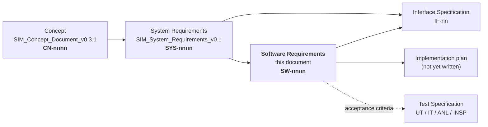
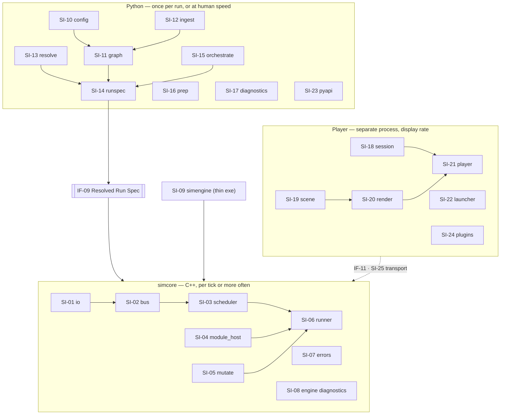

# SIM — Replay & Simulation Engine
## Software Requirements Specification — v0.1

**Owner:** SIM Team (tool supplier)
**Derived from:** `SIM_System_Requirements_v0.1.md` (this directory), which is itself derived from `SIM_Concept_Document_v0.3.1.md`.
**Status:** Draft for review. Not baselined. Inherits every blocking open decision from the System Requirements' §26; adds its own in §33.
**Audience:** SIM developers, the authors of the Interface Specification and Test Specification, and whoever re-cuts the implementation plan after this document is agreed.

> **The master is `SIM_Concept_Document_v0.3.1.md`.** Where anything in this document appears to disagree with it, the concept wins and this document is wrong. The v1 document set (`../v1/`) speaks a different language and describes a narrower problem; it is treated here as **evidence about a codebase**, never as an authority. Where a v1 statement and the concept differ, v1 is the one that is out of date.

---

## 0. How to read this document

### 0.1 Where this document sits



| Document | Answers | Exists? |
|---|---|---|
| Concept (`v0.3.1`) | *What was asked for, and why* | yes |
| System Requirements (`v0.1`) | *What the system must do, observably, at its boundary* | yes |
| **Software Requirements (this)** | *What each software item must do, internally — and what already exists* | **this draft** |
| Interface Specification | *The exact bytes, signatures and schemas at each named interface* | not yet — SYS §3.4 is its table of contents; §2.4 below adds the software-item view |
| Implementation plan | *What to write, in what order, with what names* | **not yet — deliberately out of scope here (§34)** |
| Test Specification | *The unit and integration test cases* | not yet |

**Still no separate architecture document.** Concept §5, §6, §7, §21.4 and §26 remain the architectural baseline. What this document adds is the **decomposition into software items** (§1) — which the concept sketches as a package tree but never fixes as an assignment of obligations. Every requirement below names exactly one item that owns it.

### 0.2 Two numbers, on purpose

Same discipline as the two documents above, for the same reason.

| What | Example | Rule |
|---|---|---|
| **Heading number** | `9.3` | Position in the document. Changes when sections move. |
| **UID** | `SW-0042` | Stable identity. Allocated once, in creation order, **never changed and never reused.** Use it in trace links. |

New requirements append at the end of their section. A retired requirement is recorded, never deleted silently and never reused.

### 0.3 Anatomy of a software requirement

```
**`SW-nnnn`** · `SI-nn` · `P0` · `R1` — Headline
**Shall.** The single normative statement. Exactly one "shall" per requirement.
**Accept.** The observable condition that decides pass or fail. Written so it can be false.
**Verify.** <method> · `<test id>`   **Trace.** SYS-nnnn[, …]
**Now.** <disposition> — where the behaviour lives today, if anywhere.
```

| Field | Rule |
|---|---|
| **`SI-nn`** | The **one** software item that owns this obligation (§1.2). An obligation two items share is two requirements, or it is a requirement on their interface and belongs in the Interface Specification. |
| **Shall** | One obligation on one software item, observable at that item's own interface — not only at the system boundary. This is the difference between a `SW` and a `SYS` requirement. |
| **Accept** | **Falsifiable** (`CN-0381`). If no observation could contradict it, it is a design note and is demoted to prose. |
| **Verify** | Method + the identifier of the test that will implement it, written into the test itself so the link is greppable (`CN-0383`, `SYS-0278`). |
| **Trace** | ≥1 `SYS` requirement. Where a `SW` requirement has **no** `SYS` parent, that is a gap in the System Requirements and is recorded as one in §32.3 — never papered over by tracing straight to a concept UID. |
| **Now** | §0.7. A **planning** field, not a status field. |

### 0.4 Verification methods

| Code | Method | Means |
|---|---|---|
| **T** | Test | An automated test that executes the software item and asserts an outcome. Default; preferred always. |
| **A** | Analysis | A static or derived check over the codebase or an artifact — a grep, a symbol dump, a hash comparison, a measured budget. |
| **D** | Demonstration | Executed, observed, recorded. Used only where the outcome is a human-visible behaviour (a debugger session, a GUI interaction). Scripted and evidence-attached. |
| **I** | Inspection | Review against a **named** written checklist. Used only where no execution is possible. |

### 0.5 Test identifier scheme

| Prefix | Level | Scope |
|---|---|---|
| `UT-<item>-nn` | Unit | One software item, exercised through its own interface, with its collaborators stubbed. |
| `IT-nn` | Integration | Two or more items across one named interface — most often the seam (`IF-09`) or the module ABI (`IF-01`). |
| `ANL-nn` | Analysis | A static or derived check. **Numbered in this document's own `ANL` namespace**, disjoint from the System Requirements' — an `ANL` identifier here is `ANL-SW-nn`. |
| `INSP-SW-nn` | Inspection | A checklist review. |

Item tokens for `UT-<item>-nn` are the short names in §1.2: `IO`, `BUS`, `SCH`, `HOST`, `MUT`, `RUN`, `ERR`, `EDG`, `EXE`, `CFG`, `GRF`, `ING`, `RES`, `SPC`, `ORC`, `PRP`, `DIA`, `SES`, `SCN`, `RND`, `PLR`, `LNC`, `API`, `PLG`, `TRN`.

### 0.6 Priority and release scope

Inherited unchanged from the System Requirements, and **inherited per requirement**: a `SW` requirement may not be a higher priority than the `SYS` requirement it serves, and may be lower where it decomposes only part of it.

| Code | Meaning |
|---|---|
| `P0` | The tool is not usable without it. |
| `P1` | A stated goal degrades without it. **Default when unmarked.** |
| `P2` | Valuable, deferrable. |

| Code | Meaning |
|---|---|
| `R1` | First product release (concept migration phases 0–4). |
| `R2` | Second release (phases 5–6). |
| `DEF` | Deferred, with its reason inline. |

**The System Requirements' `P0` caveat is inherited and is not re-litigated here.** SYS §0.6 records that 60% of its requirements are marked `P0` and that re-triage is a customer decision. This document does not attempt to fix that by re-prioritising the decomposition; it would only move the distortion one level down. When SYS is re-triaged, the `SW` priorities follow mechanically.

### 0.7 The `Now.` field — what it is, and what it is not

The System Requirements forbid a status column, for a good reason: `SYS-0277` — *verification status shall be derived from the test suite and never stored by hand in a second place*. This document has a hand-written `Now.` field on every requirement, so the tension must be answered plainly rather than hoped past.

**`Now.` is not verification status.** It never claims a requirement is *met*. It answers a different, purely operational question that no test suite can answer and that the migration cannot be planned without:

> *Does code that does this already exist, and is it in the right place?*

| Value | Meaning |
|---|---|
| **`DONE`** | Working code exists, in a software item this document assigns the obligation to, doing substantially what the requirement says. Reusable as-is. |
| **`DONE·MOVE`** | Working code exists and is reusable, but it lives in the **wrong software item, wrong language, or wrong repository**. The behaviour is proven; the placement is a defect. This is the value that drives the replanning in §32. |
| **`DONE·TWICE`** | Two implementations exist. One must be deleted (`CN-0287`, `SYS-0270`), not kept in step. |
| **`PARTIAL`** | Code exists but is narrower than the requirement — it satisfies the easy half and would produce a wrong or absent answer on the rest. Named, so it is not mistaken for `DONE`. |
| **`NEW`** | Nothing exists. |

Four rules keep this honest:

1. **A `Now.` value is evidence-backed.** Every `DONE`, `DONE·MOVE`, `DONE·TWICE` and `PARTIAL` names the file that carries the behaviour. A value with no file reference is not permitted.
2. **`Now.` is a dated snapshot, not a maintained field.** It states the codebase as of **2026-08-10**. It is not updated as work proceeds and must never be read as current.
3. **`Now.` is deleted, not maintained.** When the migration completes, this field is removed from the document in one pass. A permanently-maintained "implemented?" column is exactly the second stored copy `SYS-0277` forbids, and the way this one avoids becoming that is by having an end.
4. **`DONE` never means "verified".** It means "there is code here to reuse". Whether the requirement is *met* is answered by the test suite and by nothing else, including this field.

§31 collects every `Now.` value into one table so the migration can be sized without reading the whole document. Requirements added after the snapshot date carry a `Now.` written when they were added, and the current total is emitted by `trace_check.py`, never typed here.

### 0.8 The `**Built.**` line — and why it is not a second `Now.`

*Added 2026-08-13.* Every requirement now carries a second one-line field, and the two answer genuinely different questions. Confusing them is the obvious failure, so it is settled here:

| Field | Question | Source | Lifetime |
|---|---|---|---|
| **`Now.`** | *Did code that does this already exist on **2026-08-10**, and is it in the right place?* | Hand-written, evidence-backed, **frozen** | A dated snapshot. **Never updated as work proceeds.** Deleted in one pass at `WP-31` |
| **`Built.`** | *Has the work been done **yet**?* | **Generated** from the Implementation Plan's per-`IMP` checkboxes | Live. Regenerated on every tick |

**`Now.` could not have served as progress and was never meant to** — rule 2 of §0.7 says so explicitly. It is a *reuse assessment* that sized the migration; reading it as progress would report a requirement as `DONE` because reusable code exists somewhere, which is the opposite of what a resuming session needs to know.

```
```

`●` done · `◐` started · `○` not started · `◌` deferred (no work package).

**It is not the status column `SW-0373` forbids.** That rule targets a *hand-kept* status; nothing here is typed, and `trace_check.py`'s ordinary run recomputes every line and **fails on disagreement** — so it cannot go stale the way v1's `frozen` column did. `R-REQ-11`'s principle, in its own words: *the copy is made safe by checking it, not by deleting it.* Regenerate with `--write-status`; see SysReq §0.3a and Plan §0.5 for the full rollup.

**`Built.` is work, not verification.** `● done` means the code was written and its named test ticked. Whether the requirement is *met* is still a query over the suite.

---

## 1. Software architecture — the decomposition

### 1.1 The shape, inherited

Concept §5.3 fixes the process architecture, §6.1 fixes the language boundary, and §21.4 sketches the package tree. Nothing here changes any of them. What follows makes the tree into an **assignment of obligations**, because a package name is not a contract and two packages with adjacent names will grow into each other unless each owns a stated set of requirements.



### 1.2 The software items

**`SI-` identifiers are stable.** An item is never renumbered; an item that is dissolved has its number retired.

| ID | Token | Item | Language | Runs | Owns |
|---|---|---|---|---|---|
| `SI-01` | `IO` | `simcore/io` | C++ | per message | Codec plugins, streaming read, sidecar index, seek, port-selective read, export writing |
| `SI-02` | `BUS` | `simcore/bus` | C++ | per port per tick | Port values, the signal header, provenance tags, buffers, hold state |
| `SI-03` | `SCH` | `simcore/scheduler` | C++ | per tick | Base grid, due-tick gating, hold and age, sampling policy, transport delay |
| `SI-04` | `HOST` | `simcore/module_host` | C++ | per module per tick | Library load, ABI check, lifecycle, manifest-driven conversion, output buffers, per-cycle timeout |
| `SI-05` | `MUT` | `simcore/mutate` | C++ | per overridden port | Override verb application, fault verb application, address resolution against decoded payloads |
| `SI-06` | `RUN` | `simcore/runner` | C++ | per tick | The cycle loop, injection boundary, divergence detection, streaming output, checkpointing |
| `SI-07` | `ERR` | `simcore/errors` | C++ | on failure | The closed error taxonomy, message shape, exit-code mapping |
| `SI-08` | `EDG` | `simcore/diagnostics` | C++ | per run / per tick when enabled | Graph and schedule dump, cycle trace, timing statistics, byte counters |
| `SI-09` | `EXE` | `simengine` | C++ | once | Argument handling, debugger hooks, spec load, lifecycle, exit code — and nothing else |
| `SI-10` | `CFG` | `config` | Python | once per run | Parse, schema validation, four-layer merge, includes, variables, round-trip |
| `SI-11` | `GRF` | `graph` | Python | once per run | Graph build, wiring validation, port-type match, coherence classification, remedies |
| `SI-12` | `ING` | `ingest` | Python | once per run | Ingest map parse and validation, family matching, declared holes, description resolution |
| `SI-13` | `RES` | `resolve` | Python | once per run | Library resolution by stem, configuration bundle resolution, plugin bundle resolution, **the probe pass** — recording index and module manifest, as data |
| `SI-14` | `SPC` | `runspec` | Python | once per run | Resolved Run Spec emission and hashing, run manifest assembly |
| `SI-15` | `ORC` | `orchestrate` | Python | once per run / per batch | CLI verbs, batch scheduling, subprocess pool, resume, aggregation |
| `SI-16` | `PRP` | `prep` | Python | offline | Integrity check, content hash, extract, convert, index, inspect, lineage |
| `SI-17` | `DIA` | `diagnostics` | Python | on demand | Explain, doctor, probe, evidence, name resolution, run comparison |
| `SI-18` | `SES` | `session` | Python | at display rate | **Leaves — superseded to `viz` (`SM-04`, 2026-08-20), except `SW-0298` (attach/detach, `SI-25`-adjacent, stays).** The `Session` data model, tick and port-value views, transport and head semantics |
| `SI-19` | `SCN` | `scene` | Python | at display rate | **Leaves — superseded to `viz` (`SM-01`, 2026-08-20).** The `Scene` intermediate representation, frames, style tokens, provider registry, port binding |
| `SI-20` | `RND` | `render` | Python | at display rate | **Leaves — superseded to `viz` (`SM-01`, 2026-08-20).** Renderers, theme and token tables, image and figure output |
| `SI-21` | `PLR` | `player` | Python | at interaction rate | **Leaves — superseded to `viz` (`SM-01`, 2026-08-20).** Panels, layout, layer tree, plots, snapshots, evidence panel |
| `SI-22` | `LNC` | `launcher` | Python | at interaction rate | Mode and implementation selection; writes a run configuration and nothing else |
| `SI-23` | `API` | `pyapi` | Python | on demand | The scripting surface — every capability, in a few lines, with no CLI and no window |
| `SI-24` | `PLG` | `plugins` | both | at load | The four extension registries, plugin API version gate, conformance kits |
| `SI-25` | `TRN` | `transport` | both | per attach / per frame | The player↔engine channel: control and metadata, bulk over shared memory |

### 1.3 The dependency rule

| # | Rule | Enforced by |
|---|---|---|
| D-1 | **No C++ item depends on a Python item.** The engine reads the Resolved Run Spec and nothing else. | `SW-0016` |
| D-2 | **No Python item on the run-time path depends on a C++ item other than through the spec or the transport.** | `SW-0017` |
| D-3 | **`SI-19` (`scene`) depends on nothing above it.** No renderer, no player, no codec, no source. | superseded — `SI-19` itself left with its enforcing item (`SM-01`, 2026-08-20); `viz`'s to restate |
| D-4 | **`SI-01`..`SI-08` may depend on `SI-07` (`errors`) freely.** Everything raises from one taxonomy. | `SW-0121` |
| D-5 | **`SI-09` depends on `simcore` and on no other item.** | `SW-0141` |
| D-6 | **No item names a component or a function.** | `SW-0357` |

### 1.4 What each item may not do

Stated as a set because the failure mode is drift, and drift is cheapest to prevent at the item boundary.

| Item | Must not |
|---|---|
| `SI-01` `io` | Know a port model, a module, or a graph. It moves bytes with names and timestamps. |
| `SI-02` `bus` | Decide *when* anything runs. It holds values and their headers. |
| `SI-03` `scheduler` | Read a message payload. It works on headers, periods and due-ness. |
| `SI-04` `module_host` | Resolve a path, search a directory, or parse a configuration file. It receives an absolute path. |
| `SI-05` `mutate` | Contain an expression evaluator, a scripting hook, or a user-supplied callable. |
| `SI-06` `runner` | Contain a second execution path, a single-rate loop, or a "fast mode". |
| `SI-09` `simengine` | Contain a configuration parser, validation, path search or inference. |
| `SI-10` `config` | Execute anything, load a library, or open a recording's payload. |
| `SI-11` `graph` | Read a message, or open anything. It receives the probe pass's data and classifies over it. |
| `SI-12` `ingest` | Compute. Renaming, tagging, and a declared factor and offset — nothing else. Match a family by opening the file; it matches against the index it is handed. |
| `SI-13` `resolve` | Execute a module or advance a run. It may open a binary and a recording, and may call only the manifest, version and describe entry points. |
| `SI-22` `launcher` | Hold state that is not in the file it writes. |

---

## 2. Evidence base

Four sources, not three. Where they disagreed, the disagreement is recorded rather than smoothed.

| Source | Used for |
|---|---|
| `SIM_Concept_Document_v0.3.1.md` | The authority. Every requirement's ultimate origin. |
| `SIM_System_Requirements_v0.1.md` | The direct parent of every requirement here. |
| **`[REF-TC]`** — a production measurement-and-replay toolchain, examined together with a real project's configuration set for it | Independent evidence of what a mature tool of this class needs *at software-item granularity*. New findings in §2.3 and Appendix A. |
| **The current codebase** — `modules/sim` (Python framework, ~14 kLOC across 115 modules) and `modules/sil_host` (C++, ~1.9 kLOC) | The `Now.` field, and the placement findings in §2.2 and §32. |

> **On `[REF-TC]`.** It is referenced by behaviour only — never by vendor, product name, file extension or internal identifier — exactly as the System Requirements reference it. No requirement below copies its design. It is used the way prior art is used: to find obligations that were missing, and to check that obligations already written survive contact with a system that has been in production use for years.

### 2.1 The codebase, in one paragraph

A working Python framework exists and is substantial: a `Scene` intermediate representation with style tokens and no colours, a layer-provider registry discovered by import, a two-pass session that separates executing from viewing, a manifest-and-ABI component model with schemas embedded in the manifest, a two-axis `mode`×`impl` staging model with an undoable toggle, six override verbs and five fault verbs as closed lists, a determinism comparison with four derived axes and declared tolerance, a batch runner with one subprocess per recording and four distinct outcomes, and a diagnostics set — `explain`, `doctor`, `probe`, evidence, name resolution. A C++ host also exists and is further along than expected: run-time symbol binding, ABI check, manifest read, output buffer grow-and-retry, a per-execution timeout, a graph dump, an error taxonomy, a pipeline loader, an ingest-map parser, a recording reader and both a single-rate and a multi-rate stepping path.

**Almost all of that is reusable. A large part of it is in the wrong place.** That sentence is what §32 exists to make actionable.

### 2.2 Finding 1 — the engine seed is in a component-adjacent module, not in the framework

The C++ code that concept §21.2 identifies as *the seed of the engine* — the thing that becomes `simcore` and `simengine` — lives today in **`modules/sil_host`**, a module whose stated role is *"the SIL integration host … proves that component C-API DLLs can be composed and run in one process. Not a shippable ADAS component."*

That module now contains, in ~1.9 kLOC: a pipeline loader with schema versioning and load-time validation (`pipeline.cpp`, 416 lines), a component host over the generic ABI with symbol binding and buffer grow-and-retry (`sil_component.cpp`), a library resolver by stem and search path (`library_loader.cpp`), an ingest-map parser (`ingest_map.cpp`), a recording reader (`recording_reader.cpp`), a resim runner (`resim_runner.cpp`), a per-execution timeout (`exec_timeout.cpp`), a graph and schedule dump (`graph_dump.cpp`) and a four-kind error taxonomy (`errors.hpp`).

Six of those nine are `simcore`'s obligations under §1.2. Three of them are Python's under the language rule and must be deleted rather than moved. **None of them is `sil_host`'s.**

Why this matters more than a directory move:

| Consequence | Why |
|---|---|
| **`R-SIM-1`'s placement rule is inverted.** The framework belongs once in `modules/sim`; a component contributes only plug-ins. An engine living in a host module makes the framework's most load-bearing code a peer of component content. | The rule exists to stop a function's name reaching framework code. Here the risk is the reverse and worse: framework code accumulating in a module nobody treats as the framework. |
| **It is not packaged as the product.** `SYS-0257` requires the engine library and engine executable inside one versioned installable artifact. Today they are inside a module explicitly labelled *not a shippable component*. | A customer cannot install what the delivery does not contain. |
| **It licenses the duplication.** Every C++ file in that module names itself *"the C++ twin of"* its Python counterpart, in its own header comment. The duplication is not accidental; it is documented as intentional, which is how it survived. | `CN-0287` — any rule in two languages will drift. §2.4 shows it already has. |
| **It hides the multi-rate defect.** `Pipeline::Step()` — the multi-rate path — carries the comment *"Not used by sil_host's own resim driver (`Exec()` is, to match `sim resim`'s own choice)"*, while the Python side made the mirror-image choice. | Concept §22.2 verbatim, confirmed in code: the scheduler is implemented twice and used never. |

**This is the single largest replanning item in this document,** and it is a re-homing plus a split, not a rewrite: §32.1 gives the disposition file by file.

### 2.3 Finding 2 — all four predicted duplications are live, and one has already drifted

Concept §21.3 predicted four subsystems in both languages. All four are present. One has measurably diverged.

| Subsystem | Python | C++ | Verdict | Evidence of drift |
|---|---|---|---|---|
| Pipeline load and validation | `contracts/pipeline.py` (1,149 lines) | `src/pipeline.cpp` (416 lines) | **Python only** — once per run | The C++ header itself records a check it *"deliberately deferred"* — cross-component project and shared-parameter agreement. The two loaders already accept different sets of files. |
| Ingest map parsing | `io/ingest.py` (260 lines) | `src/ingest_map.cpp` (118 lines) | **Python only** — once per run | Concept §21.3.3: one rejects malformed keys, the other accepts them silently. |
| Component host | `contracts/component.py` (519 lines, ctypes) | `src/sil_component.cpp` (216 lines, native) | **C++ only** — per cycle | Both are real. The Python one is on the per-message path, which `SW-0013` forbids. |
| Recording read and grouping | `io/base.py` + `io/mcap.py` | `src/recording_reader.cpp` | **C++ only** — per message | Both group a cycle by identical timestamp. Both materialise the whole file. §2.4. |

### 2.4 Finding 3 — the cycle-boundary defect is in both readers, and it is a software-item defect

Both readers group messages into a cycle by **identical file timestamp**: the Python side in `io/base.group_by_log_time`, the C++ side in `recording_reader.cpp`, whose own header describes itself as the twin of it.

This is correct only for recordings the framework produced. On a recording where each signal carries its own source timestamp — which is every recording the concept says is the primary input (`CN-0004`, `CN-0373`, and §1.2's *"produced by anyone"*) — no two messages share a timestamp and the grouping degenerates to one cycle per message.

At software-item granularity the fix is specific and is not "improve the reader": **cycle reconstruction is `SI-02`'s obligation, not `SI-01`'s.** A reader returns timestamped, named payloads. Deciding what constitutes a cycle is a property of the signal header and the declared recovery ladder, and it belongs with the item that owns headers. Putting it in the reader is what made it a per-format decision, and a per-format decision is how one format's assumption became every format's behaviour. §7.2 states it as a requirement.

### 2.5 Finding 4 — a real recording carries far more per-source structure than the port model assumes

`[REF-TC]` binds a recording's contents to interpretation through a chain the concept collapses into one step. In it, a data source is identified by a **(family, model, name, instance-number)** tuple; each source carries one or more **typed data-description artifacts**, resolved from an explicit mapping file; each description type has its own accepted version set; and static, non-cyclic parameter data is a **separate container**, taken from inside the recording when present and otherwise resolved from a side directory by naming convention, with the choice reported.

The concept's model is *ingest map → port*. That is right, and it is not enough on its own: the ingest map names signals, but something must first decide *which description makes those signal names meaningful for this file*. In `[REF-TC]` those are two different files with two different owners and two different rates of change, and conflating them would make a description change look like an ingest change.

§17.3 adds description resolution as a distinct obligation on `SI-12`, and §7.4 adds static parameter data as a distinct port class on `SI-02`. Neither has a `SYS` parent; both are recorded in §32.3 as gaps the System Requirements should absorb.

### 2.6 Finding 5 — several system-level closed sets have a second dimension at software level

Four sets the System Requirements state as one dimension are two in `[REF-TC]`, and the second dimension is not cosmetic:

| Set | `SYS` | `[REF-TC]` adds | Where |
|---|---|---|---|
| Watchdog | one processing timeout (`SYS-0198`) | **two independent monitors** — data-processing time *and* application responsiveness — each with its own poll interval and threshold, units declared | `SW-0246`, `SW-0247` |
| Multi-source merge | "merged onto a common time base" (`SYS-0006`) | a **closed four-value merge policy** — play-all · play-intersection · force-alignment · play-sequentially — plus a declared synchronisation basis | `SW-0035`, `SW-0036` |
| Exit behaviour | a closed exit-code set (`SYS-0125`) | a separately configurable **severity threshold at which a headless run exits early** — exception · error · alert · warning | `SW-0128` |
| Recording identity | one content hash (`SYS-0222`) | **three identities** — the medium, the individual file, and a group identifier shared by files captured simultaneously by different units — the last being what makes a correct multi-source merge possible at all | `SW-0257`, `SW-0258` |

---

# PART A — THE SEAM AND THE LANGUAGE BOUNDARY

Everything in this part exists to make one sentence true in code rather than in prose: **Python owns everything before the run; C++ owns everything during it; the Resolved Run Spec is the only thing that crosses.**

## 3. The Resolved Run Spec (`IF-09`)

**`SW-0001`** · `SI-14` · `P0` · `R1` — The spec is flat and fully resolved
**Shall.** `SI-14` shall emit a Resolved Run Spec in which every path is absolute, every mode is decided, every period is computed in integer nanoseconds, every port is bound to exactly one producer, and no value requires further inference.
**Accept.** No field of the spec is a reference to be looked up, a stem to be expanded, a relative path, a default to be applied, or an expression to be evaluated. A checker over the spec schema reports zero unresolved constructs.
**Verify.** T · `UT-SPC-01` · A · `ANL-SW-01`   **Trace.** SYS-0165, SYS-0166
**Built.** ● done — `IMP-0001` in `WP-05`
**Now.** `PARTIAL` — `core/manifest.py`'s `RunSpec`/`load_run_spec` is a run-configuration reader, not a resolved-spec emitter; resolution today happens inside `contracts/pipeline.py` at load and is never serialised as one artifact.

**`SW-0410`** · `SI-13` · `P0` · `R1` — The probe pass produces a recording index and a module manifest, as data
**Shall.** `SI-13` shall produce, before emission, a `RecordingIndex` per named recording — per topic: declared payload type, message count, first and last timestamp, the highest timing rung the data supports, and the origin tag where the file carries one — and a `ModuleManifest` per named module, both as plain structures with no open handle.
**Accept.** The index is obtained through the same reader a run uses and the manifest through the same entry point the module host uses, so neither can describe a file differently from the way the run will read it. Both are serialisable, and a hand-written one drives every consumer's unit tests with no file and no binary present.
**Verify.** T · `UT-RES-11`   **Trace.** SYS-0287, SYS-0288; CN-0396, CN-0397, CN-0398
**Built.** ● done — `IMP-0410` in `WP-21`
**Now.** `PARTIAL` — `contracts/component.py`'s probe path reads manifests correctly; nothing produces a recording index, and the checks that need one read the recording at first tick instead.
*Note:* the *"highest timing rung the data supports"* field closes `OQ-01` (2026-08-12). *"Do the recordings in scope carry task/cycle marking?"* is not answered once, globally, for a corpus nobody has enumerated — it is **measured per recording** by this index and printed by `sim probe`, for our own files and foreign ones alike. A capture format we have never seen therefore yields an unknown *value*, never an unanswered question, and rung 1 being inert becomes observable rather than assumed.

**`SW-0411`** · `SI-11` · `P0` · `R1` — The graph and ingest layers receive the index; they never open anything
**Shall.** Cut feasibility, `measured`-mode validation, coherence classification and ingest-family matching shall take the `RecordingIndex` and the `ModuleManifest` set as arguments, and shall open no recording, load no library and import no codec.
**Accept.** Every one of those functions runs to completion against hand-written structures with no file on disk. An import check finds no codec or C-interface import in `SI-10`, `SI-11`, `SI-12` or `SI-14`.
**Verify.** T · `UT-GRF-27` · A · `ANL-SW-34`   **Trace.** SYS-0288; CN-0398
**Built.** ◐ started — `IMP-0411` in `WP-20`
**Now.** `PARTIAL` — the classification functions are already pure over the pipeline object; the feasibility checks are not, because they have no index to be pure over.

**`SW-0412`** · `SI-14` · `P0` · `R1` — Emission records what it was told, so a spec cannot be run against a different file
**Shall.** The spec shall carry a content hash of every recording the probe pass read, and the engine shall refuse a recording whose hash differs from the one emitted against, naming both.
**Accept.** Replacing a recording between emission and execution is refused before the first tick. Re-emitting against the replaced file succeeds.
**Verify.** T · `UT-SPC-24`   **Trace.** SYS-0287, SYS-0222; CN-0396
**Built.** ◐ started — `IMP-0412` in `WP-05`
**Now.** `PARTIAL` — `core/ids.py` hashes inputs for the run id; nothing compares a hash at load.
*Note:* without this, two passes is strictly worse than one — the spec would assert properties of a file nobody re-checked.

**`SW-0002`** · `SI-14` · `P0` · `R1` — The spec is the engine's only input
**Shall.** `SI-14` shall emit a spec sufficient on its own to construct and run the engine, with no other file consulted at run time except the recordings and module binaries the spec names by absolute path.
**Accept.** Running the engine with the configuration source tree deleted, and only the spec, the named recordings and the named binaries present, produces identical port values.
**Verify.** T · `IT-01`   **Trace.** SYS-0165, SYS-0216, CN-0293
**Built.** ● done — `IMP-0002` in `WP-05`
**Now.** `NEW`.

**`SW-0003`** · `SI-14` · `P0` · `R1` — The spec carries absolute pre-resolved binary paths
**Shall.** The spec shall carry, per module, the absolute path of the binary chosen, the platform pattern it matched, and the search order that produced it.
**Accept.** Changing the search path after emission cannot change which binary the engine loads. The manifest records the same path the engine opened.
**Verify.** T · `UT-SPC-02`   **Trace.** SYS-0166; CN-0384, CN-0385
**Built.** ● done — `IMP-0003` in `WP-05`
**Now.** `DONE·MOVE` — `contracts/loader.py::resolve_library` is the one resolver and is correct; `sil_host/src/library_loader.cpp` duplicates it in C++ and must be deleted (`SW-0018`).

**`SW-0004`** · `SI-14` · `P0` · `R1` — The spec is hashed, and the hash is an identity
**Shall.** `SI-14` shall compute a content hash over the spec's canonical serialisation and write both spec and hash into the run artifacts.
**Accept.** Two emissions from identical inputs produce an identical hash. Any semantic change to the spec changes the hash. Reordering keys that carry no meaning does not.
**Verify.** T · `UT-SPC-03`   **Trace.** SYS-0165, SYS-0123
**Built.** ● done — `IMP-0004` in `WP-05`
**Now.** `PARTIAL` — `core/ids.py::new_run_id` hashes run inputs and is stable, but there is no canonical spec serialisation to hash.

**`SW-0005`** · `SI-14` · `P0` · `R1` — The spec carries a schema version and is refused outside its range
**Shall.** The spec shall carry a schema version, and `SI-09`/`simcore` shall refuse a version outside its supported range, naming both.
**Accept.** A spec one major version ahead is refused with both numbers in the message; a spec with no version is refused naming the omission.
**Verify.** T · `UT-SPC-04`   **Trace.** SYS-0170, SYS-0258
**Built.** ● done — `IMP-0005` in `WP-05`
**Now.** `DONE·MOVE` — the `version:` field plus upgrader semantics exist in `contracts/pipeline.py` and are mirrored in `sil_host/src/pipeline.cpp`; the mechanism is right, the artifact it guards is the pipeline file rather than the spec.

**`SW-0006`** · `SI-14` · `P0` · `R1` — The spec declares the base grid, not the ingredients
**Shall.** The spec shall carry the computed base grid step and each module's period as integers in nanoseconds, and shall not carry the derivation. The grid shall be the greatest common divisor of the declared periods of **every** module in the graph, whatever triggers each one, and of no port of static kind.
**Accept.** `simcore` performs no greatest-common-divisor computation, no snapping and no unit conversion. A grep for period arithmetic in the engine returns nothing. Adding a data-driven module with a shorter period changes the emitted grid; adding a static port does not change it at all.
**Verify.** A · `ANL-SW-02` · T · `UT-SPC-23`   **Trace.** SYS-0066, SYS-0285, SYS-0060; CN-0293, CN-0393
**Built.** ● done — `IMP-0006` in `WP-05`
**Now.** `DONE·TWICE` — computed in `contracts/pipeline.py` and again in `sil_host/src/pipeline.cpp::ComputeBaseGridNs`; the C++ copy is deleted under `SW-0018`. Neither excludes static ports, because neither has a static port kind yet (`SW-0060`).

**`SW-0007`** · `SI-14` · `P0` · `R1` — The spec declares the resolved wiring, not the wiring rules
**Shall.** The spec shall express wiring as a resolved producer for every consumer port, and shall not carry the reference grammar that produced it.
**Accept.** `simcore` contains no reference parser — no splitting of a dotted address, no `self`/`source` prefix handling, no fallback lookup.
**Verify.** A · `ANL-SW-03`   **Trace.** SYS-0165, SYS-0040
**Built.** ● done — `IMP-0007` in `WP-05`
**Now.** `NEW` — the grammar exists in `contracts/pipeline.py` and is mirrored in C++; neither emits a resolved form.

**`SW-0008`** · `SI-14` · `P0` · `R1` — The spec declares overrides and faults as resolved instructions
**Shall.** Every override and fault shall appear in the spec as a verb, a resolved address, and its operands, with no addressing grammar left to interpret.
**Accept.** `SI-05` receives a verb and a resolved field path; it parses no address string. Every override in the spec also appears in the run manifest (`SW-0219`).
**Verify.** T · `UT-SPC-05`   **Trace.** SYS-0097, SYS-0099, SYS-0101, SYS-0103
**Built.** ● done — `IMP-0008` in `WP-05`
**Now.** `PARTIAL` — `contracts/binding.py` resolves an address to structure and applies the verb; the resolution result is not separable from the application, so nothing can be emitted ahead of the run.

**`SW-0009`** · `SI-14` · `P0` · `R1` — The spec declares the record policy per port
**Shall.** The spec shall carry, for every declared port, its record policy from the closed set full · excluded · decimated-by-N.
**Accept.** No port in the spec lacks a policy entry. A reader of the resulting recording can answer *was this complete?* for every port from the artifact alone.
**Verify.** T · `UT-SPC-06`   **Trace.** SYS-0116, SYS-0120
**Built.** ● done — `IMP-0009` in `WP-05`
**Now.** `DONE·MOVE` — `contracts/pipeline.py::RecordVerb` and `core/manifest.py::_record_policy_records` implement the closed set and the per-port record; they belong to `SI-14` and are already Python-side, so this is a re-homing within Python, not a language move.

**`SW-0010`** · `SI-14` · `P1` · `R1` — The spec declares the sampling and missing-data policy per port
**Shall.** The spec shall carry, per port, the sampling policy and the missing-data behaviour, each from its closed set.
**Accept.** `SI-03` selects behaviour by enumeration value and holds no default table of its own.
**Verify.** T · `UT-SPC-07`   **Trace.** SYS-0073, SYS-0074
**Built.** ● done — `IMP-0010` in `WP-05`
**Now.** `NEW`.

**`SW-0011`** · `SI-14` · `P0` · `R1` — The spec declares the ingest binding as a resolved table
**Shall.** The spec shall carry, per source, the resolved topic-to-port table including payload type, origin tag, unit factor and offset, header field bindings, and declared-absent ports.
**Accept.** `simcore` opens no ingest map file and contains no parser for one. Every translation it applies came from the spec.
**Verify.** A · `ANL-SW-04` · T · `IT-02`   **Trace.** SYS-0013, SYS-0014, SYS-0015, SYS-0019
**Built.** ◐ started — `IMP-0011` in `WP-05`
**Now.** `DONE·TWICE` — `io/ingest.py` parses and validates; `sil_host/src/ingest_map.cpp` parses again and more permissively. The C++ parser is deleted; its *application* survives as `SW-0032`.

**`SW-0012`** · `SI-14` · `P1` · `R1` — The spec is human-readable and diffable
**Shall.** The spec shall be a text document whose canonical serialisation is stable under re-emission and meaningful under a line diff.
**Accept.** Two specs differing in one mode produce a diff of the lines carrying that mode and no others.
**Verify.** T · `UT-SPC-08`   **Trace.** SYS-0165, SYS-0172
**Built.** ● done — `IMP-0012` in `WP-05`
**Now.** `NEW`.
*Note:* this is not decoration. The spec is what a developer attaches a debugger to (`SYS-0216`) and what a bug report contains; a binary seam would make both harder for no measured gain.

## 4. The language boundary as a software constraint

**`SW-0013`** · `SI-23` · `P0` · `R1` — No Python on a per-message path
**Shall.** No Python code shall execute once per message, once per port per tick, or once per sample.
**Accept.** A profile of a representative run shows no interpreter frame inside the per-message path. A static check enumerates every function reachable from a per-tick entry point and reports any that is Python.
**Verify.** A · `ANL-SW-05` · T · `IT-03`   **Trace.** SYS-0233, SYS-0269; **defect** concept §22.5
**Built.** ● done — `IMP-0013` in `WP-16`, `IMP-0422` in `WP-15b`
**Now.** `PARTIAL` — the rule is stated nowhere in code and is violated today by `core/resim.py` and `contracts/component.py`'s execution path, both confirmed still on the live per-tick exec path (`cli/resim.py`, `orchestrate/worker.py`, `check/runner.py`, `player/shell/qt_window.py`'s Run button all call into them directly, with no wiring yet onto `simengine`'s C ABI — see `WP-15b`, added 2026-08-22).
**Correction 2026-08-22:** `core/runner.py` was also named here (and in `WP-16`'s delete list / Design §28.1 / `IMP-0061`); that was wrong. It is the replay/viewer session-builder (`R-SIM-13` — no DLL, no live exec; its own docstring: *"Phase B has no C++ and no DLL"*), with 12 live call sites (`cli/explain.py`, `cli/list_cmd.py`, `cli/render.py`, `player/shell/qt_window.py`, `diagnostics/evidence.py`, `render/capture.py`, `render/clip.py`, `session/session.py`, …) that break if it is deleted. Its per-tick `Tick`/`PortValue` construction groups an **already-recorded** session for rendering, not per-message execution — whether that replay-side grouping should itself migrate to a C++-backed path is a real, separately-scoped question this correction does not resolve, and it is explicitly **not** part of `WP-16`.

**`SW-0014`** · `SI-23` · `P0` · `R1` — Bulk data crosses as a view, never as objects
**Shall.** Bulk data exposed to Python shall be an array view onto an engine-owned buffer, and the scripting layer shall never construct a per-element object from a payload.
**Accept.** Reading a point cloud into Python allocates no per-point object; the view's base pointer is inside the engine's buffer.
**Verify.** T · `UT-API-01`   **Trace.** SYS-0233; CN-0290
**Built.** ● done — `IMP-0014` in `WP-29`
**Now.** `NEW`.

**`SW-0015`** · `SI-23` · `P1` · `R1` — A view is invalidated, never silently stale
**Shall.** A view onto an engine buffer shall be invalidated when the engine reuses that buffer, and any access to an invalidated view shall raise.
**Accept.** Holding a view across a tick and reading it raises, naming the tick it was taken at. It never returns the next tick's bytes as though they were the previous tick's.
**Verify.** T · `UT-API-02`   **Trace.** SYS-0233, SYS-0026
**Built.** ● done — `IMP-0015` in `WP-29`
**Now.** `NEW`.
*Note:* this is the failure zero-copy buys. Without it, `SW-0014` trades an honest cost for a silent wrong answer, which is the opposite of what this specification optimises for.

**`SW-0016`** · `SI-06` · `P0` · `R1` — The engine never calls into Python
**Shall.** No `simcore` item shall register, hold or invoke a callback into the scripting layer during a run.
**Accept.** The engine links no interpreter and runs to completion with none present. A symbol scan of the engine binary finds no interpreter symbol.
**Verify.** A · `ANL-SW-06`   **Trace.** SYS-0271, SYS-0216; CN-0295
**Built.** ● done — `IMP-0016` in `WP-14`
**Now.** `DONE` — `sil_host` links no interpreter today. The property survives the move; it is recorded so it is not lost during it.

**`SW-0017`** · `SI-15` · `P0` · `R1` — Python drives the engine through the spec or the transport, never through shared memory of its own
**Shall.** The scripting layer shall interact with a **running** engine only through `IF-09` at start and `IF-11` thereafter.
**Accept.** No Python module holds an engine pointer, maps an engine buffer outside `SI-25`, or reads an engine-internal file.
**Verify.** A · `ANL-SW-07`   **Trace.** SYS-0271, SYS-0273; CN-0049
**Built.** ○ not started — `IMP-0017` in `WP-27`
**Now.** `NEW`.

**`SW-0409`** · `SI-13` · `P0` · `R1` — The probe pass is the one exception, and it is bounded by symbol, not by folder
**Shall.** `SI-13` shall be permitted to open a module binary and a recording for the probe pass (`SW-0410`), calling only the manifest and version entry points and only the reader's describe entry point; every entry point that executes a module or advances a run shall be unreachable from the configuration layer.
**Accept.** A symbol-level check finds the manifest, ABI-version and describe calls in `SI-13` and nowhere else in the configuration layer, and finds no initialise, execute, shutdown or step call anywhere outside `SI-23` and `SI-25`. Three Python packages may bind the C interface: `resolve`, `pyapi` and `transport`, and no fourth.
**Verify.** A · `ANL-SW-07` · T · `UT-RES-10`   **Trace.** SYS-0287, SYS-0288; CN-0396, CN-0397
**Built.** ◐ started — `IMP-0409` in `WP-21`
**Now.** `PARTIAL` — `contracts/pipeline.py` loads component libraries to read their manifests, which is the right operation in the wrong package.
*Note:* stated as a symbol rule rather than an import rule because the obligation is *not executing*, and a check on folder membership forbids the wrong thing. Forbidding execution by symbol is stricter than forbidding the binding by directory, and it is the form that survives the probe pass existing at all.

**`SW-0018`** · `SI-06` · `P0` · `R1` — Four capabilities are deleted from C++, not moved
**Shall.** `simcore` shall contain no configuration-file parser, no ingest-map parser, no wiring validator and no library search-path resolution.
**Accept.** A named check enumerates the four and confirms zero implementations in the engine. Each of the four has exactly one implementation, in Python.
**Verify.** A · `ANL-SW-08`   **Trace.** SYS-0165, SYS-0270; CN-0358
**Built.** ● done — `IMP-0018` in `WP-16`
**Now.** `DONE·TWICE` — all four exist in `sil_host/src/{pipeline,ingest_map,library_loader}.cpp` and in Python. This requirement is satisfied by deletion, and `SW-0019` is what makes the deletion safe.

**`SW-0019`** · `SI-15` · `P0` · `R1` — Nothing is deleted before its replacement is proven equal
**Shall.** Before either implementation of a duplicated capability is removed, the surviving one shall be shown to produce identical results on a corpus that includes every case the retiring one had a test for.
**Accept.** The retiring implementation's tests run against the survivor and pass, or each failure is recorded as a deliberate behaviour change with a reason. Coverage does not decrease across the deletion.
**Verify.** T · `IT-04` · A · `ANL-SW-09`   **Trace.** SYS-0262; CN-0360, CN-0362
**Built.** ● done — `IMP-0019` in `WP-15a`
**Now.** `NEW` — and this is the requirement that makes §32's replanning executable rather than risky.

**`SW-0020`** · `SI-15` · `P0` · `R1` — Two implementations do not survive a phase boundary
**Shall.** At each migration phase boundary an automated check shall confirm that no capability in the duplicated set has two implementations.
**Accept.** The check names the four historically duplicated capabilities explicitly and fails the build if any has two. Adding a fifth duplicated capability requires adding it to the check.
**Verify.** A · `ANL-SW-10`   **Trace.** SYS-0270, SYS-0262; CN-0362
**Built.** ● done — `IMP-0020` in `WP-01`
**Now.** `NEW`.

---

# PART B — THE ENGINE (`simcore`, C++)

## 5. `SI-01` — `io`: codecs, streaming, index

> **What this item is not.** `io` moves named, timestamped payloads. It knows nothing of ports, modules, graphs or cycles. Every attempt to give a reader "just a little" knowledge of the port model is the first step back to a per-format cycle rule (§2.4).

### 5.1 The codec contract

**`SW-0021`** · `SI-01` · `P0` · `R1` — A codec is a small fixed method set
**Shall.** A codec shall implement a fixed interface of open, describe, seek, read-range and close on the read side, and open, write-message, write-meta and close on the write side, and shall implement nothing else that the engine calls.
**Accept.** Adding a format adds one reader class, one writer class and one registration line. No file outside the new codec and the registry changes.
**Verify.** T · `UT-IO-01` · A · `ANL-SW-11`   **Trace.** SYS-0001, SYS-0121
**Built.** ● done — `IMP-0021` in `WP-06`
**Now.** `DONE·MOVE` — `io/base.py`'s `RecordingReader`/`RecordingWriter` protocols and `io/registry.py` are exactly this shape and are proven across three codecs (`io/mcap.py`, `io/jsonl.py`, `io/csv.py`). The shape is reusable; the language is not.

**`SW-0022`** · `SI-01` · `P0` · `R1` — A codec declares its capabilities as data
**Shall.** A codec shall declare, as a value the registry can read without opening a file: embedded schemas, random access, round-trip, capture time, arbitrary topics, meta blocks.
**Accept.** The registry refuses a codec for a use its declared capabilities do not permit, naming the missing capability — never by a branch on the codec's identity.
**Verify.** T · `UT-IO-02`   **Trace.** SYS-0010, SYS-0122
**Built.** ● done — `IMP-0022` in `WP-06`
**Now.** `DONE·MOVE` — `io/base.Capabilities` plus `io/registry.reader_for`'s refusal on `round_trips=False` is precisely this, including the write-only export case.

**`SW-0023`** · `SI-01` · `P0` · `R1` — Codecs are registered, and lookup is by extension
**Shall.** Codecs shall be discovered by registration, and a source shall be matched to a codec by its extension, with an explicit override available.
**Accept.** An unknown extension raises naming every registered codec. An explicit override selects a codec whose extension does not match, and the manifest records which codec was used.
**Verify.** T · `UT-IO-03`   **Trace.** SYS-0001, SYS-0009
**Built.** ● done — `IMP-0023` in `WP-06`
**Now.** `DONE·MOVE` — `io/registry.py`.

**`SW-0024`** · `SI-01` · `P1` · `R1` — Readers and writers are symmetric where capabilities allow
**Shall.** A codec that declares round-trip shall be registered for both reading and writing, and format conversion shall be a consequence of the capability table rather than a per-pair implementation.
**Accept.** Conversion between any two round-trip codecs works with no code specific to that pair. A pair whose capabilities forbid it refuses, naming the missing capability.
**Verify.** T · `UT-IO-04`   **Trace.** SYS-0224, SYS-0122
**Built.** ● done — `IMP-0024` in `WP-06`
**Now.** `DONE·MOVE` — `cli/convert.py` over `io/registry.py` already derives conversion from the table.

### 5.2 Streaming and memory

**`SW-0025`** · `SI-01` · `P0` · `R1` — A reader streams and never materialises a recording
**Shall.** A reader shall deliver messages in bounded batches and shall at no point hold more than a declared working set resident.
**Accept.** Peak resident bytes for a run over recordings of 1×, 5× and 20× duration vary by less than 20%. No code path constructs a container sized by the message count of the file.
**Verify.** T · `UT-IO-05` · A · `ANL-SW-12`   **Trace.** SYS-0002; CN-0302, CN-0355; **defect** concept §22.3
**Built.** ● done — `IMP-0025` in `WP-06`
**Now.** `DONE·TWICE`, both wrong — `io/base.py` builds a message list and a regrouped dictionary; `sil_host/src/recording_reader.cpp` builds `std::vector<RecordingTick> ticks_` over the whole file. Both must be replaced, not ported.

**`SW-0026`** · `SI-01` · `P0` · `R1` — A read batch is bounded on three independent axes
**Shall.** A read batch shall be bounded by a maximum message count, a maximum total payload in bytes, and a maximum time span in nanoseconds, whichever is reached first, each configurable.
**Accept.** Each bound is individually demonstrable as the one that ended a batch. A single message larger than the byte bound is delivered alone rather than deadlocking.
**Verify.** T · `UT-IO-06`   **Trace.** SYS-0002; **evidence** §2.6
**Built.** ● done — `IMP-0026` in `WP-06`
**Now.** `NEW`.
*Note:* one bound is not enough, and this is `[REF-TC]` evidence rather than a preference: a count bound alone fails on video payloads, a byte bound alone fails on sparse signals, and a time bound alone fails when a burst arrives inside one interval.

**`SW-0027`** · `SI-01` · `P0` · `R1` — Decode is separate from read, and is deferred
**Shall.** A reader shall return payload bytes without decoding them, and decoding shall occur only when a consumer requires the decoded value.
**Accept.** A run whose graph consumes no image performs zero image decode, measured by a decode counter, not inferred from timing.
**Verify.** T · `UT-IO-07`   **Trace.** SYS-0231, SYS-0230
**Built.** ● done — `IMP-0027` in `WP-06`
**Now.** `PARTIAL` — `core/tick.py`'s `PortValue.message` is lazily parsed and memoised, which is the right idea at the wrong layer; the reader below it has already materialised everything.

### 5.3 Index, seek and selective read

**`SW-0028`** · `SI-01` · `P1` · `R1` — A sidecar index is built once and reused
**Shall.** On first open a reader shall build a sidecar index and cache it beside the recording, keyed by the recording's content identity, and reuse it on later opens.
**Accept.** A second open performs no full scan. An index whose recording has changed is rebuilt rather than trusted, detected by identity and not by modification time.
**Verify.** T · `UT-IO-08`   **Trace.** SYS-0004, SYS-0194
**Built.** ○ not started — `IMP-0028` in `WP-17`
**Now.** `NEW`.

**`SW-0029`** · `SI-01` · `P0` · `R1` — The index is keyed by topic
**Shall.** The index shall permit retrieval of the messages of a named topic over a time range without reading any other topic's bytes.
**Accept.** Bytes read for a single-topic range query is within a stated factor of that topic's own bytes in that range.
**Verify.** T · `UT-IO-09` · A · `ANL-SW-13`   **Trace.** SYS-0005, SYS-0230
**Built.** ○ not started — `IMP-0029` in `WP-17`
**Now.** `NEW`.

**`SW-0030`** · `SI-01` · `P0` · `R1` — Seek is exact and does not read what precedes it
**Shall.** Seeking to a time shall return the first message at or after it without reading messages before it.
**Accept.** A seek into the middle of a long recording reads a bounded number of bytes independent of the seek position.
**Verify.** T · `UT-IO-10`   **Trace.** SYS-0003
**Built.** ○ not started — `IMP-0030` in `WP-17`
**Now.** `NEW`.

**`SW-0031`** · `SI-01` · `P1` · `R1` — A recording can be read through a declared selection
**Shall.** A reader shall accept a declared selection over source, instance, cycle identifier and topic, combined by conjunction and disjunction only, and shall read only what the selection admits.
**Accept.** The selection vocabulary is enumerable from the published schema; a selection containing an arithmetic or comparison construct outside the closed set is refused at load.
**Verify.** T · `UT-IO-11`   **Trace.** SYS-0005, SYS-0113; **evidence** §2.6
**Built.** ○ not started — `IMP-0031` in `WP-17`
**Now.** `NEW`.
*Note:* deliberately closed at *selection*. `[REF-TC]` offers exactly this vocabulary and no more, and `SYS-0019`'s reasoning applies unchanged: a filter that can compute is a preprocessing algorithm between the recording and the software under test.

### 5.4 Translation, merging and identity

**`SW-0032`** · `SI-01` · `P0` · `R1` — A reader applies a resolved ingest table and never interprets one
**Shall.** A reader shall apply the topic-to-port table the spec carries — rename, origin tag, unit factor and offset — and shall contain no parser, no schema and no validation for ingest maps.
**Accept.** The engine opens no ingest map file. A topic absent from the table is delivered untranslated and tagged `unknown`, never guessed.
**Verify.** T · `UT-IO-12` · A · `ANL-SW-04`   **Trace.** SYS-0013, SYS-0019, SYS-0033; CN-0309
**Built.** ● done — `IMP-0032` in `WP-06`
**Now.** `DONE·TWICE` — `sil_host/src/ingest_map.cpp` both parses and applies. The application half is what survives.

**`SW-0033`** · `SI-01` · `P0` · `R1` — Unit correction is a factor and an offset, applied once
**Shall.** A declared unit correction shall be a multiplicative factor and an additive offset applied once, at ingest, to the named field, and shall be recorded per port in the manifest.
**Accept.** Applying the same map twice is refused. The manifest states the factor and offset for every port that carried one, so a downstream reader can undo it. Where a source states its time in a coarser unit than the bus, the fixed integer scale to nanoseconds is applied here, exactly once, and is the only unit conversion anywhere in the engine — which is what keeps the scheduler's prohibition on unit arithmetic (`SW-0006`) checkable rather than approximate.
**Verify.** T · `UT-IO-13`   **Trace.** SYS-0019; CN-0309
**Built.** ● done — `IMP-0033` in `WP-06`
**Now.** `NEW` — `io/ingest.py` is rename-and-tag only; scale and offset are the widening `CN-0309` asks for.
*Note (2026-08-13):* the coarser-unit clause is **load-bearing, not vestigial**. `IFQ-01` ratified the signal header in **microseconds** while `SW-0046` keeps all engine-internal time in integer nanoseconds, so the ×1000 lands here — once, at ingest, descriptor-driven, in the one component that owns the nanosecond timebase. Had `IFQ-01` gone the other way this clause would have been deleted; it was not, so the exception `ANL-SW-02` grants to this site stays and is exercised on every run rather than being an unused escape hatch. **One boundary, and this is it** — a second conversion anywhere else is the defect `SW-0006` and `ANL-SW-02` exist to catch.

**`SW-0034`** · `SI-01` · `P0` · `R1` — A type mismatch is refused, never coerced
**Shall.** A source payload whose type does not match the target port's declared type shall be refused, including between numeric widths.
**Accept.** The refusal names both types and the topic. No silent widening, narrowing or reinterpretation occurs on any path.
**Verify.** T · `UT-IO-14`   **Trace.** SYS-0020
**Built.** ● done — `IMP-0034` in `WP-06`
**Now.** `PARTIAL` — `io/ingest.py` checks the declared `proto_type`; numeric-width coercion is not a case it can encounter yet and is unhandled.

**`SW-0035`** · `SI-01` · `P1` · `R1` — Multiple sources are merged under a declared policy
**Shall.** Where more than one source is active, the merge policy shall be declared from the closed set: play-all · play-intersection · force-alignment · play-sequentially.
**Accept.** Each of the four produces its stated start and end time and its stated message set on a crafted pair. No fifth behaviour is reachable, and the policy in force is recorded in the manifest.
**Verify.** T · `UT-IO-15`   **Trace.** SYS-0006; **evidence** §2.6
**Built.** ○ not started — `IMP-0035` in `WP-17`
**Now.** `NEW`.

**`SW-0036`** · `SI-01` · `P1` · `R1` — The merge synchronisation basis is declared and reported
**Shall.** A merge shall state which clock it aligned on, and shall refuse to align two sources whose time domains have no declared relationship.
**Accept.** A merge with no common basis is refused at load naming both sources and both domains; a merge that succeeded reports the basis it used.
**Verify.** T · `UT-IO-16`   **Trace.** SYS-0007, SYS-0006; CN-0269
**Built.** ○ not started — `IMP-0036` in `WP-17`
**Now.** `NEW`.

**`SW-0037`** · `SI-01` · `P1` · `R1` — Force-alignment marks every message it re-stamped
**Shall.** Where a merge policy alters timestamps, every affected message shall be marked as re-stamped and its original timestamp preserved.
**Accept.** A re-stamped message is distinguishable from an original one in every surface, and its original value is recoverable.
**Verify.** T · `UT-IO-17`   **Trace.** SYS-0030, SYS-0034
**Built.** ○ not started — `IMP-0037` in `WP-17`
**Now.** `NEW`.
*Note:* `[REF-TC]` offers timestamp rewriting as an unmarked convenience. Adopting the capability without the mark would put a fabricated time into a file that claims to be a measurement, which `SYS-0034` forbids for exactly this class of value.

### 5.5 Meta, provenance and writing

**`SW-0038`** · `SI-01` · `P0` · `R1` — Meta blocks are read and written as declared kinds
**Shall.** A codec declaring meta-block support shall read and write the declared block kinds — run manifest, configuration bundle, topic provenance, plugin identity — and shall preserve unknown block kinds on a round trip.
**Accept.** A recording written by a newer version and read by an older one loses no meta block on re-write.
**Verify.** T · `UT-IO-18`   **Trace.** SYS-0114, SYS-0253
**Built.** ● done — `IMP-0038` in `WP-06`
**Now.** `DONE·MOVE` — `io/mcap.py` reads and writes exactly these blocks and `io/base.py` types them.

**`SW-0039`** · `SI-01` · `P0` · `R1` — A recording with no provenance yields `unknown`
**Shall.** A recording carrying no provenance metadata shall yield the origin tag `unknown` for every topic.
**Accept.** No code path substitutes `measured` for a missing tag. The value `unknown` is distinguishable from every other member of the set at every surface.
**Verify.** T · `UT-IO-19`   **Trace.** SYS-0033; CN-0300
**Built.** ● done — `IMP-0039` in `WP-06`
**Now.** `DONE·MOVE` — `io/base.Provenance` plus `io/mcap.py`'s reader behaviour, covered by an existing test.

**`SW-0040`** · `SI-01` · `P0` · `R1` — Two writes of the same messages are byte-identical
**Shall.** Writing an identical message sequence twice shall produce byte-identical files, excluding fields that are by definition per-run.
**Accept.** The excluded fields are enumerated in the codec's declaration; everything else compares equal byte for byte.
**Verify.** T · `UT-IO-20`   **Trace.** SYS-0239, SYS-0242
**Built.** ● done — `IMP-0040` in `WP-06`
**Now.** `DONE·MOVE` — `io/mcap.py` satisfies this today under an existing test.

**`SW-0041`** · `SI-01` · `P1` · `R1` — Output is written as it is produced
**Shall.** The writer shall write each tick's output as it is produced and shall not accumulate a run's output in memory.
**Accept.** Peak writer memory is bounded by one batch. Terminating a run mid-way leaves a readable file up to the last completed tick.
**Verify.** T · `UT-IO-21`   **Trace.** SYS-0002, SYS-0188
**Built.** ● done — `IMP-0041` in `WP-06`
**Now.** `PARTIAL` — `sources/recorder.py` writes incrementally; `core/resim.py` accumulates every tick's outputs into a list first.

**`SW-0042`** · `SI-01` · `P1` · `R1` — A merged output is self-sufficient
**Shall.** A writer producing the original recording passed through with simulated ports overwriting their own channels shall produce a file loadable with no other input, whose origin tags distinguish passed-through from simulated per topic.
**Accept.** The merged file opens with the source recording absent and every topic carries the correct tag.
**Verify.** T · `UT-IO-22`   **Trace.** SYS-0119
**Built.** ○ not started — `IMP-0042` in `WP-18`
**Now.** `DONE·MOVE` — implemented and tested in `core/resim.py` (merged-output path).

### 5.6 Codec coverage and export

**`SW-0381`** · `SI-01` · `P1` · `R1` — Release one ships three readers
**Shall.** Release one shall provide readers for a vehicle measurement format, a bench capture export, and the system's own interchange format.
**Accept.** Each opens a real file supplied by its owning team, and the onboarding scenario completes against each.
**Verify.** T · `UT-IO-23`   **Trace.** SYS-0011
**Built.** ○ not started — `IMP-0381` in `WP-18`
**Now.** `PARTIAL` — the interchange codec exists (`io/mcap.py`) plus a second registered codec proving the registry generalises; neither measurement reader exists. **The three are named as of 2026-08-11: MCAP (interchange), MDF4 (vehicle measurement), TDMS (bench capture).** `OQ-08` is closed on the *list*; the remaining open part is priority order between MDF4 and TDMS, which `DD-13` makes moot anyway — each is written the week its first sample file arrives.

**`SW-0382`** · `SI-01` · `P2` · `R2` — Second-tier readers
**Shall.** The system shall provide readers for an image folder with an index and for a synthetic-scenario tool's output.
**Accept.** As `SW-0381`.
**Verify.** T · `UT-IO-24`   **Trace.** SYS-0012
**Built.** ○ not started — `IMP-0382` in `WP-30`
**Now.** `NEW`. *Deferred to R2 with `SYS-0012`.*

**`SW-0383`** · `SI-01` · `P0` · `R1` — A reader names no module, and a module names no reader
**Shall.** A reader shall produce port values and a module shall consume them; neither shall address the other, in code or in configuration.
**Accept.** A static check finds no module name in any codec and no codec name in any module-facing path.
**Verify.** A · `ANL-SW-72`   **Trace.** SYS-0024
**Built.** ● done — `IMP-0383` in `WP-01`
**Now.** `DONE` — true by construction of `io/` and `contracts/component.py`.

**`SW-0384`** · `SI-01` · `P0` · `R1` — Release one exports to three targets
**Shall.** The system shall export to the interchange format, to a columnar text format, and to a replayable recording it can read back.
**Accept.** Each round-trips or is registered write-only, and the registry refuses a write-only artifact as an execution input by capability check.
**Verify.** T · `UT-IO-25`   **Trace.** SYS-0111, SYS-0122
**Built.** ○ not started — `IMP-0384` in `WP-18`
**Now.** `DONE·MOVE` — `io/mcap.py` (round-trip), `io/csv.py` (write-only, refused as input by capability) and the merged replayable output.

**`SW-0385`** · `SI-01` · `P0` · `R1` — An export preserves the signal header
**Shall.** Exported data shall preserve every field of the signal header, including origin and mode.
**Accept.** Every field of `SW-0043` survives export and re-import for a round-trip codec, and is present as a column or field for a terminal one.
**Verify.** T · `UT-IO-26`   **Trace.** SYS-0115
**Built.** ○ not started — `IMP-0385` in `WP-18`
**Now.** `PARTIAL` — origin, validity, update and capture time survive; the three header fields `SW-0043` adds do not exist yet.

**`SW-0386`** · `SI-01` · `P1` · `R1` — An export selects an explicit port subset by manifest name
**Shall.** An export shall select ports by manifest name and time range, and shall flatten to a declared column or field schema.
**Accept.** An export of two named ports over a ten-second window contains exactly those ports and that window, under the declared schema.
**Verify.** T · `UT-IO-27`   **Trace.** SYS-0113, SYS-0122
**Built.** ○ not started — `IMP-0386` in `WP-18`
**Now.** `DONE·MOVE` — `cli/export.py` over `io/csv.py`, port-selectable with a declared header.

### 5.7 Cross-repo consumption boundary

**`SW-0419`** · `SI-01` · `P0` · `R1` — `io` is linkable by an external consumer with no engine acquired
**Shall.** `io` shall be packaged as a separately linkable Conan component, and a consumer linking that component alone shall acquire no first-party package beyond the one it links.
**Accept.** `adas-sim`'s resolved Conan graph carries no first-party `adas-*` package beyond itself — true today because `simcore` requires nothing first-party (`requires:` is `mcap` only), so any consumer of `adas-sim::io` inherits that same empty first-party set transitively.
**Verify.** A · `ANL-SW-80`   **Trace.** SYS-0130
**Built.** ● done — `IMP-0419` in `WP-06a`
**Now.** `PARTIAL` — `conf/build.yml`'s `recipe.components.io` block and `conanfile.py`'s generic component-population loop are real and byte-identical across every component repo (`R-BUILD-1`); the live throwaway-consumer verification (a scratch `conanfile.txt` requiring `adas-sim/0.1.0` and linking `adas-sim::io` alone) has not yet completed a full `conan create` in this environment — see `WP-06a`'s own note. `ANL-SW-80` (`scripts/check_engine_boundary.py`) is real and green against `adas-sim`'s own resolved graph, which is what makes the transitive argument above checkable rather than asserted.

---

## 6. `SI-02` — `bus`: port values, headers, provenance, cycle reconstruction

> **The item that owns the defect.** §2.4 places cycle reconstruction here rather than in `io`, because a cycle is a property of the signal header and not of a file format. `SW-0049` is the requirement that closes concept §22.1.

### 6.1 The port value

**`SW-0043`** · `SI-02` · `P0` · `R1` — One value type, eight header fields
**Shall.** A port value shall carry source time, cycle counter, status, capture time, simulation time, producer, mode and a repeat indicator, and each field shall be either a value or an explicit *unknown*.
**Accept.** No port value on any path has a field that is absent rather than explicitly unknown. Every one of the eight is present in every export and every evidence answer.
**Verify.** T · `UT-BUS-01`   **Trace.** SYS-0029; CN-0072
**Built.** ● done — `IMP-0043` in `WP-07`
**Now.** `PARTIAL` — `core/tick.py::PortValue` carries payload, `valid`, `updated`, `origin`, a derived `age_s` and a capture stamp; the source-time, cycle-counter and status fields of the signal header do not exist, because today's recordings are framework-produced and carry none.
*Note:* the contract side is settled (`IFQ-06`, closed 2026-08-12, `docs/interfaces_signal_header_plan.md` §3). `SignalHeader` carries **two** stamps — `source_timestamp_*` always filled and `capture_timestamp_*` `optional` — so all four of the fields this `Now.` line calls missing gain a producer-side home. Capture will be unset for most producers in `R1`, which is an explicit *unknown* and not a gap.

**`SW-0044`** · `SI-02` · `P0` · `R1` — Two clocks, never collapsed, never one name
**Shall.** A port value shall carry reception time and validity time as two distinct integer-nanosecond quantities under two distinct names; validity time shall belong to the signal header and shall be explicitly unknown rather than defaulted; reception time shall belong to the recording envelope and shall never appear as a header field.
**Accept.** A derived data age of exactly zero occurs only where the two genuinely coincide and is distinguishable from unknown at every surface. No constructor, conversion or default takes reception time as validity time. The two names differ at every surface — type, export, evidence answer and log.
**Verify.** T · `UT-BUS-02`   **Trace.** SYS-0030, SYS-0284; CN-0298, CN-0391
**Built.** ● done — `IMP-0044` in `WP-07`
**Now.** `DONE·MOVE` — `core/tick.py`'s `capture_ns: int | None` with `None` never replaced, plus `io/base.Capabilities.capture_time`; the rule and its tests are directly reusable. What has been missing is not the *place* but a **producer** that could fill it; `IFQ-06`'s `capture_timestamp_*` supplies one, and this requirement's *"belongs to the signal header"* clause is what decided that question.
*Note:* the separation is by **location**, not only by value. Validity describes the data and travels with it; reception describes the recording and travels with the message. Putting reception in the header is what makes the two look interchangeable, and once they look interchangeable the defaulting this requirement forbids becomes an easy mistake to make rather than an unwritable one.
*Note (2026-08-13):* *"integer-nanosecond"* here describes the **engine's internal representation** (`SW-0046`), not the wire. `IFQ-01` ratified the header's unit as **microseconds** — agreeing with `CN-0019`, which has required µs on every module output interface since the concept baseline — and `SW-0033`'s single ingest conversion is what joins the two. This is written down because the nanosecond wording in this `Shall` was cited during `IFQ-01` as an argument for a nanosecond wire field, and a reader arriving later would make the same inference. **The two clauses do not conflict: one fixes a unit at the boundary, the other inside it.**

**`SW-0045`** · `SI-02` · `P0` · `R1` — Data age is derived, never stored
**Shall.** Data age shall be computed from validity time where known and from the hold schedule otherwise, and shall not be stored as an independent field.
**Accept.** No path can set an age inconsistent with the two timestamps it is derived from. Changing a timestamp changes the age.
**Verify.** T · `UT-BUS-03`   **Trace.** SYS-0030, SYS-0070
**Built.** ● done — `IMP-0045` in `WP-07`
**Now.** `DONE·MOVE` — `core/tick.py`'s derived `age_s`.

**`SW-0046`** · `SI-02` · `P0` · `R1` — All internal time is integer nanoseconds
**Shall.** No time quantity inside the engine shall be a floating-point type.
**Accept.** A type scan over the engine's time-carrying structures finds no floating-point member. A period declared in configuration is integer microseconds and a fractional value is refused.
**Verify.** A · `ANL-SW-14` · T · `UT-BUS-04`   **Trace.** SYS-0060; CN-0139
**Built.** ● done — `IMP-0046` in `WP-07`
**Now.** `PARTIAL` — `sil_host` uses `int64_t` nanoseconds throughout, which is correct; `core/tick.py` exposes `age_s` and `hold_age_s` as floats, which is legitimate only because those are human-facing.

**`SW-0047`** · `SI-02` · `P0` · `R1` — Missing is not zero
**Shall.** An absent or invalid field shall be represented explicitly and shall never be presented as a zero, an empty string or an empty list.
**Accept.** A port value with an absent field reports absent through export, player and evidence query alike.
**Verify.** T · `UT-BUS-05`   **Trace.** SYS-0026; v1 `NR-SIM-4`
**Built.** ● done — `IMP-0047` in `WP-07`
**Now.** `DONE·MOVE` — the discipline is established framework-wide (`core/errors.py`, `core/evidence.py`'s `unknown`) and is one of the codebase's stronger properties.

**`SW-0048`** · `SI-02` · `P0` · `R1` — A value carries its origin from a closed set
**Shall.** Every port value shall carry an origin tag from the closed set `measured` · `truth` · `mocked` · `simulated` · `overridden` · `unknown`, and no seventh value shall be producible.
**Accept.** A static check enumerates the set from the published schema and compares it against the code on every build.
**Verify.** T · `UT-BUS-06` · A · `ANL-SW-15`   **Trace.** SYS-0033
**Built.** ● done — `IMP-0048` in `WP-07`
**Now.** `DONE·MOVE` — `io/base.Provenance` is exactly this closed set.

### 6.2 Cycle reconstruction — the recovery ladder

**`SW-0049`** · `SI-02` · `P0` · `R1` — A cycle is never defined by a shared file timestamp
**Shall.** Cycle membership shall be determined from the signal header, and no code path shall group messages into a cycle by equality of their file timestamps.
**Accept.** On a recording in which no two messages share a timestamp, cycles contain their correct multi-port input sets rather than one port each. A grep for timestamp-equality grouping returns nothing.
**Verify.** T · `UT-BUS-07` · A · `ANL-SW-16`   **Trace.** SYS-0062; CN-0330; **defect** concept §22.1
**Built.** ● done — `IMP-0049` in `WP-08`
**Now.** `DONE·TWICE`, both wrong — `io/base.group_by_log_time` and `sil_host/src/recording_reader.cpp` both do exactly what this forbids. This is the single most consequential replacement in the migration.

**`SW-0050`** · `SI-02` · `P0` · `R1` — The recovery ladder is ordered and declared
**Shall.** Cycle structure shall be derived per port using the ordered ladder: (1) a source-provided cycle identifier; (2) the header cycle counter; (3) source time; (4) reception time from the recording envelope — descending to the next rung only when the one above is unavailable **or demonstrably unsound** for that port.
**Accept.** Each rung is individually exercised on a crafted recording. The rung used is reported per port in the run manifest. A port whose source time is not monotonic is demoted from rung 3 to rung 4, and the demotion is reported with the offending pair of stamps — never silently used, and never clamped into order. Monotonic here means **non-decreasing, not strictly increasing** — two messages legitimately share a stamp, and a check that fails correct data is a check that gets disabled. It is evaluated **per port, never across ports**: two producers share no clock discipline and owe each other no ordering. And it binds **source** time; an out-of-order *capture* time is reported but does **not** demote, because its failure mode is a negative `age_s`, which must surface as a finding rather than be clamped into the `0.0` that `SW-0044` exists to keep distinguishable from a true one.
**Verify.** T · `UT-BUS-08`   **Trace.** SYS-0061; **evidence** SYS §2.1
**Built.** ● done — `IMP-0050` in `WP-08`
**Now.** `NEW`.
*Note:* "unavailable" is not the only way a rung fails. A present but non-monotonic source time is worse than an absent one, because the ladder would otherwise claim rung 3's quality for data that cannot support it.

**`SW-0051`** · `SI-02` · `P1` · `R1` — A rung may be forced downward, never upward, and is recorded
**Shall.** A configuration may force a port to a lower rung than the recording supports; it shall not be able to claim a higher rung than the data provides.
**Accept.** Forcing a lower rung succeeds, warns, and is recorded. Declaring a rung the data cannot support is a load error naming the port and the rung.
**Verify.** T · `UT-BUS-09`   **Trace.** SYS-0061
**Built.** ● done — `IMP-0051` in `WP-08`
**Now.** `NEW`.

**`SW-0052`** · `SI-02` · `P0` · `R1` — Timing quality is carried with the value
**Shall.** Where a port's cycle structure was derived from rung 4, that port's values shall be marked *timing approximated*.
**Accept.** The mark appears in the run manifest, in every export carrying that port, and in the player, and it survives export and re-import.
**Verify.** T · `UT-BUS-10`   **Trace.** SYS-0032, SYS-0015
**Built.** ● done — `IMP-0052` in `WP-08`
**Now.** `NEW`.

**`SW-0053`** · `SI-02` · `P1` · `R1` — A cycle counter gap is detected and reported, never interpolated
**Shall.** A discontinuity in a port's cycle counter shall be reported as a gap with its size, and no value shall be synthesised across it.
**Accept.** A recording with a dropped cycle produces a named gap finding; the consumer sees a hold, not an invented value.
**Verify.** T · `UT-BUS-11`   **Trace.** SYS-0220, SYS-0035
**Built.** ● done — `IMP-0053` in `WP-08`
**Now.** `NEW`.

**`SW-0054`** · `SI-02` · `P1` · `R1` — A repeated value is detected by the freshness key
**Shall.** A value whose freshness key is unchanged from the previous delivery shall be flagged a repeat, and the flag shall reach the consuming module.
**Accept.** The repeat flag reaches the module and appears in the export. A module that reacts to it observes a different sequence than one that does not.
**Verify.** T · `UT-BUS-12`   **Trace.** SYS-0075, SYS-0064
**Built.** ● done — `IMP-0054` in `WP-08`
**Now.** `PARTIAL` — `updated` exists on `PortValue` and is honoured; it is derived from the hold schedule, not from a freshness key on the data.

**`SW-0055`** · `SI-02` · `P1` · `R1` — Measured rate is computed and compared to the declared rate
**Shall.** The engine shall compute each port's observed interval statistics and compare them with the declared period.
**Accept.** A port recorded at 22 ms against a declared 20 ms produces a warning quoting both numbers and the sample count measured over.
**Verify.** T · `UT-BUS-13`   **Trace.** SYS-0063
**Built.** ● done — `IMP-0055` in `WP-08`
**Now.** `NEW`.

### 6.3 Buffers and hold

**`SW-0056`** · `SI-02` · `P0` · `R1` — A held value is the last real value, marked
**Shall.** Where a producer is not due, the bus shall present its last produced value marked not-updated with the exact elapsed nanoseconds since it was last produced.
**Accept.** A consumer never observes a gap. Elapsed time is exact to the nanosecond and is derived from integers.
**Verify.** T · `UT-BUS-14`   **Trace.** SYS-0070; CN-0332, CN-0333
**Built.** ● done — `IMP-0056` in `WP-09`
**Now.** `DONE·TWICE` — implemented in `contracts/pipeline.py::Pipeline.step` and in `sil_host/src/pipeline.cpp::Step`. **Neither resim driver calls it**: both take the single-rate path, each citing the other's choice. The Python one is reached only from the recording path (`cli/run.py`, `sources/recorder.py`) and its unit tests, so the hold semantics are exercised but the loop that matters is not.

**`SW-0057`** · `SI-02` · `P0` · `R1` — A consumer always receives its full port set
**Shall.** A module shall receive a value for every port it declares, on every tick it executes, regardless of any producer's due-ness or mode.
**Accept.** No module entry point is ever called with a port absent from its declared set. The port set is byte-identical whether a producer executed or its value was injected.
**Verify.** T · `UT-BUS-15`   **Trace.** SYS-0081, SYS-0070
**Built.** ● done — `IMP-0057` in `WP-09`
**Now.** `DONE·MOVE` — `contracts/pipeline.py` guarantees this and it is one of the design's central proven properties.

**`SW-0058`** · `SI-02` · `P1` · `R1` — Buffer reuse is explicit and bounded
**Shall.** The bus shall own its buffers, reuse them across ticks, and bound total buffer bytes by a declared budget.
**Accept.** Steady-state allocation per tick is zero after warm-up, measured by an allocation counter. Exceeding the budget is an error naming the port that exceeded it.
**Verify.** T · `UT-BUS-16`   **Trace.** SYS-0002, SYS-0118
**Built.** ● done — `IMP-0058` in `WP-09`
**Now.** `NEW`.

**`SW-0059`** · `SI-02` · `P0` · `R1` — Bulk arrays are referenced, never inlined
**Shall.** Bulk arrays shall be carried as a reference of topic plus time into the recording, and shall not be copied into a tick structure or a scene.
**Accept.** A tick structure containing a bulk reference is smaller than a declared budget; exceeding it is an error naming the port.
**Verify.** T · `UT-BUS-17`   **Trace.** SYS-0118; v1 `NR-SIM-43`
**Built.** ● done — `IMP-0059` in `WP-07`
**Now.** `DONE·MOVE` — `scene/types.py`'s `BulkRef` and the budget check in `Layer.__post_init__` implement this for the scene; the bus half does not exist.

### 6.4 Static and parameter data

**`SW-0060`** · `SI-02` · `P1` · `R1` — Static parameter data is a distinct port class
**Shall.** Data that is valid for a whole recording rather than per cycle shall be a distinct port class with no cycle structure, no hold semantics and no age.
**Accept.** A static port is never marked stale, never held, and never contributes to the base grid. Asking for its age returns *not applicable*, not a number.
**Verify.** T · `UT-BUS-18`   **Trace.** — **gap, see §32.3**; **evidence** §2.5
**Built.** ● done — `IMP-0060` in `WP-07`
**Now.** `NEW`.
*Note:* without this, static parameter data must masquerade as a cyclic port at some invented rate, which puts an invented period into the base-grid computation — the exact class of fabricated value `SYS-0035` forbids.

**`SW-0387`** · `SI-02` · `P1` · `R1` — Source time is preferred, and the choice is recorded per port
**Shall.** Where both are available, source time shall be preferred over reception time as a port's timing basis, and the basis used shall be recorded per port in the run manifest.
**Accept.** The manifest names, for every port, which basis was used. Forcing the other basis is possible, recorded and warned about.
**Verify.** T · `UT-BUS-19`   **Trace.** SYS-0031
**Built.** ● done — `IMP-0387` in `WP-08`
**Now.** `NEW`.

**`SW-0388`** · `SI-02` · `P0` · `R1` — A versioned port catalogue, resolved at load
**Shall.** There shall be a versioned catalogue of named ports carrying typed payloads, and every port referenced in any configuration shall resolve against it at load.
**Accept.** An unresolvable port fails the load naming the port and listing near matches. The catalogue's version is recorded in the run manifest.
**Verify.** T · `UT-BUS-20`   **Trace.** SYS-0023
**Built.** ● done — `IMP-0388` in `WP-07`
**Now.** `NEW` — today a port exists because a manifest declares it; there is no catalogue above the manifests. **`OQ-11` closed 2026-08-12, and the answer is a third shape: derive the catalogue, neither author one nor adopt one.** It is the union of the `ModuleManifest`s present in the run, computed at load. *Defining* one would create a second description of a port set we own, free to drift — exactly what `R-SIM-16` forbids (*"hand-mapping a port set we own would create a second description free to drift from the manifest"*); *adopting* an external one as the resolution authority has the same defect and adds a dependency, letting an outside document decide whether a port our compiler emitted is legal. Deriving has neither, because the manifest is already generated from `conf/ports.yaml` (`R-SIM-22`) gated by `ENABLED_FUNCTIONS` (`R-VAR-5`), so it is *by construction* a description of what compiled. Each clause is then already met: the resolution point is `SI-13`'s probe pass (`SW-0411`); the unresolvable-port error is `R-SIM-21`'s `AuthoringError`, which already lists every port the manifest declares; and the catalogue's version is the set of `(module, manifest version, library hash)` triples already in the run manifest. **If an organisation-level catalogue exists, adopt its vocabulary and never its authority** — then a late answer costs a rename, not a redesign. Argued in `SIM_Open_Question_Answers_v0.1.md` §3.1.

**`SW-0389`** · `SI-02` · `P1` · `R1` — Port identity is independent of who produces it
**Shall.** A port's identity shall be independent of which component produces it, so a component may be split in two without invalidating existing recordings, configurations, plug-ins or ingest maps.
**Accept.** Splitting a two-function component into two, with port names unchanged, leaves every existing recording readable, every plug-in bound and every ingest map valid.
**Verify.** T · `UT-BUS-21`   **Trace.** SYS-0036
**Built.** ● done — `IMP-0389` in `WP-07`
**Now.** `DONE` — port identity is already the port name, and plug-ins bind by port-name suffix rather than by producer, which is what makes this hold.

**`SW-0390`** · `SI-02` · `P1` · `R1` — A project extends the catalogue in its own namespace
**Shall.** A project shall be able to add ports in a project-local namespace without forking the catalogue, and a project-local name shall not be able to collide with a core one.
**Accept.** A project-local port is usable in configuration, export and visualization, and a name colliding with a core port is refused naming both.
**Verify.** T · `UT-BUS-22`   **Trace.** SYS-0027
**Built.** ● done — `IMP-0390` in `WP-07`
**Now.** `NEW`.

**`SW-0420`** · `SI-02` · `P1` · `R1` — The catalogue's version is semantic, and a major mismatch refuses to load
**Shall.** The port catalogue's version shall follow semantic versioning — adding an optional field is a minor change, removing or changing a field is a major change — and a configuration pinned to a major version shall refuse to load against a catalogue of a different major version, naming both.
**Accept.** Adding an optional field to a port and re-resolving bumps only the minor number. Removing or changing a field bumps the major number. A run pinned to major version `N` refuses to load against a catalogue reporting major version `M ≠ N`, naming both in the refusal.
**Verify.** T · `UT-BUS-23`   **Trace.** SYS-0025
**Built.** ○ not started — `IMP-0420` in `WP-07`
**Now.** `NEW` — `SW-0388`'s `PortCatalogue::Version()` already exposes an identity (the `(module, manifest version, library hash)` triples in the run manifest); what is missing is the semantic classification rule and the load-time refusal on a major mismatch. Found live 2026-08-20 while executing `SM-01`'s `SI-19` slice: `SYS-0025` (CN-0069/CN-0260's port-model versioning) had been decomposed solely by the now-superseded `SI-19` scene-codec item (`SW-0312`, "the scene serialises and tolerates a minor version forward" — a *consumer* of catalogue versioning, not its definition), which was never this requirement's real home. `SI-02` — where the catalogue itself lives (`SW-0388`) — is.

**`SW-0421`** · `SI-01` · `P1` · `R1` — A codec may reconstruct real port messages from a foreign scalar-per-field format
**Shall.** A codec whose native format encodes a structured message's fields as individually-named scalar columns, rather than the message's own serialized bytes, shall reconstruct the real message via protobuf reflection against a runtime-supplied descriptor (a manifest sidecar's own `descriptor_set`, `R-SIM-11`) — never by hand-duplicating the message's own schema as a second, competing definition (`R-IFACE-1`).
**Accept.** The reconstructed message's bytes deserialize as the real message type its manifest names, and every mapped field's value matches the source file's own raw column value, verified against the row's own bytes independently of the codec's internal state.
**Verify.** T · `UT-IO-28`, `UT-IO-29`   **Trace.** SYS-0001, SYS-0121
**Built.** ● done — `IMP-0421` in `WP-06b`
**Now.** `DONE·NEW` — `SM-05a` (`VIZ_Sync_Plan_v0.1.md` §2.2), discovered the same way `SW-0419`/`WP-06a` was: an external cross-repo need (`VZ-18`'s `E2E-VZ-02` pull half), gated on a real sample file arriving. `src/simcore/io/codecs/erg.cpp` — the `.erg` codec, a same-directory `<stem>.manifest.pb` sidecar convention (`Reader::Open(path)` carries no manifest parameter), `DescriptorPool`/`DynamicMessageFactory` reflection over the manifest's own embedded `FileDescriptorSet`. **`erg_wire.cpp`'s own generic field-number/wire-type walker reads the `ComponentManifest`/`PortSpec` envelope itself without linking the compiled `AdasInterfaces` classes** — `conf/build.yml`'s own comment states `simcore` requires nothing first-party, and `interfaces` is first-party; the walker dispatches by field number and wire type alone (protobuf's own forward/backward-compatible contract), so this is not a second, competing `.proto` definition. Columns matching `<component>.host.*` (real host-diagnostic state, `cm_quantities.cpp` — never serialized as a port) are recognized and dropped, named in the codec's own header comment, never silently absorbed into a reconstructed message. Verified against `F-ERG-REAL`'s real single-row capture (`UT-IO-28`, every mapped field cross-checked two independent ways) and its real 3000-row/60s companion (`UT-IO-29`, drains to exhaustion, `6000` messages, `log_time_ns` spanning `[0, 59.98s]`).

---

## 7. `SI-03` — `scheduler`: base grid, due-ness, sampling, order

**`SW-0061`** · `SI-03` · `P0` · `R1` — One execution path
**Shall.** The multi-rate scheduler shall be the only path by which a module is executed; no single-rate path shall exist.
**Accept.** The engine contains one function that decides a module executes. Every test in the suite reaches it. A grep finds no alternative per-cycle execution route.
**Verify.** A · `ANL-SW-17` · T · `UT-SCH-01`   **Trace.** SYS-0069; CN-0331; **defect** concept §22.2
**Built.** ● done — `IMP-0061` in `WP-09`
**Now.** `DONE·TWICE` — both `Pipeline.exec`/`Pipeline.step` in Python and `Exec()`/`Step()` in C++ exist as a pair, and in both languages the resim driver takes the *single-rate* half. The Python multi-rate half survives only on the recording path, which two of the adopted scope decisions remove; deleting the single-rate half in both, and keeping the multi-rate half exercised while that happens, is the whole of this requirement.

**`SW-0062`** · `SI-03` · `P0` · `R1` — The base grid is consumed, not computed
**Shall.** The scheduler shall take the base grid step from the spec and shall not derive it.
**Accept.** The engine contains no greatest-common-divisor computation. Changing the spec's grid changes behaviour; changing a period without re-emitting the spec cannot.
**Verify.** A · `ANL-SW-02`   **Trace.** SYS-0066, SYS-0165
**Built.** ● done — `IMP-0062` in `WP-09`
**Now.** `DONE·TWICE` — computed in both languages today; the C++ copy is deleted under `SW-0018`.

**`SW-0063`** · `SI-11` · `P0` · `R1` — A period that is not a multiple of the grid is refused before the run
**Shall.** A declared period that is not an integer multiple of the base grid shall be a load error naming both numbers, and shall never be rounded.
**Accept.** The error carries both integers. No path applies rounding, truncation or nearest-multiple correction.
**Verify.** T · `UT-GRF-01`   **Trace.** SYS-0066
**Built.** ● done — `IMP-0063` in `WP-20`
**Now.** `DONE·TWICE` — `contracts/pipeline.py::_require_multiple` and `sil_host/src/pipeline.cpp::RequirePeriodIsMultipleOfBaseGrid`, identically worded by construction. The Python one survives.

**`SW-0064`** · `SI-03` · `P0` · `R1` — Due-ness is an integer predicate
**Shall.** Whether a module is due on a tick shall be decided by integer arithmetic over the base grid, the module's period and its declared offset.
**Accept.** Over a 60-second run at a 10 ms grid, a 30 ms module fires on exactly the expected ticks with zero drift.
**Verify.** T · `UT-SCH-02`   **Trace.** SYS-0065, SYS-0066
**Built.** ● done — `IMP-0064` in `WP-09`
**Now.** `DONE·TWICE` — implemented in both `Pipeline.step` and `Pipeline::Step`.

**`SW-0065`** · `SI-03` · `P0` · `R1` — The data-driven trigger is the default, and it is a predicate on a tick
**Shall.** A module's default trigger shall be the arrival of new data on its declared key input, detected by the freshness key and evaluated on a simulation tick, with a periodic trigger available for modules that declare no key input. No trigger shall advance simulation time.
**Accept.** A module with a 20 ms input runs once per new value and not on repeats. A periodic module runs on its ticks regardless of arrivals. Two arrivals inside one grid step produce one execution carrying the later value and a counted *coalesced arrival* finding — never two executions, and never a silent discard.
**Verify.** T · `UT-SCH-03`   **Trace.** SYS-0064, SYS-0065, SYS-0283
**Built.** ○ not started — `IMP-0065` in `WP-09`
**Now.** `PARTIAL` — periodic triggering exists in both `step` implementations; the data-driven trigger does not exist in either.

**`SW-0413`** · `SI-03` · `P0` · `R1` — Simulation time advances by one grid step and by nothing else
**Shall.** The scheduler shall advance simulation time by exactly the spec's grid step per tick from the declared run start, and no arrival, reconstructed cycle boundary or module output shall move it.
**Accept.** The tick sequence is the arithmetic sequence the grid step defines. A recording whose data is dense in one interval and sparse in another yields the same tick sequence as a uniform one. There is no code path that writes simulation time from a message timestamp.
**Verify.** T · `UT-SCH-13` · A · `ANL-SW-75`   **Trace.** SYS-0283; CN-0392
**Built.** ● done — `IMP-0413` in `WP-09`
**Now.** `NEW` — today's tick index advances per grouped message set, so the recording's own density decides the tick sequence. That is the same defect as `SW-0049` seen from the scheduler's side.

**`SW-0414`** · `SI-03` · `P0` · `R1` — A recorded rate that contradicts a declared period is reported, and the recording wins
**Shall.** Where a `measured` module's reconstructed cycle structure places its outputs at a rate other than its declared period, the scheduler shall deliver them on the ticks the reconstruction places them on and report the disagreement naming both rates.
**Accept.** A port declared at 20 ms and recorded at 25 ms is delivered on its recorded cadence, and both numbers reach the run manifest. No value is resampled, interpolated or dropped to make the recorded rate match the declared one.
**Verify.** T · `UT-SCH-14`   **Trace.** SYS-0286; CN-0395
**Built.** ○ not started — `IMP-0414` in `WP-09`
**Now.** `NEW`.
*Note:* the declared period says what the module would run at; the recording says what happened. Reshaping the second to match the first would be fabricating data to satisfy configuration, and the disagreement is itself the finding worth surfacing — it is usually a stale manifest or a degraded sensor.

**`SW-0066`** · `SI-03` · `P0` · `R1` — The module's own update flag is authoritative
**Shall.** Where a module's reported update flag disagrees with the predicted schedule, the module's flag shall be taken and the disagreement reported.
**Accept.** A module whose internal gating has drifted from its declared period produces a named finding in the run manifest, never a silent value.
**Verify.** T · `UT-SCH-04`   **Trace.** SYS-0071; CN-0334
**Built.** ● done — `IMP-0066` in `WP-09`
**Now.** `DONE·MOVE` — implemented in `contracts/pipeline.py` with a `ProvenanceWarning` naming stage, port, declared period, predicted due-ness and reported flag. Directly portable.

**`SW-0067`** · `SI-03` · `P1` · `R1` — A pathological grid is reported before it is paid for
**Shall.** Where the base grid falls below a configured threshold or the tick count exceeds a configured maximum, the scheduler shall report the estimated cost before executing.
**Accept.** A period set producing a microsecond grid warns before the first tick, quoting the step count and the estimate.
**Verify.** T · `UT-SCH-05`   **Trace.** SYS-0067
**Built.** ○ not started — `IMP-0067` in `WP-09`
**Now.** `NEW`.

### 7.1 Sampling

**`SW-0068`** · `SI-03` · `P0` · `R1` — Sampling policy is selected per port from a closed set
**Shall.** The scheduler shall select a port's value using one of: latest-at-or-before · nearest · strict-within-tolerance · interpolate · all-since-last, chosen per port in the spec.
**Accept.** Each policy is individually demonstrable on one crafted input sequence. No sixth policy is reachable.
**Verify.** T · `UT-SCH-06`   **Trace.** SYS-0073
**Built.** ○ not started — `IMP-0068` in `WP-09`
**Now.** `NEW` — today's behaviour is latest-at-or-before, hard-coded and unnamed.

**`SW-0069`** · `SI-10` · `P0` · `R1` — Interpolation is refused on a non-continuous type
**Shall.** The interpolate policy shall be permitted only on a declared continuous scalar type, and shall be refused at load on any other, naming the type.
**Accept.** Interpolate on an enumeration, an identifier, a count or a repeated field is a load error naming the field and its type.
**Verify.** T · `UT-CFG-01`   **Trace.** SYS-0073, SYS-0035
**Built.** ● done — `IMP-0069` in `WP-04`
**Now.** `NEW`.
*Note:* interpolating an object identifier or a state enumeration produces a value that never existed, which is `SYS-0035` violated inside the framework rather than by a plug-in.

**`SW-0070`** · `SI-03` · `P1` · `R1` — Missing-data behaviour is selected per port from a closed set
**Shall.** The behaviour on a missing value shall be one of hold · skip-cycle · zero · error, per port, defaulting to hold with a counted warning.
**Accept.** Each is demonstrable; the count reaches the end-of-run summary and reconciles with the structured log.
**Verify.** T · `UT-SCH-07`   **Trace.** SYS-0074
**Built.** ○ not started — `IMP-0070` in `WP-09`
**Now.** `PARTIAL` — hold is the only behaviour and it is implicit; the count is not carried.

**`SW-0071`** · `SI-03` · `P2` · `R2` — A synchronisation buffer aligns out-of-order sources
**Shall.** The scheduler shall accept a configured reordering window within which out-of-order arrivals are ordered before delivery.
**Accept.** With the window at the declared maximum, an out-of-order source yields a monotonic tick stream; with it at zero, the same input is reported as out of order rather than accepted.
**Verify.** T · `UT-SCH-08`   **Trace.** SYS-0008
**Built.** ○ not started — `IMP-0071` in `WP-30`
**Now.** `NEW`. *Deferred to R2 with `SYS-0008`; `SW-0036` refuses the unsafe case in R1.*

### 7.2 Order and delay

**`SW-0072`** · `SI-03` · `P0` · `R1` — Execution order within a tick is topological and stable
**Shall.** Within a tick, modules shall execute in a topological order that is fully determined by the spec and identical across runs, processes and machines.
**Accept.** Two runs of one spec produce the identical order. The order does not depend on container iteration, pointer values, thread scheduling or file-system enumeration order.
**Verify.** T · `UT-SCH-09` · A · `ANL-SW-18`   **Trace.** SYS-0076, SYS-0239
**Built.** ● done — `IMP-0072` in `WP-09`
**Now.** `DONE·MOVE` — stage order is declaration order in `contracts/pipeline.py` and is stable; a real topological sort over a resolved graph does not exist yet.

**`SW-0073`** · `SI-03` · `P1` · `R1` — A per-edge transport delay is applied in whole grid steps
**Shall.** An edge may declare a transport delay in grid steps, where zero means same-step and one means the consumer sees the previous cycle's value.
**Accept.** A one-step delay shifts the consumed value by exactly one grid step, observable in the export.
**Verify.** T · `UT-SCH-10`   **Trace.** SYS-0077
**Built.** ○ not started — `IMP-0073` in `WP-09`
**Now.** `NEW`.

**`SW-0074`** · `SI-11` · `P0` · `R1` — A zero-delay cycle is refused, naming the loop
**Shall.** A cycle in the graph with no delay on any edge shall be refused at load, listing every module in the loop in order.
**Accept.** The error lists the loop in traversal order. A loop broken by a one-step delay loads.
**Verify.** T · `UT-GRF-02`   **Trace.** SYS-0078
**Built.** ● done — `IMP-0074` in `WP-20`
**Now.** `NEW`.

**`SW-0075`** · `SI-03` · `P0` · `R1` — The scheduler reads no payload
**Shall.** The scheduler shall decide due-ness, sampling and order from headers, periods and the spec alone, and shall not read a message payload.
**Accept.** A static check finds no payload access from any scheduler entry point.
**Verify.** A · `ANL-SW-19`   **Trace.** SYS-0069, SYS-0230
**Built.** ● done — `IMP-0075` in `WP-09`
**Now.** `DONE` — true of both existing `step` implementations; recorded so the property is not lost.

**`SW-0076`** · `SI-03` · `P1` · `R1` — The schedule is emitted before it is executed
**Shall.** The scheduler shall be able to produce the full tick-by-tick execution plan for a bounded horizon without executing anything.
**Accept.** The plan the scheduler emits and the order the run actually takes agree exactly, checked automatically rather than by reading.
**Verify.** T · `UT-SCH-11`   **Trace.** SYS-0202, SYS-0167
**Built.** ● done — `IMP-0076` in `WP-15`
**Now.** `PARTIAL` — `sil_host/src/graph_dump.cpp` dumps a graph and schedule; it is a print, not a comparable artifact.

**`SW-0077`** · `SI-03` · `P0` · `R1` — Wall-clock time never influences scheduling
**Shall.** No scheduling decision shall depend on wall-clock time, elapsed real time or host load.
**Accept.** Running the same spec on a machine an order of magnitude slower produces identical port values; only the performance report differs.
**Verify.** T · `IT-05`   **Trace.** SYS-0059, SYS-0239
**Built.** ● done — `IMP-0077` in `WP-09`
**Now.** `DONE` — true today in both hosts.

**`SW-0078`** · `SI-03` · `P1` · `R1` — Play-rate pacing is a separate, non-influencing concern
**Shall.** Where execution is paced to a requested play rate, the pacing shall delay execution only and shall not alter which modules run, in what order, or with what values; the achieved rate shall be reported separately from the requested rate.
**Accept.** A run paced at half rate and the same run unpaced produce identical port values. A requested rate the machine cannot sustain reports the achieved rate, not the requested one.
**Verify.** T · `UT-SCH-12`   **Trace.** SYS-0138, SYS-0059
**Built.** ○ not started — `IMP-0078` in `WP-09`
**Now.** `PARTIAL` — `view/transport.py` carries a speed setting on the player side; the engine has no pacing concept, which is the correct side for it to be absent from.

---

## 8. `SI-04` — `module_host`: loading, ABI, lifecycle, conversion

> **This item is already largely built.** Concept §21.2 calls the existing component host *"moves in unchanged"*, and code review agrees: run-time symbol binding, ABI check, manifest read and output buffer grow-and-retry are all present and correct in `sil_host/src/sil_component.cpp`. Almost every requirement below is `DONE·MOVE`, and that is the most valuable fact in this section.

### 8.1 Loading and binding

**`SW-0079`** · `SI-04` · `P0` · `R1` — A module binary is opened by absolute path
**Shall.** The module host shall open a module binary by the absolute path the spec carries, and shall perform no stem expansion, no extension guessing and no directory search.
**Accept.** The host contains no search-path logic. Given a path that does not exist, it reports that path rather than a list of places it looked.
**Verify.** T · `UT-HOST-01` · A · `ANL-SW-08`   **Trace.** SYS-0166; CN-0384
**Built.** ● done — `IMP-0079` in `WP-10`
**Now.** `DONE·TWICE` — `sil_host/src/library_loader.cpp` both resolves by stem *and* opens. The open survives; the resolve is deleted (`SW-0018`).

**`SW-0080`** · `SI-04` · `P0` · `R1` — Every export is bound at run time by name
**Shall.** Every module entry point shall be resolved by symbol name at run time; the engine shall link no component library at build time.
**Accept.** The engine binary contains no reference to any component's symbol names beyond the fixed ABI set, checked by symbol dump.
**Verify.** A · `ANL-SW-20`   **Trace.** SYS-0050; CN-0313
**Built.** ● done — `IMP-0080` in `WP-10`
**Now.** `DONE·MOVE` — `sil_host/src/sil_component.cpp` does exactly this over the generic ABI.

**`SW-0081`** · `SI-04` · `P0` · `R1` — The ABI version is checked before anything else is called
**Shall.** The host shall read and check the module's ABI version before invoking any other entry point, and shall refuse an unsupported version naming the version found and the range supported.
**Accept.** A deliberately mismatched module is refused and no lifecycle entry point is invoked. The message contains both numbers.
**Verify.** T · `UT-HOST-02`   **Trace.** SYS-0052
**Built.** ● done — `IMP-0081` in `WP-10`
**Now.** `DONE·MOVE` — implemented and tested in `sil_host`.

**`SW-0082`** · `SI-04` · `P0` · `R1` — The ABI is a small fixed set of exports
**Shall.** The set of C entry points the host resolves shall be fixed and enumerable, and adding one shall require a requirement change.
**Accept.** The set is published, enumerable from a header, and compared against the code on every build. Adding a function to a module adds a manifest line and no ABI parameter.
**Verify.** A · `ANL-SW-21`   **Trace.** SYS-0050; CN-0316
**Built.** ● done — `IMP-0082` in `WP-10`
**Now.** `DONE` — the generic ABI (`adasInit`/`adasExec`/`adasShutdown`/`adasManifest`/`adasAbiVersion`) is exactly this and is already generated per component from `conf/ports.yaml`.

**`SW-0083`** · `SI-04` · `P1` · `R1` — A load failure names the file and the reason from the operating system
**Shall.** A failure to open a module or resolve a symbol shall report the path, the symbol where applicable, and the underlying platform error.
**Accept.** A missing transitive dependency, a wrong architecture and a missing symbol produce three distinguishable messages, on both platforms.
**Verify.** T · `UT-HOST-03`   **Trace.** SYS-0209, SYS-0248
**Built.** ● done — `IMP-0083` in `WP-10`
**Now.** `PARTIAL` — the failure is reported through the taxonomy; the platform error text is not always carried.

### 8.2 Lifecycle

**`SW-0084`** · `SI-04` · `P0` · `R1` — A declared lifecycle, observable at every transition
**Shall.** The host shall drive the lifecycle create → configure → init → step (many) → reset → destroy, and every transition shall be observable in the cycle trace.
**Accept.** Every transition appears in the trace with its module and its outcome. A module failing any transition is reported with the transition named.
**Verify.** T · `UT-HOST-04`   **Trace.** SYS-0048
**Built.** ● done — `IMP-0084` in `WP-10`
**Now.** `PARTIAL` — init/exec/shutdown exist; configure and reset do not, and reset without destroy is `OQ-06`, open.

**`SW-0085`** · `SI-04` · `P1` · `R1` — Reset is separable from destroy
**Shall.** The host shall support resetting a module without unloading it, and shall report a module that does not support it rather than silently unloading and reloading.
**Accept.** Reset-and-continue and unload-and-reload are distinguishable in the trace. A module lacking reset is named at load, not discovered at the second batch entry.
**Verify.** T · `UT-HOST-05`   **Trace.** SYS-0192, SYS-0048
**Built.** ● done — `IMP-0085` in `WP-10`
**Now.** `NEW`. *Blocked on `OQ-06`.*

**`SW-0086`** · `SI-04` · `P0` · `R1` — Lifecycle events are delivered as declared control ports
**Shall.** Init, reset and end-of-cycle shall be delivered to a module through control ports it declares, wired in configuration with the same syntax as data connections.
**Accept.** Changing which modules receive a reset, or which cycle-end event triggers which consumer, is a configuration edit with no rebuild and no host change.
**Verify.** T · `IT-06`   **Trace.** SYS-0044, SYS-0045; **evidence** SYS §2.3
**Built.** ● done — `IMP-0086` in `WP-10`
**Now.** `NEW` — the port model today has data ports only.

**`SW-0087`** · `SI-04` · `P0` · `R1` — Configuration reaches the module through its own bundle
**Shall.** The host shall pass a module the resolved configuration-bundle path from the spec, or the module's own module-relative default when none is given, and shall not itself read or interpret the bundle.
**Accept.** Editing a calibration value and re-running requires no rebuild and no host change. The host parses no configuration file.
**Verify.** T · `IT-07`   **Trace.** SYS-0072, SYS-0177
**Built.** ● done — `IMP-0087` in `WP-10`
**Now.** `DONE·MOVE` — `adasInit(NULL)`'s module-relative bundle resolution works today and is exercised end to end.

### 8.3 Data exchange

**`SW-0088`** · `SI-04` · `P0` · `R1` — Conversion is driven by the manifest
**Shall.** Conversion between a port value and a module's structure shall be driven by the manifest's declared schema, and no per-module conversion code shall exist in the engine.
**Accept.** Onboarding a module adds no conversion source file to the engine. A static check finds no module name in the engine's conversion path.
**Verify.** A · `ANL-SW-22`   **Trace.** SYS-0057, SYS-0053
**Built.** ● done — `IMP-0088` in `WP-10`
**Now.** `DONE` — payload schemas travel in the manifest as a descriptor set and are used generically; no per-module code exists in either host.

**`SW-0089`** · `SI-04` · `P0` · `R1` — An undersized output buffer is grown once, then it is a contract error
**Shall.** An undersized output buffer shall be grown once and the call retried; a port still undersized after one retry shall be a contract error naming the port, the size requested and the size provided.
**Accept.** The error carries all three. No unbounded retry loop exists on any path.
**Verify.** T · `UT-HOST-06`   **Trace.** SYS-0051; CN-0314
**Built.** ● done — `IMP-0089` in `WP-10`
**Now.** `DONE·MOVE` — implemented in `sil_host/src/sil_component.cpp` exactly as written.

**`SW-0090`** · `SI-04` · `P0` · `R1` — A module's port set is read from its manifest
**Shall.** The host shall obtain a module's ports, types, periods, schemas and build identity from its manifest, and from no other source.
**Accept.** The engine reads no module property from a configuration file, a naming convention or a hard-coded table.
**Verify.** T · `UT-HOST-07`   **Trace.** SYS-0037, SYS-0053
**Built.** ● done — `IMP-0090` in `WP-10`
**Now.** `DONE·MOVE` — the manifest read is implemented and is one of the codebase's proven ideas.

**`SW-0091`** · `SI-04` · `P1` · `R1` — A legacy module without a manifest is quarantined, not accommodated
**Shall.** Where a binary genuinely cannot carry a manifest, its ports shall be declared in configuration under an explicitly named legacy implementation kind, and every such module shall be individually identifiable in the run manifest.
**Accept.** No module without the legacy marker is permitted verbose per-argument wiring. The count of legacy modules is reported per run.
**Verify.** T · `UT-HOST-08`   **Trace.** SYS-0053
**Built.** ● done — `IMP-0091` in `WP-10`
**Now.** `NEW`.

### 8.4 Failure containment

**`SW-0092`** · `SI-04` · `P0` · `R1` — A per-cycle execution timeout aborts with the cycle named
**Shall.** A configurable per-cycle timeout shall abort a module that exceeds it, and the outcome shall be reported as `timeout`, distinct from `fail` and `crash`.
**Accept.** A deliberately hanging module aborts within the configured bound; the three outcomes never collapse into one another.
**Verify.** T · `UT-HOST-09`   **Trace.** SYS-0056, SYS-0186
**Built.** ● done — `IMP-0092` in `WP-10`
**Now.** `DONE·MOVE` — `sil_host/src/exec_timeout.cpp` with its own unit test.

**`SW-0093`** · `SI-04` · `P0` · `R1` — The timeout is suspended under a debugger
**Shall.** The per-cycle timeout and any watchdog shall be automatically inactive when a debugger is attached or debug mode is selected.
**Accept.** Attaching a debugger suppresses both with no configuration edit. Stepping through a cycle does not trigger a timeout.
**Verify.** D · `UT-HOST-10`   **Trace.** SYS-0198, SYS-0215
**Built.** ● done — `IMP-0093` in `WP-10`
**Now.** `NEW`.

**`SW-0094`** · `SI-04` · `P0` · `R1` — A failure names the module, the cycle and the input snapshot
**Shall.** A module error or crash shall be reported with the module, the cycle index, the cycle time and the input port values at that cycle.
**Accept.** From the report alone the failing cycle is re-executable in a debugger without re-running the preceding cycles from scratch.
**Verify.** T · `UT-HOST-11`   **Trace.** SYS-0049, SYS-0219
**Built.** ● done — `IMP-0094` in `WP-10`
**Now.** `PARTIAL` — module and error kind are reported; the cycle and the input snapshot are not.

**`SW-0095`** · `SI-04` · `P1` · `R1` — A module is loaded in process by default
**Shall.** Modules shall be loaded into the engine process by default, so attaching to the engine gives access to every module.
**Accept.** A breakpoint inside a module is hit from an engine-attached debugger, on both platforms.
**Verify.** D · `UT-HOST-12`   **Trace.** SYS-0212
**Built.** ● done — `IMP-0095` in `WP-10`
**Now.** `DONE` — true of `sil_host` today.

**`SW-0096`** · `SI-04` · `P2` · `R1` — A stage may be isolated for bisection
**Shall.** A named stage shall be runnable in a separate process for the purpose of identifying which stage crashes, selected per stage and off by default.
**Accept.** With one stage isolated, that stage's crash is reported as that stage's crash and the run reports which stage was isolated.
**Verify.** T · `UT-HOST-13`   **Trace.** SYS-0183, SYS-0058
**Built.** ● done — `IMP-0096` in `WP-14`
**Now.** `NEW`.

### 8.5 Manifest provenance and declared behaviour

**`SW-0391`** · `SI-04` · `P1` · `R1` — The checked-in manifest is the authority, and regeneration reports rather than overwrites
**Shall.** A manifest may be generated as a first draft from the build, and the checked-in manifest shall be the authority; regenerating one that disagrees shall report the difference and shall not overwrite without an explicit instruction.
**Accept.** A disagreement is reported field by field. No build step silently rewrites a checked-in manifest.
**Verify.** T · `UT-HOST-15`   **Trace.** SYS-0041
**Built.** ◐ started — `IMP-0391` in `WP-10`
**Now.** `PARTIAL` — the checked-in `<component>.ports.yaml` is a dump of what was compiled and the generated shim is never checked in, which is the right shape; nothing compares a regenerated manifest against the checked-in one.

**`SW-0392`** · `SI-04` · `P1` · `R1` — The generic-ABI shim is generated, never hand-written, never checked in
**Shall.** A component's generic-ABI shim shall be generated from declared data in that component and shall not be checked in.
**Accept.** Deleting the generated shim and rebuilding reproduces it byte-identically. A hand-edited shim is overwritten by the build.
**Verify.** T · `UT-HOST-16`   **Trace.** SYS-0042
**Built.** ◐ started — `IMP-0392` in `WP-10`
**Now.** `DONE` — generated from `conf/ports.yaml` gated by the enabled-function list; this is what stops the per-component growth `SYS-0042` exists to prevent.

**`SW-0393`** · `SI-04` · `P0` · `R1` — A module reads no clock, and the prohibition is in the contract
**Shall.** A module shall not read wall-clock time; all time shall reach it through the cycle time and the port headers, and the prohibition shall be stated in the delivery contract.
**Accept.** A module reading wall-clock time is caught by the fresh-process reproducibility axis. The contract states the prohibition and the checklist checks it.
**Verify.** T · `UT-HOST-17` · I · `INSP-SW-09`   **Trace.** SYS-0054
**Built.** ● done — `IMP-0393` in `WP-10`
**Now.** `PARTIAL` — the host never passes a clock, which makes compliance natural; nothing detects a module that reads one, because the fresh-process axis is not yet run per component.

**`SW-0394`** · `SI-04` · `P1` · `R1` — Non-deterministic behaviour is declared in the manifest
**Shall.** A module that spawns threads or reads files in a way affecting determinism shall declare it in its manifest, and a declared such module shall mark the run non-reproducible.
**Accept.** An undeclared such module fails the fresh-process axis; a declared one marks the run and the mark reaches every artifact.
**Verify.** T · `UT-HOST-18`   **Trace.** SYS-0055, SYS-0245
**Built.** ● done — `IMP-0394` in `WP-10`
**Now.** `NEW`.

---

## 9. `SI-05` — `mutate`: overrides and fault injection

> **Closed lists, stated once.** Six override verbs, five fault verbs, one address grammar. Each is closed with a written reason; reopening one is a design change requiring a requirement, never an implementation choice. `SW-0106` is the requirement that makes "closed" checkable rather than cultural.

**`SW-0097`** · `SI-05` · `P0` · `R1` — Six override verbs, and no others
**Shall.** Override application shall implement exactly the arithmetic verbs const · hold · offset · scale and the structural verbs select · drop, and no expression evaluator, scripting hook or user-supplied callable shall exist on the path.
**Accept.** The verb set is enumerable from the published schema and compared against the code on every build. A configuration naming any other verb is refused at load.
**Verify.** T · `UT-MUT-01` · A · `ANL-SW-23`   **Trace.** SYS-0097
**Built.** ● done — `IMP-0097` in `WP-11`
**Now.** `DONE·MOVE` — `contracts/override.py::OverrideVerb` is exactly this closed set, and `contracts/binding.py` applies all six against real bytes.

**`SW-0098`** · `SI-05` · `P0` · `R1` — An override may destroy or attenuate, never create
**Shall.** No verb shall insert, move or duplicate a repeated element, or bring an entity into existence.
**Accept.** Attempting to express such an operation is a load error. No composition of the six verbs produces an element that was not present in the input.
**Verify.** T · `UT-MUT-02`   **Trace.** SYS-0098; CN-0327
**Built.** ● done — `IMP-0098` in `WP-11`
**Now.** `DONE·MOVE` — the property holds by construction in `contracts/binding.py`.

**`SW-0099`** · `SI-05` · `P0` · `R1` — A closed address grammar, with no predicates
**Shall.** An address shall be one of port · port.field · port.array[i] · port.array[\*], and no predicate, wildcard field, slice or comparison shall be expressible.
**Accept.** A predicate is a load error naming the construct. The grammar is published and its acceptance set is testable.
**Verify.** T · `UT-MUT-03`   **Trace.** SYS-0099
**Built.** ● done — `IMP-0099` in `WP-11`
**Now.** `DONE·MOVE` — `contracts/binding.py` implements exactly this grammar.

**`SW-0100`** · `SI-05` · `P1` · `R1` — Clearing a fixed-slot port never renumbers
**Shall.** Clearing an element of a port declared fixed-slot shall empty it in place and shall never compact the container.
**Accept.** Clearing index 3 of a ten-slot list leaves indices 0–2 and 4–9 unchanged and index 3 explicitly empty.
**Verify.** T · `UT-MUT-04`   **Trace.** SYS-0100
**Built.** ● done — `IMP-0100` in `WP-11`
**Now.** `DONE·MOVE` — implemented in `contracts/binding.py`.
*Note:* compaction renumbers indices, and renumbering breaks entity association silently — which is exactly the class of silent wrong answer this specification spends most of its length preventing.

**`SW-0101`** · `SI-05` · `P0` · `R1` — Five fault verbs, derived from the header's own fields
**Shall.** Fault injection shall implement exactly drop · stale · delay · invalidate · corrupt, each acting on a field the port value already carries.
**Accept.** Each is individually demonstrable and observable in the consumer's header. No sixth verb exists, and no verb invents a field.
**Verify.** T · `UT-MUT-05`   **Trace.** SYS-0103
**Built.** ● done — `IMP-0101` in `WP-11`
**Now.** `DONE·MOVE` — `contracts/fault.py::FaultVerb` is this exact set, derived from `PortValue`'s own shape.

**`SW-0102`** · `SI-05` · `P0` · `R1` — Application is on the decoded value, and encoding happens once
**Shall.** A verb shall be applied to a decoded field and the payload re-encoded once per tick per overridden port, never decoded and re-encoded per verb.
**Accept.** Applying three overrides to one port performs one decode and one encode. The count is measured, not asserted.
**Verify.** T · `UT-MUT-06`   **Trace.** SYS-0233; **defect** concept §22.5
**Built.** ● done — `IMP-0102` in `WP-11`
**Now.** `PARTIAL` — `contracts/binding.py` applies verbs correctly but decodes, mutates and re-encodes per override, which is a per-message Python path and is the specific cost concept §22.5 names.

**`SW-0103`** · `SI-05` · `P0` · `R1` — An overridden value is tagged at the value, not only in the manifest
**Shall.** A value any verb touched shall carry the origin tag `overridden` from the moment of application.
**Accept.** The tag reaches the export, the player badge and the evidence answer. An overridden value is never presented as `measured` or `simulated`.
**Verify.** T · `UT-MUT-07`   **Trace.** SYS-0101, SYS-0033
**Built.** ● done — `IMP-0103` in `WP-11`
**Now.** `DONE·MOVE` — implemented; the tag is in the closed provenance set and is carried through to the HUD badge.

**`SW-0104`** · `SI-05` · `P1` · `R1` — A delay fault uses the capture stamp, never a fabricated one
**Shall.** The delay fault shall alter the delivery schedule and the derived age, and shall not write a validity timestamp the source never produced.
**Accept.** A delayed value's validity time equals its original validity time; only its delivery tick and derived age change.
**Verify.** T · `UT-MUT-08`   **Trace.** SYS-0035, SYS-0030
**Built.** ● done — `IMP-0104` in `WP-11`
**Now.** `DONE·MOVE` — `contracts/fault.py`'s `delay` is built on the capture stamp for this reason.

**`SW-0105`** · `SI-05` · `P0` · `R1` — Mutation is bounded to declared ports
**Shall.** `SI-05` shall touch only ports the spec names, and shall be a no-op for every other port.
**Accept.** A run with no overrides and no faults produces byte-identical port values to the same run with `SI-05` absent.
**Verify.** T · `UT-MUT-09`   **Trace.** SYS-0239, SYS-0101
**Built.** ● done — `IMP-0105` in `WP-11`
**Now.** `DONE` — true today.

**`SW-0424`** · `SI-05` · `P0` · `R1` — A declared override's address is what actually gets touched
**Shall.** `Mutator::ApplyTo`'s own internal touch re-check shall use the same port-name convention every other consumer of a published `PortValue.port` uses, so a declared override's address and the value it is checked against always agree.
**Accept.** A value published through the real `PortBus` and addressed by a declared override is observed changed on read-back — not silently unchanged because the override's check and the bus's own stored form disagree on qualified-vs-bare.
**Verify.** T · `UT-MUT-11`   **Trace.** SYS-0097, SYS-0098; defect found 2026-08-22 attempting `WP-14a`/`WP-15b`
**Built.** ● done — `IMP-0428` in `WP-11a`
**Now.** `NEW` — `mutate::Mutator::ApplyTo` (`src/simcore/mutate/address.cpp:291-294`) re-derives its own `Touches` gate from `value.port`; `bus::PortBus::Publish` (`src/simcore/bus/port_bus.cpp:24`) always stores `value.port` fully-qualified (`"<stage>.<port>"`), never bare, while `cycle_loop.cpp`'s own caller-side pre-check uses the bare name. No single override address can satisfy both, so a declared override never applies through a real run. Never previously caught: `WP-13`'s `test_ut_run_core.cpp` never passes a non-null mutator into `Runner::Construct`; `WP-11`'s own `test_mut_core.cpp` only calls `ApplyTo` on a hand-built `PortValue` whose `.port` is deliberately bare, never through the real bus.

**`SW-0106`** · `SI-05` · `P0` · `R1` — Every closed vocabulary is machine-comparable against its schema
**Shall.** Every closed set this document names shall be enumerable at run time and compared against the published schema on every build.
**Accept.** A member added in code but absent from the schema fails the build, and the failure names the set and the member.
**Verify.** A · `ANL-SW-24`   **Trace.** SYS-0275
**Built.** ● done — `IMP-0106` in `WP-11`
**Now.** `PARTIAL` — the sets are `StrEnum`s and are therefore enumerable; nothing compares them against a published schema, so "closed" is currently a convention rather than a check.

**`SW-0107`** · `SI-05` · `P1` · `R1` — An override contradicting the coherence classification is a waiver
**Shall.** An override that contradicts the coherence classification shall be treated exactly as a waiver, requiring the explicit flag and a written reason.
**Accept.** Such a run is marked incoherent in the manifest and in every export. No path permits it silently.
**Verify.** T · `IT-08`   **Trace.** SYS-0102
**Built.** ◐ started — `IMP-0107` in `WP-11`
**Now.** `NEW` — the coherence classification and the override engine both exist and do not yet meet.

**`SW-0108`** · `SI-05` · `P1` · `R1` — A fault is scoped in time and the scope is recorded
**Shall.** A fault shall carry a declared activation window in ticks or time, and the window shall appear in the run manifest.
**Accept.** A fault active for ten ticks affects exactly those ten. The window is recoverable from the manifest alone.
**Verify.** T · `UT-MUT-10`   **Trace.** SYS-0101, SYS-0103
**Built.** ● done — `IMP-0108` in `WP-11`
**Now.** `DONE·MOVE` — scenario-level fault windows exist in `contracts/scenario.py` and are recorded by `core/manifest.py::_fault_records`.

---

## 10. `SI-06` — `runner`: the cycle loop

**`SW-0109`** · `SI-06` · `P0` · `R1` — One loop, constructed from the spec
**Shall.** The runner shall construct the whole run from the Resolved Run Spec and shall expose exactly one entry point that advances the run.
**Accept.** There is one function that advances a tick. No alternative entry point, fast path or mode flag reaches a second one.
**Verify.** A · `ANL-SW-17` · T · `UT-RUN-01`   **Trace.** SYS-0069, SYS-0165
**Built.** ● done — `IMP-0109` in `WP-13`
**Now.** `DONE·TWICE` — `core/resim.py::resim_pipeline` and `sil_host/src/resim_runner.cpp` are two loops with the same shape. The C++ one survives, streaming (`SW-0025`, `SW-0041`).

**`SW-0110`** · `SI-06` · `P0` · `R1` — A `measured` stage is a pure source
**Shall.** A stage in `measured` mode shall emit its declared outputs from the recording at the recorded rate and shall not be executed.
**Accept.** No module entry point is invoked for a `measured` stage. Its implementation is retained in the spec so the toggle is reversible.
**Verify.** T · `UT-RUN-02`   **Trace.** SYS-0080, SYS-0081
**Built.** ● done — `IMP-0110` in `WP-13`
**Now.** `DONE·MOVE` — implemented in both hosts and directly reusable.

**`SW-0111`** · `SI-11` · `P0` · `R1` — `mode: measured` against a recording lacking those outputs is a startup error
**Shall.** Setting a stage to `measured` where the recording does not carry its declared outputs shall be a startup error naming the stage and every missing port, never a partial injection.
**Accept.** The error occurs before the first tick and names every missing port, not the first one.
**Verify.** T · `UT-GRF-03`   **Trace.** SYS-0228, SYS-0171
**Built.** ● done — `IMP-0111` in `WP-20`
**Now.** `DONE·MOVE` — `contracts/pipeline.py`'s wiring validation does exactly this and `sil_host` mirrors it.

**`SW-0112`** · `SI-06` · `P0` · `R1` — An `off` stage's ports are simply absent
**Shall.** An `off` stage shall contribute no ports, using the same absent-port convention a missing input already uses.
**Accept.** No code path distinguishes absent-because-off from absent-because-unmapped at the consumer.
**Verify.** T · `UT-RUN-03`   **Trace.** SYS-0084
**Built.** ● done — `IMP-0112` in `WP-13`
**Now.** `DONE·MOVE` — implemented in `contracts/pipeline.py`.

**`SW-0113`** · `SI-06` · `P0` · `R1` — The injection boundary is computed and logged before the first tick
**Shall.** The runner shall compute the set of ports crossing from `measured` into `simulate` and log every one by name with its source before executing.
**Accept.** The set appears in the log and in the run manifest before the first tick, and equals the set the configuration layer predicted.
**Verify.** T · `UT-RUN-04`   **Trace.** SYS-0083, SYS-0167
**Built.** ● done — `IMP-0113` in `WP-13`
**Now.** `NEW` — the information exists in the loaded pipeline; nothing computes or logs the boundary as a set.

**`SW-0114`** · `SI-06` · `P0` · `R1` — Every declared port is recorded, subject only to its policy
**Shall.** The runner shall offer every declared port — every stage's inputs and outputs — to the writer, filtered only by the declared per-port record policy.
**Accept.** No declared port is absent from the recording without an explicit policy entry saying so.
**Verify.** T · `IT-09`   **Trace.** SYS-0120, SYS-0116
**Built.** ● done — `IMP-0114` in `WP-13`
**Now.** `DONE·MOVE` — `sources/recorder.py` derives its topic list from the port manifests exactly as required.

**`SW-0115`** · `SI-11` · `P0` · `R1` — Excluding or decimating a consumed input is a record-time load error
**Shall.** Excluding or decimating a port that a `simulate` stage consumes shall be a load error at record time.
**Accept.** The error names the port and the consuming stage, and occurs before recording begins.
**Verify.** T · `UT-GRF-04`   **Trace.** SYS-0116
**Built.** ● done — `IMP-0115` in `WP-20`
**Now.** `DONE·MOVE` — implemented in `contracts/pipeline.py`.

**`SW-0116`** · `SI-06` · `P0` · `R1` — Divergence is detected at its first occurrence
**Shall.** The runner shall detect the first tick at which simulated actuation differs from the recorded actuation, and shall record the tick, the port and the magnitude.
**Accept.** On a crafted recording the divergence tick is reported and is identical across re-runs. It appears in the run manifest and on the player timeline.
**Verify.** T · `UT-RUN-05`   **Trace.** SYS-0105, SYS-0107
**Built.** ● done — `IMP-0116` in `WP-13`
**Now.** `NEW`.

**`SW-0117`** · `SI-06` · `P1` · `R1` — Post-divergence data is flagged per message
**Shall.** Data produced after the divergence point plus a configured grace window shall carry an informational-only flag on each message, not only in a header.
**Accept.** A consumer reading an arbitrary slice of the export cannot miss the flag.
**Verify.** T · `UT-RUN-06`   **Trace.** SYS-0106
**Built.** ● done — `IMP-0117` in `WP-13`
**Now.** `NEW`.

**`SW-0118`** · `SI-06` · `P0` · `R1` — Simulated output never reaches a reader
**Shall.** No module output shall alter what a reader returns.
**Accept.** No configuration causes a reader's output to depend on a module's output. A static check confirms no write path from the runner into `SI-01`'s read side.
**Verify.** A · `ANL-SW-25`   **Trace.** SYS-0104
**Built.** ● done — `IMP-0118` in `WP-13`
**Now.** `DONE` — true today by construction in both hosts.

**`SW-0119`** · `SI-06` · `P1` · `R1` — Progress is checkpointed as the run proceeds
**Shall.** The runner shall record its last completed cycle to durable storage as it proceeds, so a crashing run's last completed cycle is known from outside the process.
**Accept.** Killing the process mid-run leaves a checkpoint naming the last completed cycle, and it agrees with the last cycle present in the output.
**Verify.** T · `UT-RUN-07`   **Trace.** SYS-0188, SYS-0186
**Built.** ● done — `IMP-0119` in `WP-13`
**Now.** `PARTIAL` — `core/batch_worker.py` checkpoints at run granularity; per-cycle checkpointing does not exist.

**`SW-0120`** · `SI-06` · `P1` · `R1` — A time-sliced run costs the slice
**Shall.** The runner shall execute only a requested time range, seeking to its start rather than reading from the beginning.
**Accept.** Wall time for a six-second slice of a twenty-minute recording scales with the slice within a declared factor.
**Verify.** T · `UT-RUN-08` · A · `ANL-SW-26`   **Trace.** SYS-0232
**Built.** ● done — `IMP-0120` in `WP-13`
**Now.** `NEW`.

**`SW-0395`** · `SI-06` · `P2` · `DEF` — Ego re-integration
**Shall.** The runner shall optionally propagate ego pose from simulated actuation and transform recorded object data into the resulting frame, labelled an approximation.
**Accept.** The transformed data is marked approximate everywhere it appears, and the capability is off by default.
**Verify.** T · `UT-RUN-09`   **Trace.** SYS-0108
**Built.** ◌ deferred — `IMP-0395` (no package)
**Now.** `NEW`. *Deferred with `SYS-0108`: an approximation whose validity envelope is unknown, and shipping it before the divergence machinery (`SW-0116`, `SW-0117`) is trusted would invite it to be read as removing the open-loop limit. Revisit when `OQ-02` closes.*

**`SW-0396`** · `SI-06` · `P2` · `R2` — Single-cycle replay from a saved state
**Shall.** The runner shall re-execute one cycle from a saved state.
**Accept.** The re-executed cycle produces outputs identical to that cycle in the full run.
**Verify.** T · `UT-RUN-10`   **Trace.** SYS-0218
**Built.** ○ not started — `IMP-0396` in `WP-30`
**Now.** `NEW`. *Deferred to R2 with `SYS-0218`; the minimal reproducer (`SW-0139`) covers the urgent case.*

---

## 11. `SI-07` — `errors`: one taxonomy, one shape

**`SW-0121`** · `SI-07` · `P0` · `R1` — Four error kinds, one shape, no fifth
**Shall.** Every error the system raises shall be a member of the closed taxonomy authoring · environment · contract · internal, and shall carry expected, found, where and hint.
**Accept.** Every error type in the codebase is a member, checked statically. An error carrying fewer than the four fields fails the check.
**Verify.** T · `UT-ERR-01` · A · `ANL-SW-27`   **Trace.** SYS-0209
**Built.** ● done — `IMP-0121` in `WP-03`
**Now.** `DONE·TWICE` — `core/errors.py` (Python) and `sil_host/src/errors.hpp` (C++) implement the same four kinds. Here the duplication is **legitimate and stays**: two processes in two languages both need to raise, and the shared artifact is the published shape, not an implementation. `SW-0122` is what keeps them from drifting.

**`SW-0122`** · `SI-07` · `P0` · `R1` — The two implementations of the taxonomy are compared, not trusted
**Shall.** The Python and C++ error taxonomies shall be checked against one published definition on every build.
**Accept.** Adding a kind to one and not the other fails the build. The message shape is compared field for field, not by eye.
**Verify.** A · `ANL-SW-28`   **Trace.** SYS-0209, SYS-0270
**Built.** ● done — `IMP-0122` in `WP-03`
**Now.** `NEW`.
*Note:* this is the one place this document permits a concept in two languages, so it is also the one place that needs an explicit anti-drift check. Without it, `SW-0121` is the exception that becomes the precedent.

**`SW-0123`** · `SI-07` · `P0` · `R1` — An authoring error names both ends
**Shall.** An authoring error shall name what was expected and what was found, with the location of each where a location exists.
**Accept.** For every entry in the error catalogue the message contains an actionable instruction, verified by test rather than by review.
**Verify.** T · `UT-ERR-02`   **Trace.** SYS-0264, SYS-0168
**Built.** ● done — `IMP-0123` in `WP-03`
**Now.** `DONE·MOVE` — the discipline is established and consistently applied across `contracts/` and `io/`.

**`SW-0124`** · `SI-07` · `P1` · `R1` — A name that failed to resolve offers near matches
**Shall.** An error caused by an unresolvable name shall list candidate matches from the set that was searched.
**Accept.** A misspelled port, layer, style token or module name produces the correct suggestion, and the searched set is named.
**Verify.** T · `UT-ERR-03`   **Trace.** SYS-0169, SYS-0207
**Built.** ● done — `IMP-0124` in `WP-03`
**Now.** `DONE·MOVE` — implemented widely (`N-8` discipline); `scene/registry.py` and `contracts/pipeline.py` both list what they searched.

**`SW-0125`** · `SI-07` · `P0` · `R1` — Exit codes are a closed published set and are platform-identical
**Shall.** The taxonomy shall map to a closed, published set of exit codes covering at minimum success, configuration error, coherence violation, module failure, input or integrity error, and infrastructure error, identical on both platforms.
**Accept.** Each is produced by a crafted case, and the same case yields the same code on both operating systems.
**Verify.** T · `UT-ERR-04`   **Trace.** SYS-0125, SYS-0248
**Built.** ● done — `IMP-0125` in `WP-03`
**Now.** `PARTIAL` — CLI verbs return distinguishable codes; there is no published closed set and no cross-platform comparison.

**`SW-0126`** · `SI-07` · `P0` · `R1` — No exit code encodes a functional verdict
**Shall.** Exit codes shall report execution outcome only, and no artifact shall contain a pass/fail verdict field.
**Accept.** A static check finds no verdict field in any emitted artifact schema.
**Verify.** A · `ANL-SW-29` · I · `INSP-SW-01`   **Trace.** SYS-0127
**Built.** ○ not started — `IMP-0126` in `WP-02`
**Now.** `PARTIAL` — true of the engine and the batch runner; **`check/`** (`expect.py`, `runner.py`, `report.py`, ~1,040 lines) computes exactly the verdicts `SYS-0127` removes from scope. §32.4 dispositions it.

**`SW-0127`** · `SI-07` · `P0` · `R1` — Structured logs come from a closed event vocabulary
**Shall.** Every emitted log event shall be a member of a published closed vocabulary, emitted in one fixed field order, with a human-readable console option.
**Accept.** An event not in the vocabulary fails the build. The same run's console output is byte-comparable across platforms after normalising line endings.
**Verify.** T · `UT-ERR-05` · A · `ANL-SW-30`   **Trace.** SYS-0126
**Built.** ● done — `IMP-0127` in `WP-03`
**Now.** `DONE·MOVE` — `core/logging.py`'s `Event` `StrEnum` plus a fixed-order line, with a unit test.

**`SW-0128`** · `SI-07` · `P1` · `R1` — A headless run may exit at a declared severity threshold
**Shall.** A headless run shall accept a configured severity at which it terminates early — exception · error · alert · warning — with the threshold recorded in the run manifest.
**Accept.** Each threshold is individually demonstrable. The run's exit code reflects the triggering severity, and the manifest states the run ended early and why.
**Verify.** T · `UT-ERR-06`   **Trace.** SYS-0125, SYS-0193; **evidence** §2.6
**Built.** ◐ started — `IMP-0128` in `WP-23`
**Now.** `NEW`.

**`SW-0129`** · `SI-07` · `P0` · `R1` — Console encoding is forced at every entry point
**Shall.** Every process entry point shall force console encoding before emitting output.
**Accept.** Diagnostics containing non-ASCII characters read identically on both platforms in a default shell.
**Verify.** T · `UT-ERR-07`   **Trace.** SYS-0126; CN-0363
**Built.** ● done — `IMP-0129` in `WP-03`
**Now.** `DONE·MOVE` — `core/console.py::reconfigure_console_utf8`, called at each entry point.

**`SW-0130`** · `SI-07` · `P1` · `R1` — Every run ends with a warning summary that reconciles
**Shall.** Every run shall end with a compact summary of warning counts by category, and the counts shall reconcile exactly with the structured log.
**Accept.** The summary count for each category equals the number of log events of that category, compared automatically.
**Verify.** T · `UT-ERR-08`   **Trace.** SYS-0206
**Built.** ● done — `IMP-0130` in `WP-24`
**Now.** `NEW`.

---

## 12. `SI-08` — engine diagnostics

**`SW-0131`** · `SI-08` · `P0` · `R1` — The engine states the graph and schedule it actually loaded
**Shall.** The engine shall emit, independently of the configuration layer, the graph and the schedule it constructed.
**Accept.** A deliberately introduced disagreement between the engine's emission and the configuration layer's prediction is detected by an automated comparison, not by a reader.
**Verify.** T · `IT-10`   **Trace.** SYS-0167; CN-0386
**Built.** ● done — `IMP-0131` in `WP-15`
**Now.** `DONE·MOVE` — `sil_host/src/graph_dump.cpp` emits it and has a unit test; nothing compares it against the Python side, which is the half that makes it worth having.

**`SW-0132`** · `SI-08` · `P1` · `R1` — An optional cycle trace accounts for every module on every tick
**Shall.** An optional per-cycle trace shall record which modules ran, which were held, which inputs each received, and how long each took.
**Accept.** The trace accounts for every module on every tick including held ones, and its timing reconciles with the per-module statistics.
**Verify.** T · `UT-EDG-01`   **Trace.** SYS-0204, SYS-0199
**Built.** ● done — `IMP-0132` in `WP-15`
**Now.** `NEW`.

**`SW-0133`** · `SI-08` · `P1` · `R1` — The trace is off by default and does not alter results
**Shall.** Enabling the cycle trace shall not change any port value.
**Accept.** A run with the trace on and the same run with it off produce byte-identical port values.
**Verify.** T · `UT-EDG-02`   **Trace.** SYS-0239
**Built.** ● done — `IMP-0133` in `WP-15`
**Now.** `NEW`.

**`SW-0134`** · `SI-08` · `P1` · `R1` — Per-run cost is measured and reported
**Shall.** The engine shall report wall time, cycles executed, time per module, time reading and bytes read.
**Accept.** All five are present and reconcile with each other and with the cycle trace.
**Verify.** T · `UT-EDG-03`   **Trace.** SYS-0237, SYS-0199
**Built.** ● done — `IMP-0134` in `WP-15`
**Now.** `NEW`.

**`SW-0135`** · `SI-08` · `P0` · `R1` — Bytes read is counted, not estimated
**Shall.** Bytes read shall be counted at the codec boundary and attributed per topic.
**Accept.** The per-topic total equals the run total. A run that decodes no image reports zero image bytes, and the number is a count, not a derivation from timing.
**Verify.** T · `UT-EDG-04`, `UT-RUN-15`   **Trace.** SYS-0230, SYS-0005
**Built.** ● done — `IMP-0135` in `WP-15`
**Now.** `NEW`.
*Note:* `SYS-0005`, `SYS-0230` and `SYS-0231` are all verified by comparing bytes read. Without a real counter each is verified by inference, and an inferred measurement is what `CN-0356` says will be declared satisfied. `UT-RUN-15` (`WP-15`'s own `UT-EDG-04` proves the counter standalone; this proves it wired into a real `Runner`'s live cycle loop, `IMP-0135`'s own remaining half, closed 2026-08-23) is `tests/unit/test_ut_run_core.cpp`'s, not a second standalone-counter test.

**`SW-0136`** · `SI-08` · `P1` · `R1` — Timing measurement never influences results
**Shall.** No measured duration shall enter a scheduling decision, a value or an output.
**Accept.** Two runs whose measured durations differ produce identical port values.
**Verify.** T · `UT-EDG-05`   **Trace.** SYS-0059, SYS-0239
**Built.** ● done — `IMP-0136` in `WP-15`
**Now.** `DONE` — true today.

**`SW-0137`** · `SI-08` · `P1` · `R1` — The engine reports the modules and versions it loaded
**Shall.** The engine shall report, per module, the path opened, the ABI version, the component version, the build identity and the configuration bundle hash it initialised with.
**Accept.** Every field is present or explicitly unknown, and matches what the run manifest records.
**Verify.** T · `UT-EDG-06`   **Trace.** SYS-0123, SYS-0246
**Built.** ● done — `IMP-0137` in `WP-15`
**Now.** `PARTIAL` — the manifest read exposes these; the engine does not report them as a set.

**`SW-0138`** · `SI-08` · `P2` · `R1` — Break conditions are expressible at the engine
**Shall.** The engine shall support halting at a cycle index, at a time, on entry to a named module, or when a named port satisfies a declared condition from the closed comparison set.
**Accept.** Each of the four halts at the correct point, on both platforms.
**Verify.** D · `UT-EDG-07`   **Trace.** SYS-0214
**Built.** ● done — `IMP-0138` in `WP-15`
**Now.** `NEW`.

**`SW-0139`** · `SI-08` · `P1` · `R1` — A crash writes a minimal reproducer
**Shall.** On a module crash the engine shall write a package containing the spec, the input snapshot at the failing cycle, the module identity and the captured standard error.
**Accept.** The package reproduces the crash on another machine with nothing else from the original environment.
**Verify.** T · `UT-EDG-08`, `UT-ABI-03`   **Trace.** SYS-0219, SYS-0049
**Built.** ● done — `IMP-0139` in `WP-15`
**Now.** `NEW`.

**`SW-0140`** · `SI-08` · `P1` · `R1` — Diagnostics never raise
**Shall.** No diagnostic emission shall raise or abort a run.
**Accept.** With the output directory unwritable, the disk full, and the trace target invalid, the run completes and reports the diagnostic failure as a warning.
**Verify.** T · `UT-EDG-09`   **Trace.** SYS-0208
**Built.** ● done — `IMP-0140` in `WP-15`
**Now.** `DONE·MOVE` — the discipline exists in `core/diagnostics.py` for `sim doctor` and is directly applicable.

---

## 13. `SI-09` — `simengine`: the thin executable

**`SW-0141`** · `SI-09` · `P0` · `R1` — Arguments and lifecycle only
**Shall.** The executable shall contain argument handling, debugger hooks, spec load, engine construction, run and exit-code return, and nothing else.
**Accept.** It contains no configuration parser, no validation, no path search and no inference. Growth beyond a stated size is a review trigger, checked automatically and reported, not enforced as a hard limit.
**Verify.** A · `ANL-SW-31`   **Trace.** SYS-0272, SYS-0216; CN-0388, CN-0389
**Built.** ● done — `IMP-0141` in `WP-14`
**Now.** `DONE·MOVE` — `sil_host/main.cpp` is 179 lines and close to this shape already; what must leave it is the configuration-side work it currently triggers.

**`SW-0142`** · `SI-09` · `P0` · `R1` — The executable runs with no interpreter in the process
**Shall.** The executable shall run a complete simulation from a Resolved Run Spec with no scripting interpreter loaded.
**Accept.** A debugging session against it contains no interpreter frame. A module-loading dependency scan finds no interpreter.
**Verify.** D · `UT-EXE-01` · A · `ANL-SW-06`   **Trace.** SYS-0216, SYS-0271
**Built.** ● done — `IMP-0142` in `WP-14`
**Now.** `DONE` — true of `sil_host` today, and one of the properties most worth protecting during the move.

**`SW-0143`** · `SI-09` · `P0` · `R1` — Wait-for-debugger prints a process id and pauses
**Shall.** The executable shall support printing its process id and pausing before the first cycle.
**Accept.** The printed id is attachable and execution does not begin until attach, on both platforms.
**Verify.** D · `UT-EXE-02`   **Trace.** SYS-0213
**Built.** ● done — `IMP-0143` in `WP-14`
**Now.** `NEW`.

**`SW-0144`** · `SI-09` · `P0` · `R1` — The engine library is usable without the executable
**Shall.** `simcore` shall be linkable and drivable by any host, and the executable shall be one such host with no privileged access.
**Accept.** A second host — the test harness — constructs and runs the engine using only the public library interface.
**Verify.** T · `IT-11`   **Trace.** SYS-0272; CN-0390
**Built.** ● done — `IMP-0144` in `WP-14`
**Now.** `DONE·MOVE` — the library-plus-thin-executable split already exists in `sil_host`'s CMake structure; concept §21.2 is right that this is a rename, not a restructure.

**`SW-0422`** · `SI-09` · `P0` · `R1` — The embeddable ABI writes a real recording
**Shall.** `simEngineCreate` shall construct its `Runner` with a real writer when the resolved Run Spec declares recording output, never `nullptr`.
**Accept.** A run driven through the C ABI (or `simengine`'s own CLI) produces a recording on disk containing every declared, non-excluded port (`SYS-0120`); a caller reading it back observes real per-tick values, not an empty or absent file.
**Verify.** T · `UT-ABI-01`   **Trace.** SYS-0120; defect found 2026-08-22 attempting `WP-15b`
**Built.** ● done — `IMP-0426` in `WP-14a`
**Now.** `NEW` — `src/simcore/abi/simcore.cpp::simEngineCreate` hardcodes `Runner::Construct(..., /*writer=*/nullptr, /*mutator=*/nullptr, ...)`; the file's own comment reads *"No writer is opened either — this slice drives a read-only resim."* Confirmed the only call site of `Runner::Construct` in the tree — nothing downstream of the C ABI can currently retrieve a run's results at all.

**`SW-0423`** · `SI-09` · `P0` · `R1` — The embeddable ABI applies declared overrides
**Shall.** `simEngineCreate` shall wire a `PortResolver` so a resolved Run Spec's declared overrides (`R-SIM-15`) are applied during a C-ABI-driven run, never silently ignored.
**Accept.** A run through the C ABI with at least one declared override in its Run Spec produces output reflecting that override; a Run Spec with zero overrides behaves identically to today (a no-op resolver satisfies this — not a partial implementation).
**Verify.** T · `UT-ABI-02`   **Trace.** SYS-0097; defect found 2026-08-22 attempting `WP-15b`
**Built.** ● done — `IMP-0427` in `WP-14a`
**Now.** `NEW` — same function, same comment: *"this host does not yet wire a `PortResolver` for mutations"* (`WP-14`'s own named scope limit). Blocks `check/runner.py`'s fault/override tests specifically (`R-SIM-15`, `SI-05`'s existing verb application is real but unreachable through this ABI).

**`SW-0145`** · `SI-09` · `P0` · `R1` — One binary serves interactive, batch and continuous-integration use
**Shall.** There shall be one engine executable, used unchanged by the desktop, batch and continuous-integration paths.
**Accept.** The binary hash is identical in all three paths. No build option produces a variant with different behaviour.
**Verify.** A · `ANL-SW-32`   **Trace.** SYS-0196, SYS-0195
**Built.** ● done — `IMP-0145` in `WP-14`
**Now.** `DONE` — true today.

**`SW-0146`** · `SI-09` · `P0` · `R1` — No display, no toolkit, no prompt
**Shall.** The executable shall build and run with no graphical toolkit present and shall never prompt.
**Accept.** It completes a run in a container with no toolkit installed and no display variable set. A dependency scan finds no toolkit.
**Verify.** T · `UT-EXE-03` · A · `ANL-SW-33`   **Trace.** SYS-0195
**Built.** ● done — `IMP-0146` in `WP-14`
**Now.** `DONE` — true today.

**`SW-0147`** · `SI-09` · `P1` · `R1` — Automatic restart behaviour is explicit, and off by default
**Shall.** Where the executable is configured to restart after an abnormal termination, the restart shall be explicitly enabled, bounded in count, and recorded in the run manifest.
**Accept.** Default behaviour is no restart. A restarted run is identifiable as one from its artifacts alone.
**Verify.** T · `UT-EXE-04`   **Trace.** SYS-0186, SYS-0245; **evidence** §2.6
**Built.** ● done — `IMP-0147` in `WP-14`
**Now.** `NEW`.
*Note:* `[REF-TC]` offers automatic restart with the same arguments. Unrecorded, that turns a `crash` outcome into an `ok` one on the second attempt — merging two of the four outcomes `SYS-0186` requires never to merge.

**`SW-0148`** · `SI-09` · `P0` · `R1` — The executable's exit code is the taxonomy's
**Shall.** The executable's exit code shall be the mapped value from `SW-0125` and shall never be a raw platform or library code.
**Accept.** Every terminating path returns a member of the published set, checked by exercising each.
**Verify.** T · `UT-EXE-05`   **Trace.** SYS-0125
**Built.** ◐ started — `IMP-0148` in `WP-14`
**Now.** `PARTIAL`.

**`SW-0397`** · `SI-09` · `P1` · `R1` — Symbol resolution is documented, and launch configurations ship
**Shall.** Symbol resolution shall be documented and configurable for both platforms, and the package shall ship ready-made debugger launch configurations for common development environments on both.
**Accept.** An engineer who did not build the tool attaches a debugger using only shipped material, on both platforms, in a recorded demonstration.
**Verify.** D · `UT-EXE-06`   **Trace.** SYS-0217
**Built.** ○ not started — `IMP-0397` in `WP-31`
**Now.** `NEW`.

---

# PART C — THE CONFIGURATION LAYER (Python)

## 14. `SI-10` — `config`: parse, validate, merge

**`SW-0149`** · `SI-10` · `P0` · `R1` — Four merge layers, later wins, source recorded
**Shall.** Configuration shall merge in four ordered layers — package defaults, project configuration, run configuration, command-line overrides — and the layer each resolved value came from shall be retained.
**Accept.** For any resolved value the originating layer is reported. Removing a layer changes only the values that layer supplied.
**Verify.** T · `UT-CFG-02`   **Trace.** SYS-0164
**Built.** ● done — `IMP-0149` in `WP-04`
**Now.** `PARTIAL` — `model/project.py::ProjectModel.resolve` implements a four-tier resolution order with the tier reported, for calibration data only; there is no general configuration merge.

**`SW-0150`** · `SI-10` · `P0` · `R1` — Four concerns stay four file kinds
**Shall.** Component composition, connections, source-signal binding and visual layout shall be separately authored file kinds, independently replaceable, and shall not be merged into one file.
**Accept.** Swapping the layout touches no composition file; swapping the ingest map touches no connection file. Ownership is enforceable per file kind.
**Verify.** T · `UT-CFG-03` · I · `INSP-SW-02`   **Trace.** SYS-0174; **evidence** SYS §2.2
**Built.** ● done — `IMP-0150` in `WP-04`
**Now.** `PARTIAL` — the ingest map (`modules/<n>/sim/ingest/`) and the layout (`workspace.yaml`, `viewpoints.yaml`) are separate; composition and connections are one file (`pipelines/*.yaml`), which is the merge this forbids.

**`SW-0151`** · `SI-10` · `P0` · `R1` — Every file is validated against a published schema
**Shall.** Every configuration file shall be validated against a published schema, and an error shall name the file, the line, the offending value and the allowed values.
**Accept.** All four elements are present in every schema error, checked by test.
**Verify.** T · `UT-CFG-04`   **Trace.** SYS-0168
**Built.** ● done — `IMP-0151` in `WP-04`
**Now.** `PARTIAL` — validation is hand-written per loader and messages name file and value; no published schema exists and line numbers are not carried.

**`SW-0152`** · `SI-10` · `P0` · `R1` — An unknown key is an error, with near matches
**Shall.** An unrecognised configuration key shall fail the load, offering near matches from the accepted key set.
**Accept.** A typo'd key fails and the message contains the intended key.
**Verify.** T · `UT-CFG-05`   **Trace.** SYS-0169
**Built.** ● done — `IMP-0152` in `WP-04`
**Now.** `PARTIAL` — implemented in some loaders (`contracts/pipeline.py`), absent in others.

**`SW-0153`** · `SI-10` · `P0` · `R1` — Every file carries a schema version, and an unknown one is refused
**Shall.** Every configuration file shall carry a schema version; a version above the supported range shall be refused naming both, and an absent version shall be refused naming the omission.
**Accept.** Neither case is best-guessed. A version below the current one is upgraded by a declared upgrader, and the upgrade is reported.
**Verify.** T · `UT-CFG-06`   **Trace.** SYS-0170
**Built.** ● done — `IMP-0153` in `WP-04`
**Now.** `DONE·MOVE` — `contracts/pipeline.py` and `contracts/scenario.py` both carry `version:` with an upgrader and refuse unknown versions; the mechanism generalises.

**`SW-0154`** · `SI-10` · `P0` · `R1` — Validation completes at load, never at first cycle
**Shall.** Every reference shall resolve, every type shall match and every mode shall be checked against the recording at load; no configuration error shall be first observable during execution.
**Accept.** For every entry in the error catalogue, a crafted invalid configuration fails before the first cycle.
**Verify.** T · `UT-CFG-07`   **Trace.** SYS-0171; CN-0346
**Built.** ◐ started — `IMP-0154` in `WP-04`
**Now.** `DONE·MOVE` — `contracts/pipeline.py` validates wiring, versions, periods, implementations and recording support at load, naming both ends. One of the codebase's strongest properties.

**`SW-0155`** · `SI-10` · `P1` · `R1` — Configuration round-trips byte-identically
**Shall.** Writing back what was read shall produce a byte-identical file, including comments and ordering where the format preserves them.
**Accept.** For every file in the test corpus, read-then-write is byte-identical.
**Verify.** T · `UT-CFG-08`   **Trace.** SYS-0172
**Built.** ● done — `IMP-0155` in `WP-04`
**Now.** `NEW`.

**`SW-0156`** · `SI-10` · `P1` · `R1` — Includes and fragments resolve to identical values
**Shall.** Includes and reusable fragments shall be supported, and a fragment referenced from two configurations shall resolve identically in both.
**Accept.** The resolved values match, and the fragment is named as the source layer.
**Verify.** T · `UT-CFG-09`   **Trace.** SYS-0173
**Built.** ● done — `IMP-0156` in `WP-04`
**Now.** `NEW`.

**`SW-0157`** · `SI-10` · `P1` · `R1` — Variables resolve at load, and every resolution is reported
**Shall.** Paths and environment-specific values shall use variables resolved at load, with every resolution reported.
**Accept.** The same configuration set runs unchanged on two machines with different install roots, and each substitution is visible in the dry run.
**Verify.** T · `UT-CFG-10`   **Trace.** SYS-0047, SYS-0247
**Built.** ● done — `IMP-0157` in `WP-04`
**Now.** `NEW`.

**`SW-0158`** · `SI-10` · `P0` · `R1` — Configuration lives in the customer's repository
**Shall.** No file shall need to be added to the package's own installation for a project to run.
**Accept.** A project runs from a read-only installation of the package.
**Verify.** T · `IT-12`   **Trace.** SYS-0176
**Built.** ● done — `IMP-0158` in `WP-04`
**Now.** `DONE·MOVE` — component plug-in, pipeline and ingest directories all live in `modules/<name>/sim/` today, which is the correct authoring home.

**`SW-0159`** · `SI-10` · `P0` · `R1` — Only real runtime configuration enters the bundle
**Shall.** A file shall enter a component's configuration bundle if and only if some module reads it at run time; simulation-only data shall not.
**Accept.** A bundle containing a simulation-only file is refused, naming it. What a module believes about a sensor and what the tooling feeds it remain separately addressable.
**Verify.** T · `UT-CFG-11`   **Trace.** SYS-0179
**Built.** ● done — `IMP-0159` in `WP-04`
**Now.** `DONE·MOVE` — the split is implemented and enforced by placement: sensor error models live in `modules/<n>/sim/sensor_models/`, real calibration in the bundle.

**`SW-0160`** · `SI-10` · `P0` · `R1` — Cross-component agreement is checked at load, at two severities
**Shall.** At load the configuration layer shall check project agreement across module manifests — a warning with a declared, recorded escape — and shared physical-parameter agreement across bundles — a hard error with no escape.
**Accept.** Two modules disagreeing about a shared vehicle parameter refuse to run. Two modules from different projects warn and record the escape.
**Verify.** T · `UT-CFG-12`   **Trace.** SYS-0178
**Built.** ● done — `IMP-0160` in `WP-04`
**Now.** `DONE·MOVE` — `contracts/pipeline.py::_validate_cross_component_agreement` implements both severities. The C++ twin explicitly omits it, which is `SW-0018`'s point made by the code itself.

**`SW-0161`** · `SI-10` · `P0` · `R1` — Geometry comes from the project's configuration, per run
**Shall.** Body geometry, footprints, sensor poses and camera intrinsics shall be resolved per run from the project's configuration and never from a module constant.
**Accept.** Switching project changes the picture. A fallback rather than a measurement is identifiable on screen without opening a file.
**Verify.** T · `UT-CFG-13`   **Trace.** SYS-0180
**Built.** ● done — `IMP-0161` in `WP-04`
**Now.** `DONE` — `model/{project,ego,objects,sensors,cameras}.py`, with an equivalence test against the code it replaced and an `assumed_geometry` style for fallbacks.

**`SW-0162`** · `SI-10` · `P0` · `R1` — A calibration value changes with no rebuild
**Shall.** Changing a value in a configuration bundle and re-running shall require no rebuild and no host edit.
**Accept.** A parameter sweep changes only bundle values; the module binary hash is unchanged across the sweep.
**Verify.** T · `IT-13`   **Trace.** SYS-0072, SYS-0177
**Built.** ● done — `IMP-0162` in `WP-04`
**Now.** `DONE` — the bundle sits beside the library rather than compiled into it, and `core/manifest.py::resolve_swept_config` already sweeps it.

**`SW-0163`** · `SI-10` · `P1` · `R1` — A period is calibration, read as integer microseconds
**Shall.** A module's period shall be read from its configuration bundle as an integer number of microseconds and reported through its manifest; a fractional value shall be refused.
**Accept.** A rate sweep changes only a calibration value. A fractional period is a load error naming the key and the value.
**Verify.** T · `UT-CFG-14`   **Trace.** SYS-0072; CN-0284
**Built.** ● done — `IMP-0163` in `WP-04`
**Now.** `DONE` — implemented as `<COMPONENT>_<FN>_PERIOD_US` in the bundle, surfaced through the generated manifest.

**`SW-0164`** · `SI-10` · `P1` · `R1` — The configuration layer opens no payload
**Shall.** `SI-10`, `SI-11`, `SI-12` and `SI-14` shall not decode a message payload, open a recording, load a module binary, or execute anything; what they need about a file or a module shall reach them as the probe pass's data (`SW-0410`, `SW-0411`).
**Accept.** A static check finds no codec payload access and no library load in any of the four. `SI-13` is the sole exception and is bounded by symbol rather than by folder (`SW-0409`).
**Verify.** A · `ANL-SW-34`   **Trace.** SYS-0089, SYS-0202, SYS-0288
**Built.** ◐ started — `IMP-0164` in `WP-04`
**Now.** `PARTIAL` — `contracts/pipeline.py` loads component libraries at load time to read their manifests, which is the right operation in the wrong package.

**`SW-0165`** · `SI-10` · `P1` · `R1` — A configuration set is validated with no recording and no binary present
**Shall.** A fast validation mode shall check everything checkable without opening a recording or loading a module.
**Accept.** The mode completes on a ten-module configuration in under a second and states explicitly which checks it could not perform.
**Verify.** T · `UT-CFG-15`   **Trace.** SYS-0089, SYS-0171
**Built.** ● done — `IMP-0165` in `WP-04`
**Now.** `PARTIAL` — `contracts/pipeline.py` supports a `recording=None` load; it does not report which checks it skipped, which is the half that matters.

**`SW-0166`** · `SI-10` · `P1` · `R1` — A resolved value carries its provenance to the dry run
**Shall.** Every resolved configuration value shall retain the file, the layer and, where the format permits, the line it came from.
**Accept.** The dry run prints all three for any requested value.
**Verify.** T · `UT-CFG-16`   **Trace.** SYS-0164, SYS-0202
**Built.** ● done — `IMP-0166` in `WP-04`
**Now.** `PARTIAL` — `model/project.py` reports the tier; file and line are not retained.

**`SW-0398`** · `SI-10` · `P1` · `R1` — A unit does not know what it is wired to
**Shall.** A module's configuration shall be a self-contained unit exposing named ports and unaware of what it is connected to, and a top-level configuration shall compose units by connecting exposed ports.
**Accept.** A unit's file is reusable in two different top-level compositions with no edit.
**Verify.** T · `UT-CFG-18`   **Trace.** SYS-0046; **evidence** SYS §2.2
**Built.** ● done — `IMP-0398` in `WP-04`
**Now.** `NEW` — today composition and connection are one file, which is the merge `SW-0150` forbids and this requirement is the positive half of.

**`SW-0399`** · `SI-10` · `P1` · `R1` — The SIM team owns the format; the algorithm team owns the content
**Shall.** A schema change shall be releasable without touching any project's content, and a content change shall be makeable without a package release.
**Accept.** Both are demonstrated on the reference project set.
**Verify.** I · `INSP-SW-10`   **Trace.** SYS-0281
**Built.** ○ not started — `IMP-0399` in `WP-31`
**Now.** `DONE·MOVE` — true structurally: schemas live in the framework, content in `modules/<name>/`. Nothing demonstrates the two directions.

---

## 15. `SI-11` — `graph`: wiring, coherence, remedies

**`SW-0167`** · `SI-11` · `P0` · `R1` — The graph is built from manifests, and no chain is hard-coded
**Shall.** The graph shall be built from module manifests plus the project's active module list, and no file shall enumerate a specific processing chain.
**Accept.** Reordering or replacing the chain is a configuration change only. A static check finds no hard-coded chain.
**Verify.** T · `UT-GRF-05` · A · `ANL-SW-35`   **Trace.** SYS-0038, SYS-0053
**Built.** ○ not started — `IMP-0167` in `WP-20`
**Now.** `DONE` — `contracts/pipeline.py` builds from manifests; this is the property `GT-1`'s grep already protects.

**`SW-0168`** · `SI-11` · `P0` · `R1` — A port has exactly one producer
**Shall.** Two active producers for one port shall be refused at load, naming both.
**Accept.** The error names both producers and the port. No precedence rule resolves it silently.
**Verify.** T · `UT-GRF-06`   **Trace.** SYS-0039
**Built.** ○ not started — `IMP-0168` in `WP-20`
**Now.** `DONE·MOVE` — implemented in `contracts/pipeline.py`.

**`SW-0169`** · `SI-11` · `P0` · `R1` — A required input with no producer is refused, naming what was considered
**Shall.** A required input with neither a producer nor a recording source shall be refused, naming the consumer, the port, and every candidate considered with the reason each failed.
**Accept.** The message lists every candidate, not only the count.
**Verify.** T · `UT-GRF-07`   **Trace.** SYS-0040; CN-0346
**Built.** ○ not started — `IMP-0169` in `WP-20`
**Now.** `PARTIAL` — refusal exists and names both ends; the candidate list does not.

**`SW-0170`** · `SI-11` · `P0` · `R1` — Port types are matched at load
**Shall.** A connection between ports whose declared payload types differ shall be refused at load, naming both types.
**Accept.** No type mismatch survives to execution, including between structurally similar types with different identities.
**Verify.** T · `UT-GRF-08`   **Trace.** SYS-0171, SYS-0020
**Built.** ○ not started — `IMP-0170` in `WP-20`
**Now.** `PARTIAL` — checked for recording-sourced ports; not for module-to-module edges.

**`SW-0171`** · `SI-11` · `P0` · `R1` — A data port never connects to a control port
**Shall.** A connection between a data port and a control port shall be refused, naming both kinds.
**Accept.** The refusal names both kinds and both ports.
**Verify.** T · `UT-GRF-09`   **Trace.** SYS-0044
**Built.** ○ not started — `IMP-0171` in `WP-20`
**Now.** `NEW` — control ports do not exist yet.

**`SW-0172`** · `SI-11` · `P1` · `R1` — The base grid is derived, never configured
**Shall.** The base grid step shall be computed as the greatest common divisor of the declared periods and shall not be settable in configuration.
**Accept.** No configuration key sets the grid. With 20 ms and 30 ms declared the grid is 10 ms, and both modules fire on their correct ticks.
**Verify.** T · `UT-GRF-10`   **Trace.** SYS-0066
**Built.** ● done — `IMP-0172` in `WP-20`
**Now.** `DONE·TWICE` — computed in `contracts/pipeline.py` and again in C++; the Python one survives (`SW-0006`, `SW-0062`).

**`SW-0173`** · `SI-11` · `P0` · `R1` — No tolerance makes a period fit the grid
**Shall.** `SI-11` shall provide no snap tolerance, no nearest-multiple correction and no rounding of any kind on a declared period; a period that is not an integer multiple of the derived grid shall be refused naming both integers.
**Accept.** No configuration key can cause 19.99 ms to be accepted beside 20 ms. The refusal names both values and the grid they were checked against.
**Verify.** T · `UT-GRF-11`   **Trace.** SYS-0066; CN-0394
**Built.** ● done — `IMP-0173` in `WP-20`
**Now.** `NEW`.
*Note:* a rounded period does not stay a rounding — it accumulates, and it surfaces as a module producing values at the wrong moments, which reads as a defect in the module rather than in the scheduling that caused it. That is why this is stated as a prohibition on the tool rather than as advice to the user.

### 15.1 Coherence

**`SW-0174`** · `SI-11` · `P0` · `R1` — Staleness is evaluated over the transitive ancestor set
**Shall.** A `measured` module shall be classified stale if any module anywhere upstream of it in the data graph, transitively, is `simulate`.
**Accept.** The case *simulate → measured → measured → simulate* is classified stale at both measured modules. A direct-neighbour implementation fails this test.
**Verify.** T · `UT-GRF-12`   **Trace.** SYS-0087; **defect** concept §22.4
**Built.** ● done — `IMP-0174` in `WP-20`
**Now.** `PARTIAL`, and wrong in the way that matters — `contracts/pipeline.py::severed_chains` inspects **one hop** upstream (`ref_stage`'s mode) and **one hop** downstream (a later stage referencing this stage directly). The two-measured-in-sequence case produces no finding and a corrupted result, silently.

**`SW-0175`** · `SI-11` · `P0` · `R1` — Consumption is evaluated over the transitive descendant set
**Shall.** Whether a stale module is consumed by a `simulate` module shall be evaluated over the transitive descendant set.
**Accept.** A stale module consumed three hops downstream by a `simulate` module is classified a broken chain.
**Verify.** T · `UT-GRF-13`   **Trace.** SYS-0087
**Built.** ● done — `IMP-0175` in `WP-20`
**Now.** `PARTIAL` — same defect, downstream side.

**`SW-0176`** · `SI-11` · `P0` · `R1` — Exactly three outcomes
**Shall.** The classification shall yield exactly broken chain (error), orphan simulation (warning) or injection (normal), with no unclassified state.
**Accept.** Each outcome is produced by a crafted configuration and no configuration produces a fourth or an unclassified result.
**Verify.** T · `UT-GRF-14`   **Trace.** SYS-0088
**Built.** ● done — `IMP-0176` in `WP-20`
**Now.** `PARTIAL` — severed chains are detected as one outcome; orphan simulation exists only as a warning inside `with_mode`, not as a classification.

**`SW-0177`** · `SI-11` · `P0` · `R1` — Classification runs with nothing opened and nothing executed
**Shall.** The classification shall be computable from the graph alone, with no recording opened and no module loaded, and shall be callable as a standalone check.
**Accept.** It completes on a ten-module graph in under a second with no file handle opened on a recording.
**Verify.** T · `UT-GRF-15`   **Trace.** SYS-0089
**Built.** ● done — `IMP-0177` in `WP-20`
**Now.** `DONE·MOVE` — `severed_chains()` is a pure function over the loaded pipeline.

**`SW-0178`** · `SI-11` · `P0` · `R1` — A broken chain blocks, naming the path and the landing point
**Shall.** A broken chain shall block the run by default, naming every stale module, the path that made each stale, and the consumer where the corruption would land.
**Accept.** The run does not execute and the message contains all three elements.
**Verify.** T · `UT-GRF-16`   **Trace.** SYS-0090
**Built.** ● done — `IMP-0178` in `WP-20`
**Now.** `PARTIAL` — `SeveredChain` carries upstream, measured, downstream and both port names, which is the right shape; it is returned rather than raised and nothing blocks on it.

**`SW-0179`** · `SI-11` · `P1` · `R1` — Remedies are computed, including the smallest change
**Shall.** On a broken chain the system shall compute remedies including the minimal change, and one remedy shall promote every affected module to `simulate` while printing exactly what changed.
**Accept.** The suggested remedy applied verbatim produces a passing classification.
**Verify.** T · `UT-GRF-17`   **Trace.** SYS-0091
**Built.** ● done — `IMP-0179` in `WP-20`
**Now.** `PARTIAL` — `with_mode(close_gaps=True)` implements the promote remedy and prints what it changed; the minimal-change remedy is not computed.

**`SW-0180`** · `SI-11` · `P0` · `R1` — A waiver requires a flag and a written reason, and marks permanently
**Shall.** A broken chain shall be waivable only with an explicit flag and a written reason, and the waived run shall be permanently marked incoherent in the manifest, in every export and visibly in the player.
**Accept.** No code path waives without both. The mark survives export, conversion and re-import.
**Verify.** T · `UT-GRF-18`   **Trace.** SYS-0092
**Built.** ● done — `IMP-0180` in `WP-20`
**Now.** `NEW`.

**`SW-0181`** · `SI-11` · `P1` · `R1` — Policy can forbid waivers entirely
**Shall.** A policy setting shall be able to forbid waivers, under which a waived run exits with the coherence-violation exit code rather than executing.
**Accept.** Under the policy the run does not execute and the exit code is the coherence one.
**Verify.** T · `UT-GRF-19`   **Trace.** SYS-0093
**Built.** ● done — `IMP-0181` in `WP-20`
**Now.** `NEW`.

**`SW-0182`** · `SI-11` · `P1` · `R1` — An orphan warns once and badges
**Shall.** An orphan simulation shall warn exactly once naming every affected module, badge them *computed, not consumed* wherever rendered, and never block.
**Accept.** A ten-tick run with an orphan produces one warning, not ten, and the badge appears in the player and in the headless summary.
**Verify.** T · `UT-GRF-20`   **Trace.** SYS-0094
**Built.** ● done — `IMP-0182` in `WP-20`
**Now.** `PARTIAL` — the warning text exists in `with_mode`; it fires at toggle time rather than per run, and the badge exists only in the pipeline panel.

**`SW-0183`** · `SI-11` · `P1` · `R1` — Closing the gap is the default; forcing it open is possible and never silent
**Shall.** Setting a stage to `simulate` shall by default flip intervening stages to `simulate`, undoably, and forcing the gap open shall remain possible and shall badge the orphaned stage.
**Accept.** Both paths are exercisable and neither is silent.
**Verify.** T · `UT-GRF-21`   **Trace.** SYS-0095
**Built.** ● done — `IMP-0183` in `WP-20`
**Now.** `DONE·MOVE` — `with_mode(stage, mode, close_gaps=...)` implements exactly this, including the warning on `close_gaps=False`.

**`SW-0184`** · `SI-11` · `P1` · `R1` — Every mode change returns a new configuration
**Shall.** A mode change shall return a new configuration object, leaving the previous one intact.
**Accept.** After N toggles the original is recoverable exactly, and the configuration round-trips byte-identically.
**Verify.** T · `UT-GRF-22`   **Trace.** SYS-0096
**Built.** ● done — `IMP-0184` in `WP-20`
**Now.** `DONE·MOVE` — `with_mode` returns a new `Pipeline`; the round-trip half depends on `SW-0155`.

**`SW-0185`** · `SI-11` · `P0` · `R1` — Feasible cuts are computed before any run
**Shall.** Given a recording's topic index and the manifests present, the system shall compute the set of feasible cuts without executing anything.
**Accept.** Every cut reported runs; every cut excluded is refused at load with a reason. The set equals what the launcher shows.
**Verify.** T · `UT-GRF-23`   **Trace.** SYS-0022, SYS-0163
**Built.** ● done — `IMP-0185` in `WP-20`
**Now.** `DONE·MOVE` — `cli/probe.py` over the ingest map's `provides:`/`absent:` computes and reports exactly this.

**`SW-0186`** · `SI-11` · `P0` · `R1` — The trace catalogue is validated against the file
**Shall.** A project's declared trace catalogue shall be validated against what a recording actually carries, and a module shall not be settable to `measured` when its declared outputs are absent.
**Accept.** A module declared traced but absent from the file is refused at load, naming the module and the missing ports.
**Verify.** T · `UT-GRF-24`   **Trace.** SYS-0228
**Built.** ○ not started — `IMP-0186` in `WP-20`
**Now.** `PARTIAL` — the recording-versus-declared-outputs check exists; the trace catalogue as an artifact does not.

**`SW-0400`** · `SI-11` · `P1` · `R1` — Mode is overridable per output port
**Shall.** Mode shall be overridable per output port, so one port of a `simulate` stage may be sourced from the recording while its siblings are computed.
**Accept.** The exception is listed explicitly in the run manifest and is subject to the same coherence classification as a stage-level mode.
**Verify.** T · `UT-GRF-25`   **Trace.** SYS-0082
**Built.** ● done — `IMP-0400` in `WP-20`
**Now.** `NEW`. *Whether stage-level staging plus per-port override is sufficient granularity is `OQ-04`, open.*

**`SW-0401`** · `SI-11` · `P2` · `R2` — A module may be instantiated more than once
**Shall.** A module shall be instantiable more than once in a run, with instance renaming, producing distinct port namespaces and distinct provenance per instance.
**Accept.** Two instances of one module produce two port namespaces that never collide and two independently traceable sets of provenance.
**Verify.** T · `UT-GRF-26`   **Trace.** SYS-0043
**Built.** ○ not started — `IMP-0401` in `WP-30`
**Now.** `NEW`. *How many instances must be supported is `OQ-03`, open.*

---

## 16. `SI-12` — `ingest`: maps, families, descriptions

### 16.1 The ingest map

**`SW-0187`** · `SI-12` · `P0` · `R1` — The source-to-port bridge is declared data, parsed once
**Shall.** The bridge from a recording's own signal vocabulary to the port model shall be a declared file, parsed and validated exactly once per run, in Python.
**Accept.** Onboarding a recording family rebuilds no compiled artifact and edits no source module. Exactly one parser for the file kind exists in the codebase.
**Verify.** T · `UT-ING-01` · A · `ANL-SW-08`   **Trace.** SYS-0013, SYS-0270
**Built.** ● done — `IMP-0187` in `WP-12`
**Now.** `DONE·TWICE` — `io/ingest.py` and `sil_host/src/ingest_map.cpp`; the C++ parser is deleted and its application survives as `SW-0032`.

**`SW-0188`** · `SI-12` · `P0` · `R1` — What a map declares per signal
**Shall.** A map shall declare, per source signal: target port, payload type, origin tag, unit, scale, offset, and array shape where applicable.
**Accept.** A map omitting any mandatory field is refused at load naming the field and the line.
**Verify.** T · `UT-ING-02`   **Trace.** SYS-0014
**Built.** ● done — `IMP-0188` in `WP-12`
**Now.** `PARTIAL` — `io/ingest.py` declares topic, port, `proto_type` and origin; unit, scale, offset and array shape are absent.

**`SW-0189`** · `SI-12` · `P0` · `R1` — The signal header is bound explicitly
**Shall.** A map shall bind the header fields explicitly — which source channel provides source time, which provides the cycle counter, which provides status, and which provides the cycle identifier where the source carries one.
**Accept.** A map binding none of these loads, but every port it feeds is marked *timing approximated* and a warning names those ports.
**Verify.** T · `UT-ING-03`   **Trace.** SYS-0015; **evidence** SYS §2.1
**Built.** ● done — `IMP-0189` in `WP-12`
**Now.** `NEW`.

**`SW-0190`** · `SI-12` · `P0` · `R1` — Declared holes are named at load
**Shall.** A map shall declare which ports the recording family never carries, with a reason, and a cut requiring a declared-absent port shall be refused at load with the reason quoted.
**Accept.** The refusal occurs at load, not at the first cycle, and quotes the declared reason verbatim.
**Verify.** T · `UT-ING-04`   **Trace.** SYS-0016
**Built.** ● done — `IMP-0190` in `WP-12`
**Now.** `DONE·MOVE` — `io/ingest.py`'s `absent:` block with its reason is implemented and used by `sim probe`.

**`SW-0191`** · `SI-12` · `P1` · `R1` — A family is recognised by declared match rules
**Shall.** A recording family shall be recognised by declared match rules, so two teams' vocabularies coexist without a shared namespace.
**Accept.** Two maps with disjoint rules coexist. A recording matching neither is reported as unmapped, naming every map considered.
**Verify.** T · `UT-ING-05`   **Trace.** SYS-0017
**Built.** ● done — `IMP-0191` in `WP-12`
**Now.** `PARTIAL` — maps are discovered per component directory; match rules against a recording's own identity do not exist.

**`SW-0192`** · `SI-12` · `P0` · `R1` — A port claimed twice is an authoring error naming both
**Shall.** A port claimed by two applicable maps shall be an authoring error naming both maps, the port and both source signals.
**Accept.** No precedence rule resolves it silently.
**Verify.** T · `UT-ING-06`   **Trace.** SYS-0018
**Built.** ● done — `IMP-0192` in `WP-12`
**Now.** `DONE·MOVE` — implemented in `io/ingest.py` and mirrored in the C++ parser.

**`SW-0193`** · `SI-12` · `P0` · `R1` — Unit correction is declarative and the vocabulary is closed
**Shall.** A map shall permit unit conversion by a declared factor and offset from a closed vocabulary and nothing else — no expression, no field arithmetic, no scripting, no user-supplied callable.
**Accept.** A construct outside the vocabulary is refused at load, and the vocabulary's members are enumerable from the published schema.
**Verify.** T · `UT-ING-07` · I · `INSP-SW-03`   **Trace.** SYS-0019; CN-0309
**Built.** ● done — `IMP-0193` in `WP-12`
**Now.** `PARTIAL` — the ban is honoured (rename and tag only); the permitted widening to factor and offset is not implemented, so no real measurement format can currently be ingested.

**`SW-0194`** · `SI-12` · `P1` · `R1` — A map is deployed beside the library, not read from a checkout
**Shall.** Ingest maps shall be resolved from beside the component library, never from a source checkout.
**Accept.** A run from installed artifacts alone, with no source tree present, resolves every map.
**Verify.** T · `IT-14`   **Trace.** SYS-0021
**Built.** ● done — `IMP-0194` in `WP-21`
**Now.** `DONE` — the whole `modules/<n>/sim/` tree is copied beside the library at build time and resolved from there.

**`SW-0195`** · `SI-12` · `P0` · `R1` — A map is data, and applying it creates nothing
**Shall.** No map construct shall create a port value, an array element or an entity that the source did not carry.
**Accept.** Every port a map produces is traceable to a source signal it named. A map producing an unmapped port is an authoring error.
**Verify.** T · `UT-ING-08`   **Trace.** SYS-0035, SYS-0086
**Built.** ● done — `IMP-0195` in `WP-12`
**Now.** `DONE` — true of `io/ingest.py` by construction.

### 16.2 Description resolution

> **New obligation, from `[REF-TC]` (§2.5).** The ingest map answers *which port does this signal satisfy*. Something must first answer *what makes these signal names meaningful for this file*. Those are two artifacts with two owners and two rates of change, and the System Requirements have only the first. §32.3 records the gap.

**`SW-0196`** · `SI-12` · `P0` · `R1` — A source is identified before it is interpreted
**Shall.** The system shall identify each data source in a recording by its declared identity tuple — family, model, name and instance number — before selecting any interpretation for it.
**Accept.** Two sources of the same family and model with different instance numbers are interpreted independently. A source whose identity is incomplete is reported, not guessed.
**Verify.** T · `UT-ING-09`   **Trace.** — **gap, see §32.3**; **evidence** §2.5
**Built.** ● done — `IMP-0196` in `WP-12`
**Now.** `NEW`.

**`SW-0197`** · `SI-12` · `P0` · `R1` — Description resolution is declared, ordered and reported
**Shall.** The description artifact used to interpret a source shall be resolved in a declared order — embedded in the recording, then an explicit mapping, then a configured directory by naming convention — and the tier used shall be reported per source.
**Accept.** Each tier is individually exercised. The tier used appears in the run manifest. A source with no resolvable description is named at load, not at the first message.
**Verify.** T · `UT-ING-10`   **Trace.** SYS-0009; **evidence** §2.5
**Built.** ● done — `IMP-0197` in `WP-12`
**Now.** `PARTIAL` — the *pattern* is proven: `model/project.py` and `model/plugins.py` both implement exactly this ordered-tier-with-reported-tier resolution. Nothing applies it to descriptions.

**`SW-0198`** · `SI-12` · `P1` · `R1` — A description type declares its accepted versions
**Shall.** Each description artifact type shall declare the versions it accepts, and a version outside that set shall be refused naming the type, the version found and the versions accepted.
**Accept.** A description one version outside the set is refused with all three named.
**Verify.** T · `UT-ING-11`   **Trace.** SYS-0009, SYS-0170; **evidence** §2.5
**Built.** ● done — `IMP-0198` in `WP-12`
**Now.** `NEW`.

**`SW-0199`** · `SI-12` · `P1` · `R1` — Static parameter data resolves from the recording first
**Shall.** Static parameter data shall be taken from the recording where present, and otherwise from a configured directory by declared naming convention, with the choice reported.
**Accept.** Both paths are exercised. The run manifest states which was used and the identity of the artifact chosen.
**Verify.** T · `UT-ING-12`   **Trace.** — **gap, see §32.3**; **evidence** §2.5
**Built.** ● done — `IMP-0199` in `WP-12`
**Now.** `NEW`.

**`SW-0200`** · `SI-12` · `P1` · `R1` — A recording is never modified to record a decision about it
**Shall.** Overrides to a recording's own attributes — markers, descriptions, annotations — shall be written to a sidecar and the recording shall be left byte-identical.
**Accept.** After any attribute edit the recording's content hash is unchanged. The sidecar is a separate artifact with its own identity.
**Verify.** T · `UT-ING-13`   **Trace.** SYS-0222, SYS-0226; **evidence** §2.6
**Built.** ● done — `IMP-0200` in `WP-12`
**Now.** `NEW`.

**`SW-0201`** · `SI-12` · `P1` · `R1` — Sidecar precedence is declared, not discovered
**Shall.** Where more than one sidecar applies to a recording, the application order shall be declared and every applied sidecar shall be reported.
**Accept.** With a directory-scoped and a file-scoped sidecar both present, the resulting attribute set is the declared composition and both sources are named.
**Verify.** T · `UT-ING-14`   **Trace.** SYS-0009; **evidence** §2.6
**Built.** ● done — `IMP-0201` in `WP-12`
**Now.** `NEW`.

**`SW-0202`** · `SI-12` · `P0` · `R1` — An ingest map is not a place to compute
**Shall.** The map schema shall admit no construct capable of arithmetic beyond the declared factor and offset, no conditional, and no reference to another signal's value.
**Accept.** The schema's accepted construct set is enumerable and is compared against the parser on every build.
**Verify.** A · `ANL-SW-36`   **Trace.** SYS-0019; CN-0309
**Built.** ● done — `IMP-0202` in `WP-12`
**Now.** `PARTIAL` — true today, but true by omission rather than by a check, and `SW-0193` is about to widen the schema.

---

## 17. `SI-13` — `resolve`: libraries, bundles, plug-ins

**`SW-0203`** · `SI-13` · `P0` · `R1` — One resolver for module binaries
**Shall.** There shall be exactly one implementation that turns a stem plus search directories into an absolute binary path, in Python, applying the platform's own naming pattern.
**Accept.** A static check finds one implementation. The engine contains none.
**Verify.** A · `ANL-SW-08` · T · `UT-RES-01`   **Trace.** SYS-0166; CN-0384
**Built.** ● done — `IMP-0203` in `WP-21`
**Now.** `DONE·TWICE` — `contracts/loader.py::resolve_library` is the Python one and is already documented as *"the ONE place"*; `sil_host/src/library_loader.cpp` contradicts that and is deleted.

**`SW-0204`** · `SI-13` · `P0` · `R1` — Resolution reports what it searched and what it chose
**Shall.** Resolution shall report the directories searched in order, the pattern applied, the candidates found and the one chosen.
**Accept.** A failed resolution names every directory searched. A successful one records the chosen path in the run manifest.
**Verify.** T · `UT-RES-02`   **Trace.** SYS-0166, SYS-0209
**Built.** ● done — `IMP-0204` in `WP-21`
**Now.** `DONE·MOVE` — implemented with the `N-8` naming discipline.

**`SW-0205`** · `SI-13` · `P1` · `R1` — Availability is determined without loading
**Shall.** Whether a module has a binary for the running platform shall be determinable without loading it.
**Accept.** A module with no binary for the platform is reported as unavailable before launch, not as a load failure after it.
**Verify.** T · `UT-RES-03`   **Trace.** SYS-0162
**Built.** ● done — `IMP-0205` in `WP-21`
**Now.** `PARTIAL` — resolution answers existence; the platform-availability report as a set does not exist.

**`SW-0206`** · `SI-13` · `P0` · `R1` — The configuration bundle is one atomic artifact per component and build
**Shall.** The build shall pack one configuration bundle per component and build, beside the library, with a content hash covering it.
**Accept.** The hash covers every file in the bundle. A bundle whose contents changed without its hash changing is not producible.
**Verify.** T · `UT-RES-04`   **Trace.** SYS-0177
**Built.** ● done — `IMP-0206` in `WP-21`
**Now.** `DONE` — implemented, with the hash checked at load.

**`SW-0207`** · `SI-13` · `P0` · `R1` — Bundle resolution is module-relative, explicit wins, mismatch warns
**Shall.** A bundle shall resolve relative to its library by default, an explicit path shall win, and a project mismatch shall be a warning naming both projects.
**Accept.** All three behaviours are exercised, and the resolved bundle is recorded in the run manifest.
**Verify.** T · `UT-RES-05`   **Trace.** SYS-0177
**Built.** ● done — `IMP-0207` in `WP-21`
**Now.** `DONE` — `adasInit(NULL)` plus the explicit-path path, with the mismatch warning.

**`SW-0208`** · `SI-13` · `P0` · `R1` — The viewer resolves the bundle the module was initialised with
**Shall.** The viewer shall resolve the configuration bundle in the order embedded-in-recording, library directory, source checkout, and shall state which it read.
**Accept.** The viewer names the bundle it used. A missing bundle is reported in the display, never silently substituted from the source checkout.
**Verify.** T · `UT-RES-06`   **Trace.** SYS-0177, SYS-0208
**Built.** ● done — `IMP-0208` in `WP-21`
**Now.** `DONE` — `model/project.py::resolve` implements exactly this order and reports the tier.

**`SW-0209`** · `SI-13` · `P0` · `R1` — Plug-ins are discovered from a path of library directories
**Shall.** Visualization plug-ins shall be discovered from a configured path of library directories and shall require no sibling source checkout and no interpreter path variable.
**Accept.** Pointing the player at a folder of installed libraries renders their layers with no rebuild of the player.
**Verify.** T · `IT-15`   **Trace.** SYS-0255
**Built.** ● done — `IMP-0209` in `WP-21`
**Now.** `DONE` — `model/plugins.py::PluginBundle.resolve`, with an installed-artifacts relocatability test.

**`SW-0210`** · `SI-13` · `P0` · `R1` — A recording carries a plug-in's identity, never its code
**Shall.** A recording shall embed the configuration bundle's bytes and the plug-in bundle's hash and identity only.
**Accept.** Opening a recording produced elsewhere executes no code from it. A missing plug-in degrades to *these layers unavailable*, naming the hashes expected.
**Verify.** T · `UT-RES-07`   **Trace.** SYS-0253
**Built.** ● done — `IMP-0210` in `WP-21`
**Now.** `DONE` — the asymmetry is implemented deliberately and is covered by tests.

**`SW-0211`** · `SI-13` · `P0` · `R1` — The plug-in API version is read before the plug-in is imported
**Shall.** A plug-in's declared API version range shall be read from a file, before importing any of its code, and an incompatible plug-in shall be refused rather than half-loaded.
**Accept.** The refusal decision is made with no plug-in module imported, checked by an import counter.
**Verify.** T · `UT-RES-08`   **Trace.** SYS-0254
**Built.** ● done — `IMP-0211` in `WP-21`
**Now.** `DONE` — `modules/<n>/sim/plugin.yaml` is read first for exactly this reason.

**`SW-0212`** · `SI-13` · `P1` · `R1` — Resolution happens once, and the result is what everything uses
**Shall.** Every resolvable artifact shall be resolved once per run and the resolved value carried in the spec and the manifest; no consumer shall re-resolve.
**Accept.** Changing the environment after resolution cannot change what the run uses. A static check finds no second resolution call on the run path.
**Verify.** A · `ANL-SW-37`   **Trace.** SYS-0166, SYS-0124
**Built.** ◐ started — `IMP-0212` in `WP-21`
**Now.** `PARTIAL` — resolution is centralised per artifact kind but happens lazily at several points rather than once.

**`SW-0213`** · `SI-13` · `P1` · `R1` — A local build is honestly reported as unpinnable
**Shall.** A re-execution shall be pinnable to a module build verified against the library hash the recording carries, and a locally built library shall be reported as unpinnable rather than accepted as pinned.
**Accept.** A pinned re-execution against a different build refuses naming both hashes; a local build reports honestly.
**Verify.** T · `UT-RES-09`   **Trace.** SYS-0246
**Built.** ● done — `IMP-0213` in `WP-21`
**Now.** `DONE·MOVE` — `core/manifest.py::verify_pinned_builds` and `check_library_provenance`.

**`SW-0214`** · `SI-13` · `P1` · `R1` — Every resolution order is the same shape
**Shall.** Every ordered resolution in the system — project configuration, bundle, plug-in bundle, description, ingest map — shall use one implementation of the ordered-tier-with-reported-tier pattern.
**Accept.** A static check finds one implementation. Adding a resolvable artifact kind adds a declaration, not a resolver.
**Verify.** A · `ANL-SW-38`   **Trace.** SYS-0270, SYS-0177
**Built.** ● done — `IMP-0214` in `WP-21`
**Now.** `PARTIAL` — the pattern is implemented three times independently (`model/project.py`, `model/plugins.py`, `contracts/loader.py`) with the same shape and no shared implementation. Small, but it is the shape drift starts in.

---

## 18. `SI-14` — `runspec`: the spec and the run manifest

> §3 states what the spec **is**. This section states what `SI-14` must **do** with it, and what the run manifest must carry.

**`SW-0215`** · `SI-14` · `P0` · `R1` — Every run produces a machine-readable manifest
**Shall.** Every run shall produce a manifest carrying at minimum: tool version, resolved spec and its hash, module identities, versions and binary hashes, input paths and content hashes, per-module mode and implementation, timing model, reset policy, coherence result, divergence point, override and fault list, per-port record policy, per-port timing-recovery rung, host platform, and start and end time.
**Accept.** Every listed field is present in every manifest, each either a value or an explicit *unknown*; no field carries a plausible default.
**Verify.** T · `UT-SPC-09`   **Trace.** SYS-0123
**Built.** ◐ started — `IMP-0215` in `WP-22`
**Now.** `PARTIAL` — `core/manifest.py::build_manifest` carries roughly two thirds: identities, hashes, modes, overrides, faults, record policy, bundle hashes, host and clock. Coherence result, divergence point, timing model, reset policy and recovery rung are absent because the mechanisms behind them are.

**`SW-0216`** · `SI-14` · `P0` · `R1` — A run is reproducible from its manifest alone
**Shall.** A past run shall be reproducible from its manifest without access to the originating machine.
**Accept.** Reproduction succeeds on a clean machine from a downloaded artifact directory and produces identical port values.
**Verify.** T · `IT-16`   **Trace.** SYS-0124, SYS-0197
**Built.** ◐ started — `IMP-0216` in `WP-22`
**Now.** `PARTIAL` — cross-host resim is implemented and tested; reproduction is driven from the pipeline file rather than from the manifest.

**`SW-0217`** · `SI-14` · `P0` · `R1` — Every artifact embeds the manifest
**Shall.** Every artifact the system writes shall embed the run manifest.
**Accept.** Any artifact taken alone to another machine identifies the run that produced it.
**Verify.** T · `UT-SPC-10`   **Trace.** SYS-0114
**Built.** ● done — `IMP-0217` in `WP-22`
**Now.** `DONE·MOVE` — recordings, snapshots and exports all embed it today.

**`SW-0218`** · `SI-14` · `P0` · `R1` — Two manifests differing in one dimension are comparable
**Shall.** The manifest shall carry each reproducibility dimension — host, process identity, library hash, build identity, configuration bundle hash — as its own field.
**Accept.** The determinism axis of a pair is derivable from the fields alone with no flag supplied by the caller.
**Verify.** T · `UT-SPC-11`   **Trace.** SYS-0241
**Built.** ● done — `IMP-0218` in `WP-22`
**Now.** `DONE` — `core/determinism.py::derive_axis` derives the axis from exactly these fields and reports a multi-dimension difference as inconclusive.

**`SW-0219`** · `SI-14` · `P0` · `R1` — Every override and fault appears in the manifest
**Shall.** Every override, fault and bundle-value override in force shall appear in the run manifest as a structured record.
**Accept.** An override invisible in the manifest is not producible by any path.
**Verify.** T · `UT-SPC-12`   **Trace.** SYS-0101
**Built.** ● done — `IMP-0219` in `WP-22`
**Now.** `DONE` — `core/manifest.py`'s `_override_records`, `_fault_records` and `_bundle_override_records`.

**`SW-0220`** · `SI-14` · `P1` · `R1` — A manifest field that cannot be filled reads `unknown`
**Shall.** A manifest field the system cannot determine shall read *unknown* and shall never carry a plausible-looking default.
**Accept.** No default value in the manifest schema resembles a real answer. A crafted incomplete environment produces `unknown`, not a substitute.
**Verify.** T · `UT-SPC-13`   **Trace.** SYS-0123; v1 `NR-SIM-4`
**Built.** ● done — `IMP-0220` in `WP-22`
**Now.** `DONE` — the discipline is established, including the specific case of never defaulting a project name to a real-looking one.

**`SW-0221`** · `SI-14` · `P1` · `R1` — The run identifier is derived and stable
**Shall.** A run identifier shall be derived from the run's own inputs, stable for identical inputs and different for any change.
**Accept.** Two runs from identical inputs share an identifier; changing any input changes it.
**Verify.** T · `UT-SPC-14`   **Trace.** SYS-0123, SYS-0165
**Built.** ● done — `IMP-0221` in `WP-22`
**Now.** `DONE·MOVE` — `core/ids.py::new_run_id`, with its hashed inputs enumerated and unit-tested.

**`SW-0222`** · `SI-14` · `P1` · `R1` — The manifest is written even when the run fails
**Shall.** A manifest shall be written for a run that failed, crashed or timed out, carrying the outcome and the last completed cycle.
**Accept.** All four outcomes produce a manifest. A crashed run's manifest is written from outside the worker.
**Verify.** T · `UT-SPC-15`   **Trace.** SYS-0186, SYS-0188
**Built.** ● done — `IMP-0222` in `WP-22`
**Now.** `DONE` — every batch entry (`ok`/`fail`/`crash`/`timeout`) gets a standalone `run_manifest.json` under `<out_dir>/manifest/<NNNN>_<stem>/`, written by `batch.py` (the parent, classifying from exit code/timer) — never by the worker's own `finally`, which a real crash/hang never reaches. `last_completed_cycle` is honestly `-1` when no checkpoint exists (`SW-0119` still pending — no per-tick channel across the `simengine` subprocess boundary). `tests/unit/test_si15_orchestrate.py::test_a_crashed_and_a_timed_out_entry_each_get_a_manifest_written_from_outside_the_worker`.

**`SW-0223`** · `SI-14` · `P1` · `R1` — A run with no outputs still writes a manifest
**Shall.** A run with every exporter disabled shall complete successfully and shall still write a run manifest.
**Accept.** The manifest is present and complete; the artifact directory contains it and nothing else.
**Verify.** T · `UT-SPC-16`   **Trace.** SYS-0110
**Built.** ● done — `IMP-0223` in `WP-22`
**Now.** `PARTIAL`.

**`SW-0224`** · `SI-14` · `P1` · `R1` — The manifest carries the coherence classification and the divergence point
**Shall.** The manifest shall carry the coherence classification and the divergence point, so a downstream consumer reading only the manifest can determine whether the run was physically valid and up to which time.
**Accept.** Both fields are present in every manifest, each a value or explicit *unknown*.
**Verify.** T · `UT-SPC-17`   **Trace.** SYS-0107, SYS-0092
**Built.** ◐ started — `IMP-0224` in `WP-22`
**Now.** `NEW`.

**`SW-0225`** · `SI-14` · `P1` · `R1` — Recording volume is estimated before it is produced
**Shall.** The system shall estimate recording volume before a run or campaign starts, label it an upper bound, and revise it from the measured rate.
**Accept.** The estimate for a known recording is within a stated factor of the actual, and a campaign refuses to start when the estimate exceeds a configured budget.
**Verify.** T · `UT-SPC-18`   **Trace.** SYS-0117
**Built.** ● done — `IMP-0225` in `WP-22`
**Now.** `DONE·MOVE` — campaign sizing is implemented and tested.

**`SW-0226`** · `SI-14` · `P1` · `R1` — The tolerance declaration's hash is in the manifest
**Shall.** The determinism tolerance declaration in force shall have its content hash recorded in the run manifest.
**Accept.** A changed tolerance file changes the hash. A comparison across two runs with different tolerance hashes reports that fact.
**Verify.** T · `UT-SPC-19`   **Trace.** SYS-0243
**Built.** ● done — `IMP-0226` in `WP-22`
**Now.** `DONE·MOVE` — `core/tolerance.py` plus the manifest field.

**`SW-0227`** · `SI-14` · `P1` · `R1` — The manifest is written atomically
**Shall.** A manifest shall appear complete or not at all.
**Accept.** Interrupting the write leaves no partial manifest. A reader never observes a truncated one.
**Verify.** T · `UT-SPC-20`   **Trace.** SYS-0152, SYS-0123
**Built.** ● done — `IMP-0227` in `WP-22`
**Now.** `DONE·MOVE` — the atomic both-or-neither pattern exists in `render/capture.py` and generalises directly.

**`SW-0228`** · `SI-14` · `P1` · `R1` — The manifest schema is versioned and published
**Shall.** The run manifest shall carry its own schema version, and the schema shall be published for the external automation framework to read against.
**Accept.** A consumer pinned to a major version refuses a manifest outside it, naming both.
**Verify.** T · `UT-SPC-21`   **Trace.** SYS-0123, SYS-0170
**Built.** ● done — `IMP-0228` in `WP-22`
**Now.** `PARTIAL` — a `version` field exists; the schema is not published.

**`SW-0402`** · `SI-14` · `P1` · `R1` — The latency model in force is recorded
**Shall.** Every declared transport delay shall appear in the run manifest, and a run reproduced from the manifest shall reproduce the delays.
**Accept.** The reproduced run's consumed values are shifted identically.
**Verify.** T · `UT-SPC-22`   **Trace.** SYS-0079
**Built.** ◐ started — `IMP-0402` in `WP-22`
**Now.** `NEW` — depends on `SW-0073`.

---

# PART D — ORCHESTRATION, PREPARATION, DIAGNOSTICS

## 19. `SI-15` / `SI-23` — the command line and the scripting API

**`SW-0229`** · `SI-15` · `P0` · `R1` — The command line holds no logic
**Shall.** Every command-line module shall contain argument parsing and delegation only, with every capability implemented in a library module reachable without it.
**Accept.** A static check finds no branching on domain state in a command-line module. Every verb's behaviour is exercisable with the argument parser bypassed.
**Verify.** A · `ANL-SW-39` · T · `UT-ORC-01`   **Trace.** SYS-0200, SYS-0211
**Built.** ◐ started — `IMP-0229` in `WP-23`
**Now.** `DONE` — every `cli/*.py` is thin over a `core/` module, and this is checked today.

**`SW-0230`** · `SI-23` · `P0` · `R1` — Every capability is reachable from a plain script
**Shall.** Every capability shall be reachable from a script in no more than a declared number of lines, with no command line and no window.
**Accept.** For a stated list of capabilities each is exercised from a script within the declared line count. No capability exists that is reachable only through the graphical surface.
**Verify.** T · `UT-API-03` · I · `INSP-SW-04`   **Trace.** SYS-0200; CN-0350
**Built.** ● done — `IMP-0230` in `WP-29`
**Now.** `DONE·MOVE` — the property holds structurally, including a Python console inside the player bound to the live session. The declared line budget does not exist, so the requirement cannot currently be failed.

**`SW-0231`** · `SI-23` · `P1` · `R1` — Every verb has a scripted equivalent producing the same artifacts
**Shall.** For each command-line verb there shall be a scripted call producing the same artifacts.
**Accept.** For each verb, artifacts produced by the two paths compare equal, excluding per-run fields.
**Verify.** T · `UT-API-04`   **Trace.** SYS-0211
**Built.** ● done — `IMP-0231` in `WP-29`
**Now.** `DONE` — true by construction of `SW-0229`.

**`SW-0232`** · `SI-15` · `P0` · `R1` — The verb set is closed, published and counted
**Shall.** The command-line verb set shall be a closed published set whose size is reported per release, and growth shall require a requirement.
**Accept.** Membership is enumerable. A verb added without a requirement fails a static check.
**Verify.** A · `ANL-SW-40`   **Trace.** SYS-0268
**Built.** ● done — `IMP-0232` in `WP-23`
**Now.** `PARTIAL` — the set is enumerable from one dispatch table (15 verbs today); nothing counts it or gates growth.

**`SW-0233`** · `SI-15` · `P0` · `R1` — Producing and executing are different verbs
**Shall.** The verb that produces a recording and executes nothing, the verb that does both, and the verb that executes an existing recording shall be three distinct verbs.
**Accept.** Each is individually exercisable and none is a mode flag of another.
**Verify.** T · `UT-ORC-02`   **Trace.** SYS-0112, SYS-0122
**Built.** ● done — `IMP-0233` in `WP-23`
**Now.** `DONE` — `record`, `run` and `resim` are exactly these three.

**`SW-0234`** · `SI-15` · `P1` · `R1` — Every verb has a dry-run path
**Shall.** Every verb that executes shall have a corresponding path that prints what it would do and executes nothing.
**Accept.** No capability executes without an explainable plan. The dry run loads no module and decodes no message.
**Verify.** T · `UT-ORC-03`   **Trace.** SYS-0263, SYS-0202
**Built.** ● done — `IMP-0234` in `WP-23`
**Now.** `PARTIAL` — `sim explain` covers naming and resolution; it is not a per-verb dry run.

**`SW-0235`** · `SI-15` · `P1` · `R1` — A long operation reports progress and is cancellable
**Shall.** An operation whose duration is not bounded by a small constant shall report progress and accept cancellation, leaving a well-defined state.
**Accept.** Cancelling leaves the artifact set at a tick boundary, never mid-tick, and the manifest records the cancellation.
**Verify.** T · `UT-ORC-04`   **Trace.** SYS-0137, SYS-0188
**Built.** ◐ started — `IMP-0235` in `WP-23`
**Now.** `PARTIAL` — the player's advance-N is one cancellable job; headless verbs are not cancellable.

**`SW-0236`** · `SI-15` · `P1` · `R1` — Artifacts are written under a per-run directory
**Shall.** Each run shall write to its own artifact directory, and no two concurrent runs shall write to one path.
**Accept.** A run's directory opens standalone. Concurrent runs never collide, verified by running many concurrently.
**Verify.** T · `UT-ORC-05`   **Trace.** SYS-0184
**Built.** ● done — `IMP-0236` in `WP-23`
**Now.** `DONE·MOVE` — implemented in `core/batch.py`.

**`SW-0237`** · `SI-15` · `P1` · `R1` — An artifact directory is self-contained
**Shall.** A downloaded artifact directory shall open in the player with no access to the originating machine and no source checkout.
**Accept.** Every layer renders or names precisely which plug-in bundle is missing and which hash was expected.
**Verify.** T · `IT-17`   **Trace.** SYS-0197, SYS-0130
**Built.** ● done — `IMP-0237` in `WP-23`
**Now.** `DONE` — covered by a relocatability test against installed artifacts.

**`SW-0238`** · `SI-15` · `P0` · `R1` — One engine invocation shape for every face
**Shall.** The interactive, batch and continuous-integration paths shall invoke the engine through one code path with one spec format.
**Accept.** A static check finds one invocation site. The developer's own run configuration is the batch's input unchanged, with only a recording list wrapped around it.
**Verify.** A · `ANL-SW-41` · T · `UT-ORC-06`   **Trace.** SYS-0181, SYS-0196
**Built.** ● done — `IMP-0238` in `WP-23`
**Now.** `DONE·MOVE` — `core/batch.py` drives the same `resim` path the interactive face uses; there is no second execution engine.

**`SW-0239`** · `SI-23` · `P1` · `R1` — The scripting surface is versioned
**Shall.** The scripting API shall carry its own version, independent of the recording format and the module ABI.
**Accept.** A script pinned to a major version refuses an incompatible package, naming both.
**Verify.** T · `UT-API-05`   **Trace.** SYS-0258, SYS-0254
**Built.** ● done — `IMP-0239` in `WP-29`
**Now.** `PARTIAL` — a package version exists; the scripting surface is not separately versioned.

**`SW-0240`** · `SI-23` · `P1` · `R1` — The scripting surface never requires generated bindings
**Shall.** No scripted use shall require generated message bindings or a sibling source checkout; message classes shall be built at run time from the schemas the manifest carries.
**Accept.** Removing every generated binding from the environment changes nothing. A machine with only installed artifacts decodes every port.
**Verify.** T · `IT-18`   **Trace.** SYS-0028
**Built.** ● done — `IMP-0240` in `WP-29`
**Now.** `DONE` — schemas travel in the manifest as a descriptor set and classes are built from it; generated bindings are used when present and never required.

---

## 20. `SI-15` — batch and campaign

**`SW-0241`** · `SI-15` · `P0` · `R1` — One process per run, never a thread
**Shall.** Batch runs shall execute as separate processes.
**Accept.** A module segfaulting in one run leaves every other run unaffected and the batch running.
**Verify.** T · `UT-ORC-07`   **Trace.** SYS-0182
**Built.** ● done — `IMP-0241` in `WP-23`
**Now.** `DONE` — `core/batch.py` plus `core/batch_worker.py`, one subprocess per recording.

**`SW-0242`** · `SI-15` · `P0` · `R1` — Four outcomes, judged from outside the worker
**Shall.** Per-run outcome shall be exactly one of ok · fail · crash · timeout, with crash and hang judged from outside the worker process.
**Accept.** Each is individually producible and none collapses into another. A segfaulting process is reported as `crash` although it cannot report its own death.
**Verify.** T · `UT-ORC-08`   **Trace.** SYS-0186
**Built.** ● done — `IMP-0242` in `WP-23`
**Now.** `DONE` — implemented and tested.

**`SW-0243`** · `SI-15` · `P1` · `R1` — A failing run does not stop the batch
**Shall.** A failing run shall not stop the batch by default.
**Accept.** With two failures among ten runs, ten results are produced.
**Verify.** T · `UT-ORC-09`   **Trace.** SYS-0185
**Built.** ● done — `IMP-0243` in `WP-23`
**Now.** `DONE`.

**`SW-0244`** · `SI-15` · `P1` · `R1` — The aggregate reconciles with the individual manifests
**Shall.** The batch shall produce a machine-readable aggregate whose per-run rows reconcile exactly with the individual run manifests.
**Accept.** Every field in a row equals the corresponding manifest field, compared automatically.
**Verify.** T · `UT-ORC-10`   **Trace.** SYS-0187
**Built.** ● done — `IMP-0244` in `WP-23`
**Now.** `PARTIAL` — the aggregate exists; nothing reconciles it against the manifests.

**`SW-0245`** · `SI-15` · `P1` · `R1` — A crash record reopens in process
**Shall.** Every crash shall record recording, configuration, last completed cycle, captured standard error and run identifier.
**Accept.** From the crash record alone the failure is reopened in process on a developer machine.
**Verify.** T · `UT-ORC-11`   **Trace.** SYS-0188
**Built.** ◐ started — `IMP-0245` in `WP-23`
**Now.** `PARTIAL` — recording, configuration, standard error and run identifier are recorded; the last completed cycle is not, pending `SW-0119`.

**`SW-0246`** · `SI-15` · `P1` · `R1` — A processing watchdog with its own interval and threshold
**Shall.** A watchdog shall monitor per-module processing time at a configured interval against a configured threshold whose unit is explicit, and abort the run when exceeded.
**Accept.** The watchdog fires on a hang. A threshold expressed with an explicit unit and one without it are both accepted, and the assumed unit is reported.
**Verify.** T · `UT-ORC-12`   **Trace.** SYS-0198; **evidence** §2.6
**Built.** ◐ started — `IMP-0246` in `WP-23`
**Now.** `PARTIAL` — the per-cycle timeout (`SW-0092`) exists; a watchdog with its own poll interval does not.

**`SW-0247`** · `SI-15` · `P1` · `R1` — A responsiveness watchdog is separate from the processing watchdog
**Shall.** A second watchdog shall monitor whether the process remains responsive, with its own interval and threshold, independent of per-module processing time.
**Accept.** A run whose modules are all within their processing threshold but whose process has stopped responding is detected by the second watchdog and not by the first.
**Verify.** T · `UT-ORC-13`   **Trace.** SYS-0198; **evidence** §2.6
**Built.** ◐ started — `IMP-0247` in `WP-23`
**Now.** `NEW`.
*Note:* one watchdog cannot cover both. A deadlock outside a module's own execution — in reading, in writing, in the transport — is invisible to a per-module timer, and it is the failure that produces the *"still running"* symptom `SYS-0186` calls harder to diagnose than a crash.

**`SW-0248`** · `SI-15` · `P1` · `R1` — Per-run resource limits are configurable and distinctly reported
**Shall.** Per-run wall-time and memory limits shall be configurable, and a run exceeding either shall be terminated and reported distinctly.
**Accept.** A time-limited termination reports `timeout`; a memory-limited one reports a resource failure, and the two are not merged.
**Verify.** T · `UT-ORC-14`   **Trace.** SYS-0191
**Built.** ● done — `IMP-0248` in `WP-23`
**Now.** `PARTIAL` — a per-run timeout exists; a memory limit does not.

**`SW-0249`** · `SI-15` · `P1` · `R1` — A batch is resumable and re-executes nothing completed
**Shall.** A batch shall be resumable, re-executing no completed run.
**Accept.** Interrupting after k of N runs and resuming produces N results and re-executes no completed run, verified by run identifiers.
**Verify.** T · `UT-ORC-15`   **Trace.** SYS-0190
**Built.** ● done — `IMP-0249` in `WP-23`
**Now.** `PARTIAL` — checkpointing exists; resume does not consume it.

**`SW-0250`** · `SI-15` · `P1` · `R1` — Parameter sweeps differ in exactly the swept value
**Shall.** A sweep over N values shall produce N runs whose manifests differ in exactly the swept value.
**Accept.** A three-value sweep produces three manifests differing in one field.
**Verify.** T · `UT-ORC-16`   **Trace.** SYS-0189
**Built.** ● done — `IMP-0250` in `WP-23`
**Now.** `DONE·MOVE` — `core/manifest.py::resolve_swept_config` plus the bundle-override records.

**`SW-0251`** · `SI-15` · `P1` · `R1` — Reset mode and reset timing are two independent settings
**Shall.** Reset mode shall be none · reset · reset-and-init and reset timing shall be before-whole-batch · before-each-entry · before-each-section, independently settable, defaulting to reset-and-init before each entry, and both recorded in the run manifest.
**Accept.** With the default, shuffling the recording list produces identical per-run outputs. With `none`, order dependence is demonstrable, proving the test has power.
**Verify.** T · `UT-ORC-17`   **Trace.** SYS-0192; **evidence** SYS §2.2
**Built.** ◐ started — `IMP-0251` in `WP-23`
**Now.** `NEW`.

**`SW-0252`** · `SI-15` · `P1` · `R1` — Read-error behaviour is selected from a closed set
**Shall.** The behaviour on a read error shall be one of stop · skip-entry · abort-batch · skip-damaged-package-and-continue, and skipped packages shall be counted, reported and shall flag the run.
**Accept.** Each behaviour is demonstrable. A run that skipped packages cannot be mistaken for a clean one, in the manifest or in the aggregate.
**Verify.** T · `UT-ORC-18`   **Trace.** SYS-0193
**Built.** ◐ started — `IMP-0252` in `WP-23`
**Now.** `NEW`.

**`SW-0253`** · `SI-15` · `P1` · `R1` — A read retry is bounded and recorded
**Shall.** A retried read shall be bounded by a configured duration, and any run in which a read was retried shall record it.
**Accept.** The retry bound is honoured. A run that retried is distinguishable from one that did not.
**Verify.** T · `UT-ORC-19`   **Trace.** SYS-0193; **evidence** §2.6
**Built.** ◐ started — `IMP-0253` in `WP-23`
**Now.** `NEW`.

**`SW-0254`** · `SI-15` · `P1` · `R1` — Index caches are shared across a batch
**Shall.** An index built for a recording shall be reused by every batch entry over that recording.
**Accept.** Index build cost appears once per recording across the batch, not once per run, measured by a counter.
**Verify.** T · `UT-ORC-20`   **Trace.** SYS-0194
**Built.** ◐ started — `IMP-0254` in `WP-23`
**Now.** `NEW`.

**`SW-0255`** · `SI-15` · `P0` · `R1` — Isolation is a property of the face, not a global setting
**Shall.** Interactive runs shall execute in process, batch runs one subprocess per recording, and a per-stage isolated mode shall exist for bisection.
**Accept.** All three are selectable. The interactive path yields an attachable debugger and a stack; per-tick cost of batch isolation is zero.
**Verify.** T · `UT-ORC-21`   **Trace.** SYS-0183
**Built.** ◐ started — `IMP-0255` in `WP-23`
**Now.** `PARTIAL` — the first two exist; per-stage isolation does not.

**`SW-0256`** · `SI-15` · `P0` · `R1` — The batch face adds no second configuration format
**Shall.** A batch shall be one run configuration plus a recording list and optional parameter sets, with no configuration format of its own.
**Accept.** The developer's own run configuration is the batch's input unchanged. A static check finds one configuration schema for both faces.
**Verify.** T · `UT-ORC-22` · A · `ANL-SW-42`   **Trace.** SYS-0181
**Built.** ● done — `IMP-0256` in `WP-23`
**Now.** `DONE` — the campaign face is `sim batch` with a list wrapped around it, deliberately.

---

## 21. `SI-16` — recording preparation

**`SW-0257`** · `SI-16` · `P0` · `R1` — A recording's content identity is a hash
**Shall.** Each recording shall carry a content hash used as its identity in the run manifest.
**Accept.** Two runs over the same file record the same hash; a modified file records a different one and is not silently accepted as the same input.
**Verify.** T · `UT-PRP-01`   **Trace.** SYS-0222
**Built.** ○ not started — `IMP-0257` in `WP-19`
**Now.** `DONE·MOVE` — `core/manifest.py::_sha256_file` and the manifest field.

**`SW-0258`** · `SI-16` · `P1` · `R1` — A recording carries three identities, not one
**Shall.** A recording shall carry, in addition to its content hash, an identifier for the individual file and a group identifier shared by files captured simultaneously by different units.
**Accept.** Two files of one simultaneous capture share a group identifier and differ in file identifier. Files with no group identifier are reported as ungrouped rather than assumed independent.
**Verify.** T · `UT-PRP-02`   **Trace.** SYS-0222, SYS-0006; **evidence** §2.6
**Built.** ○ not started — `IMP-0258` in `WP-19`
**Now.** `NEW`.
*Note:* this is what makes a correct multi-source merge (`SW-0035`) possible at all. Without a group identifier, merging is a manual claim that two files belong together, and a wrong claim produces a plausible, wrong, aligned result.

**`SW-0259`** · `SI-16` · `P0` · `R1` — Integrity is checked across four independent classes
**Shall.** Integrity checking shall cover timestamp monotonicity and gaps, per-port counter continuity, checksums where the format carries them, and rate stability.
**Accept.** Each defect class is detected on a crafted damaged recording and is individually reported.
**Verify.** T · `UT-PRP-03`   **Trace.** SYS-0220
**Built.** ○ not started — `IMP-0259` in `WP-19`
**Now.** `NEW`.

**`SW-0260`** · `SI-16` · `P0` · `R1` — Integrity results are usable as a gate
**Shall.** Integrity results shall be consumable as a gate that refuses a damaged recording before it produces any result.
**Accept.** A damaged recording is refused by the gate, with the defect class named.
**Verify.** T · `UT-PRP-04`   **Trace.** SYS-0221
**Built.** ○ not started — `IMP-0260` in `WP-19`
**Now.** `NEW`.

**`SW-0261`** · `SI-16` · `P1` · `R1` — Checksum verification is available and its cost is declared
**Shall.** Where the format carries checksums, verification shall be selectable, and its cost shall be reported so it can be traded against throughput deliberately.
**Accept.** Verification detects a corrupted payload. The reported cost is a measurement, not an estimate.
**Verify.** T · `UT-PRP-05`   **Trace.** SYS-0220; **evidence** §2.6
**Built.** ○ not started — `IMP-0261` in `WP-19`
**Now.** `NEW`.

**`SW-0262`** · `SI-16` · `P1` · `R1` — Recovery of a damaged recording is explicit and marks the result
**Shall.** Where a damaged recording can be partially recovered, recovery shall be explicitly requested, and every artifact derived from a recovered file shall be marked as such.
**Accept.** A recovered file is distinguishable from an intact one in the manifest and in every derived artifact. Recovery is never automatic.
**Verify.** T · `UT-PRP-06`   **Trace.** SYS-0221, SYS-0193; **evidence** §2.6
**Built.** ○ not started — `IMP-0262` in `WP-19`
**Now.** `NEW`.
*Note:* `[REF-TC]` offers recovery as an open-time option with an explicit caveat that success is not guaranteed. Silent recovery would let a partially-read file produce a confident, short result — the exact failure `SYS-0221` exists to prevent, arriving by a different door.

**`SW-0263`** · `SI-16` · `P1` · `R1` — Extract produces a directly usable input
**Shall.** Extraction by time range and by port or source selection shall produce a recording containing exactly the requested range and ports, directly usable as an input.
**Accept.** The extract's topic index equals the requested selection and its time bounds equal the requested range.
**Verify.** T · `UT-PRP-07`   **Trace.** SYS-0223
**Built.** ○ not started — `IMP-0263` in `WP-19`
**Now.** `PARTIAL` — `sim export` selects ports into a terminal format; extraction into a replayable recording does not exist.

**`SW-0264`** · `SI-16` · `P1` · `R1` — Section extraction is bounded and predictably named
**Shall.** Where multiple sections are extracted in one operation, each shall become its own artifact under a declared naming rule, and the complement shall be extractable by the same operation.
**Accept.** N sections produce N artifacts under the declared rule, and the complement operation produces artifacts whose union with them is the original.
**Verify.** T · `UT-PRP-08`   **Trace.** SYS-0223; **evidence** §2.6
**Built.** ○ not started — `IMP-0264` in `WP-19`
**Now.** `NEW`.

**`SW-0265`** · `SI-16` · `P1` · `R1` — Conversion is a consequence of the capability table
**Shall.** Conversion between formats shall be derived from the codec capability table, and a pair whose capabilities do not permit it shall refuse, naming the missing capability.
**Accept.** No code specific to a codec pair exists. The refusal names the capability, not the codec.
**Verify.** T · `UT-PRP-09`   **Trace.** SYS-0224
**Built.** ○ not started — `IMP-0265` in `WP-19`
**Now.** `DONE·MOVE` — `cli/convert.py` over `io/registry.py`.

**`SW-0266`** · `SI-16` · `P1` · `R1` — Inspection matches what a run actually reads
**Shall.** Inspection shall list a recording's ports, rates, sources, time range and available descriptions, and the listing shall equal what a run over the same file reads.
**Accept.** The listing and the run's own topic set are compared automatically and are equal.
**Verify.** T · `UT-PRP-10`   **Trace.** SYS-0225
**Built.** ○ not started — `IMP-0266` in `WP-19`
**Now.** `DONE·MOVE` — `sim probe` over a recording does this and is used by `E2E-01`'s first step.

**`SW-0267`** · `SI-16` · `P1` · `R1` — Lineage survives chained derivation
**Shall.** A derived recording shall record what it came from, when, and by which operation, and the chain shall survive further derivation.
**Accept.** After two chained derivations the original is identifiable from the third artifact.
**Verify.** T · `UT-PRP-11`   **Trace.** SYS-0226
**Built.** ○ not started — `IMP-0267` in `WP-19`
**Now.** `NEW`.

**`SW-0268`** · `SI-16` · `P1` · `R1` — Preparation runs with no module installed
**Shall.** Every preparation operation shall run with no module library installed and with no engine present.
**Accept.** Every preparation verb completes on a machine with neither.
**Verify.** T · `UT-PRP-12`   **Trace.** SYS-0227
**Built.** ○ not started — `IMP-0268` in `WP-19`
**Now.** `DONE` — the preparation-shaped verbs already run without a component library.

**`SW-0269`** · `SI-16` · `P2` · `R1` — Per-cycle size is measured against a declared budget
**Shall.** The trace catalogue shall carry a per-cycle size budget, and preparation shall report a recording's measured per-cycle size against it.
**Accept.** A port family exceeding its declared budget is reported before a test drive, not after.
**Verify.** T · `UT-PRP-13`   **Trace.** SYS-0229
**Built.** ○ not started — `IMP-0269` in `WP-19`
**Now.** `NEW`.

**`SW-0270`** · `SI-16` · `P1` · `R1` — Preparation never rewrites its input
**Shall.** No preparation operation shall modify its input recording.
**Accept.** Every input's content hash is unchanged after every operation, checked automatically across the verb set.
**Verify.** T · `UT-PRP-14`   **Trace.** SYS-0222, SYS-0226
**Built.** ○ not started — `IMP-0270` in `WP-19`
**Now.** `DONE` — true today; recorded so it survives the addition of the attribute-sidecar mechanism (`SW-0200`).

---

## 22. `SI-17` — diagnostics

> **Why this item outranks features.** A visualization and replay tool does not die of a crash. It dies of a developer who cannot confirm what they are looking at, stops believing it, and goes back to printing values — after which every other capability is sunk cost. Everything here exists to make *what am I looking at, and where did it come from* answerable in one action.

**`SW-0271`** · `SI-17` · `P0` · `R1` — The dry run reports the plan and executes nothing
**Shall.** The dry run shall report the resolved configuration with the source layer of each value, the graph, the schedule, the injection boundary, the coherence result and an estimated duration, loading no module and decoding no message.
**Accept.** A module-load counter and a message-decode counter both read zero after a dry run. Every listed element is present.
**Verify.** T · `UT-DIA-01`   **Trace.** SYS-0202, SYS-0263
**Built.** ● done — `IMP-0271` in `WP-24`
**Now.** `PARTIAL` — `core/explain.py` resolves names and reports where they came from; the graph, schedule, injection boundary, coherence result and duration estimate are absent.

**`SW-0272`** · `SI-17` · `P1` · `R1` — The duration estimate is stated with its own accuracy
**Shall.** The estimated duration shall be reported together with the factor within which it has been measured to fall.
**Accept.** The factor is a measured number on the reference configuration of SysReq §18.0, reported alongside the estimate rather than claimed in prose. It is declared from the first campaign's measurement; a later campaign whose estimate falls outside it fails.
**Verify.** A · `ANL-SW-43`   **Trace.** SYS-0238
**Built.** ● done — `IMP-0272` in `WP-24`
**Now.** `NEW` — **`OQ-14` closed 2026-08-13**; baseline-seeded, failable from the second campaign.

**`SW-0273`** · `SI-17` · `P0` · `R1` — One evidence producer, two formatters
**Shall.** There shall be exactly one function producing an evidence record for an address at a tick, and both the graphical panel and the command-line query shall format its output.
**Accept.** For a sampled set of addresses the two outputs are field-for-field identical. A static check finds no second code path capable of producing an evidence answer.
**Verify.** T · `UT-DIA-02` · A · `ANL-SW-44`   **Trace.** SYS-0154, SYS-0153
**Built.** ● done — `IMP-0273` in `WP-24`
**Now.** `DONE` — `core/evidence.py::evidence` with `format_evidence`, consumed by `cli/explain.py --at` and `view/evidence_panel.py`. Structurally identical by construction, not by discipline.

**`SW-0274`** · `SI-17` · `P0` · `R1` — An evidence answer reaches the bytes
**Shall.** For any primitive, layer or plotted sample the evidence record shall carry port, topic, tick, origin tag, source timestamp, configuration bundle, module build, and whether the value was published by a module or reconstructed by a layer.
**Accept.** Every field is present or reads *unknown*; no field carries a plausible-looking default.
**Verify.** T · `UT-DIA-03`   **Trace.** SYS-0153, SYS-0034
**Built.** ● done — `IMP-0274` in `WP-24`
**Now.** `PARTIAL` — the record carries port, topic, tick, origin, bundle origin, run identifier and the derived flag; the source timestamp and module build are not joined in, because `SW-0043`'s header does not exist yet.

**`SW-0275`** · `SI-17` · `P0` · `R1` — The evidence chain needs no new capture and no new index
**Shall.** The evidence answer shall be composed from records the run already produces — the run identifier to the manifest, the layer to its resolved port requirements, the port to its topic and origin, the pick identifier to the entity — and shall require no additional capture.
**Accept.** Enabling evidence changes no port value and adds no per-tick cost measurable above noise.
**Verify.** T · `UT-DIA-04`   **Trace.** SYS-0153; CN-0343
**Built.** ● done — `IMP-0275` in `WP-24`
**Now.** `DONE` — this is exactly how `core/evidence.py` is built.

**`SW-0276`** · `SI-17` · `P1` · `R1` — The chain stops at the module boundary
**Shall.** An evidence answer shall state where a value came from and shall not state why an algorithm produced it.
**Accept.** No evidence answer contains an inference about module-internal reasoning.
**Verify.** I · `INSP-SW-05`   **Trace.** SYS-0155
**Built.** ● done — `IMP-0276` in `WP-24`
**Now.** `DONE`.

**`SW-0277`** · `SI-17` · `P0` · `R1` — An environment report never raises
**Shall.** One operation shall report library resolution, configuration agreement, recording cut support and plug-in inspection, and shall never raise.
**Accept.** Run against a deliberately broken environment — missing library, corrupt bundle, unreadable recording, incompatible plug-in — it reports each fault and exits normally in every case.
**Verify.** T · `UT-DIA-05`   **Trace.** SYS-0208
**Built.** ● done — `IMP-0277` in `WP-24`
**Now.** `DONE` — `cli/doctor.py` over `core/diagnostics.py`, with the never-raises property tested.

**`SW-0278`** · `SI-17` · `P1` · `R1` — Any name resolves to an explanation
**Shall.** Any name — port, topic, layer, error code, style token, run identifier — shall resolve to an explanation, with near-match suggestions on failure.
**Accept.** A misspelled name of each kind produces the correct suggestion and names the set searched.
**Verify.** T · `UT-DIA-06`   **Trace.** SYS-0207
**Built.** ● done — `IMP-0278` in `WP-24`
**Now.** `DONE` — `core/explain.py` plus `cli/explain.py`.

**`SW-0279`** · `SI-17` · `P0` · `R1` — A probe reads a module's ports from its manifest
**Shall.** Probing a module shall read its ports, types, periods and schemas from its manifest with no hand-mapping and no per-module code.
**Accept.** Probing a module the framework has never seen lists its full port set. No framework file is edited to add a module.
**Verify.** T · `UT-DIA-07`   **Trace.** SYS-0053, SYS-0022
**Built.** ● done — `IMP-0279` in `WP-24`
**Now.** `DONE` — `cli/probe.py`, and the same load path is reused by the player's probe panel rather than reimplemented.

**`SW-0280`** · `SI-17` · `P0` · `R1` — Run comparison names the first divergence
**Shall.** A comparison between two runs, or between a run and a recording, shall report the first diverging tick, port and field, and the bound in force.
**Accept.** A bare pass or fail is never produced as a comparison result.
**Verify.** T · `UT-DIA-08`   **Trace.** SYS-0205, SYS-0244
**Built.** ● done — `IMP-0280` in `WP-24`
**Now.** `DONE` — `core/determinism.py`'s `compare_exact` and `compare_with_tolerance` both report a `Divergence` naming tick, port and field.

**`SW-0281`** · `SI-17` · `P0` · `R1` — The comparison axis is derived from the manifests
**Shall.** Which reproducibility axis a comparison exercises shall be derived from the two runs' manifests, and a pair differing in more than one dimension shall be reported as inconclusive naming every difference.
**Accept.** A pair differing in host and build is inconclusive for both axes, naming both differences. No caller-supplied flag selects the axis.
**Verify.** T · `UT-DIA-09`   **Trace.** SYS-0241
**Built.** ● done — `IMP-0281` in `WP-24`
**Now.** `DONE` — `core/determinism.py::derive_axis` is exactly this.

**`SW-0282`** · `SI-17` · `P0` · `R1` — The comparison is over port values, never file bytes
**Shall.** Reproducibility comparison shall be over decoded port values.
**Accept.** Two recordings of one deterministic run, differing in run identifier and timestamp, compare equal.
**Verify.** T · `UT-DIA-10`   **Trace.** SYS-0242
**Built.** ● done — `IMP-0282` in `WP-24`
**Now.** `DONE`.

**`SW-0283`** · `SI-17` · `P0` · `R1` — Two axes are gates, two are measurements
**Shall.** Same-process and fresh-process reproducibility shall be exact and blocking, with no tolerance field; rebuilt-binary and different-machine shall be measured against a declared tolerance and tracked.
**Accept.** The first two have no tolerance field to widen. A passing report on the last two prints the tolerance used and the headroom consumed.
**Verify.** T · `UT-DIA-11`   **Trace.** SYS-0240, SYS-0243
**Built.** ● done — `IMP-0283` in `WP-24`
**Now.** `PARTIAL` — the axis model and the tolerance file exist; headroom is not printed on a pass, which is the anti-spiral half.

**`SW-0284`** · `SI-17` · `P0` · `R1` — Tolerance is declared once, per component and field, with a mandatory reason
**Shall.** Tolerance shall be declared once per component and field, defaulting to exact, with integers and enumerations exact and not overridable, and every row carrying a mandatory written reason.
**Accept.** A row with no reason is refused at load. An integer row with a tolerance is refused.
**Verify.** T · `UT-DIA-12`   **Trace.** SYS-0243
**Built.** ● done — `IMP-0284` in `WP-24`
**Now.** `DONE` — `core/tolerance.py`, with the mandatory `why:` enforced as an authoring error.

**`SW-0285`** · `SI-17` · `P1` · `R1` — Any internal port is recordable by naming it
**Shall.** Any internal port shall become recorded output by naming it in configuration, with no code change, and untapping shall have no other effect.
**Accept.** A tapped port appears in the output with full provenance; removing the tap leaves the run otherwise byte-identical.
**Verify.** T · `UT-DIA-13`   **Trace.** SYS-0203
**Built.** ◐ started — `IMP-0285` in `WP-24`
**Now.** `PARTIAL` — the record policy mechanism can express it; there is no tap concept distinct from a declared port.

**`SW-0286`** · `SI-17` · `P1` · `R1` — Diagnostics are reachable from a script, not only a terminal
**Shall.** Every diagnostic shall be callable as a function returning structured data, with the textual rendering a separate step.
**Accept.** Each diagnostic's structured result is consumable without parsing text.
**Verify.** T · `UT-DIA-14`   **Trace.** SYS-0211, SYS-0200
**Built.** ● done — `IMP-0286` in `WP-29`
**Now.** `DONE` — every diagnostic lives in `core/` and returns data; `cli/` only formats.

**`SW-0403`** · `SI-17` · `P0` · `R1` — The provenance query is the evidence producer, reached from a script
**Shall.** The question *where did this value come from* shall be answerable for any value from the scripting API, returning the same record `SW-0273`'s producer returns.
**Accept.** The scripted answer and the command-line answer are field-for-field identical, checked automatically. No third derivation exists.
**Verify.** T · `UT-DIA-15`   **Trace.** SYS-0210, SYS-0154
**Built.** ● done — `IMP-0403` in `WP-24`
**Now.** `DONE` — `core.evidence.evidence` is a plain function; the command line is one caller and the panel is another.

---

# PART E — THE PLAYER

## 23. `SI-18` — `session`: the data model and the head — 14 of 15 superseded (`SM-04`, 2026-08-20; `SW-0288`/`SW-0289`/`SW-0300` already pointed to real `viz` UIDs by `VZ-12`, 2026-08-19)

`SI-18` moves to `viz` in full (`D-3`'s Route B), as C++ (`viz_concept.md`,
`VZ-12`/`VZ-13`). 14 of its 15 items are retired with pointers below.
Recorded per `R-REQ-2` rather than deleted silently. `SW-0290`'s row is the
one genuine non-match: `viz`'s `Session::PortValue` is decode-free by
design, not lazily-decoded-and-memoised, so there is no successor claim to
point at — a design divergence, not a delay.

**`SW-0298` (below, "Attach and detach do not disturb the run") is the one
item this table does not retire.** It is `D-5`'s split, not `SI-18`'s move:
it already lands in `WP-27` (`SI-25` transport, not `WP-25`), traces to
`SYS-0129` (kept, §11.1's clean cluster A), and needed no textual change —
correctly excluded from `SM-04`'s own sweep rather than swept up by the
`SW-0287`..`SW-0300` range, per that package's own note.

**`SW-0078`'s pacing item is also not in this table** — it was never
`SI-18`'s. Its item field has always read `SI-03`; only its *code home*
(`session/pacing.py`) moved with `session/`, and this session relocates
its design row to `WP-09` (`SI-03`'s own package) accordingly — see
`SIM_Implementation_Design_v0.1.md` §6's own note.

| Retired | Was | Replaced by |
|---|---|---|
| `SW-0287` | The player's only input is a session | `VIZ:SW-nnnn` — not yet allocated |
| `SW-0288` | Behind the head, a session is immutable data | `VIZ:SW-0030` — real, `VZ-12`, 2026-08-19 |
| `SW-0289` | Resuming forward offers two honest choices | `VIZ:SW-0043` — real, `VZ-12`, 2026-08-19 |
| `SW-0290` | A port value is decoded lazily and memoised | **no successor** — `viz`'s `PortValue` is deliberately decode-free (`VZ-12`); this property was not carried over, not merely relocated |
| `SW-0291` | The scene cache is bounded by bytes | `VIZ:SW-nnnn` — not yet formally allocated; the property is real and built (`viz/history/scene_history.{hpp,cpp}`'s `max_bytes` bound, `VZ-12`, 2026-08-19) |
| `SW-0292` | History is a read-only window, never a growing buffer | `VIZ:SW-nnnn` — not yet allocated |
| `SW-0293` | Step granularity is selectable from a closed set | `VIZ:SW-nnnn` — not yet allocated |
| `SW-0294` | Advance-N is one cancellable job | `VIZ:SW-nnnn` — not yet allocated |
| `SW-0295` | A section is an exact tick range, reproducible headlessly | `VIZ:SW-nnnn` — not yet allocated |
| `SW-0296` | Markers, divergence and coherence are navigable on the timeline | `VIZ:SW-nnnn` — not yet allocated |
| `SW-0297` | Display time formatting is a closed set and never the internal representation | `VIZ:SW-nnnn` — not yet allocated |
| `SW-0299` | A finished run opens with no engine present | `VIZ:SW-nnnn` — not yet allocated |
| `SW-0300` | Session construction is bounded, and a long recording is not materialised | `VIZ:SW-0044` — real, `VZ-12`, 2026-08-19 |
| `SW-0404` | The transport control set is complete and lands exactly | `VIZ:SW-nnnn` — not yet allocated |

**`SW-0298`** · `SI-18` · `P1` · `R1` — Attach and detach do not disturb the run
**Shall.** The player shall attach to, detach from and re-attach to a running engine without stopping or perturbing it.
**Accept.** A run with attach and detach mid-way produces port values identical to a control run with no player attached.
**Verify.** T · `IT-19`   **Trace.** SYS-0129
**Built.** ○ not started — `IMP-0298` in `WP-27`
**Now.** `NEW`.

---

## 24. `SI-19` — `scene`: geometry, tokens, layers, binding — superseded (`SM-01`, 2026-08-20)

`SI-19` moved to `viz` with the rest of the player/scene toolkit. Every one of these 17 items is cited only by requirements in this same supersede set. Recorded per `R-REQ-2` rather than deleted silently.

| Retired | Was | Replaced by |
|---|---|---|
| `SW-0301` | Geometry in metres, in a named frame, styled by token | `VIZ:SW-nnnn` — not yet allocated |
| `SW-0302` | A layer provider imports no renderer and touches no disk | `VIZ:SW-nnnn` — not yet allocated |
| `SW-0303` | The scene layer depends on nothing above it | `VIZ:SW-nnnn` — not yet allocated |
| `SW-0304` | A layer reacts to interaction through state, never a callback | `VIZ:SW-nnnn` — not yet allocated |
| `SW-0305` | A plug-in never spells a port address | `VIZ:SW-nnnn` — not yet allocated |
| `SW-0306` | A zero-match reference is a named placeholder, never an empty layer | `VIZ:SW-nnnn` — not yet allocated |
| `SW-0307` | Layer names are namespaced per plug-in | `VIZ:SW-nnnn` — not yet allocated |
| `SW-0308` | Providers are discovered by import, with no central roster | `VIZ:SW-nnnn` — not yet allocated |
| `SW-0309` | Bulk geometry is referenced, under a per-layer budget | `VIZ:SW-nnnn` — not yet allocated |
| `SW-0310` | Reconstructed geometry is marked per primitive | `VIZ:SW-nnnn` — not yet allocated |
| `SW-0311` | A layer never estimates what nothing produced | `VIZ:SW-nnnn` — not yet allocated |
| `SW-0312` | The scene serialises and tolerates a minor version forward | `VIZ:SW-nnnn` — not yet allocated |
| `SW-0313` | An unknown style token raises; there is no default colour | `VIZ:SW-nnnn` — not yet allocated |
| `SW-0314` | The frame graph is declared, and an unknown frame raises | `VIZ:SW-nnnn` — not yet allocated |
| `SW-0315` | A framework-owned default layer set exists | `VIZ:SW-nnnn` — not yet allocated |
| `SW-0316` | A component ships a default layout, and the user's wins | `VIZ:SW-nnnn` — not yet allocated |
| `SW-0405` | A plug-in reads data by name, never the algorithm's memory | `VIZ:SW-nnnn` — not yet allocated |

---

## 25. `SI-20` — `render` — superseded (`SM-01`, 2026-08-20; `SW-0324` already retired in the trial slice)

`SI-20` moved to `viz` with the rest of the player/scene toolkit. Every one of these 7 items is cited only by requirements in this same supersede set. Recorded per `R-REQ-2` rather than deleted silently.

| Retired | Was | Replaced by |
|---|---|---|
| `SW-0317` | One token table per medium, and one place a colour exists | `VIZ:SW-nnnn` — not yet allocated |
| `SW-0318` | The palette is validated by computation | `VIZ:SW-nnnn` — not yet allocated |
| `SW-0319` | The rendering core is toolkit-independent and headless | `VIZ:SW-nnnn` — not yet allocated |
| `SW-0320` | A figure and a live run are the same picture | `VIZ:SW-nnnn` — not yet allocated |
| `SW-0321` | A snapshot is atomic and reproducible | `VIZ:SW-nnnn` — not yet allocated |
| `SW-0322` | A second rendering surface renders the same scene, never a second scene | `VIZ:SW-nnnn` — not yet allocated |
| `SW-0323` | Frame time has a stated budget at a stated load | `VIZ:SW-nnnn` — not yet allocated |

---

Superseded (`SM-01` trial), `SW-0324` — was *Display-only data is decoded only for frames shown*, `SI-20` · `P1` · `R2`. Its parents `SYS-0156`/`SYS-0157` moved to `viz` (`SIM_System_Requirements_v0.1.md` §11.5); never started (`Built.` read `0/1`), so this is a pointer, not a code move. Replaced by `VIZ:SW-nnnn` — not yet allocated, same `R2` deferral as its parents.

---

## 26. `SI-21` — panels, layout, evidence — superseded (`SM-01`, 2026-08-20)

`SI-21` moved to `viz` with the rest of the player/scene toolkit. Every one of these 16 items is cited only by requirements in this same supersede set. Recorded per `R-REQ-2` rather than deleted silently.

| Retired | Was | Replaced by |
|---|---|---|
| `SW-0325` | The player names no component and no function | `VIZ:SW-nnnn` — not yet allocated |
| `SW-0326` | Panel state is separable from rendering and testable with no window | `VIZ:SW-nnnn` — not yet allocated |
| `SW-0327` | Toggling a layer re-renders without re-executing | `VIZ:SW-nnnn` — not yet allocated |
| `SW-0328` | Layout is a file, and interactive changes save back to it | `VIZ:SW-nnnn` — not yet allocated |
| `SW-0329` | Per-layer default visibility and view-scoped typed parameters | `VIZ:SW-nnnn` — not yet allocated |
| `SW-0330` | Per-layer input-listening capability is declared, not global | `VIZ:SW-nnnn` — not yet allocated |
| `SW-0331` | Plots address the same port space as everything else | `VIZ:SW-nnnn` — not yet allocated |
| `SW-0332` | The evidence panel and the command line share one producer | `VIZ:SW-nnnn` — not yet allocated |
| `SW-0333` | Selecting anything on screen reaches its evidence in one action | `VIZ:SW-nnnn` — not yet allocated |
| `SW-0334` | The pipeline panel offers `measured` only where the recording supports it | `VIZ:SW-nnnn` — not yet allocated |
| `SW-0335` | An overridden or incoherent run is badged in the window | `VIZ:SW-nnnn` — not yet allocated |
| `SW-0336` | A missing plug-in degrades, naming what was expected | `VIZ:SW-nnnn` — not yet allocated |
| `SW-0337` | Every action is reachable without knowing where it lives | `VIZ:SW-nnnn` — not yet allocated |
| `SW-0338` | A workspace is a mode of one window, not a second application | `VIZ:SW-nnnn` — not yet allocated |
| `SW-0339` | A scripting console is bound to the live session | `VIZ:SW-nnnn` — not yet allocated |
| `SW-0340` | The interface surface is closed, published and counted | `VIZ:SW-nnnn` — not yet allocated |

---

## 27. `SI-22` — launcher

**`SW-0341`** · `SI-22` · `P0` · `R1` — Mode and implementation are both selectable per module
**Shall.** The launcher shall present each module's mode and implementation and allow both to be chosen independently.
**Accept.** Every combination expressible in configuration is reachable, and nothing is reachable that is not expressible in configuration.
**Verify.** D · `UT-LNC-01`   **Trace.** SYS-0158, SYS-0080
**Built.** ● done — `IMP-0341` in `WP-28`
**Now.** `PARTIAL` — the pipeline panel presents mode and implementation; it is a panel, not a launcher, and it does not write a run configuration.

**`SW-0342`** · `SI-22` · `P0` · `R1` — Coherence is classified at selection time
**Shall.** The launcher shall run the coherence classification as the selection changes and block launch on a broken chain, offering the same remedies as the headless path.
**Accept.** The block occurs on selection, before launch is invoked, and the remedy text is identical to the headless message.
**Verify.** D · `UT-LNC-02`   **Trace.** SYS-0159
**Built.** ● done — `IMP-0342` in `WP-28`
**Now.** `NEW`.

**`SW-0343`** · `SI-22` · `P0` · `R1` — The launcher writes a file and holds no hidden state
**Shall.** The launcher shall write a run configuration file and pass it onward, holding no state absent from that file.
**Accept.** Any run started from the graphical surface is reproducible headlessly from the saved file, producing identical port values.
**Verify.** T · `IT-21`   **Trace.** SYS-0160
**Built.** ● done — `IMP-0343` in `WP-28`
**Now.** `NEW`. *This is the requirement that links interactive work to continuous integration, and it does not exist yet.*

**`SW-0344`** · `SI-22` · `P1` · `R1` — Availability is shown before launch, not discovered after
**Shall.** The launcher shall show which modules are available, their versions, and which lack a binary for the running platform.
**Accept.** A module with no binary for the platform is shown unavailable before launch, not as a load failure after it.
**Verify.** D · `UT-LNC-03`   **Trace.** SYS-0162
**Built.** ◐ started — `IMP-0344` in `WP-28`
**Now.** `PARTIAL` — `sim doctor` reports resolution; the launcher does not exist to show it.

**`SW-0345`** · `SI-22` · `P0` · `R1` — Feasible cuts are shown per recording
**Shall.** The launcher shall show, per recording, which modules could be set to `measured` given what that file carries.
**Accept.** The set shown equals the set computed headlessly.
**Verify.** T · `UT-LNC-04`   **Trace.** SYS-0163
**Built.** ● done — `IMP-0345` in `WP-28`
**Now.** `PARTIAL` — computed headlessly and shown in the pipeline panel; not shown per recording at selection time.

**`SW-0346`** · `SI-22` · `P1` · `R1` — One action yields a complete run
**Shall.** Adding recordings and selecting a layout shall be possible in the launcher, so one action yields a complete run.
**Accept.** A run is startable from an empty state within a declared number of interactions, recorded in the demonstration.
**Verify.** D · `UT-LNC-05`   **Trace.** SYS-0161
**Built.** ● done — `IMP-0346` in `WP-28`
**Now.** `PARTIAL` — the start page offers recent files, a library probe and sample configurations, which is the shape; the launch path is not complete.

**`SW-0347`** · `SI-22` · `P1` · `R1` — The launcher and the command line share the configuration schema
**Shall.** The launcher shall read and write the same configuration files the command line consumes, with no launcher-only fields.
**Accept.** A file written by the launcher loads unmodified headlessly, and one written by hand loads in the launcher.
**Verify.** T · `UT-LNC-06`   **Trace.** SYS-0160, SYS-0181
**Built.** ● done — `IMP-0347` in `WP-28`
**Now.** `NEW`.

**`SW-0348`** · `SI-22` · `P1` · `R1` — A common configuration change is completed unaided within a budget
**Shall.** A declared set of common changes — switch a module's mode, change a calibration value, add a recording, change the layout, add an export — shall each be completable by a representative engineer unaided within a declared time budget.
**Accept.** Each change touches exactly its declared file set and no other file, requires no rebuild and no source edit — asserted by making the change and diffing. Lines of configuration per project is tracked as a health metric across releases. The wall clock is measured and recorded as an observation; it is not a gate.
**Verify.** A · `ANL-SW-57` · D · `UT-LNC-07`   **Trace.** SYS-0175
**Built.** ○ not started — `IMP-0348` in `WP-31`
**Now.** `PARTIAL` — an onboarding walkthrough exists. **`OQ-16` closed 2026-08-13:** the change set was already named in this requirement's own `Shall`; the **structural** gate is what CI enforces and is failable today, and the wall-clock budget is measured once and then put to the customer team rather than guessed. SysReq `SYS-0175` carries the file-set table.

---

## 28. `SI-25` — the player↔engine transport

**`SW-0349`** · `SI-25` · `P0` · `R1` — One interface, replaceable transports
**Shall.** The interface between player and engine shall be fixed, and at least two transports — in-process pass-through and local shared memory — shall be implemented against it unchanged.
**Accept.** Switching transport changes no interface signature and no consumer.
**Verify.** T · `UT-TRN-01`   **Trace.** SYS-0273
**Built.** ● done — `IMP-0349` in `WP-27`
**Now.** `NEW`.

**`SW-0350`** · `SI-25` · `P0` · `R1` — No view reads engine memory directly
**Shall.** No player component shall hold a pointer into engine memory outside the transport implementation.
**Accept.** A static check finds no such access. The engine builds and runs with no graphical toolkit present.
**Verify.** A · `ANL-SW-58`   **Trace.** SYS-0128, SYS-0273
**Built.** ○ not started — `IMP-0350` in `WP-27`
**Now.** `DONE` — trivially true today, since the two are separate processes with a file between them. Recorded because this is the line concept §5.3 says must not be crossed *later*.

**`SW-0351`** · `SI-25` · `P0` · `R1` — Bulk over shared memory, control over a channel
**Shall.** Bulk data shall cross by shared memory; control and metadata may use a separate channel.
**Accept.** Frame data does not cross a socket. The bulk path's throughput does not scale with message count in the control path.
**Verify.** T · `UT-TRN-02`   **Trace.** SYS-0273
**Built.** ● done — `IMP-0351` in `WP-27`
**Now.** `NEW`.

**`SW-0352`** · `SI-25` · `P1` · `R1` — Attaching and detaching are non-perturbing
**Shall.** Attaching and detaching shall not alter the engine's execution, values or timing model.
**Accept.** A run with attach and detach produces port values identical to a control run with no player.
**Verify.** T · `IT-19`   **Trace.** SYS-0129
**Built.** ● done — `IMP-0352` in `WP-27`
**Now.** `NEW`.

**`SW-0353`** · `SI-25` · `P1` · `R1` — A slow player never slows the engine
**Shall.** A player consuming slower than the engine produces shall drop frames on the display side and shall not apply back-pressure to the run.
**Accept.** Engine wall time is unchanged between a run with a slow player attached and one with none. Dropped frames are counted and reported.
**Verify.** T · `UT-TRN-03`   **Trace.** SYS-0129, SYS-0059
**Built.** ● done — `IMP-0353` in `WP-27`
**Now.** `NEW`.
*Note:* the alternative — the display pacing the simulation — would make the run's duration, and therefore the timing report, depend on whether someone was watching.

**`SW-0354`** · `SI-25` · `P1` · `R1` — The transport carries no format knowledge
**Shall.** The transport shall carry port values and metadata and shall not name a codec, a world model or a component.
**Accept.** A static check finds no such name in the transport implementation.
**Verify.** A · `ANL-SW-59`   **Trace.** SYS-0131, SYS-0282
**Built.** ○ not started — `IMP-0354` in `WP-27`
**Now.** `NEW`.

**`SW-0355`** · `SI-25` · `P1` · `R1` — Transport version is negotiated and mismatch is refused
**Shall.** Player and engine shall exchange a transport version on attach, and an incompatible pair shall refuse to attach, naming both versions.
**Accept.** The refusal happens before any data crosses.
**Verify.** T · `UT-TRN-04`   **Trace.** SYS-0258
**Built.** ○ not started — `IMP-0355` in `WP-27`
**Now.** `NEW`.

**`SW-0356`** · `SI-25` · `P1` · `R1` — An engine that dies is reported, not waited on
**Shall.** The player shall detect an engine that has terminated and report it with the last tick received, rather than blocking.
**Accept.** Killing the engine leaves the player responsive and stating what happened, with the session up to the last received tick intact.
**Verify.** T · `UT-TRN-05`   **Trace.** SYS-0186, SYS-0188
**Built.** ● done — `IMP-0356` in `WP-27`
**Now.** `NEW`.

**Ownership split (`SYNC:SM-06`, `D-5`, 2026-08-21), amended not superseded —
none of `SW-0349`..`SW-0356`'s text above moved; only *where each half is
implemented* did.** The abstract `Transport` wire/ABI contract these eight
items describe now lives in `modules/interfaces` (`cpp/transport/ITransport.hpp`,
`R-IFACE-1`) rather than as a same-repo Python module — both the engine and
the player depend on it, neither on the other (`R-ARCH-1`). The **engine-side
implementation** (in-process pass-through, local shared memory) lands in
`modules/sim`'s own `src/simcore/transport/`, still this WP's (`WP-27`)
scope. The **player-side client** lands in `modules/viz` (`VIZ:SI-16`,
`VIZ_Software_Requirements_v0.1.md` §140) — not this module's scope from
here on. `IT-19`/`UT-TRN-01`..`05` stay named on the `SW` rows above and are
satisfied once both halves exist; a stub client on sim's own side (this
row's own `WP-27` exit clause) is what lets sim verify `SW-0349` without
waiting on `modules/viz`'s own client landing.

---

# PART F — CROSS-CUTTING SOFTWARE CONSTRAINTS

## 29. Constraints that bind every item

These bind every software item, so none owns them alone; the item field reads `all` where that is the case. Each is falsifiable by a check that runs on the codebase, not by opinion.

**`SW-0357`** · `SI-24` · `P0` · `R1` — The framework's shipped source names no component and no function
**Shall.** No shipped framework source file shall contain a component name or a function name.
**Accept.** An automated check over the framework's source directories passes on every build, and a companion test proves the check fails on a planted violation. Test fixtures that legitimately name a component to prove parity are outside the scope, by written exception.
**Verify.** A · `ANL-SW-53` · T · `UT-PLG-01`   **Trace.** SYS-0274
**Built.** ● done — `IMP-0357` in `WP-01`
**Now.** `DONE` — `scripts/check_invariants.py` scoped to `src/adas_sim/**`, with the planted-violation test and the written test-directory exception.

**`SW-0358`** · `SI-24` · `P0` · `R1` — Exactly four extension points
**Shall.** There shall be exactly four public extension points — reader, exporter, visualization, module — each with a versioned interface and a conformance kit, discovered by registration.
**Accept.** A fifth cannot be added without a requirement change. Each of the four is exercised by a shipped template plug-in that passes its own conformance kit.
**Verify.** T · `UT-PLG-02` · I · `INSP-SW-07`   **Trace.** SYS-0252
**Built.** ● done — `IMP-0358` in `WP-29`
**Now.** `PARTIAL` — all four exist as registries; conformance kits and template plug-ins do not.

**`SW-0359`** · `SI-24` · `P0` · `R1` — A plug-in is discovered by registration, never by editing the core
**Shall.** Adding a plug-in of any kind shall require no edit to a framework file.
**Accept.** Each of the four kinds is added by registration alone in a test, and a static check finds no plug-in roster.
**Verify.** T · `UT-PLG-03`   **Trace.** SYS-0252, SYS-0256
**Built.** ● done — `IMP-0359` in `WP-29`
**Now.** `DONE` — true for all four registries today.

**`SW-0360`** · `SI-24` · `P0` · `R1` — Three contracts are versioned independently, with a generated matrix
**Shall.** The package version, the port-model version, the module ABI version and the plug-in API version shall be versioned independently under semantic versioning, with a compatibility matrix generated from the enforced constants.
**Accept.** The matrix is generated, not hand-maintained. A combination outside it is refused at load, naming every version involved.
**Verify.** T · `UT-PLG-04`   **Trace.** SYS-0258, SYS-0254
**Built.** ○ not started — `IMP-0360` in `WP-31`
**Now.** `PARTIAL` — `app/version.py` builds a compatibility statement by reading the real enforced constants rather than restating them, which is the correct mechanism; the port model has no version and the matrix is not a gate.

**`SW-0361`** · `SI-24` · `P1` · `R1` — Every closed set is enumerable and schema-compared
**Shall.** Every closed set this specification names shall be enumerable at run time and compared against a published schema on every build.
**Accept.** A member added in code but absent from the schema fails the build, naming the set and the member.
**Verify.** A · `ANL-SW-24`   **Trace.** SYS-0275
**Built.** ● done — `IMP-0361` in `WP-01`
**Now.** `PARTIAL` — see `SW-0106`. The sets are enumerable; the comparison does not exist, so "closed" is currently unfalsifiable.

**`SW-0362`** · `SI-24` · `P0` · `R1` — The delivered package is identical across projects
**Shall.** The package shall be one product, identical for every project, with project behaviour coming only from configuration and plug-ins.
**Accept.** The delivered artifact's hash is identical across projects, and a static check finds no project-specific code path.
**Verify.** A · `ANL-SW-60`   **Trace.** SYS-0280
**Built.** ○ not started — `IMP-0362` in `WP-31`
**Now.** `DONE` — no project-specific path exists; project behaviour is data throughout.

**`SW-0363`** · all · `P0` · `R1` — One configuration set runs unchanged on both platforms
**Shall.** The same configuration files shall work unchanged on both operating systems, with no configuration file naming a platform.
**Accept.** The reference configuration set is byte-identical on both and produces the same results. Manifests declare a binary per platform.
**Verify.** T · `UT-CFG-17`   **Trace.** SYS-0247
**Built.** ○ not started — `IMP-0363` in `WP-31`
**Now.** `DONE·MOVE` — the portability contract is written and largely honoured; the cross-platform comparison is not automated.

**`SW-0364`** · all · `P0` · `R1` — Path handling and dynamic loading are abstracted at one place each
**Shall.** Path handling, case sensitivity, separators and dynamic library loading shall each be abstracted behind one implementation.
**Accept.** No user-facing surface exposes a platform difference. A static check finds one implementation of each.
**Verify.** A · `ANL-SW-61`   **Trace.** SYS-0248
**Built.** ● done — `IMP-0364` in `WP-03`
**Now.** `PARTIAL` — path handling is consistent; dynamic loading is abstracted in `sil_host` and duplicated by the ctypes host in Python, which `SW-0018` removes.

**`SW-0365`** · all · `P0` · `R1` — Floating-point expectations are part of the delivery contract
**Shall.** Compiler flag expectations affecting floating-point behaviour shall be declared, and a module built outside them shall produce a load-time warning naming the flag.
**Accept.** A library built with a non-conforming flag set warns before its results are used.
**Verify.** T · `UT-HOST-14`   **Trace.** SYS-0249
**Built.** ● done — `IMP-0365` in `WP-03`
**Now.** `NEW`.

**`SW-0366`** · all · `P0` · `R1` — The suite runs on both platforms and compares
**Shall.** The reference test suite shall run on both operating systems and compare results, and a difference shall be reported as a defect.
**Accept.** A cross-platform difference fails the build rather than being tolerated as an environment difference.
**Verify.** T · `UT-ORC-23`   **Trace.** SYS-0250
**Built.** ◐ started — `IMP-0366` in `WP-01`
**Now.** `NEW` — needs a runner with a compiler toolchain on both platforms. **`OQ-15`'s vendor is undecided (Jenkins likely) and does not block this**: the comparison itself is a plain command, so what waits is hardware access, not a choice.

**`SW-0367`** · all · `P1` · `R1` — Every measured claim names its platform and shell
**Shall.** Every measured claim shall name the platform and the shell that produced it.
**Accept.** A measurement with no platform attribution is rejected by the reporting tooling, not by a reviewer.
**Verify.** T · `UT-ORC-24`   **Trace.** SYS-0251
**Built.** ● done — `IMP-0367` in `WP-01`
**Now.** `PARTIAL` — the convention is written into the portability contract; nothing rejects an unattributed measurement.

**`SW-0368`** · all · `P0` · `R1` — Parallelism is across runs, never inside one
**Shall.** No intra-run thread pool shall exist, and core count shall not affect a run's outputs or execution order.
**Accept.** A run on a one-core and a many-core machine produces identical port values in identical order.
**Verify.** A · `ANL-SW-62` · T · `UT-ORC-25`   **Trace.** SYS-0236, SYS-0239
**Built.** ● done — `IMP-0368` in `WP-23`
**Now.** `DONE` — true today, and the batch face is already the only parallelism.

**`SW-0369`** · all · `P0` · `R1` — Per-cycle cost carries a number that a run can exceed
**Shall.** Per-cycle cost and per-worker campaign throughput shall each carry a declared numeric budget, measured on the reference configuration of SysReq §18.0 and reported per release.
**Accept.** A worker clearing fewer than 10.4 recordings per hour, a recording exceeding 5 min 46 s of wall time, or a worker whose peak resident memory exceeds 4 GB, fails. The aggregate campaign figure is derived as `workers × per-worker rate` and reported, never separately budgeted. A release exceeding a budget is reported as a regression rather than silently re-baselined.
**Verify.** A · `ANL-SW-63`   **Trace.** SYS-0234
**Built.** ○ not started — `IMP-0369` in `WP-31`
**Now.** `NEW` — **`OQ-14` closed 2026-08-13.** The budget file and the reference configuration are declared and the numbers derive from the supplied absolute (1000 recordings overnight, 8 cores, 32 GB, lean `df`). The requirement is failable from the first run, which is what `CN-0356` was asking for.

**`SW-0370`** · all · `P0` · `R1` — A negative check ships with a planted-violation test
**Shall.** Every check that passes when nothing is wrong shall ship with a test that plants a violation and proves the check catches it.
**Accept.** For each such check, the planted-violation test exists and fails the check.
**Verify.** A · `ANL-SW-64`   **Trace.** SYS-0274; SYS §24.2 V-8
**Built.** ● done — `IMP-0370` in `WP-01`
**Now.** `PARTIAL` — done for the invariant checks; not done for the newer analysis checks this document adds.

**`SW-0371`** · all · `P0` · `R1` — Every cited test identifier appears in its test
**Shall.** Every test identifier cited in this document shall appear literally in the test that implements it.
**Accept.** A check resolves every `Verify` identifier to at least one occurrence in the suite and reports every identifier resolving to none. A test claiming an identifier without implementing it is reported as over-claiming.
**Verify.** A · `ANL-SW-65`   **Trace.** SYS-0278
**Built.** ● done — `IMP-0371` in `WP-01`
**Now.** `PARTIAL` — the convention is followed in the existing suite; nothing checks it.

**`SW-0372`** · all · `P0` · `R1` — Every software requirement traces to a system requirement
**Shall.** Every requirement in this document shall carry a non-empty trace to at least one system requirement, or shall be listed in §32.3 as a gap.
**Accept.** An automated check confirms every entry has a resolvable trace or an entry in §32.3, and reports every system requirement with no software requirement decomposing it.
**Verify.** A · `ANL-SW-66`   **Trace.** SYS-0279
**Built.** ● done — `IMP-0372` in `WP-01`
**Now.** `NEW`.

**`SW-0373`** · all · `P0` · `R1` — Verification status is derived, never stored
**Shall.** Verification status shall be derived from the test suite and shall never be stored by hand.
**Accept.** No document in the set carries a hand-maintained verification column. The `Now.` field of this document is a dated planning snapshot, explicitly not a verification claim, and is removed when the migration completes.
**Verify.** A · `ANL-SW-67` · I · `INSP-SW-08`   **Trace.** SYS-0277
**Built.** ● done — `IMP-0373` in `WP-01`
**Now.** `NEW`.

**`SW-0418`** · all · `P0` · `R1` — The progress rollup has one source, and is checked rather than trusted
**Shall.** Implementation progress shall be rolled up from a single stored source — the implementation plan's per-design-requirement checkboxes — and the ordinary check run shall recompute every derived mark and fail on disagreement.
**Accept.** A hand-edited mark fails the check, naming the requirement and both values. Regeneration is idempotent: running it twice leaves the documents byte-identical. A partially-complete box carrying no `closed by` clause fails. A requirement with no child to derive from is reported *unknowable*, distinct from *not started*. Each of these four ships a planted-violation case proving the check catches it.
**Verify.** A · `ANL-SW-79`   **Trace.** SYS-0292
**Built.** ● done — `IMP-0418` in `WP-01`
**Now.** `PARTIAL` — the rollup, the writer and the verifier exist in `docs/v2/py/trace_check.py` as of 2026-08-13 and were exercised by hand; **nothing runs them as a test yet**, which is the half `WP-01` lands. A verifier nobody has watched fail is exactly what `SW-0370` exists to forbid, and it applies to this one no less than to the checks it governs.

**`SW-0374`** · all · `P0` · `R1` — Every source file carries the file-header block
**Shall.** Every new source file shall carry the declared file-header block including the owning component token.
**Accept.** A check over the tree finds no source file without it.
**Verify.** A · `ANL-SW-68`   **Trace.** SYS-0267
**Built.** ● done — `IMP-0374` in `WP-01`
**Now.** `DONE` — enforced today across the Python tree and the C++ host.

**`SW-0375`** · all · `P1` · `R1` — A name is the same string in the log, the configuration and the display
**Shall.** A user-visible name shall be identical in the log, in configuration and on screen, with no surface renaming a concept for presentation.
**Accept.** For a sampled set the three strings are identical, checked automatically.
**Verify.** A · `ANL-SW-69`   **Trace.** SYS-0267
**Built.** ● done — `IMP-0375` in `WP-01`
**Now.** `DONE` — `ANL-SW-69` (`tests/unit/test_a1_check_anl_sw69.py`) cross-checks config, screen and log for a sampled port name.

**`SW-0376`** · all · `P0` · `R1` — Automated execution exists from the first increment
**Shall.** Automated execution of the test suite shall be established at the start of the build order, and manual verification shall never be the sole evidence for any requirement.
**Accept.** The first delivered increment is accompanied by a running pipeline, and every requirement's `Verify` field names at least one non-manual method or an inspection with a named checklist. Every check runs as one plain command on a developer machine, reporting its exit code and the number of items it scanned.
**Verify.** A · `ANL-SW-70`   **Trace.** SYS-0201
**Built.** ● done — `IMP-0376` in `WP-01`
**Now.** `PARTIAL` — a substantial suite exists and gates locally; no shared pipeline runs it. **`OQ-15`'s vendor is undecided (Jenkins likely) and blocks only the trigger file**, roughly ten lines: the harness half is vendor-independent and is where all the work and all the value are. The last `Accept` clause is what keeps that true — a check that only ever runs in a pipeline stops being runnable when the pipeline moves.

**`SW-0377`** · all · `P1` · `R1` — Every release ships a self-test
**Shall.** Every release shall ship a self-test running a bundled miniature recording through a bundled stub chain.
**Accept.** The self-test passes on a clean machine with no project, no component library and no recording of the user's own.
**Verify.** T · `UT-ORC-26`   **Trace.** SYS-0260, SYS-0085
**Built.** ○ not started — `IMP-0377` in `WP-31`
**Now.** `PARTIAL` — a stub implementation and a committed miniature recording both exist, which is most of the ingredients; nothing packages them as a shipped self-test.

**`SW-0378`** · all · `P0` · `R1` — A stub implementation lets the suite run with no compiled component
**Shall.** A stub implementation on the same generic interface shall exist so the framework's tests run with no compiled component present.
**Accept.** The full test suite passes on a machine with no component library installed.
**Verify.** T · `UT-ORC-27`   **Trace.** SYS-0085
**Built.** ● done — `IMP-0378` in `WP-01`
**Now.** `DONE` — `contracts/component.py`'s in-process implementation plus the compiled stub for the no-interpreter case.

**`SW-0379`** · all · `P1` · `R1` — What a component owes is a checklist, proven by a second component
**Shall.** What a component must provide shall be a published checklist, proven sufficient by a second component completing it unaided.
**Accept.** The second component onboards with no framework edit and no addition to the checklist; any addition required is recorded as a defect in the checklist.
**Verify.** D · `IT-22`   **Trace.** SYS-0266
**Built.** ○ not started — `IMP-0379` in `WP-31`
**Now.** `PARTIAL` — the checklist exists as a command, and two components have plug-in directories; the unaided second-component demonstration has not been done and needs a second person.

**`SW-0380`** · all · `P1` · `R1` — The documentation set's size is measured
**Shall.** The documentation set shall be sized so a new maintainer becomes productive without reading all of it, and its size shall be measured and reported per release.
**Accept.** A named onboarding path exists and is completed by an engineer who did not build the tool, unaided, within a declared budget. Size per release is reported.
**Verify.** D · `ANL-SW-71`   **Trace.** SYS-0265
**Built.** ○ not started — `IMP-0380` in `WP-31`
**Now.** `PARTIAL` — an onboarding walkthrough exists; the measurement needs a second person and is one of the items no work can close.

**`SW-0406`** · `SI-24` · `P1` · `R1` — A project pins a package version range
**Shall.** A project shall pin a package version range and the tool shall refuse to run outside it, naming both.
**Accept.** An out-of-range package refuses against a pinned project before doing any work.
**Verify.** T · `UT-PLG-05`   **Trace.** SYS-0259
**Built.** ○ not started — `IMP-0406` in `WP-31`
**Now.** `NEW`.

**`SW-0407`** · `SI-24` · `P1` · `R1` — A breaking change ships a migration
**Shall.** A breaking change shall ship a migration guide and, where possible, an automatic configuration migration command.
**Accept.** The migration command converts the previous release's reference configuration set, and the migrated set produces identical results.
**Verify.** T · `UT-PLG-06`   **Trace.** SYS-0261
**Built.** ○ not started — `IMP-0407` in `WP-31`
**Now.** `PARTIAL` — configuration schema upgraders exist per file kind (`contracts/pipeline.py`, `contracts/scenario.py`); there is no migration command and no reference set to convert.

**`SW-0408`** · all · `P0` · `R1` — Every requirement in this document is falsifiable
**Shall.** Every requirement here shall carry an acceptance criterion an observation could contradict, and a `Verify` field with at least one resolvable identifier.
**Accept.** An automated check confirms both for every entry and reports every entry failing either. A requirement no test could fail is demoted to prose in the next revision.
**Verify.** A · `ANL-SW-74`   **Trace.** SYS-0276
**Built.** ● done — `IMP-0408` in `WP-01`
**Now.** `NEW`.

### 29.1 Tool qualification — the software half

*Added 2026-08-13, decomposing SysReq §23a (`OQ-17` answered: **yes**, tool
outputs will be cited in a safety argument). Three requirements, one per system
obligation. Each is a **check plus a declaration**, and that is the whole
design: the qualification artifacts are generated from data the build already
has, so that they cannot be right on the day of a review and wrong on every
other day. Nothing here is a new capability — `SYS-0114`/`SYS-0123` already
carry the identity half and are deliberately not re-decomposed (SysReq §23a).*

**`SW-0415`** · all · `P0` · `R1` — The artifact-kind declaration is data, and every writer is checked against it
**Shall.** The set of artifact kinds the system writes shall be declared in one file, each marked cited or not-cited, and every writer shall be checked against that file.
**Accept.** A writer producing a kind the file does not carry fails the check, naming the kind and the writer. The check reports how many writers it scanned, and reads `SKIPPED` rather than `PASSED` when that count is zero.
**Verify.** A · `ANL-SW-76`   **Trace.** SYS-0289
**Built.** ● done — `IMP-0415` in `WP-01`
**Now.** `NEW` — no such declaration exists; the writers do, scattered across the exporter and recorder paths, which is the reason the declaration has to be checked rather than trusted.

**`SW-0416`** · all · `P0` · `R1` — The use-constraints statement is generated, never typed
**Shall.** The use-constraints statement shall be generated from the artifact-kind declaration and the recorded limit entries, and generation shall fail where a cited kind has no entry.
**Accept.** Generation fails naming the kind when an entry is missing, and fails on a blank entry. A hand-edit to the generated file is detected by content hash on the next build and reported as a finding rather than overwritten silently.
**Verify.** A · `ANL-SW-77` · I · `INSP-SW-11`   **Trace.** SYS-0290
**Built.** ○ not started — `IMP-0416` in `WP-31`
**Now.** `NEW` — the limits themselves are mostly written already and scattered (open-loop limit, rung-4 approximation, reconstructed-not-published values, the divergence point); what does not exist is one place that collects them and one check that notices a gap.

**`SW-0417`** · all · `P0` · `R1` — A named detecting check resolves to a test that exists
**Shall.** Every detecting check named against a cited artifact kind shall resolve to a test identifier present in the suite, or to the literal `undetected`.
**Accept.** An identifier resolving to no test fails, naming it; a blank fails. `undetected` passes and its count is printed in the report on success as well as on failure.
**Verify.** A · `ANL-SW-78`   **Trace.** SYS-0291
**Built.** ◐ started — `IMP-0417` in `WP-01`
**Now.** `NEW` — the resolution machinery is `SW-0371`'s, which already resolves a cited identifier to its implementing test. This is that check pointed at a second table, not a second implementation of it.

---

# PART G — WHAT EXISTS, WHAT MOVES, WHAT IS LEFT

## 30. What the existing implementation already does

This section answers the first half of the question this document was written to answer: **which obligations already have working code behind them.** It is a reuse assessment taken against the **408 requirements that existed on 2026-08-10**, not a verification claim (§0.7) and not a current total — later requirements carry a `Now.` written when they were added, and `trace_check.py` emits the live count.

### 30.1 The headline

| | Count | Share |
|---|---|---|
| Working code exists, in the right item — **`DONE`** | **98** | 24% |
| Working code exists, in the wrong place — **`DONE·MOVE`** | **78** | 19% |
| Working code exists twice — **`DONE·TWICE`** | **17** | 4% |
| **Code exists in some form** | **193** | **47%** |
| Narrower than the requirement — `PARTIAL` | 102 | 25% |
| Nothing exists — `NEW` | 113 | 28% |
| | **408** | |

**Nearly half of this specification is already built.** Of what is built, **half is in the wrong place** — 95 of 193. That ratio, not the raw count, is the finding: the expensive work has been done, and the expensive risk is now placement rather than capability.

### 30.2 Where the codebase is strongest

Six areas are effectively complete, and each is complete in the way that is hardest to retrofit — the invariant is enforced by structure or by a check, not by discipline.

| Area | Items | Evidence |
|---|---|---|
| **The scene intermediate representation** | `SI-19` — 16 of 17 `DONE` | Geometry in metres, semantic tokens, no colour constructible, reconstruction marked per primitive and bound to its layer, bulk referenced under a budget, providers discovered by import, plug-ins bind by manifest never by literal, and every one of those enforced by `scripts/check_invariants.py` with a planted-violation test. This is the strongest part of the codebase and none of it moves. |
| **Diagnostics** | `SI-17` — 12 of 17 `DONE` | One evidence producer with two formatters, an environment report that never raises, name resolution with suggestions, a determinism axis derived from manifests rather than declared by a flag, tolerance with a mandatory written reason, divergence reported with tick, port and field. |
| **The player's panel model** | `SI-21` — 10 of 16 `DONE` | Eleven panels, each pure state with no toolkit import, each unit-tested with no window; the toolkit confined to one module above them. This is why the player can be re-hosted without rewriting it. |
| **The session and head model** | `SI-18` — 7 of 15 `DONE` | Two-pass session, free backwards seek, lazily-decoded memoised port values, byte-bounded scene cache, and exactly two honest choices when resuming forward from behind the head. |
| **Resolution** | `SI-13` — 6 of 12 `DONE` | The ordered-tier-with-reported-tier pattern, applied to the project configuration, the configuration bundle and the plug-in bundle; the bundle beside the library rather than compiled into it; the plug-in API version read from a file *before* the plug-in is imported; a recording carrying a plug-in's hash and never its code. |
| **The component contract** | `SI-04` — 10 of 22 `DONE`/`DONE·MOVE` | The generic ABI, generated per component from declared data; schemas embedded in the manifest so no generated bindings are required; run-time symbol binding; buffer grow-and-retry; a per-execution timeout. Concept §21.2 calls this *"further along than expected"* and that is accurate. |

### 30.3 The staging model, which is the design's own claim

`mode` × `impl` as two independent axes, an undoable toggle that returns a new configuration, gap-closing by default with forcing-open allowed and badged, `measured` refused where the recording does not carry the outputs, a consumer's port set byte-identical whether its producer executed or was injected. All of it is built and tested, and it is what the concept adopted into §11.1 as written.

**One part of it is wrong, and it is the part that decides correctness:** the severed-chain detection inspects one hop upstream and one hop downstream (`SW-0174`, `SW-0175`). The case the concept calls the common real one — simulated, then two measured in sequence, then simulated — produces no finding, and a corrupted result, silently. The mechanism is sound; the traversal is not.

### 30.4 Where the codebase is weakest

| Area | Items | Why |
|---|---|---|
| **The transport** | `SI-25` — 7 of 8 `NEW` | Two processes joined by a file today. Everything about attaching to a live engine is unbuilt. |
| **The launcher** | `SI-22` — 0 `DONE` | The panel that shows mode and implementation exists; the thing that writes a run configuration and holds no hidden state does not. This is the link between interactive work and continuous integration, and it is missing. |
| **Recording preparation** | `SI-16` — 8 of 14 `NEW` | Integrity checking, recovery, extraction into a replayable recording, lineage — none exists, because every recording so far was produced by the framework itself and was therefore trusted. |
| **Engine diagnostics** | `SI-08` — 6 of 10 `NEW` | Cycle trace, byte counters, timing statistics. Their absence is why `SYS-0005`, `SYS-0230` and `SYS-0231` currently have no way to be measured rather than inferred. |
| **Streaming** | across `SI-01`, `SI-06`, `SI-18` | Every read path materialises. This is concept §22.3, and it is why a twenty-minute recording cannot be opened. |
| **The signal header** | `SI-02` | Three of its eight fields do not exist, because framework-produced recordings never needed them. This is the single dependency the most other requirements sit on. |

---

## 31. Disposition summary, per software item

Dated **2026-08-10**. See §0.7 for what these values do and do not claim.

| Item | `DONE` | `DONE·MOVE` | `DONE·TWICE` | `PARTIAL` | `NEW` | Total |
|---|---|---|---|---|---|---|
| `SI-01` `io` | 1 | 10 | 2 | 5 | 10 | **28** |
| `SI-02` `bus` | 1 | 6 | 2 | 3 | 10 | **22** |
| `SI-03` `scheduler` | 2 | 2 | 3 | 4 | 4 | **15** |
| `SI-04` `module_host` | 4 | 6 | 1 | 5 | 6 | **22** |
| `SI-05` `mutate` | 1 | 8 | — | 2 | 1 | **12** |
| `SI-06` `runner` | 2 | 3 | 2 | 1 | 6 | **14** |
| `SI-07` `errors` | — | 4 | 1 | 2 | 3 | **10** |
| `SI-08` engine diagnostics | 1 | 2 | — | 1 | 6 | **10** |
| `SI-09` `simengine` | 3 | 2 | — | 1 | 3 | **9** |
| `SI-10` `config` | 3 | 6 | — | 7 | 5 | **21** |
| `SI-11` `graph` | 1 | 7 | 2 | 9 | 7 | **26** |
| `SI-12` `ingest` | 2 | 2 | 1 | 5 | 6 | **16** |
| `SI-13` `resolve` | 6 | 2 | 1 | 3 | — | **12** |
| `SI-14` `runspec` | 3 | 8 | 2 | 8 | 6 | **27** |
| `SI-15` `orchestrate` | 7 | 3 | — | 9 | 8 | **27** |
| `SI-16` `prep` | 2 | 3 | — | 1 | 8 | **14** |
| `SI-17` `diagnostics` | 12 | — | — | 4 | 1 | **17** |
| `SI-18` `session` | 7 | 1 | — | 5 | 2 | **15** |
| `SI-19` `scene` | 16 | — | — | 1 | — | **17** |
| `SI-20` `render` | 5 | 1 | — | 1 | 1 | **8** |
| `SI-21` `player` | 10 | — | — | 5 | 1 | **16** |
| `SI-22` `launcher` | — | — | — | 5 | 3 | **8** |
| `SI-23` `pyapi` | 2 | 1 | — | 2 | 2 | **7** |
| `SI-24` `plugins` | 3 | — | — | 4 | 1 | **8** |
| `SI-25` `transport` | 1 | — | — | — | 7 | **8** |
| `all` (cross-cutting) | 3 | 1 | — | 9 | 6 | **19** |
| **Total** | **98** | **78** | **17** | **102** | **113** | **408** |

**Priority and release scope, reported rather than smoothed.** The distribution is `P0` 229 · `P1` 170 · `P2` 9, and `R1` 402 · `R2` 5 · `DEF` 1. Both inherit the System Requirements' distortion rather than correcting it — SYS §0.6 records that its own `P0` share is very likely wrong and that re-triage is a customer decision, and only six requirements here are deferred past release one because only their parents are. **When the System Requirements are re-triaged, both columns here follow mechanically and are re-derived, not re-argued.**

---

## 32. Replanning — what moves, what dies, what is missing

This is the second half of the question. Nothing below is a new capability; it is all placement, deletion or an admission.

### 32.1 `modules/sil_host` — file by file

The C++ host is ~1,940 lines across nine source pairs plus the executable's entry point. **Six move whole, three split, and every split half either moves or dies.** No file is rewritten from nothing, and no file stays where it is.

| File | Lines | Does | Disposition | Becomes |
|---|---:|---|---|---|
| `src/sil_component.cpp/.hpp` | 315 | Symbol binding, ABI check, manifest read, buffer grow-and-retry | **MOVE, unchanged** | `simcore/module_host` (`SI-04`) |
| `src/exec_timeout.cpp/.hpp` | 77 | Per-execution timeout | **MOVE, unchanged** | `simcore/module_host` (`SI-04`) |
| `src/errors.hpp` | 61 | Four-kind taxonomy, one message shape | **MOVE, unchanged** | `simcore/errors` (`SI-07`) — and gains `SW-0122`'s anti-drift check |
| `src/graph_dump.cpp/.hpp` | 68 | Graph and schedule dump | **MOVE, extended** | `simcore/diagnostics` (`SI-08`) — becomes comparable against the configuration layer's prediction (`SW-0131`) |
| `src/resim_runner.cpp/.hpp` | 134 | The cycle loop | **MOVE, rewritten to stream** | `simcore/runner` (`SI-06`) — loop shape is right, accumulation is not (`SW-0025`, `SW-0041`) |
| `src/recording_reader.cpp/.hpp` | 191 | Recording read, cycle grouping | **MOVE, internals replaced** | `simcore/io` (`SI-01`) + `simcore/bus` (`SI-02`) — right place, wrong internals: single-format, whole file resident, groups by exact timestamp (`SW-0025`, `SW-0049`) |
| `src/pipeline.cpp/.hpp` | 558 | Pipeline load, validation, base grid, single-rate `Exec`, multi-rate `Step` | **SPLIT** | Load, validation and grid **die** (`SW-0018`); `Step`'s due-tick gating, hold and age move to `simcore/scheduler` (`SI-03`); `Exec` **dies** with the single-rate path (`SW-0061`) |
| `src/ingest_map.cpp/.hpp` | 198 | Ingest map parse **and** apply | **SPLIT** | Parsing **dies** (`SW-0018`, `SW-0187`); application moves to `simcore/io` (`SW-0032`) |
| `src/library_loader.cpp/.hpp` | 162 | Resolve by stem **and** open | **SPLIT** | Resolution **dies** (`SW-0018`, `SW-0203`); opening moves to `simcore/module_host` (`SW-0079`) |
| `main.cpp` | 179 | Arguments, lifecycle | **MOVE, trimmed** | `simengine` (`SI-09`) — already close to `SW-0141`'s shape |
| | **1,943** | | | |

**Three consequences the plan must carry:**

1. **The destination is `modules/sim`, not a new module.** The framework lives once (`R-SIM-1`), and the delivered package must contain the engine library and the engine executable (`SYS-0257`). A C++ subtree inside `modules/sim` is a change to that module's shape — it currently declares itself as having no compiled artifact — and that change is part of this work, not a precondition for it.
2. **`sil_host` does not survive the move.** What remains after six moves and three deletions is nothing. The module is retired, not emptied.
3. **`SW-0019` gates every deletion.** No half of a split is removed until the surviving half passes the retiring half's own tests. That is what makes this a sequence of safe steps rather than one large rewrite.

### 32.2 The duplications, and what happens to each

| Capability | Survivor | Dies | Order |
|---|---|---|---|
| Pipeline load and validation | `contracts/pipeline.py` → `SI-10`/`SI-11` | `src/pipeline.cpp`'s load half | After the Resolved Run Spec exists (`SW-0001`), because until then the engine has nothing else to read |
| Ingest map parsing | `io/ingest.py` → `SI-12` | `src/ingest_map.cpp`'s parse half | After the spec carries the resolved table (`SW-0011`) |
| Component host | `src/sil_component.cpp` → `SI-04` | `contracts/component.py`'s ctypes execution path | After the transport or the spec path can drive a run without it; the class survives for probing, which is once per run |
| Recording read and grouping | neither — both are replaced | `io/base.group_by_log_time` **and** `src/recording_reader.cpp`'s grouping | First, because `SW-0049` blocks everything about foreign recordings |
| *(fifth, added here)* Base-grid computation | `contracts/pipeline.py` → `SI-11` | `src/pipeline.cpp::ComputeBaseGridNs` | With the spec (`SW-0006`) |
| *(sixth, added here)* Library resolution | `contracts/loader.py` → `SI-13` | `src/library_loader.cpp`'s resolve half | With the spec (`SW-0003`) |

The concept predicted four. **There are six.** The two extra are small, which is precisely why they were not noticed: `ComputeBaseGridNs` and `ResolveLibrary` are each under a hundred lines, and each is a rule that will drift the moment one side changes.

**One duplication is legitimate and stays:** the error taxonomy (`SW-0121`). Two processes in two languages both need to raise. It is kept honest by `SW-0122`, and it is the only exception this document grants.

### 32.3 Gaps this document found in the System Requirements

Every `SW` requirement must trace to a `SYS` requirement (`SW-0372`). **Three have no parent at all, and two have a parent that covers only part of them.** Each is recorded here rather than traced to a concept UID directly, because a software requirement with no system parent means the system boundary is under-described, and quietly reaching past `SYS` to `CN` would hide that.

| `SW` | What it requires | Why `SYS` has no parent | Proposed |
|---|---|---|---|
| `SW-0060` | Static parameter data is a distinct port class with no cycle, no hold and no age | The port model in `SYS` §6.1 is uniformly cyclic. Real recordings carry non-cyclic parameter data that the dynamic data cannot be interpreted without | A new `SYS` requirement in §6.1 |
| `SW-0196` | A data source is identified by its declared identity tuple before it is interpreted | `SYS-0009` says a self-describing format is used as such, but never says how a source is *identified* when the description is external | Extend `SYS-0009` |
| `SW-0197`, `SW-0198` | Description resolution is ordered, reported and version-checked per description type | **Partial parent.** `SYS-0009` says a self-describing format is used as such and an external override is accepted; it does not make resolution an ordered, reported, version-checked step, and it says nothing about a description that is external for every source | A new `SYS` requirement beside `SYS-0009` |
| `SW-0199` | Static parameter data resolves from the recording first, then a configured directory, with the choice reported | Consequence of the two above | With `SW-0060`'s parent |

All five come from the same finding (§2.5) and would be closed by one addition to the System Requirements: **interpretation resolution is a declared, ordered, reported step distinct from the ingest map.** Until that is added, `SW-0060`, `SW-0196` and `SW-0199` are traceable only to this document — `ANL-SW-66` reports them as unparented rather than passing them — and `SW-0197`/`SW-0198` are reported as exceeding what their parent states.

### 32.3a The mirror gap — system requirements this document does not decompose

*Found 2026-08-13, by the status rollup on its first run.* §32.3 records `SW` requirements with no `SYS` parent. The **opposite** direction was never checked, and rolling implementation progress up the chain surfaced it immediately: a `SYS` requirement with no `SW` beneath it has no progress that could be computed. Its status is not zero — it is **unknowable**, and it is marked `⚠` rather than `○` so the two can never be confused.

| `SYS` | What it requires | Why nothing decomposes it | Proposed |
|---|---|---|---|
| `SYS-0109` | A closed-loop simulator's output is read as an input source, through the ordinary reader and ingest-map path, with no privileged code path | It is satisfied **by construction** rather than by a dedicated obligation — `DD-12` removed the live world-model client, so a foreign simulator is already just a codec plus an ingest map. Nothing was written because there was nothing extra to write | One `SW` in `SI-12` stating the no-privileged-path invariant, so the property is *asserted* rather than merely *true today* |
| `SYS-0257` | A versioned installable artifact for both platforms, with a stated minimum content list | Packaging obligations were decomposed by *capability* (`SW-0377` self-test, the plug-in and version requirements) and no requirement owns the **artifact's content list** | One `SW` owning the manifest of what ships, so `SYT-CON-05` has something to check against |

**Both are `KNOWN_UNDECOMPOSED` in `trace_check.py`**, listed rather than failing the build — a gate that is red before any work starts is a gate nobody can act on. The list is checked in **both** directions, so neither can leave it silently and neither can stay once it gains a child.

**The general point is worth more than the two rows.** A property that is true *by construction* still needs a requirement, or nothing notices when the construction changes. `SYS-0109` is the sharper of the two: it reads as fully satisfied today precisely because `DD-12` deleted the thing that would have violated it — and a requirement whose satisfaction depends on an absence is exactly the one that fails silently when the absence ends.

### 32.4 Capabilities now out of scope, and what happens to the code

`SYS-0127` removes pass/fail from the system. Three areas of the current codebase implement it.

| Code | Lines | Disposition |
|---|---:|---|
| `check/expect.py`, `check/runner.py`, `check/report.py` | ~1,040 | **Out of scope** (`SW-0126`). The expectation vocabulary, the evaluator and the report compute verdicts, which the external automation framework now owns. **The mechanism is good and should be offered to whoever builds that framework**, not deleted from the world — `SYS` §25.3 says the same about its v1 parent. |
| `contracts/scenario.py`'s `expect:` and `markers:` blocks | part of 524 | **Split.** The scenario schema's world, sensor-model and fault sections stay; the expectation block leaves with `check/`. |
| `sources/carla/` + `sources/base.py` | ~1,150 | **Deleted.** *Superseded 2026-08-10 — this row originally read "demoted, not deleted".* The customer removed live world-model clients from the system entirely (Implementation Design `DD-12`, and `SYS-0282` reworked accordingly). A world-driving client does not fit the architecture, and keeping one as a plug-in preserves the shape of the thing that does not fit. **The capability survives without the coupling:** `SYS-0109` already requires a foreign simulator's output to be read as an ordinary input source through the same reader and ingest-map path as a measurement, with no privileged code path — so a simulator that emits MCAP is fully supported by the codec table and an ingest map, with no code in `modules/sim` naming it. `sources/recorder.py` moves to `io/`; `sources/synthetic.py` becomes a test fixture that writes MCAP (`R-SIM-12`'s own advice for a mock). |

None of the three is a defect. All three are scope that the concept moved outward, and recording them here is what stops them being carried forward by momentum.

### 32.5 What this means for the implementation plan

The existing plan (`../v1/sim_implementation_plan.md`, 32 stages `S-A1`…`S-E3`) is written against the v1 problem and its Phase E is *"only deletes"*. It cannot be extended into this; it must be re-cut. **That work is deliberately not done here (§34).** What this document fixes for whoever does it:

| Fixed here | Consequence for the plan |
|---|---|
| The item decomposition (§1.2) and the dependency rule (§1.3) | Stages are cut per item, not per feature, so a stage has one owner and one test surface |
| The seam (§3) | The Resolved Run Spec is the **first** thing built. Until it exists, no duplication can be deleted, because the engine has nothing else to read |
| `SW-0049` — the cycle boundary | The **second** thing built, and the highest-value single change in the migration: it is what makes a recording the framework did not produce work at all |
| `SW-0019` and `SW-0020` | Every deletion is gated by a proven-equal check and a phase-boundary check, so the migration is a sequence of reversible steps |
| §32.1 and §32.2 | The move is enumerated file by file, so the C++ work is a re-homing with three deletions, not a rewrite |
| §31's disposition | Sizing is derivable: 113 `NEW`, 102 `PARTIAL`, 95 misplaced-but-working, 98 already in place |

**One ordering claim is worth stating alone.** `SW-0049` (cycle reconstruction) and `SW-0043` (the full signal header) are what the largest number of other requirements depend on — the recovery ladder, timing quality, repeat detection, rate comparison, evidence's source timestamp, and every claim about foreign recordings. They are not the easiest first stage. They are the one whose absence makes the rest unmeasurable.

---

## 33. Verification strategy

### 33.1 Levels

| Level | Owner | Proves | Identifiers |
|---|---|---|---|
| **Unit (`UT-<item>-nn`)** | SIM developers | One software item behaves as its requirement says, with collaborators stubbed | This document, per requirement |
| **Integration (`IT-nn`)** | SIM developers | Two or more items across one named interface, most often the seam or the module ABI | This document, per requirement |
| **Analysis (`ANL-SW-nn`)** | Automated, every build | A static or derived property — a grep, a symbol dump, an import-direction check, a counter, a hash | This document, per requirement |
| **Inspection (`INSP-SW-nn`)** | Named reviewer against a named checklist | A property with no possible execution | This document, per requirement |
| System / end-to-end | — | One system capability or operational scenario | System Requirements (`SYT-*`, `E2E-*`), **not here** |

### 33.2 The rules that keep this honest

| # | Rule | Enforced by |
|---|---|---|
| SV-1 | Every requirement has an acceptance criterion an observation could contradict. | `SW-0372`'s companion check |
| SV-2 | Every cited test identifier appears in the test that implements it. | `SW-0371` |
| SV-3 | Verification status is derived from the suite, never stored; `Now.` is a dated planning field with an end. | `SW-0373`, §0.7 |
| SV-4 | Every requirement traces to a system requirement, or appears in §32.3. | `SW-0372` |
| SV-5 | A negative check ships with a planted-violation test. | `SW-0370` |
| SV-6 | A measurement names its platform and shell. | `SW-0367` |
| SV-7 | A duplicated concept is compared, not trusted — and only the error taxonomy is permitted to be duplicated at all. | `SW-0122`, `SW-0020` |
| SV-8 | A closed set is compared against its published schema, not asserted closed. | `SW-0361` |

> **SV-8 deserves its own line.** Six closed vocabularies in this system are currently closed by convention: they are enumerations in code that nothing compares against anything. A vocabulary closed by convention is closed until the first person in a hurry adds a member, and the whole argument for closing them — that a seventh verb is a design change requiring a requirement — is only true if adding one fails a build.

### 33.3 What the Test Specification must add

Per identifier: preconditions and fixtures, exact steps, exact expected values, the reference configurations named in `SW-0369` and `SW-0323`, the tolerance declaration named in `SW-0284`, and the pass/fail recording format. It must not restate an acceptance criterion in different words — where it needs different words, this document is wrong and is changed.

---

## 34. Open questions

**All of them, in one place: `SIM_Open_Questions_v0.1.md`** — a view over this
section, SYS §26 and the Design's `DD-nn` statuses, assembled so that answering
is one pass instead of four. That document is a view; **this section stays
authoritative** for the `SWQ-nn` below.

**As of 2026-08-13: every question this document inherits or raised is closed
except one, and that one is an input rather than a decision.** §34.2's eight
closed by confirmed design decisions; §34.3's six closed here; §34.1's inherited
gates all closed across 2026-08-12 and 2026-08-13. What remains is a bench
sample file (`OQ-09`) and a CI vendor (`OQ-15`), neither of which blocks a
requirement in this document.

### 34.1 Inherited — all five gates closed

The System Requirements' open questions (SYS §26) are inherited. **All five baselining gates are now closed** and no requirement here is unfailable for want of an answer:

| ID | Question | What it changed here |
|---|---|---|
| ~~`OQ-01`~~ | ~~Do the recordings in scope carry task/cycle marking?~~ | **Closed 2026-08-12** — it stopped being a global question. `SW-0410`'s `RecordingIndex` reports the highest rung each topic supports, measured per file before every run, so an unseen capture format yields an unknown **value** rather than an unanswered question. `SW-0050`'s ladder is unchanged, which is the ladder having been the right shape |
| ~~`OQ-11`~~ | ~~Does an internal port model or signal catalogue already exist that should be adopted rather than defined?~~ | **Closed 2026-08-12 — derive it**, neither adopt nor define. `SW-0388`'s catalogue is the union of the `ModuleManifest`s present in the run, computed at load, and therefore *by construction* a description of what compiled. `SW-0383`'s scope is unchanged |
| ~~`OQ-14`~~ | ~~The numbers for per-cycle cost, campaign throughput and frame time~~ | **Closed 2026-08-13.** `SW-0369` carries supplied per-worker numbers derived from *1000 recordings overnight on 8 cores and 32 GB with a lean `df`* (SysReq §18.0); `SW-0323` and `SW-0272` are seeded from their first measurement. All three are failable |
| ~~`OQ-16`~~ | ~~The stated set of common configuration changes and each one's time budget~~ | **Closed 2026-08-13.** The set was already in `SW-0348`'s own `Shall`; the gate is now the **diff**, not the stopwatch, and is failable in CI today |
| ~~`OQ-17`~~ | ~~Are there tool qualification or functional-safety process constraints?~~ | **Closed 2026-08-13: yes** — tool outputs will be cited in a safety argument. **The requirement style did not change**, which was the risk this row carried; the cost was three new requirements (§29.1, `SW-0415`…`SW-0417`) decomposing SysReq §23a. The identity half was already discharged by `SW-0215`'s run manifest and is not restated |

**One row is open and it is not a gate.** `OQ-09` — a real bench capture — is
*verification evidence*: `SW-0050`'s rungs are specified and buildable either
way, and what the sample changes is whether `MP-1`'s exit rests on a fixture the
team wrote itself. A sample was confirmed obtainable on 2026-08-13.

### 34.2 New, arising from the decomposition — all eight closed

**All eight `SWQ-nn` are closed by a design decision, and every one of those was confirmed on 2026-08-11.** Kept as a table rather than deleted, because the question is what makes the decision legible — but none of these is open, and none blocks a work package. Full text of each decision: `SIM_Implementation_Design_v0.1.md` §1.

| ID | The question | Closed by |
|---|---|---|
| `SWQ-01` | Where does the C++ subtree live — a change to `modules/sim`, or a second module? | `DD-01` — siblings inside `modules/sim`: `src/simcore/`, `src/simengine/`, `src/adas_sim/`, headers at `include/simcore/`. `conanfile.py` unedited, which is the check that says the shape is right |
| `SWQ-02` | Does the port model carry a **static/parameter** port class, or is static data a separate concept beside ports? | `DD-05` — a port **kind**, not a concept beside ports |
| `SWQ-03` | Is description resolution one artifact kind, or several typed ones with independent version sets? | `DD-06` — several typed artifacts, each with its own accepted-version set |
| `SWQ-04` | What is the Resolved Run Spec's serialisation? | `DD-02` — JSON, canonically serialised (§3.4) |
| `SWQ-05` | A stable **C** ABI, or C++ with a C shim? | `DD-03` — C++17 inside, a flat C ABI to every embedder; `simengine` and the Python binding consume that and nothing else |
| `SWQ-06` | What is the declared **line budget** for `SW-0230`? | `DD-07` — three statements: one import, one construction, one call |
| `SWQ-07` | Who owns the offered-onward home for `check/`? | `DD-08` — moved intact to `contrib/check/`, excluded from the package, offered to the automation-framework owner |
| `SWQ-08` | Does per-stage isolation reuse the module ABI over a pipe, or need out-of-process hosting? | `DD-09` — the module ABI over a pipe, hosted by a second `simengine` in single-stage mode. `SYS-0058`'s deferral is untouched |

**`SWQ-01` was the one where the wrong answer would have been expensive to reverse**, which is why the Design closed it first and marked it `ADOPTED` rather than `CONFIRM`.

### 34.3 Arising from reading the decomposition against itself — all six closed

Six questions that no document asked, because each is invisible while only one
document is open. Every one is answered above; they are listed so that the
answer is legible as a decision rather than as a sentence somebody happened to
write.

| ID | The question | Closed by |
|---|---|---|
| `SWQ-09` | **How does simulation time advance?** Three requirements decide that a module runs — data arrival, a declared period, and a `measured` module's recorded rate — and none of them says what one tick *is*. On a self-produced recording all three agree by construction; on a foreign recording they cannot | `SW-0413` — one grid step per tick, from the run start, moved by nothing else. `SW-0065` makes the data-driven trigger a predicate on a tick rather than a second clock, and `SW-0414` gives the recording the last word where a recorded rate contradicts a declared one |
| `SWQ-10` | **Does a data-driven module's period enter the base grid?** If it does not, the grid can be coarser than that module's own data and the trigger predicate silently coalesces arrivals it should have seen separately | `SW-0006` — every module's declared period enters the grid whatever triggers it; no static port does. The period says how fine the grid must be; the trigger says whether this tick counts |
| `SWQ-11` | **Is a near-equal period snapped to fit the grid, or refused?** Two requirements answered this in opposite directions | `SW-0173` — refused, naming both integers, with no tolerance key anywhere. A rounded period accumulates into drift that reads as a defect in the module rather than in the scheduling that caused it |
| `SWQ-12` | **Who reads what is inside a recording, before the run?** Cut feasibility, `measured`-mode validation and ingest-family matching all need a file's topic list, and all three live in items forbidden to open a file | `SW-0410`, `SW-0411` — `SI-13` produces a recording index and a module manifest as plain data through the same interfaces the run uses; every consumer receives them as arguments and opens nothing |
| `SWQ-13` | **Is the spec emitted in one pass or two?** Several of its fields cannot be filled without knowing what a file contains, which the emitting layer is not allowed to open | `SW-0410` and `SW-0412` — two passes, probe then emit, with every probed recording's hash carried in the spec so a spec cannot be executed against a file it was not emitted against |
| `SWQ-14` | **May the configuration layer bind the C interface at all?** It must, to read a manifest — and the obvious check forbids exactly that | `SW-0409` — yes, in `SI-13` only, bounded **by symbol**: manifest, version and describe may be called; initialise, execute, shutdown and step may not. Forbidding execution by symbol is stricter than forbidding the binding by folder, and it is the form that survives the probe pass existing |

**Five of the six are one question wearing different clothes:** *what does the
configuration layer know, and how did it find out?* The seam was specified as a
document handed downward, and these are the inputs the document itself needs.

---

## 35. What this document deliberately does not contain

Stated so its absence is not read as an omission.

| Not here | Where it belongs | Why not here |
|---|---|---|
| Module, class, file and function **names** | The implementation plan | A name fixed against an unagreed decomposition has to be re-fixed. §1.2 fixes the items; the plan fixes the names inside them |
| Skeletons and signatures | The Interface Specification (`IF-01`…`IF-16`) and the implementation plan | A signature is a contract and belongs where contracts are specified |
| Build order, stages, checkboxes | The implementation plan | §32.5 fixes what the order must respect; it does not fix the order |
| Reuse/removal/redefinition mapping at file granularity | The implementation plan | §32.1 and §32.2 fix the disposition per file; mapping it onto stages is the plan's work |
| A second architecture narrative | Concept §5, §6, §7, §21.4, §26 | Duplicating it would create the two-copies-that-drift failure `CN-0287` exists to prevent |
| Test steps and expected values | The Test Specification | This document fixes identifiers and acceptance criteria only (§33.3) |

---

## Appendix A — Software-level findings from the `[REF-TC]` study

Recorded separately so their origin is visible and their value assessable. Each exists because the study showed a gap at software-item granularity, not because `[REF-TC]` does it that way. Findings the System Requirements already absorbed (its own Appendix A) are not repeated.

| `SW` | What it adds | Finding |
|---|---|---|
| `SW-0026` | A read batch is bounded on three independent axes — count, bytes, time span — whichever is reached first | §2.6 |
| `SW-0031` | A recording is readable through a declared closed selection over source, instance, cycle and topic | §2.6 |
| `SW-0035`, `SW-0036`, `SW-0037` | Multi-source merge is a closed four-value policy with a declared synchronisation basis, and any re-stamped message is marked | §2.6 |
| `SW-0060`, `SW-0199` | Static parameter data is a distinct port class, resolved from the recording first and otherwise by declared convention | §2.5 |
| `SW-0128` | A headless run may exit at a declared severity threshold, recorded in the manifest | §2.6 |
| `SW-0147` | Automatic restart after abnormal termination is explicit, bounded and recorded — never a silent `crash` → `ok` | §2.6 |
| `SW-0196`, `SW-0197`, `SW-0198` | Source identity, then ordered and reported description resolution, with per-type accepted versions | §2.5 |
| `SW-0200`, `SW-0201` | Recording attributes are overridden by sidecar with a declared precedence; the recording is never modified | §2.6 |
| `SW-0246`, `SW-0247` | Two independent watchdogs — processing time and responsiveness — each with its own interval and threshold | §2.6 |
| `SW-0252`, `SW-0253` | A closed read-error behaviour set, and a bounded, recorded read retry | §2.6 |
| `SW-0258` | A recording carries three identities, the third being the group identifier that makes a correct merge possible | §2.6 |
| `SW-0261`, `SW-0262` | Checksum verification with a declared cost; recovery of a damaged recording explicit and marked in every derived artifact | §2.6 |
| `SW-0264` | Section extraction produces N artifacts under a declared naming rule, with the complement extractable by the same operation | §2.6 |
| `SW-0297` | Display time formatting is a closed set and never the internal representation | §2.6 |
| `SW-0330` | Per-layer input-listening capability is declared per layer per view | SYS §2.5, extended to software level |
| `SW-0251` | Reset mode and reset timing as two independent settings, both recorded | SYS §2.2, confirmed |

**Two adoptions were deliberately refused**, and are recorded so the refusal is not re-argued:

| Refused | Why |
|---|---|
| Unmarked timestamp rewriting (re-stamping packets as though captured live) | It puts a fabricated time into a file that claims to be a measurement. Adopted only in marked form, `SW-0037`. |
| Silent recovery of a damaged recording at open time | It produces a confident short result from a damaged file, which is `SYS-0221` defeated by a different door. Adopted only as explicit-and-marked, `SW-0262`. |

---

## Appendix B — Glossary delta

The concept's Appendix A and the System Requirements' Appendix B apply unchanged. This document adds:

| Term | Meaning |
|---|---|
| **Software item (`SI-nn`)** | The unit of ownership in this document. Every requirement names exactly one. An item is never renumbered; a dissolved item's number is retired. |
| **The seam** | `IF-09`, the Resolved Run Spec — the one artifact that crosses the language boundary, and a data format rather than shared logic. |
| **`Now.`** | The dated reuse disposition of a requirement (§0.7). One of `DONE`, `DONE·MOVE`, `DONE·TWICE`, `PARTIAL`, `NEW`. Never a verification claim; removed when the migration completes. |
| **`DONE·MOVE`** | Working, reusable code in the wrong software item, language or repository. The behaviour is proven; the placement is the defect. |
| **`DONE·TWICE`** | A concept implemented in both languages. One implementation is deleted, not maintained in step — except the error taxonomy, which is the single written exception. |
| **Recovery ladder rung** | One entry in the ordered mechanism list by which per-port cycle structure is derived (`SW-0050`). The rung used is reported per port. |
| **Description artifact** | The typed, versioned file that makes a source's signal names interpretable, resolved separately from the ingest map (§2.5, `SW-0197`). |
| **Static parameter data** | Data valid for a whole recording rather than per cycle: no cycle structure, no hold, no age (`SW-0060`). |
| **Group identifier** | The recording identity shared by files captured simultaneously by different units, which is what makes a correct multi-source merge possible (`SW-0258`). |
| **Closed by convention** | A vocabulary that is enumerable in code but compared against nothing. Closed until the first person in a hurry adds a member (`SW-0361`, SV-8). |

---

*End of v0.1. New requirements append at the end of their section; UIDs are never changed and never reused. Nothing here is baselined until the System Requirements' five blocking questions and `SWQ-01` are closed.*
