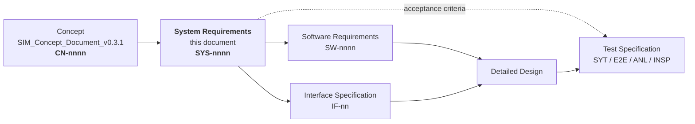
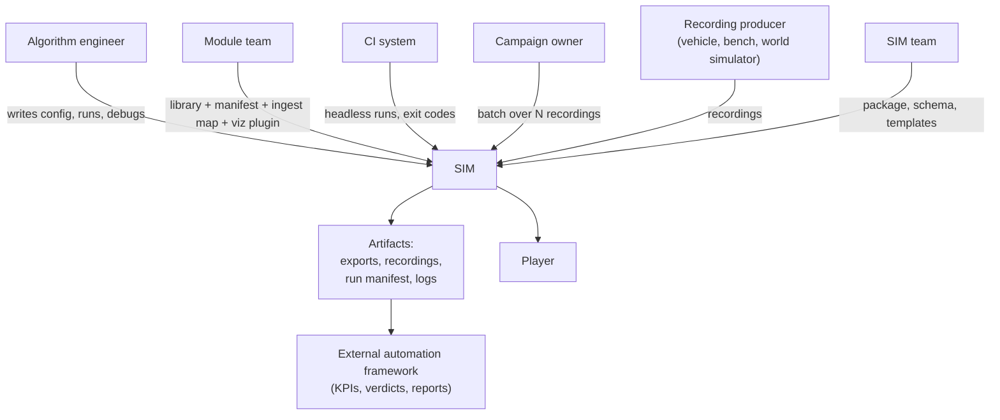

# SIM — Replay & Simulation Engine
## System Requirements Specification — v0.1

**Owner:** SIM Team (tool supplier)
**Derived from:** `SIM_Concept_Document_v0.3.1.md` (this directory) — the concept baseline.
**Status:** Draft for review. **All five baselining gates closed 2026-08-13** (§26.1) — the barrier to baselining is now review, not an open decision. Two rows remain open and neither is a gate: `OQ-09` (a bench sample, evidence rather than design) and `OQ-15` (the CI vendor, ~10 lines).
**Audience:** SIM developers, algorithm-team integrators, CI/DevOps, and the authors of the Software Requirements, Interface Specification and Test Specification derived from this document.

---

## 0. How to read this document

### 0.1 Where this document sits



| Document | Answers | Exists? |
|---|---|---|
| Concept (`v0.3.1`) | *What was asked for, and why* | yes |
| **System Requirements (this)** | *What the system must do, observably, at its boundary* | **this draft** |
| Software Requirements | *What each software item must do, internally* | `SIM_Software_Requirements_v0.1.md` |
| Implementation Design | *Which file, which symbol, which signature* | `SIM_Implementation_Design_v0.1.md` |
| Interface Specification | *The exact bytes, signatures and schemas at each named interface* | not yet — §3.4 is its table of contents |
| **System Test Specification** | *The `SYT-*` / `ANL-*` / `INSP-*` verification cases* | `SIM_System_Test_Spec_v0.1.md` |
| **Concept Test Specification** | *The `CT-*` / `E2E-*` validation cases* | `SIM_Concept_Test_Spec_v0.1.md` |
| Software Test Specification | *The `UT-*` / `IT-*` cases* | `SIM_Software_Test_Spec_v0.1.md` |

**No separate architecture document is produced.** The concept document's §5 (process architecture), §6 (the C++/Python boundary), §7 (data model), §21.4 (target package structure) and §26 (extension points) already constitute the architectural baseline, and duplicating them here would create the two-copies-that-drift failure that `CN-0287` exists to prevent. What is genuinely missing is *interface* detail, which belongs in the Interface Specification, not in a second architecture narrative. §3.4 below names every interface that document must specify.

### 0.2 Two numbers, on purpose

Same discipline as the concept document, for the same reason.

| What | Example | Rule |
|---|---|---|
| **Heading number** | `7.3` | Position in the document. Changes when sections move. |
| **UID** | `SYS-0042` | Stable identity. Allocated once, in creation order, **never changed and never reused.** Use it in trace links. |

New requirements append at the end of their section. A retired requirement is recorded in §21, never deleted silently and never reused.

### 0.3 Anatomy of a requirement

```
**`SYS-nnnn`** · `P0` · `R1` — Headline
**Shall.** The single normative statement. Exactly one "shall" per requirement.
**Accept.** The observable condition that decides pass or fail. Written so it can be false.
**Verify.** <method> · `<test id>`   **Trace.** CN-nnnn[, …]; v1 `<v1 id>`
```

| Field | Rule |
|---|---|
| **Shall** | One system-observable obligation. If it needs "and" twice, it is two requirements. |
| **Accept** | **Falsifiable** (`CN-0381`). If no observation could contradict it, it is a motivation and is demoted to prose, not carried as a requirement. |
| **Verify** | Method + the identifier of the test that will implement it. The identifier is written into the test itself, so the link is discoverable by `grep` and not by one sentence in a plan (`CN-0383`). |
| **Trace** | ≥1 concept UID (`CN-0377`), plus the v1 register id where this requirement carries v1 forward (§20). |

**There is deliberately no status field.** Verification status is *derived* from the test suite, never stored by hand in a second place (`CN-0382`). v1's register carried a `Status` column, 68 of 77 rows read `frozen` after twelve stages had shipped, and it could not answer "what is left". That column is not repeated.

### 0.3a The `**Built.**` line — generated, never typed

*Added 2026-08-13.* Every requirement carries one:

```
**Built.** ◐ started — 2/5 software requirements done, in `WP-09`, `WP-20`
```

| Glyph | Means |
|---|---|
| `●` done | Every software requirement decomposing this is done |
| `◐` started | At least one has started; not all are done |
| `○` not started | None has started |
| `◌` deferred | Deferred with its parent; no work package |
| `⚠` unknowable | **No software requirement decomposes this** — a finding, not a status. There is nothing under it to tick |

**It is not the status column §0.3 forbids, and the difference is mechanical rather than a matter of intent.** The rule's target is a *hand-kept* status, and its evidence is v1's own register — which failed because nobody updated it and **nothing checked it**. Both failures are structurally impossible here:

- **Nothing about this field is typed.** It is rolled up from the Implementation Plan's per-`IMP` checkboxes, which are the single stored progress state in the document set (Plan §0.5). Regenerate with `trace_check.py --write-status`.
- **The ordinary checker run verifies it.** `trace_check.py` recomputes every line and **fails on any disagreement**. A stale `Built.` line cannot survive a commit.

`R-REQ-11` already settles the principle for trace links, in those words: **the copy is made safe by checking it, not by deleting it.** A second copy that is checked is a readable document; a second copy that is trusted is v1's register.

**`Built.` is work, not verification.** It answers *"has the code been written and its test ticked?"* — never *"is this requirement met?"*, which remains a query over the suite and nothing else.

### 0.4 Verification methods

| Code | Method | Means |
|---|---|---|
| **T** | Test | An automated test that executes the system and asserts an outcome. Default; preferred always. |
| **D** | Demonstration | Executed, observed, recorded — used where the outcome is a human-visible behaviour (a GUI interaction, a debugger session). Scripted and screenshot-attached, never "we tried it". |
| **A** | Analysis | A derived measurement or a static check over the codebase or artifacts (a grep, a hash comparison, a budget calculation). |
| **I** | Inspection | Review against a written checklist. Used only where no execution is possible (documentation completeness, licence terms). Bounded to a named checklist so "inspected" cannot mean "someone read it". |

### 0.5 Test identifier scheme

Reserved here so the Test Specifications have a fixed namespace and every
`Verify` link below resolves.

| Prefix | Level | Scope | Specified in |
|---|---|---|---|
| `SYT-<area>-nn` | System test | One capability of the assembled system, exercised through its external interfaces. | `SIM_System_Test_Spec_v0.1.md` |
| `ANL-nn` | Analysis | A measurement or static check. | `SIM_System_Test_Spec_v0.1.md` |
| `INSP-nn` | Inspection | A checklist review. | `SIM_System_Test_Spec_v0.1.md` |
| `E2E-nn` | End-to-end | A complete operational scenario from §4, start to finish, one user goal. | **`SIM_Concept_Test_Spec_v0.1.md`** |

**Why `E2E-*` is specified one level up** *(decided 2026-08-13, when the test
specifications were written)*. This document originally reserved all four
prefixes in one namespace. An end-to-end scenario asks *"can the user complete
this job?"* — **validation** — while `SYT`/`ANL`/`INSP` ask *"does the boundary
behave as specified?"* — **verification**. The two are different levels of the
V, so they are specified in different documents.

**The identifiers do not change.** `E2E-01`…`E2E-12` are exactly as §4 defines
them and as `SYS-0112`, `SYS-0124`, `SYS-0130`, `SYS-0197` and `SYS-0266` cite
them. Only the document that specifies them moved; §4 remains their definition
and the Concept Test Specification adds fixtures and pass/fail cases without
restating the steps.

**Identifier allocation is document-wide, never section-local** (`R-REQ-2`).
Six duplicates entered this document when late-added requirements took the next
number local to their subsection — see `SIM_System_Test_Spec_v0.1.md` §6 for the
finding and the renumbering. `trace_check.py` now fails on a duplicate.

Areas: `INP` input · `DAT` data model · `PRC` processing · `TIM` timing · `STG` staging · `OUT` output · `PLR` player · `CFG` configuration · `BAT` batch/CI · `DIA` diagnostics · `REC` recording prep · `NFR` non-functional · `CON` constraints.

### 0.6 Priority

Carried forward from v1's register unchanged, because the definitions worked.

| Code | Meaning |
|---|---|
| `P0` | The tool is not usable without it. |
| `P1` | A stated goal degrades without it. **Default when unmarked.** |
| `P2` | Valuable, deferrable. |

**A caveat the review must settle.** As drafted, the distribution is `P0` 170 · `P1` 104 · `P2` 8 — **60% of requirements are `P0`**. That is very likely wrong, and it is wrong in a specific and familiar way: v1's own register opened by warning that 54 rows all marked equally mandatory *"provides no guidance at the exact moment guidance is needed — when time runs short and something must give"*, and this draft has reproduced that failure in a different column. The cause is that each requirement was prioritised on its own merits, where almost everything looks essential, rather than against the others.

It is recorded rather than quietly smoothed because **re-triage is a customer decision, not an author's**: which capabilities genuinely block first use is knowledge the algorithm teams have and this document does not. The review should push a substantial share of the current `P0` set to `P1`. A useful forcing question per row: *if this were missing on release day, would the tool be unusable, or merely worse?*

### 0.7 Release scope

| Code | Meaning | Concept migration phase (`§23`) |
|---|---|---|
| `R1` | First product release — the tool is usable by an algorithm engineer on a real recording. | Phases 0–4 |
| `R2` | Second release. | Phases 5–6 |
| `DEF` | Deferred. **Every `DEF` requirement carries its reason inline** (`CN-0378`). | — |

---

## 1. Purpose and system definition

### 1.1 The system

**SIM** is one configurable replay and simulation engine. It reads recorded data produced by anyone, feeds it through any set of algorithm libraries at the correct timing, and produces any set of outputs — controlled entirely by configuration files that live inside each project's own repository.

The system comprises:

| Item | Nature |
|---|---|
| `simcore` | C++ library — everything during a run |
| `simengine` | Thin native executable wrapping `simcore` — no GUI, no Python |
| Configuration layer | Python — everything before a run: parse, validate, resolve, emit the Resolved Run Spec |
| Player | Separate process — renders a session |
| Launcher | Interactive front-end that writes a run configuration and nothing else |
| CLI / batch orchestrator | Python |
| Standard plugin set | Readers, exporters, port model, config schemas, templates |

### 1.2 Scope boundary

| Inside the system | Outside the system |
|---|---|
| Reading recordings and building a time index | Producing recordings (measurement hardware, bench, world simulator) |
| Reconstructing cycle structure and scheduling | The algorithm libraries themselves |
| Loading and driving algorithm libraries | KPI computation, pass/fail verdicts, test reports |
| Applying declared overrides and faults | Physics and sensor simulation |
| Writing exports, recordings and the run manifest | Results databases, labelling, tuning optimisers |
| Rendering a session | Real ECUs, real buses, real-time guarantees |

**`CN-0011` is load-bearing and is repeated here because it is the most commonly violated boundary in tools of this class:** SIM does not decide whether a run passed. It reports what happened, with enough provenance that somebody else can decide.

### 1.3 The success measure

> An algorithm engineer can set up and change a simulation alone, in configuration, in minutes.

Everything in §17.6 (usability and survivability) exists to make that measurable rather than aspirational.

---

## 2. Evidence base, and the findings that changed requirements

This specification was written against three sources, not one. Where they disagreed, the disagreement is recorded rather than smoothed over.

| Source | Used for |
|---|---|
| `SIM_Concept_Document_v0.3.1.md` | Every requirement's origin. The authority on what was asked for. |
| The v1 document set (`../v1/`) | Requirement reuse (§20). 81 requirements, dispositioned individually. |
| **[REF-TC]** — a production measurement-and-replay toolchain examined during this analysis, together with a real project's configuration set for it | Independent evidence of what a mature tool of this class actually needs. Cited as `[REF-TC]` throughout. |

> **On `[REF-TC]`.** It is referenced by behaviour only — never by vendor, product name, file extension or internal identifier — and no requirement below copies its design. It is used the way a prior art survey is used: to find requirements that were missing, and to check that requirements already written survive contact with a system that has been in production use for years.

### 2.1 Finding 1 — a concept assumption is contradicted by the evidence, and it matters

**Concept `CN-0373` states:** *"Recordings in scope carry **no task or cycle marking**. Cycle structure must be reconstructed from the signal header."* The whole of concept §12.2 and migration phase 1 rest on this.

**The evidence says otherwise.** In `[REF-TC]`, cycle structure is a first-class recorded property: each data source may logically split its data into groups identified by a task/cycle identifier; every packet produced by such a task carries that identifier; successive runs of the same cycle are individually recognisable; and a consumer subscribes to a *cycle-end event* for a named source and cycle id in order to know when a coherent set of data is complete. A real project's configuration in that toolchain binds a visualization component's store trigger directly to such a cycle-end event.

**Why this is not a footnote.** If cycle marking is present in the recordings actually in scope, then header-driven reconstruction from `counter`/`t_source` is a *fallback*, not the primary mechanism — and the primary mechanism is both cheaper and exact. Building the fallback first, and only discovering later that the recordings carried the answer, would mean the most load-bearing part of phase 1 was designed against a false premise.

**What this specification does about it.** Rather than pick a side, §8.2 requires a **declared recovery ladder** in which a source-provided cycle marking is the highest-quality rung when present, `counter` the next, `t_source` the next, and reception time the last — with the rung actually used reported per port in the run manifest. This is correct under either answer, and it makes the answer *measurable* on the first real recording instead of assumed. `CN-0373` is flagged in §22 as an assumption requiring confirmation, and `CN-0330` (never define a cycle by identical file timestamps) survives untouched — it was right for a different reason.

### 2.2 Finding 2 — configuration decomposition, confirmed

`[REF-TC]` splits configuration into four independent file kinds with four different owners and four different rates of change: **component composition** (which units load, from which binaries, exposing which ports), **connections** (how exposed ports are wired, data-to-data and lifecycle-to-lifecycle), **source signal binding** (which recorded signal, from which data source, satisfies which port), and **visual layout** (tabs, splits, views, which draw layers are on, and per-view parameters).

That is a four-way split arrived at independently, and it maps almost exactly onto the concept's §15.2 ownership table. It is promoted here into an explicit requirement (`SYS-0117`) that these four concerns **shall not be merged into one file**, because the natural pressure during implementation is to collapse them and the cost of that is invisible until two teams need to change the same file for unrelated reasons.

### 2.3 Finding 3 — lifecycle wiring is data, and it is richer than the concept states

In `[REF-TC]`, lifecycle is wired in the same file and with the same syntax as data flow: a batch-player init signal reaches a component's `Init`, a batch-player reset reaches its `Reset`, and a source's cycle-end event reaches a visualization component's `DoStore`. Concept §9.2 has the *concept* of control ports; the evidence shows it is not an edge case but the ordinary mechanism by which "who runs when" becomes configuration instead of code. §9.3 requires it accordingly.

### 2.4 Finding 4 — player stepping granularity is a requirement, not a preference

`[REF-TC]` offers five distinct step granularities: one packet · N packets · a fixed time interval · the next packet of a chosen data source · the next complete run of a chosen cycle. A developer chasing a specific defect needs a different one of these on different days, and the last is the only one that lands on a coherent input set.

The concept's §13.3 transport list (play, pause, step, jump) is a subset. §13.2 adds the granularity requirement, scoped so it does not conflict with concept `CN-0335`'s two-pass separation of execution from viewing.

### 2.5 Finding 5 — layer namespacing and per-view parameters

In `[REF-TC]`, a visualization component claims a namespace of draw layers by wildcard, and the layout file switches individual layers on or off by their fully-qualified name, sets per-layer input-listener capability, and carries typed parameters scoped either globally or to one view-and-layer pair. The concept's §13.2 has layout and layer registration but not the namespace or the parameter scoping. §13.3 adds both — the namespace is what keeps two components' layers from colliding without a central registry, which is the same "no central roster" property the port model already has.

---

## 3. System context

### 3.1 Actors



### 3.2 System boundary — what crosses it

| Direction | Crosses the boundary |
|---|---|
| In | Recordings · configuration files · module manifests · ingest maps · algorithm libraries · visualization plugins · layout files · CLI arguments |
| Out | Exports · replayable recordings · run manifest · structured logs · exit codes · rendered session · snapshots · diagnostic reports |

### 3.3 Operating environments

| Environment | Characteristics |
|---|---|
| **Developer desktop** | Windows or Linux, interactive, player attached, native debugger available, one recording at a time. |
| **CI runner** | Linux container, headless, no GUI toolkit, no display, exit-code driven, artifacts uploaded. |
| **Campaign host** | Many cores, many recordings in parallel, one process per recording, long-running, resumable. |

### 3.4 External interfaces — the Interface Specification's table of contents

Named here so the boundary is fixed before the interfaces are designed. Each becomes one chapter of the Interface Specification.

| ID | Interface | Between | Nature |
|---|---|---|---|
| `IF-01` | **Module ABI** | `simcore` ↔ algorithm library | Small fixed set of C exports, versioned |
| `IF-02` | **Module manifest** | Module team → SIM | Declarative file: ports, types, periods, schemas, binaries, ABI version |
| `IF-03` | **Port model** | SIM-owned catalogue | Versioned named ports with typed payloads |
| `IF-04` | **Payload schema set** | Module → SIM, embedded in `IF-02` | Self-describing message schemas; no generated bindings required |
| `IF-05` | **Ingest map** | Recording owner → SIM | Source signal → port binding, header binding, unit/scale, origin tag |
| `IF-06` | **Reader plugin API** | SIM ↔ format codec | Open, index, seek, stream port values; capability declaration |
| `IF-07` | **Exporter plugin API** | SIM ↔ output codec | Write, with declared capabilities |
| `IF-08` | **Visualization plugin API** | SIM ↔ module viz plugin | Layer registration, port binding by manifest, geometry + style tokens |
| `IF-09` | **Resolved Run Spec** | Python → `simcore` | The language boundary. Flat, fully resolved, self-sufficient |
| `IF-10` | **Run manifest** | SIM → artifacts / external automation | Machine-readable record of everything that defined a run |
| `IF-11` | **Player transport** | Player process ↔ engine | Control + metadata channel, bulk via shared memory |
| `IF-12` | **Recording model** | SIM ↔ any codec | `meta` + typed topics + two-clock messages |
| `IF-13` | **Configuration schema set** | SIM → users | Published, versioned schemas for every configuration file kind |
| `IF-14` | **CLI + exit codes** | SIM ↔ operator / CI | Verbs, arguments, closed exit-code set |
| `IF-15` | **Python API** | SIM ↔ scripts and notebooks | Everything the CLI does, in a few lines |
| `IF-16` | **Layout file** | User → player | Tabs, splits, views, layer visibility, scoped parameters |

---

## 4. Operational scenarios

These are the sequences the system exists to support, end to end. Each becomes one `E2E-nn` test case in the Test Specification; the requirements each exercises are listed so that a scenario failing points at requirements rather than at code.

**Notation:** *Pre* — what must be true before. *Steps* — the observable sequence. *Post* — what must be true after. *Exercises* — the SYS requirements this scenario is the acceptance vehicle for.

---

**`E2E-01` — Onboard a recording the tool has never seen**
*Pre:* a recording from an external producer; the component's library and manifest are installed; no ingest map yet.
*Steps:* (1) inspect the recording — ports, rates, time range, data descriptions. (2) Run the environment report; it names what is missing without raising. (3) Author an ingest map declaring signal→port bindings, header bindings, units and the ports this family never carries. (4) Validate — every reference resolves or the failure names both ends. (5) Probe — the tool reports which cuts this recording can support. (6) Explain — resolved spec, graph, schedule, injection boundary, coherence result, estimated duration, nothing executed.
*Post:* the feasible-cut set is known before any run has been attempted.
*Exercises:* `SYS-0001`…`SYS-0022` (readers, index, ingest maps, feasible cuts), `SYS-0171` (validate at load), `SYS-0202` (explain), `SYS-0208` (environment report), `SYS-0225` (inspect).

---

**`E2E-02` — Tune a driving function against recorded perception**
*Pre:* `E2E-01` complete; perception outputs present in the recording.
*Steps:* (1) Launcher: set upstream modules `measured`, the function under test `simulate`. (2) Coherence check passes at selection time. (3) Save the run configuration. (4) Launch with player. (5) Change a calibration value in the config bundle; re-run without rebuilding anything. (6) Compare the two runs port by port; first divergence is reported with tick, port and field.
*Post:* two runs, two manifests, one diff, no code edited and no rebuild.
*Exercises:* `SYS-0080`…`SYS-0083` (mode and implementation), `SYS-0158`…`SYS-0163` (launcher), `SYS-0164`…`SYS-0172` (configuration), `SYS-0072` and `SYS-0177` (calibration without rebuild), `SYS-0205` (run comparison).

---

**`E2E-03` — Deepen the cut without touching the downstream configuration**
*Pre:* `E2E-02` complete.
*Steps:* (1) Change the upstream stage from `measured` to `simulate` and give it an implementation. (2) The tool closes any severed chain by default and prints exactly what it changed. (3) Re-run.
*Post:* the downstream module's configuration entry is **byte-identical** to before, and it cannot tell from its inputs which mode its producer was in.
*Exercises:* `SYS-0080`, `SYS-0081` (executed and injected are indistinguishable), `SYS-0095` (closing the gap), `SYS-0087`…`SYS-0090` (classification).

---

**`E2E-04` — Catch and resolve a coherence violation**
*Pre:* a configuration in which a simulated module has a measured descendant that is itself consumed by a simulated module, with at least one measured module in between.
*Steps:* (1) Attempt the run. (2) It is blocked before execution, naming every stale module, the path that made it stale, and the consumer where the corruption would land. (3) Three remedies are offered including the smallest change. (4) Apply the suggested remedy; the run proceeds. (5) Separately, waive the violation with a written reason; the run proceeds and every artifact is permanently marked incoherent.
*Post:* neither the block nor the waiver can happen silently.
*Exercises:* `SYS-0087`…`SYS-0096` (the whole of §9.2).

---

**`E2E-05` — Interactive debugging down to a native breakpoint**
*Pre:* a run configuration that reproduces a defect.
*Steps:* (1) Launch, observe the defect in the player. (2) From the picture, reach the bytes: port, origin, source timestamp, cycle, recording, and whether the value was published or reconstructed. (3) Ask the same question from the command line; the answers are identical. (4) Re-launch the engine executable alone from the saved Resolved Run Spec, with no Python in the process. (5) Attach a native debugger; break on entry to the named module at a named cycle. (6) Step. Watchdog and timeouts are inactive.
*Post:* the defect is reproduced in a debugger from an artifact, on both platforms.
*Exercises:* `SYS-0153`, `SYS-0154` (evidence, one producer), `SYS-0165`, `SYS-0166` (the Resolved Run Spec as a launchable artifact), `SYS-0212`…`SYS-0217` (native debugging).

---

**`E2E-06` — Nightly regression campaign**
*Pre:* one run configuration, a list of N recordings, a CI runner.
*Steps:* (1) Estimate recording volume before starting; the estimate is labelled an upper bound and revised from the measured rate. (2) Run headless, one subprocess per recording, jobs bounded. (3) One recording's module segfaults; another hangs. (4) The batch continues. (5) Aggregate status distinguishes ok, fail, crash and timeout. (6) Each failure names recording, pipeline, last completed cycle, captured stderr and run id.
*Post:* the batch completes; two failures are individually reproducible on a desktop from their artifacts alone.
*Exercises:* `SYS-0117` (volume estimate), `SYS-0181`…`SYS-0194` (batch), `SYS-0056` (per-cycle timeout), `SYS-0186`, `SYS-0188` (four outcomes, reproducible crash records).

---

**`E2E-07` — Reuse an intermediate result**
*Pre:* a chain where perception is expensive and the function under test is cheap.
*Steps:* (1) Simulate perception once; export a replayable recording carrying its outputs and the original inputs. (2) Load that export on its own, with no other input. (3) Iterate the function against it many times.
*Post:* iteration wall time drops by at least the measured cost of the perception stage; the export declares its own feasible cuts and its origin tags mark simulated data as simulated.
*Exercises:* `SYS-0111`, `SYS-0112` (replayable output as input), `SYS-0119` (a merged output loads alone), `SYS-0122` (recording vs export), `SYS-0232` (time-sliced runs).

---

**`E2E-08` — Open a colleague's result on a machine with no build**
*Pre:* an artifact directory copied from another machine, another OS, with no source checkout and no compiler.
*Steps:* (1) Open it in the player. (2) Every layer renders, or names precisely which plugin bundle is missing and which hash was expected. (3) Reproduce the run from the manifest alone.
*Post:* nothing from the originating machine is required, and no code from the artifact executes.
*Exercises:* `SYS-0028` (schemas travel with the component), `SYS-0114`, `SYS-0123`, `SYS-0124` (manifest sufficiency), `SYS-0130` (player with no engine), `SYS-0197` (self-contained artifacts), `SYS-0253`, `SYS-0255` (a recording never executes code).

---

**`E2E-09` — Prepare a recording for simulation**
*Pre:* a raw recording of unknown quality.
*Steps:* (1) Integrity check: timestamp monotonicity, gaps, per-port counter continuity, rate stability, checksums where available. (2) Use the result as a gate. (3) Extract a smaller recording by time range and port selection. (4) Index it. (5) Confirm lineage: the derived recording states what it came from, when, and how.
*Post:* a damaged recording is refused before it produces confident nonsense.
*Exercises:* `SYS-0220`…`SYS-0229` (the whole of §17).

---

**`E2E-10` — Onboard a new module, with no help from the SIM team**
*Pre:* a module team with a library and no prior SIM contact.
*Steps:* (1) Follow the published checklist. (2) Generate a first-draft manifest from the build. (3) Probe the library: its port set is read from the manifest with no hand-mapping. (4) Add a visualization plugin binding ports through the manifest, never by spelled address. (5) Deploy manifest, ingest map and plugin beside the library. (6) Run.
*Post:* no SIM-team edit, no ticket, no framework file changed, and the checklist is proven sufficient by a *second* module completing it unaided.
*Exercises:* `SYS-0037`…`SYS-0042` (manifests), `SYS-0053` (discovered, never hand-mapped), `SYS-0149` (plugins bind through the manifest), `SYS-0255` (deployed beside the library), `SYS-0266` (the checklist, proven by a second component).

---

**`E2E-11` — Open-loop divergence is visible, not hidden**
*Pre:* a run in which a simulated function commands an actuation the recorded vehicle did not perform.
*Steps:* (1) Run. (2) The first divergence point is detected. (3) It appears in the run manifest, on the player timeline, and as a flag on exported data past the point plus a configured grace window.
*Post:* no consumer of the artifact can mistake post-divergence data for valid.
*Exercises:* `SYS-0104`…`SYS-0107` (open loop and divergence).

---

**`E2E-12` — Determinism, measured**
*Pre:* one recording, one resolved spec, one set of binaries.
*Steps:* (1) Re-run in the same process. (2) Re-run in a fresh process. (3) Rebuild the libraries and re-run. (4) Re-run on a different machine and a different OS. (5) Compare port values, not file bytes.
*Post:* axes 1 and 2 are exact and block; axes 3 and 4 are reported against a declared tolerance, with headroom consumed printed even on a pass.
*Exercises:* `SYS-0239`…`SYS-0246` (the whole of §19).

---

# PART A — FUNCTIONAL SYSTEM REQUIREMENTS

## 5. Input and ingest

### 5.1 Readers

**`SYS-0001`** · `P0` · `R1` — Recordings are read through plugins
**Shall.** The system shall read source data exclusively through Reader plugins that open a source, build a time index, seek by time, and return port values.
**Accept.** Adding support for a new format requires no change to any file in `simcore` outside the new reader and its registration.
**Verify.** T · `SYT-INP-01`   **Trace.** CN-0078, CN-0085; v1 `NR-SIM-20`
**Built.** ● done — 2/2 software requirements done

**`SYS-0002`** · `P0` · `R1` — Readers stream
**Shall.** A reader shall stream, and the system shall never require a whole recording to be resident in memory.
**Accept.** Peak resident memory for a run over a 20-minute recording is bounded by the declared working set and does not scale with recording length; measured across three recordings of 1×, 5× and 20× duration, peak memory varies by less than 20%.
**Verify.** T · `SYT-INP-02` · `ANL-01`   **Trace.** CN-0302, CN-0355
**Built.** ◐ started — 3/6 software requirements done, in `WP-06`, `WP-09`, `WP-25`

**`SYS-0003`** · `P0` · `R1` — Random access by time
**Shall.** A reader shall support random access by time, or provide an index that makes it possible.
**Accept.** Seeking to an arbitrary time in a 20-minute recording returns the correct first message without reading messages before it.
**Verify.** T · `SYT-INP-03`   **Trace.** CN-0079
**Built.** ○ not started — 0/1 software requirements done, in `WP-17`

**`SYS-0004`** · `P1` · `R1` — Sidecar index, built once
**Shall.** On first open, a reader shall build a sidecar index and cache it for reuse by later runs and batch entries.
**Accept.** The second open of the same unmodified recording performs no full scan; index build time appears once in a batch of N entries, not N times.
**Verify.** T · `SYT-INP-04`   **Trace.** CN-0080, CN-0226, CN-0192
**Built.** ○ not started — 0/1 software requirements done, in `WP-17`

**`SYS-0005`** · `P0` · `R1` — The index is keyed by port
**Shall.** The index shall be keyed by port, so a run reads only the ports its active graph requires.
**Accept.** A run whose graph needs no image port decodes no image; bytes-read is lower than for the same run with an image consumer active, by at least the image channels' share of the file.
**Verify.** T · `SYT-INP-05` · `ANL-02`   **Trace.** CN-0081, CN-0224
**Built.** ○ not started — 0/3 software requirements done, in `WP-15`, `WP-17`

**`SYS-0006`** · `P1` · `R1` — Multiple sources merged on one time base
**Shall.** The system shall permit multiple readers active in one run, merged onto a common time base.
**Accept.** A run combining two sources produces one ordered tick stream; each port's origin source is identifiable in the manifest.
**Verify.** T · `SYT-INP-06`   **Trace.** CN-0082
**Built.** ○ not started — 0/3 software requirements done, in `WP-17`, `WP-19`

**`SYS-0007`** · `P1` · `R1` — Declared time domains and offsets
**Shall.** Each source shall declare its time domain and an optional offset/skew correction.
**Accept.** A configuration combining two sources with different time domains and no declared relationship is rejected at load, naming both.
**Verify.** T · `SYT-INP-07`   **Trace.** CN-0083, CN-0269
**Built.** ○ not started — 0/1 software requirements done, in `WP-17`

**`SYS-0008`** · `P2` · `R2` — Synchronization buffer
**Shall.** The system shall provide a configurable synchronization buffer that aligns sources whose data arrives out of order.
**Accept.** With the buffer configured to the declared maximum reordering window, an out-of-order source produces a monotonic tick stream; with it configured to zero, the same input is reported as out of order rather than silently accepted.
**Verify.** T · `SYT-INP-08`   **Trace.** CN-0084
**Built.** ○ not started — 0/1 software requirements done, in `WP-30`

**`SYS-0009`** · `P1` · `R1` — Self-describing formats are used as such
**Shall.** Where a source format carries its own data description, the reader shall use it, and shall accept an external override.
**Accept.** A recording carrying an embedded description loads with no external description file; supplying one overrides the embedded description and the manifest records which was used.
**Verify.** T · `SYT-INP-09`   **Trace.** CN-0086
**Built.** ◐ started — 1/4 software requirements done, in `WP-06`, `WP-12`

**`SYS-0010`** · `P0` · `R1` — Codecs declare capabilities
**Shall.** Every codec shall declare its capabilities explicitly — at minimum: embedded schemas, random access, round-trip, capture time, arbitrary topics, meta blocks.
**Accept.** A codec that does not declare round-trip is refused as a simulation input **by capability check at load**, not by a special case in the loader; the refusal names the missing capability.
**Verify.** T · `SYT-INP-10`   **Trace.** CN-0303, CN-0371(io)
**Built.** ● done — 1/1 software requirements done

**`SYS-0011`** · `P1` · `R1` — Format priority for release one
**Shall.** Release one shall provide readers for, in priority order: a vehicle measurement format, a bench capture export, and the system's own interchange format.
**Accept.** Each of the three opens a real file supplied by its owning team, and `E2E-01` completes against each.
**Verify.** T · `SYT-INP-11`   **Trace.** CN-0004
**Built.** ○ not started — 0/1 software requirements done, in `WP-18`
*Note:* the definitive format list was `OQ-08` in §22, **closed 2026-08-11 — MCAP (interchange), MDF4 (vehicle measurement), TDMS (bench capture)**.
*Note (`OQ-22` closed 2026-08-13):* **acquiring third-party readers for MDF4 and TDMS is agreed in principle**, and the licence question moves out of the baselining gates and onto the two format work packages — asked, per format, in the week its first sample file arrives, by somebody holding a real file rather than in the abstract. That is safe because one decision bounds it completely: a codec is about four methods behind a registered interface, touching no engine code and replaceable without a single caller changing, so the choice between an open-source reader, a vendor SDK and a clean-room implementation is **procurement, not architecture**. Two things to check when each is asked: the licence class against how the deliverable ships — **the case that bites is a copyleft reader statically linked into a delivered library**, with dynamic linkage the usual mitigation and still needing sign-off — and, for any SDK, redistribution terms plus coverage of **both** Windows and Ubuntu. **One item should start early regardless:** if a vendor SDK is even a candidate, open the redistribution-terms conversation now. It is the only open item in this document whose latency is measured in months rather than days.

**`SYS-0012`** · `P2` · `R2` — Second-tier formats
**Shall.** The system shall provide readers for an image folder with index, and for a synthetic-scenario tool's output.
**Accept.** As `SYS-0011`.
**Verify.** T · `SYT-INP-12`   **Trace.** CN-0004, CN-0008
**Built.** ○ not started — 0/1 software requirements done, in `WP-30`

### 5.2 Ingest maps

**`SYS-0013`** · `P0` · `R1` — The source-to-port bridge is declared data
**Shall.** The bridge from a recording's own signal vocabulary to the port model shall be a declared file, never code.
**Accept.** A new recording family is onboarded with no compiled artifact rebuilt and no Python module edited.
**Verify.** T · `SYT-INP-13`   **Trace.** CN-0068, CN-0304; v1 `FR-SIM-66`
**Built.** ◐ started — 1/3 software requirements done, in `WP-05`, `WP-06`, `WP-12`

**`SYS-0014`** · `P0` · `R1` — What an ingest map declares
**Shall.** An ingest map shall declare, per source signal: target port, payload type, origin tag, unit, scale and offset, and array shape where applicable.
**Accept.** A map omitting any mandatory field is refused at load, naming the field and the line.
**Verify.** T · `SYT-INP-14`   **Trace.** CN-0304
**Built.** ◐ started — 0/2 software requirements done, in `WP-05`, `WP-12`

**`SYS-0015`** · `P0` · `R1` — The signal header is bound explicitly
**Shall.** An ingest map shall bind the signal header fields explicitly — which source channel provides source time, which provides the cycle counter, which provides status, and, where the source carries it, which provides the cycle identifier.
**Accept.** A map that binds none of these loads, but every port it feeds is marked *timing approximated* in the run manifest and a warning is emitted naming those ports.
**Verify.** T · `SYT-INP-15`   **Trace.** CN-0305, CN-0074; **evidence** §2.1
**Built.** ◐ started — 0/3 software requirements done, in `WP-05`, `WP-08`, `WP-12`

**`SYS-0016`** · `P0` · `R1` — Declared holes
**Shall.** An ingest map shall declare which ports the recording family never carries, with a reason.
**Accept.** A cut requiring a declared-absent port is refused at load with the declared reason quoted, not at the first cycle.
**Verify.** T · `SYT-INP-16`   **Trace.** CN-0306
**Built.** ○ not started — 0/1 software requirements done, in `WP-12`

**`SYS-0017`** · `P1` · `R1` — Family recognition
**Shall.** A recording family shall be recognised by declared match rules, so two teams' vocabularies coexist without a shared namespace.
**Accept.** Two maps with disjoint match rules coexist; a recording matching neither is reported as unmapped, naming the maps considered.
**Verify.** T · `SYT-INP-17`   **Trace.** CN-0307
**Built.** ○ not started — 0/1 software requirements done, in `WP-12`

**`SYS-0018`** · `P0` · `R1` — Two maps claiming one port is an error
**Shall.** A port claimed by two applicable ingest maps shall be an authoring error naming both.
**Accept.** The error names both maps, the port, and both source signals. No precedence rule resolves it silently.
**Verify.** T · `SYT-INP-18`   **Trace.** CN-0308
**Built.** ○ not started — 0/1 software requirements done, in `WP-12`

**`SYS-0019`** · `P0` · `R1` — Declarative unit correction, and nothing more
**Shall.** An ingest map shall permit unit conversion by a declared factor and offset from a closed vocabulary, and shall permit nothing else — no expression, no field arithmetic, no scripting, no user-supplied callable.
**Accept.** A map containing any construct outside the closed vocabulary is refused at load. The vocabulary's members are enumerable from the published schema.
**Verify.** T · `SYT-INP-19` · `INSP-01`   **Trace.** CN-0309, CN-0286
**Built.** ◐ started — 2/5 software requirements done, in `WP-05`, `WP-06`, `WP-12`

**`SYS-0020`** · `P0` · `R1` — Type mismatch means the cut is unsupported
**Shall.** A source signal whose type does not match the target port's declared type shall mean the recording does not support that cut.
**Accept.** The refusal names both types. No silent coercion occurs, including between numeric widths.
**Verify.** T · `SYT-INP-20`   **Trace.** CN-0303, CN-0070
**Built.** ◐ started — 1/2 software requirements done, in `WP-06`, `WP-20`

**`SYS-0021`** · `P1` · `R1` — Ingest maps deploy beside the library
**Shall.** Ingest maps shall be deployed beside the component library and resolved from there, never read from a source checkout.
**Accept.** A run from installed artifacts alone, with no source tree present, resolves every ingest map.
**Verify.** T · `SYT-INP-21`   **Trace.** CN-0310, CN-0285; v1 `FR-SIM-64`
**Built.** ○ not started — 0/1 software requirements done, in `WP-21`

**`SYS-0022`** · `P0` · `R1` — Feasible cuts are computed, not discovered
**Shall.** Given a recording and the manifests present, the system shall compute the set of feasible cuts before any run.
**Accept.** `probe` reports the feasible set; every cut it reports runs, and every cut it excludes is refused at load with a reason.
**Verify.** T · `SYT-INP-22`   **Trace.** CN-0344; v1 `CR-SIM-21`
**Built.** ○ not started — 0/2 software requirements done, in `WP-20`, `WP-24`

---

## 6. Data model

### 6.1 Port model

**`SYS-0023`** · `P0` · `R1` — A versioned port catalogue
**Shall.** The system shall define a port model: a versioned catalogue of named ports carrying typed payloads.
**Accept.** Every port referenced in any configuration resolves against the catalogue at load, or the load fails naming the port and listing near matches.
**Verify.** T · `SYT-DAT-01`   **Trace.** CN-0066; v1 `NR-SIM-8`
**Built.** ● done — 1/1 software requirements done

**`SYS-0024`** · `P0` · `R1` — Readers and modules do not meet
**Shall.** Readers shall produce port values and modules shall consume port values; neither shall address the other.
**Accept.** No reader names a module and no module names a reader, in configuration or in code.
**Verify.** A · `ANL-03`   **Trace.** CN-0067
**Built.** ● done — 1/1 software requirements done

**`SYS-0025`** · `P1` · `R1` — Port model versioning
**Shall.** The port model shall be versioned, with adding an optional field a minor change and removing or changing one a major change.
**Accept.** A configuration pinned to a major version refuses to load against a different major version, naming both.
**Verify.** T · `SYT-DAT-02`   **Trace.** CN-0069, CN-0260
**Built.** ○ not started — 0/1 software requirements done, in `WP-07`

**`SYS-0026`** · `P0` · `R1` — Missing is not zero
**Shall.** Missing or invalid fields shall be represented explicitly and never silently zero-filled.
**Accept.** A port value with an absent field reports absent through every surface — export, player, evidence query — and never `0`, `0.0` or an empty list.
**Verify.** T · `SYT-DAT-03`   **Trace.** CN-0070; v1 `NR-SIM-4`
**Built.** ◐ started — 1/2 software requirements done, in `WP-07`, `WP-29`

**`SYS-0027`** · `P1` · `R1` — Project-local extension
**Shall.** A project shall be able to extend the port model in a project-local namespace without forking the core.
**Accept.** A project-local port is usable in configuration, export and visualization, and its name cannot collide with a core port.
**Verify.** T · `SYT-DAT-04`   **Trace.** CN-0071, CN-0274
**Built.** ● done — 1/1 software requirements done

**`SYS-0028`** · `P0` · `R1` — Schemas travel with the component
**Shall.** Payload schemas shall travel with the component, embedded in its manifest, and the framework shall require no generated bindings and no sibling source checkout to decode any component's ports.
**Accept.** A machine with only the component's installed artifacts decodes every port it produces. Removing every generated binding from the environment changes nothing.
**Verify.** T · `SYT-DAT-05`   **Trace.** CN-0297; v1 `NR-SIM-10`
**Built.** ○ not started — 0/1 software requirements done, in `WP-29`

### 6.2 Signal header

**`SYS-0029`** · `P0` · `R1` — Every port value carries a header
**Shall.** Every port value shall carry: source time, cycle counter, status, capture time, simulation time, producer, mode, and a repeat indicator.
**Accept.** Every port value in every export and every evidence answer has all eight fields present, each either a value or an explicit *unknown*.
**Verify.** T · `SYT-DAT-06`   **Trace.** CN-0072; v1 `NR-SIM-7`
**Built.** ● done — 1/1 software requirements done

**`SYS-0030`** · `P0` · `R1` — Two clocks, never collapsed
**Shall.** A recorded message shall carry two distinct timestamps — the instant the data describes, and the instant it was received — and the system shall never default one to the other.
**Accept.** Where capture time is unknown it reads *unknown*; a derived data age of exactly zero occurs only when capture and reception genuinely coincide, and is distinguishable from unknown in every surface.
**Verify.** T · `SYT-DAT-07`   **Trace.** CN-0298, CN-0139; v1 `CR-SIM-4`
**Built.** ◐ started — 2/4 software requirements done, in `WP-07`, `WP-11`, `WP-17`

**`SYS-0031`** · `P1` · `R1` — Source time preferred, and the choice recorded
**Shall.** Source time shall be preferred over capture time where available, and the system shall record which was used, per port, in the run manifest.
**Accept.** The manifest names, for every port, which timestamp basis was used.
**Verify.** T · `SYT-DAT-08`   **Trace.** CN-0073
**Built.** ○ not started — 0/1 software requirements done, in `WP-08`

**`SYS-0032`** · `P0` · `R1` — Timing quality is declared, not assumed
**Shall.** Where neither source time nor a cycle counter is available for a port, the system shall warn and mark that port's timing as approximated.
**Accept.** The mark appears in the run manifest, in every export carrying that port, and in the player.
**Verify.** T · `SYT-DAT-09`   **Trace.** CN-0074
**Built.** ○ not started — 0/1 software requirements done, in `WP-08`

### 6.3 Provenance

**`SYS-0033`** · `P0` · `R1` — A closed origin vocabulary
**Shall.** Every port shall carry an origin tag from the closed set: `measured`, `truth`, `mocked`, `simulated`, `overridden`, `unknown`.
**Accept.** No seventh value can be produced by any code path. A recording with no provenance metadata yields `unknown`, never `measured`.
**Verify.** T · `SYT-DAT-10` · `ANL-04`   **Trace.** CN-0299, CN-0300, CN-0286; v1 `CR-SIM-20`
**Built.** ◐ started — 3/4 software requirements done, in `WP-06`, `WP-07`, `WP-11`

**`SYS-0034`** · `P0` · `R1` — Reconstructed values are marked
**Shall.** A value reconstructed rather than read shall be marked as reconstructed everywhere it is rendered, exported or explained.
**Accept.** A reconstructed value and a published value of the same port are visually and textually distinguishable without opening the configuration.
**Verify.** T · `SYT-DAT-11`   **Trace.** CN-0301; v1 `FR-SIM-67`
**Built.** ○ not started — 0/2 software requirements done, in `WP-17`, `WP-24`

**`SYS-0035`** · `P0` · `R1` — Never estimate what nothing produced
**Shall.** The system shall not integrate a time-varying signal, filter, or otherwise produce a history-dependent estimate of information no module published.
**Accept.** No component of the system holds state across ticks for the purpose of producing a port value that no producer emitted. Reconstruction is limited to deterministic transforms of a fixed constant or of an already-emitted value.
**Verify.** A · `ANL-05` · `INSP-02`   **Trace.** CN-0301
**Built.** ◐ started — 1/5 software requirements done, in `WP-04`, `WP-08`, `WP-11`, `WP-12`, `WP-25`

**`SYS-0036`** · `P1` · `R1` — Port identity is independent of who produces it
**Shall.** A component shall be splittable into two without invalidating existing recordings, pipelines, plugins or ingest maps.
**Accept.** Splitting a two-function component into two components, with the port names unchanged, leaves every existing recording readable, every plugin bound, and every ingest map valid.
**Verify.** T · `SYT-DAT-12`   **Trace.** CN-0312; v1 `FR-SIM-71`
**Built.** ● done — 1/1 software requirements done

---

## 7. Processing and module lifecycle

### 7.1 Manifests and the graph

**`SYS-0037`** · `P0` · `R1` — Every module declares itself
**Shall.** Every simulatable module shall provide a manifest at a fixed location, declaring at minimum: component id, version, ABI version, build id, per-port name and type, per-port period, config bundle hash, and the embedded payload schema set.
**Accept.** A manifest missing any of these is refused at load naming the field. The engine reads no module property from any other source.
**Verify.** T · `SYT-PRC-01`   **Trace.** CN-0087, CN-0311
**Built.** ○ not started — 0/1 software requirements done, in `WP-10`

**`SYS-0038`** · `P0` · `R1` — The graph is built from manifests
**Shall.** The system shall build the module graph from manifests plus the project's active module list, and shall hardcode no chain.
**Accept.** No file in the system enumerates a specific processing chain. Reordering or replacing the chain is a configuration change only.
**Verify.** T · `SYT-PRC-02` · `ANL-06`   **Trace.** CN-0088, CN-0028, CN-0037; v1 `FR-SIM-1`, `FR-SIM-2`
**Built.** ○ not started — 0/1 software requirements done, in `WP-20`

**`SYS-0039`** · `P0` · `R1` — One producer per port
**Shall.** A port shall have exactly one producer in a run.
**Accept.** Two active producers for one port is refused at load, naming both.
**Verify.** T · `SYT-PRC-03`   **Trace.** CN-0089
**Built.** ○ not started — 0/1 software requirements done, in `WP-20`

**`SYS-0040`** · `P0` · `R1` — No unfed required input
**Shall.** A required input with neither a producer nor a recording source shall be a rejected configuration.
**Accept.** Refused at load, naming the consumer, the port, and every candidate that was considered and why each failed.
**Verify.** T · `SYT-PRC-04`   **Trace.** CN-0090, CN-0346
**Built.** ◐ started — 1/2 software requirements done, in `WP-05`, `WP-20`

**`SYS-0041`** · `P1` · `R1` — Manifests may be generated, but the checked-in file is the authority
**Shall.** A manifest may be auto-generated as a first draft from the build, and the checked-in manifest shall be the authority.
**Accept.** Regenerating a manifest that disagrees with the checked-in one reports the difference and does not overwrite it without an explicit instruction.
**Verify.** T · `SYT-PRC-05`   **Trace.** CN-0091
**Built.** ○ not started — 0/1 software requirements done, in `WP-10`

**`SYS-0042`** · `P1` · `R1` — The shim is generated from declared data
**Shall.** A component's generic-ABI shim shall be generated from declared data in the component, never hand-written, and shall not be checked in.
**Accept.** Deleting the generated shim and rebuilding reproduces it byte-identically. A hand-edited shim is overwritten by the build.
**Verify.** T · `SYT-PRC-06`   **Trace.** CN-0091; v1 `NR-SIM-11`
**Built.** ○ not started — 0/1 software requirements done, in `WP-10`

**`SYS-0043`** · `P2` · `R2` — Multiple instances
**Shall.** A module shall be instantiable more than once in a run, with instance renaming.
**Accept.** Two instances of one module produce two distinct port namespaces and two distinct sets of provenance.
**Verify.** T · `SYT-PRC-07`   **Trace.** CN-0092, CN-0105
**Built.** ○ not started — 0/1 software requirements done, in `WP-30`
*Note:* how many instances must be supported is `OQ-03` in §22.

### 7.2 Port kinds and composition

**`SYS-0044`** · `P0` · `R1` — Data ports and control ports are distinct
**Shall.** The port model shall distinguish data ports, which carry values, from control ports, which carry execution triggers and lifecycle events.
**Accept.** A configuration connecting a data port to a control port is refused, naming both kinds.
**Verify.** T · `SYT-PRC-08`   **Trace.** CN-0093, CN-0094; **evidence** §2.3
**Built.** ○ not started — 0/2 software requirements done, in `WP-10`, `WP-20`

**`SYS-0045`** · `P0` · `R1` — Lifecycle is wired, not coded
**Shall.** Lifecycle events — at minimum init, reset, and end-of-cycle — shall be connectable to any module that declares the corresponding control port, in the same configuration file kind and with the same syntax as data connections.
**Accept.** Changing which modules receive a reset, or which cycle-end event triggers which consumer, is a configuration edit with no rebuild.
**Verify.** T · `SYT-PRC-09`   **Trace.** CN-0095; **evidence** §2.3
**Built.** ○ not started — 0/1 software requirements done, in `WP-10`

**`SYS-0046`** · `P1` · `R1` — A unit does not know what it is wired to
**Shall.** A module's configuration shall be a self-contained unit exposing named ports, unaware of what it is connected to; a top-level configuration shall compose units by connecting exposed ports.
**Accept.** A unit's file is reusable in two different top-level compositions with no edit.
**Verify.** T · `SYT-PRC-10`   **Trace.** CN-0103, CN-0104; **evidence** §2.2
**Built.** ● done — 1/1 software requirements done

**`SYS-0047`** · `P1` · `R1` — Variables, resolved at load
**Shall.** Paths and environment-specific values shall use variables resolved at load time.
**Accept.** The same configuration set runs unchanged on two machines with different install roots. Every resolution is reported by `explain`.
**Verify.** T · `SYT-PRC-11`   **Trace.** CN-0106, CN-0242
**Built.** ● done — 1/1 software requirements done

### 7.3 Module host

**`SYS-0048`** · `P0` · `R1` — A declared lifecycle
**Shall.** The module host shall load the library, resolve ABI entry points, and drive the lifecycle `create → configure → init → step (many) → reset → destroy`.
**Accept.** Every transition is observable in the cycle trace. A module that fails any transition is reported with the transition named.
**Verify.** T · `SYT-PRC-12`   **Trace.** CN-0096
**Built.** ○ not started — 0/2 software requirements done, in `WP-10`
*Note (`OQ-06`, closed 2026-08-12):* the ABI has **five** exports — `adasAbiVersion`, `adasManifest`, `adasInit`, `adasExec`, `adasShutdown` — and **no reset entry point**, so *"do modules support reset without destroy?"* is a question about the contract rather than about eleven module teams. The lifecycle maps onto it today with no module change: create/configure/init is `adasInit(configPath)`, step is `adasExec`, **reset is `adasShutdown` then `adasInit`**, destroy is `adasShutdown`. That is exact for all handle-scoped state; its cost is one config-bundle re-parse per reset. Reset-without-destroy is therefore an **optimisation, never a semantic requirement** — see `SYS-0192` for the hazard it does not cover and `SIM_Open_Question_Answers_v0.1.md` §2.2 for the optional-export shape it would take if a measurement ever justified one.

**`SYS-0049`** · `P0` · `R1` — Failures name the module and the cycle
**Shall.** Module errors and crashes shall be reported as the module, the cycle, and the input snapshot at that cycle.
**Accept.** From the report alone, the failing cycle is re-executable in a debugger without re-running the preceding cycles from scratch.
**Verify.** T · `SYT-PRC-13`   **Trace.** CN-0097, CN-0223
**Built.** ○ not started — 0/2 software requirements done, in `WP-10`, `WP-15`

**`SYS-0050`** · `P0` · `R1` — Symbols bound at run time, by name
**Shall.** Every module export shall be bound at run time by name; the system shall link no component library at compile time.
**Accept.** The engine binary contains no reference to any component's symbol names other than the fixed ABI set.
**Verify.** A · `ANL-07`   **Trace.** CN-0313, CN-0316
**Built.** ○ not started — 0/2 software requirements done, in `WP-10`

**`SYS-0051`** · `P1` · `R1` — Buffers grow once, then it is a contract error
**Shall.** An undersized output buffer shall be grown once and the call retried; a port still undersized after one retry shall be a contract error naming the port.
**Accept.** The error names the port, the size requested and the size provided. No unbounded retry loop exists.
**Verify.** T · `SYT-PRC-14`   **Trace.** CN-0314
**Built.** ○ not started — 0/1 software requirements done, in `WP-10`

**`SYS-0052`** · `P0` · `R1` — ABI version is checked, not assumed
**Shall.** The host shall refuse to load a module with an unsupported ABI version, naming the version found and the range supported.
**Accept.** A deliberately mismatched module is refused; the message contains both numbers.
**Verify.** T · `SYT-PRC-15`   **Trace.** CN-0100, CN-0260
**Built.** ○ not started — 0/1 software requirements done, in `WP-10`

**`SYS-0053`** · `P0` · `R1` — Modules are discovered, never hand-mapped
**Shall.** A module's port set shall be read from its manifest at probe time, with no port-mapping step and no per-module code in the framework.
**Accept.** Onboarding a module requires no edit to any framework file. The single permitted exception is a declared legacy implementation kind for binaries that genuinely cannot carry a manifest, and such stages are individually identifiable in the run manifest.
**Verify.** T · `SYT-PRC-16` · `ANL-08`   **Trace.** CN-0037, CN-0088; v1 `FR-SIM-2`
**Built.** ○ not started — 0/5 software requirements done, in `WP-10`, `WP-20`, `WP-24`

**`SYS-0054`** · `P0` · `R1` — Modules do not read the clock
**Shall.** Modules shall not read wall-clock time; all time shall arrive through the cycle time and the port headers.
**Accept.** A module reading wall-clock time is detectable by the determinism axes of `SYS-0163`, and the delivery contract states the prohibition.
**Verify.** T · `SYT-PRC-17` · `INSP-03`   **Trace.** CN-0101, CN-0138
**Built.** ○ not started — 0/1 software requirements done, in `WP-10`

**`SYS-0055`** · `P1` · `R1` — Non-deterministic behaviour is declared
**Shall.** A module that spawns threads or reads files in a way affecting determinism shall declare it in its manifest.
**Accept.** An undeclared such module fails the fresh-process determinism axis; a declared one marks the run non-reproducible in the manifest.
**Verify.** T · `SYT-PRC-18`   **Trace.** CN-0102, CN-0254
**Built.** ○ not started — 0/1 software requirements done, in `WP-10`

**`SYS-0056`** · `P0` · `R1` — Per-cycle execution timeout
**Shall.** A per-cycle execution timeout shall be configurable, and a module exceeding it shall abort the run with the cycle named.
**Accept.** A deliberately hanging module aborts within the configured bound; the outcome is reported as `timeout`, distinct from `fail` and `crash`.
**Verify.** T · `SYT-PRC-19`   **Trace.** CN-0315, CN-0348; v1 `NR-SIM-22`
**Built.** ○ not started — 0/1 software requirements done, in `WP-10`

**`SYS-0057`** · `P0` · `R1` — Conversion is manifest-driven
**Shall.** Conversion between port values and module structures shall be driven by the manifest, not hand-written per module.
**Accept.** No per-module conversion code exists in the framework. Adding a module adds no conversion source file.
**Verify.** A · `ANL-09`   **Trace.** CN-0098
**Built.** ○ not started — 0/1 software requirements done, in `WP-10`

**`SYS-0058`** · `P2` · `DEF` — Out-of-process module hosting
**Shall.** The system shall support hosting a module in a separate process.
**Accept.** A module hosted out of process produces the same port values as in process.
**Verify.** T · `SYT-PRC-20`   **Trace.** CN-0099
**Built.** ○ not started — 0/1 software requirements done, in `WP-14`
*Deferred:* explicitly not release one (`CN-0099`). In-process hosting is what makes `SYS-0147`'s debugger workflow work, and per-stage isolation (`SYS-0129`) covers the crash-bisection case at lower cost.

---

## 8. Time and scheduling

### 8.1 Clocks

**`SYS-0059`** · `P0` · `R1` — Three clocks, one of them advisory
**Shall.** The system shall maintain three clocks — the data's own source time, the engine's simulation time, and wall-clock execution time — and wall-clock time shall never influence results.
**Accept.** Running the same spec on a machine 10× slower produces identical port values; only the performance report differs.
**Verify.** T · `SYT-TIM-01`   **Trace.** CN-0137, CN-0138
**Built.** ○ not started — 0/4 software requirements done, in `WP-09`, `WP-15`, `WP-25`, `WP-27`

**`SYS-0060`** · `P0` · `R1` — Integer nanoseconds internally
**Shall.** All internal time shall be integer nanoseconds; float seconds shall appear only at human-facing boundaries.
**Accept.** No time value inside the engine is a floating-point type. A period expressed in configuration is integer microseconds and is refused if fractional.
**Verify.** A · `ANL-10` · T · `SYT-TIM-02`   **Trace.** CN-0139
**Built.** ◐ started — 2/3 software requirements done, in `WP-05`, `WP-07`, `WP-25`

**`SYS-0283`** · `P0` · `R1` — Simulation time advances by one grid step, and by nothing else
**Shall.** Simulation time shall advance by exactly one base-grid step per tick from the declared run start, and no arrival, reconstructed cycle boundary or module output shall move it.
**Accept.** Over a run, the sequence of simulation-time values is the arithmetic sequence the grid step defines, independent of the recording's own timestamps and of which modules executed. A recording whose data is dense in one interval and sparse in another produces the same tick sequence as one that is uniform.
**Verify.** T · `SYT-TIM-21`   **Trace.** CN-0392, CN-0137
**Built.** ○ not started — 0/2 software requirements done, in `WP-09`
*Note:* stated because three things in the concept decide that a module runs — data arrival, a declared period, and a recorded rate. They agree on a self-produced recording and cannot agree on a foreign one. Fixing one clock and making both kinds of due-ness predicates on its ticks is what removes the ambiguity rather than deferring it to whichever implementation lands first.

**`SYS-0284`** · `P0` · `R1` — Reception time is not a header field
**Shall.** Reception time shall be carried by the recording envelope and not by the signal header, and shall be named distinctly from the instant the data describes.
**Accept.** No header field is filled from reception time. A value whose describing instant is unknown reports it as unknown, and its age is derived from the hold schedule rather than computed against reception.
**Verify.** T · `SYT-TIM-22`   **Trace.** CN-0391, CN-0298
**Built.** ● done — 1/1 software requirements done
*Note:* the two are one word apart and mean opposite things. Collapsing them produces an age of exactly zero that cannot be told from a true one, which is the failure `CN-0298` exists to prevent.

### 8.2 Cycle reconstruction

**`SYS-0061`** · `P0` · `R1` — A declared recovery ladder
**Shall.** The system shall derive per-port cycle structure using a declared ordered ladder: (1) a source-provided cycle identifier where the recording carries one; (2) the header cycle counter; (3) source time; (4) reception time from the recording envelope.
**Accept.** For each port, the rung actually used is reported in the run manifest. Forcing a lower rung on a recording that supports a higher one is possible, is recorded, and is warned about.
**Verify.** T · `SYT-TIM-03`   **Trace.** CN-0140, CN-0141; **evidence** §2.1
**Built.** ○ not started — 0/2 software requirements done, in `WP-08`
*Note:* rung (1) exists because of the finding in §2.1. If `OQ-01` closes as "no recording in scope carries cycle marking", rung (1) becomes inert rather than wrong.

**`SYS-0062`** · `P0` · `R1` — A cycle is never a shared file timestamp
**Shall.** A cycle boundary shall never be defined as messages sharing an identical file timestamp.
**Accept.** On a recording in which no two messages share a timestamp, cycles contain the correct multi-port input sets, not one port each.
**Verify.** T · `SYT-TIM-04`   **Trace.** CN-0330; **defect** concept §22.1
**Built.** ○ not started — 0/1 software requirements done, in `WP-08`

**`SYS-0063`** · `P1` · `R1` — Measured rate against configured rate
**Shall.** The system shall report each port's measured rate against its configured rate and warn on mismatch.
**Accept.** A port recorded at 22 ms against a declared 20 ms produces a warning quoting both numbers and the sample count it measured over.
**Verify.** T · `SYT-TIM-05`   **Trace.** CN-0142
**Built.** ○ not started — 0/1 software requirements done, in `WP-08`

### 8.3 Triggering and the base grid

**`SYS-0064`** · `P0` · `R1` — Data-driven trigger by default, evaluated on a tick
**Shall.** The default trigger for a module shall be the arrival of new data on its key input, detected by the freshness key, and shall be evaluated as a predicate on a simulation tick rather than as an independent clock.
**Accept.** A module with a 20 ms input runs once per new input value and not on repeats. It never executes between ticks, and two arrivals inside one grid step produce one execution with the later value, reported as a coalesced arrival rather than dropped silently.
**Verify.** T · `SYT-TIM-06`   **Trace.** CN-0143, CN-0392
**Built.** ○ not started — 0/2 software requirements done, in `WP-08`, `WP-09`

**`SYS-0065`** · `P1` · `R1` — Periodic trigger available
**Shall.** A periodic trigger with a period and an offset shall be available for modules with no data-driven trigger.
**Accept.** A periodic module fires on exactly the expected ticks over a 60-second run, with zero drift.
**Verify.** T · `SYT-TIM-07`   **Trace.** CN-0144
**Built.** ○ not started — 0/2 software requirements done, in `WP-09`

**`SYS-0066`** · `P0` · `R1` — The base grid is the GCD, and a period is never rounded to fit it
**Shall.** The base grid step shall be the greatest common divisor of all declared periods, derived and never configured; a declared period that is not an integer multiple of it shall be a load error naming both numbers, and shall never be rounded, snapped or matched to a nearest value.
**Accept.** With 20 ms and 30 ms declared, the grid is 10 ms and both modules fire on their correct ticks. A period of 19.99 ms beside one of 20 ms is refused naming both, and no configured tolerance can make it accepted.
**Verify.** T · `SYT-TIM-08`   **Trace.** CN-0145, CN-0394
**Built.** ◐ started — 1/6 software requirements done, in `WP-05`, `WP-09`, `WP-20`
*Note:* a rounded period does not stay a rounding. It accumulates, and it surfaces as a module producing values at the wrong moments — which reads as a defect in the module rather than in the scheduling that caused it.

**`SYS-0285`** · `P0` · `R1` — Every declared period enters the grid, whatever triggers the module
**Shall.** A module's declared period shall contribute to the base-grid derivation whether that module is triggered by data or by period.
**Accept.** Adding a data-driven module with a 5 ms period to a graph of 20 ms modules changes the grid to 5 ms. Its arrivals are each observed on their own tick.
**Verify.** T · `SYT-TIM-23`   **Trace.** CN-0393
**Built.** ● done — 1/1 software requirements done
*Note:* without this the grid can be coarser than a data-driven module's own data, and `SYS-0064`'s predicate then coalesces arrivals it should have seen separately. The period says how fine the grid must be; the trigger says whether this tick counts.

**`SYS-0067`** · `P1` · `R1` — Pathological grids are reported before they are paid for
**Shall.** If the computed base step falls below a configurable threshold, or produces more than a configurable number of steps, the system shall warn and print the estimated cost.
**Accept.** A period set producing a 1 µs grid warns before executing, quoting the step count.
**Verify.** T · `SYT-TIM-09`   **Trace.** CN-0146
**Built.** ○ not started — 0/1 software requirements done, in `WP-09`

**`SYS-0286`** · `P0` · `R1` — A recorded rate that contradicts a declared period is reported, and the recording wins
**Shall.** Where a `measured` module's reconstructed cycle structure places its outputs at a rate other than its declared period, the system shall deliver them on the ticks the reconstruction places them on and shall report the disagreement naming both rates.
**Accept.** A port declared at 20 ms and recorded at 25 ms is delivered on its recorded cadence, and the run manifest carries both numbers. No value is resampled, interpolated or dropped to make the recorded rate match the declared one.
**Verify.** T · `SYT-TIM-24`   **Trace.** CN-0395, CN-0142
**Built.** ○ not started — 0/1 software requirements done, in `WP-09`
*Note:* the declared period is what the module would run at; the recording is what happened. Making the second match the first would be fabricating data to satisfy configuration, and the disagreement is itself the finding worth surfacing.

**`SYS-0069`** · `P0` · `R1` — One execution path
**Shall.** The multi-rate scheduler shall be the only execution path; no single-rate path shall exist.
**Accept.** The codebase contains no alternative per-cycle execution route. Every test in the suite exercises the multi-rate scheduler.
**Verify.** A · `ANL-11`   **Trace.** CN-0331, CN-0359; **defect** concept §22.2
**Built.** ○ not started — 0/3 software requirements done, in `WP-09`, `WP-13`

**`SYS-0070`** · `P0` · `R1` — Not due means held, never absent
**Shall.** A module that is not due shall hold its last output, marked not-updated, with the exact elapsed time since it was last due; a consumer shall always receive its full port set.
**Accept.** A 50 ms consumer of a 10 ms producer sees a value on every tick, with the not-updated flag and elapsed time correct to the nanosecond. No consumer ever observes a gap.
**Verify.** T · `SYT-TIM-11`   **Trace.** CN-0332, CN-0333
**Built.** ◐ started — 1/3 software requirements done, in `WP-07`, `WP-09`

**`SYS-0071`** · `P0` · `R1` — The module's own update flag wins
**Shall.** A module's own reported update flag shall be authoritative over the predicted schedule, and any disagreement shall be reported.
**Accept.** A module whose internal rate gating disagrees with its declared period produces a named finding in the run manifest, never a silent value.
**Verify.** T · `SYT-TIM-12`   **Trace.** CN-0334
**Built.** ○ not started — 0/1 software requirements done, in `WP-09`
*Note:* this is what remains of `OQ-12` once the ABI has answered it (`SYS-0072`). A module cannot *declare* a new rate mid-run, but it may still **behave** at one — internal sub-gating, a cycle skipped under load, a stale calibration key. This requirement covers exactly that, and it is a **stronger** guarantee than an answer from a module team would have been, because it also holds for the modules that would have answered the survey wrongly.

**`SYS-0072`** · `P0` · `R1` — Period is declared by the module, calibrated in configuration
**Shall.** A module shall declare its cycle period as configuration read from its config bundle in integer microseconds, reported through its manifest; the host shall never set it.
**Accept.** A rate sweep changes only a calibration value; no rebuild occurs and no host file is edited.
**Verify.** T · `SYT-TIM-13`   **Trace.** CN-0284; v1 `NR-SIM-6`
**Built.** ◐ started — 2/3 software requirements done, in `WP-04`, `WP-10`
*Note (`OQ-12`, closed 2026-08-12):* *"do any modules change rate at run time?"* is answered by the contract, not by the module teams — **no**, and unrepresentably so. The period is read from the config bundle at manifest-build time (`<COMPONENT>_<FN>_PERIOD_US`, `buildManifest()`'s `periodLookupUs`) and reported through `adasManifest`, which is callable before `adasInit` and returns a snapshot; `adasExec` takes `dtS` and no rate argument. There is no export by which a module could announce a new period mid-run. So the base grid (`SYS-0066`) can be computed once at load and cannot go stale, and a module needing a variable rate would arrive as an ABI change request rather than slipping in quietly.

### 8.4 Sampling and order

**`SYS-0073`** · `P0` · `R1` — Sampling policy per port
**Shall.** The sampling policy shall be configurable per port from a closed set — latest-at-or-before, nearest, strict-with-tolerance, interpolate, all-since-last — with a sensible default per type.
**Accept.** Each policy is individually demonstrable on one crafted input; interpolate is refused on a non-continuous type, naming the type.
**Verify.** T · `SYT-TIM-14`   **Trace.** CN-0148, CN-0286
**Built.** ◐ started — 2/3 software requirements done, in `WP-04`, `WP-05`, `WP-09`

**`SYS-0074`** · `P1` · `R1` — Missing-data policy per port
**Shall.** The behaviour on a missing value shall be configurable per port — hold, skip cycle, zero, or error — defaulting to hold with a counted warning.
**Accept.** Each behaviour is demonstrable; the warning count appears in the end-of-run summary.
**Verify.** T · `SYT-TIM-15`   **Trace.** CN-0149
**Built.** ◐ started — 1/2 software requirements done, in `WP-05`, `WP-09`

**`SYS-0075`** · `P1` · `R1` — A repeat is visible to the consumer
**Shall.** A reused value shall be flagged as a repeat, and the module shall be able to react to it.
**Accept.** The repeat flag reaches the module and appears in the export.
**Verify.** T · `SYT-TIM-16`   **Trace.** CN-0150
**Built.** ○ not started — 0/1 software requirements done, in `WP-08`

**`SYS-0076`** · `P0` · `R1` — Topological order, printed
**Shall.** Within a step, modules shall execute in a deterministic topological order, printed by the explain command.
**Accept.** Two runs of one spec produce the identical order; `explain` prints it before executing anything.
**Verify.** T · `SYT-TIM-17`   **Trace.** CN-0151
**Built.** ○ not started — 0/1 software requirements done, in `WP-09`

**`SYS-0077`** · `P1` · `R1` — Transport delay per edge
**Shall.** Each edge may declare a transport delay in steps, where zero means same-step and one models a consumer seeing the previous cycle's data.
**Accept.** A one-step delay shifts the consumed value by exactly one grid step, observable in the export.
**Verify.** T · `SYT-TIM-18`   **Trace.** CN-0152
**Built.** ○ not started — 0/1 software requirements done, in `WP-09`
*Note:* whether same-step is an acceptable default is `OQ-13` in §22.

**`SYS-0078`** · `P0` · `R1` — Zero-delay cycles are rejected
**Shall.** A zero-delay cycle in the graph shall be rejected, naming the loop.
**Accept.** The error lists every module in the loop in order.
**Verify.** T · `SYT-TIM-19`   **Trace.** CN-0153
**Built.** ○ not started — 0/1 software requirements done, in `WP-20`

**`SYS-0079`** · `P1` · `R1` — The latency model is recorded
**Shall.** The latency model in force shall be recorded in the run manifest.
**Accept.** Every declared delay appears in the manifest; a run reproduced from the manifest reproduces the delays.
**Verify.** T · `SYT-TIM-20`   **Trace.** CN-0154
**Built.** ○ not started — 0/1 software requirements done, in `WP-22`

---

## 9. Staged simulation

### 9.1 Mode and implementation

**`SYS-0080`** · `P0` · `R1` — Two independent axes
**Shall.** Every module in the graph shall carry a mode — `simulate`, `measured` or `off` — and, when simulating, an implementation, and the two shall be independently settable.
**Accept.** All valid combinations are expressible; setting mode does not change implementation and vice versa. Implementation is retained on a `measured` module so the toggle is reversible.
**Verify.** T · `SYT-STG-01`   **Trace.** CN-0118; v1 `FR-SIM-41`, `FR-SIM-42`
**Built.** ○ not started — 0/2 software requirements done, in `WP-13`, `WP-28`

**`SYS-0081`** · `P0` · `R1` — Executed and injected are indistinguishable to a consumer
**Shall.** A stage's port set shall be identical whether the stage executed or its outputs were injected from a recording.
**Accept.** A downstream module's configuration entry is byte-identical across the change, and it cannot determine its producer's mode from its inputs alone.
**Verify.** T · `SYT-STG-02`   **Trace.** CN-0118, CN-0120; v1 `FR-SIM-41`
**Built.** ○ not started — 0/2 software requirements done, in `WP-09`, `WP-13`

**`SYS-0082`** · `P1` · `R1` — Per-port mode override
**Shall.** Mode shall be overridable per output port for expert cases.
**Accept.** One port of a simulated module can be sourced from the recording while its siblings are computed; the run manifest lists the exception explicitly.
**Verify.** T · `SYT-STG-03`   **Trace.** CN-0119, CN-0129
**Built.** ○ not started — 0/1 software requirements done, in `WP-20`
*Note (`OQ-04`, closed 2026-08-12):* *"is module-level staging plus per-port override sufficient granularity?"* — **yes, and the question understates what exists.** Addressability is four levels deep, not two: per module (`SYS-0080`'s two axes), per port (this requirement), **per field path within a port** (`egoDyn.vx`) and **per element of a repeated field** (`[i]`, `[*]`) — the last two from `R-SIM-15`'s closed index grammar. Nobody has yet needed the two finer levels that already exist. **The one missing axis is missing on purpose:** there is no time-varying or conditional override — no predicate, no expression language, no user-supplied callable — because *an override may destroy or attenuate information; it may never create an entity*, and the two written alternatives are *edit the scenario* (also data, versioned and hashed) or *a `stub:` stage* (code, in the open, testable). **Reopen condition, deliberately demanding:** a concrete case, with an example recording, that neither alternative serves. That is a change request with evidence, not an open question — and the answer would still more likely be a fifth verb than a predicate.

**`SYS-0083`** · `P0` · `R1` — The injection boundary is logged
**Shall.** The set of ports crossing from `measured` into `simulate` shall be logged explicitly at the start of every run.
**Accept.** Every such port is listed by name, with its source, before the first cycle executes.
**Verify.** T · `SYT-STG-04`   **Trace.** CN-0121
**Built.** ○ not started — 0/1 software requirements done, in `WP-13`

**`SYS-0084`** · `P1` · `R1` — `off` needs no special case
**Shall.** An `off` module's ports shall simply be absent, using the same absent-port convention a missing input already uses.
**Accept.** No code path distinguishes "absent because off" from "absent because unmapped" at the consumer.
**Verify.** T · `SYT-STG-05`   **Trace.** CN-0320
**Built.** ○ not started — 0/1 software requirements done, in `WP-13`

**`SYS-0085`** · `P0` · `R1` — A stub implementation exists
**Shall.** A stub implementation shall exist so framework tests run with no compiled component present.
**Accept.** The full test suite passes on a machine with no component library installed.
**Verify.** T · `SYT-STG-06`   **Trace.** CN-0321
**Built.** ◐ started — 1/2 software requirements done, in `WP-01`, `WP-31`

**`SYS-0086`** · `P1` · `R1` — A stand-in is a stage, never a source feature
**Shall.** A stand-in for a module that does not yet exist shall be expressed as a stage, and the reader layer shall never grow the ability to manufacture module output.
**Accept.** No reader emits a value not present in its source. A stand-in that must run without the scripting layer is promoted to a compiled implementation on the same ABI, not reimplemented in the host.
**Verify.** A · `ANL-12`   **Trace.** CN-0321, CN-0120; v1 `FR-SIM-43`
**Built.** ○ not started — 0/1 software requirements done, in `WP-12`

### 9.2 Coherence

**`SYS-0087`** · `P0` · `R1` — Staleness is transitive
**Shall.** A `measured` module shall be classified stale if any module anywhere upstream in the data graph, transitively, is `simulate`; consumption shall likewise be evaluated over the transitive descendant set.
**Accept.** The case *simulate → measured → measured → simulate* is classified as a broken chain. A direct-neighbour-only implementation fails this test.
**Verify.** T · `SYT-STG-07`   **Trace.** CN-0322; **defect** concept §22.4
**Built.** ○ not started — 0/2 software requirements done, in `WP-20`

**`SYS-0088`** · `P0` · `R1` — Three outcomes, not two
**Shall.** The classification shall yield exactly three outcomes: broken chain (error), orphan simulation (warning), injection (normal).
**Accept.** Each outcome is produced by a crafted configuration; no configuration produces a fourth outcome or an unclassified state.
**Verify.** T · `SYT-STG-08`   **Trace.** CN-0322, CN-0324
**Built.** ○ not started — 0/1 software requirements done, in `WP-20`

**`SYS-0089`** · `P0` · `R1` — Classification runs before execution and standalone
**Shall.** The classification shall be computable without executing anything and shall be available as a standalone check.
**Accept.** The check runs in a lint job in under one second on a ten-module graph, with no recording opened.
**Verify.** T · `SYT-STG-09`   **Trace.** CN-0323, CN-0122, CN-0128
**Built.** ◐ started — 1/3 software requirements done, in `WP-04`, `WP-20`

**`SYS-0090`** · `P0` · `R1` — A broken chain blocks
**Shall.** A broken chain shall block the run by default.
**Accept.** The run does not execute. The message names every stale module, the path that made it stale, and the consumer where corruption would land.
**Verify.** T · `SYT-STG-10`   **Trace.** CN-0123
**Built.** ○ not started — 0/1 software requirements done, in `WP-20`

**`SYS-0091`** · `P1` · `R1` — Remedies are offered, including the smallest
**Shall.** On a broken chain the system shall offer remedies including the minimal change, and shall provide an option that promotes affected modules to `simulate` automatically while printing exactly what changed.
**Accept.** The suggested remedy, applied verbatim, produces a passing classification.
**Verify.** T · `SYT-STG-11`   **Trace.** CN-0124
**Built.** ○ not started — 0/1 software requirements done, in `WP-20`

**`SYS-0092`** · `P0` · `R1` — Waiving is explicit and permanent
**Shall.** A broken chain shall be waivable only with an explicit flag *and* a written reason, and a waived run shall be permanently marked incoherent in the run manifest, in every export, and visibly in the player.
**Accept.** No code path waives without both. The mark survives export, conversion and re-import.
**Verify.** T · `SYT-STG-12`   **Trace.** CN-0125, CN-0126
**Built.** ○ not started — 0/2 software requirements done, in `WP-20`, `WP-22`

**`SYS-0093`** · `P1` · `R1` — Waivers can be forbidden by policy
**Shall.** A policy setting shall be able to forbid waivers entirely.
**Accept.** Under the policy, a waived run exits with the coherence-violation exit code rather than executing.
**Verify.** T · `SYT-STG-13`   **Trace.** CN-0127
**Built.** ○ not started — 0/1 software requirements done, in `WP-20`

**`SYS-0094`** · `P1` · `R1` — Orphan simulation warns once and badges
**Shall.** An orphan simulation shall warn exactly once, naming every affected module, and those modules shall be badged *computed, not consumed* wherever rendered. It shall never block.
**Accept.** A ten-tick run with an orphan produces one warning, not ten, and the badge appears in the player and in the headless summary.
**Verify.** T · `SYT-STG-14`   **Trace.** CN-0324
**Built.** ○ not started — 0/1 software requirements done, in `WP-20`

**`SYS-0095`** · `P1` · `R1` — Closing the gap is the default, forcing it open is allowed
**Shall.** Setting a stage to `simulate` shall by default flip intervening stages to `simulate`, undoably; forcing the gap open shall remain possible and shall badge the orphaned stage.
**Accept.** Both paths are exercisable; neither is silent.
**Verify.** T · `SYT-STG-15`   **Trace.** CN-0324, CN-0325; v1 `FR-SIM-44`
**Built.** ○ not started — 0/1 software requirements done, in `WP-20`

**`SYS-0096`** · `P1` · `R1` — Every toggle is undoable
**Shall.** A mode change shall return a new configuration, leaving the previous one intact.
**Accept.** After N toggles, the original configuration is recoverable exactly, and the configuration round-trips byte-identically.
**Verify.** T · `SYT-STG-16`   **Trace.** CN-0325, CN-0347
**Built.** ○ not started — 0/1 software requirements done, in `WP-20`

### 9.3 Overrides and fault injection

**`SYS-0097`** · `P0` · `R1` — A closed override verb list
**Shall.** Port value overrides shall use a closed verb list — the arithmetic verbs const, hold, offset, scale and the structural verbs select, drop — with no expression language, no scripting hook and no user-supplied callable.
**Accept.** A configuration using any other verb is refused at load. The verb set is enumerable from the published schema and has not grown between releases without a requirement change.
**Verify.** T · `SYT-STG-17` · `INSP-04`   **Trace.** CN-0326, CN-0286; v1 `FR-SIM-45`
**Built.** ◐ started — 1/2 software requirements done, in `WP-05`, `WP-11`

**`SYS-0098`** · `P0` · `R1` — An override may destroy, never create
**Shall.** No override shall create an entity.
**Accept.** No verb inserts, moves or duplicates a repeated element. Attempting to express such an operation is a load error.
**Verify.** T · `SYT-STG-18`   **Trace.** CN-0327
**Built.** ○ not started — 0/1 software requirements done, in `WP-11`

**`SYS-0099`** · `P0` · `R1` — A closed address grammar
**Shall.** Override addressing shall use the closed grammar: port, port.field, port.array[i], port.array[\*] — with no predicates.
**Accept.** A predicate expression is a load error. The grammar is published and testable.
**Verify.** T · `SYT-STG-19`   **Trace.** CN-0328
**Built.** ◐ started — 1/2 software requirements done, in `WP-05`, `WP-11`

**`SYS-0100`** · `P1` · `R1` — Clearing does not renumber
**Shall.** A port declared fixed-slot shall have an element cleared in place and shall never be compacted.
**Accept.** Clearing index 3 of a 10-slot list leaves indices 0–2 and 4–9 unchanged and index 3 explicitly empty.
**Verify.** T · `SYT-STG-20`   **Trace.** CN-0327, CN-0328
**Built.** ○ not started — 0/1 software requirements done, in `WP-11`

**`SYS-0101`** · `P0` · `R1` — Overrides are declared, never smuggled
**Shall.** Every override shall appear in the run manifest, and an overridden port shall be badged in the player and tagged `overridden` on its topic.
**Accept.** An override invisible in the manifest is not producible by any path.
**Verify.** T · `SYT-STG-21`   **Trace.** CN-0131, CN-0299
**Built.** ◐ started — 1/5 software requirements done, in `WP-05`, `WP-11`, `WP-22`

**`SYS-0102`** · `P1` · `R1` — An override contradicting coherence is a waiver
**Shall.** An override that contradicts the coherence classification shall be treated exactly like a waiver.
**Accept.** Such a run is marked incoherent and requires a written reason.
**Verify.** T · `SYT-STG-22`   **Trace.** CN-0130
**Built.** ○ not started — 0/1 software requirements done, in `WP-11`

**`SYS-0103`** · `P1` · `R1` — A closed fault verb list
**Shall.** Fault injection shall use a closed verb list derived from the port value's own metadata fields: drop, stale, delay, invalidate, corrupt.
**Accept.** Each is individually demonstrable and observable in the consumer's header. No sixth verb exists.
**Verify.** T · `SYT-STG-23`   **Trace.** CN-0329, CN-0286
**Built.** ◐ started — 1/3 software requirements done, in `WP-05`, `WP-11`

### 9.4 The open-loop limit

**`SYS-0104`** · `P0` · `R1` — Open loop, stated
**Shall.** The system shall be an open-loop replay engine; simulated actuation shall not change the recorded sensor stream.
**Accept.** No configuration causes a module output to alter what a reader returns.
**Verify.** A · `ANL-13`   **Trace.** CN-0132
**Built.** ○ not started — 0/1 software requirements done, in `WP-13`

**`SYS-0105`** · `P0` · `R1` — First divergence is detected
**Shall.** The system shall detect the first divergence point between simulated actuation and the recording, and record it in the run manifest and on the player timeline.
**Accept.** On a crafted recording where the function commands a brake the recorded vehicle did not apply, the divergence tick is reported and is stable across re-runs.
**Verify.** T · `SYT-STG-24`   **Trace.** CN-0133
**Built.** ○ not started — 0/1 software requirements done, in `WP-13`

**`SYS-0106`** · `P1` · `R1` — Post-divergence data is flagged
**Shall.** Data after the divergence point plus a configurable grace window shall be flagged informational-only in exports.
**Accept.** The flag is present per row/message, not only in a header, so a downstream consumer reading a slice cannot miss it.
**Verify.** T · `SYT-STG-25`   **Trace.** CN-0134
**Built.** ○ not started — 0/1 software requirements done, in `WP-13`

**`SYS-0107`** · `P1` · `R1` — The divergence point reaches the external framework
**Shall.** The run manifest shall carry both the coherence classification and the divergence point.
**Accept.** A downstream KPI consumer reading only the manifest can determine whether the run was physically valid and up to which time.
**Verify.** T · `SYT-STG-26`   **Trace.** CN-0114
**Built.** ○ not started — 0/2 software requirements done, in `WP-13`, `WP-22`

**`SYS-0108`** · `P2` · `DEF` — Ego re-integration
**Shall.** The system shall optionally propagate ego pose from simulated actuation and transform recorded object data into the new ego frame, labelled as an approximation.
**Accept.** The transformed data is marked approximate everywhere, and the feature is off by default.
**Verify.** T · `SYT-STG-27`   **Trace.** CN-0135
**Built.** ◌ deferred — 0/1 software requirements done
*Deferred:* it is an approximation whose validity envelope is unknown, and shipping it before the divergence machinery (`SYS-0105`–`SYS-0107`) is trusted would let it be used as though it removed the open-loop limit.
*Revisit trigger, restated 2026-08-12 (`OQ-02` closed, and `OQ-01` closed into a measurement rather than a global yes/no):* **ego re-integration may be considered for a recording whose ports report rung 3 or better, and only once the divergence machinery is trusted.** The timing dependency was never arbitrary — re-integrating ego pose means integrating over per-cycle `dt`, which is only as sound as the rung the recording supports — so the trigger is now evaluable **per recording** from `SW-0410`'s index. On a rung-4 recording the integration would run on *reception* time, the clock `SW-0044` exists to keep separate from validity, so there the feature is not merely approximate: it is measuring the wrong thing. **Two grounds, and the second is untouched** — even with perfect timing, `SYS-0105`–`SYS-0107` must be trusted first, so `R1` is unaffected whatever the timing evidence shows.
*And a constraint for the day it is implemented:* ego re-integration is dead-reckoning, which `R-SIM-7` bans outright in a layer provider (*"never integrating a time-varying signal … into information nobody produced. That is an algorithm."*). Placing it in the engine is the right side of that line **only while its output stays labelled an approximation everywhere**, which this requirement's acceptance already demands. The label is the requirement, not the transform.

**`SYS-0109`** · `P1` · `R1` — A closed-loop simulator is an input, not an integration
**Shall.** Where closed-loop analysis is required, the system shall read the world simulator's output as an input source.
**Accept.** A synthetic-scenario tool's output is ingested through the same reader and ingest-map path as a measurement, with no privileged code path.
**Verify.** T · `SYT-STG-28`   **Trace.** CN-0136, CN-0282, CN-0008; v1 `FR-SIM-50`
**Built.** ⚠ unknowable — no software requirement decomposes this (finding)

---

## 10. Output and artifacts

**`SYS-0110`** · `P0` · `R1` — Outputs are plugins, and none is mandatory
**Shall.** Outputs shall be plugins; zero or more may be active, and a run with no outputs shall be legal.
**Accept.** A run with every exporter disabled completes successfully and still writes a run manifest.
**Verify.** T · `SYT-OUT-01`   **Trace.** CN-0107
**Built.** ○ not started — 0/1 software requirements done, in `WP-22`

**`SYS-0111`** · `P0` · `R1` — Export formats for release one
**Shall.** The system shall export to the interchange format, to a columnar text format, and to a replayable recording the system can read back.
**Accept.** Each round-trips or is registered write-only, per `SYS-0010`.
**Verify.** T · `SYT-OUT-02`   **Trace.** CN-0108; v1 `FR-SIM-52`
**Built.** ○ not started — 0/1 software requirements done, in `WP-18`
*Note (`OQ-10`, closed 2026-08-12):* *"what is the preferred exchange format for outputs?"* is answered by this requirement plus `DD-13` before it was asked. `R1` is **MCAP** — interchange and replayable, one codec serving both, which is why `SYS-0112`'s chaining is free — and **CSV/TSV** as the columnar text export, registered **write-only** because it cannot round-trip. That is not a guess about anyone's preference; it is the smallest set satisfying three separate requirements. A team's stated preference **cannot block**, because `R-SIM-14` makes a format ~4 methods behind one registered interface and `SYS-0110` makes every exporter optional — so "we live in MDF4" or "we want Parquet" adds a codec row, with no change to `Session`, the pipeline, the Scene or any expectation. The question is worth re-asking at the first export review as a **scheduling** input (an export nobody opens is dead weight), not as a gate. One line worth keeping in view: an export is **lossy and terminal** and is never accepted as a resim input, so a CSV of a run is not a smaller recording — the loader refuses it by capability, not by convention.

**`SYS-0112`** · `P0` · `R1` — Chaining is a first-class outcome
**Shall.** A replayable output shall be usable as system input.
**Accept.** `E2E-07` completes: simulate a stage once, export, iterate against the export with no other input present.
**Verify.** T · `E2E-07`   **Trace.** CN-0109, CN-0227
**Built.** ○ not started — 0/1 software requirements done, in `WP-23`

**`SYS-0113`** · `P1` · `R1` — Filtered export
**Shall.** Exports shall be filterable by port and by time range.
**Accept.** An export of two named ports over a ten-second window contains exactly those ports and that window.
**Verify.** T · `SYT-OUT-03`   **Trace.** CN-0110
**Built.** ○ not started — 0/2 software requirements done, in `WP-17`, `WP-18`

**`SYS-0114`** · `P0` · `R1` — Every artifact carries its manifest
**Shall.** Every artifact shall embed the run manifest.
**Accept.** Any artifact, taken alone to another machine, identifies the run that produced it.
**Verify.** T · `SYT-OUT-04`   **Trace.** CN-0111, CN-0203
**Built.** ◐ started — 1/2 software requirements done, in `WP-06`, `WP-22`

**`SYS-0115`** · `P0` · `R1` — Exports preserve the header
**Shall.** Exported data shall preserve the signal header, including origin and mode.
**Accept.** Every field of `SYS-0029` survives export and re-import.
**Verify.** T · `SYT-OUT-05`   **Trace.** CN-0112
**Built.** ○ not started — 0/1 software requirements done, in `WP-18`

**`SYS-0116`** · `P0` · `R1` — Record policy per port, from a closed set
**Shall.** Each port shall declare a record policy from the closed set full, excluded, decimated-by-N; the policy shall be recorded for **every** declared port.
**Accept.** A reader of the artifact alone can answer "was this complete?" for every port. Excluding or decimating an input a simulated stage consumes is a load error at record time.
**Verify.** T · `SYT-OUT-06`   **Trace.** CN-0317; v1 `NR-SIM-42`
**Built.** ◐ started — 1/3 software requirements done, in `WP-05`, `WP-13`, `WP-20`

**`SYS-0117`** · `P0` · `R1` — Volume is estimated before it is produced
**Shall.** Recording volume shall be estimated before a run or campaign starts, labelled an upper bound, and revised from the measured rate.
**Accept.** The estimate for a known recording is within a stated factor of the actual; the campaign refuses to start if the estimate exceeds a configured budget.
**Verify.** T · `SYT-OUT-07` · `ANL-14`   **Trace.** CN-0317, CN-0376; v1 `NR-SIM-23`
**Built.** ○ not started — 0/1 software requirements done, in `WP-22`

**`SYS-0118`** · `P0` · `R1` — Bulk data is referenced, not inlined
**Shall.** Bulk arrays — point clouds, images, occupancy grids — shall be referenced into the recording by topic and time, never inlined into a scene or a tick structure.
**Accept.** A scene containing an image reference is smaller than a declared per-scene budget; exceeding the budget is an error naming the layer.
**Verify.** T · `SYT-OUT-08`   **Trace.** CN-0318; v1 `NR-SIM-43`
**Built.** ◐ started — 1/3 software requirements done, in `WP-07`, `WP-09`, `WP-25`

**`SYS-0119`** · `P1` · `R1` — A merged output loads alone
**Shall.** An output consisting of the original recording passed through with simulated ports overwriting their own channels shall be loadable on its own, with no other input.
**Accept.** The merged file opens with the source recording absent, and its origin tags distinguish passed-through from simulated per port.
**Verify.** T · `SYT-OUT-09`   **Trace.** CN-0319
**Built.** ○ not started — 0/1 software requirements done, in `WP-18`

**`SYS-0120`** · `P0` · `R1` — Every declared port is recorded, inputs and outputs
**Shall.** The recorder shall derive its topic list from the pipeline's port manifests, so that every declared port — every stage's inputs and outputs — is recorded, subject only to the declared per-port record policy.
**Accept.** No declared port is absent from the recording without an explicit policy entry saying so.
**Verify.** T · `SYT-OUT-10`   **Trace.** CN-0113, CN-0317
**Built.** ◐ started — 1/2 software requirements done, in `WP-05`, `WP-13`

**`SYS-0121`** · `P0` · `R1` — A recording is a model; a format is a codec
**Shall.** The recording model shall be `meta` plus typed topics plus two-clock messages, and no consumer of a recording — layer provider, renderer, expectation, analysis — shall be able to learn which format it came from.
**Accept.** A new format is added as one reader and one writer of a small fixed method set; no consumer file changes.
**Verify.** T · `SYT-OUT-11` · `ANL-15`   **Trace.** CN-0303; v1 `NR-SIM-20`
**Built.** ● done — 1/1 software requirements done

**`SYS-0122`** · `P1` · `R1` — Recording and export are different artifacts
**Shall.** A recording shall round-trip and be re-executable; an export shall be lossy and terminal, selecting an explicit port subset by manifest name, and shall never be accepted as a re-execution input.
**Accept.** Attempting to re-execute an export is refused by capability check, naming the missing capability.
**Verify.** T · `SYT-OUT-12`   **Trace.** CN-0303, CN-0110; v1 `FR-SIM-52`
**Built.** ◐ started — 2/5 software requirements done, in `WP-06`, `WP-18`, `WP-23`

### 10.1 The run manifest and the handover

**`SYS-0123`** · `P0` · `R1` — A machine-readable run manifest, always
**Shall.** Every run shall produce a machine-readable run manifest carrying at minimum: tool version, resolved run spec and its hash, module ids/versions/binary hashes, input paths and content hashes, per-module mode and implementation, timing model, reset policy, coherence result, divergence point, override list, per-port record policy, per-port timing-recovery rung, host platform, and start and end time.
**Accept.** Every listed field is present in every manifest, each either a value or an explicit *unknown*. A field that cannot be filled never carries a plausible default.
**Verify.** T · `SYT-OUT-13`   **Trace.** CN-0113, CN-0252, CN-0114; v1 `NR-SIM-4`
**Built.** ◐ started — 1/7 software requirements done, in `WP-05`, `WP-15`, `WP-22`

**`SYS-0124`** · `P0` · `R1` — Reproducible from the manifest alone
**Shall.** A past run shall be reproducible from its manifest alone.
**Accept.** `E2E-08` completes on a machine with no access to the originating machine.
**Verify.** T · `E2E-08`   **Trace.** CN-0253, CN-0296
**Built.** ○ not started — 0/2 software requirements done, in `WP-21`, `WP-22`

**`SYS-0125`** · `P0` · `R1` — Distinct exit codes
**Shall.** The system shall return distinct, documented exit codes for at least: success, configuration error, coherence violation, module failure, input or integrity error, and infrastructure error — identical on both platforms.
**Accept.** Each is produced by a crafted case; the set is closed and published; the same case yields the same code on both operating systems.
**Verify.** T · `SYT-OUT-14`   **Trace.** CN-0115, CN-0202, CN-0248
**Built.** ◐ started — 1/3 software requirements done, in `WP-03`, `WP-14`, `WP-23`

**`SYS-0126`** · `P0` · `R1` — Structured logs from a closed vocabulary
**Shall.** The system shall emit structured logs from a closed event vocabulary, with a human-readable console option, and console encoding shall be forced at every entry point.
**Accept.** Every emitted event is a member of the published vocabulary; the same run's console output is byte-comparable across platforms after normalising line endings.
**Verify.** T · `SYT-OUT-15`   **Trace.** CN-0116, CN-0286, CN-0363
**Built.** ◐ started — 1/2 software requirements done, in `WP-03`

**`SYS-0127`** · `P0` · `R1` — The system does not decide pass or fail
**Shall.** The system shall not decide whether a run passed.
**Accept.** No artifact contains a verdict field. No exit code encodes a functional verdict — exit codes report execution outcome only.
**Verify.** A · `ANL-16` · `INSP-05`   **Trace.** CN-0011, CN-0117
**Built.** ○ not started — 0/1 software requirements done, in `WP-02`

---

## 11. Player and visualization

### 11.1 Role and isolation

**`SYS-0128`** · `P0` · `R1` — The player is a separate process
**Shall.** The player shall be a separate process and shall never read engine memory directly.
**Accept.** No view holds a pointer into engine memory. The engine builds and runs with no GUI toolkit present.
**Verify.** A · `ANL-17` · T · `SYT-PLR-01`   **Trace.** CN-0049, CN-0296(boundary)
**Built.** ○ not started — 0/1 software requirements done, in `WP-27`

**`SYS-0129`** · `P1` · `R1` — Attach and detach without stopping
**Shall.** The player shall attach to, detach from and re-attach to a running engine without stopping the run.
**Accept.** Detach and re-attach mid-run; the run's port values are unchanged from a control run with no player attached.
**Verify.** T · `SYT-PLR-02`   **Trace.** CN-0053, CN-0156
**Built.** ○ not started — 0/3 software requirements done, in `WP-27`

**`SYS-0130`** · `P0` · `R1` — The player opens a finished run with no engine
**Shall.** The player shall open a finished run's artifacts with no engine present.
**Accept.** `E2E-08` completes with no engine executable installed.
**Verify.** T · `E2E-08`   **Trace.** CN-0157
**Built.** ◐ started — 1/3 software requirements done, in `WP-06a`, `WP-23`, `WP-25`

**`SYS-0131`** · `P0` · `R1` — The player's only input is a session
**Shall.** The player shall render a session and shall never talk to a library, a world model or a file format.
**Accept.** No player source file names a codec, a world model or a component library. Visualization is identical across every source of data.
**Verify.** A · `ANL-18`   **Trace.** CN-0336, CN-0033; v1 `NR-SIM-1`
**Built.** ○ not started — 0/2 software requirements done, in `WP-25`, `WP-27`

Superseded (`SM-01`, 2026-08-20 — clean subset of §11.1: cited only by
`SI-18`/`21` items that already themselves supersede, so retiring these
three orphans nothing): `SYS-0132`, `SYS-0133`, `SYS-0134`. Recorded per
`R-REQ-2` rather than deleted silently — a dangling trace link must resolve
to an explanation, never to nothing.

| Retired | Was | Replaced by |
|---|---|---|
| `SYS-0132` | The player knows no module | `VIZ:SYS-nnnn` — not yet allocated |
| `SYS-0133` | Executing and viewing are separated | `VIZ:SYS-nnnn` — not yet allocated |
| `SYS-0134` | Stepping backwards never fabricates state | `VIZ:SYS-nnnn` — not yet allocated |

**`SYS-0128`..`SYS-0131` — design call resolved 2026-08-20: kept, not superseded, not amended.** Read carefully, none of the four ever decomposed into a Python-player-specific `SW` in the first place — every current citer is `SI-25` (`SW-0350`, `SW-0352`, `SW-0353`, `SW-0354`) or `SI-01` (`SW-0419`), both of which stay (`SI-25` splits by end under `SM-06`, `SI-01` is core `io`). Re-reading each Accept clause confirms why: `SYS-0128`'s own Accept is *"the engine builds and runs with no GUI toolkit present"* — an **engine**-side obligation, not a player one; `SYS-0129`/`SYS-0131` are transport-boundary claims (non-perturbing attach, no format knowledge crossing the wire) that hold regardless of what language renders the pixels on the other end of that boundary; `SYS-0130` is `io`'s Conan-linkability claim, already the parent `SW-0419` cites. Their placement under "§11 Player and visualization" was **organisational, not architectural** — these four describe the engine/transport isolation boundary the player sits behind, which is exactly as true once the player is C++ as it was when it was Python. Nothing here moves to `viz`.

### 11.2 Transport

**Amended 2026-08-20 — `SYS-0135`..`SYS-0140` (playback transport: play/pause/step/speed/sections/markers) kept, not superseded, per `SM-01`'s design call.** Unlike §11.1/§11.4's clusters, these six are not entangled in a way that needed resolving *now* — every current decomposer is either `SI-18` (`session`, `UT-SES-06`..`09`/`12`) or a staying item (`SI-03`'s `SW-0078`, `SI-15`'s `SW-0235`). `SI-18` is `D-3`'s Route B: it moves to `viz` as C++, but that move is `SM-04`'s own unstarted work package (prereq `VZ-12`), not this one's — superseding these six now, ahead of `SI-18`'s own supersession, would orphan `SW-0078`/`SW-0235` exactly the way §11.1/§11.4's premature supersession would have orphaned their `SI-25`/`SI-14`/`SI-17` citers. **The correct sequencing is: `SM-04` supersedes `SI-18`'s `SW` first; these six `SYS` are revisited in that same pass**, since only then will it be visible whether they split the way §11.4's did (headless-mechanism-stays / GUI-half-moves) or move wholesale. Recorded here rather than left silent so a future session does not re-derive it.

**`SYS-0135`** · `P0` · `R1` — Transport controls
**Shall.** The player shall provide play, pause, step forward, step backward, jump to time, and jump to marker.
**Accept.** Each is exercisable and lands on the exact target tick.
**Verify.** D · `SYT-PLR-06`   **Trace.** CN-0164; v1 `FR-SIM-12`
**Built.** ○ not started — 0/1 software requirements done, in `WP-25`

**`SYS-0136`** · `P1` · `R1` — Step granularity is selectable
**Shall.** The step granularity shall be selectable from a closed set: one message · N messages · a fixed time interval · the next message of a named source · the next complete run of a named cycle.
**Accept.** Each granularity is individually demonstrable and lands on the stated boundary; the cycle granularity lands on a tick whose input set is complete.
**Verify.** D · `SYT-PLR-07`   **Trace.** CN-0164; **evidence** §2.4
**Built.** ○ not started — 0/1 software requirements done, in `WP-25`

**`SYS-0137`** · `P1` · `R1` — Advance-N is one cancellable job
**Shall.** Advancing by a chosen number of ticks shall be one uninterruptible job with progress and cancel.
**Accept.** Cancelling leaves the session at a well-defined tick, never mid-tick.
**Verify.** D · `SYT-PLR-08`   **Trace.** CN-0164; v1 `FR-SIM-17`
**Built.** ○ not started — 0/2 software requirements done, in `WP-23`, `WP-25`

**`SYS-0138`** · `P1` · `R1` — Play speed, including unbounded
**Shall.** Play speed shall be adjustable, including as fast as the machine allows, and the achieved speed shall be displayed.
**Accept.** A requested speed the machine cannot sustain shows the achieved speed, not the requested one.
**Verify.** D · `SYT-PLR-09`   **Trace.** CN-0165
**Built.** ○ not started — 0/1 software requirements done, in `WP-25`

**`SYS-0139`** · `P1` · `R1` — Sections
**Shall.** The user shall be able to mark a start and end and replay only that slice.
**Accept.** The slice boundaries are exact ticks and are reproducible headlessly from the saved configuration.
**Verify.** D · `SYT-PLR-10`   **Trace.** CN-0166
**Built.** ○ not started — 0/1 software requirements done, in `WP-25`

**`SYS-0140`** · `P1` · `R1` — Markers, divergence and coherence on the timeline
**Shall.** Markers carried by the recording shall be shown on the timeline and be navigable, and the timeline shall show the divergence point and the coherence banner.
**Accept.** All three appear; each is clickable and lands on its tick.
**Verify.** D · `SYT-PLR-11`   **Trace.** CN-0167, CN-0168
**Built.** ○ not started — 0/1 software requirements done, in `WP-25`

### 11.3 Layers, layout and drawing — superseded (`SM-01`, 2026-08-20, checked clean in full)

`SYS-0141`..`SYS-0150` moved to `viz` with the rest of §11 (the player).
Every citer traces back to `SI-19`/`20`/`21`, all already in the supersede
set — no cross-reference problem. Recorded per `R-REQ-2` rather than
deleted silently.

| Retired | Was | Replaced by |
|---|---|---|
| `SYS-0141` | Layout is a file | `VIZ:SYS-nnnn` — not yet allocated |
| `SYS-0142` | Layers are registered and switched by name | `VIZ:SYS-nnnn` — not yet allocated |
| `SYS-0143` | Layer names are namespaced per plugin | `VIZ:SYS-nnnn` — not yet allocated |
| `SYS-0144` | Per-layer default visibility, and per-view parameters | `VIZ:SYS-nnnn` — not yet allocated |
| `SYS-0145` | A component ships a default layout | `VIZ:SYS-nnnn` — not yet allocated |
| `SYS-0146` | Geometry in metres, style by token | `VIZ:SYS-nnnn` — not yet allocated |
| `SYS-0147` | One picture, many media | `VIZ:SYS-nnnn` — not yet allocated |
| `SYS-0148` | Layers stay pure functions | `VIZ:SYS-nnnn` — not yet allocated |
| `SYS-0149` | A plugin binds ports through the manifest | `VIZ:SYS-nnnn` — not yet allocated |
| `SYS-0150` | The plugin never reads the algorithm's memory | `VIZ:SYS-nnnn` — not yet allocated |

### 11.4 Panels, snapshots and evidence

Superseded (`SM-01`, 2026-08-20 — clean subset of §11.4: `SYS-0151` is
cited only by `SI-21`, already in the supersede set): `SYS-0151`. Recorded
per `R-REQ-2` rather than deleted silently.

| Retired | Was | Replaced by |
|---|---|---|
| `SYS-0151` | Plots are panels over the same address space | `VIZ:SYS-nnnn` — not yet allocated |

**`SYS-0152`..`SYS-0154` — design call resolved 2026-08-20: `AMEND`, not `supersede`.** Unlike §11.1's four, these three genuinely **do** decompose in part into what just moved — but each also has a live, staying `SI-14`/`SI-17` decomposer that is not the whole requirement, which is what superseding-as-written would have orphaned. Each is a shared principle spanning both modules, not a player-only claim:
- **`SYS-0152`** — the atomic-write-both-or-neither pattern. The frame-plus-sidecar instance (`SW-0321`) moved to `viz` (`VIZ:SW-nnnn`, this session's `SI-20` disposition). `SW-0227` (`SI-14`, stays) generalises the same pattern to the run manifest and remains this `SYS`'s live decomposer — `SW-0227`'s own `Now.` note already says as much ("the atomic both-or-neither pattern exists in `render/capture.py` and generalises directly").
- **`SYS-0153`**/**`SYS-0154`** — one evidence producer (`SI-17`'s `core/evidence.py`, stays), reached today by the command line and the script (`SW-0273`/`0274`/`0275`/`0276`/`0403`, all `SI-17`, all stay — `SYT-DIA-09` already exercises the CLI-and-script half headlessly) and, until this session, also by a graphical panel and on-screen picking (`SW-0332`, `SW-0333`, `SI-21` → `VIZ:SW-nnnn`, this session's disposition). The producer and its headless formatters are sim's and are unaffected; the *graphical* formatter and the *on-screen* half of "anything on screen … in one action" are `viz`'s.

None of the three is superseded — their `Shall`/`Accept` text is unchanged and stays falsifiable exactly as written, verified sim-side by `ANL-22`/`SYT-DIA-09` today and cross-repo by `SYT-PLR-23`..`25` once `viz`'s player exists to complete the other formatter. `SYT-PLR-23`..`25` are **not** removed for the same reason `SM-01`'s own supersessions never touch a still-applicable cross-repo claim — see the System Test Spec, which carries the identical note beside those three rows.

**`SYS-0152`** · `P1` · `R1` — Snapshots are atomic and reproducible
**Shall.** A snapshot shall be a single frame plus a provenance sidecar, written atomically — both or neither — and two snapshots of the same cycle shall be byte-identical.
**Accept.** Interrupting a snapshot write leaves neither file. Two snapshots of one cycle hash equal.
**Verify.** T · `SYT-PLR-23`   **Trace.** CN-0341; v1 `FR-SIM-13`
**Built.** ○ not started — 0/1 software requirements done, in `WP-22`

**`SYS-0153`** · `P0` · `R1` — From anything on screen to the bytes that produced it
**Shall.** For any primitive, layer or plotted sample, the system shall answer in one action: which port, topic, tick, origin tag, source timestamp, configuration bundle and module build produced it, and whether the value was published by a module or reconstructed by a layer.
**Accept.** Every field is present or reads *unknown*; no field carries a plausible-looking default.
**Verify.** T · `SYT-PLR-24`   **Trace.** CN-0343, CN-0301; v1 `FR-SIM-67`
**Built.** ○ not started — 0/3 software requirements done, in `WP-24`

**`SYS-0154`** · `P0` · `R1` — One producer, two formatters
**Shall.** The graphical evidence panel and the command-line evidence query shall be rendered from one producer, so the two cannot disagree.
**Accept.** For a sampled set of addresses, the two outputs are field-for-field identical. There is no second code path capable of producing an evidence answer.
**Verify.** T · `SYT-PLR-25` · `ANL-22`   **Trace.** CN-0343; v1 `FR-SIM-67`
**Built.** ○ not started — 0/2 software requirements done, in `WP-24`

**`SYS-0155`** · `P1` · `R1` — The chain stops at the module boundary
**Shall.** The evidence chain shall state where a value came from and shall not attempt to state why an algorithm produced it.
**Accept.** No evidence answer contains an inference about module-internal reasoning.
**Verify.** I · `INSP-06`   **Trace.** CN-0343
**Built.** ○ not started — 0/1 software requirements done, in `WP-24`

### 11.5 Display-only data — superseded (`SM-01` trial, `D-3`/§11 player move)

`SYS-0156`/`SYS-0157` moved to `viz` with the rest of §11 (the player). Neither
had started (`Built.` read `0/1` for both), so this is a pointer, not a code
move. Recorded per `R-REQ-2` rather than deleted silently — a dangling trace
link must resolve to an explanation, never to nothing.

| Retired | Was | Replaced by |
|---|---|---|
| `SYS-0156` … `SYS-0157` | Display-only data bypasses the engine; is lazily decoded and visibly distinct | `VIZ:SYS-nnnn` — not yet allocated, `R2` scope on both sides (`viz_concept.md` §4.3 view spaces/reference prims land before v1; this pair is later) |

---

## 12. Launcher

**`SYS-0158`** · `P0` · `R1` — Mode and implementation per module, in the UI
**Shall.** The launcher shall present each module with its mode and implementation and allow the user to choose both.
**Accept.** Every combination expressible in configuration is reachable in the UI; nothing is reachable in the UI that is not expressible in configuration.
**Verify.** D · `SYT-CFG-01`   **Trace.** CN-0171; v1 `FR-SIM-42`
**Built.** ○ not started — 0/1 software requirements done, in `WP-28`

**`SYS-0159`** · `P0` · `R1` — Coherence is checked at selection time
**Shall.** The launcher shall run the coherence classification at selection time and shall block launch on a broken chain, offering the same remedies as the headless path.
**Accept.** The block occurs on selection, before launch is pressed, and the remedies are textually identical to the headless message.
**Verify.** D · `SYT-CFG-02`   **Trace.** CN-0172
**Built.** ○ not started — 0/1 software requirements done, in `WP-28`

**`SYS-0160`** · `P0` · `R1` — The launcher writes a file and holds no hidden state
**Shall.** The launcher shall write a run configuration file and pass it to the engine, holding no state that is not in that file.
**Accept.** Any run started from the GUI is reproducible headlessly from the saved file, producing identical port values.
**Verify.** T · `SYT-CFG-03`   **Trace.** CN-0174, CN-0175
**Built.** ○ not started — 0/2 software requirements done, in `WP-28`

**`SYS-0161`** · `P1` · `R1` — One action yields a complete run
**Shall.** The launcher shall allow adding recordings and selecting a layout, so one action yields a complete run.
**Accept.** A run is startable from an empty state in a bounded number of interactions, recorded in the demonstration.
**Verify.** D · `SYT-CFG-04`   **Trace.** CN-0176
**Built.** ○ not started — 0/1 software requirements done, in `WP-28`

**`SYS-0162`** · `P1` · `R1` — Availability is shown, not discovered
**Shall.** The launcher shall show which modules are available, their versions, and which lack a binary for the current platform.
**Accept.** A module with no binary for the running platform is shown as unavailable before launch, not as a load failure after it.
**Verify.** D · `SYT-CFG-05`   **Trace.** CN-0177
**Built.** ○ not started — 0/2 software requirements done, in `WP-21`, `WP-28`

**`SYS-0163`** · `P0` · `R1` — Feasible cuts per recording, in the UI
**Shall.** The launcher shall show, per recording, which modules could be set to `measured` given what that file actually carries.
**Accept.** The set shown equals the set `probe` computes headlessly.
**Verify.** T · `SYT-CFG-06`   **Trace.** CN-0344; v1 `CR-SIM-21`
**Built.** ○ not started — 0/2 software requirements done, in `WP-20`, `WP-28`

---

## 13. Configuration

**`SYS-0164`** · `P0` · `R1` — Four merge layers, later wins
**Shall.** Configuration shall merge in four ordered layers — package defaults, project configuration, run configuration, command-line overrides — with later winning.
**Accept.** For any resolved value, the layer it came from is reported by `explain`.
**Verify.** T · `SYT-CFG-07`   **Trace.** CN-0178, CN-0180
**Built.** ● done — 2/2 software requirements done

**`SYS-0165`** · `P0` · `R1` — The Resolved Run Spec is the artifact and the seam
**Shall.** The system shall produce a Resolved Run Spec — flat, with every path resolved, every mode decided, every period computed, every validation passed — write it and its hash into the run artifacts, and treat it as the only input the engine takes.
**Accept.** The engine performs no configuration inference, no schema upgrading, no wiring validation and no library search-path logic; it requires no configuration-language parser. The same spec hash always produces the same results.
**Verify.** T · `SYT-CFG-08` · `ANL-24`   **Trace.** CN-0292, CN-0293, CN-0294, CN-0296, CN-0179; v1 `FR-SIM-30`
**Built.** ◐ started — 4/9 software requirements done, in `WP-05`, `WP-09`, `WP-13`, `WP-16`, `WP-22`

**`SYS-0166`** · `P0` · `R1` — Absolute, pre-resolved binary paths
**Shall.** The Resolved Run Spec shall carry absolute, already-resolved paths for every module binary; the engine shall perform no stem expansion and consult no search path.
**Accept.** Which file was chosen is decided once, recorded in the manifest, and reproducible. Changing the search path after resolution cannot change which binary the engine loads.
**Verify.** T · `SYT-CFG-09`   **Trace.** CN-0384, CN-0385
**Built.** ◐ started — 2/6 software requirements done, in `WP-05`, `WP-10`, `WP-21`

**`SYS-0287`** · `P0` · `R1` — Resolution is two passes: probe, then emit
**Shall.** The system shall obtain, before emitting a Resolved Run Spec, a **recording index** stating what each named recording carries and a **module manifest** stating what each named module declares; and both shall be read through the same interfaces the run itself uses.
**Accept.** Every spec field that depends on a file's contents — the ports a recording provides, the timing rung each supports, the ports it declares it never carries, and each module's period, ABI version and port set — is filled from the probe pass and from no other source. A configuration approved by the probe pass is never rejected by the run for a reason the probe could have seen.
**Verify.** T · `SYT-CFG-24`   **Trace.** CN-0396, CN-0397, CN-0165
**Built.** ◐ started — 0/3 software requirements done, in `WP-05`, `WP-21`
*Note:* stated because the spec's own rule is that the engine decides nothing the configuration layer could have decided — and several of those fields cannot be decided without opening a file. Naming the probe pass is what keeps that rule true instead of quietly reintroducing a second, simpler reader for configuration time.

**`SYS-0288`** · `P0` · `R1` — What the probe returns is data, and it is passed, not fetched
**Shall.** The recording index and the module manifest shall be plain data structures, and the graph, coherence, ingest and launcher functions that need them shall receive them as arguments rather than opening any file or library themselves.
**Accept.** Coherence classification, cut feasibility, ingest-family matching and mode validation all run against in-memory structures with no file open and no library loaded, and are testable with a hand-written index.
**Verify.** T · `SYT-CFG-25`   **Trace.** CN-0398, CN-0089
**Built.** ◐ started — 0/4 software requirements done, in `WP-04`, `WP-20`, `WP-21`
*Note:* this is what lets those functions stay free of any dependency on the reader, which is the property their unit tests rest on.

**`SYS-0167`** · `P0` · `R1` — The engine states what it actually loaded
**Shall.** The engine shall independently print the graph and schedule it loaded, so it can be compared against what the configuration layer predicted.
**Accept.** A deliberately introduced disagreement between the two is detected by an automated comparison, not by a reader.
**Verify.** T · `SYT-CFG-10`   **Trace.** CN-0386
**Built.** ○ not started — 0/3 software requirements done, in `WP-13`, `WP-15`

**`SYS-0168`** · `P0` · `R1` — Schema validation, with locating errors
**Shall.** Every configuration file shall be validated against a published schema, and errors shall name file, line, the wrong value and the allowed values.
**Accept.** Each of those four elements is present in every schema error message, checked by test.
**Verify.** T · `SYT-CFG-11`   **Trace.** CN-0182
**Built.** ● done — 2/2 software requirements done

**`SYS-0169`** · `P0` · `R1` — Unknown keys are errors
**Shall.** An unknown configuration key shall be an error, not a warning.
**Accept.** A typo'd key fails the load and the message offers near matches.
**Verify.** T · `SYT-CFG-12`   **Trace.** CN-0183
**Built.** ● done — 2/2 software requirements done

**`SYS-0170`** · `P0` · `R1` — Every file carries a schema version
**Shall.** Every configuration file shall carry a schema version, and an unrecognised version shall be refused rather than best-guessed.
**Accept.** A file with a future version is refused naming both versions. A file with no version is refused naming the omission.
**Verify.** T · `SYT-CFG-13`   **Trace.** CN-0345; v1 `CR-SIM-23`
**Built.** ◐ started — 2/4 software requirements done, in `WP-04`, `WP-05`, `WP-12`, `WP-22`

**`SYS-0171`** · `P0` · `R1` — Validation at load, never at first cycle
**Shall.** Every reference shall resolve, every mode shall be checked against the recording, and every type shall match, at load; every failure shall name both ends.
**Accept.** No configuration error is first observable during execution. A crafted invalid configuration fails before the first cycle in every case in the error catalogue.
**Verify.** T · `SYT-CFG-14`   **Trace.** CN-0346, CN-0039
**Built.** ◐ started — 1/4 software requirements done, in `WP-04`, `WP-20`

**`SYS-0172`** · `P1` · `R1` — Configuration round-trips
**Shall.** Writing back what was read shall produce a byte-identical file.
**Accept.** For every file in the test corpus, read-then-write is byte-identical, including comments and ordering where the format preserves them.
**Verify.** T · `SYT-CFG-15`   **Trace.** CN-0347
**Built.** ● done — 2/2 software requirements done

**`SYS-0173`** · `P1` · `R1` — Includes and fragments
**Shall.** Includes and reusable fragments shall be supported.
**Accept.** A fragment referenced from two configurations produces identical resolved values in both; `explain` names the fragment as the source layer.
**Verify.** T · `SYT-CFG-16`   **Trace.** CN-0184
**Built.** ● done — 1/1 software requirements done

**`SYS-0174`** · `P0` · `R1` — Four configuration concerns stay four files
**Shall.** Component composition, connections, source-signal binding and visual layout shall be separately authored file kinds and shall not be merged into one file.
**Accept.** Each kind is independently replaceable: swapping the layout does not touch composition; swapping the ingest map does not touch connections. Ownership per §13.1 is enforceable per file.
**Verify.** T · `SYT-CFG-17` · `INSP-07`   **Trace.** CN-0103, CN-0104, CN-0068; **evidence** §2.2
**Built.** ● done — 1/1 software requirements done

**`SYS-0175`** · `P0` · `R1` — Configuration is simple enough to change alone
**Shall.** An algorithm engineer shall be able to make a stated set of common changes — switch a module's mode, change a calibration value, add a recording, change the active layout, add an export — without assistance and without editing framework code.
**Accept.** Each change in the stated set touches **exactly its declared file set and no other file**, requires no rebuild and no source edit, and is completed unaided — checked mechanically by making the change and asserting the resulting diff. Lines-of-configuration per project is tracked as a health metric across releases.

| Change | Declared file set |
|---|---|
| Switch a module's mode | One field in the run spec |
| Change a calibration value | One key in one configuration bundle |
| Add a recording | One entry in the recording list — the ingest map is edited for a new *family*, never for a new file |
| Change the active layout | One workspace file |
| Add an export | One exporter entry |

**Verify.** A · `ANL-25` · D · `SYT-CFG-18`   **Trace.** CN-0016, CN-0275, CN-0035
**Built.** ○ not started — 0/1 software requirements done, in `WP-31`
*Note:* this is the success measure of §1.3 made falsifiable. **`OQ-16` closed 2026-08-13:** the set was never open — it is named in the `Shall` above — and the **structural gate is what CI enforces**. The wall-clock budget deliberately is not: measuring *"a representative engineer, unaided, within a declared budget"* needs an engineer who has not seen the system, a facilitator and a repeat each release, which is the right acceptance criterion and the wrong gate — an expensive instrument gets run once and quoted for two years. The structural shape is what actually decides whether a task takes ten minutes or a day, it is failable today, and it catches the regression this requirement exists to prevent: **a change that used to be one file starting to need three.** The wall clock is measured once against these five tasks, recorded as an **observation rather than a target**, and put to the customer team then — a number to react to gets an answer where an open question gets silence. `SYT-CFG-18` remains the demonstration and carries the observation.

**`SYS-0176`** · `P0` · `R1` — Configuration lives in the customer's repository
**Shall.** Configuration files shall live in the algorithm team's repository, versioned with their code; the system shall require nothing to be added to its own installation to run a project.
**Accept.** A project runs from a read-only installation of the package.
**Verify.** T · `SYT-CFG-19`   **Trace.** CN-0014, CN-0013
**Built.** ● done — 1/1 software requirements done

**`SYS-0177`** · `P0` · `R1` — Configuration bundle, packed beside the library
**Shall.** The build shall pack one atomic configuration bundle per component and build, beside the library, with a content hash; the system shall resolve it relative to the library, an explicit path shall win, and a project mismatch shall be a warning.
**Accept.** Configuration is never compiled into the library — editing a value and re-running requires no rebuild. The viewer reads the same bundle the module was initialised with, and states which one it read.
**Verify.** T · `SYT-CFG-20`   **Trace.** CN-0285; v1 `FR-SIM-21`, `FR-SIM-22`
**Built.** ◐ started — 1/6 software requirements done, in `WP-04`, `WP-10`, `WP-21`
*Note (`OQ-07`, closed 2026-08-12):* *"should the system inject parameters, or point at the module's existing parameter file?"* — **it passes a path and never a value.** `adasInit` takes `configPath`, and this requirement plus `R-SIM-3a` settle the rest. Injection is not a close call: the bundle is *"a build output, never a second place to edit a value"*, and this requirement's own acceptance — *the viewer reads the same bundle the module was initialised with, and states which one* — is unsatisfiable if a value can arrive from somewhere else, because there would then be two answers to *"what wheelbase did this run use?"*, free to disagree. **A parameter sweep is a bundle variant**: copy, change the one key, re-hash, point `adasInit` at it, record the hash. That meets `SYS-0072`'s acceptance verbatim (*"a rate sweep changes only a calibration value; no rebuild occurs and no host file is edited"*), because producing a variant is neither a rebuild nor a host edit. It implies one small helper beside the run spec — copy · patch one key · re-hash — which is a file, not a mechanism. §4.1 in `SIM_Open_Question_Answers_v0.1.md`.

**`SYS-0178`** · `P0` · `R1` — Cross-component configuration agreement
**Shall.** At load the system shall check project agreement across module manifests and shared-parameter agreement across bundles; a project disagreement shall be a warning with a declared, recorded escape, and a disagreement in shared physical parameters shall be a hard error with no escape.
**Accept.** Two modules disagreeing about a shared vehicle parameter refuses to run; two modules from different projects warns and records the escape.
**Verify.** T · `SYT-CFG-21`   **Trace.** CN-0285; v1 `CR-SIM-10`
**Built.** ● done — 1/1 software requirements done

**`SYS-0179`** · `P1` · `R1` — Only real runtime configuration enters the bundle
**Shall.** A file shall enter the configuration bundle if and only if some module reads it at run time; simulation-only data — world bindings, sensor error models, fault definitions — shall live with the tooling, not in the bundle.
**Accept.** A crafted bundle containing a simulation-only file is refused, naming it. What a module believes about a sensor and what the tooling feeds it remain separately addressable and are never merged.
**Verify.** T · `SYT-CFG-22`   **Trace.** CN-0009(scope); v1 `CR-SIM-10`, `CR-SIM-11`
**Built.** ● done — 1/1 software requirements done

**`SYS-0180`** · `P1` · `R1` — Geometry comes from configuration, per project
**Shall.** Body geometry, footprints, sensor poses and camera intrinsics shall come from the project's configuration resolved per run, never from a module constant; a fallback rather than a measurement shall be drawn in a visibly distinct style.
**Accept.** Switching project changes the picture. A fallback footprint is identifiable on screen without opening a file.
**Verify.** T · `SYT-CFG-23`   **Trace.** CN-0003(concept §3.1); v1 `FR-SIM-20`
**Built.** ● done — 1/1 software requirements done

---

## 14. Batch and campaigns

**`SYS-0181`** · `P0` · `R1` — A batch is one configuration plus a list
**Shall.** A batch shall be a set of runs from one run configuration plus a list of recordings, and optionally parameter sets.
**Accept.** The developer's own run configuration is the batch's input unchanged, with only a scenario list wrapped around it — there is no second configuration format for batch.
**Verify.** T · `SYT-BAT-01`   **Trace.** CN-0185; v1 `FR-SIM-46`, `NR-SIM-21`
**Built.** ○ not started — 0/3 software requirements done, in `WP-23`, `WP-28`

**`SYS-0182`** · `P0` · `R1` — One process per run
**Shall.** Runs shall execute in parallel as separate processes, never as threads.
**Accept.** A module segfaulting in one run leaves every other run unaffected and the batch running.
**Verify.** T · `SYT-BAT-02`   **Trace.** CN-0186, CN-0251
**Built.** ○ not started — 0/1 software requirements done, in `WP-23`

**`SYS-0183`** · `P0` · `R1` — Isolation is a property of the face
**Shall.** Interactive runs shall execute in process, batch runs shall execute one subprocess per recording, and a per-stage isolated mode shall exist for bisecting which stage crashes.
**Accept.** All three are selectable; the interactive path yields an attachable debugger and a stack, and per-tick cost of batch isolation is zero.
**Verify.** T · `SYT-BAT-03`   **Trace.** CN-0186, CN-0214; v1 `NR-SIM-22`
**Built.** ○ not started — 0/2 software requirements done, in `WP-14`, `WP-23`

**`SYS-0184`** · `P1` · `R1` — Per-run artifact directories
**Shall.** Each run shall write to its own artifact directory.
**Accept.** No two concurrent runs write to the same path. A run's directory opens standalone.
**Verify.** T · `SYT-BAT-04`   **Trace.** CN-0187
**Built.** ○ not started — 0/1 software requirements done, in `WP-23`
*Note (`OQ-19` closed 2026-08-13):* **campaign results are retained by the customer**, in the result format named in the run configuration, in storage the customer owns. Retention durations are therefore not this system's to set and no requirement here states one. What the system owes is that a retained result is **self-describing** — which `SYS-0114` and `SYS-0123` already require, and which is what makes this answer safe rather than merely convenient: a result kept for years, on storage the tool never sees, still identifies the run, the binaries and the configuration that produced it. The one thing a retention policy cannot wish away is worth recording where the owner will read it: **regeneration needs the binary, not merely its hash.** A build that can no longer be obtained makes its results unregenerable, and at that moment the stored results become the only evidence the run happened.

**`SYS-0185`** · `P1` · `R1` — A failing run does not stop the batch
**Shall.** A failing run shall not stop the batch by default.
**Accept.** With two failures among ten runs, ten results are produced.
**Verify.** T · `SYT-BAT-05`   **Trace.** CN-0188
**Built.** ○ not started — 0/1 software requirements done, in `WP-23`

**`SYS-0186`** · `P0` · `R1` — Four outcomes, never merged
**Shall.** The batch shall report per-run outcome as exactly one of ok, fail, crash, timeout, and shall judge crash and hang from outside the worker.
**Accept.** The four are individually producible and never collapse into one another; a segfaulting process is reported as `crash` even though it cannot report its own death.
**Verify.** T · `SYT-BAT-06`   **Trace.** CN-0348; v1 `NR-SIM-22`
**Built.** ○ not started — 0/6 software requirements done, in `WP-10`, `WP-13`, `WP-14`, `WP-22`, `WP-23`, `WP-27`

**`SYS-0187`** · `P1` · `R1` — Aggregated status
**Shall.** The batch shall produce an aggregated status list with per-run result, failure reason and duration.
**Accept.** The aggregate is machine-readable and its per-run rows reconcile exactly with the individual manifests.
**Verify.** T · `SYT-BAT-07`   **Trace.** CN-0189
**Built.** ○ not started — 0/1 software requirements done, in `WP-23`

**`SYS-0188`** · `P1` · `R1` — Crash reports are reproducible
**Shall.** Every crash shall record recording, configuration, last completed cycle, captured standard error and run id; a worker shall checkpoint progress so a crashing run's last completed cycle is known.
**Accept.** From the crash record alone, the failure is reopened in process on a developer machine.
**Verify.** T · `SYT-BAT-08`   **Trace.** CN-0348, CN-0349, CN-0223; v1 `NR-SIM-22`
**Built.** ◐ started — 1/6 software requirements done, in `WP-06`, `WP-13`, `WP-22`, `WP-23`, `WP-27`

**`SYS-0189`** · `P1` · `R1` — Parameter sweeps
**Shall.** Parameter sweeps shall be supported.
**Accept.** A sweep over three values produces three runs whose manifests differ in exactly the swept value.
**Verify.** T · `SYT-BAT-09`   **Trace.** CN-0190
**Built.** ○ not started — 0/1 software requirements done, in `WP-23`

**`SYS-0190`** · `P1` · `R1` — Batches are resumable
**Shall.** A batch shall be resumable.
**Accept.** Interrupting after k of N runs and resuming produces N results and re-executes no completed run.
**Verify.** T · `SYT-BAT-10`   **Trace.** CN-0191
**Built.** ○ not started — 0/1 software requirements done, in `WP-23`

**`SYS-0191`** · `P1` · `R1` — Per-run limits
**Shall.** Per-run timeout and memory limits shall be configurable.
**Accept.** A run exceeding either is terminated and reported as `timeout` or as a resource failure, distinctly.
**Verify.** T · `SYT-BAT-11`   **Trace.** CN-0193
**Built.** ○ not started — 0/1 software requirements done, in `WP-23`

**`SYS-0192`** · `P1` · `R1` — Reset policy is configurable and recorded
**Shall.** Reset mode shall be configurable as none / reset / reset-and-init, and reset timing as before the whole batch / before each entry / before each section, defaulting to reset-and-init before each entry; the chosen policy shall be recorded in the run manifest.
**Accept.** With the default, run order does not affect results — shuffling the list produces identical per-run outputs. With `none`, order dependence is demonstrable, proving the test has power.
**Verify.** T · `SYT-BAT-12`   **Trace.** CN-0194, CN-0195, CN-0196, CN-0197; **evidence** §2.2
**Built.** ○ not started — 0/2 software requirements done, in `WP-10`, `WP-23`
*Note:* the default is implementable today as `adasShutdown` + `adasInit` (`SYS-0048`). That clears everything reachable from the handle but **not** process-level state — a file-scope global or a function-local `static` survives, because the library stays loaded. **This requirement's own acceptance criterion is the detector:** a surviving static makes a shuffled batch differ, which is exactly what *"shuffling the list produces identical per-run outputs"* fails on. So the hazard needs no new mechanism to find. Where exactness must be *guaranteed* rather than tested, `DD-09`'s one-subprocess-per-recording resets process state by construction.

**`SYS-0193`** · `P1` · `R1` — Read-error policy
**Shall.** The behaviour on a read error shall be configurable as stop / skip entry / abort batch / skip the damaged package and continue; skipped packages shall be counted, reported, and shall flag the run.
**Accept.** Each behaviour is demonstrable; a run that skipped packages cannot be mistaken for a clean one.
**Verify.** T · `SYT-BAT-13`   **Trace.** CN-0198, CN-0199
**Built.** ○ not started — 0/4 software requirements done, in `WP-19`, `WP-23`

**`SYS-0194`** · `P1` · `R1` — Shared index caches
**Shall.** Index caches shall be shared across a batch.
**Accept.** Index build cost appears once per recording across the batch, not once per run.
**Verify.** T · `SYT-BAT-14` · `ANL-26`   **Trace.** CN-0192
**Built.** ○ not started — 0/2 software requirements done, in `WP-17`, `WP-23`

---

## 15. Headless operation and CI

**`SYS-0195`** · `P0` · `R1` — No display, no GUI, no prompts
**Shall.** The engine shall run with no display, no GUI libraries and no interactive prompts.
**Accept.** A run completes in a container with no GUI toolkit installed and no display variable set.
**Verify.** T · `SYT-BAT-15`   **Trace.** CN-0200, CN-0041
**Built.** ○ not started — 0/2 software requirements done, in `WP-14`

**`SYS-0196`** · `P0` · `R1` — One binary for CI and desktop
**Shall.** The CI path shall use the same engine binary as the desktop path; no separate CI build shall exist.
**Accept.** The binary hash is identical in both paths.
**Verify.** A · `ANL-27`   **Trace.** CN-0201
**Built.** ○ not started — 0/2 software requirements done, in `WP-14`, `WP-23`

**`SYS-0197`** · `P0` · `R1` — Artifacts are self-contained
**Shall.** A downloaded artifact directory shall open in the player with no access to the originating machine.
**Accept.** `E2E-08` completes from a downloaded archive on a clean machine.
**Verify.** T · `E2E-08`   **Trace.** CN-0203
**Built.** ○ not started — 0/2 software requirements done, in `WP-22`, `WP-23`

**`SYS-0198`** · `P1` · `R1` — Watchdog, and its automatic suspension
**Shall.** An optional watchdog shall abort a run whose module exceeds a configured processing time, and shall be automatically disabled when a debugger is attached or in debug mode.
**Accept.** The watchdog fires on a hang; attaching a debugger suppresses it without a configuration edit.
**Verify.** T · `SYT-BAT-16`   **Trace.** CN-0204, CN-0205, CN-0218
**Built.** ○ not started — 0/3 software requirements done, in `WP-10`, `WP-23`

**`SYS-0199`** · `P1` · `R1` — Per-module timing statistics
**Shall.** Per-module timing statistics shall be reported.
**Accept.** The report attributes wall time per module and reconciles with total run time.
**Verify.** T · `SYT-BAT-17`   **Trace.** CN-0206, CN-0232
**Built.** ○ not started — 0/2 software requirements done, in `WP-15`

**`SYS-0200`** · `P0` · `R1` — Every capability reachable from a plain script
**Shall.** Every capability shall be reachable from a plain script in a few lines, with no command line and no window.
**Accept.** For a stated list of capabilities, each is exercised from a script of no more than a declared line count. No capability exists that is reachable only through the GUI.
**Verify.** T · `SYT-BAT-18` · `INSP-08`   **Trace.** CN-0350, CN-0213; v1 `FR-SIM-46`
**Built.** ○ not started — 0/3 software requirements done, in `WP-23`, `WP-29`

**`SYS-0201`** · `P0` · `R1` — CI exists from the start of the build order
**Shall.** Automated execution of the test suite shall be established at the start of the build order, not at the end.
**Accept.** The first delivered increment is accompanied by a running pipeline. Manual verification is never the sole evidence for any requirement. Every check is runnable as one plain command on a developer machine, on both platforms, reporting its exit code and the number of items it scanned.
**Verify.** A · `ANL-28`   **Trace.** CN-0351; v1 `NR-SIM-25`
**Built.** ● done — 1/1 software requirements done
*Note (`OQ-15` answered 2026-08-13, partially):* **the CI system is not yet chosen** — Jenkins is the likely candidate, not a commitment. This requirement is written so that it does not matter, and the last clause of the `Accept` is what does the work. The obligation splits in two: the **harness** — every check as one plain command, vendor-independent, all the work and all the value — and the **trigger**, roughly ten lines of vendor file written the day the vendor is known. `WP-01` completes on the harness alone. The property that outranks the schedule: **every check stays runnable on a developer machine**, which is what keeps checks being run at all. Two constraints travel to whichever system is chosen: it must run Windows and Ubuntu, and the harness lives in the contributed-tooling directory rather than the shipped source tree.

---

## 16. Diagnostics and debugging

### 16.1 Understanding a run before and after it

**`SYS-0202`** · `P0` · `R1` — Explain is a dry run
**Shall.** The system shall provide a dry run reporting the resolved specification with the source layer of each value, the graph, the schedule, the injection boundary, the coherence result and an estimated duration, executing nothing.
**Accept.** No module is loaded and no recording message is decoded during explain. Every listed element is present.
**Verify.** T · `SYT-DIA-01`   **Trace.** CN-0207, CN-0045, CN-0233
**Built.** ◐ started — 1/5 software requirements done, in `WP-04`, `WP-15`, `WP-23`, `WP-24`

**`SYS-0203`** · `P1` · `R1` — Tap points
**Shall.** Any internal port shall be recordable by naming it in configuration, with no code change.
**Accept.** A tapped port appears in the output with full provenance; untapping removes it with no other effect.
**Verify.** T · `SYT-DIA-02`   **Trace.** CN-0208
**Built.** ○ not started — 0/1 software requirements done, in `WP-24`

**`SYS-0204`** · `P1` · `R1` — Cycle trace
**Shall.** An optional per-cycle log shall record which modules ran, which inputs they received, and how long each took.
**Accept.** The trace accounts for every module on every tick, including held ones, and its timing reconciles with `SYS-0199`.
**Verify.** T · `SYT-DIA-03`   **Trace.** CN-0210
**Built.** ○ not started — 0/1 software requirements done, in `WP-15`

**`SYS-0205`** · `P0` · `R1` — Run comparison with first divergence
**Shall.** The system shall produce a port-level difference between two runs, or between a run and a recording, reporting the first divergence.
**Accept.** The report names the first diverging tick, port and field, and the bound in force. A bare pass/fail is not accepted as a result.
**Verify.** T · `SYT-DIA-04`   **Trace.** CN-0211; v1 `NR-SIM-40`
**Built.** ○ not started — 0/1 software requirements done, in `WP-24`

**`SYS-0206`** · `P1` · `R1` — Warning summary
**Shall.** Every run shall end with a compact warning summary carrying counts by category.
**Accept.** Counts reconcile exactly with the structured log.
**Verify.** T · `SYT-DIA-05`   **Trace.** CN-0212
**Built.** ○ not started — 0/1 software requirements done, in `WP-24`

**`SYS-0207`** · `P1` · `R1` — Name resolution with suggestions
**Shall.** Any name — port, topic, layer, error code, style token, run id — shall resolve to an explanation, with near-match suggestions on failure.
**Accept.** A misspelled name of each kind produces the correct suggestion.
**Verify.** T · `SYT-DIA-06`   **Trace.** CN-0352
**Built.** ◐ started — 1/2 software requirements done, in `WP-03`, `WP-24`

**`SYS-0208`** · `P0` · `R1` — An environment report that never raises
**Shall.** A single command shall report library resolution, configuration agreement, recording cut support and plugin inspection, and shall never raise an exception.
**Accept.** Run against a deliberately broken environment — missing library, corrupt bundle, unreadable recording, incompatible plugin — it reports each fault and exits normally in every case.
**Verify.** T · `SYT-DIA-07`   **Trace.** CN-0353; v1 `NR-SIM-4`
**Built.** ○ not started — 0/3 software requirements done, in `WP-15`, `WP-21`, `WP-24`

**`SYS-0209`** · `P0` · `R1` — A closed error taxonomy in one shape
**Shall.** Errors shall come from a closed taxonomy — authoring, environment, contract, internal — each carrying expected, found, where and hint, in one fixed shape.
**Accept.** Every error the system can emit is a member of the taxonomy and carries all four fields. An error outside the taxonomy fails a static check.
**Verify.** T · `SYT-DIA-08` · `ANL-29`   **Trace.** CN-0354, CN-0286
**Built.** ◐ started — 2/4 software requirements done, in `WP-03`, `WP-10`, `WP-21`

**`SYS-0210`** · `P0` · `R1` — Provenance query
**Shall.** For any value, the system shall answer where it came from.
**Accept.** As `SYS-0153` and `SYS-0154`, from the command line and from a script.
**Verify.** T · `SYT-DIA-09`   **Trace.** CN-0209
**Built.** ○ not started — 0/1 software requirements done, in `WP-24`

**`SYS-0211`** · `P1` · `R1` — Everything the CLI does, from Python
**Shall.** Everything the command line does shall be available from the scripting API.
**Accept.** For each CLI verb, an equivalent scripted call exists and produces the same artifacts.
**Verify.** T · `SYT-DIA-10`   **Trace.** CN-0213, CN-0350
**Built.** ○ not started — 0/3 software requirements done, in `WP-23`, `WP-29`

### 16.2 Native debugging

**`SYS-0212`** · `P0` · `R1` — Modules load in process
**Shall.** Algorithm modules shall be loaded in process by the engine, so attaching to the engine gives access to every module.
**Accept.** A breakpoint inside a module is hit from an engine-attached debugger, on both platforms.
**Verify.** D · `SYT-DIA-11`   **Trace.** CN-0214, CN-0046
**Built.** ○ not started — 0/1 software requirements done, in `WP-10`

**`SYS-0213`** · `P0` · `R1` — Wait for debugger
**Shall.** The engine shall support printing its process id and pausing before the first cycle.
**Accept.** The printed id is attachable; execution does not begin until attach.
**Verify.** D · `SYT-DIA-12`   **Trace.** CN-0215
**Built.** ○ not started — 0/1 software requirements done, in `WP-14`

**`SYS-0214`** · `P1` · `R1` — Break conditions
**Shall.** Break conditions shall be expressible at a cycle, at a time, on entry to a named module, or when a port satisfies a condition.
**Accept.** Each of the four halts at the correct point.
**Verify.** D · `SYT-DIA-13`   **Trace.** CN-0216
**Built.** ○ not started — 0/1 software requirements done, in `WP-15`

**`SYS-0215`** · `P0` · `R1` — Single-threaded and deterministic by default
**Shall.** The cycle loop shall be single-threaded and deterministic in the default mode, so breakpoints are usable.
**Accept.** Stepping through a cycle in a debugger does not change results.
**Verify.** D · `SYT-DIA-14`   **Trace.** CN-0217, CN-0250
**Built.** ○ not started — 0/1 software requirements done, in `WP-10`

**`SYS-0216`** · `P0` · `R1` — The engine launches without the scripting layer
**Shall.** The engine shall be launchable from a Resolved Run Spec with no interpreter in the process.
**Accept.** The debugging session contains no interpreter frames. The engine executable contains no configuration parser, no validation, no path search and no inference.
**Verify.** D · `SYT-DIA-15` · `ANL-30`   **Trace.** CN-0219, CN-0388, CN-0389
**Built.** ◐ started — 0/4 software requirements done, in `WP-05`, `WP-14`

**`SYS-0217`** · `P1` · `R1` — Symbols and shipped launch configurations
**Shall.** Symbol resolution shall be documented and configurable for both platforms, and the package shall ship ready-made debugger launch configurations for common development environments on both.
**Accept.** A new engineer attaches a debugger using only shipped material, on both platforms, in a recorded demonstration.
**Verify.** D · `SYT-DIA-16`   **Trace.** CN-0220, CN-0221
**Built.** ○ not started — 0/1 software requirements done, in `WP-31`

**`SYS-0218`** · `P2` · `R2` — Single-cycle replay
**Shall.** The system shall re-execute one cycle from a saved state.
**Accept.** The re-executed cycle produces the identical outputs to that cycle in the full run.
**Verify.** T · `SYT-DIA-17`   **Trace.** CN-0222
**Built.** ○ not started — 0/1 software requirements done, in `WP-30`

**`SYS-0219`** · `P1` · `R1` — Minimal reproducer on crash
**Shall.** On a module crash the engine shall write a minimal reproducer package.
**Accept.** The package reproduces the crash on another machine with nothing else from the original environment.
**Verify.** T · `SYT-DIA-18`   **Trace.** CN-0223
**Built.** ○ not started — 0/2 software requirements done, in `WP-10`, `WP-15`

---

## 17. Recording preparation

**`SYS-0220`** · `P0` · `R1` — Integrity check
**Shall.** The system shall check, before simulation: timestamp monotonicity and gaps, per-port counter continuity, checksums where available, and rate stability.
**Accept.** Each defect class is detected on a crafted damaged recording, and each is individually reported.
**Verify.** T · `SYT-REC-01`   **Trace.** CN-0234
**Built.** ○ not started — 0/3 software requirements done, in `WP-08`, `WP-19`

**`SYS-0221`** · `P0` · `R1` — Integrity results are usable as a gate
**Shall.** Integrity results shall be available as a gate.
**Accept.** A damaged recording is refused by the gate before producing any result.
**Verify.** T · `SYT-REC-02`   **Trace.** CN-0235
**Built.** ○ not started — 0/2 software requirements done, in `WP-19`

**`SYS-0222`** · `P0` · `R1` — Content hash as identity
**Shall.** Each recording shall carry a content hash used as its identity in the run manifest.
**Accept.** Two runs over the same file record the same hash; a modified file records a different one and is not silently accepted as the same input.
**Verify.** T · `SYT-REC-03`   **Trace.** CN-0236
**Built.** ◐ started — 0/5 software requirements done, in `WP-05`, `WP-12`, `WP-19`

**`SYS-0223`** · `P1` · `R1` — Extract
**Shall.** The system shall produce a smaller recording by time range and by port or source selection.
**Accept.** The extract contains exactly the requested range and ports and is directly usable as input.
**Verify.** T · `SYT-REC-04`   **Trace.** CN-0237, CN-0241
**Built.** ○ not started — 0/2 software requirements done, in `WP-19`

**`SYS-0224`** · `P1` · `R1` — Convert and index
**Shall.** The system shall convert between formats and produce an indexed intermediate form for fast repeated replay.
**Accept.** Conversion is a consequence of the codec capability table, not a special feature; a codec pair whose capabilities do not permit a conversion refuses it, naming the missing capability.
**Verify.** T · `SYT-REC-05`   **Trace.** CN-0238, CN-0303
**Built.** ◐ started — 1/2 software requirements done, in `WP-06`, `WP-19`

**`SYS-0225`** · `P1` · `R1` — Inspect
**Shall.** The system shall list a recording's ports, rates, sources, time range and available data descriptions.
**Accept.** The listing matches what a run over the same file actually reads.
**Verify.** T · `SYT-REC-06`   **Trace.** CN-0239
**Built.** ○ not started — 0/1 software requirements done, in `WP-19`

**`SYS-0226`** · `P1` · `R1` — Lineage
**Shall.** A derived recording shall record what it came from, when, and how.
**Accept.** Lineage survives two chained derivations, and the original is identifiable from the third artifact.
**Verify.** T · `SYT-REC-07`   **Trace.** CN-0240
**Built.** ○ not started — 0/3 software requirements done, in `WP-12`, `WP-19`

**`SYS-0227`** · `P1` · `R1` — Usable without the engine
**Shall.** Recording preparation shall be usable independently of the engine, and its output directly usable as engine input.
**Accept.** Every preparation verb runs with no module library installed.
**Verify.** T · `SYT-REC-08`   **Trace.** CN-0241
**Built.** ○ not started — 0/1 software requirements done, in `WP-19`

**`SYS-0228`** · `P1` · `R1` — The trace catalogue is validated against the file
**Shall.** The system shall validate a project's declared trace catalogue against what a recording actually carries, and shall refuse to set a module to `measured` whose outputs are absent.
**Accept.** A module declared traced but absent from the file is refused at load, naming the module and the ports missing.
**Verify.** T · `SYT-REC-09`   **Trace.** CN-0021, CN-0022, CN-0268
**Built.** ○ not started — 0/2 software requirements done, in `WP-20`

**`SYS-0229`** · `P2` · `R1` — Per-cycle size budget is visible at design time
**Shall.** The trace catalogue shall carry a per-cycle size budget, and the system shall report a recording's measured per-cycle size against it.
**Accept.** A port family exceeding its declared budget is reported before a test drive, not after.
**Verify.** T · `SYT-REC-10`   **Trace.** CN-0023
**Built.** ○ not started — 0/1 software requirements done, in `WP-19`

---

# PART B — NON-FUNCTIONAL REQUIREMENTS

## 18. Performance

> **The governing principle.** Cost is dominated by what each step *reads and decodes*, not by the number of steps. Six thousand cycles is trivial; decoding six thousand camera frames is not. Every requirement below is a lever on the first, not the second.

### 18.0 The reference configuration and the supplied absolute

*Added 2026-08-13, closing `OQ-14` in §26.*

**The absolute, as supplied.** *A campaign of **1000 recordings** must finish
**overnight** on a **PC with 8 cores and 32 GB of RAM**, running a **lean `df`
library**. On a server it goes higher, because more runs can be executed at
once.*

**One interpretation is added, and it is the only invented number here.**
*Overnight* is read as a **12-hour window**. It is stated as a declared constant
in the budget file rather than folded into the requirements, so correcting it to
8 h or 16 h is one edit and every derived figure below moves with it.

**The derivation, and why it is expressed per worker.** `SYS-0236` puts
parallelism across runs and never inside one, and `SYS-0183` runs one subprocess
per recording in batch. So the campaign figure is not a property of the system —
it is `workers × per-worker rate`, and only the second factor is ours:

| Quantity | Value on the reference host | How it is obtained |
|---|---|---|
| Campaign window | 12 h | Declared interpretation of *overnight* |
| Campaign size | 1000 recordings | Supplied |
| Aggregate throughput | ≥ 83.3 recordings / hour | 1000 ÷ 12 |
| Workers | 8 | One per core |
| **Per-worker throughput** | **≥ 10.4 recordings / hour** | 83.3 ÷ 8 |
| **Wall time per recording** | **≤ 5 min 46 s** | 3600 ÷ 10.4 |
| **Peak resident memory per worker** | **≤ 4 GB** | 32 GB ÷ 8, so eight workers fit |
| Per-cycle cost | per-recording budget ÷ the reference fixture's cycle count | Declared in the budget file, so a fixture change moves one number |

**The consequence worth stating, because it is why the requirement is written
this way.** *"On a server it gets higher"* needs **no second requirement and no
re-baseline**: the budget is per worker, the campaign figure is derived from the
worker count, and a 64-core server changes the derived figure and nothing else.
A campaign throughput requirement stated as an absolute would have had to be
re-negotiated on every host, which is how a performance budget quietly becomes
advisory.

**The reference configuration — the half that actually causes trouble.** An
unstated reference configuration is worse than an unstated number, because two
measurements taken on different setups look like a regression and burn a day
each time. All six axes are pinned:

| Axis | Pinned as |
|---|---|
| Host | 8 cores, 32 GB — recorded **beside every budget**, per `SYS-0251`, so a move to CI hardware is a visible re-baseline rather than a mystery regression |
| Module set | `df` alone, lean build, for per-cycle cost; `perception-core` → `df` for the multi-module figure |
| Recording | One named MCAP fixture, committed with its hash — never referenced by a path that can change underneath |
| Tick count · layer count | Fixed and stated (`SYS-0235`'s own wording) |
| Build configuration | `RelWithDebInfo`, matching the platform suffix already in use. Never a debug build, never implicit |
| Workers | 8, one per core |

**Where no absolute was supplied — player frame time and estimate accuracy —
the budget is the first measurement.** Both requirements are written to catch a
**regression**, and a regression is a comparison, so the first measurement on
the reference configuration supplies the number and the requirement becomes
failable from the second run. The budget file is the shape `SYS-0243` already
defines for determinism tolerance: one row per metric, a value, a mandatory
written reason, its hash in the run manifest, and **the consumed headroom
printed on pass as well as on fail** — the one anti-spiral device that does not
depend on somebody choosing to look. This is deliberately not a second
mechanism.

**`SYS-0230`** · `P0` · `R1` — Read only what the graph needs
**Shall.** The system shall read and decode only the ports the active graph requires.
**Accept.** A run of a function alone over a recording containing camera data decodes zero image bytes. Bytes-read is reported per run and is compared against the theoretical minimum for the port set.
**Verify.** T · `SYT-NFR-01` · `ANL-31`   **Trace.** CN-0224, CN-0042
**Built.** ◐ started — 1/5 software requirements done, in `WP-06`, `WP-09`, `WP-15`, `WP-17`, `WP-25`

**`SYS-0231`** · `P1` · `R1` — Lazy decode
**Shall.** Data shall be decoded only when a simulating module consumes it or the player displays it.
**Accept.** A signal-only run over a multi-camera recording performs no image decode.
**Verify.** T · `SYT-NFR-02`   **Trace.** CN-0225
**Built.** ◐ started — 1/2 software requirements done, in `WP-06`, `WP-25`

**`SYS-0232`** · `P1` · `R1` — Time-sliced runs
**Shall.** The system shall simulate only a requested time range.
**Accept.** A six-second slice of a twenty-minute recording costs approximately the slice, not the file: wall time scales with slice length within a declared factor.
**Verify.** T · `SYT-NFR-03` · `ANL-32`   **Trace.** CN-0231
**Built.** ○ not started — 0/1 software requirements done, in `WP-13`

**`SYS-0233`** · `P0` · `R1` — Zero-copy across the language boundary
**Shall.** Bulk data crossing into the scripting layer shall be exposed as array views onto engine-owned buffers, never as per-element scripting objects; the scripting layer shall never touch a message payload.
**Accept.** No per-element conversion occurs on any per-message path. A profile of a representative run shows no scripting-layer frames inside the per-message path.
**Verify.** A · `ANL-33` · T · `SYT-NFR-04`   **Trace.** CN-0290, CN-0229, CN-0288; **defect** concept §22.5
**Built.** ○ not started — 0/4 software requirements done, in `WP-11`, `WP-16`, `WP-29`

**`SYS-0234`** · `P0` · `R1` — Per-cycle cost is budgeted with a number and measured
**Shall.** Per-cycle cost and per-worker campaign throughput shall each carry a declared numeric budget, measured on §18.0's reference configuration, and reported per release.
**Accept.** A worker clearing fewer than **10.4 recordings per hour**, a recording taking more than **5 min 46 s** of wall time, or a worker whose peak resident memory exceeds **4 GB**, fails. The aggregate campaign figure is derived as `workers × per-worker rate` and is reported, never separately budgeted. A release whose measurement exceeds its budget is reported as a regression, not re-baselined silently.
**Verify.** A · `ANL-34`   **Trace.** CN-0356, CN-0232; v1 `NR-SIM-41`
**Built.** ○ not started — 0/1 software requirements done, in `WP-31`
*Note:* the numbers derive from the supplied absolute — 1000 recordings overnight on 8 cores and 32 GB with a lean `df` — via §18.0, whose 12-hour reading of *overnight* is the one declared interpretation. Budgeting **per worker** is what makes *"on a server it goes higher"* a derived figure rather than a second requirement.

**`SYS-0235`** · `P1` · `R1` — Player responsiveness has a stated budget
**Shall.** Player frame time shall have a stated budget at a stated tick count and layer count.
**Accept.** Measured on §18.0's reference configuration and reported; exceeding it is a regression. No absolute was supplied, so the budget is **seeded from the first measurement** and the requirement is failable from the second run onward; the seeding run is marked as such in the budget file and its consumed headroom prints on pass.
**Verify.** A · `ANL-35`   **Trace.** CN-0357; v1 `NR-SIM-5`
**Built.** ○ not started — 0/1 software requirements done, in `WP-25`

**`SYS-0236`** · `P1` · `R1` — Parallelism across runs only
**Shall.** Parallelism shall be across independent runs, never inside a run.
**Accept.** No intra-run thread pool exists. Core count does not affect a single run's outputs or its execution order.
**Verify.** A · `ANL-36` · T · `SYT-NFR-05`   **Trace.** CN-0228, CN-0251
**Built.** ○ not started — 0/1 software requirements done, in `WP-23`

**`SYS-0237`** · `P1` · `R1` — Run cost is reported
**Shall.** The system shall report per run: wall time, cycles executed, time per module, time reading, and bytes read.
**Accept.** All five are present; they reconcile with each other and with the cycle trace.
**Verify.** T · `SYT-NFR-06`   **Trace.** CN-0232
**Built.** ○ not started — 0/1 software requirements done, in `WP-15`

**`SYS-0238`** · `P1` · `R1` — Duration is estimated before execution
**Shall.** The dry run shall estimate run duration before execution.
**Accept.** The estimate is within a declared factor of the measured duration on §18.0's reference configuration, and the factor is reported alongside the estimate. No absolute was supplied, so the factor is **measured on the first campaign and declared from it**; a later campaign whose estimate falls outside the declared factor fails.
**Verify.** A · `ANL-37`   **Trace.** CN-0233
**Built.** ○ not started — 0/1 software requirements done, in `WP-24`
*Note:* this estimate is what `SYS-0117`'s pre-campaign refusal reads, so its accuracy is what decides whether a 1000-recording campaign is refused for the right reason.

---

## 19. Determinism and reproducibility

**`SYS-0239`** · `P0` · `R1` — Determinism, stated
**Shall.** The same inputs, the same Resolved Run Spec and the same binaries shall produce identical outputs.
**Accept.** Byte-identical port values across repeated runs, on both platforms, with no wall-clock dependency, no unseeded randomness and no dependence on thread scheduling in the default mode.
**Verify.** T · `SYT-NFR-07`   **Trace.** CN-0249, CN-0250, CN-0038
**Built.** ◐ started — 1/7 software requirements done, in `WP-06`, `WP-09`, `WP-11`, `WP-15`, `WP-23`

**`SYS-0240`** · `P0` · `R1` — Four axes, two gates and two measurements
**Shall.** Reproducibility shall be reported separately for four axes — same process, fresh process, rebuilt binary, different machine — with the first two exact and blocking, and the last two measured, declared and tracked against a bound.
**Accept.** Each axis is separately reported. A same-process divergence blocks. A different-machine divergence within the declared bound passes and prints the headroom consumed.
**Verify.** T · `SYT-NFR-08` · `ANL-38`   **Trace.** CN-0364; v1 `NR-SIM-40`
**Built.** ○ not started — 0/1 software requirements done, in `WP-24`

**`SYS-0241`** · `P0` · `R1` — The axis is derived from the manifests, never declared by a flag
**Shall.** Which axis a comparison exercises shall be derived from the two runs' manifests — host, process identity, library hash, build id, configuration bundle hash — and a pair differing in more than one dimension shall not be accepted as evidence for the narrower axis.
**Accept.** A pair differing in host *and* build is reported as inconclusive for both axes, naming both differences.
**Verify.** T · `SYT-NFR-09`   **Trace.** CN-0364
**Built.** ○ not started — 0/2 software requirements done, in `WP-22`, `WP-24`

**`SYS-0242`** · `P0` · `R1` — The comparison is over port values, never file bytes
**Shall.** Reproducibility comparison shall be over port values, never over recording file bytes.
**Accept.** Two recordings of one deterministic run, differing in run id and timestamp, compare equal.
**Verify.** T · `SYT-NFR-10`   **Trace.** CN-0364
**Built.** ◐ started — 1/2 software requirements done, in `WP-06`, `WP-24`

**`SYS-0243`** · `P0` · `R1` — Tolerance is declared once, with a mandatory reason
**Shall.** Tolerance shall be declared once per component and field, defaulting to exact, with integers and enumerations exact and not overridable, every row carrying a mandatory written reason, and the declaration's hash recorded in the run manifest.
**Accept.** A tolerance row with no reason is refused. A passing report prints the tolerance used and the headroom consumed, so a widening trend is visible without anyone choosing to look. The first two axes have no tolerance field at all, so there is nothing to widen.
**Verify.** T · `SYT-NFR-11`   **Trace.** CN-0365; v1 `NR-SIM-40`
**Built.** ○ not started — 0/3 software requirements done, in `WP-22`, `WP-24`

**`SYS-0244`** · `P0` · `R1` — A divergence report names the first difference
**Shall.** A divergence shall be reported with the first diverging tick, port, field and the bound in force.
**Accept.** A bare pass/fail is never produced as a determinism result.
**Verify.** T · `SYT-NFR-12`   **Trace.** CN-0364
**Built.** ○ not started — 0/1 software requirements done, in `WP-24`

**`SYS-0245`** · `P1` · `R1` — Non-reproducibility is declared, not discovered
**Shall.** Anything breaking reproducibility shall be declared and shall mark the run non-reproducible in the manifest.
**Accept.** An undeclared source of non-determinism is caught by the fresh-process axis rather than surviving to a campaign.
**Verify.** T · `SYT-NFR-13`   **Trace.** CN-0254
**Built.** ○ not started — 0/2 software requirements done, in `WP-10`, `WP-14`

**`SYS-0246`** · `P1` · `R1` — A re-execution may be pinned to a build
**Shall.** A re-execution shall be pinnable to a specific module build, verified against the library hash the recording carries; a locally built library shall be reported as unpinnable.
**Accept.** A pinned re-execution against a different build refuses, naming both hashes. A local build is honestly reported rather than silently accepted as pinned.
**Verify.** T · `SYT-NFR-14`   **Trace.** CN-0366; v1 `NR-SIM-24`
**Built.** ○ not started — 0/2 software requirements done, in `WP-15`, `WP-21`

---

## 20. Portability

**`SYS-0247`** · `P0` · `R1` — One configuration set, two operating systems
**Shall.** The same configuration files shall work unchanged on Windows and Linux, and users shall never write platform-specific configuration.
**Accept.** The reference project's configuration set is byte-identical on both and produces the same results. Manifests declare a binary per platform; no configuration file names a platform.
**Verify.** T · `SYT-NFR-15`   **Trace.** CN-0242, CN-0243
**Built.** ◐ started — 1/2 software requirements done, in `WP-04`, `WP-31`

**`SYS-0248`** · `P0` · `R1` — Paths and dynamic loading are abstracted
**Shall.** Path handling, case sensitivity, separators and dynamic library loading shall be abstracted behind the system.
**Accept.** No user-facing surface exposes a platform difference. A configuration written on one platform loads on the other with no edit.
**Verify.** T · `SYT-NFR-16`   **Trace.** CN-0244, CN-0245
**Built.** ◐ started — 1/3 software requirements done, in `WP-03`, `WP-10`

**`SYS-0249`** · `P0` · `R1` — Floating-point expectations are part of the contract
**Shall.** Compiler flag expectations affecting floating-point behaviour shall be part of the delivery contract, and deviations shall be warned about at load.
**Accept.** A library built with a non-conforming flag set produces a load-time warning naming the flag, before its results are used.
**Verify.** T · `SYT-NFR-17`   **Trace.** CN-0246, CN-0277
**Built.** ● done — 1/1 software requirements done

**`SYS-0250`** · `P0` · `R1` — The reference suite runs on both and compares
**Shall.** The reference test suite shall run on both operating systems and compare results.
**Accept.** A difference between platforms is a defect and is reported as such, not tolerated as an environment difference.
**Verify.** T · `SYT-NFR-18`   **Trace.** CN-0247, CN-0043
**Built.** ◐ started — 0/1 software requirements done, in `WP-01`

**`SYS-0251`** · `P1` · `R1` — A measured claim names its platform
**Shall.** Every measured claim — performance, throughput, reproducibility — shall name the platform and the shell that produced it.
**Accept.** A measurement with no platform attribution is rejected by the reporting tooling, not by a reviewer.
**Verify.** T · `SYT-NFR-19`   **Trace.** CN-0247; v1 `NR-SIM-47`
**Built.** ● done — 1/1 software requirements done

---

## 21. Extensibility

**`SYS-0252`** · `P0` · `R1` — Four public extension points
**Shall.** The system shall expose exactly four public extension points — Reader, Exporter, Visualization, Module — each with a versioned interface and a conformance test kit, discovered by registration and never by editing the core.
**Accept.** A fifth extension point cannot be added without a requirement change. Each of the four is exercised by a template plugin shipped with the package that passes its own conformance kit.
**Verify.** T · `SYT-CON-01` · `INSP-09`   **Trace.** CN-0255, CN-0256, CN-0257, CN-0258, CN-0044
**Built.** ○ not started — 0/2 software requirements done, in `WP-29`

**`SYS-0253`** · `P0` · `R1` — A recording never executes code
**Shall.** A recording shall carry a plugin's identity and hash, never its implementation.
**Accept.** Opening a recording produced elsewhere executes no code from that recording. A missing plugin degrades to *these layers unavailable*, naming the hashes expected.
**Verify.** T · `SYT-CON-02`   **Trace.** CN-0367; v1 `NR-SIM-44`
**Built.** ◐ started — 1/2 software requirements done, in `WP-06`, `WP-21`

**`SYS-0254`** · `P0` · `R1` — The plugin API carries its own version, in a file
**Shall.** The plugin API shall carry its own version range, independent of the recording format and the module ABI, declared in a file the player reads *before* importing the plugin.
**Accept.** An incompatible plugin is refused, not half-loaded. The decision is made without importing the plugin's code.
**Verify.** T · `SYT-CON-03`   **Trace.** CN-0368; v1 `NR-SIM-44`
**Built.** ○ not started — 0/3 software requirements done, in `WP-21`, `WP-29`, `WP-31`

**`SYS-0255`** · `P0` · `R1` — Authoring home and deployed form are different questions
**Shall.** A component's plugins shall be authored in the component's own repository and *deployed* beside its library by the build, with the same hash discipline as the configuration bundle; the player shall discover plugins from a path of library directories.
**Accept.** Pointing the player at a folder of installed libraries renders their layers, with no sibling checkout, no interpreter path variable and no rebuild of the player.
**Verify.** T · `SYT-CON-04`   **Trace.** CN-0285, CN-0030; v1 `FR-SIM-64`, `FR-SIM-70`
**Built.** ○ not started — 0/1 software requirements done, in `WP-21`

**`SYS-0256`** · `P1` · `R1` — A project extends by plugin, never by fork
**Shall.** Where a project needs behaviour the package does not provide, the mechanism shall be a plugin on a public interface.
**Accept.** No project branch of the package exists. Every project-specific behaviour in the reference projects is implemented as a plugin.
**Verify.** I · `INSP-10`   **Trace.** CN-0017, CN-0018, CN-0036, CN-0279
**Built.** ○ not started — 0/1 software requirements done, in `WP-29`

---

## 22. Packaging and delivery

**`SYS-0257`** · `P0` · `R1` — A versioned installable artifact
**Shall.** The package shall be delivered as a versioned, installable artifact for Windows and Linux with pinned dependencies, containing at minimum: engine library, engine executable, player, launcher, standard readers and exporters, port model, configuration schemas, templates, debugger launch configurations, migration notes and documentation.
**Accept.** A clean machine installs the artifact and completes `E2E-01` with nothing else fetched.
**Verify.** T · `SYT-CON-05`   **Trace.** CN-0259, CN-0262
**Built.** ⚠ unknowable — no software requirement decomposes this (finding)

**`SYS-0258`** · `P0` · `R1` — Independently versioned contracts, with a published matrix
**Shall.** The package version, the port model version and the module ABI version shall be versioned independently under semantic versioning, with a published compatibility matrix.
**Accept.** The matrix is generated from the enforced constants, not hand-maintained. A combination outside it is refused at load, naming all three versions.
**Verify.** T · `SYT-CON-06`   **Trace.** CN-0260, CN-0370; v1 `NR-SIM-9`
**Built.** ◐ started — 1/4 software requirements done, in `WP-05`, `WP-27`, `WP-29`, `WP-31`

**`SYS-0259`** · `P1` · `R1` — Projects pin a range
**Shall.** A project shall pin a package version range, and the tool shall refuse to run outside it.
**Accept.** Running an out-of-range package against a pinned project refuses, naming both.
**Verify.** T · `SYT-CON-07`   **Trace.** CN-0261
**Built.** ○ not started — 0/1 software requirements done, in `WP-31`

**`SYS-0260`** · `P0` · `R1` — Every release ships a self-test
**Shall.** Every release shall ship a self-test that runs a bundled miniature recording through a bundled dummy chain.
**Accept.** The self-test passes on a clean machine with no project, no component library and no recording of the user's own.
**Verify.** T · `SYT-CON-08`   **Trace.** CN-0263, CN-0321
**Built.** ○ not started — 0/1 software requirements done, in `WP-31`

**`SYS-0261`** · `P1` · `R1` — Breaking changes ship a migration
**Shall.** A breaking change shall ship a migration guide and, where possible, an automatic configuration migration command.
**Accept.** The migration command converts the previous release's reference configuration set and the migrated set produces identical results.
**Verify.** T · `SYT-CON-09`   **Trace.** CN-0264
**Built.** ○ not started — 0/1 software requirements done, in `WP-31`

**`SYS-0262`** · `P0` · `R1` — Nothing is deleted before its replacement is proven
**Shall.** No existing capability shall be removed before its replacement is proven, and no two implementations of one concept shall survive a phase boundary.
**Accept.** At each phase boundary, an automated check confirms that the retired implementation is gone and the replacement carries the retired one's tests.
**Verify.** A · `ANL-39`   **Trace.** CN-0360, CN-0361, CN-0362; v1 `NR-SIM-30`, `NR-SIM-31`
**Built.** ◐ started — 1/2 software requirements done, in `WP-01`, `WP-15a`

---

## 23. Usability and survivability

**`SYS-0263`** · `P0` · `R1` — The tool can always say what it will do
**Shall.** The system shall be able to print what it will do before doing it, for every run.
**Accept.** Every execution path has a corresponding dry-run path; no capability executes without an explainable plan.
**Verify.** T · `SYT-NFR-20`   **Trace.** CN-0045, CN-0207
**Built.** ○ not started — 0/2 software requirements done, in `WP-23`, `WP-24`

**`SYS-0264`** · `P0` · `R1` — Invalid setups are rejected early, naming what to change
**Shall.** Invalid or physically meaningless setups shall be rejected before the run, naming what to change.
**Accept.** For every entry in the error catalogue, the message contains an actionable instruction, verified by test rather than by review.
**Verify.** T · `SYT-NFR-21`   **Trace.** CN-0039, CN-0346
**Built.** ● done — 1/1 software requirements done

**`SYS-0265`** · `P0` · `R1` — The tool is survivable by someone who did not build it
**Shall.** The documentation set shall be sized so a new maintainer becomes productive without reading all of it, and the set's own size shall be tracked.
**Accept.** A named onboarding path exists and is completed by an engineer who did not build the tool, unaided, within a declared budget, in a recorded demonstration. Documentation size per release is measured and reported.
**Verify.** D · `SYT-NFR-22` · `ANL-40`   **Trace.** CN-0371, CN-0375; v1 `NR-SIM-45`
**Built.** ○ not started — 0/1 software requirements done, in `WP-31`

**`SYS-0266`** · `P0` · `R1` — What a component owes is a checklist, proven by a second component
**Shall.** What a component must provide to the framework shall be a published checklist, and a second component shall prove the checklist sufficient by completing it unaided.
**Accept.** The second component onboards with no framework edit, no SIM-team involvement and no addition to the checklist. Any addition required is a defect in the checklist and is recorded as one.
**Verify.** D · `E2E-10`   **Trace.** CN-0372; v1 `NR-SIM-48`
**Built.** ○ not started — 0/1 software requirements done, in `WP-31`

**`SYS-0267`** · `P1` · `R1` — Naming is chosen for debugging
**Shall.** Names visible to a user — ports, layers, error codes, log events, style tokens, run ids — shall follow a published convention chosen so that a name in a log, a name in a configuration file and a name on screen are the same string.
**Accept.** For a sampled set, the string in the log, the configuration and the display is identical; no surface renames a concept for presentation.
**Verify.** A · `ANL-41`   **Trace.** CN-0352; v1 `FR-SIM-49`
**Built.** ◐ started — 1/2 software requirements done, in `WP-01`

**`SYS-0268`** · `P1` · `R1` — The interface stays lean
**Shall.** The user-facing surface — CLI verbs, configuration file kinds, panel types, extension points — shall be a closed, published, countable set, and growth shall require a requirement.
**Accept.** Each set's membership is enumerable and its size is reported per release. A new member added without a requirement fails a static check.
**Verify.** A · `ANL-42`   **Trace.** CN-0286, CN-0275; v1 `FR-SIM-47`
**Built.** ○ not started — 0/1 software requirements done, in `WP-23`

---

# PART C — CONSTRAINTS

Constraints are obligations on *how* the system is built, imposed because a correct-looking implementation that violates them decays predictably. Each is falsifiable by a check that can be run on the codebase, not by opinion.

**`SYS-0269`** · `P0` · `R1` — The language boundary is one rule
**Shall.** Code executing per tick, per message or per sample shall be C++; code executing once per run, or at user-interaction or display rate, shall be Python.
**Accept.** Every module of the system is classifiable by the rule with no case requiring judgement. A per-message code path in the scripting layer fails a static check.
**Verify.** A · `ANL-43` · `INSP-11`   **Trace.** CN-0288, CN-0289; v1 `FR-SIM-30`
**Built.** ○ not started — 0/1 software requirements done, in `WP-16`

**`SYS-0270`** · `P0` · `R1` — One implementation per concept
**Shall.** No concept shall be implemented in both languages; where one exists on both sides today, one side shall be deleted rather than maintained in step.
**Accept.** A named check enumerates the four historically duplicated subsystems — configuration load and validation, ingest-map parsing, module hosting, recording read and grouping — and confirms exactly one implementation of each. Any concept found in both languages is a defect.
**Verify.** A · `ANL-44`   **Trace.** CN-0291, CN-0358, CN-0287; **defect** concept §21.3, §22.2
**Built.** ◐ started — 2/5 software requirements done, in `WP-01`, `WP-03`, `WP-12`, `WP-16`, `WP-21`

**`SYS-0271`** · `P0` · `R1` — The engine never calls back into the scripting layer
**Shall.** The engine shall never call back into Python during a run.
**Accept.** No callback registration crosses the boundary. The engine runs to completion with no interpreter present.
**Verify.** A · `ANL-45`   **Trace.** CN-0295, CN-0219
**Built.** ○ not started — 0/3 software requirements done, in `WP-14`, `WP-27`

**`SYS-0272`** · `P0` · `R1` — The engine is a library; the executable is thin
**Shall.** The engine shall be built as a library with a stable C ABI and shall be usable without the executable; the executable shall contain argument handling and lifecycle only.
**Accept.** The player or any host embeds the library directly. The executable contains no configuration parser, no validation, no path search and no inference; its growth beyond a stated size is a review trigger.
**Verify.** A · `ANL-46`   **Trace.** CN-0047, CN-0048, CN-0388, CN-0389, CN-0390
**Built.** ○ not started — 0/2 software requirements done, in `WP-14`

**`SYS-0273`** · `P0` · `R1` — Transport is replaceable behind a fixed interface
**Shall.** The transport between player and engine shall be replaceable — in-process pass-through, local shared memory, or network — without changing the interface, with bulk data over shared memory and control and metadata over a channel of the transport's choosing.
**Accept.** Two transports are implemented against one unchanged interface. No view is permitted to read an engine pointer directly under any circumstance.
**Verify.** T · `SYT-CON-10` · `ANL-47`   **Trace.** CN-0050, CN-0051, CN-0052
**Built.** ○ not started — 0/4 software requirements done, in `WP-27`
**Amended 2026-08-20** — kept, not superseded (`SM-01`). The `Shall`/`Accept` text is unaffected by `D-5`: it states the interface property, not who implements which side. What `D-5` settles is where each side's *code* lives once split — contract → `modules/interfaces` (`R-IFACE-1`), engine-side implementation → this module's own `simcore/transport`, client-side implementation → `modules/viz` — which is `SM-06`'s execution, prereq `SM-01`, not yet run. `SW-0349`..`SW-0356` (`SI-25`) stay `amend`, matching `SM-01`'s own table.

**`SYS-0274`** · `P0` · `R1` — The framework names no function and no component
**Shall.** The framework's own shipped source shall contain no function name and no component name.
**Accept.** An automated check over the framework's source directories passes on every build, and a companion test proves the check itself fails on a planted violation. The check's scope is the shipped framework source; test fixtures that legitimately name a component to prove parity are outside it, by written exception.
**Verify.** A · `ANL-48` · T · `SYT-CON-11`   **Trace.** CN-0283, CN-0028; v1 `CR-SIM-1`
**Built.** ● done — 2/2 software requirements done

**`SYS-0275`** · `P0` · `R1` — Closed vocabularies stay closed
**Shall.** Every closed set in this specification — override verbs, fault verbs, address grammar, origin tags, sampling policies, record policies, error classes, log events, primitive kinds, exit codes, extension points, missing-data policies, reset modes, reset timings, read-error policies, step granularities, codec capabilities, determinism axes — shall be enumerable from a published schema and shall not grow without a requirement change.
**Accept.** Each set's membership is machine-readable and compared against the published schema on every build. A member added in code but absent from the schema fails the build.
**Verify.** A · `ANL-49`   **Trace.** CN-0286, CN-0044
**Built.** ◐ started — 1/2 software requirements done, in `WP-01`, `WP-11`

**`SYS-0276`** · `P0` · `R1` — Every requirement is falsifiable
**Shall.** Every requirement in this specification shall carry an acceptance criterion that an observation could contradict.
**Accept.** An automated check confirms every `SYS` entry has an `Accept` line and a `Verify` line with at least one resolvable identifier. A requirement whose acceptance criterion no test could fail is demoted to prose in the next revision.
**Verify.** A · `ANL-50`   **Trace.** CN-0381
**Built.** ● done — 1/1 software requirements done

**`SYS-0277`** · `P0` · `R1` — Verification status is derived, never stored
**Shall.** Verification status shall be derived from the test suite and shall never be stored by hand in a second place.
**Accept.** No document in the set carries a hand-maintained status column. The derived report is the sole authority on what is verified.
**Verify.** A · `ANL-51`   **Trace.** CN-0382; **defect** concept §22.6
**Built.** ● done — 1/1 software requirements done

**`SYS-0292`** · `P0` · `R1` — A progress mark is generated and verified, never typed
**Shall.** A progress mark carried in a requirement document shall be generated from the implementation plan's checkboxes and shall be re-verified on every check run.
**Accept.** Hand-editing a generated mark fails the next check run, naming the requirement, the stored value and the derived one. No requirement document is the source of its own mark. A mark that cannot be derived — because no requirement of the layer below decomposes this one — reads *unknowable* and is never rendered as *not started*.
**Verify.** A · `ANL-59`   **Trace.** CN-0403, CN-0382
**Built.** ● done — 1/1 software requirements done
*Note:* this is the obligation behind §0.3a's `**Built.**` field, and it exists because the field would otherwise be machinery with no requirement governing it — a check nobody has seen fail. `SYS-0277` is unchanged and remains the stronger prohibition: **verification** status is still derived from the suite and appears in no specification. This one authorises *implementation progress* only, and only in the generated-and-checked form `CN-0403` sets out.

**`SYS-0278`** · `P0` · `R1` — A cited test identifier appears in the test
**Shall.** Every test identifier cited by a requirement shall appear literally in the test that implements it.
**Accept.** A check resolves every `Verify` identifier in this document to at least one occurrence in the test suite, and reports every identifier that resolves to none. A test claiming an identifier in a docstring without implementing it is reported as over-claiming.
**Verify.** A · `ANL-52`   **Trace.** CN-0383; **defect** v1 §12.7
**Built.** ● done — 1/1 software requirements done

**`SYS-0279`** · `P0` · `R1` — Every system requirement traces to the concept
**Shall.** Every requirement in this specification shall trace to at least one concept UID.
**Accept.** An automated check confirms every `SYS` entry has a non-empty `Trace` field resolving to a live concept UID, and reports every live concept UID with no `SYS` requirement covering it.
**Verify.** A · `ANL-53`   **Trace.** CN-0377
**Built.** ● done — 1/1 software requirements done

**`SYS-0280`** · `P0` · `R1` — One package, no project branches
**Shall.** The package shall be one product, identical for all projects; project behaviour shall come only from configuration and plugins.
**Accept.** The delivered artifact's hash is identical across projects. No project-specific code path exists in the package.
**Verify.** A · `ANL-54`   **Trace.** CN-0013, CN-0036
**Built.** ○ not started — 0/1 software requirements done, in `WP-31`

**`SYS-0281`** · `P1` · `R1` — Format and content ownership are separate
**Shall.** The SIM team shall own configuration format and schema; the algorithm team shall own configuration content after handover.
**Accept.** A schema change is releasable without touching any project's content; a content change is made without a package release.
**Verify.** I · `INSP-12`   **Trace.** CN-0015
**Built.** ○ not started — 0/1 software requirements done, in `WP-31`
*Note (`OQ-18` closed 2026-08-13):* the content owner after handover is the customer's **algorithm test manager or product owner** — a named role, not a team to be formed. This requires no change to the requirement, which is the useful part: the split it already states is exactly the one the answer names, because project configuration is data in versioned files with no code (no central project roster, per-project calibration directories, and a configuration bundle that is a build *output* rather than a second place anyone edits a value). So *"who maintains it"* was always a question about repository access and review, never about capability — **nobody needs to be able to program to own it.** What actually sizes the support model is the diagnostics: `sim explain`, `sim doctor`, and an authoring error that names the plug-in, the port it asked for and every port the manifest declares. A thin support model is viable in proportion to how good those messages are, which turns a staffing question into an engineering target and is why those rules are normative rather than nice-to-have.

**`SYS-0282`** · `P0` · `R1` — A codec moves bytes and knows nothing above itself
**Shall.** A format codec shall know only named, timestamped payloads, and no software above the codec layer shall name a codec, a format or a producing tool.
**Accept.** No codec source file names a port, a module, a graph or a producing tool; no file above the codec layer names a format. Adding a format changes the new codec and the registry, and nothing else.
**Verify.** A · `ANL-55`   **Trace.** CN-0282, CN-0136, CN-0004
**Built.** ○ not started — 0/1 software requirements done, in `WP-27`

> **Reworked 2026-08-10, under a stable UID.** The original text required *"format codecs and world-model clients"* to be separate abstractions. The customer has since removed live world-model clients from the system entirely (Implementation Design `DD-12`): a scene-authoring, actor-spawning, world-driving client does not fit this architecture, and keeping one as a plugin would preserve the shape of the thing that does not fit. **The capability is not lost** — `SYS-0109` already requires a world simulator's output to be read as an ordinary input source, *"through the same reader and ingest-map path as a measurement, with no privileged code path"*. What is lost is the coupling. The requirement therefore keeps its number and states the invariant that survives, which is the stronger half of the original: the codec boundary. `SYS-0109` is unchanged and now carries the whole of the foreign-simulator story.

---

## 23a. Tool qualification and the safety argument

*Added 2026-08-13, closing `OQ-17` in §26. **Lettered rather than renumbered**,
by the convention the Implementation Plan already uses for `WP-15a`: a section
inserted after the numbering is fixed takes a letter, so every existing
cross-reference to §24…§28 keeps pointing at what it meant.*

**The answer, and its scope.** Outputs of this system **will** be cited as
evidence in a functional-safety argument, and a functional-safety concept for
the tool will be asked for (concept §2.4). The three requirements below are the
**first level** of that obligation and no more. They deliberately name no
standard and no confidence level: the classification is quality's to make, and
a requirement that pre-empted it would be rewritten rather than used. What
these fix is the part that is expensive to retrofit and cheap now — knowing
*which* outputs are cited, *what* they may be relied on for, and *what would
catch one that is wrong*.

**Why the blast radius is small.** The set is already in the shape a
qualification argument asks for — a falsifiable `Accept` per requirement
(`SYS-0276`), a `Verify` naming a test that exists (`SYS-0278`), a `Trace`
upward (`SYS-0279`), status derived rather than stored (`SYS-0277`) — and it
was built that way because a requirement nobody can fail is worthless, not in
anticipation of this answer. So the cost of the *yes* is **addition**, not
re-styling. The one thing that must not lapse while the classification is
pending is the `Trace` discipline: reconstructing traceability after thirty-two
work packages are cut is the only part of this that would genuinely hurt.

**`SYS-0289`** · `P0` · `R1` — Every artifact kind declares whether it may be cited
**Shall.** The system shall declare, per artifact kind it writes, whether that artifact may be cited as evidence in a safety argument.
**Accept.** Every artifact kind the system writes appears exactly once in the declaration, marked cited or not-cited. A writer producing a kind absent from the declaration fails the release check, naming the kind and the writer; the check reports how many writers it scanned and reads `SKIPPED`, never `PASSED`, at zero.
**Verify.** A · `ANL-56`   **Trace.** CN-0400
**Built.** ● done — 1/1 software requirements done

**`SYS-0290`** · `P0` · `R1` — Use constraints and known limits ship with the release
**Shall.** The release shall ship a use-constraints statement naming, per cited artifact kind, what it may be relied upon for, the known limits that bound it, and the open defects that affect it.
**Accept.** The statement is present in the delivered package and names every kind `SYS-0289` marks cited. Each entry carries at least one limit, or the literal *none known* with a date — a blank entry fails. A cited kind with no entry fails the release check.
**Verify.** A · `ANL-57` · I · `INSP-13`   **Trace.** CN-0401
**Built.** ○ not started — 0/1 software requirements done, in `WP-31`
*Note:* the limits this collects are mostly already written and scattered — the open-loop limit (§9), a rung-4 reconstruction's approximation (§8), a value reconstructed by a layer rather than published by a module (`SYS-0035`), and a divergence past which results are not to be trusted. Collecting them is the work; discovering them is not.

**`SYS-0291`** · `P0` · `R1` — Every cited artifact kind names what would catch a wrong value
**Shall.** For each artifact kind marked cited, the system shall name the check that would detect a wrong value in it, or shall declare that none exists.
**Accept.** Every cited kind resolves either to at least one test identifier that exists in the suite, or to the literal `undetected`. An identifier resolving to no test fails, naming it; a blank fails. The count of `undetected` kinds is printed in the release report on success as well as on failure, so it cannot decay unobserved.
**Verify.** A · `ANL-58`   **Trace.** CN-0402
**Built.** ◐ started — 0/1 software requirements done, in `WP-01`
*Note:* printing the count on **pass** is the same anti-spiral device `SYS-0243` uses for tolerance headroom, and it is here for the same reason: a number that is only shown when something is already wrong is a number nobody watches.

### The fourth obligation, deliberately not written here

Every tool-confidence scheme asks for a **fourth** thing beside impact,
detection and use constraints: that a cited result identify the exact tool
version, configuration and binaries that produced it. **It is already required,
twice, and is not restated.** `SYS-0123` fixes the run manifest's contents —
tool version, resolved spec and its hash, module ids, versions and binary
hashes, input hashes, host platform, *"each either a value or an explicit
unknown"* — and `SYS-0114` requires every artifact to embed it, so that *"any
artifact, taken alone to another machine, identifies the run that produced
it."* A fifth requirement saying the same thing in qualification vocabulary
would be the second copy `CN-0287` exists to prevent, and the copy that drifts
is always the one written for a review rather than for a build.

This is worth stating rather than leaving silent, because the natural reflex on
receiving a qualification obligation is to write a requirement per clause of the
obligation. Two of the four clauses were already discharged before the question
was asked. **That is also the honest answer to *"how rigid is the tool"*:** the
identity chain, the falsifiable acceptance criteria, the derived status and the
planted-violation twins were not built for an auditor, which is precisely what
makes them evidence.

---

# PART D — VERIFICATION, REUSE AND OPEN ITEMS

## 24. Verification strategy

### 24.1 Levels

| Level | Owner | What it proves | Where the identifiers live |
|---|---|---|---|
| Unit | SIM developers | One software item behaves as its software requirement says | Software Requirements (`SW-nnnn`), not this document |
| **System (`SYT-*`)** | SIM developers | One system capability, exercised through an external interface (§3.4) | This document, per requirement |
| **End-to-end (`E2E-*`)** | SIM developers + a customer team | One complete operational scenario (§4) | This document, §4 |
| **Analysis (`ANL-*`)** | Automated, on every build | A static or derived property — a grep, a hash, a budget, a measurement | This document, per requirement |
| **Inspection (`INSP-*`)** | Named reviewer, against a written checklist | A property with no possible execution | This document, per requirement |
| Cross-platform | CI, both operating systems | Every level above, on both, with comparison | `SYS-0250` |
| Self-test | Shipped with the release | The installed package works on the customer's machine | `SYS-0260` |

### 24.2 The rules that keep verification honest

| # | Rule | Enforced by |
|---|---|---|
| V-1 | Every requirement has an acceptance criterion that can be false. | `SYS-0276` |
| V-2 | Every cited test identifier exists in the test that implements it. | `SYS-0278` |
| V-3 | Verification status is derived from the suite, never stored. | `SYS-0277` |
| V-4 | Every requirement traces to the concept; every live concept UID is either covered or explicitly deferred. | `SYS-0279`, §26 |
| V-5 | A demonstration is scripted and its evidence attached. "We tried it" is not a demonstration. | §0.4 |
| V-6 | An inspection names its checklist. "Reviewed" without a checklist is not an inspection. | §0.4 |
| V-7 | A measured claim names the platform and shell that produced it. | `SYS-0251` |
| V-8 | A negative check ships with a planted-violation test proving the check has power. | `SYS-0274`, `SYS-0192` |

> **V-8 deserves its own line.** Several requirements here are verified by a check that *passes when nothing is wrong* — a grep that finds no function name, a comparison that finds no divergence. Such a check is indistinguishable from a broken check until something is planted for it to catch. Every negative check in this specification therefore ships with its own planted-violation test. This is the single cheapest defence against the failure mode `CN-0356` names: a requirement nobody can fail will be declared satisfied.

### 24.3 What the Test Specification must add

This document fixes the identifiers and the acceptance criteria. The Test Specification must add, per identifier: preconditions and fixtures, exact steps, exact expected values, the reference configurations named in §18, the tolerance declarations named in §19, and the pass/fail recording format. It must not restate acceptance criteria in different words — where it needs different words, this document is wrong and is changed.

---

## 25. Disposition of the v1 requirement register

The v1 register holds **80** requirements. **None is discarded silently.** Each is dispositioned below exactly once, and the counts are the ones a reader can verify by counting the rows.

| Disposition | Meaning | Count |
|---|---|---|
| **CARRY** | Survives as written; now traced from one or more `SYS` requirements. | **60** |
| **REWORK** | The intent survives; the statement changes because v2 widened or narrowed the problem. | **14** |
| **CUT** | Genuinely out of scope now, with a reason. | **2** |
| **PROCESS** | Real, but a development-plan obligation rather than a system requirement. | **4** |
| | **Total** | **80** |

### 25.1 Carried forward

| v1 id | Headline | Now covered by |
|---|---|---|
| `FR-SIM-1` | One framework, N functions | `SYS-0038`, `SYS-0053` |
| `FR-SIM-2` | One framework, N components | `SYS-0038`, `SYS-0053` |
| `FR-SIM-3` | Scale to perception | `SYS-0038`, `SYS-0012`, `SYS-0151`, `SYS-0156` |
| `CR-SIM-1` | The framework names no function | `SYS-0132`, `SYS-0274` |
| `FR-SIM-12` | Time transport | `SYS-0135`, `SYS-0139` |
| `FR-SIM-13` | Snapshots | `SYS-0152` |
| `FR-SIM-14` | Plotting as a first-class panel | `SYS-0151` |
| `FR-SIM-15` | A component ships a default workspace | `SYS-0145` |
| `FR-SIM-16` | Layers react to interaction without becoming stateful | `SYS-0148` |
| `FR-SIM-17` | Step-wise execution | `SYS-0134`, `SYS-0137` |
| `NR-SIM-1` | Visualization constant regardless of data origin | `SYS-0131`, `SYS-0150` |
| `NR-SIM-2` | One picture, many media | `SYS-0146`, `SYS-0147` |
| `NR-SIM-4` | Fail at load, warn in the HUD, never substitute | `SYS-0026`, `SYS-0123`, `SYS-0171`, `SYS-0208` |
| `NR-SIM-5` | The viewer stays responsive on a long run | `SYS-0235` |
| `NR-SIM-7` | The tick model carries what the specs promise | `SYS-0029` |
| `NR-SIM-8` | One signal address space | `SYS-0023`, `SYS-0151` |
| `FR-SIM-20` | Geometry from configuration, per project | `SYS-0180` |
| `FR-SIM-21` | Configuration packed beside the library | `SYS-0177` |
| `FR-SIM-22` | Config source overridable and displayed | `SYS-0177` |
| `CR-SIM-10` | Bundle holds real runtime config only | `SYS-0178`, `SYS-0179` |
| `CR-SIM-11` | World-model specifics live with the tooling | `SYS-0179`, `SYS-0282` |
| `NR-SIM-6` | Calibration sweeps need no rebuild | `SYS-0072`, `SYS-0177` |
| `FR-SIM-30` | A proper Python↔C boundary | `SYS-0165`, `SYS-0269` |
| `NR-SIM-10` | No generated bindings, no sibling checkout | `SYS-0028` |
| `FR-SIM-41` | One concept for every level of simulation | `SYS-0080`, `SYS-0081` |
| `FR-SIM-42` | Per-component measured vs simulated, from a GUI | `SYS-0080`, `SYS-0158` |
| `FR-SIM-43` | Two sides: producing vs executing | `SYS-0086`, `SYS-0112`, `SYS-0122` |
| `CR-SIM-20` | A mock is not a measurement | `SYS-0033` |
| `CR-SIM-21` | Feasible cuts are a property of the recording | `SYS-0022`, `SYS-0163` |
| `FR-SIM-66` | Adapt to recordings it did not produce | `SYS-0013`…`SYS-0022` |
| `FR-SIM-44` | Setting a stage to sim closes the chain | `SYS-0095` |
| `FR-SIM-45` | A developer can tweak individual inputs | `SYS-0097`…`SYS-0101` |
| `FR-SIM-46` | One tool, not two | `SYS-0181`, `SYS-0200` |
| `NR-SIM-20` | Changing the recording format is easy | `SYS-0001`, `SYS-0121` |
| `FR-SIM-50` | Synthetic-scenario tool support | `SYS-0012`, `SYS-0109` |
| `FR-SIM-52` | Writers and export dumps with port selection | `SYS-0111`, `SYS-0113`, `SYS-0122` |
| `NR-SIM-21` | Mass-scale runs expressible | `SYS-0181`, `SYS-0189` |
| `FR-SIM-70` | The outcome is an application, not only a library | `SYS-0255`, `SYS-0257` |
| `FR-SIM-64` | Plug-ins delivered, not merely checked out | `SYS-0021`, `SYS-0255` |
| `CR-SIM-2` | A plug-in never spells a port address | `SYS-0149` |
| `NR-SIM-11` | The ABI shim is generated | `SYS-0042` |
| `NR-SIM-9` | An explicit compatibility statement | `SYS-0258` |
| `NR-SIM-22` | A crash or hang must not take the run | `SYS-0056`, `SYS-0183`, `SYS-0186`, `SYS-0188` |
| `NR-SIM-23` | Throughput and storage sized before the campaign | `SYS-0117`, `SYS-0234` |
| `NR-SIM-24` | A re-execution pinnable to a build | `SYS-0246` |
| `CR-SIM-23` | A configuration file carries a schema version | `SYS-0170` |
| `NR-SIM-25` | Automated execution exists | `SYS-0201` |
| `NR-SIM-40` | Determinism measured across axes; tolerance declared once | `SYS-0240`…`SYS-0244` |
| `NR-SIM-41` | Per-tick cost and throughput budgeted and measured | `SYS-0234` |
| `NR-SIM-42` | Volume bounded by per-port policy, estimated first | `SYS-0116`, `SYS-0117` |
| `FR-SIM-67` | Every rendered value traceable to its bytes | `SYS-0034`, `SYS-0153`, `SYS-0154` |
| `NR-SIM-43` | The Scene carries geometry, not bulk data | `SYS-0118`, `SYS-0146` |
| `CR-SIM-4` | Capture time and reception time | `SYS-0030` |
| `NR-SIM-44` | Versioned plug-in API; a recording never executes code | `SYS-0253`, `SYS-0254` |
| `NR-SIM-45` | Survivable by someone who did not build it | `SYS-0265` |
| `FR-SIM-71` | A component may be split in two | `SYS-0036` |
| `NR-SIM-47` | A measured claim names its platform | `SYS-0251` |
| `NR-SIM-48` | A checklist, proven by a second component | `SYS-0266` |
| `FR-SIM-49` | Naming appropriate for debugging | `SYS-0267` |
| `FR-SIM-47` | The UI and the concept must be lean | `SYS-0268` |

### 25.2 Reworked

| v1 id | What changed, and why |
|---|---|
| `FR-SIM-10` | *"A state-of-the-art 2D bird's-eye view, and it is **the** developer view"* — the bird's-eye view remains the primary panel, but v2's primary input is foreign measurement data in which a plan view is one panel among plots, tables and camera views. Reworked into `SYS-0141`–`SYS-0148` (layers, layout, tokens) plus `SYS-0151` (plots as peers). The single-privileged-view framing is dropped. |
| `FR-SIM-11` | *"Enumerate the feature set rather than guess"* — the instruction was right and has been honoured; the enumeration now lives in §11 as individual requirements rather than as one requirement asking for an enumeration. |
| `FR-SIM-40` | *sim / resim / replay* — the vocabulary survives but the concept's scope excludes live world simulation (`CN-0282`), so "sim" as a live non-deterministic world model is out of scope for the system and becomes an input source (`SYS-0109`). The distinction that mattered — never call a re-execution a replay — is preserved in `SYS-0122`. |
| `FR-SIM-48` | *Name the player and its two workspaces* — v1 named the player *Vantage* with *Bench* and *Campaign* workspaces. The v2 concept uses neutral role names throughout. This is an unresolved naming decision, `OQ-20` in §26; the v1 names remain the leading candidates and nothing in this specification depends on the outcome. |
| `CR-SIM-3` | *The player authors nothing* — survives in substance (`SYS-0160`: the launcher holds no hidden state) but its original framing was about scenario ownership, which follows expectations out of scope. |
| `FR-SIM-51` | *Closed loop with a foreign simulator* — explicitly out of scope (`CN-0010`, `CN-0136`); becomes `SYS-0109`, reading the foreign tool's output as an input. |
| `FR-SIM-65` | *The host runs a complete pipeline and that is its whole job* — survives, sharpened: the host also must never grow its own object generator (`SYS-0086`). |
| `NR-SIM-3` | *The Scene must evolve without breaking recordings or goldens* — survives as port model and plugin API versioning (`SYS-0025`, `SYS-0254`); the Scene-specific framing is subsumed. |
| `NR-SIM-12` | *A shared-contract change proven not to break any component's build* — a real obligation, now expressed as the compatibility matrix and its enforcement (`SYS-0258`) rather than as a build-farm requirement. |
| `NR-SIM-46` | *Build-vs-adopt for the viewer decided explicitly* — a procurement decision, not a system requirement. Retained as `OQ-21` in §26. |
| `FR-SIM-60`, `FR-SIM-61`, `FR-SIM-62`, `FR-SIM-63` | Repository-structure requirements. The *principle* survives as `SYS-0255` (authoring home vs deployed form) and `SYS-0021`; the specific repository layout is a development-plan concern, not a system requirement. |

### 25.3 Cut, and moved to the development plan

| v1 id | Disposition | Reason |
|---|---|---|
| `CR-SIM-22` | **CUT** | *Expectations are data, from one source* — expectations, predicates and the check runner are out of scope: the system does not decide pass or fail (`CN-0011`, `SYS-0127`). The external automation framework owns them. **The mechanism was good and should be offered to whoever builds that framework** rather than deleted from the world. |
| `CR-SIM-5` | **CUT** | *What SIL does not verify is stated, not assumed* — a claim about the verification value of software-in-the-loop testing generally, not about this system. Belongs in the test strategy of the component teams. |
| `NR-SIM-30` | **PROCESS** | *Nothing is deleted before its replacement is proven* — a migration obligation rather than a product property, so it leaves the register; its product-visible half survives as `SYS-0262`. Recorded here so the split is deliberate rather than an omission. |
| `NR-SIM-31` | **PROCESS** | *Incremental, checkbox-tracked, tested at every step* — development method. Its one product-visible consequence, that automation exists from the start, is `SYS-0201`. |
| `CR-SIM-30` | **PROCESS** | *All work on feature branches* — development method. Nothing about the delivered system depends on it. |
| `NR-SIM-32` | **PROCESS** | *Promote decisions into the AI operational layer* — development method, specific to how this repository is worked. |
| — | **CUT** | Not a register row, but recorded for completeness: v1's *extra themes and palette validator* (concept §21.1). Two themes only. |
| — | **CUT** | Not a register row: v1's *third renderer* (concept §21.1). One interactive surface; the decision is made rather than accumulated. |

### 25.4 What this disposition means in practice

**60 of 80 v1 requirements carry forward unchanged in substance, and only 2 are genuinely cut.** That is the answer to "reuse v1 to the maximum extent": the v1 register was largely right, and the parts that change are the parts where v2 widened the problem from *"replay our own recordings of our own components"* to *"replay anyone's recordings of anyone's components"*. The three genuinely structural changes are:

1. **Execution moves to C++** and the scripting layer stops touching messages (`SYS-0233`, `SYS-0269`, `SYS-0270`).
2. **Cycle structure is reconstructed, not assumed** (`SYS-0061`, `SYS-0062`), which is what makes foreign data work at all.
3. **Pass/fail leaves the system** (`SYS-0127`), which removes expectations, predicates and reporting from scope and shrinks the tool by a whole subsystem.

Everything else is continuity.

---

## 26. Open questions and required decisions

`CN-0379` requires that every concept open question becomes a decision record or a documented assumption **before** these requirements are baselined. Each is listed with what it blocks, so the order to close them is visible.

**Consolidated view for answering: `SIM_Open_Questions_v0.1.md`**, which gathers these twenty-two together with the Software Requirements' `SWQ-nn`, the Design's `DD-nn` confirmations and the `SignalHeader` questions. It is a view; this table stays authoritative.

| ID | Question | Blocks | Owner |
|---|---|---|---|
| **`OQ-01`** | **Do the recordings in scope carry task/cycle marking?** The concept assumes not (`CN-0373`); the evidence in §2.1 says a toolchain of this class does. | `SYS-0061` rung 1, and the sizing of migration phase 1. **Close first.** | SIM team + a recording owner |
| `OQ-02` | Is ego re-integration needed in release one? | `SYS-0108` | Algorithm teams |
| ~~`OQ-03`~~ | ~~How many instances of one module must a run support?~~ **Answered 2026-08-12: declared unbounded, exercised at two, shipped at one.** `SYS-0043` already requires instance renaming and `SYS-0036` makes port identity independent of which component produces it, so an additional instance costs a name prefix and nothing else. Asking for a number invites an answer that becomes a limit. | `SYS-0043` | **Closed** |
| `OQ-04` | Is module-level staging plus per-port override sufficient granularity? | `SYS-0080`, `SYS-0082` | Algorithm teams |
| `OQ-05` | Which components have real, functional libraries today, and which are structural only? | What can actually be validated in `E2E-02`, `E2E-03`, `E2E-10` | Module teams |
| `OQ-06` | Do existing modules support reset without destroy? | `SYS-0048`, `SYS-0192` | Module teams |
| `OQ-07` | Should the system inject parameters, or point at a module's existing parameter file? | `SYS-0177`, `SYS-0179` | SIM team + module teams |
| ~~`OQ-08`~~ | ~~Definitive input format list for release one, in priority order.~~ **Answered 2026-08-11: MCAP (the system's own interchange format), MDF4 (vehicle measurement), TDMS (bench capture).** Priority order is moot — `DD-13` ships MCAP now and writes each other reader the week its first sample file arrives. | `SYS-0011`, `SYS-0012` | **Closed** |
| `OQ-09` | **What exactly does the bench capture write, and does it preserve the signal header end to end?** **Answered 2026-08-13: a sample is obtainable.** What remains is the file itself, and it is **verification evidence rather than design input** — `IFQ-06` no longer depends on it (the header carries two stamps regardless of what a reader receives) and neither does `OQ-01` (the supported rung is a measured per-recording field). Three things are read on arrival: whether a per-message reception stamp exists (decides whether rung 4 is available for that format at all), whether the signal header survives end to end (decides rungs 2 and 3), and the **finest timestamp resolution present** — the named trigger for reopening `IFQ-01`, since a sub-microsecond source would be truncated by the ratified microsecond contract. Ten seconds from a routine run is the whole ask; it retires plan risk `R-8` at `WP-18` | `SYS-0015`, `SYS-0029`, `SYS-0061` — none blocked; `MP-1`'s exit is provisional until it lands | Bench owner — **scheduled** |
| `OQ-10` | Preferred exchange format for outputs. | `SYS-0111` | Algorithm teams + external automation owner |
| `OQ-11` | Does an internal port model or signal catalogue already exist that should be adopted rather than defined? | `SYS-0023` — **adopting beats defining**, and this must be asked before the port model is authored | SIM team |
| `OQ-12` | Do any modules change rate at run time? | `SYS-0066`, `SYS-0071`, `SYS-0072` | Module teams |
| ~~`OQ-13`~~ | ~~Is same-step execution acceptable as default, or must transport delays be modelled from day one?~~ **Answered 2026-08-12: same-step is the default, and the per-edge delay is carried from day one with a value of zero.** The Resolved Run Spec already declares `delay_steps` per edge and `SYS-0077` is `R1`, so the field costs nothing to carry and the modelling becomes data rather than a later redesign. The question was answered by the artifact before it was asked. | `SYS-0077` | **Closed** |
| ~~`OQ-14`~~ | ~~The numbers for the per-cycle cost budget, campaign throughput budget and player frame-time budget, and the reference configurations they are measured on.~~ **Answered 2026-08-13:** *a campaign of 1000 recordings must finish overnight on 8 cores and 32 GB with a lean `df` library.* §18.0 derives the per-worker budgets from it (≥ 10.4 recordings/hour, ≤ 5 min 46 s per recording, ≤ 4 GB peak) and pins the six-axis reference configuration. Budgeting **per worker** makes *"a server goes higher"* a derived figure rather than a second requirement. Frame time and estimate accuracy had no absolute and are **seeded from their first measurement**, failable from the second run | `SYS-0234`, `SYS-0235`, `SYS-0238` | **Closed** |
| `OQ-15` | **Which CI system, and what artifact retention?** *Vendor undecided as of 2026-08-13 — Jenkins likely, not committed.* De-blocked rather than waiting: the harness is vendor-independent and completes `WP-01`; the trigger is ~10 lines written the day the vendor is known (`SYS-0201`'s note). The retention half is answered with `OQ-19` | `SYS-0201` — **not blocked**, one small file deferred | DevOps |
| ~~`OQ-16`~~ | ~~The stated set of common configuration changes and the time budget for each.~~ **Answered 2026-08-13:** the set was never open — it is named in `SYS-0175`'s own `Shall`. The **structural** gate is what CI enforces (each change touches exactly its declared file set, no rebuild, no source edit) and is failable today; the wall clock is measured once, recorded as an **observation rather than a target**, and put to the customer team then | `SYS-0175` | **Closed** |
| ~~`OQ-17`~~ | ~~Are there tool qualification or functional-safety process constraints on this system?~~ **Answered 2026-08-13: yes.** Tool outputs will be cited in a safety argument and a functional-safety concept will be asked for. The fallback below was **not** exercised: the cost is addition, not re-styling — concept §2.4 (`CN-0400`…`CN-0402`) and **§23a** (`SYS-0289`…`SYS-0291`). Two of the four obligations any confidence scheme asks for were already discharged by `SYS-0114`/`SYS-0123` and are deliberately not restated. The classification itself stays with quality and is not pre-empted here | requirement style — **unchanged**; §23a added | **Closed** |
| ~~`OQ-18`~~ | ~~Who maintains project configuration after handover, and what is the support model?~~ **Answered 2026-08-13: the algorithm test manager or the product owner.** No requirement changes — `SYS-0281`'s split is already the one the answer names, because configuration is data in versioned files with no code | `SYS-0281` | **Closed** |
| ~~`OQ-19`~~ | ~~Campaign retention policy — kept as baseline, regenerable, deleted.~~ **Answered 2026-08-13: results are retained by the customer**, in the result format named in the run configuration, on storage the customer owns. Durations are not this system's to set; what it owes is that a retained result is self-describing (`SYS-0114`, `SYS-0123`) | `SYS-0117`, `SYS-0184` | **Closed** |
| ~~`OQ-20`~~ | ~~Product and workspace naming: adopt v1's names, or the concept's neutral role names?~~ **Answered 2026-08-12: the requirement documents use the neutral role names — player, launcher, batch; the product and its user interface keep their own names.** Two vocabularies for one thing is only a problem when both claim to be normative, and this settles which is. Blocking in exactly one place: the module's own context file still uses the product names throughout and cannot be corrected while this is open. | Documentation and UI strings only | **Closed** |
| ~~`OQ-21`~~ | ~~Build or adopt the interactive viewer surface.~~ **Answered 2026-08-12: keep what exists.** The scene layer is the strongest area of the current codebase and the viewer work is a split of a working surface, not a rewrite. Adopting a third-party surface would discard the one part of the previous effort that is unambiguously right, to solve a problem nobody has reported. | `SYS-0128`–`SYS-0157` implementation cost | **Closed** |
| ~~`OQ-22`~~ | ~~Licence and distribution situation for proprietary format readers.~~ **Answered 2026-08-13: agreed in principle, and moved out of the gates onto the two format work packages** — asked per format in the week its first sample arrives, by somebody holding a real file. A codec is four methods behind a registered interface, so this is procurement, not architecture. `SYS-0011`'s note carries what to check; the vendor-SDK redistribution conversation is the one item to start early | `SYS-0011` | **Closed** |

### 26.1 The gates are clear

**All five baselining gates are closed.** `OQ-01` and `OQ-11` closed on
2026-08-12; `OQ-14`, `OQ-16` and `OQ-17` on 2026-08-13. **This document has no
remaining barrier to baselining**, and the two rows still carrying text —
`OQ-09` and `OQ-15` — are neither gates nor blockers: one is a sample file whose
absence weakens *evidence* rather than *design*, the other is a vendor choice
worth ten lines of configuration.

**`OQ-17`'s fallback was never exercised, and that is worth recording rather
than deleting.** The fallback read: *if unanswered by the time the seam is
built, the chain is developed in the present style and re-styling is accepted as
a known, scoped cost.* The answer arrived first, and it turned out the fallback
had over-provisioned for it — the yes cost **three concept statements, three
system requirements and three design rows**, because the set was already written
in a shape a qualification argument asks for. It was written that way because a
requirement nobody can fail is worthless, not in anticipation of an auditor,
**which is exactly what makes it usable as evidence.** The one discipline that
must not lapse while the classification is pending is `Trace` completeness:
reconstructing traceability after thirty-two work packages are cut is the only
part of that fallback that would genuinely have hurt.

**What the closures did *not* do is also the useful signal.** Naming three
formats changed the plan's shape not at all; naming the performance absolute
changed no interface; answering the qualification question added requirements
and moved none. A seam that absorbs an answer without deforming is a seam drawn
in the right place — and the converse held too: had `OQ-17` demanded a different
requirement *style*, that would have been the finding.

---

## 27. Deferred concept requirements

`CN-0378` requires that every concept UID not implemented in release one is explicitly marked deferred, with a reason. The `DEF`-marked requirements above carry their reasons inline. Collected here for a single reading:

| Concept UID | Requirement | Deferred to | Reason |
|---|---|---|---|
| `CN-0099` | Out-of-process module hosting | after R2 | In-process hosting is what makes the native debugger workflow work (`SYS-0212`); per-stage isolation covers crash bisection at lower cost (`SYS-0183`). |
| `CN-0135` | Ego re-integration | `OQ-02` | An approximation with an unknown validity envelope. Shipping it before the divergence machinery is trusted invites it to be read as removing the open-loop limit. |
| `CN-0222` | Single-cycle replay from a saved state | R2 | Depends on a state-capture mechanism not required by anything in R1; the minimal reproducer (`SYS-0219`) covers the urgent case. |
| `CN-0063`, `CN-0064`, `CN-0065`, `CN-0173` | Display-only data bypass and lazy decode | R2 | Concept migration phase 5. It is a bandwidth optimisation whose absence degrades performance, not correctness — but see the note below. |
| `CN-0084` | Synchronization buffer for out-of-order sources | R2 | Needed only for multi-source runs with known reordering; `SYS-0007` refuses the unsafe case in R1 rather than silently mis-handling it. |
| `CN-0004` (partial) | Image folder and synthetic-tool readers | R2 | `OQ-08` named three R1 formats and neither of these is among them, so both stay R2. The three R1 readers (`SYS-0011`) are the ones with a stated owner. |

> **On the display-only deferral.** It is deferred, not dropped, and the reason is worth stating precisely: a large share of a real recording is context video that never enters the simulation chain (`CN-0270`). Deferring the bypass means R1's performance on multi-camera recordings will be poor, and that is an accepted, stated consequence rather than a discovered one. `SYS-0230` (read only what the graph needs) is in R1 and carries most of the benefit; the remaining bypass is the player-side half.

---

## 28. Traceability

### 28.1 Concept coverage

| Measure | Value |
|---|---|
| Concept UIDs allocated | 390 |
| Retired in the concept's own §0.4 | 13 |
| **Live concept UIDs** | **377** |
| System requirements in this document | 282 |

Coverage is not asserted here as a number, because a hand-counted coverage figure is exactly the second stored copy `SYS-0277` forbids. `ANL-53` computes it on every build and reports every live concept UID with no covering `SYS` requirement. **That report, not this table, is the authority.**

### 28.2 The four trace directions, and who checks each

| Direction | Question | Check |
|---|---|---|
| `SYS` → `CN` | Does every requirement come from somewhere? | `ANL-53` |
| `CN` → `SYS` | Is every concept statement covered or explicitly deferred? | `ANL-53` + §27 |
| `SYS` → test | Can every requirement be failed? | `ANL-50`, `ANL-52` |
| test → `SYS` | Does every test know which requirement it serves? | `ANL-52` |

### 28.3 v1 coverage

§25 is the complete map. Every one of v1's 80 requirements appears there exactly once — verified by an automated comparison against the v1 register, not by counting.

---

## Appendix A — Requirements added purely from the reference-toolchain study

Recorded separately so their origin is visible and their value assessable. Each exists because the study showed a gap the concept did not have, not because the reference does it that way.

| `SYS` | What it adds | Finding |
|---|---|---|
| `SYS-0061` rung 1 | A source-provided cycle identifier as the highest-quality recovery rung | §2.1 |
| `SYS-0015` (partial) | Binding the cycle identifier explicitly in the ingest map | §2.1 |
| `SYS-0174` | Four configuration concerns stay four files | §2.2 |
| `SYS-0045` | Lifecycle is wired in configuration, in the same syntax as data flow | §2.3 |
| `SYS-0136` | Step granularity is a closed selectable set, including per-cycle | §2.4 |
| `SYS-0143` | Layer names are namespaced per plugin | §2.5 |
| `SYS-0144` | Per-layer default visibility and view-scoped typed parameters | §2.5 |
| `SYS-0192` (confirmation) | Reset mode × reset timing — the concept already had this; the study confirms both axes and all seven combinations are used in practice, which raises it from plausible to evidenced | §2.2 |

---

## Appendix B — Glossary delta

The concept's Appendix A glossary applies unchanged. This document adds:

| Term | Meaning |
|---|---|
| **Acceptance criterion** | The observable condition in a requirement's `Accept` line. If no observation could contradict it, the requirement is invalid. |
| **Recovery ladder** | The ordered list of mechanisms by which per-port cycle structure is derived, best first (`SYS-0061`). |
| **Rung** | One entry in the recovery ladder. The rung used is reported per port. |
| **Negative check** | A check that passes when nothing is wrong. Requires a planted-violation test to prove it has power (V-8). |
| **Reference configuration** | A named, fixed configuration on which a budgeted measurement is taken, so two measurements are comparable. |
| **`[REF-TC]`** | The production measurement-and-replay toolchain examined during this analysis, cited by behaviour only. |

---

*End of v0.1. New requirements append at the end of their section; UIDs are never changed and never reused. Nothing here is baselined until §26's five blocking questions are closed.*
